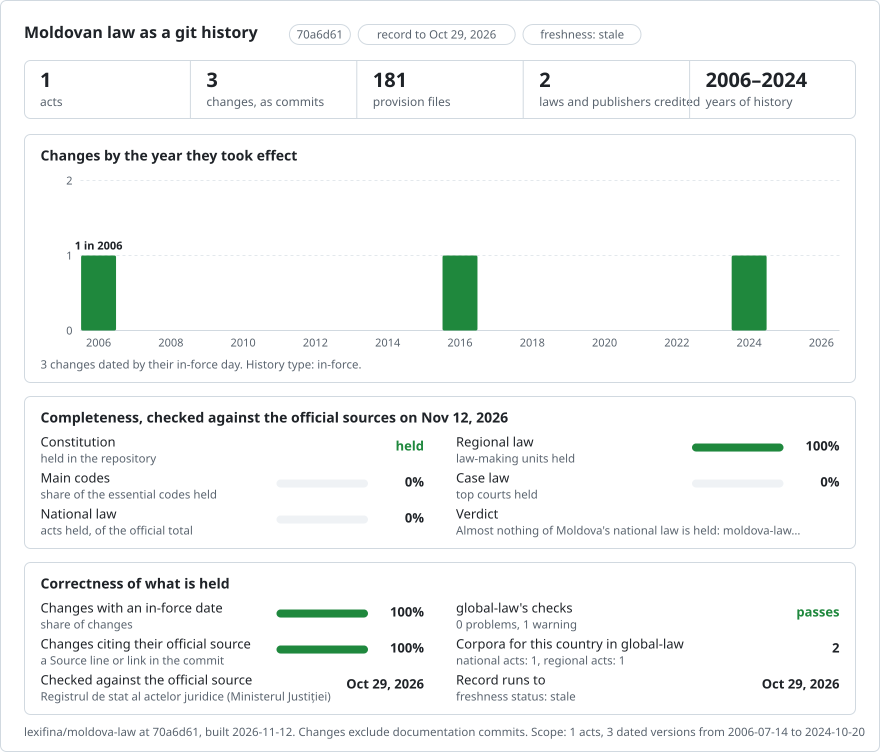

# Moldova: law history in git

[Română](README.md) · **English**

<picture>
<source media="(prefers-color-scheme: dark)" srcset="data/effort-dark.svg">

</picture>

Part of [lexifina/global-law](https://github.com/lexifina/global-law), one git history for every country's law: this is Moldova's national law, which global-law reads at `moldova/national/acts/`.

The law of the Republic of Moldova as a git history: one file per provision, one commit per change on the day it took effect, and the law or court judgment that made each change as the commit's author. `git blame` names the act behind a paragraph where the sources say which act it was; `git log` lists every change to an article; picking a date gives the text in force that day.

It follows the shared design of [lexifina/global-law](https://github.com/lexifina/global-law), which places it at `md/`. The texts are in Romanian (limba română), the official language, as the State Register of Legal Acts and the official Moldpres edition print them.

**What is in it now**

| Folder | Act | Versions | History |
| --- | --- | ---: | --- |
| `constitutia/` | Constituția Republicii Moldova (the Constitution of 29 July 1994) | 3 | The consolidated text as amended to 2006 (oldest version available); Constitutional Court judgment HCC7/2016 (4 March 2016); the official edition as amended to 20 October 2024 |

This repository was built from what can be read:

- the register's earlier home, **lex.justice.md** (Ministry of Justice), through Internet Archive captures (2008-2024). Its Constitution page is the consolidated text with notes naming the amending laws, up to 2006, and the notes it added for HCC7/2016;
- the **Constitutional Court judgment HCC7/2016** on that site, whose point 8 b) sets out the new text of Articles 78 and 89;
- the **Moldpres edition** "Constituția Republicii Moldova. Cu modificări și completări la data de 20 octombrie 2024" (Moldpres is the state agency that publishes the Monitorul Oficial), hosted as a PDF by the Presidency (presedinte.md).

## Questions as git commands

| Question | Command |
| --- | --- |
| What did Article 78 say on 1 January 2010? | `python tools/on.py 2010-01-01 constitutia art-078` |
| The same, with raw git (bash) | `git show $(git rev-list -1 --before="2010-01-01T23:59:59Z" main -- constitutia/art-078.md):constitutia/art-078.md` |
| The same, in PowerShell | `$r = git rev-list -1 --before="2010-01-01T23:59:59Z" main -- constitutia/art-078.md; git show "$($r):constitutia/art-078.md"` |
| Who wrote each paragraph of Article 89? | `git blame constitutia/art-089.md` |
| Every change to Article 13 (the language), word by word | `git log -p --word-diff constitutia/art-013.md` |
| Every change in order | `git log --reverse --format="%ad %an" --date=short main` |
| Everything HCC7/2016 changed | `git log --author="HCC7" --stat` |
| The whole Constitution on a date | `python tools/on.py 2020-01-01 constitutia` |

After a rebuild, refresh tags with `git fetch --force --tags`: a plain fetch keeps stale tags.

**Or ask in plain words.** The same record is free to use without git, an account or a key:

- **[Ask Claude about Moldovan law](https://global-law.lexifina.com/v1/try_claude?country=moldova&q=what%20does%20the%20Constitution%20%28Constitu%C8%9Bia%20Republicii%20Moldova%29%20say%20about%20the%20right%20to%20work%20%28art.%2043%29%20today%2C%20and%20which%20laws%20have%20changed%20the%20Constitution%20since%202006%3F%20Quote%20the%20words%20of%20the%20law%2C%20name%20the%20law%20behind%20each%20change%20with%20the%20day%20it%20took%20effect%2C%20and%20cite%20the%20official%20publisher%27s%20page.)**: one click opens Claude with a first question ready (the right to work in the Constitution, and how the Constitution has changed).
- **[Ask ChatGPT](https://global-law.lexifina.com/v1/try_chatgpt?country=moldova&q=what%20does%20the%20Constitution%20%28Constitu%C8%9Bia%20Republicii%20Moldova%29%20say%20about%20the%20right%20to%20work%20%28art.%2043%29%20today%2C%20and%20which%20laws%20have%20changed%20the%20Constitution%20since%202006%3F%20Quote%20the%20words%20of%20the%20law%2C%20name%20the%20law%20behind%20each%20change%20with%20the%20day%20it%20took%20effect%2C%20and%20cite%20the%20official%20publisher%27s%20page.)**: the same question in ChatGPT.
- **[Call the API in your browser](https://global-law.lexifina.com/v1/search_law?query=dreptul+la+munc%C4%83&jurisdictions=moldova)**: Moldovan law searched for "dreptul la muncă", answered as JSON. No key for 5 calls a minute; [every tool](https://global-law.lexifina.com/v1), [keys and documentation](https://lexifina.com/api).

The assistants read it through the free Global law connector (MCP, `https://global-law.lexifina.com/mcp`); the first time, the chat gives the link that adds it. In Claude, choose "Always allow" so that each look-up is not asked about. Ask in Romanian or in English.

## Dates

- Each commit is dated at **noon, Europe/Chisinau, on the day the change took effect**. The adoption and publication dates are trailers; the in-force day is in `In-force:`, which `tools/on.py` reads.
- **The Constitution** was adopted on 29 July 1994, published in the Monitorul Oficial nr. 1 on 12 August 1994, and took effect on 27 August 1994 (its Art. I). Its text as first adopted is not in any source this build could read, so the history starts at 14 July 2006.
- **14 July 2006**: the oldest version available, the register's consolidated text, which records every amendment up to Law 185-XVI of 29 June 2006, published on 14 July 2006. That law states no day of its own, so under Art. 76 of the Constitution it took effect on publication.
- **4 March 2016**: HCC7/2016 took effect on its adoption (its point 9), before its publication on 18 March 2016.
- **20 October 2024**: the date the Moldpres edition gives itself ("la data de 20 octombrie 2024"), the day of the referendum that adopted Law 244/2024.
- `--before="YYYY-MM-DD"` alone uses your clock's time of day; use `T23:59:59Z` as above, or the tool.

## How it is checked

- **The two register pages agree.** The 2016 register page is compared with the 2013 one used for the 2006 text: it may differ only in its HCC7 notes, in three units where its HTML is corrupted (Arts. 35, 75, 129), and in listed typo corrections; anything else stops the build.
- **The judgment is applied as written.** Articles 78 and 89 take the text that point 8 b) of HCC7/2016 sets out, and point 3's phrase is removed from Art. 85(4). Article 89 as built equals the 2024 edition word for word. Article 78 differs from it only by "limba de stat" becoming "limba română" (Law 52/2023), and Article 85 only by a spelling correction.
- **The 2024 text is the edition's own**, read from the PDF's text layer: every article, title, chapter and section, in order. The build checks that the edition names the seven amending acts it lists.
- Every version is read back from git on the day it took effect and on the day before (`tools/check_repo.py`); both must match `corpus.json`. Results are in `REPRODUCE.md`.
- Health checks: no merge commits on `main`, commit dates never go backwards, nothing is dated in the future, and every commit's trailers parse with `git interpret-trailers --parse`.
- The repository is rebuilt a second time from the same data and must give identical hashes.

## What "author" means

The author of a commit is the law or judgment that made the change, with an e-mail address that cannot exist (`hcc-7-2016@legis.invalid`), so `git blame` and `git log --author` name it. The committer is always Lexifina.

- **The first commit** is the oldest version available, credited to the State Register (the publisher). Its message names the acts that had already amended the text: the two 1994 corrections and Laws 957/1996, 1115/2000, 351/2001, 1469, 1470 and 1471/2002, 344/2003 and 185/2006.
- **Credits come only from the sources.** HCC7/2016 is credited with Articles 78, 85 and 89, the provisions its dispositive names.
- **The 2024 changes are not credited one by one.** Between 2016 and 2024 the Moldpres edition lists seven amending acts: Laws 256/2016, 70/2017, 255/2018 and 120/2021, Law 52/2023 (on the name of the language), the Constitutional Court judgment HCC8/2024, and Law 244/2024 (the European integration amendment, adopted by referendum). The edition gives no notes on which article each act changed, and their texts could not be read, so the 111 units that differ are one commit authored by the publisher and marked unexplained. The republished text also uses the current spelling ("â", "sunt") throughout, so nearly every article differs from 2016.
- Blame credits whole lines (one paragraph or lettered point per line); use `git log -p --word-diff` for the words.

## What it does not show

- **The 1994 text as adopted, and each amendment from 1994 to 2006 on its own day.** The register shows only the consolidated text, with notes such as "[Art.78 în redacția LP1115-XIV din 05.07.00]" but not the earlier words.
- **Each amendment from 2016 to 2024 on its own day** (see above), and **any change after the 2024 edition**. These need legis.md.
- **What the 2016 register page itself printed for Arts. 78, 85 and 89**: it kept the 2000 words and added notes. This history applies the judgment from the day it took effect instead.
- **Ordinary laws.** The Law on Personal Data Protection 133/2011 (repealed from 23 August 2026 by Law 195/2024), Law 195/2024 itself and the Criminal Code (985/2002) are not built. Their current texts are only on legis.md, and the archives hold only register pages from before 2019.
- **The Russian text.** Only the Romanian, official text is here.

## How it is built

Lexifina reads the sources listed here and records each act's dated versions, and the laws that made each change, in one corpus file. `tools/build.py` writes this repository from that file, and the same corpus always gives the same commit hashes; `REPRODUCE.md` gives the details and the checks. A model (Claude) wrote Lexifina's code; it wrote no legal text, and no model runs when the history is built.

No OCR was run, and no AI model wrote or changed legal text. Claude Opus 5.5 wrote the scripts and chose the sources; see `REPRODUCE.md`.

## Sources

| Source | Kind | Past versions by date | Names the amending act | API or bulk | Notes |
| --- | --- | --- | --- | --- | --- |
| [State Register of Legal Acts](https://www.legis.md) | Official legislation | yes (dated versions per act) | yes | no | – |
| [lex.justice.md](http://lex.justice.md/md/311496/) via the [Internet Archive](https://web.archive.org/) | The register's earlier home (Ministry of Justice) | consolidated text only | in notes, per article | no | Captures 2008-2024; the Constitution page stopped changing after 2016 |
| [Presidency: Constitution](https://presedinte.md/rom/constitutia-republicii-moldova) | Moldpres edition of 2024 (PDF, text layer) | no | lists the amending acts, not per article | no | ISBN 978-9975-3618-2-8 |
| [Monitorul Oficial](https://monitorul.gov.md) | Official Gazette (Moldpres) | each issue | yes | no | Issues from 2009 can be viewed online; downloading them is a paid subscription, so it is not used |

Research guides: [GlobaLex](https://www.nyulawglobal.org/globalex/) and the [Law Library of Congress Guide to Law Online](https://www.loc.gov/research-centers/law-library-of-congress/researcher-resources/guide-to-law-online/).

## Licence

Official texts such as laws and court judgments are not protected by copyright in Moldova (Law 139/2010 on copyright and related rights). The texts come from the State Register of Legal Acts (lex.justice.md, read through the Internet Archive) and from the Moldpres edition of the Constitution (2024). Lexifina's own contributions are dedicated to the public domain under CC0 1.0; see `LICENSE`.

This repository is not legal advice and is not an official publication.

## More

From [lexifina/global-law](https://github.com/lexifina/global-law):

- [FEATURES.md](https://github.com/lexifina/global-law/blob/main/FEATURES.md): every feature, and what every corpus must support (`git blame`, `law.py`, the MCP tools)
- [FAQ.md](https://github.com/lexifina/global-law/blob/main/FAQ.md): questions and answers · [CONTRIBUTING.md](https://github.com/lexifina/global-law/blob/main/CONTRIBUTING.md): proposing changes · [MCP.md](https://github.com/lexifina/global-law/blob/main/MCP.md): the MCP server · [REPRODUCE.md](https://github.com/lexifina/global-law/blob/main/REPRODUCE.md): how it was built · [CHANGELOG.md](https://github.com/lexifina/global-law/blob/main/CHANGELOG.md)
- [FRESHNESS.md](https://github.com/lexifina/global-law/blob/main/FRESHNESS.md): how current each corpus is · [Monitoring](https://github.com/lexifina/global-law/tree/main/monitoring): whether updates are running · [WATCHING.md](https://github.com/lexifina/global-law/blob/main/WATCHING.md): how each official source is watched for changes
- [performance/](https://github.com/lexifina/global-law/tree/main/performance): how fast the tools are, measured
- [visualisations/](https://github.com/lexifina/global-law/tree/main/visualisations): charts and bridges across the world's law
- [Vulnerabilities](https://github.com/lexifina/global-law/tree/main/vulnerabilities): mistakes in legislation as published
