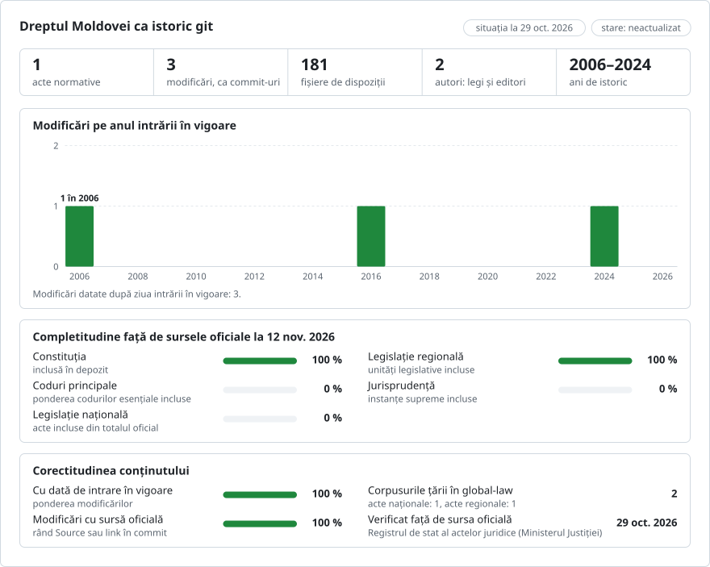

# Moldova: istoria dreptului în git

**Română** · **[Or read it in English](README.en.md)**

<picture>
<source media="(prefers-color-scheme: dark)" srcset="data/ro/effort-dark.svg">

</picture>

Dreptul Republicii Moldova ca istorie git: un fișier pentru fiecare articol, un commit pentru fiecare versiune, în ziua în care a intrat în vigoare, iar autorul fiecărui commit este actul care a făcut modificarea. `git blame` arată actul din spatele fiecărui alineat, acolo unde sursele spun care a fost acel act; `git log` enumeră fiecare modificare a unui articol; alegerea unei date dă textul în vigoare în acea zi.

Face parte din [lexifina/global-law](https://github.com/lexifina/global-law), o singură istorie git pentru dreptul tuturor țărilor: acesta este dreptul național al Republicii Moldova, pe care global-law îl citește la `moldova/national/acts/`.

**Ce conține acum:** Constituția din 29 iulie 1994, în 3 versiuni (14 iulie 2006, 4 martie 2016 și 20 octombrie 2024), cu 180 de dispoziții în cea mai recentă. Niciun alt act nu se află încă aici: nici legi sau coduri, nici acte locale, hotărâri judecătorești sau proiecte de lege. [`constitutia/README.md`](constitutia/README.md) enumeră fiecare dispoziție și de câte ori s-a modificat.

Constituția se află în `constitutia/`, cu un fișier pentru fiecare articol (`constitutia/art-078.md` este articolul 78, alegerea Președintelui); preambulul, titlurile, capitolele și secțiunile au fișiere proprii, iar articolele tranzitorii I-VIII sunt `tranz-01.md`-`tranz-08.md`.

Textul este în limba română, limba oficială, așa cum îl tipăresc Registrul de stat al actelor juridice și ediția oficială Moldpres. Textul în limba rusă și o traducere în engleză nu fac parte din această evidență.

## Întrebări ca comenzi git

| Întrebare | Comandă |
| --- | --- |
| Fiecare modificare a articolului 78 din Constituție | `git log -p --word-diff -- constitutia/art-078.md` |
| Ce act a scris fiecare rând al articolului 78? | `git blame constitutia/art-078.md` |
| Fiecare versiune a Constituției, cu ziua în care a intrat în vigoare | `git log --format="%h %(trailers:key=In-force,valueonly,separator=) %an" -- constitutia ':!constitutia/README.md'` |
| Articolul 78 în forma în vigoare la 1 ianuarie 2010 | `python tools/on.py 2010-01-01 constitutia art-078` |

**În afara git**, oferim această evidență și public, gratuit:

- **[Întrebați Claude despre dreptul Republicii Moldova](https://global-law.lexifina.com/v1/try_claude?country=moldova)**: deschide Claude cu o primă întrebare pregătită.
- **[Întrebați ChatGPT](https://global-law.lexifina.com/v1/try_chatgpt?country=moldova)**: aceeași întrebare în ChatGPT.
- **[Căutați în dreptul Republicii Moldova pe site-ul nostru](https://lexifina.com/law?country=moldova&q=concediul+de+odihn%C4%83)**: o căutare după „concediul de odihnă”, cu textul fiecărui articol și versiunile lui, fără cont.
- **[API REST pentru dezvoltatori](https://global-law.lexifina.com/v1/search_law?query=concediul+de+odihn%C4%83&jurisdiction=moldova)**: aceeași căutare în JSON, fără cheie. Documentația este [aici](https://lexifina.com/api/global-law).

Ambii asistenți citesc evidența prin conectorul gratuit Global law (MCP, `https://global-law.lexifina.com/mcp`); prima dată, conversația vă oferă linkul care îl adaugă. Întrebați în română sau în engleză.

**Ușor de rulat chiar de dumneavoastră.** Sunt de ajuns git și Python, iar instrumentele rulează pe calculatorul dumneavoastră:

```sh
git clone --depth 1 https://github.com/lexifina/global-law && cd global-law
python3 tools/countries.py add moldova/national/acts
python3 tools/law.py show 2026-01-01 moldova/national/acts/constitutia/art-078.md
```

Deschisă în Claude Code, Cursor, VS Code sau Codex, clona pornește și un server MCP local cu aceleași instrumente ([MCP.md](https://github.com/lexifina/global-law/blob/main/MCP.md)).

## Datare

Fiecare commit este datat la prânz, ora Chișinăului (Europe/Chisinau), în ziua în care versiunea a intrat în vigoare, și poartă această zi în trailerul `In-force:`:

- o lege intră în vigoare la data prevăzută în textul ei sau, în lipsa acesteia, la data publicării în Monitorul Oficial (art. 76 din Constituție); o hotărâre a Curții Constituționale, la data stabilită în propriul text (HCC7/2016: la adoptare, 4 martie 2016, cu două săptămâni înainte de publicare);
- prima versiune este datată 14 iulie 2006, ziua publicării Legii nr. 185-XVI, ultima modificare cuprinsă în textul consolidat al registrului; aceasta nu stabilește o dată proprie;
- versiunea din 2024 poartă data pe care și-o atribuie ediția Moldpres, 20 octombrie 2024, ziua referendumului prin care a fost adoptată Legea nr. 244/2024.

Prima versiune este „cea mai veche versiune disponibilă”, atribuită Registrului de stat (editorul), iar mesajul ei numește cele două rectificări din 1994 și cele opt legi din anii 1996-2006 pe care le cuprinde deja. Hotărârii HCC7/2016 îi sunt atribuite articolele 78, 85 și 89. Ediția din 2024 enumeră șapte acte de modificare de după 2016, dar nu și articolul modificat de fiecare, așa că cele 111 dispoziții modificate formează un singur commit, atribuit editorului și marcat ca neexplicat.

## Cum se verifică

- Fiecare versiune este recitită din git în ziua în care a intrat în vigoare și în ziua precedentă (`tools/check_repo.py`) și trebuie să corespundă corpusului; rezultatele se află în [`REPRODUCE.md`](REPRODUCE.md).
- Pagina registrului din 2016 este comparată cu pagina din 2013, care dă textul din 2006: ele pot diferi doar prin notele privind HCC7, prin trei unități al căror HTML este corupt (art. 35, 75 și 129) și prin corecturile de greșeli de tipar enumerate.
- HCC7/2016 este aplicată așa cum este scrisă: articolele 78 și 89 primesc textul stabilit la punctul 8 lit. b), iar sintagma eliminată de punctul 3 dispare din art. 85 alin. (4); articolul 89, așa cum este construit, este identic cuvânt cu cuvânt cu ediția din 2024. Textul din 2024 este citit din stratul de text al PDF-ului ediției, fără OCR.
- Istoria doar se completează: niciun commit de tip merge, datele commiturilor nu merg niciodată înapoi, nimic nu este datat în viitor, iar trailerele fiecărui commit sunt valide.

## Ce nu arată

- **Textul adoptat în 1994 și fiecare modificare din anii 1994-2006 la data ei.** Registrul arăta doar textul consolidat, cu note care numesc legile de modificare, dar fără formulările anterioare.
- **Fiecare modificare din anii 2016-2024 la data ei și orice modificare ulterioară ediției din 2024.** Pentru acestea este nevoie de registrul actual, legis.md, pe care această construcție nu l-a putut citi.
- **Ce a tipărit pagina registrului din 2016 pentru art. 78, 85 și 89.** Aceasta a păstrat formulările din 2000, cu note; această istorie aplică hotărârea de la data intrării ei în vigoare.
- **Orice altă lege.** Legile și codurile (Codul muncii, Codul penal și celelalte), actele locale, hotărârile judecătorești și proiectele de lege nu sunt încă construite.

## Surse

| Sursă | Tip | Versiuni anterioare | Note |
| --- | --- | --- | --- |
| [lex.justice.md](https://web.archive.org/web/20130527162646/http://lex.justice.md:80/index.php?action=view&view=doc&lang=1&id=311496), prin Internet Archive | Fosta adresă a Registrului de stat al actelor juridice (Ministerul Justiției) | doar textul consolidat, cu note care numesc legile de modificare | Textul din 2006 (captura din 2013) și [HCC7/2016](https://web.archive.org/web/20160831022417/http://lex.justice.md/md/363742/) (captura din 2016) |
| [Ediția Moldpres a Constituției](https://presedinte.md/app/webroot/Constitutia_RM/Constitutia_2024_ro.pdf), găzduită de Președinție | Ediție oficială, cu modificările până la 20 octombrie 2024 | nu | Enumeră actele de modificare, dar nu și articolul modificat de fiecare |

## Licență

Vezi [`LICENSE`](LICENSE). Legile și hotărârile judecătorești nu sunt obiecte ale dreptului de autor în Republica Moldova (Legea nr. 139/2010 privind dreptul de autor și drepturile conexe); contribuțiile proprii ale Lexifina (organizarea istoriei, mesajele de commit, tabelele și instrumentele) sunt dedicate domeniului public (CC0 1.0).

Niciun model AI nu a scris, tradus sau corectat text juridic și niciunul nu rulează la generarea istoriei; scripturile au fost scrise de un model AI (vezi [`REPRODUCE.md`](REPRODUCE.md)).

Aceasta este o traducere a versiunii în engleză ([README.en.md](README.en.md)); dacă diferă, prevalează versiunea în engleză.

## Mai multe

Din depozitul [lexifina/global-law](https://github.com/lexifina/global-law) (pagini în engleză):

- [FEATURES.md](https://github.com/lexifina/global-law/blob/main/FEATURES.md): toate funcțiile și ce trebuie să suporte fiecare corpus (`git blame`, `law.py`, instrumente MCP)
- [FAQ.md](https://github.com/lexifina/global-law/blob/main/FAQ.md): întrebări și răspunsuri · [CONTRIBUTING.md](https://github.com/lexifina/global-law/blob/main/CONTRIBUTING.md): propunerea de modificări · [MCP.md](https://github.com/lexifina/global-law/blob/main/MCP.md): serverul MCP · [REPRODUCE.md](https://github.com/lexifina/global-law/blob/main/REPRODUCE.md): cum a fost construit · [CHANGELOG.md](https://github.com/lexifina/global-law/blob/main/CHANGELOG.md)
- [FRESHNESS.md](https://github.com/lexifina/global-law/blob/main/FRESHNESS.md): cât de actualizat este fiecare corpus · [Monitorizare](https://github.com/lexifina/global-law/tree/main/monitoring): dacă actualizările funcționează · [WATCHING.md](https://github.com/lexifina/global-law/blob/main/WATCHING.md): cum este urmărită fiecare sursă oficială pentru modificări
- [performance/](https://github.com/lexifina/global-law/tree/main/performance): cât de rapide sunt instrumentele, măsurat
- [visualisations/](https://github.com/lexifina/global-law/tree/main/visualisations): grafice și legături în dreptul întregii lumi
- [Vulnerabilități](https://github.com/lexifina/global-law/tree/main/vulnerabilities): erori în actele normative așa cum au fost publicate
