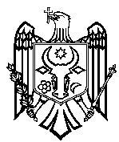

 

CONSILIUL 
CONCURENŢEI 
СОВЕТ ПО 
КОНКУРЕНЦИИ 
 
 
 
PLENUL CONSILIULUI CONCURENŢEI 
 
Decizie 
 
 
nr. CCE – 09-12/11                                                                             mun. Chişinău             
din 27.12.2012 
 
Plenul Consiliului Concurenţei,  
examinînd cererea Cooperativei Agricole de Producţie „Basarabia” referitor la semnele 
încălcării legislaţiei cu privire la protecţia concurenţei de către Consiliul sătesc Hîrbovăţ, r-nul 
Anenii Noi, raportul de investigaţie şi materialele anexate, 
acţionând în temeiul art. 41 şi a art. 93 al Legii Concurenţei nr. 183 din 11.07.2012,  
 
A CONSTATAT: 
1. 
Consiliul Administrativ al Agenţiei Naţionale pentru Protecţia Concurenţei, la 
cererea CAP „Basarabia” din 21.03.2012, a dispus prin Dispoziţia nr.09 din 29 martie 2012 
iniţierea investigaţiei referitor la semnele încălcării prevederilor art. 9 al Legii nr. 1103-XIV din 30 
iunie 2000 cu privire la protecţia concurenţei de către Consiliul sătesc Hîrbovăţ. 
Acţiunea reclamată de către CAP „Basarabia” constituie emiterea de către Consiliul sătesc 
Hîrbovăţ a Deciziei nr. 04-06 din 30 decembrie 2011 „Cu privire la stabilirea taxelor locale, pentru 
anul 2012” în partea ce ţine de stabilirea taxei locale pentru unitate comercială faţă de CAP 
„Basarabia”. 
2. 
Cooperativa Agricolă de Producţie „Basarabia” (în continuare CAP „Basarabia”) 
este o întreprindere înfiinţată de persoane fizice, care s-au asociat benevol în scopul desfăşurării în 
comun a activităţii de producţie şi a altei activităţi economice bazate preponderent pe munca 
personală a membrilor ei şi pe cooperarea cotelor de participare la capitalul cooperativei (conform 
Statutului). 
În anul 2001, ca rezultat al deciziei Adunării Generale a Acţionarilor, SA „Basarabia” a fost 
reorganizată în cooperativă agricolă de producţie. 
CAP „Basarabia” este o gospodărie multiramurală care produce cereale, seminţe de floarea 
soarelui, legume, struguri, fructe, producţie conservată. Este amplasată şi activează pe teritoriul s. 
Hîrbovăţ, r-nul Anenii Noi. Gospodăria produce, prelucrează şi comercializează producţia agricolă 
proprie. 
Consiliul sătesc Hîrbovăţ este autoritatea reprezentativă şi deliberativă a populaţiei unităţii 
administrativ-teritoriale de nivelul întîi, aleasă în vederea soluţionării problemelor de interes local. 
Printre competenţele de bază ale consiliilor locale, potrivit Legii nr. 436 din 28 decembrie 
2006 privind administraţia publică locală, face parte şi dreptul de iniţiativă şi de a decide, în 
condiţiile legii, în toate problemele de interes local, cu excepţia celor care ţin de competenţa altor 
autorităţi publice. 
Pornind de la domeniile de activitate ale autorităţilor administraţiei publice locale de nivelul 
întîi, stabilite la art.4 al Legii nr. 435 din 28 decembrie 2006 privind descentralizarea 
administrativă, printre activităţile Consiliului local, sunt incluse: 
a) administrarea bunurilor domeniului public şi ale celui privat ale satului (comunei), 
oraşului (municipiului); 
b) decide punerea în aplicare şi modificarea, în limitele competenţei sale, a impozitelor şi 
 
 

taxelor locale, a modului şi a termenelor de plată a acestora, precum şi acordarea de facilităţi pe 
parcursul anului bugetar, etc. 
Conform Codului Fiscal, taxele locale sunt aplicate de către autorităţile administraţiei 
publice locale, iar cota acestora este stabilită de către aceleaşi autorităţi, în funcţie de 
caracteristicile obiectelor impunerii. 
3. 
Piaţa relevantă - potrivit Legii concurenţei nr. 183 din 11 iulie 2012, reprezintă 
piaţa în cadrul căreia trebuie evaluată o anumită problemă de concurenţă şi care se determină prin 
raportarea pieţei relevante a produsului la piaţa geografică relevantă. 
Piaţa relevantă a produsului - ţinînd cont de acţiunea reclamată, este piaţa privind 
comercializarea producţiei agricole, reieşind din faptul că Decizia nr. 04-06 din data de 30 
decembrie 2011 se referă la procedura aplicării taxei locale pentru desfăşurarea activităţii de 
comerţ. 
Potrivit Anexei nr. 2 al Deciziei nr. 04-06 din data de 30 decembrie 2011, taxele pentru 
activităţile desfăşurate de către unităţile comerciale şi/sau de prestări servicii de deservire socială 
se aplică pe teritoriul satului Hîrbovăţ, r-nul Anenii Noi. Prin urmare, piaţa geografică 
relevantă este determinată ca fiind limitele unităţii teritorial- administrative unde întreprinderea 
desfăşoară activitatea sa comercială - satul Hîrbovăţ, r-nul Anii Noi. 
Piaţa relevantă constă în comercializarea producţiei agricole pe teritoriul satului 
Hîrbovăţ, r-nul Anenii Noi. 
4. 
Conform sesizării depuse, CAP „Basarabia” susţine că: Consiliul sătesc 
Hîrbovăţ, la data de 30.12.2011, prin Decizia nr. 04-06 a stabilit pentru cooperativa dată taxa 
pentru unitate comercială pe anul 2012 în sumă de 65000 lei. Primarul şi o parte din consilieri 
considerînd-o ca unitate comercială. 
Iniţial, în proiectul de decizie pentru CAP „Basarabia” a fost prevăzută taxa de 500 lei. 
Anii precedenţi CAP „Basarabia" achita taxa de 500 lei pentru o unitate, considerată de primărie 
comercială, în realitate însă, o secţiune a depozitului de produse alimentare a gospodăriei de unde 
în timpul a trei linii de sezon se eliberează tomate, preponderent în contul salariului lucrătorilor 
gospodăriei şi în contul plăţii pentru arenda patrimoniului agricol.  
În aceeaşi ordine de idei, CAP „Basarabia” menţionează şi faptul că: în proiectul deciziei, 
pentru alte unităţi, cu adevărat comerciale din sat (baruri, magazine etc.), sînt prevăzute taxe la 
nivelul anului precedent. În decizia finală […] taxele au fost esenţial micşorate. Iar pentru alte 
formaţiuni agricole din teritoriu, careva taxe în această privinţă nu au fost stabilite în genere. Un 
Regulament concret în această privinţa, pînă în prezent, nu este adoptat de Consiliul local şi nici 
explicaţii verbale din partea Primăriei, referitor la decizia data, nu au fost prezentate. 
Astfel, prin acţiunile sale. Consiliul sătesc Hîrbovăţ, r-nul Anenii Noi încălcă prevederile 
alin. (3) a art. 4 şi lit.(c), alin.(1) a art. 9 al Legii nr. 1103 din 30.06.2000 cu privire la protecţia 
concurenţei.  
5. 
La solicitarea informaţiei de către ANPC referitor la presupusele unităţi comerciale 
deţinute prin intermediul cărora îşi realizează producţia sa agricolă (ex: magazin specializat, 
gheretă, tarabă, ect.), cu menţionarea suprafeţei acesteia, CAP „Basarabia” susţine că nu a creat 
unităţi comerciale, nu a avut necesitate şi nu a depus către Administraţia Publică Locală careva 
cereri pentru a i se elibera autorizaţie de amplasare a unităţii comerciale şi, prin urmare, nu 
dispune de asemenea autorizaţie. Producţia proprie o livrează direct din cîmp sau din depozitele de 
care dispune către alţi agenţi economici sau consumatori, proprietarilor de cote valorice şi de teren 
agricol, ca plată pentru arendă, în baza contractelor, precum şi cantităţi neînsemnate în contul 
salariului. 
În acelaşi timp, CAP „Basarabia” s-a adresat la data de 03.02.2012 cu o cerere prealabilă 
către Consiliul sătesc Hîrbovăţ, cît şi cu cerere de chemare în judecată cu privire la contenciosul 
administrativ, cu referire la modificarea taxei locale stabilite de către Consiliul sătesc în decizia nr. 
04-06 din 30.12.2011 „Cu privire la stabilirea taxelor locale pentru anul 2012”. 
În rezultatul examinării cererii depuse la data de 03.02.2012, Consiliul sătesc Hîrbovăţ a 
adoptat o nouă decizie nr. 05-11 din data de 28.03.2012 „Cu privire la anularea deciziei Consiliului 
sătesc Hîrbovăţ”, prin care taxa stabilită anterior Cooperativei în cauză a rămas neschimbată. 
Examinarea cererii în judecată s-a soldat doar cu modificarea primei decizii, care însă nu a 
 

produs careva modificări taxei ce urmează a fi percepută de la CAP „Basarabia”. 
Astfel, Cooperativa s-a adresat repetat către Consiliul sătesc Hîrbovăţ şi în instanţa de 
judecată, cu referire la modificarea şi concretizarea acţiunii CAP „Basarabia” de la data de 
14.02.2012 cu privire la contenciosul administrativ, cea din urmă aflîndu-se în examinare. 
Consiliul sătesc Hîrbovăţ la şedinţa din 19.06.2012, fără a pune în discuţie problema 
invocată de către CAP „Basarabia", a modificat ultima decizie a sa cu privire la taxele locale şi 
regulamentul acesteia a fost completat cu o anexă care include lista unităţilor comerciale şi/sau de 
prestări servicii de deservire socială, conform clasificării după profilul de activitate, amplasare şi 
suprafaţa de comerţ. 
În acest context, Cooperativa susţine că (ţinînd cont de depozitele de care dispune şi de 
întreaga gospodărie) nu întruneşte criteriile specificate de legislaţia R. Moldova, în special alin. (2) 
al art. 2 şi art. 3 al Legii nr. 231 din 23 septembrie 2010 cu privire la comerţul interior, alin.(4) al 
art.288 din Codul fiscal, pentru a putea fi calificată drept unitate comercială. 
CAP „Basarabia” invocă şi momentul potrivit căruia poziţia 6 - întreprinderi situate în 
centrul localităţii, precum au clasificat-o pe CAP „Basarabia” (în cazul lipsei unităţilor comerciale 
în centrul localităţii şi în pofida faptului că doar sediul gospodăriei este în centru, depozitele ei 
fiind la periferie şi majoritatea în extravilanul localităţii), cu suprafaţa mai mare de 50,1 m2, 
urmează să achite taxa de 65000 lei, iar la poziţiile 14,16,17 din anexă, agenţii economici care 
dispun de unităţi comerciale situate în centrul localităţii şi au o suprafaţă de pînă la 70m2 (adică 
mai mult de 50,l m2), vor plăti de la 1800 pînă la 3000 lei. 
În aceeaşi ordine de idei, CAP „Basarabia” a prezentat informaţii cu privire la deţinerea 
maşinilor de casă şi control, subdiviziunile unde acestea se aplică şi poziţionarea lor pe harta 
satului Hîrbovăţ. 
Astfel, aceasta deţine două maşini de casă şi control, una fiind amplasată la moară (situată 
la periferia satului), cealaltă - la oficiu (amplasat în centrul localităţii), fapt confirmat şi de 
Inspectoratul Fiscal de Stat pe raionul Anenii Noi. 
6. 
Consiliul sătesc Hîrbovăţ (la solicitarea ANPC referitor la argumentarea legală care 
a stat la baza stabilirii taxei locale pentru CAP „Basarabia”, adoptată prin Decizia Consiliului 
sătesc Hîrbovăţ nr. 04-06 din 30.12.2011 şi lista cooperativelor agricole de producţie care practică 
activităţi similare cooperativei sus-menţionate) a menţionat faptul că CAP „Basarabia” a depus o 
cerere prealabilă referitor la modificarea taxei locale. Astfel, în urma examinării cererii respective, 
la data de 28 martie 2012 fost adoptată decizia nr. 05-11 conform căreia taxa stabilită anterior a 
rămas neschimbată. 
Totodată, Consiliul sătesc Hîrbovăţ a indicat criteriile care au stat la baza stabilirii taxei 
locale pentru unităţile comerciale şi/sau de prestării servicii de deservire socială - profilul de 
activitate (genurile de activitate desfăşurate de agentul economic); suprafaţa de comerţ; amplasarea 
obiectului (în centrul localităţii ori la periferie). 
Conform prevederilor alin.e) al art. 291 Cod Fiscal, baza impozabilă la stabilirea taxei 
pentru unităţile comerciale şi/sau de prestări servicii de deservire socială, cu excepţia celor care se 
află total în zona de protecţie a drumurilor, se determină în dependenţă de: suprafaţa ocupată de 
unităţile de comerţ şi/sau de prestări servicii de deservire socială, amplasarea lor, tipul mărfurilor 
desfăcute şi serviciilor prestate. 
Cît priveşte amplasarea CAP „Basarabia”, Consiliul sătesc a stabilit în anexa nr. 2 a deciziei 
Consiliului sătesc Hîrbovăţ nr. 06-03 din 19.06.2012 pentru modificarea Regulamentului cu privire 
la stabilirea şi aplicarea taxelor locale din teritoriul UAT pentru anul 2012, zona de centru a satului, 
drept teritoriu unde aceasta îşi desfăşoară activitatea, iar alţi agenţi economici care ar desfăşură 
activităţi similare ei  nefiind înregistraţi pe teritoriul satului Hîrbovăţ. 
7. 
În rezultatul examinării materialelor prezentate de CAP „Basarabia” şi Consiliul 
sătesc Hîrbovăţ referitor la amplasarea Cooperativei, s-a constatat că în centrul localităţii se află 
birourile deţinute de CAP „Basarabia” (contabilitatea, secţia de cadre, sala de şedinţe, comitetul 
sindical, etc) cu o suprafaţa de 187,2 m2, pe cînd depozitele acesteia sînt situate la periferiile 
satului. 
În art. 3 al Legii nr. 231 din 23 septembrie 2010 cu privire la comerţul interior, unitatea 
comercială este definită ca fiind spaţiul în care au loc procesele operative de circulaţie a 
mărfurilor/serviciilor (primirea, depozitarea şi vînzarea), iar suprafaţa de vînzare - suprafaţa 
 
 

destinată accesului consumatorilor pentru cumpărarea produsului/serviciului, pentru expunerea 
produselor oferite, pentru plata acestora şi pentru circulaţia personalului angajat în vederea 
desfăşurării activităţii. 
Conform informaţiei prezentate de către CAP „Basarabia”, procesul de vînzare şi respectiv 
procurare a mărfii se desfăşoară nemijlocit la depozitele acesteia, nu în centrul localităţii, cum s-a 
stabilit în Anexei nr. 2 a Deciziei Consiliului sătesc Hîrbovăţ nr. 06-03 din 19.06.2012.  
Totodată, în Legea nr. 231 din 23 septembrie 2010 cu privire la comerţul interior e stabilit 
că nu constituie suprafeţe de vînzare, suprafeţele destinate recepţiei, depozitării, prelucrării şi 
păstrării mărfurilor sau producţiei, precum şi cele destinate birourilor şi anexelor. 
Prin urmare, sub incidenţa criteriului sus-menţionat (amplasarea obiectului) din Anexa nr. 2 
a Deciziei Consiliului sătesc Hîrbovăţ nr. 06-03 din 19.06.2012, a fost inclusă suprafaţa birourilor, 
evaluată ca fiind mai mare de 50,l m2 din centrul localităţii în cadrul cărora nu se desfăşoară 
activitate comercială. 
8. 
De menţionat faptul că, la momentul depunerii cererii de către CAP „Basarabia” şi 
ulterior a adoptării de către CA al ANPC a Dispoziţiei nr. 09 din 29.03.2012  privind semnele 
încălcării legislaţiei concurenţiale, au fost aplicate prevederile Legii nr. 1103-XIV din 30 iunie 
2000 cu privire la protecţia concurenţei.  
Odată cu intrarea în vigoare a Legii concurenţei nr. 183 din 11 iulie 2012, a fost abrogată 
Legea nr. 1103-XIV cu privire la protecţia concurenţei. 
Conform alin. (5) al art. 93 din Legea concurenţei nr. 183 din 11 iulie 2012, plîngerile şi 
cauzele ale căror proceduri de examinare de către Agenţia Naţională pentru Protecţia Concurenţei 
nu s-au încheiat pînă la data intrării în vigoare a prezentei legi, se examinează conform normelor de 
procedură prevăzute de prezenta lege şi normelor materiale, inclusiv celor privind răspunderea 
pentru încălcarea legislaţiei concurenţiale, prevăzute de legea în vigoare la data comiterii încălcării. 
Astfel, acţiunile invocate de către CAP „Basarabia” vor fi calificate prin prisma 
prevederilor legii noi. 
9. 
În conformitate cu  prevederile art. 59 al Legii concurenţei nr. 183 din 11.07.2012, 
Consiliul Concurenţei a transmis spre informare copia raportul de investigaţie, oferind, astfel, 
posibilitatea Consiliului sătesc Hărbovăţ şi CAP „Basarabia”, de a prezenta observaţii asupra 
acestuia, în termen de 30 de zile lucrătoare.  
Consiliul sătesc Hîrbovăţ a prezentat observaţiile asupra raportului de investigaţie. Întru 
argumentarea poziţiei sale, au fost prezentate materiale care au fost furnizate anterior şi utilizate în 
cadrul investigaţiei şi constatării acţiunilor în cauză.  
Practicarea activităţii de comerţ fără a deţine autorizaţie, nu poate figura drept temei legal la 
aplicarea taxei locale pentru unitate comercială. Altfel nu se explică faptul estimării sumei stabilite 
drept taxă locală Cooperativei-  65000 lei. 
Desfăşurarea activităţii de întreprinzător fără autorizaţie, licenţă sau certificat, eliberate de 
autoritatea competentă, este sancţionată de organele de control financiar şi fiscal ale Ministerului 
Finanţelor. 
Aceste momente sunt invocate, întrucît Consiliul sătesc Hîrbovăţ a evaluat activitatea 
Cooperativei sub aspectul unei unităţi comerciale, fără ca aceasta să deţină autorizaţia în cauză. 
Totodată, Consiliul sătesc Hîrbovăţ a anexat şi materiale prin care Oficiul Teritorial 
Căuşeni al Cancelariei de Stat s-a expus asupra legalităţii Deciziilor nr. 04-06 din 30.12.2011 şi nr. 
06-03 din 19.06.2012 declarîndu-le drept legale. 
La rîndul său, CAP „Basarabia” a comunicat despre lipsa de obiecţii şi propuneri pe 
marginea raportului în cauză. 
10. 
Potrivit alin. (1), lit. d) al art. 9 din Legea 1103-XIV din 30 iunie 2000, autorităţile 
administraţiei publice nu au dreptul să stabilească condiţii discriminatorii sau de privilegiere pentru 
activitatea unor agenţi economici. 
Astfel, acţiunea invocată cade sub incidenţa prevederilor alin. (1), lit. d) al art. 9 din Legea 
1103-XIV din 30 iunie 2000 - aplicarea condiţiilor discriminatorii pentru activitatea desfăşurată de 
către CAP „Basarabia” în raport cu agenţii economici aflaţi pe teritoriul satului Hîrbovăţ. 
Totodată, datorită faptului că Decizia Consiliului sătesc Hîrbovăţ nr. 06-03 din 19.06.2012 
„Cu privire la modificarea deciziei Consiliului sătesc nr. 04-06 din 30.12.2011 „Cu privire la taxele 
locale pentru anul 2012” nu a fost anulată şi continuă să producă efecte juridice şi după intrarea în 
 

vigoare a Legii concurenţei nr. 183 din 11 iulie 2012, acţiunea invocată de către CAP „Basarabia” 
cade sub incidenţa prevederilor alin. (1), lit. b) al art. 12 al Legii date.  
Potrivit alin. (1), lit. b) al art. 12 din Legea concurenţei nr. 183 din 11 iulie 2012, 
autorităţile administraţiei publice nu sunt în drept să stabilească condiţii discriminatorii sau de 
acordare a privilegiilor pentru activitatea întreprinderilor, în cazul în care acestea nu sunt prevăzute 
de lege. Consiliul sătesc Hîrbovăţ întruneşte condiţiile de subiect al prevederilor art. 12 al legii 
date.  
Codul fiscal, în alin. (8) al art.6 indică principiile aplicate la stabilirea impozitelor şi taxelor 
fiscale care, la lit. c) prevede principiul echităţii fiscale - tratare egală a persoanelor fizice şi 
juridice, care activează în condiţii similare, în vederea asigurării unei sarcini fiscale egale 
Luînd în considerare circumstanţele expuse, în acţiunile Consiliului sătesc Hîrbovăţ 
manifestate prin emiterea Deciziei nr. 04-06 din 30 decembrie 2011 „Cu privire la stabilirea taxelor 
locale pentru anul 2012” este prezentă latura obiectivă a componenţei de încălcare descrisă la lit. b) 
alin. (1) a art. 12 al Legii Concurenţei nr. 183 din  11.07.2012, din motiv că Consiliul sătesc 
Hărbovăţ: 
- 
ca criteriu de bază la stabilirea taxei locale pentru unitate comercială, a inclus 
suprafaţa birourilor din centrul localităţii în cadrul cărora nu se desfăşoară activitate comercială; 
- 
a evaluat activitatea CAP „Basarabia” sub aspectul unei unităţi comerciale, fără ca 
aceasta să deţină autorizaţia în cauză, aplicîndu-i taxa locală pentru unitate comercială. 
ţinînd cont de cele constatate, Plenul Consiliului Concurenţei, în temeiul art. 41 al Legii 
Concurenţei nr.183 din 11 iulie 2012, 
 
DECIDE: 
 
1. 
A califica acţiunile Consiliului sătesc Hîrbovăţ, manifestate prin stabilirea 
condiţiilor discriminatorii pentru activitatea desfăşurată de CAP „Basarabia”, 
prin emiterea deciziei nr. 06-03 din 19.06.2012 „Cu privire la modificarea 
deciziei Consiliului sătesc nr. 04-06 din 30.12.2011 „Cu privire la taxele locale 
pentru anul 2012” ca acte ale autorităţilor administraţiei publice care limitează 
concurenţa prevăzute la lit.b) alin.(1) al art. 12 din Legea concurenţei nr. 183 din 
11 iulie 2012; 
2. 
A emite o prescripţie faţă de Consiliului sătesc Hîrbovăţ, referitor la anularea în 
parte a Deciziei nr. 06-03 din 19.06.2012 „Cu privire la modificarea deciziei 
Consiliului sătesc nr. 04-06 din 30.12.2011 „Cu privire la taxele locale pentru 
anul 2012”, în partea ce ţine de  stabilirea taxei locale în mărime de 65000 lei 
pentru unitate comercială şi/sau de prestări servicii de deservire socială, faţă de 
CAP „Basarabia”; 
3. 
Prezenta Decizie intră în vigoare la data adoptării şi va fi adusă la cunoştinţa 
părţilor. 
 
 
Preşedintele 
Plenului Consiliului Concurenţei                                                         Viorica CĂRARE 
 
 
