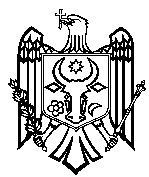

 
СОВЕТ ПО  
КОНКУРЕНЦИИ 
CONSILIUL 
 CONCURENŢEI 
 
PLENUL CONSILIULUI CONCURENŢEI 
 
DECIZIE 
 
 
Nr. APD – 73                                                                                  mun. Chişinău 
din 24.12.2015 
 
Plenul Consiliului Concurenţei, 
 
acționând în temeiul art. 41 alin. (1) lit. h) şi art. 93 alin. (5) ale Legii 
concurenţei nr. 183 din 11.07.2012, Hotărârii Parlamentului nr. 179 din 
12.07.2013 privind numirea în funcţie a membrilor Plenului Consiliului 
Concurenţei, precum și Hotărârii Parlamentului nr. 220 din 27.09.2013 privind 
numirea în funcţie a unui membru al Plenului Consiliului Concurenţei,   
 
analizând raportul de investigaţie asupra cazului iniţiat prin Dispoziţia 
Consiliului Administrativ al Agenţiei Naţionale pentru Protecţia Concurenţei nr. 
APD – 14 din 15.03.2010, observaţiile făcute de părţi asupra raportului de 
investigaţie şi materialele acumulate în cadrul investigaţiei, 
 
A CONSTATAT: 
 
Prin Dispoziţia Consiliului Administrativ al Agenţiei Naţionale pentru 
Protecţia Concurenţei nr. APD – 14 din 15.03.2010 a fost iniţiat controlul de stat 
asupra respectării legislaţiei din domeniul concurenţei în cadrul asigurării 
transportului internaţional de mărfuri sub acoperirea carnetului TIR.  
 
Scopul exercitării controlului de stat constituie elucidarea faptului 
respectării legislaţiei concurenţiale, în cazul în care asigurarea posesorilor 
carnetelor TIR se efectuează doar la SAR „MOLDCARGO” SA.  
I. Părțile implicate 
 
Asociația Internațională a Transportatorilor Auto din Moldova 
(AITA), IDNO 1002600005831, mun. Chişinău, str. Dimitrie Cantemir 3/1 - este 
o organizaţie nonguvernamentală, necomercială profesionistă care întruneşte 
întreprinderile şi organizaţiile de transport din Republica Moldova care 
efectuează transportul auto internaţional de mărfuri şi pasageri. 
Conform capitolului 3 pct. 1 din statutul AITA, prezentat de Ministerul 
Justiției al Republicii Moldova prin scrisoarea nr. 05/3791 din 17.04.2015, AITA 
 
1 
 

este asociația națională garantă a aplicării în Republica Moldova a Convenției 
vamale relativă la transportul internaţional de mărfuri sub acoperirea carnetelor 
TIR în forma adoptată la Geneva la 14.11.1975 (în continuare Convenția TIR), 
ratificată prin Hotărârea Parlamentului Republicii Moldova nr. 1318-XII din 
02.03.1993. 
Rolul AITA este de a reprezenta şi apăra membrii săi în relaţiile cu 
organele naţionale şi internaţionale din domeniu în cadrul funcţiilor sale. 
AITA este membru a Uniunii Internaţionale a Transportatorilor Auto 
(IRU) cu sediul la Geneva (Elveția).şi a Federaţiei Internaţionale a Asociaţiei 
Expeditorilor (FIATA) cu sediul la Zürich (Elveția). 
Asociaţia participă la pregătirea şi realizarea proiectelor naţionale şi 
internaţionale care au legătură cu transportul auto internaţional, inclusiv 
„Revederea Convenţiei vamale relativă la transportul internaţional al mărfurilor 
sub acoperirea carnetelor TIR” adoptată la Geneva la 14.11.1975. 
AITA reprezintă interesele transportatorilor din Republica Moldova în 
lucrul organelor de transport a Comisiei Europene Economice din cadrul 
Organizaţiei Naţiunilor Unite şi Uniunea Internaţională a Transportului Auto, 
menţine relaţii cu alte asociaţii naţionale. 
Mai mult de 200 de întreprinderi şi organizaţii beneficiază de serviciile 
prestate de Asociaţie în diverse direcții, cum ar fi: 
• Asigură transportatorii din Republica Moldova cu cartele TIR-Carnets şi 
cartele de passage. 
• Asigură elucidarea conflictelor din reglementările legate de utilizarea 
sistemului TIR. 
•  Asigură reprezentarea transportatorului auto naţional sau internaţional 
care efectuează operaţiuni de transport pe teritoriul Republicii Moldova 
însoţite de carnetul TIR etc. 
Societatea de asigurări - reasigurări „MOLDCARGO” SA (în 
continuare SAR „MOLDCARGO” SA), IDNO 1002600005819, mun. Chişinău, 
str. V. Alecsandri, 97 – societate fondată în octombrie 1999 de către AITA, firme 
de transport internațional din Republica Moldova și persoane fizice. 
Fondatorul majoritar al SAR „MOLDCARGO” SA este AITA. Scopul 
principal urmărit de către societate este oferirea unor servicii de asigurare noi şi 
de calitate pentru societăţile de transport şi expediţie, care activează în sfera 
transporturilor internaţionale, pentru firme turistice, instituţii financiare şi pentru 
persoanele fizice. SAR „MOLDCARGO” SA oferă diverse tipuri de asigurări, 
printre care și asigurarea responsabilităţii titularului carnetului TIR. 
 
2 
 

SAR „MOLDCARGO” SA deţine Licenţa seria CNPF nr. 000660, 
eliberată la 30.05.2011, pentru desfăşurarea activităţii de asigurare şi/sau 
reasigurare în limitele categoriilor şi claselor de asigurare. 
Astfel, conform licenței la clasa de asigurare nr. 10 se conțin următoarele 
prevederi: „condiţii de asigurare a responsabilităţii titularului carnetului TIR la 
efectuarea transporturilor în cadrul Convenției vamale relativă la transportul 
internațional al mărfurilor sub acoperirea carnetelor TIR”. 
Potrivit informației prezentate de AITA în scrisoarea nr. 219 din 
24.04.2014, începând cu anul 2000 și până în prezent, SAR „MOLDCARGO” 
SA prestează servicii de asigurare a posesorilor carnetelor TIR. Prin urmare, 
consumatori ai serviciului de asigurare acordat de SAR „MOLDCARGO” SA 
sunt întreprinderile de transport (transportatorii) titulari ai carnetelor TIR. 
 
II. Piaţa relevantă: piaţa relevantă a produsului şi piaţa geografică 
relevantă 
Piaţa relevantă a produsului  
În conformitate cu art. 4 al Legii concurenței nr. 183 din 11.07.2012, piaţa 
relevantă a produsului cuprinde toate produsele considerate de consumatori ca 
interschimbabile sau substituibile datorită utilizării date acestora, datorită 
caracteristicilor fizice, funcţionale şi a preţului. 
Ținând cont de faptul că prin Dispoziţia Consiliului Administrativ al 
Agenţiei Naţionale pentru Protecţia Concurenţei nr. APD – 14 din 15.03.2010 a 
fost iniţiat controlul de stat asupra respectării legislaţiei cu privire la protecţia 
concurenţei în cadrul asigurării transportului internaţional de mărfuri sub 
acoperirea carnetului TIR și ținând cont că asigurarea în cauză nu este o 
asigurare în formă clasică, ci o asigurare care garantează rambursarea 
cheltuielilor, suportate de participanții Lanțului internațional de garanție, piața 
relevantă a produsului în cazul investigat se definește ca piața prestării 
serviciilor de asigurare a posesorilor carnetelor TIR. 
Piaţa geografică relevantă 
Conform art. 4 al Legii concurenței nr. 183 din 11.07.2012, piaţă 
geografică relevantă reprezintă o zonă în care întreprinderile sunt implicate în 
oferta sau cererea de pe piaţa relevantă a produsului, în care condiţiile de 
concurenţă sunt suficient de omogene şi care poate fi deosebită de zonele 
geografice învecinate prin condiţii de concurenţă ce diferă în mod apreciabil. 
Astfel, potrivit capitolului III pct. 3 al Regulamentului cu privire la modul 
de aplicare a Convenţiei vamale relativă la transportul internaţional de mărfuri 
sub acoperirea carnetului TIR aprobat prin Hotărârea Guvernului nr. 1086 din 
25.11.1997, în Republica Moldova carnetele TIR sunt eliberate de către AITA. 
 
3 
 

 Dat fiind faptul că eliberarea carnetelor TIR pe teritoriul Republicii 
Moldova se efectuează de AITA, iar asigurarea posesorilor Carnetelor TIR se 
efectuează doar la SAR „MOLDCARGO” SA, care își desfășoară activitatea pe 
teritoriul Republicii Moldova, piaţa geografică relevantă se defineşte ca 
teritoriul Republicii Moldova. 
Prin urmare, în sensul cazului investigat piața relevantă se definește ca 
piața prestării serviciilor de asigurare a posesorilor carnetelor TIR pe teritoriul 
Republicii Moldova. 
Poziția dominantă 
Conform capitolului IV pct. 1 din Regulamentului cu privire la modul de 
aplicare a Convenţiei vamale relativă la transportul internaţional de mărfuri sub 
acoperirea carnetului TIR aprobat prin Hotărârea Guvernului nr. 1086 din 
25.11.1997, în Republica Moldova la tranzitul şi livrarea mărfurilor sub 
supraveghere vamală cu respectarea procedurii TIR, asociaţia garantă este AITA. 
De asemenea, capitolul III pct. 3 al aceluiași Regulament prevede că în 
Republica Moldova carnetele TIR sunt eliberate de către AITA. 
Prin urmare, din cele menționate mai sus rezultă faptul că pe teritoriul 
Republicii Moldova carnetele TIR sunt eliberate doar de către AITA. 
 
Potrivit informației prezentate de AITA în scrisoarea nr. 219 din 
24.04.2014, începând cu anul 2000 și până în prezent, asigurarea posesorilor 
carnetelor TIR se efectuează doar la SAR „MOLDCARGO” SA. Astfel, ținând 
cont de faptul SAR „MOLDCARGO” SA este singura companie care realizează 
asigurarea posesorilor de carnetelor TIR (similar ca în Federația Rusă, Ucraina, 
România unde la fel este o singură companie de asigurări) se constată că SAR 
„MOLDCARGO” SA deține poziție dominată pe piața prestării serviciilor de 
asigurare a posesorilor carnetelor TIR pe teritoriul Republicii Moldova, având o 
cotă de 100% pe această piața. 
 
III. Acte şi fapte constatate 
 
În urma studierii cadrului normativ, precum şi în rezultatul examinării 
informaţiilor și materialelor anexate la dosar, s-a constatat următoarele. 
 
Convenţia vamală relativă la transportul internaţional de mărfuri sub 
acoperirea carnetelor TIR adoptată la 14.11.1975, Geneva, (în continuare 
Convenția TIR) ratificată prin Hotărârea Parlamentului Republicii Moldova nr. 
1318-XII din 02.03.1993, reglementează procedura tranzitului vamal. Scopul 
Convenţiei TIR este de a simplifica şi de a armoniza facilităţile administrative, 
de frontieră (vamale) în cazul transporturilor de mărfuri pe teritoriul statelor ce 
au aprobat utilizarea carnetului TIR. 
Astfel, art. 2 al Convenției TIR prevede că, Convenția privește transportul 
mărfurilor efectuat fără descărcare și reîncărcare, peste una sau mai multe 
 
4 
 

frontiere, de la un birou vamal de plecare al unei parți contractante, sau al 
aceleiași părți contractante până la un birou vamal de destinație al unei părți 
contractante, sau al aceleiași părți contractante, în vehicule rutiere, ansambluri 
de vehicule sau în containere, cu condiția că o parte din traseu între începutul 
operațiunii TIR si terminarea ei să fie un traseu rutier. 
De asemenea, art. 5 alin. (1) al Convenției TIR prevede că mărfurile 
transportate sub regim TIR în vehicule rutiere, în ansambluri de vehicule sau în 
containere sigilate nu vor fi, de regulă, supuse controlului vamal la birourile de 
trecere. 
 
Prin urmare, transportul internațional de mărfuri sub acoperirea carnetului 
TIR este un tip de transport internațional de mărfuri specific deoarece, 
transportul mărfurilor este efectuat fără descărcare și reîncărcare acestora la 
trecerea peste una sau mai multe frontiere, de la un birou vamal de plecare până 
la un birou vamal de destinație, iar mărfurile transportate sub regim TIR în 
vehicule rutiere, în ansambluri de vehicule sau în containere sigilate nu sunt, de 
regulă, supuse controlului vamal la birourile de trecere. 
 
Pentru a beneficia de dispoziţiile Convenţiei TIR transporturile trebuie să 
aibă loc sub garanţia asociaţiilor agreate conform dispoziţiilor art. 6 al 
Convenției TIR şi trebuie să fie efectuate sub acoperirea unui carnet TIR, 
conform modelului reprodus în anexa nr. 1 a Convenţiei TIR. 
 
Republica Moldova a aderat la Convenţia TIR prin Hotărârea 
Parlamentului Republicii Moldova nr. 1318-XII din 02.03.1993. 
 
Ulterior, prin Hotărârea Guvernului Republicii Moldova nr. 501 din 
30.05.1997 cu privire la măsurile de realizare a prevederilor Convenţiei vamale 
privind aplicarea carnetelor TIR, a fost desemnată Asociaţia Internaţională a 
Transportatorilor Auto din Moldova în calitate de asociaţie garant a Republicii 
Moldova în cadrul Convenţiei TIR. 
 Conform capitolului IV pct. 1 din Regulamentul cu privire la modul de 
aplicare a Convenţiei vamale relativă la transportul internaţional de mărfuri sub 
acoperirea carnetului TIR aprobat prin Hotărârea Guvernului nr. 1086 din 
25.11.1997, în Republica Moldova la tranzitul şi livrarea mărfurilor sub 
supraveghere vamală cu respectarea procedurii TIR, asociaţia garantă este AITA. 
De asemenea, capitolul III pct. 3 a aceluiași regulament prevede că în Republica 
Moldova carnetele TIR sunt eliberate de către AITA. 
 
Carnetul TIR este un act vamal internaţional, care însoţeşte mărfurile pe 
drumul pe care acestea îl urmează şi serveşte drept confirmare a faptului că 
pentru mărfurile transportate există o garanţie internaţională de achitare a 
plăţilor vamale. Transportarea mărfurilor însoţită de carnetul TIR oferă 
posibilitatea de a evita necesitatea supunerii unui control fizic minuţios al 
 
5 
 

mărfurilor în statele de tranzit, aplicarea garanţiilor naţionale şi de a reduce un 
asemenea control la verificarea ştampilelor, a sigiliilor şi a aspectului extern al 
secţiei de mărfuri sau a containerului. 
 
Sistemul TIR, elaborat prin Convenţia TIR, oferă operatorilor de transport 
facilităţi importante pentru transportul şi comerţul internaţional. Acest sistem se 
bazează pe Convenţia TIR a ONU, care este implementată de către Uniunea 
Internaţională a Transporturilor Rutiere. 
 
Uniunea Internaţională a Transporturilor Rutiere este responsabilă de 
organizarea şi funcţionarea eficientă a Lanţului internaţional de garanţii. În acest 
sens IRU a stabilit reguli obligatorii pentru fiecare asociaţie emiţătoare şi 
operator de transport. 
 
Un operator de transport, care foloseşte Sistemul TIR este: 
- responsabil direct în faţa autorităţilor vamale pentru utilizarea corectă a 
Carnetului TIR şi achitarea taxelor şi impozitelor vamale, în cazul unei 
încălcări în timpul efectuării transportului TIR; 
- responsabil în faţa Lanţului internaţional de garanţii TIR, gestionat de 
către IRU, Geneva, deoarece a primit o garanţie financiară pe care IRU o 
acordă autorităţilor vamale pentru acesta. 
 
Fiecare asociaţie naţională trebuie să-şi respecte obligaţiile faţă de IRU 
legate de furnizarea acoperirii obligaţiunilor fiecărui titular de carnet TIR cu o 
poliţă generală de asigurare pentru toate carnetele TIR, emise de asociaţia 
respectivă. 
 
Atunci când un operator TIR – titular de carnet TIR – nu-şi respectă 
obligaţiile directe faţă de autorităţile vamale şi nu va soluţiona cazul prin 
demonstrarea încheierii corecte a unei operaţiuni TIR sau prin achitarea directă a 
taxei şi impozitului corespunzător, reclamaţia vamală este expediată Lanţului 
internaţional de garanţii TIR. Succesiunea în care entitățile implicate în Lanţul 
internaţional de garanţii TIR poartă răspundere față de autoritățile vamale este 
următoarea: Asociația garantă națională (AITA) - Uniunea Internaţională a 
Transporturilor Rutiere - Compania Internațională de asigurare - Compania 
națională de asigurare - Titularul carnetului TIR. 
 
Astfel, în cazul în care un titular de carnet TIR nu îşi respectă obligaţiile, 
IRU poate fi obligată – în calitate de garant financiar - să achite reclamaţia, şi 
poate încerca să-şi recupereze pierderile prin intermediul Lanţului internaţional 
de garanţii TIR de la persoanele care au utilizat greşit carnetul TIR şi acest lucru 
a cauzat pierderi. 
Prin scrisoarea nr. 219 din 24.04.2014 AITA a comunicat că, potrivit 
articolelor 31 și 32 ale Actului de Angajament al Asociației Garante și Emitente 
a Carnetelor TIR Obișnuite, semnat între AITA și IRU la data de 01.01.2008, 
 
6 
 

asociația trebuie să asigure faptul că fiecare titular de carnet TIR va fi acoperit 
de o poliță de asigurare. Asociaţia naţională poate adera la poliţă de asigurare la 
nivel central negociată de IRU, sau îşi poate alege asigurătorul naţional, care 
trebuie să fie aprobat oficial de către IRU şi partenerii săi de asigurări şi 
reasigurări – membri ai Lanţului internaţional de garanţii TIR.  
În altă ordine de idei, se constată că, în Explicațiile sale prezentate prin 
scrisoarea AITA nr. 128 din 27.04.2010, IRU a comunicat că nu desemnează în 
mod unilateral și formal asigurătorii naționali în nici una din țări. Asociația 
națională prezintă IRU informația cu privire la o potențială companie națională 
de asigurări, după aceasta IRU împreună cu toți partenerii de asigurări și 
reasigurări din Lanțul internațional de garanții TIR revizuiește solicitantul, luând 
în considerare cunoștințele sale despre trăsăturile sistemului TIR și stabilitatea 
sa financiară care are o importanță semnificativă. 
Contractul de asigurare a posesorilor de carnete TIR se încheie între 
asociația națională garantă și asiguratorul național. Asigurarea naţională acoperă 
în mod exclusiv, în anumite condiţii, responsabilitatea titularului faţă de Lanţul 
internaţional de garanţii TIR, în privinţa taxelor şi impozitelor vamale, conform 
art. 8 al Convenţiei TIR, înaintată de Lanţul internaţional de garanţii TIR. 
Prin scrisoarea nr. 219 din 24.04.2014, AITA a comunicat că asigurarea în 
cauză nu este o asigurare în formă clasică, ci mai degrabă o garanție de 
rambursare a cheltuielilor, suportate de participanții Lanțului internațional de 
garanție. Acest lucru este demonstrat prin faptul că condițiile de asigurare, 
elaborate de IRU, sunt aceleași pentru asigurătorii naționali în toate țările-
membre ale Convenției, și sunt obligatorii pentru a fi îndeplinite. 
Toate reclamațiile organelor vamale sunt examinate de IRU, iar decizia 
privind recunoașterea cazului a fi unul asigurat la fel este luată de IRU. Prin 
urmare asigurătorul nu are dreptul de a refuza plata despăgubirii de asigurare 
dacă IRU a decis că cererea autorităților vamale este justificată și a plătit pentru 
aceasta. De asemenea asigurătorul nu are nici o influență asupra examinării 
cererilor de despăgubire și nu poate face modificări la termenii standard și 
condițiile elaborate de IRU. 
 
Termenii contractului de asigurare, stabiliți de IRU, presupun că acest 
contract acoperă angajamentele pentru toate carnetele TIR emise de Asociația 
garantă. În același timp, contractul de asigurare este perfectat odată în an de 
compania națională de asigurare, aprobată de asociația garantă, IRU și 
reasigurătorii internaționali.  
 
În vederea minimizării riscurilor sistemului TIR, pentru asigurare în fiecare 
țară este responsabil un singur asigurător (similar cu răspunderea față de 
 
7 
 

autoritățile vamale, care poartă o singură Asociația garantă, Lanțul de garanție 
are un singur asigurător național). 
 
Pentru a asigura durabilitatea sistemului TIR şi luând în considerare 
natura specifică şi sofisticată a sistemului TIR, precum şi volumul riscului 
financiar potenţial, fiecare membru al Lanţului internaţional de garanţii TIR 
este obligat să-şi reasigure parţial sau integral riscul la o piaţă din Londra 
(Lloyd’ s Underwriters), prin intermediul brokerului lor autorizat R. L. 
DAVISON & Co Ltd. Aceasta este o cerinţă obligatorie pentru orice asigurător 
naţional, care activează în cadrul sistemului TIR şi are ca scop acordarea 
securităţii financiare a sistemului internaţional de garanţii gestionat de IRU.   
 
Prin scrisoarea nr. 219 din 24.04.2014 AITA a comunicat că până în 1995 
asigurătorul național în Republica Moldova a fost compania „ORATEH” SRL, 
care a refuzat să îndeplinească obligațiunea sa de a rambursa sumele 
reclamațiilor vamale, plătite de Lanțul internațional de garanții, și a rambursat 
pierderile numai prin hotărâre judecătorească. După aceasta, contractul cu 
compania dată a fost reziliat. 
 
De asemenea, AITA a informat că în anul 1995, contractul de asigurare a 
riscurilor TIR a fost semnat cu compania „ASITO” SA, însă și cu compania 
„ASITO” SA au avut probleme la gestionarea acoperirii de asigurări, dar pe o 
scară mai mare. 
 
Având în vedere această situație, AITA, în noiembrie 1999, cu acordul 
IRU și a tuturor participanților la Lanțului internațional de garanție, a încheiat 
contractul de asigurare pentru anul 2000 cu societate de asigurări-reasigurări 
„MOLDCARGO” SA, care a trecut procedura de agrementare a asigurătorului 
național, elaborată de IRU. Această decizie a fost justificată, deoarece „ASITO” 
SA nu și-a îndeplinit mai târziu obligațiile față de Lanțul internațional de 
garanții TIR. 
 
De asemenea, prin scrisoarea nr. 219 din 24.04.2014, AITA a comunicat 
că, din anul 2000 până în prezent, SAR „MOLDCARGO” SA  are calitatea de 
asigurător național în cadrul sistemului TIR, și își îndeplinește toate obligațiile 
față de reasigurătorii internaționali, cât și față de Lanțul internațional de 
garanție, referitor la despăgubiri și regres.  
 
Astfel, în prezent în Republica Moldova ca urmare a selectării de către 
AITA în anul 1999 a SAR „MOLDCARGO” SA  în calitate de asigurător 
național, în fiecare an AITA încheie cu SAR „MOLDCARGO” SA contractul 
de asigurare a posesorilor de carnete TIR. La rândul său SAR 
„MOLDCARGO” SA în calitate de asigurator național în cadrul Lanțului 
internațional de garanții, în fiecare an încheie un contract de reasigurare cu 
compania Rosgosstrakh Ltd. 
 
8 
 

 
Prin scrisoarea nr. 1663 din 07.09.2015 SAR „MOLDCARGO” SA a 
remis copia contractului de asigurare nr. 01-15/TIR/AITA din 16.12.2014 
încheiat între AITA și SAR „MOLDCARGO” SA. Potrivit pct. 11.1. din 
contractul nr. 01-15/TIR/AITA din 16.12.2014, contractul de asigurare este 
valabil în perioada stabilită în confirmarea asigurării. Polița de asigurare poate fi 
anulată fie prin clauza 31/32 sau de către asociația contractantă prin trimiterea 
unei scrisori de informare cu cel puțin șase luni înainte de expirare. În caz 
contrar, polița va fi reînnoită în mod automat de la an la an. 
Cuantumul primei de asigurarea variază în dependență de numărul de 
voleți ai carnetului TIR. Astfel, în prezent prima de asigurare aferentă carnetelor 
TIR variază între suma de 9,8 și 13,05 CHF (Franci Elvețieni), în dependență de 
numărul de voleți a carnetului TIR.1 
Astfel, SAR „MOLDCARGO” SA în calitate de asigurător național, 
percepe prima de asigurare aferentă carnetului TIR. Însă, conform cerințelor 
stabilite de prevederile care reglementează funcționarea sistemului TIR, SAR 
SAR „MOLDCARGO” SA în fiecare an încheie un contract de reasigurare cu 
compania Rosgosstrakh Ltd. Prin scrisoarea nr. 1663 din 07.09.2015 SAR 
„MOLDCARGO” SA a remis copia contractului de reasigurare nr. 01-
15/TIR/AITA din 16.12.2014 încheiat între SAR „MOLDCARGO” SA și 
compania Rosgosstrakh Ltd. Din prevederile contractului de reasigurare nr. 01-
15/TIR/AITA din 16.12.2014 reiese faptul prima de asigurare aferentă fiecărui 
carnet TIR este obligatorie, iar cuantumul ei trebuie să fie aprobat de IRU, 
reasigurători și Miller Insurance Service LLP. 
De asemenea, contractului  de reasigurare nr. 01-15/TIR/AITA din 
16.12.2014 stabilește modul de repartizare a cuantumul primei de asigurare 
aferentă carnetelor TIR. Astfel cea mai mare parte a cuantumul primei de 
asigurare aferentă carnetelor TIR o constituie prima de reasigurare care se 
achitată de către SAR „MOLDCARGO” SA companiei Rosgosstrakh Ltd, la 
care se mai adaugă prima de asigurare stabilită conform clauzei 31/32 din actul 
de angajament și alte costuri adiționale pe care le percepe SAR 
„MOLDCARGO” SA. 
 
În ceea ce priveşte sistemul de asigurări şi reasigurări, aplicat de în cadrul 
sistemului TIR, AITA, prin scrisoarea nr. 128 din 27.04.2010, a comunicat că, în 
scopul asigurării transparenţei procesului de lucru a sistemului TIR şi a ridicării 
nivelului capacităţii de conducere a IRU, se aplică principiul uniformităţii şi a 
unicităţii reprezentanţei: în fiecare ţară funcţionarea sistemului TIR este 
organizată într-un mod unic pentru participantul la Convenţie (în afara organelor 
                                                 
1 http://www.aita.md/index.php/ro/component/content/article/14-proiecte/290-pretul-carnetelor-tir 
 
9 
 

vamale naţionale, în calitate de garant al sistemului TIR, este desemnată o 
singură Asociaţie garantă naţională, iar problemele de asigurare sunt dirijate de 
către un singur asigurător naţional). 
 
Prin respectarea principiului (o singură Asociaţie Garantă naţională şi un 
singur asigurător naţional) sistemul TIR a fost implementat în 58 de ţări care au 
semnat Convenţia TIR, printre care în Federaţia Rusă asociație garantă este 
ASMAR, în Ucraina AsMAPua, în Polonia ZMPD, în Bulgaria AEBTRI, în 
Turcia TOBB, în Franța AFTRI, în Lituania LINAVA, în Italia UICCIAA, în 
România ARTRI, în Germania AIST, etc. În ceea ce privește asiguratorul 
național se constată că în Federația Rusă este Compania de asigurări „000 
Ingosstrakh”, în Ucraina Compania de asigurări „Перша Страховая 
Компания”, În România - Brokerul de asigurări „Global Risk Services-
Insurance Broker SRL”. 
Luând în considerare cele menţionate mai sus, cerinţa privind existenţa în 
fiecare ţară doar a unui asigurător naţional de asigurare TIR, care trebuie să 
obţină aprobarea IRU şi a asigurătorilor reasigurătorilor internaţionali din cadrul 
Lanţului internaţional de garanţii, este importantă pentru funcţionarea eficace a 
sistemului TIR.  
 
Prin scrisoarea nr. 219 din 24.04.2014, AITA a comunicat că atunci când 
se alege un asigurător național, Asociația AITA și IRU sunt ghidate de 
următoarele criterii: societatea are experiență în asigurarea răspunderii 
operatorilor de transport rutier și riscurile TIR, precum și personalul familiarizat 
cu aceste tipuri de asigurări, stabilitate financiară, cunoașterea funcționarii 
sistemului TIR, posibilitate de a asigura procesele din cadrul companiei în 
conformitate cu cerințele IRU (aplicarea principiului „singura fereastra” pentru 
deservirea contractului de asigurare, reglementarea reclamațiilor, recuperării în 
ordine de regres, controlul termenelor de plata la toate etapele, etc.). 
 
În conformitate cu procedura stabilită de IRU, asociația prezintă IRU și 
participanților Lanțului de garanție o candidatură pentru aprobare la rolul 
asigurătorului național (documentele constitutive, situațiile financiare, licențe, 
informațiile de profil, structura companiei, disponibilitatea cunoștințelor privind 
activitatea TIR). 
 
Pentru participanții Lanțului de garanție, este foarte important ca 
asigurătorul național să stabilească relații strânse de încredere cu Asociația 
națională garantă și toți partenerii Lanțului internațional de garanție, pentru a 
asigura funcționarea corespunzătoare a sistemului de garanție, să fie fiabil, cât și 
să posede o experiență substanțială și încrederea participanților Lanțului. IRU 
trebuie sa știe exact cine este plătitorul recuperării, să fie încrezut în îndeplinirea 
 
10 
 

obligațiilor sale. Având în vedere numărul țărilor participante, este binevenită 
continuarea relațiilor pe termen lung cu asigurătorul național.  
Această garanție de rambursare ușurează obținerea și fluxul de documente 
între participanții Lanțului de garanție, precum și asistența contractelor de 
asigurare, ceea ce permite IRU să monitorizeze tranzacțiile financiare la etapele 
de plata a primelor, decontărilor cu reasigurătorii, despăgubirea de asigurare, 
recuperarea sumelor prin acțiunea în regres, etc. În cazul în care schimbarea 
asigurătorului național este cauzată din motive obiective semnificative, 
candidatul pentru rolul de asigurător național nou, odată cu accesul la asigurare 
riscurilor TIR, își asuma obligațiile referitor la toate perioadele de asigurare 
anterioare. Aceasta confirmă, de asemenea, că asigurarea TIR este un sistem de 
garanție (de asigurare) financiară și nu este o asigurare în stil clasic. 
 
Prin scrisoarea nr. 52 din 24.02.2010, AITA a prezentat ca anexă 
Explicațiile prezentate de IRU privind funcționarea sistemului de asigurări TIR 
la nivel național și internațional la data de 29.01.2010.  
 
Astfel, din punctul de vedere al IRU, AITA și-a îndeplinit întotdeauna 
obligațiile, cu privire la următoarele: 
• Acoperirea financiară a responsabilităților tuturor titularilor de Carnet TIR 
față de Lanțul internațional de garanții TIR prin negocierea unei polițe 
separate de asigurare cu SAR „MOLDCARGO” SA. 
• Acoperirea financiară acordată de către SAR „MOLDCARGO” SA 
corespunde integral termenilor și condițiilor IRU. 
• Textul poliței de asigurare, eliberate de  SAR „MOLDCARGO” SA, și 
activitatea zilnică a acestei companii de asigurări coincid deplin cu 
Condițiile Standard de Asigurări Internaționale ale IRU, aplicate de toate 
asociațiile. 
• Angajații SAR „MOLDCARGO” SA au beneficiat de cursuri de formare 
profesională, pentru a atinge nivelul necesar de înțelegere a modului în 
care funcționează Sistemul TIR, și au demonstrat că dețin cunoștințe și 
experiență corespunzătoare în acest domeniu. 
 
De asemenea, în Explicațiile prezentate de IRU privind funcționarea 
sistemului de asigurări TIR la nivel național și internațional la data de 
29.01.2010, se menționează că Lanțul internațional de garanții TIR, gestionat de 
către IRU, oferă garanții financiare pentru fiecare carnet TIR eliberat de 
asociațiile naționale cu suma totală de câteva miliarde dolari SUA pe an. Pentru 
a acorda astfel de garanții, este esențial de a avea un sistem eficient și centralizat 
și de a colabora cu parteneri de încredere, care au experiență vastă și 
credibilitate, cunoscută tuturor. 
 
11 
 

 
Obligația principală a IRU este de a menține credibilitatea financiară a 
sistemului internațional de garanții prin segregarea strictă a tuturor partenerilor 
săi financiari. 
 
La fel, în Explicațiile IRU prezentate prin scrisorile AITA nr. 52 din 
24.02.2010 și nr. 219 din 24.04.2014, se menționează că managementul 
entităților, care în prezent participă la Lanțul de garanții în 58 de state membre a 
Convenției TIR, presupune proceduri stricte de management. Iar existența 
câtorva parteneri naționali (de exemplu - asigurători) într-o țară, poate duce la 
dublarea procedurilor de management și la crearea unei birocrații 
netransparente, care ar putea pune în pericol funcționarea și securitatea 
întregului Lanț internațional de garanții TIR. 
 
Mai mult ca atât, IRU a statuat că, atunci când reclamațiile vamale sunt 
prezentate după 2 - 5 ani, sau chiar mai mult, de la eliberarea unui carnet TIR, 
asigurătorii nu întotdeauna dispun de mijloace financiare pentru a acoperi suma 
solicitată din cauza lipsei resurselor potrivite. Aceasta poate duce la situația când 
Lanțul internațional de garanții TIR își poate pierde încrederea în piața națională 
de asigurări, ceea ce poate pune în pericol funcționalitatea sistemului TIR în 
Republica Moldova. 
 
În altă ordine de idei, cu referire la faptul că asigurarea posesorilor 
carnetelor TIR se efectuează doar la SAR „MOLDCARGO” SA companiile de 
asigurări au comunicat următoarele: 
1. Compania de asigurări „Grawe Carat Asigurări” SA, prin scrisoarea nr. 
1445/10 din 29.09.2010, a comunicat că nu consideră că acest fapt este 
rezultatul unor practici abuzive ale societății de asigurări SAR 
„MOLDCARGO” SA, ci o lipsă de interes a celorlalţi prestatori faţă de 
aceste servicii. Concomitent, compania de asigurări „Grawe Carat 
Asigurări” SA a informat ANPC că nu a avut nici o tentativă de a intra pe 
piaţa asigurării posesorilor de carnete TIR. 
2. Societatea de asigurări - reasigurări „Donaris Group” SA, prin scrisoarea 
nr. 05/1107 din 27.09.2010, a comunicat că evaluează negativ faptul că 
asigurarea posesorilor carnetelor TIR se efectuează doar de o singură 
companie de asigurare. În acelaşi timp, însă, a comunicat ANPC că nu a 
întreprins careva tentative de a intra pe piaţa respectivă şi nu dispune de 
licenţă. 
3. Compania internaţională de asigurări „ASITO” SA, prin scrisoarea nr. 03-
1/1B-230 din 23.09.2010, a confirmat faptul că până în anul 1998 
inclusiv, perioada în care a fost fondată SAR „MOLDCARGO” SA, a 
contractat asigurarea de răspundere a deţinătorilor de carnete TIR. 
Ulterior, noua companie a preluat în totalitate portofoliul de asigurări de 
 
12 
 

răspundere a deţinătorilor de carnet TIR, utilizând abuziv în acest scop 
pârghiile administrative şi alte procedee neloiale. Materiale probatorii, 
întru susţinerea celor invocate, nu au fost prezentate. În prezent, compania 
internaţională de asigurări „ASITO” SA nu încheie contracte de asigurare 
a deţinătorilor de carnete TIR şi nici nu dispune de licenţa respectivă.  
4. Compania de asigurări „Victoria Asigurări” SA, prin scrisoarea nr. 177-
2012 din 20.03.2012, a comunicat faptul că domeniul dat trebuie să fie 
demonopolizat, să se ofere posibilitatea participanților la piața asigurărilor 
să activeze concurențial. În acelaşi timp, însă, a comunicat că nu a 
întreprins careva tentative de a intra pe piaţa respectivă, însă în scurt timp 
intenționează să depună tot efortul pentru a se dezvolta și în asigurarea 
transportului internațional de mărfuri sub acoperirea carnetului TIR. 
5. Societatea de asigurări „ACORD GRUP” SRL, prin scrisoarea nr. 61.12 
din 16.03.2012, a comunicat că evaluează negativ faptul că asigurarea 
posesorilor carnetelor TIR se efectuează doar de o singură companie de 
asigurare, deoarece piața autohtonă de asigurări cunoaște mai mulți 
operatori economici, care au capacitatea economică de a subscrie 
riscurilor și de a presta servicii de asigurare la un nivel înalt și calitativ. 
6. Societatea de asigurări „MOLDOVA-ASTROVAZ” SRL, prin scrisoarea 
nr. 482 din 25.03.2012, a comunicat faptul că asigurarea posesorilor 
carnetelor TIR doar de către o singură companie de asigurare vine în 
contradicție cu principiile de concurență loială. De asemenea, 
„MOLDOVA-ASTROVAZ” SRL a mai comunicat faptul că nu a 
întreprins careva măsuri privind asigurarea răspunderii transportatorilor în 
baza carnetului TIR. În caz de demonopolizare a pieței în acest domeniu 
va fi gata pentru a practica tipul dat de asigurare.  
 
Mai mult ca atât ei au comunicat că colaborează cu un șir de transportatori 
care ar contracta acest tip de asigurare cu această companie. 
7. Compania de asigurări „Sigur-Asigur” SRL, prin scrisoarea nr. 20/03-12 
din 12.03.2012, a comunicat că nu practică asigurarea transportului, 
inclusiv prin sistemul TIR, și niciodată nu a încercat să asigure posesorii 
carnetelor TIR, deoarece se concentrează pe asigurarea acumulativă a 
vieții și a pensiei suplimentare. 
8. Compania internaţională de asigurări „MOLDASIG” SA prin scrisoarea 
nr. 1314 din 07.05.2012, a comunicat că în prezent nu oferă asigurarea 
posesorilor carnetelor TIR, însă au existat tentative de a intra pe piața 
asigurărilor cu asemenea produs, care în urma diferitor piedici nu s-a 
soldat cu succes. De asemenea, compania de asigurări „MOLDASIG” SA 
a mai comunicat că în vederea dezvoltării unei concurențe loiale și 
 
13 
 

sănătoase consideră oportună prestarea serviciilor de cel puțin 2-3 
companii de asigurării din Republica Moldova. 
 
Astfel, opiniile companiilor de asigurări - reasigurări cu privire la faptul 
că asigurarea posesorilor carnetelor TIR se efectuează doar la societatea de SAR 
„MOLDCARGO” SA  , pot fi divizate în următorul mod: 
- Companii de asigurări - reasigurări care nu evaluează negativ situația 
existentă, ci ca o lipsă de interes a celorlalţi prestatori faţă de aceste 
servicii de exemplu: „Grawe Carat Asigurări” SA, „Sigur-Asigur” SRL;  
- Companii de asigurări - reasigurări care evaluează negativ situația 
existentă, și consideră că trebuie să se ofere posibilitatea participanților la 
piața asigurărilor posesorilor de carnete TIR să activeze concurențial pe 
această piață de exemplu: „Donaris Group” SA, „ASITO” SA, „Victoria 
Asigurări” SA, „ACORD GRUP” SRL, „MOLDOVA-ASTROVAZ” SRL 
și „MOLDASIG” SA. Este de remarcat faptul că, în vederea susținerii 
opiniilor expuse, companiile de asigurări-reasigurări nu au prezentat 
careva probe care să confirme cele menționate. 
 
Referitor la faptul dacă au întreprins careva tentative de a intra pe piaţa 
serviciilor de asigurare a posesorilor de carnete TIR, majoritatea companiilor de 
asigurări menționate mai sus (cu excepția companiei „MOLDASIG” SA și 
companiei „ASITO” SA, care a fost asigurător național în perioada 1995-1998) 
au comunicat că nu au întreprins careva tentative de a intra pe această piaţă. 
În conformitate cu prevederile art. 59 din Legea concurenţei nr. 183 din 
11.07.2012, la data de 02.06.2015 prin scrisorile nr. APD-03/244-1004 către 
Comisia Națională a Pieței Financiare, nr. APD-06/245-1005 către SAR 
„MOLDCARGO” SA, nr. APD-06/247-1007 către AITA și nr. APD-06/246-
1006 către Uniunea Asigurătorilor din Moldova, Consiliul Concurenţei a remis 
raportul asupra investigaţiei inițiate prin Dispoziţia Consiliului Administrativ al 
Agenţiei Naţionale pentru Protecţia Concurenţei nr. APD – 14 din 15.03.2010, 
pentru prezentarea de obiecţii şi propuneri pe baza acestuia. 
 
Prin scrisoarea nr. 107 din 29.06.2015, Uniunea Asigurătorilor din 
Moldova a comunicat că susține propunerea de a prescrie ca AITA să efectueze 
un concurs transparent de selectare a asigurătorului național. 
 
Comisia Națională a Pieței Financiare, prin scrisoarea nr. 04-3388 din 
15.07.2015, a comunicat că, în calitate de autoritate publică care reglementează 
și autorizează activitatea participanților la piața asigurărilor, potrivit prevederilor 
Legii nr. 451-XV din 30.07.2001 privind reglementarea prin licențiere a 
activității de întreprinzător și Legii nr. 407-XVI din 21.12.2006 cu privire la 
asigurări, în baza licențelor eliberate pentru activitate în categoria „asigurări 
generale” în limita clasei de asigurare 10 „Asigurări de răspundere civilă auto”, 
 
14 
 

și anume dreptul de a încheia contracte de asigurare privind responsabilitatea 
titularului carnet TIR la efectuarea transporturilor în cadrul Convenției TIR îl 
deține numai SAR „MOLDCARGO” SA. 
 
De asemenea, CNPF a comunicat că nu a înregistrat cereri de reperfectare 
a licenței cu includerea tipului de asigurare menționat din partea altor 
asigurători. Totodată, a mai comunicat că la recepționarea unor astfel de cereri, 
autoritatea de supraveghere va examina prin prisma prevederilor legale 
corespunderea solicitantului criteriilor pentru desfășurarea activității de 
asigurare privind responsabilitatea titularului de carnet TIR la efectuarea 
transporturilor în cadrul Convenției vamale relative la transportul internațional 
al mărfurilor sub acoperirea carnetelor TIR. 
 
În același timp, CNPF a comunicat că „MOLDCARGO” SA poartă 
răspundere integrală a obligațiilor asumate în baza contractelor de asigurare 
privind responsabilitatea titularului de carnet TIR. 
 
SAR „MOLDCARGO” SA nu a prezentat observaţii în termenul prevăzut 
de art. 59 alin. (3) al Legii concurenţei nr.183 din 11.07.2012, mai mult ca atât 
nu a solicitat prelungirea termenului potrivit prevederilor art. 59 alin. (4) al Legii 
concurenţei nr. 183 din 11.07.2012. 
   
La data 23.11.2015 la sediul Consiliului Concurenței au avut loc audieri la 
care au participat reprezentanții AITA. Ulterior, prin scrisoarea nr. de intrare 
Consiliul Concurenței 2597 din 01.12.2015, AITA a remis Observații pe 
marginea raportului de investigație. 
Astfel, în Observații AITA a comunicat că aceasta nu poate fi calificată, în 
sensul art. 2 alin. (2) al Legii concurenţei, drept persoană asimilată autorităţilor 
publice care exercită atribuţii de putere publică sau utilizează domeniul public 
pentru prestarea unui serviciu de interes public. În acest sens, AITA a comunicat 
că, potrivit Hotărârilor Guvernului Republicii Moldova nr. 501 din 25.11.1997 şi 
nr. 1086 din 25.11.1997, AITA a fost desemnată în calitate de asociaţie garant a 
Republicii Moldova în cadrul Convenţiei TIR, dar acest fapt nu presupune că 
AITA poate fi asimilată unei autorităţi publice ce prestează un serviciu de interes 
public. Prin aceste Hotărâri AITA i s-a oferit doar calitatea de garant a 
Republicii Moldova în cadrul Convenţiei TIR la eliberarea carnetelor TIR. 
În contextul celor expuse mai sus, Consiliul Concurenței a constatat că, 
potrivit capitolului III pct. 3 al Hotărârea Guvernului Republicii Moldova nr. 
1086 din 25.11.1997 pentru aprobarea Regulamentului cu privire la modul de 
aplicare a Convenţiei vamale relativă la transportul internaţional de mărfuri sub 
acoperirea carnetului TIR, în Republica Moldova carnetele TIR sunt eliberate de 
către AITA, fapt ce demonstrează că AITA a fost împuternicită să presteze un 
 
15 
 

serviciu de interes public, și anume eliberarea carnetelor TIR în Republica 
Moldova. 
În altă ordine de idei, în Observații AITA a comunicat că IRU, în calitatea 
sa de unică organizaţie responsabilă de organizarea și funcţionarea sistemului 
TIR reglementat de Convenţia TIR, nu a stabilit anumite reguli pentru aprobarea 
prin concurs a asigurătorului naţional nici în perioada anului 1999 şi nici până în 
prezent. Prin urmare, în eventualitatea în care IRU va retrage pentru careva 
motive aprobarea acordată anterior SAR „MOLDCARGO” SA şi va fi necesară 
aprobarea unui nou asigurător naţional, iar IRU va stabili că această aprobare 
poate fi acordată doar în urma selectării prin concurs a asigurătorului naţional, 
AITA la rândul său se va conforma tuturor regulilor stabilite în acest sens de 
IRU. 
De asemenea, AITA consideră absolut irelevante propunerile si concluziile 
expuse în raportul de investigaţie în sensul prescrierii Asociaţiei AITA să 
organizeze un concurs de selectare a asigurătorului naţional în baza unor criterii 
de selecţie ce urmează a fi elaborate, în condiţiile în care IRU nu a retras 
aprobarea acordată anterior SAR „MOLDCARGO” SA şi în situaţia în care 
potrivit art. 6.2 bis a Convenţiei TIR, doar IRU este responsabilă de organizarea 
şi funcţionarea sistemului TIR, având în acest sens prerogativele exclusive de a 
stabili regulile pentru organizarea si funcţionarea sistemului TIR. 
În contextul celor expuse mai sus Consiliul Concurenței a constatat că 
IRU, în Explicațiile sale prezentate prin scrisoarea AITA  nr. 128 din 27.04.2010, 
a comunicat că nu desemnează în mod unilateral și formal asigurătorii naționali 
în nici una din țări. Asociația națională prezintă IRU informația cu privire la o 
potențială companie națională de asigurări. După aceasta IRU împreună cu toți 
partenerii de asigurări și reasigurări din Lanțul internațional de garanții TIR 
revizuiește solicitantul, luând în considerare cunoștințele sale despre trăsăturile 
sistemului TIR și stabilitatea sa financiară care are o importanță semnificativă. 
Astfel, se constată că inițiativa de a propune un nou candidat ca 
asigurator național în cadrul sistemului TIR îi aparține asociației naționale. 
Prin urmare, ținând cont de faptul că asociația națională prezintă IRU 
informația cu privire la o potențială societate națională de asigurări, în acest 
context urmează ca potențialul asigurator național care va fi propus ulterior spre 
aprobare către IRU și toți partenerii de asigurări și reasigurări din Lanțul 
internațional de garanții TIR, să fie selectat de către AITA în bază de concurs.
 
 
IV. Calificarea legală a acţiunilor constatate   
 
Analizând acțiunile descrise anterior Consiliul Concurenței reține 
următoarele: 
 
16 
 

1) Cerința privind existenţa în fiecare ţară doar a unui asigurător naţional de 
asigurare TIR, care trebuie să obţină aprobarea IRU şi a asigurătorilor - 
reasigurătorilor internaţionali din cadrul Lanţului internaţional de garanţii, este 
importantă pentru funcţionarea eficace a sistemului TIR.  
Astfel, ținând cont de faptul că aderarea Republicii Moldova la sistemul TIR 
presupune şi aderarea la toate regulile administrative şi juridice înaintate de 
către IRU şi Organizaţia Naţiunilor Unite, inclusiv şi la principiul uniformităţii 
şi a unicităţii reprezentanţei (o singură asociaţie garantă naţională şi un singur 
asigurător naţional), faptul că asigurarea posesorilor carnetelor TIR se 
efectuează doar de către o singură societate de asigurări-reasigurări presupune că 
Republica Moldova respectă regulile administrative şi juridice înaintate de către 
IRU şi Organizaţia Naţiunilor Unite. 
2) AITA este o persoană  de drept privat asimilată autorităţilor publice în sensul art. 
2 alin (2) al Legii concurenţei nr. 183 din 11.07.2012, deoarece, potrivit 
prevederilor Hotărârii Guvernului Republicii Moldova nr. 501 din 30.05.1997 cu 
privire la măsurile de realizare a prevederilor Convenţiei vamale privind 
aplicarea carnetelor TIR, cât și capitolului IV pct. 1 din Hotărârea Guvernului 
Republicii Moldova nr. 1086 din 25.11.1997 pentru aprobarea Regulamentul cu 
privire la modul de aplicare a Convenţiei vamale relativ la transportul 
internaţional de mărfuri sub acoperirea carnetului TIR, asociaţie garantă a 
Republicii Moldova în cadrul Convenţiei TIR este AITA. De asemenea, potrivit 
capitolului III pct. 3 al Hotărârea Guvernului Republicii Moldova nr. 1086 din 
25.11.1997, în Republica Moldova carnetele TIR sunt eliberate de către AITA 
Conform prevederilor Convenţiei TIR, AITA în calitate de asociaţie garantă are 
următoarele atribuţii: 
- Să elibereze carnete TIR în conformitate cu prevederile Convenției TIR (art. 
5, par. 1). 
- Să încheie un contract (sau a un acord) între aceasta şi autorităţile vamale 
naţionale şi angajamentul să achite drepturile şi taxele de import sau export 
exigibile, majorate, dacă este cazul, cu dobânzile de întârziere datorate în 
virtutea legilor şi reglementărilor vamale ale ţării în care o neregularitate 
referitoare la operaţiunea TIR ar fi fost comisă. Asociaţia va fi responsabilă, 
împreună şi solidar cu persoanele responsabile de sumele vizate mai sus, la 
plata acestor sume (art. 8, par. 1).  
- Să încheie un acord scris privind funcţionarea sistemului internaţional de 
garanţie cu o organizaţie internaţională (în prezent cu Uniunea Internaţională 
a Transporturilor Rutiere).  
- A se face garantă (art. 6, par. 1). Această garanţie trebuie de asemenea să 
acopere responsabilităţile care decurg din operaţiunile efectuate sub 
 
17 
 

acoperirea carnetelor TIR eliberate de asociaţiile străine afiliate la aceeaşi 
organizaţie internaţională ca cea la care ea însăşi este afiliată (art. 6, par. 2).  
- Să încheie o declaraţie de angajament cu transportatorul care solicită carnete 
TIR. 
În această ordine de idei, potrivit prevederilor art. 2 alin (2) al Legii concurenţei 
nr. 183 din 11.07.2012 sub incidenţa prezentei legi cad şi persoanele asimilate 
autorităţilor publice care exercită atribuţii de putere publică sau utilizează 
domeniul public, fiind împuternicite prin lege să presteze un serviciu de interes 
public. La fel, potrivit art. 2 al Legii contenciosului administrativ nr. 793 din 
10.02.2000, sunt asimilate autorităţilor publice, în sensul prezentei legi, 
persoanele de drept privat care exercită atribuţii de putere publică sau 
utilizează domeniul public, fiind împuternicite prin lege să presteze un serviciu 
de interes public. Prevederii similare care definesc noțiunea de „persoane 
asimilate autorităţilor publice” se regăsesc și în art. 2 al Legii nr. 160 din 
22.07.2011 privind reglementarea prin autorizare a activității de întreprinzător.  
Astfel, prin Hotărârea Guvernului Republicii Moldova nr. 501 din 30.05.1997 cu 
privire la măsurile de realizare a prevederilor Convenţiei vamale privind 
aplicarea carnetelor TIR, cât și prin Hotărârea Guvernului Republicii Moldova 
nr. 1086 din 25.11.1997 pentru aprobarea Regulamentului cu privire la modul de 
aplicare a Convenţiei vamale relativă la transportul internaţional de mărfuri sub 
acoperirea carnetului TIR, AITA a fost desemnată în calitate de asociație garantă 
în cadrul Convenției TIR și a fost împuternicită, prin aceste acte normative să 
presteze un serviciu de interes public care constă în eliberarea carnetelor TIR pe 
teritoriul Republicii Moldova – în conformitate cu prevederile Convenției TIR. 
Reieșind din cele expuse mai sus, se constată că AITA, fiind împuternicită prin 
aceste acte normative să presteze servicii de interes public, asimilată unei 
autorități publice. 
3) În noiembrie 1999 când s-a realizat selectarea SAR „MOLDCARGO” SA în 
calitate de asigurător național în cadrul sistemului TIR în lipsa unui concurs era 
în vigoare Legii nr. 906-XII din 29.01.1992 privind limitarea activităţii 
monopoliste şi dezvoltarea concurenţei (abrogată prin Legea concurenței nr. 183 
din 11.07.2012), care în art. 5 alin (1) prevedea că organelor puterii şi ale 
administraţiei li se interzice să adopte acte şi (sau) să întreprindă acţiuni 
îndreptate spre limitarea independenţei agenţilor economici, spre crearea de 
condiţii discriminatorii sau, dimpotrivă, favorabile activităţii unor anumiţi 
agenţi economici, dacă asemenea acte sau acţiuni conduc sau pot conduce la 
limitarea concurenţei şi (sau) la lezarea intereselor agenţilor economici. 
Astfel, AITA, prin desemnarea în anul 1999 a SAR „MOLDCARGO” SA ca 
asigurător 
național 
în 
cadrul 
sistemului 
TIR, 
a 
privilegiat 
SAR 
 
18 
 

„MOLDCARGO” SA în raport cu celelalte societăți de asigurări-reasigurări care 
activau în acea perioadă pe piața asigurărilor. Însă, ținând cont de caracterul 
continuu al efectelor pe care le producere acțiunea de selectare de către AITA în 
noiembrie 1999 a SAR „MOLDCARGO” SA în calitate de asigurător național în 
cadrul sistemului TIR, și anume încheierea în fiecare an a contractul de asigurare 
a posesorilor de carnete TIR cât și încheierea la data de 16.12.2014 a contractul 
de asigurare nr. 01-15/TIR/AITA din 16.12.2014 între AITA și SAR 
„MOLDCARGO” SA, urmează ca acțiunile AITA să fie calificate în 
conformitate cu Legea concurenței nr. 183 din 11.07.2012.  
 
 Astfel, se constată că AITA, în calitate de persoană de drept privat 
asimilată autorităților publice, prin încheierea contractului de asigurare cu SAR 
„MOLDCARGO” SA în fiecare an începând cu anul 1999, în baza selectării fără 
concurs în calitate de asigurator național în cadrul sistemului TIR, a acordat un 
privilegiu neprevăzut de lege SAR „MOLDCARGO” SA în raport cu ceilalți 
participanți la piața asigurărilor.  
 
Prin urmare, se constată că AITA prin încheierea contractelor de asigurare 
a posesorilor de carnetelor TIR cu SAR „MOLDCARGO” SA în anul 2013, 
2014 și 2015 a încălcat prevederile art. 12 alin (1) lit. b) din Legea concurenței 
nr. 183 din 11.07.2012, care prevede că sunt interzise orice acţiuni sau inacţiuni 
ale autorităţilor şi instituţiilor administraţiei publice centrale sau locale care 
restrâng, împiedică sau denaturează concurenţa, precum stabilirea de condiţii 
discriminatorii sau acordarea de privilegii pentru activitatea întreprinderilor, în 
cazul în care acestea nu sunt prevăzute de lege.  
 
De asemenea, prin scrisoarea nr. 219 din 24.04.2014, AITA a comunicat 
că în cazul în care, pentru orice motive obiectiv-semnificative va exista o nevoie 
de a modifica asigurătorul național, asociația, în funcție de situații diferite, va 
elabora, împreuna cu IRU și asigurătorii și reasigurătorii internaționali, criteriile 
de selectare și cerințele pentru asigurătorul național. 
 
Reieşind din constatările expuse mai sus, în temeiul art. 39, art. 41 alin. 
(1) lit. h) și art. 46 al Legii concurenţei nr. 183 din 11.07.2012, precum şi art. 93 
alin. (5) al Legii concurenţei nr. 183 din 11.07.2012, Plenul Consiliului 
Concurenţei 
DECIDE: 
 
1. A constata încălcarea de către Asociaţia Internațională a Transportatorilor 
Auto din Moldova a prevederilor art. 12 alin (1) lit. b) din Legea concurenței 
nr. 183 din 11.07.2012. 
 
19 
 

2. A emite o prescripție Asociației Internaționale a Transportatorilor Auto din 
Moldova în vederea obligării efectuării un concurs transparent de selectare a 
asiguratorului național participant în cadrul sistemului TIR până la data de 
31.12.2016. 
3.  Asociația Internațională a Transportatorilor Auto din Moldova va informa 
Consiliul 
Concurenței 
despre 
executarea 
Prescripției, 
cu 
anexarea 
documentelor confirmative. 
4. A informa Comisia Națională a Pieței Financiare cu privire la prezenta 
Decizie. 
5. Prezenta Decizie intră în vigoare la data adoptării şi va fi adusă la cunoştinţă 
părţilor. 
 
Preşedintele Plenului  
Consiliului Concurenţei                                                          Viorica CĂRARE 
 
20 
 
