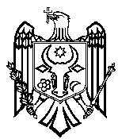

CONSILIUL 
CONCURENŢEI 
СОВЕТ ПО 
КОНКУРЕНЦИИ 
 
 
PLENUL CONSILIULUI  CONCURENŢEI 
 
 
DECIZIE 
 
Nr. ASER- 68                                                                                    mun. Chişinău 
din 11.12.2015 
 
Plenul Consiliului Concurenţei, acționând în temeiul art. 41 din Legea 
concurenţei nr.183 din 11.07.2012, Hotărârii Parlamentului nr. 179 din 12.07.2013 
privind numirea în funcţie a membrilor Plenului Consiliului Concurenţei, precum 
şi Hotărârii Parlamentului nr. 220 din 27.09.2013 privind numirea în funcţie a unui 
membru al Plenului Consiliului Concurenţei, 
analizând raportul de investigaţie asupra cazului iniţiat prin Dispoziţia 
Plenului Consiliului Concurenţei nr. 24 din 23.06.2015 privind iniţierea 
investigaţiei referitor la semnele încălcării legislaţiei  în domeniul ajutorului de stat 
de către Banca Națională a Moldovei, observațiile prezentate de către Banca 
Națională a Moldovei și Ministerul Finanțelor asupra raportului de investigație și   
materialele anexate, 
(Partea motivată a deciziei a fost exclusă în conformitate cu art. 21 alin. (5) din 
Legea nr. 139 din 15.06.2012 cu privire la ajutorul de stat și art. 36 din Legea nr. 
548-XIII din 21.07.1995 cu privire la Banca Națională a Moldovei la solicitarea 
Băncii Naționale a Moldovei) 
DECIDE: 
1. A constata încălcare a art. 10 alin. (4) din Legea nr. 139 din 15.06.2012 cu 
privire la ajutorul de stat și pct. 3 din Decizia Plenului Consiliului 
Concurenței nr. 01 SS din 27.11.2014 de către Banca Națională a Moldovei, 
manifestată prin neprezentarea planului de restructurarea sau lichidare a S.A. 
"Banca de Economii", B.C. "Banca Socială" S.A. şi B.C."UNIBANK"S.A.. 
2. A constata că ajutorul de stat pentru salvare acordat de Banca Națională a 
Moldovei sub formă de împrumuturi cu dobânzi preferenţiale S.A. "Banca 
de Economii", B.C. "Banca Socială" S.A. şi B.C."UNIBANK" S.A., după 
1 
 

expirarea a 6 luni de la acordarea ajutorului de stat, constituie ajutor utilizat 
abuziv în sensul art. 3 din Legea nr. 139 din 15.06.2012 cu privire la ajutorul 
de stat. 
3. Banca Națională a Moldovei va întreprinde măsurile necesare pentru 
recuperarea ajutorului utilizat abuziv de către S.A. "Banca de Economii", 
B.C. "Banca Socială" S.A. şi B.C."UNIBANK" S.A.. 
4.  A constata că măsura de sprijin acordată de către Ministerul Finanţelor, sub 
formă de garanţii în condiţii preferenţiale, S.A. "Banca de Economii", B.C. 
"Banca Socială" S.A. şi B.C."UNIBANK"S.A. constituie ajutor de stat în 
sensul art. 3 din Legea nr. 139 din 15.06.2012 cu privire la ajutorul de stat. 
5. A constata că prin nenotificarea ajutorului de stat acordat sub formă de 
garanţii în condiţii preferenţiale S.A. "Banca de Economii", B.C. "Banca 
Socială" S.A. și B.C."UNIBANK"S.A., Ministerul Finanțelor nu a respectat 
prevederile art. 8 din Legea nr. 139 din 15.06.2012 cu privire la ajutorul de 
stat. 
6. Ministerul Finanţelor va întreprinde măsurile necesare pentru recuperarea 
ajutorului acordat, sub formă de garanţii în condiţii preferenţiale, S.A. 
"Banca de Economii", B.C. "Banca Socială" S.A. şi B.C."UNIBANK" S.A.. 
7. Banca Națională a Moldovei și Ministerul Finanțelor vor informa semestrial 
Consiliul Concurenței cu privire la evoluția măsurilor luate pentru punerea 
în aplicare a prezentei Decizii până la finalizarea recuperării ajutorului de 
stat. 
8. Prezenta Decizie intră în vigoare la data adoptării. 
 
 
Preşedintele Plenului 
Consiliului Concurenţei 
                                         Viorica CĂRARE 
 
 
 
 
 
 
2 
 
