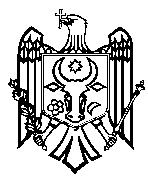

 

CONSILIUL 
CONCURENŢEI 
СОВЕТ ПО 
КОНКУРЕНЦИИ 
 
PLENUL CONSILIULUI CONCURENŢEI 
 
DECIZIE 
 
Nr. ASS - 44 
din 02.07.2015  
 
 
 
 
 
mun. Chişinău 
 
Plenul Consiliului Concurenţei, acţionînd în temeiul art. 41 al Legii 
concurenţei nr.183 din 11.07.2012, art.2 şi art.10 al Legii nr. 139 din 15.06.2012 
cu privire la ajutorul de stat, Hotărîrii Parlamentului nr.179 din 12.07.2013 privind 
numirea în funcţie a membrilor Plenului Consiliului Concurenţei, Hotărîrii 
Parlamentului nr. 220 din 27.09.2013 privind numirea în funcţie a unui membru al 
Plenului Consiliului Concurenţei, 
în conformitate cu prevederile Regulamentului cu privire la forma de 
notificare, procedura de examinare şi adoptare a deciziilor cu privire la ajutorul de 
stat, aprobat prin Hotărîrea Plenului Consiliului Concurenţei nr.1 din 30.08.2013,   
analizînd nota informativă referitor la notificarea depusă de Ministerul 
Finanțelor, prin adresarea nr.13/3-07-131 din 12.05.2015, privind măsura de sprijin 
acordată Î.S. „Calea Ferată din Moldova” cu suportul Băncii Europene pentru 
Reconstrucție și Dezvoltare, referitor la acordul de finanțare încheiat cu Republica 
Moldova în data de 14.11.2014, şi materialele anexate,  
 
A CONSTATAT:  
 
Prin scrisoarea nr.13/3-07-108 din 21.04.2015, în baza art. 8 din Legea nr. 
139 din 15.06.2012 cu privire la ajutorul de stat și a Regulamentului privind forma 
de notificare, procedura de examinare și adoptare a deciziilor cu privire la ajutorul 
de stat, aprobat prin Hotărîrea Plenului Consiliului Concurenţei nr.1 din 
30.08.2013, Ministerul Finanțelor a prezentat Formularul general de notificare a 
ajutorului de stat. 
Ca urmare a îmbunătățirilor efectuate de furnizor notificarea a devenit 
efectivă în data de 12.05.2015. 
Baza legală pentru acordarea măsurii de sprijin constituie: 
• Legea nr. 419 din 22.12.2006 cu privire la datoria sectorului public, 
garanțiile de stat și recreditarea de stat; 
• Legea nr. 22 din 27.02.2015 privind ratificarea Acordului de finanțare dintre 
Republica Moldova și Banca Europeană pentru Reconstrucție și Dezvoltare 
1 
 

(BERD) în vederea realizării Proiectului de achiziție a locomotivelor și de 
restructurare a infrastructurii feroviare; 
• Acordul de împrumut între Republica Moldova și BERD nr. 44085 din 
14.11.2014; 
• Strategia de transport şi logistică pe anii 2013-2022 aprobată prin Hotărîrea 
Guvernului nr. 827 din 28.10.2013. 
 
 
Măsura de sprijin notificată constă în acordarea unui împrumut cu dobîndă 
preferențială pentru Î.S. „Calea Ferată din Moldova” ce urmează a fi contractat în 
vederea reînnoirii parcului de locomotive din dotare și reabilitarea infrastructurii 
feroviare. Valoarea împrumutului este de 52,5 mil. Euro. Mijloacele împrumutului 
se acordă pe o perioadă de 15 ani, inclusiv cu o perioadă de grație de 3 ani.   
Suportul financiar este acordat ca urmare a Acordului de împrumut dintre 
Republica Moldova și BERD, semnat la 14.11.2014, ratificat prin Legea nr.22 din 
27.02.2015. Responsabilitatea asupra utilizării și implementării proiectului, 
efectuării lucrărilor și calității acestora se pune în sarcina Î.S. „Calea Ferată din 
Moldova” precum și Ministerului Transporturilor și Infrastructurii Drumurilor.   
        
Beneficiarul 
       Beneficiarul măsurii de sprijin notificate este Î.S. „Calea Ferată din 
Moldova” (IDNO 1002600001257), cu sediul în mun. Chișinău, str. Vlaicu 
Pîrcălab, 48 MD-2012.  
       Întreprinderea este deținută 100% de stat și gestionată de Ministerul 
Transporturilor și Infrastructurii Drumurilor. În cadrul acestei întreprinderi 
activează ... angajați. 
       Conform informației prezentate de furnizorul măsurii de sprijin Î.S. „Calea 
Ferată din Moldova” desfășoară atît activități principale cît și activități secundare, 
conform tabelul de mai jos. 
                                                                                                                       Tabel 1 
Activitățile Î.S. „Calea Ferată din Moldova”  
Nr. 
  Tip de  
activitate  
Denumirea activității 
Transport feroviar de marfă 
Transport feroviar de călători 
Producția, întreținerea, repararea și modificarea 
mijloacelor de transport feroviar și material rulant 
Construcția și reparația căii ferate 
1. 
 Principale 
Producția și furnizarea energiei electrice 
Activități farmaceutice 
Acordarea de asistență medicală 
Activități sportive ale instituțiilor de cultură, arhive 
 
Secundare 
2. 
 
 
 
                        Sursa: Formularul general de notificare a ajutorului de stat.  
2 
 

       
Principalii indicatori economico-financiari înregistrați de Î.S. „Calea Ferată 
din Moldova”, conform datelor din situațiile financiare aferente anilor 2012-2014, 
sunt prezentați în tabelul 2. 
Din datele tabelului 2 se constată că Î.S. „Calea Ferată din Moldova” 
înregistrează o evoluție ... a rezultatului financiar profit/pierdere de la ... în 
perioada 2011-2012: ... mil. lei în 2011 și ... mil. lei în 2012, la ... în 2013 de ... 
mil. lei cu ... acestui indicator, în următorul an ... mil. lei.  
Tabel 2 
Situaţia financiară în perioada anilor 2011-2014 
Nr. 
Indicator 
2011 
2012 
2013 
2014 
1. 
Cifra de afaceri, mil. lei 
... 
... 
... 
... 
2. 
Costul vînzărilor, mil. lei 
... 
... 
... 
... 
3. 
Profit/Pierdere, mil. lei 
... 
... 
... 
... 
    Sursa: Rapoartele financiare ale Î.S. „Calea Ferată din Moldova” pentru anii 2013-2014. 
       
 
Potrivit Planului investițional creșterea pierderilor este generată în principal 
de următorii factori: 
a) Impactul crizei financiare din anii 2008-2009 care, afectînd activitatea de 
transport a Î.S. „Calea Ferată din Moldova”, a determinat lipsa mijloacelor 
financiare ce urmau a fi investite în dezvoltarea și repararea capitală a 
mijloacelor fixe; 
b) Renunțarea de către clienți la serviciile prestate  de Î.S. „Calea Ferată din 
Moldova” în favoarea transportului rutier, mai rapid și mai competitiv. Ca 
rezultat al neînnoirii materialului rulant și nereabilitării infrastructurii, 
transportul feroviar din Republica Moldova a devenit lent, costisitor și 
nesigur fapt ce i-a determinat pe consumatori să opteze pentru un alt tip de 
transport; 
c) Subvenționarea încrucișată a transportului feroviar de pasageri din 
veniturile transportului feroviar de marfă reduce posibilitatea Î.S. „Calea 
Ferată din Moldova” de a genera rezultate financiare înalte. 
 
 
În vederea realizării Proiectului de achiziție a locomotivelor și de 
restructurare a infrastructurii feroviare a Î.S. „Calea Ferată din Moldova”, în data 
de 14.11.2014, a fost semnat Acordul de împrumut dintre Republica Moldova și 
BERD (în continuare – Acord de împrumut) în valoare de 52,5 mil. Euro, ce 
implică Tranșa 1 de 25,0 mil. Euro și Tranșa 2 de 27,5 mil. Euro.  
 
Împrumutul urmează a fi utilizat în vederea efectuării investițiilor prezentate 
în tabelul 3.                                                                                         
 
 
 
 
 
 
 
3 
 

 Tabel 3 
Distribuţia împrumutului  
Nr. Categoria investiției Suma alocată, mil. Euro 
1. 
Tranșa 1 
25 
1.1. ... 
... 
1.2. ... 
... 
1.3. ... 
... 
1.4. ... 
... 
2. 
Tranșa 2 
27,5 
2.1. ... 
... 
2.2. ... 
... 
 
Total 
52,5 
         Sursa: Acordul de împrumut între Republica Moldova și BERD nr. 44085 din 14.11.2014. 
       Valoarea măsurii de sprijin acordată Î.S. „Calea Ferată din Moldova” de 
către Ministerul Finanțelor este calculată ca diferență dintre dintre dobînda de piaţă 
şi dobînda efectiv plătită. Astfel, măsura de sprijin notificată de către Ministerul 
Finanțelor este în valoare de 1.147.082.196,75 lei1. 
Valoarea actualizată la momentul cînd notificarea a devenit efectivă este de 
376.259.239,35 lei.2 
În urma examinării măsurii de sprijin, notificată prin adresarea Ministerului 
Finanțelor nr.13/3-07-131 din 12.05.2015, s-a constatat că aceasta întrunește 
cumulativ cele patru condiții specificate în art. 3 din Legea nr. 139 din 15.06.2012, 
pentru stabilirea existenței ajutorului de stat. 
Conform tabelului 4 se evidențiază cele mai importante acțiuni care urmează 
a fi întreprinse de Î.S „Calea Ferată din Moldova” pentru a accesa suportul 
financiar, după cum: 
a) Restructurarea întreprinderii prin crearea a 3 unități separate, avînd în 
responsabilitate transportul călătorilor, transport marfă și gestiunea 
infrastructurii; 
b) Acțiuni de protecție a mediului înconjurător prin: 
• Crearea unei subdiviziuni responsabile de coordonarea și supravegherea 
problemelor de mediu;  
• Elaborarea și implementarea unui plan de gestionare a deșeurilor - 
utilizare, stocare, selectare a materialelor periculoase (uleiuri, lubrifianți), 
în concordanță cu Directivele Europene. 
                                                          
1 Diferența dintre rata dobînzii pe piațăși rata dobînzii efective, convertită în MDL, conform calculelor preliminarea realizate de Ministerul 
Finanțelor (1 Euro = 20.002 MDL). 
2 Rata CHIBOR la data de 12.05.2015 - 19,01% , http://www.bnm.org/bdi/pages/reports/dop/DOP6DisclaimerAgree.xhtml? 
4 
 

c)  Elaborarea și implementarea unui plan de reducere a cadrelor, într-o 
manieră corectă, transparentă și obiectivă. 
Tabel 4  
Planul de acțiuni 
Nr. 
Acțiuni 
Termen 
1. 
Aprobarea și punerea în aplicare a Planului de Acțiune de Austeritate. 
Pînă pe 30.10.2015 
2. 
Aprobarea și punerea în aplicare a unui Plan de acțiuni privind adoptarea 
unui sistem de gestiune a mediului înconjurător, a sănătății și a siguranței 
în baza standardului ISO14000 și OHSAS 18001. 
Pînă pe 30.10.2015 
3. 
Adoptarea unui plan de eficiență energetică și implementarea acestuia.  
Pînă pe 31.12.2015 
4. 
Adoptarea și punerea în aplicarea a Planului de Acțiuni privind 
Guvernarea Corporativă 
Pînă pe 31.12.2015 
5. 
Crearea unui departament responsabil de coordonarea și supravegherea 
problemelor de mediu. 
Pînă pe 31.03.2016 
6. 
Separarea operațională în vederea instituirii a trei unități distincte pentru 
pasageri, marfă și infrastructură. 
Pînă pe 31.03.2016 
7. 
Adoptarea planului de separare a contabilității pentru fiecare unitate. 
Pînă pe 30.06.2016 
8. 
Aprobarea planului de corporatizare și a raportului de evaluare juridică. 
Pînă pe 30.06.2016 
9. 
A contribui și oferi sprijinul în dezvoltarea metodologiei privind 
obligația de serviciu public. 
Pînă pe 30.06.2016 
10. 
Adoptarea și implementarea Planului de Acțiuni de Restructurare.  
Pînă pe 31.12.2016 
11. 
Adoptarea elementelor sistemului de gestiune a mediului înconjurător, a 
sănătății și a siguranței în baza ISO 1400 și OHSAS 18001. 
Pînă pe 30.04.2017 
12. 
A contribui și oferi sprijinul în dezvoltarea Pachetului de Acțiuni privind 
Reformarea Sectorului Feroviar în vederea adoptării acestuia.  
Pînă pe 30.04.2017 
Sursa: Acordul de proiect încheiat între Î.S. „Calea Ferată din Moldova” și BERD.  
 
 Ca urmare a efectuării investițiilor în îmbunătățirea activității Î.S „Calea 
Ferată din Moldova”3 se prognozează creșterea fluxului de numerar din prestarea 
serviciului de transport de mărfuri și călători, reducerea costurilor de întreținere a 
infrastructurii. 
 
Conform prognozei efectuate în Planul investițional, potrivit tabelului 5, se 
preconizează creșterea fluxului de numerar cu ...% pînă în 2030 (de la ... mil. lei la 
... mil. lei), creșterea cea mai mare înregistrînd-o venitul din transportul de marfă 
cu ...%. 
                                                          
3 Conform planului investițional pentru dezvoltarea Î.S. „Calea Ferată din Moldova” 2014-2024. 
 
5 
 

 
Referitor la costuri, se prevede o diminuare cu ...% (de la ... mil. lei la ... 
mil.lei), ca rezultat al reducerii costurilor generate de întreținerea infrastructurii cu 
...% (de la ... mil. lei la ... mil. lei). 
 
Tabel 5 
Prognoza fluxurilor de numerar din activitatea operațională, mil. lei 
Nr. 
Indicator 
Anul 
2015 
2030 
Transport marfă 
... 
... 
Transport călători 
... 
... 
Alte venituri 
... 
... 
Total venituri 
... 
... 
 
Venit 
 
 
1. 
Costuri operaționale 
... 
... 
Întreținere infrastructură 
... 
... 
Cheltuieli generale 
... 
... 
Total costuri 
... 
... 
Sursa: Planul investițional pentru dezvoltare a Î.S. „Calea Ferată din Moldova” 2014-2024. 
 
 
În vederea depășirii situației cu care se confruntă sectorul transportului 
feroviar, ajutorul de stat notificat va contribui la: 
 
Cost 
 
 
2. 
a) îmbunătățirea siguranței în prestarea serviciului de transport de marfă și 
pasageri; 
b) reducerea consumului de combustibil, majorarea vitezei de circulație a 
trenurilor și sporirea competitivității transportului feroviar; 
c) sporirea eficienței energetice a transportului feroviar. 
 
       Ajutorul de stat acordat de Ministerul Finanțelor este analizat în contextul 
îndeplinirii de către Î.S. „Calea Ferată din Moldova” a unui obiectiv sectorial și 
anume prestarea serviciilor de transport feroviar. Potrivit art. 5 lit. i) din Legea nr. 
139 din 15.06.2012 cu privire la ajutorul de stat, ajutorul de stat acordat unui 
anumit sector poate fi compatibil cu mediul concurențial normal. 
Evaluarea compatibilității ajutorului de stat acordat Î.S. „Calea Ferată din 
Moldova” 
a fost 
efectuată prin analiza 
comparativă 
fiind 
examinată 
compatibilitatea măsurii de ajutor de stat luînd în vedere prevederile Secțiunii 11 a 
Regulamentului privind forma de notificare, procedura de examinare și adoptare a 
deciziilor cu privire la ajutorul de stat.  
Ca urmare a examinării condițiilor necesare a fi întrunite de Î.S. „Calea Ferată 
din Moldova” în vederea obținerii suportului financiar se constată următoarele 
efecte ale ajutorului de stat: 
 
• efectele certe ale ajutorului de stat: 
- modernizarea parcului de locomotive și restructurarea infrastructurii 
feroviare; 
- reorganizarea întreprinderii feroviare - excluderea subvenționării 
încrucișate; 
6 
 

- creșterea calității serviciului prestat.  
• ajutorul va contribui la reducerea efectelor negative asupra mediului (asupra 
aerului, solului și fonului), transportul feroviar fiind unul mai puțin poluant. 
• ajutorul va genera efecte pozitive prin creșterea competitivității transportului 
feroviar față de alte tipuri de transport mai poluante, întreprinderile care 
beneficiază de serviciile de transport vor avea parte pe termen lung de servicii 
de o calitate mai bună; 
• ajutorul este bine orientat astfel încît Î.S. „Calea Ferată din Moldova” își va 
optimiza activitatea reducînd pierderile din activitățile neperformante; 
• ajutorul de care urmează să beneficieze Î.S. „Calea Ferată din Moldova” 
urmează să producă efecte de contagiune pozitive importante pentru pieţele 
produselor. În perspectivă beneficiarii serviciilor de transport marfar și de 
pasageri vor avea de profitat ca urmare a creșterii calității serviciilor prestate, 
drept exemplu ar putea constitui întreprinderile care activează pe piața 
produselor cerealiere, petroliere.  
• ajutorul nu denaturează semnificativ buna funcţionare a pieţei, efectul asupra 
mediului concurențial fiind minim; 
• ajutorul urmează să contribuie la alinierea sectorului transportului feroviar la 
condiţiile general-valabile pentru piața transportului feroviar din Comunitatea 
Europeană. 
 
În urma evaluării s-a constatat că măsura de sprijin acordată Î.S. „Calea 
Ferată din Moldova” constituie ajutor de stat compatibil cu mediul concurențial 
normal, efectele pozitive ca urmare a acordării măsurii de sprijin fiind mai mari 
decît efectele negative. 
Investițiile 
pentru 
reînnoirea 
materialului 
rulant 
și 
restructurarea 
infrastructurii feroviare sunt indispensabile pentru menținerea competitivității 
transportului feroviar față de alte moduri de transport mai poluante. Aceste 
investiții sunt necesare pentru îmbunătățirea interoperabilității între rețelele 
naționale și internaționale, protecția mediului înconjurător, sporirea siguranței 
trenurilor și calificarea personalului. 
 
Astfel de investiții sunt necesare pentru a limita impactul transportului 
feroviar asupra mediului, în special prin reducerea poluării fonice pe care o 
provoacă și prin sporirea gradului de siguranță al acestuia.  
 
Avînd în vedere cele de mai sus, concluzia este că ajutoarele pentru 
achiziționarea și reînnoirea materialului rulant pot să contribuie la atingerea mai 
multor tipuri de obiective de interes public și pot fi, așadar, considerate 
compatibile cu mediul concurențial normal. 
       Cît privește separarea juridică a activităților Î.S. „Calea Ferată din 
Moldova”, aceasta aduce o contribuție semnificativă la realizarea unui dublu 
obiectiv: eliminarea tuturor subvențiilor încrucișate între subunitatea restructurată 
și restul întreprinderii și asigurarea faptului că ansamblul relațiilor financiare dintre 
activitățile restructurate se desfășoară în mod durabil și pe baze comerciale. 
7 
 

 
Reieşind din constatările expuse, ţinînd cont de prevederile legislaţiei 
Republicii Moldova, în temeiul art. 41 din Legea concurenţei nr. 183 din 
11.07.2012 și art. 10 alin. (2) lit. b) din Legea nr. 139 din 15.06.2012 cu privire la 
ajutorul de stat, Plenului Consiliului Concurenţei,  
 
DECIDE: 
 
1. A constata faptul că măsura notificată de către Ministerul Finanțelor, 
avînd ca beneficiar Î.S. „Calea Ferată din Moldova” și constînd în 
acordarea unui împrumut cu dobîndă preferențială cu suportul Băncii 
Europene pentru Reconstrucție și Dezvoltare, constituie ajutor de stat în 
sensul art. 3 din Legea nr. 139 din 15.06.2012 cu privire la ajutorul de 
stat. 
2. A autoriza ajutorul de stat oferit Î.S. „Calea Ferată din Moldova” în 
vederea achiziției locomotivelor și restructurării infrastructurii feroviare. 
3. Ministerul Finanțelor va transmite anual Consiliului Concurenței 
informații privind ajutorul de stat care face obiectul prezentei Decizii, în 
vederea actualizării și completării Registrului ajutorului de stat, în 
conformitate cu prevederile art. 19 din Legea nr. 139 din 15.06.2012 cu 
privire la ajutorul de stat.  
4. Prezenta Decizie intră în vigoare la data adoptării şi va fi adusă la 
cunoştinţă părţilor. 
5. Partea dispozitivă a prezentei Decizii va fi publicată în Monitorul Oficial 
al Republicii Moldova.  
 
 
Preşedintele Plenului 
Consiliului Concurenţei 
                                                    Viorica CĂRARE 
 
 
 
8 
 
