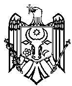

CONSILIUL 
CONCURENŢEI 
СОВЕТ ПО 
КОНКУРЕНЦИИ 
 
PLENUL CONSILIULUI CONCURENŢEI 
 
DECIZIE 
 
Nr. ASS - 72 
din 17.12.2015 
 
 
 
                              mun. Chişinău 
 
Plenul Consiliului Concurenţei, acţionând în temeiul art. 41 al Legii 
concurenţei nr.183 din 11.07.2012, art. 2 şi art. 10 al Legii nr. 139 din 15.06.2012 cu 
privire la ajutorul de stat, Hotărârii Parlamentului nr. 179 din 12.07.2013 privind 
numirea în funcţie a membrilor Plenului Consiliului Concurenţei, Hotărârii 
Parlamentului nr. 220 din 27.09.2013 privind numirea în funcţie a unui membru al 
Plenului Consiliului Concurenţei, 
în conformitate cu prevederile Regulamentului cu privire la forma de notificare, 
procedura de examinare şi adoptare a deciziilor cu privire la ajutorul de stat, aprobat 
prin Hotărârea Plenului Consiliului Concurenţei nr.1 din 30.08.2013,   
analizând nota informativă referitor la notificarea simplificată depusă de 
Agenția de Intervenție și Plăți pentru Agricultură privind majorarea bugetului măsurii 
de sprijin nr.8 din Hotărârea Guvernului nr. 135 din 24.02.2014 referitor la 
„Stimularea investițiilor pentru dezvoltarea infrastructurii postrecoltare și procesare” 
acordat producătorilor agricoli prin intermediul fondului de subvenționare pentru anul 
2014, măsură autorizată anterior prin Decizia Plenului Consiliului Concurenței nr. 
ASS-37 din 16.10.2014,  
 
A CONSTATAT:  
Prin scrisoarea nr. 616/10 din 17.11.2015, în baza art. 8 din Legea nr. 139 din 
15.06.2012 cu privire la ajutorul de stat și a Regulamentului privind forma de 
notificare, procedura de examinare și adoptare a deciziilor cu privire la ajutorul de 
stat, aprobat prin Hotărârea Plenului Consiliului Concurenței nr.1 din 30.08.2013 (în 
continuare Regulamentul privind forma de notificare, procedura de examinare și 
adoptare a deciziilor cu privire la ajutorul de stat), Agenția de Intervenție și Plăți 
pentru Agricultură (în continuare AIPA) a prezentat Formularul de notificare 
simplificată a ajutorului de stat. 
Ca urmare a modificărilor efectuate de furnizor notificarea, expediată prin 
intermediul Sistemului informațional automatizat „Registrul ajutoarelor de stat” prin 
adresarea nr. 2555, a devenit efectivă în data de 26.11.2015. 
 
1 
 

Potrivit prevederilor pct. 22 din Regulamentul privind forma de notificare, 
procedura de examinare și adoptare a deciziilor cu privire la ajutorul de stat, 
furnizorul şi/sau iniţiatorul unui ajutor de stat ilegal şi asupra căruia Consiliul 
Concurenţei nu a iniţiat procedura privind ajutorul ilegal sau ajutorul utilizat abuziv, 
prevăzută la art.13 din Legea nr. 139 din 15.06.2012 cu privire la ajutorul de stat, 
poate să-l notifice pentru a fi autorizat. 
Luând în vedere prevederile pct.22 menţionat mai sus, AIPA a notificat 
majorarea bugetului măsurii de sprijin nr.8 din Hotărârea Guvernului nr. 135 din 
24.02.2014 referitor la „Stimularea investiţiilor pentru dezvoltarea infrastructurii 
postrecoltare şi procesare” acordat producătorilor agricoli prin intermediul fondului 
de subvenționare pentru anul 2014. 
Majorarea procentuală a bugetului măsurii de sprijin nr. 8 constituie 165%,  
comparativ cu valoarea ajutorului inițial notificat. Depășirea pragului de 20%, stabilit 
în pct. 24, lit. a) din Regulamentul privind forma de notificare, procedura de 
examinare și adoptare a deciziilor cu privire la ajutorul de stat, face pasibilă 
efectuarea notificării prin intermediul procedurii simplificate.  
Baza legală 
a) Legea bugetului de stat pe anul 2015 nr.72 din 12.04.2015; 
b) Legea nr. 243-XV din 08.07.2004 privind asigurarea subvenţionată a riscurilor 
de producţie în agricultură; 
c) Legii nr. 312 din 20.12.2013 privind grupurile de producători agricoli şi 
asociaţiile acestora; 
d) Hotărârea Guvernului nr. 409 din 04.06.2014 cu privire la aprobarea Strategiei 
naţionale de dezvoltare agricolă şi rurală pentru anii 2014-2020; 
e) Hotărârea Guvernului nr. 135 din 24.02.2014 cu privire la aprobarea modului 
de repartizare a mijloacelor fondului de subvenționare a producătorilor agricoli 
pentru anul 2014; 
f) Hotărârea Guvernului nr. 352 din 10.06.2015 cu privire la modul de repartizare 
a mijloacelor fondului de subvenționare a producătorilor agricoli pentru anul 
2015. 
Descrierea ajutorului de stat existent 
În data de 16.10.2014 Plenul Consiliului Concurenței, prin Decizia nr. ASS-37, 
a autorizat schema de ajutor de stat privind subvenționarea producătorilor agricoli 
prin intermediul măsurii de sprijin nr.8 din Hotărârea Guvernului nr. 135 din 
24.02.2014. Bugetul măsurii nr. 8 este de 60 mil. lei, din volumul total al fondului de 
subvenționare de 500 mil. lei, care au fost alocați producătorilor agricoli prin 
intermediul fondului de subvenționare pentru anul 2014, aprobat prin Hotărârea 
Guvernului nr. 135 din 24.02.2014.  
2 
 

Obiectivul măsurii este sporirea productivității și competitivității sectorului 
agricol prin modernizarea utilajului și infrastructurii postrecoltare și procesare. Durata 
aplicării schemei este 01.11.2013 - 31.10.2014. 
Modificarea ajutorului existent 
Potrivit informației prezentate de furnizor valoarea ajutorului de stat acordat 
până în prezent, prin intermediul măsurii nr. 8, a constituit 152,14 mil.lei, depășind 
valoarea ajutorului de 60 mil. lei notificată prin Decizia nr. ASS-37 din 16.10.2014.  
Suplimentar la cele 152,14 mil. lei acordate până în prezent, urmează a fi 
alocate 7 mil. lei. Ajutorul de stat suplimentar de 99,15 mil. lei (159,14 mil. lei – 60 
mil. lei) reprezintă valoarea majorată a bugetului măsurii notificate. 
Potrivit răspunsului transmis de AIPA valoarea ajutorului notificat pentru 
măsura nr.8, și autorizat prin Decizia nr. ASS-37 din 16.10.2014, a fost una 
planificată, însă pe parcursul anului, ca urmare a epuizării mijloacelor financiare 
destinate măsurii, contul a fost suplinit cu mijloace financiare de la alte măsuri de 
sprijin prevăzute în Regulamentul privind modul de repartizare a mijloacelor fondului 
de subvenționare a producătorilor agricoli, aprobat prin Hotărârea Guvernului nr. 135 
din 24.02.2014.  
Conform pct. 4 din Hotărârea Guvernului nr. 352 din 10.06.2015, ca urmare a 
nefinanțării dosarelor din contul fondului de subvenționare pentru anul 2014 depuse 
până la 31.10.2014, s-a acceptat finanțarea din contul mijloacelor finaciare prevăzute 
pentru anul 2015. 
Creșterea bugetului schemei de ajutor de stat a fost însoțită de creșterea 
numărului beneficiarilor de la circa 100 de producători agricoli, estimat în notificarea 
depusă anterior, până la 303 de beneficiari.  
Evaluarea măsurii notificate 
Evaluarea măsurii de sprijin nr. 8 a fost efectuată în Decizia nr. ASS-37 din 
16.10.2014. Ajutorul de stat acordat suplimentar în valoare de 99,15 mil. lei va 
contribui la realizarea obiectivului privind creșterea investițiilor în infrastructura de 
prelucrare primară, procesare, uscare și congelare a fructelor, legumelor, de prelucrare 
primară, ambalare, refrigerare, congelare și păstrare a cărnii, procesare, ambalare și 
păstrare a laptelui, prelucrare primară și procesare a cerealelor și produselor 
oleaginoase, precum și casele de ambalare și refrigerare. 
Reieşind din constatările expuse, ţinând cont de prevederile legislaţiei 
Republicii Moldova, în temeiul art. 41 din Legea concurenţei nr. 183 din 11.07.2012 
3 
 

și art. 10 alin. (2) lit. b) din Legea nr. 139 din 15.06.2012 cu privire la ajutorul de stat, 
Plenul Consiliului Concurenţei,  
 
DECIDE: 
1. A autoriza ajutorul de stat notificat de către Agenția de Intervenție și Plăți 
pentru Agricultură prin intermediul procedurii simplificate în legătură cu 
majorarea bugetului măsurii de sprijin privind stimularea investițiilor pentru 
dezvoltarea infrastructurii postrecoltare și procesare, în baza Hotărârii 
Guvernului nr. 352 din 10.06.2015 cu privire la modul de repartizare a 
mijloacelor fondului de subvenționare a producătorilor agricoli pentru anul 
2015. 
2. Agenția de Intervenție și Plăți pentru Agricultură va transmite Consiliului 
Concurenței informații privind ajutorul de stat care face obiectul prezentei 
decizii, în vederea actualizării și completării Registrului ajutorului de stat, în 
conformitate cu prevederile art.19 din Legea nr. 139 din 15.06.2012 cu 
privire la ajutorul de stat. 
3. Prezenta Decizie intră în vigoare la data adoptării și va fi adusă la cunoștință 
Agenției de Intervenție și Plăți pentru Agricultură. 
4. Partea dispozitivă a prezentei Decizii va fi publicată în Monitorul Oficial al 
Republicii Moldova. 
 
 
Preşedintele Plenului 
Consiliului Concurenţei 
 
                                                    
                                                 Viorica CĂRARE 
 
 
 
 
4 
 
