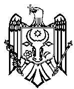

 

CONSILIUL 
CONCURENŢEI 
СОВЕТ ПО 
КОНКУРЕНЦИИ 
 
 
 
PLENUL CONSILIULUI CONCURENŢEI 
 
 
DECIZIE 
 
Nr. ASS - 75 
din 24.12.2015 
                                                              mun. Chișinău 
 
Plenul Consiliului Concurenţei, acționând în temeiul art. 41 al Legii 
concurenţei nr.183 din 11.07.2012, art. 2 şi art. 10 al Legii nr. 139 din 15.06.2012 
cu privire la ajutorul de stat, Hotărârii Parlamentului nr. 179 din 12.07.2013 
privind numirea în funcţie a membrilor Plenului Consiliului Concurenţei, Hotărârii 
Parlamentului nr. 220 din 27.09.2013 privind numirea în funcţie a unui membru al 
Plenului Consiliului Concurenţei, 
în conformitate cu prevederile Regulamentului cu privire la forma de 
notificare, procedura de examinare şi adoptare a deciziilor cu privire la ajutorul de 
stat, aprobat prin Hotărârea Plenului Consiliului Concurenţei nr. 1 din 30.08.2013, 
prevederile Regulamentului privind ajutorului de stat acordat beneficiarilor ce 
prestează servicii de interes economic general, aprobat prin Hotărârea Plenului 
Consiliului Concurenţei nr. 11 din 30.08.2013, 
analizând nota informativă referitor la notificarea depusă de Ministerul 
Finanțelor, prin adresarea nr.13/3-04-359 din 10.11.2015, privind măsura de sprijin 
acordată S.A. „Termoelectrica” cu suportul Băncii Internaționale pentru 
Reconstrucție și Dezvoltare, referitor la acordul de finanțare încheiat cu Republica 
Moldova în data de 15.04.2015, şi materialele anexate, 
 
A CONSTATAT:  
 
Prin scrisoarea nr. 13/3-04-359 din 10.11.2015, în baza art. 8 din Legea nr. 
139 din 15.06.2012 cu privire la ajutorul de stat și Regulamentul privind forma de 
notificare, procedura de examinare și adoptare a deciziilor cu privire la ajutorul de 
stat, Ministerul Finanțelor, a prezentat anexat formularul general de notificare a 
ajutorului de stat și formularul special de notificare a ajutorului de stat acordat 
beneficiarilor ce prestează servicii de interes economic general (în continuare 
SIEG).  
Notificarea a devenit efectivă în data de 11.11.2015. 
 
1 
 

Baza legală pentru acordarea măsurii de sprijin constituie: 
 
 Acordul de finanțare nr.8451-MD din 15.04.2015 dintre Republica Moldova 
și Banca Internațională pentru Reconstrucție și Dezvoltare în vederea 
realizării proiectului de îmbunătățire a eficienței sistemului de alimentare 
centralizată cu energie termică; 
 Legea nr.148 din 30.07.2015 privind ratificarea Acordului de finanțare 
nr.8451-MD din 15.04.2015 dintre Republica Moldova și Banca 
Internațională pentru Reconstrucție și Dezvoltare în vederea realizării 
proiectului de îmbunătățire a eficienței sistemului de alimentare centralizată 
cu energie termică; 
 Legea nr.419 din 22.12.2006 cu privire la datoria sectorului public, 
garanţiile de stat şi recreditarea de stat; 
 Legea nr.92 din 29.05.2014 cu privire la energia termică și promovarea 
cogenerării; 
 Legea nr.124 din 23.12.2009 cu privire la energia electrică. 
 
Măsura de sprijin notificată de către Ministerul Finanțelor constă în 
acordarea unui împrumut cu dobândă preferențială în vederea îmbunătățirii 
infrastructurii de alimentare cu energie termică, îmbunătățirea eficienței energetice 
și reducerea costurilor operaționale.   
Beneficiarul măsurii de sprijin S.A. „Termoelectrica” are sediul în mun. 
Chișinău, str. Meșterul Manole, 3, MD-2023 (IDNO 1003600026295).  
Actul de atribuire a prestării SIEG reprezintă Ordinul Departamentului 
Energetică, Resurse Energetice și Combustibil nr. 60 din 10.07.1997. La momentul 
fondării mărimea capitalului social constituia …lei. 
Din prestarea SIEG S.A. „Termoelectrica”, pe parcursul anilor 2013-2014, a 
înregistrat pierderi situație care, conform informațiilor prezentate, se datorează 
neajustării tarifului pentru serviciul de energie termică pe parcursul a 4 ani, fapt 
care pune în dificultate desfăşurarea activităţii întreprinderii. 
Conform datelor prezentate de către Ministerul Finanțelor, valoarea totală a 
împrumutului obținut de S.A. „Termoelectrica” este de 39 100 000 dolari SUA. 
Investiția implică proiectarea şi construcția staţiilor de pompare, înlocuirea 
pompelor și reconstrucția reţelelor termice subterane, urmând a fi instalate 454 de 
puncte termice individuale. 
Potrivit proiectului contractului de recreditare care urmează a fi încheiat 
între Ministerul Finanțelor și S.A. „Termoelectrica”, întreprinderea urmează să 
ramburseze împrumutul pe parcursul anilor 2020-2049. Valoarea măsurii de sprijin 
acordată de către Ministerul Finanțelor pe parcursul acestei perioade, calculată ca 
diferență dintre dobânda de piaţă şi dobânda efectiv plătită, constituie             
673 505 529,23 lei. Valoarea actualizată, la momentul când notificarea a devenit 
efectivă, este de 122 650 002,65 lei. 
 
 
2 
 

În urma examinării măsurii de sprijin notificată de către Ministerul 
Finanțelor, s-a constatat că aceasta întrunește cumulativ cele patru condiții 
specificate în art. 3 din Legea nr. 139 din 15.06.2012, pentru stabilirea existenței 
ajutorului de stat. 
Ajutorul de stat este analizat în contextul îndeplinirii de către S.A. 
„Termoelectrica” a obligației de SIEG și anume furnizarea serviciului de 
alimentare cu energie termică în mun. Chișinău. 
În conformitate cu pct. 9 din Regulamentul privind ajutorul de stat acordat 
beneficiarilor ce prestează servicii de interes economic general, aprobat prin 
Hotărârea Plenului Consiliului Concurenţei nr.11 din 30.08.2013, pot constitui 
ajutor de stat compatibil cu mediul concurențial normal, daca se respectă cumulativ 
următoarele condiții: 
1. ajutorul de stat este necesar în vederea operării SIEG; 
2. ajutorul de stat nu denaturează în mod nejustificativ concurența. 
Măsura de sprijin este necesară în vederea asigurării furnizării agentului 
termic la o temperatură și volum adecvat, producerea și distribuția energiei termice 
eficientă către consumatorii finali cu scopul de a limita costurile și de a minimiza 
impactul tarifelor asupra păturilor social vulnerabile, obținerea de auto-suficiență 
financiară.   
S.A. „Termoelectrica” activează pe piața prestării serviciului de energie 
termică prin sistem centralizat și pe piața prestării serviciului de energie electrică. 
Piața prestării serviciului de alimentare cu energiei termică din             
mun. Chișinău este limitată din punct de vedere concurențial, costurile de trecere 
de la un furnizor de servicii la un alt furnizor sunt considerabile, fapt ce 
demotivează consumatorii să migreze. Din acest considerent măsura de ajutor de 
stat nu va distorsiona semnificativ mediul concurențial pe piața prestării serviciului 
de alimentare cu energiei termică. 
Producătorii de energie electrică sunt asigurați că vor comercializa întreaga 
cantitate produsă, furnizorii energiei electrice având obligația să procure energia 
electrică generată de întreprinderile autohtone la tarife stabilite de reglementator. 
Din acest considerent acordarea acestei măsuri de ajutor nu va denatura în mod 
nejustificat mediul concurențial pe piața producerii energiei electrice.     
Piețele respective sunt limitate din punct de vedere concurențial fapt ce 
denotă că acordarea acestei măsuri de ajutor nu va denatura în mod nejustificat 
mediul concurențial.   
 
Astfel se constată că sunt îndeplinite cumulativ cele două condiții stipulate 
în pct. 9 din Regulamentul privind ajutorul de stat acordat beneficiarilor ce 
prestează servicii de interes economic general pentru a aprecia că măsura de sprijin 
acordată S.A. „Termoelectrica” constituie măsură de sprijin compatibilă cu mediul 
concurențial normal. 
 
Reieşind din constatările expuse, ținând cont de prevederile legislaţiei 
Republicii Moldova, în temeiul art. 41 din Legea concurenţei nr. 183 din 
3 
 

11.07.2012 și art. 10 alin. (2) lit. b) din Legea nr. 139 din 15.06.2012 cu privire la 
ajutorul de stat,  Plenul Consiliului Concurenţei, 
 
DECIDE: 
1. A constata faptul că măsura notificată de către Ministerul Finanțelor, având 
ca beneficiar S.A „Termoelectrica”, constituie ajutor de stat în sensul art. 3 
din Legea nr. 139 din 15.06.2012 cu privire la ajutorul de stat. 
2. A autoriza ajutorul de stat pentru prestarea serviciului de interes economic 
general oferit S.A. „Termoelectrica” în vederea îmbunătățirii infrastructurii 
de alimentare cu energie termică. 
3. Ministerul Finanțelor va transmite anual Consiliului Concurenței informații 
privind ajutorul de stat care face obiectul prezentei Decizii, în vederea 
actualizării și completării Registrului ajutorului de stat, în conformitate cu 
prevederile art. 19 din Legea nr. 139 din 15.06.2012 cu privire la ajutorul de 
stat. 
4. Prezenta Decizie intră în vigoare la data adoptării şi va fi adusă la cunoştinţă 
Ministerului Finanțelor. 
5. Partea dispozitivă a prezentei Decizii va fi publicată în Monitorul Oficial al 
Republicii Moldova. 
 
 
 
Preşedintele Plenului 
Consiliului Concurenţei 
                                                    Viorica CĂRARE 
 
 
 
 
 
 
 
4 
 
