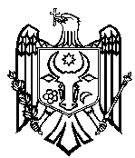

CONSILIUL 
CONCURENŢEI 
 
             СОВЕТ ПО 
         КОНКУРЕНЦИИ 
 
PLENUL CONSILIULUI CONCURENȚEI 
 
D E C I Z I E 
 
Nr. DA-78 
din 28.12.2015                                                                              mun. Chișinău                          
 
Plenul Consiliului Concurenței, 
 
acționând în temeiul art. 41 al Legii concurenței nr. 183 din 11.07.2012, 
Hotărârii Parlamentului nr. 179 din 12.07.2013 şi Hotărârii Parlamentului nr. 220 din 
27.09.2013, 
analizând raportul de investigație pe marginea cazului inițiat prin Dispoziția 
Plenului Consiliului Concurenței nr. 2 din 29.10.2012, informațiile acumulate în 
cadrul investigației, observațiile făcute de  părţi asupra raportului de investigaţie şi 
după desfăşurarea audierilor,   
 
A CONSTATAT: 
 
În rezultatul efectuării examinării preliminare, precum şi urmare a audierii notei 
examinatorului nr. AA-12/161 din 16.10.2012, Plenul Consiliul Concurenţei, la 
29.10.2012 a emis Dispoziţia de inițiere nr. 2 cu privire la semnele încălcării alin. (1) 
al art. 5 din Legea concurenţei nr. 183 din 11.07.2012 de către „Asito” S.A., „Donaris 
Group” S.A., „Grawe Carat” S.A., „Moldasig” S.A., „Moldcargo” S.A., „Moldova-
Astrovaz” S.A. şi Biroul Naţional al Asiguratorilor de Autovehicule. 
 
I. Părţile implicate 
1. Biroul Naţional al Asiguratorilor de Autovehicule (în continuare BNAA) – 
asociaţia 
profesională 
BNAA 
(IDNO–1003600005045) 
este 
o 
asociaţie 
necomercială, constituită prin comunitate de interese, cu statut de persoană 
juridică, bazată pe principiul aderării asiguratorilor de răspundere civilă auto în 
calitate de membru, în vederea realizării în comun a scopurilor şi obiectivelor 
determinate de Statutul BNAA, care îndeplineşte şi atribuţiile de Birou Naţional al 
Republicii Moldova în Consiliul Birourilor Sistemului Internaţional de Asigurare 
„Carte Verde”. Asociaţia are drept scop reprezentarea intereselor colective ale 
membrilor săi, în domeniul asigurării obligatorii de răspundere civilă pentru 
pagube produse de autovehicule atât pe teritoriul Republicii Moldova cât şi în 
străinătate, promovarea cooperării, precum şi compensarea prejudiciilor cauzate 
1 
 
 

persoanelor păgubite prin accidente produse de autovehicule, ai căror posesori nu 
au respectat obligaţia de asigurare obligatorie de răspundere civilă auto, de 
autovehicule neidentificate şi/sau obţinute pe cale ilicită (Statutul asociaţiei 
profesionale „Biroul Naţional al Asiguratorilor de Autovehicule”).   
2. Companiile de asigurări membre cu drepturi depline ale BNAA în anul 2012:  
Conform Statutului din data de 16.01.2009, BNAA avea două tipuri de membri 
– membri cu drepturi depline şi membri asociaţi. Pe parcursul anului 2012 membri cu 
drepturi depline ai BNAA erau următoarele companii de asigurări: 
a) S.A.R. „Moldcargo” S.A. (în continuare „Moldcargo” S.A.) – IDNO-
1002600005819; înregistrată la Camera Înregistrării de Stat la 30.03.2012, genuri 
de activitate: activități de asigurări neefectuate de stat. 
b)  „Moldasig” S.A. (în continuare „Moldasig” S.A.) – IDNO-1002600053315, 
înregistrată la Camera Înregistrării de Stat la 02.04.2012, genuri de activitate: 
activități de asigurare pe viață și alte activități de asigurări. 
c) C.I.A. „Asito” S.A. (în continuare „Asito” S.A.) – IDNO-1002600007123, 
înregistrată la Camera Înregistrării de Stat la 13.06.2001, genuri de activitate: 
activități de asigurări neefectuate de stat. 
d) C.A. „Moldova-Astrovaz” S.A. (în continuare „Moldova-Astrovaz” S.A.) – IDNO-
1003600005344, înregistrată la Camera Înregistrării de Stat la  30.05.2012, genuri 
de activitate: activități de asigurări neefectuate de stat. 
e) C.A. „Donaris Vienna Insurance Group” S.A. (în continuare „Donaris Group” 
S.A.) – IDNO-1002600020908, înregistrată la Camera Înregistrării de Stat la 
23.07.2001, genuri de activitate: activități de asigurări neefectuate de stat. 
f) Î.M. „GRAWE Carat Asigurări” S.A. (în continuare „Grawe Carat” S.A.) – IDNO-
1004601000125, înregistrată la Camera Înregistrării de Stat la 19.02.2002, genuri 
de activitate: activități de asigurări neefectuate de stat. 
3. Asociaţia Brokerilor de Asigurare – Reasigurare (în continuare ABAR) –asociaţie 
neguvernamentală, apolitică, necomercială, având drept scop formarea si susţinerea 
statutului profesionist al brokerilor de asigurare și reasigurare, reprezentarea şi 
protecţia intereselor membrilor săi, protecţia intereselor consumatorilor serviciilor de 
asigurare etc.  
  
II. Piaţa relevantă: piaţa produsului şi piaţa geografică.  
Conform art. 4 din Legea concurenței nr. 183 din 11.07.2012, piaţa relevantă a 
produsului cuprinde toate produsele considerate de către consumatori ca 
interschimbabile sau substituibile datorită utilizării date acestora, caracteristicilor 
fizice, funcţionale şi a preţului. Conform art. 53 alin. (1) din Legea cu privire la 
asigurări nr. 407 din 21.12.2006, în cadrul activităţii sale de intermediere în asigurări 
şi reasigurări, brokerul de asigurare şi/sau de reasigurare reprezintă interesele 
asiguratului (reasiguratului). Drept consecință, serviciile prestate de brokerii de 
2 
 
 

asigurare-reasigurare nu sunt substituibile cu serviciile de intermediere a asigurărilor 
prestate de alți intermediari în asigurări.  În cazul investigaţiei date, piaţa produsului, 
ţinând cont de produsul asupra căruia se răsfrâng efectele deciziei luate de companiile 
de asigurări, membre cu drepturi depline în anul 2012 - „Asito” S.A., „Donaris 
Group” S.A., „Grawe Carat” S.A., „Moldasig” S.A., „Moldcargo” S.A. şi „Moldova-
Astrovaz” S.A. prin intermediul procesului-verbal din 31.07.2012 al ședinței 
companiilor de asigurări membre cu drepturi depline ale BNAA (în continuare proces-
verbal din 31.07.2012), va fi definită drept piaţa serviciilor de intermediere a 
asigurărilor obligatorii de răspundere civilă auto externă (Carte Verde)  prin 
intermediul brokerilor de asigurare-reasigurare.  
Dat fiind faptul, că serviciile de intermediere sunt prestate pe întreg teritoriu al 
Republicii Moldova, piaţa geografică va fi definită ca fiind întreg teritoriu al 
Republicii Moldova. 
Astfel, piaţa relevantă va fi definită drept piaţa serviciilor de intermediere a 
asigurărilor obligatorii de răspundere civilă auto externă (Carte Verde)  prin 
intermediul brokerilor de asigurare-reasigurare pe teritoriul Republicii Moldova.  
 
III. 
Acte şi fapte constatate  
Urmare a examinării materialelor anexate precum şi a informaţiilor acumulate în 
cadrul investigaţiei, a solicitărilor de informaţii, a intervievării conducerii BNAA şi a 
conducătorilor unor membri  cu drepturi depline ai BNAA s-au constatat următoarele: 
1. Prin procesul-verbal din 31.07.2012 (f/d 16-21), companiile de asigurări membre cu 
drepturi depline ale BNAA au decis de a implementa în practică, începând cu 
01.08.2012, contractul cadru de mandat pentru intermedierea încheierii contractelor 
de asigurare de răspundere civilă auto externă (Carte Verde). Potrivit procesului-
verbal din 31.07.2012, începând cu 01.08.2012, prevederile contractelor generale de 
mandat şi/sau intermediere în asigurări, încheiate anterior cu brokerii şi/sau agenţii 
de asigurare în partea ce ţine de condiţiile de intermediere a contractelor de 
asigurare obligatorie de răspundere civilă auto externă (Carte Verde), s-au 
considerat nule.  
2. Contractele cadru de mandat încheiate de către companiile de asigurări - membre cu 
dreptul de emitere a certificatului de asigurare externă (Carte Verde) (în continuare - 
certificate „Carte Verde”) în 2012: „Asito” S.A., „Donaris Group” S.A., „Grawe 
Carat” S.A., „Moldasig” S.A., „Moldcargo” S.A., „Moldova-Astrovaz” S.A. cu 
brokerii de asigurare/reasigurare au fost  identice. Astfel, companiile de asigurări – 
membre cu drepturi depline în anul 2012 au încheiat contracte cadru de mandat după 
cum urmează (f/d 134-170, 393, 396, 399, 402-403, 408):  
- „Asito” S.A. - 18 contracte cadru de mandat;  
- „Donaris Group” S.A. – 11 contracte cadru de mandat;  
- „Grawe Carat” S.A. – 23 contracte cadru de mandat;   
3 
 
 

- „Moldasig” S.A. – 14 contracte cadru de mandat;  
- „Moldcargo” S.A. – 51 contracte cadru de mandat;   
- „Moldova-Astrovaz” S.A. – 1 contract cadru de mandat.    
3. Obiectul contractului cadru de mandat încheiat între companiile de asigurări şi 
brokeri, instituit în practică prin intermediul procesului-verbal din 31.07.2012,  au 
fost contractele de asigurare obligatorie de răspundere civilă auto externă în baza 
cărora brokerii au fost împuterniciţi să elibereze în baza acestora certificate „Carte 
Verde” (f/d 16-21). În contextul contractului cadru de mandat, pct. 15 al contractului 
tip prevedea expres că „Mandantul se obliga să plătească Mandatarului o 
remuneraţie sub formă de comision în mărime de până la 15 % din prima brută 
subscrisă în baza primelor de asigurare în vigoare…”. Astfel, prin intermediul 
procesului-verbal din 31.07.2012 a fost stabilit comisionul de achitare către brokeri 
în mărime de „până la 15 %” (extras din contractul de mandat (f/d 16-21),  în timp 
ce mărimea comisionului  acordat brokerilor nu era prevăzută expres. Deşi 
contractele cadru prevăd sintagma „de până la 15 %”, în urma solicitărilor de 
informaţii s-a constatat, că pe durata acţiunii contractelor cadru de mandat de tip 
nou: 01.08.2012 – 10-19.09.2012, cât și după rezilierea acestuia, companiile de 
asigurări: „Asito” S.A., „Donaris Group” S.A., „Grawe Carat” S.A., „Moldasig” 
S.A., „Moldcargo” S.A., „Moldova-Astrovaz” S.A. - au aplicat comisionul în 
valoare de 15 %.  
4. Metodologia de calcul al primei de asigurare de bază şi al coeficienţilor de 
rectificare pentru asigurarea obligatorie de răspundere civilă pentru pagube 
produse de autovehicule  adoptată prin Hotărârea Guvernului nr. 318 din 17.03.2008 
prevede că cota factorului de încărcare la asigurarea obligatorie de răspundere civilă 
auto externă (Carte Verde) include: 
- Cheltuielile asigurătorului – până la 20 % 
- Marja de profit – până la 7 % 
- Cheltuieli de reasigurare – până la 18 % 
- Contribuţiile în fondurile speciale.  
Pct. 9 din Metodologia de calcul al primei de asigurare de bază şi al coeficienţilor 
de rectificare pentru asigurarea obligatorie de răspundere civilă pentru pagube 
produse de autovehicule  adoptată prin Hotărârea Guvernului nr. 318 din 17.03.2008 
prevede, că cheltuielile asigurătorului includ cheltuielile de achiziţie (comisioanele, 
alte cheltuieli pentru agenţi de asigurare şi brokerii de asigurare şi/sau reasigurare), 
salariile pentru angajaţi, impozitele şi alte cheltuieli de gestiune ale asigurătorului.  
5. În cadrul procesului de investigaţie au fost desfășurate intervievări cu conducătorii 
companiilor de asigurare, membri cu drepturi depline ai BNAA în anul 2012 precum 
şi cu conducerea BNAA. Conform declaraţiilor depuse în cadrul intervievărilor, 
forma şi conţinutul contractului cadru de mandat au fost stabilite de comun acord 
între companiile de asigurări, în urma numeroaselor întâlniri şi discuţii între 
4 
 
 

reprezentanţii companiilor de asigurări (f/d 837-842). Potrivit acestuia, contractul 
cadru de mandat a fost tipărit centralizat şi fiecare companie de asigurări a achitat 
costul contractului cadru de mandat tipografiei.  
6. Prin intermediul Hotărârii nr. 14/14 din 29.03.2012, Comisia Națională a Pieței 
Financiare (CNPF) a prescris persoanelor cu funcţie de răspundere ale 
asigurătorilor, care deţin licenţă „revizuirea contractelor de colaborare cu 
intermediarii în asigurări şi/sau reasigurări şi a contractelor de muncă cu personalul 
propriu cu atribuţii de vânzări în vederea stabilirii comisioanelor şi altor plăţi 
acestora, rezultate din activitatea de intermediere sau din relaţiile de muncă 
finalizate cu încheierea contractelor de asigurare obligatorie de răspundere civilă 
auto, în limita cheltuielilor asigurătorului conform structurii tarifului de asigurare 
aprobat”. Implementarea Hotărârii nr. 14/14 din 29.03.2012 a CNPF prevedea 
acțiuni individuale ale companiilor de asigurări, dar nu decizii comune ale acestora. 
Totodată, hotărârea CNPF nu a instituit limita de 15 % a comisionului spre achitare 
brokerilor.        
7.  Regulamentul General al Consiliului Birourilor din 30.05.2002 a fost invocat de 
majoritatea reprezentanţilor companiilor de asigurări în cadrul intervievărilor drept 
una din cauzele esenţiale pentru care s-a dorit stabilirea unui tip de contract de 
mandat identic a companiilor de asigurări cu brokerii. Art. 6 alin. (1) din 
Regulamentul General al Consiliului Birourilor prevede, că fiecare Birou 
garantează, cǎ membrii săi vor rambursa orice sumă cerută de către Biroul ţǎrii în 
care s-a produs accidentul sau de către agentul pe care l-a  numit în acest scop. Dacǎ 
un membru nu face plata cerutǎ în termenul prevăzut, Biroul de care aparţine acest 
membru va face el însuşi rambursarea conform condiţiilor descrise, după primirea 
unei chemări în garanţie făcutǎ de biroul ţării în care s-a  produs accidentul sau de 
agentul care a fost numit în acest scop. Astfel, reprezentanţii companiilor de 
asigurări în cadrul intervievărilor (f/d 837-842) au susţinut prezenţa unor relaţii 
defectuoase cu brokerii, numeroase dosare în instanţa de judecată şi datorii din 
partea acestora. Raportând această situaţie la faptul că BNAA apare drept garant al 
membrilor săi, potrivit declarațiilor depuse, s-a încercat crearea unui sistem de 
funcţionare, prin care să se minimalizeze riscurile companiilor de asigurări şi în 
consecinţă a BNAA.   
8. Companiile de asigurări au invocat comiterea fraudelor şi „disciplina financiară 
foarte proastă” a  brokerilor (f/d 837-842).  De menţionat, că potrivit art.1 din Legea 
privind Comisia Naţională a Pieţei Financiare nr. 192 din 12.11.1998, CNPF este 
autoritate publică care autorizează şi reglementează activitatea participanţilor pe 
piaţa financiară nebancară, precum şi supraveghează respectarea legislaţiei de către 
ei. Astfel, în contextul Hotărârii CNPF cu privire la prescrierea lichidării încălcărilor  
legislaţiei în domeniul asigurărilor nr. 14/14 din 29.03.2012 se menţionează, că 
“urmare a examinării selective a contractelor de asigurare încheiate pe parcursul 
5 
 
 

anului 2011, inclusiv în cadrul concursurilor pentru contractarea serviciilor de 
asigurare obligatorie de răspundere civilă auto, organizate de către diverse 
întreprinderi şi instituţii s-a constatat, că asigurătorii au propus şi au acordat reduceri 
de până la 55 % din prima de asigurare stabilită, precum şi au acceptat achitarea în 
rate a primei de asigurare, încălcând astfel prevederile art. 11 alin. (3) şi art. 13 alin. 
(1) din Legea nr. 414-XVI din 22.12.2006 cu privire la asigurarea obligatorie de 
răspundere civilă pentru pagube produse de autovehicule”.   
9.  În perioada 10-19.09.2012, 4 companii de asigurare au transmis scrisori de reziliere 
unilaterală a acordurilor încheiate cu companiile de brokeri. În acest sens, 
„Moldcargo” S.A., „Grawe Carat” S.A. și „Moldasig” S.A. au informat despre 
rezilierea contractelor cadru de mandat în aceeaşi zi – 10.09.2012 (f/d 27-91, 92-
133, 134-170)  iar „Donaris Group” S.A. la 19.09.2012 (f/d 180-199).   
10. În cazul „Asito” S.A. şi „Moldova – Astrovaz” S.A. s-a constatat că au fost 
încheiate contracte cadru de mandat de aceste companii de asigurări şi după 
rezilierea contractelor din luna octombrie 2012 de către companiile „Donaris 
Group” S.A., „Grawe Carat” S.A., „Moldcargo” S.A., „Moldasig” S.A. Perioada de 
acțiune a contractelor încheiate de „Asito” SA a fost de la 01.08.2012 până la 
26.06.2014, fiecare contract fiind încheiat pe un termen individual (f/d 393). 
Referitor la acţiunile „Moldova-Astrovaz” S.A. se constată că a fost încheiat un 
singur contract cadru de mandat cu durata de acţiune de la 02.01.2013 până la 
02.01.2015 (f/d 399). 
11. Prin intermediul scrisorii nr. 06 din 19.09.2012, Asociaţia Brokerilor de Asigurare - 
Reasigurare (ABAR) a afirmat faptul, că „rezilierea unilaterală (a contractelor-tip) 
demonstrează nemijlocit încălcarea normelor de concurenţă şi limitarea flagrantă a 
dreptului de intermediere...”(f/d 12-15).   
12. De menţionat că, contractele de mandat încheiate cu brokerii până la începutul lunii 
august 2012 au fost reziliate de către companiile de asigurări. În acest sens în 
procesul-verbal din 31.07.2012 se menţionează că “prevederile contractelor generale 
… încheiate anterior cu brokerii … se consideră nule” (f/d 16-26). Ulterior 
rezilierilor simultane din perioada 10-19.09.2012 şi informaţiilor din cadrul 
intervievărilor (f/d 837-842) s-a stabilit, că companiile de asigurări au revenit la 
contractele anterioare dinaintea celor semnate la începutul lunii august 2012, fie au 
încheiat contracte noi.  
13. În cadrul investigaţiei, de la principalii brokeri de asigurare-reasigurare din 
Republica  Moldova (16 din totalul de 71), care în comun deţineau în anul 2012 
aproximativ 55% din cifra totală de afaceri realizată de brokeri, au fost solicitate 
informaţii cu privire la companiile de asigurări care aveau dreptul de a emite 
certificate „Carte Verde” în anul 2012, cu care aceştia colaborează în vederea 
6 
 
 

comercializării certificatelor „Carte Verde” şi cu privire la mărimea comisioanelor 
achitate de aceştia din urmă pentru serviciile prestate de brokeri.  
14. Prin scrisoarea nr. AA-7/101-591 din 01.08.2013 (f/d 351) către brokerii de 
asigurare-reasigurare, Consiliul Concurenţei a solicitat informaţii referitoare la 
companiile cu care colaborează acestea, tipurile de contracte care au stat la baza 
colaborării, comisioanele achitate de companiile de asigurări şi ce alte sume de bani 
au fost achitate de companiile de asigurări cu excepţia comisioanelor stabilite în 
contractele de mandat. Din informaţiile prezentate, se constată  faptul, că din 
01.08.2012 companiile de asigurări „Asito” S.A., „Donaris Group” S.A., „Grawe 
Carat” S.A., „Moldasig” S.A. şi „Moldcargo” S.A. au modificat comisioanele 
achitate în general de la 35 % la 15 %. Începând cu 01.08.2012, urmare a instituirii 
în practică a contractului cadru de mandat prin intermediul procesului-verbal din 
31.07.2015, comisioanele spre achitare brokerilor devin identice, în valoarea de 15 
%. Deşi în contractul cadru de mandat se prevede că plata comisionului se va realiza 
în valoarea de „până la 15%”, în urma procesării informaţiilor parvenite cât și a 
declarațiilor din cadrul intervievărilor se atestă faptul, că s-a aplicat comisionul egal 
achitat de companiile de asigurări în valoare de 15 %, acțiune care a continuat și 
după rezilierea contractelor cadru de mandat (f/d 355-382, 757-787, 837-842).   
15. La 22.10.2014, Consiliul Concurenţei a solicitat companiilor de asigurări 
nominalizarea brokerilor de asigurare-reasigurare cu care acestea au încheiat 
contractul cadru de mandat consemnat prin procesul-verbal din 31.07.2012 în 
vederea comercializării certificatului „Carte Verde” şi indicarea perioadelor de 
acţiune a contractului cadru de mandat (f/d 388). Astfel, perioada de acţiune a 
contractelor cadru de mandat pentru brokerii cu care au contractat companiile de 
asigurări, membre cu drepturi depline în anul 2012 este următoarea:  
Tabelul nr. 1 
Durata de acțiune a contractelor cadru de mandat încheiate între  companiile de 
asigurări – membre cu drepturi depline în anul 2012  
și brokerii de asigurare-reasigurare 
Nr. 
d/o 
Compania de asigurări 
Data 
încheierii 
Data 
notificării 
Data 
rezilierii 
ultimului 
primului 
rezilierii 
contractelor  
contract  
1. „Asito” S.A. 
01.08.2012 
- 
26.06.2014 
2. „Donaris Group” S.A.  
01.08.2012 
19.09.2012 
01.10.2012 
3. „Grawe Carat” S.A. 
01.08.2012 
10.09.2012 
24.09.2012 
4. „Moldasig” S.A. 
01.08.2012 
10.09.2012 
12.10.2012 
5. „Moldcargo” S.A. 
01.08.2012 
10.09.2012 
01.10.2012 
6. „Moldova Astrovaz” S.A. 
02.01.2013 
- 
02.01.2015 
contract  
Sursa: elaborat în baza informațiilor din scrisorile „Moldcargo" SA, „Grawe Carat" SA, „Moldasig" 
SA; „Asito" SA, „Donaris Group" SA, „Moldova-Astrovaz" SA din perioada 2012-2015. 
7 
 
 

Astfel, cu luarea în considerație a informațiilor expuse în tabelul nr. 1, se constată, că 
durata contractelor cadru de mandat a fost următoarea:   
a)  „Donaris Group” S.A., „Moldcargo” S.A., „Moldasig” S.A. și „Grawe Carat” S.A. 
– aproximativ 2 luni; 
b) „Asito” S.A. - 1 an și 11 luni;  
c) „Moldova Astrovaz” S.A. - 2 ani.  
16. Referitor la aplicarea comisionului de 15 % între brokerii de asigurare în fapt, 
constatăm că acesta a fost aplicat după cum urmează:  
Tabelul nr. 2 
Durata de acțiune a aplicării identice a comisionului în valoare de 15 %  
de către companiile de asigurări – membre cu drepturi depline în anul 2012  
Nr. 
Compania de asigurări 
Perioada aplicării comisionului 
d/o 
 de 15 % 
1.  „Asito” S.A.  
01.08.2012 - 31.07.2015 
2.  „Donaris Group” S.A.   
01.08.2012 - 09.09.2015 
3.  „Grawe Carat” S.A.  
01.08.2012 - 20.11.2014 
4.  „Moldasig” S.A.   
01.08.2012 - 28.02.2015 
5.  „Moldcargo” S.A. 
01.08.2012 - 05.04.2013 
01.01.2015 - 25.08.2015 
6.  „Moldova Astrovaz” S.A.  
02.01.2013 - 31.08.2015 
Sursa: elaborat în baza informațiilor din scrisorile „Moldcargo" S.A., „Grawe Carat" S.A., 
„Moldasig" S.A., „Asito" S.A., „Donaris Group" S.A., „Moldova-Astrovaz" S.A. din perioada 2012-
2015 
* În perioada 05.04.2013-31.12.2014 S.A. „Moldcargo” nu a comercializat certificate „Carte Verde”. 
 
Cu considerarea informațiilor expuse în tabelul nr. 2, se constată, că comisioanele 
stabilite prin intermediul procesului-verbal din 31.07.2012, au fost aplicate după cum  
urmează:    
a) „Asito” S.A. – 3 ani;  
b) „Donaris Group” S.A.  - 3 ani și 1 lună;  
c) „Grawe Carat” S.A.  - 2 ani și 4 luni;  
d) „Moldova Astrovaz” S.A. – 2 ani;  
e) „Moldcargo” S.A. – 1 an și 5 luni;  
f) „Moldasig” S.A. – 2 ani și 7 luni.  
 
17. Referitor la durata încălcării se constată, că încălcarea comisă de companiile de 
asigurări - „Donaris Group” S.A., „Grawe Carat” S.A., „Moldcargo” S.A., 
„Moldasig” S.A.,  „Asito” S.A., „Moldova-Astrovaz” S.A. este continuă.  Astfel, 
acțiunile anticoncurențiale ale companiilor de asigurări au început la 31.07.2012 
odată cu adoptarea comportamentului comun de către companiile de asigurări, 
membre cu drepturi depline în anul 2012, privind implementarea în practică 
începând cu 01.08.2012  a contractului cadru de mandat și au continuat și după 
8 
 
 

intrarea în vigoare la 14.09.2012 a Legii concurenței nr. 183, drept consecință 
urmând să fie aplicate  prevederile Legii concurenței nr. 183 din 11.07.2012.  
 
VI. Calificarea legală a acţiunilor constatate 
Analizând acțiunile descrise anterior, Consiliul Concurenței reține următoarele:  
- Atât Legea nr. 1103 cu privire la protecția concurenței din 30.06.2000, cât și Legea 
concurenței nr. 183 din 11.07.2012  interzic acordurile anticoncurențiale încheiate 
între întreprinderi. Astfel, conform art. 5 alin. (1), (3) din Legea concurenței nr. 
183 din 11.07.2012, sunt interzise, fără a fi necesară o decizie prealabilă în acest 
sens, orice acorduri între întreprinderi sau asociaţii de întreprinderi, orice decizii 
ale asociaţiilor de întreprinderi şi orice practici concertate (denumite în continuare 
acorduri) care au ca obiect sau efect împiedicarea, restrângerea sau denaturarea 
concurenţei pe piaţa Republicii Moldova sau pe o parte a acesteia, inclusiv cele 
îndreptate spre stabilirea directă sau indirectă a preţurilor de cumpărare sau de 
vânzare sau a oricăror alte condiţii de tranzacţionare.     
- Cu luarea în considerație a faptelor constatate și a probelor prezente la dosarul 
cauzei se susține, că companiile de asigurări - „Asito” S.A., „Donaris Group” S.A., 
„Grawe Carat” S.A., „Moldcargo” S.A., „Moldasig” S.A.  și „Moldova-Astrovaz” 
S.A. au încheiat un acord  anticoncurențial orizontal. Respectiva înțelegere s-a 
realizat prin intermediul procesului-verbal din 31.07.2012 prin care a fost fixat 
comisionul de retribuire a brokerilor pentru intermedierea certificatelor „Carte 
Verde”.  
- Referitor la obiectul acordului - stabilirea comisioanelor de retribuire a brokerilor 
pentru intermedierea certificatelor „Carte Verde” s-a materializat prin decizia 
companiilor de asigurări membre cu drepturi depline ale BNAA în anul 2012: 
proces-verbal al Consiliului de Administrație din cadrul BNAA din data de 
31.07.2012. Adițional, se evidențiază următoarele: 
 Companiile de asigurări, membre cu drepturi depline a BNAA în anul 2012 - 
„Asito” SA, „Donaris Group” SA, „Grawe Carat” SA, „Moldcargo” SA, 
„Moldasig” SA  și „Moldova-Astrovaz” SA, urmare a deciziei comune din 
31.07.2012, au încheiat acelaşi tip de contract cu brokerii, forma și conținutul 
căruia a fost stabilit de comun acord între companiile de asigurări. Pct. 15 al 
contractului tip prevedea expres că „Mandantul se obliga să plătească 
Mandatarului o remuneraţie sub formă de comision în mărime de până la 15 % din 
prima brută subscrisă în baza primelor de asigurare în vigoare…”. 
 Deși în drept contractele de mandat au fost reziliate în intervalul de timp 10-
19.10.2012, companiile de asigurări au continuat aplicarea identică a comisionului 
achitat brokerilor de asigurare-reasigurare în valoare de 15 %. 
- În funcție de gravitate și în conformitate cu prevederile art. 72 alin. (3) din Legea 
concurenței nr. 183 din 11.07.2012, cu considerarea faptului că  Decizia 
9 
 
 

Consiliului de Administrație al BNAA din data de 31.07.2012 constituie un acord 
anticoncurenţial orizontal, obiectul căruia este stabilirea comisioanelor de 
retribuire a brokerilor pentru intermedierea certificatelor „Carte Verde”, fapta se 
încadrează la încălcări de gravitate medie.    
-  Conform art. 4 din Legea concurenței nr. 183 din 11.07.2012 cifra totală de 
afaceri reprezintă pentru societăţile de asigurări valoarea totală a primelor brute 
subscrise. Se constată că pentru anul 2014 companiile de asigurări - „Asito” S.A., 
„Donaris Group” S.A., „Grawe Carat” S.A., „Moldcargo” S.A., „Moldasig” S.A.  
și „Moldova-Astrovaz” S.A. au înregistrat prime brute subscrise, specificate în 
tabelul nr. 3 : 
Tabelul nr. 3 
Prime brute subscrise de companiile de asigurări - „Asito” S.A., „Donaris 
Group” S.A., „Grawe Carat” S.A., „Moldcargo” S.A., „Moldasig” S.A.  și 
„Moldova-Astrovaz” S.A. în anul 2014, lei 
Nr 
d/o 
Primele brute subscrise pe 
Prime brute 
subscrise 
1.  „Asito” S.A.  
186 291 844  
2.  „Donaris Group” S.A.   
129 187 365  
3.  „Grawe Carat” S.A.  
137 750 449 
4.  „Moldasig” S.A.   
282 019 215  
5.  „Moldcargo” S.A. 
92 202 604 
6.  „Moldova Astrovaz” S.A.  
9 618 460 
    Sursa: www.cnpf.md 
companii 
- Cu considerarea celor expuse anterior, se constată că perioada aplicării comisionului 
de 15 % de fiecare întreprindere este următoarea:  
a) „Asito” S.A. – de la 01.08.2012 până la 31.07.2014; 
b) „Donaris Group” S.A. – de la 01.08.2012 până la 09.09.2015; 
c) „Grawe Carat” S.A. - de la 01.08.2012 până la 20.11.2014; 
d) „Moldasig” S.A. - de la 01.08.2012 până la 28.08.2014; 
e) „Moldcargo” S.A. - de la 01.08.2012 până la 05.04.2013 și în perioada 
01.01.2015 – 25.08.2015;  
f) „Moldova Astrovaz” S.A. – de la 02.01.2013 până la 02.01.2015. 
Astfel, în funcţie de durată și în conformitate cu prevederile art. 72 alin. (5) lit. 
b) din Legea concurenței nr.183 din 11.07.2012, fapta se încadrează la încălcări de 
durată medie (de la un an la cinci ani) - factor 1,2 pentru întreprinderile „Donaris 
Group” S.A., „Grawe Carat” S.A., „Moldcargo” S.A., „Moldasig” S.A.,  „Asito” 
S.A., „Moldova-Astrovaz” S.A. 
- Circumstanţe agravante şi circumstanţe atenuante, prevăzute la art. 73 din Legea 
concurenţei nr. 183 din 11.07.2012 nu au fost reţinute. 
10 
 
 

- Cu considerarea faptului, că în vederea exceptării acordurilor anticoncurențiale, 
trebuie îndeplinite cumulativ condițiile prevăzute la art. 6 alin. (1) din Legea 
concurenței nr. 183 din 11.07.2012, se constată, că în lipsa dovedirii că acordurile 
în cauză îndeplinesc condiţiile expuse la alin. (1), în special indispensabilitatea 
restricțiilor impuse brokerilor de asigurare-reasigurare,  prevederile art. 6 din 
Legea nr. 183 din 11.07.2012 nu pot fi aplicate încălcării constatate (f/d 721-722).   
- La 30.06.2015 prin scrisoarea nr. DA-06/145-1292, Consiliul Concurenţei a remis 
părţilor implicate raportul asupra investigaţiei inițiate prin Dispoziția Plenului 
Consiliului Concurenței nr. 2 din 29.10.2012 pentru prezentarea de obiecţii şi 
propuneri pe baza acestuia. 
- Observațiile pe marginea raportului de investigație au fost remise de către  
„Moldasig” S.A. prin scrisoarea nr. 3749 din  05.08.2015 (f/d 696-700); de către 
„Moldova-Astrovaz” S.A. la 01.09.2015 prin scrisoarea nr. 585 din 06.08.2015 (f/d 
743-750); de către „Grawe Carat” S.A. la 19.08.2015 prin scrisoarea nr. 1555 (f/d 
705-728; 751-756);  de către „Donaris Group” S.A. prin scrisoarea nr. 2136/15 (nr. 
de intrare 1909 din 12.08.2015) din 10.08.2015 (f/d 701-704)  și de către 
„Moldcargo” S.A. prin scrisoarea nr. 1555 din 19.08.2015 (f/d 729-733), după cum 
urmează:   
1. Observațiile „Moldasig” S.A., „Moldcargo” S.A., „Donaris Group” S.A., „Grawe 
Carat” S.A., „Moldova-Astrovaz” S.A. referitor la conformarea companiilor de 
asigurări cu prevederile Hotărârii nr. 14/14 din 29.03.2012 al CNPF privind 
prescrierea lichidării încălcărilor legislației în domeniul asigurărilor privind 
înlăturarea unor abateri constatate de Autoritatea de Supraveghere. 
Poziția Consiliului Concurenței 
Hotărârea nr. 14/14 din 29.03.2012 a CNPF prevede realizarea acțiunilor individuale 
ale companiilor de asigurări, și nu decizii comune ale acestora. Totodată, Hotărârea 
CNPF nr. 14/14 din 29.03.2012 nu a instituit limita de 15 % a comisionului spre 
achitare brokerilor.  
2. Observațiile „Moldasig” S.A., „Moldcargo” S.A., „Moldova-Astrovaz” S.A., 
„Grawe Carat” S.A., „Donaris Group” S.A. privind susținerea că valoarea 
comisioanelor instituite prin procesul-verbal din 31.07.2012 spre achitare 
brokerilor în perioada de investigație au fost stabilite în conformitate cu normele 
legale stabilite în Metodologia de calcul al primei de asigurare de bază şi al 
coeficienţilor de rectificare pentru asigurarea obligatorie de răspundere civilă 
pentru pagube produse de autovehicule adoptată prin Hotărârea Guvernului nr. 318 
din 17.03.2008 și normelor civile prevăzute de Codul Civil nr. 1107 din 06.06.2002. 
Poziția Consiliului Concurenței  
Deși valoarea comisioanelor achitate brokerilor sunt stabilite în limitele permise de 
legislație, mărimea comisionului spre achitare brokerilor nu este expres 
reglementată, or Metodologia de calcul al primei de asigurare de bază şi al 
coeficienţilor de rectificare pentru asigurarea obligatorie de răspundere civilă pentru 
11 
 
 

pagube produse de autovehicule, adoptată prin Hotărârea Guvernului nr. 318 din 
17.03.2008, prevede că cheltuielile asigurătorilor se vor stabili în mărime de până la 
20 % din valoarea primei brute subscrise. Prin procesul-verbal din 31.07.2012 a fost 
instituit în practică contractul cadru de mandat, care prevedea expres că valoarea 
comisionului achitat brokerilor urmează să fie de „până la 15 %” din valoarea primei 
brute subscrise, fapt urmat de încheierea contractelor de mandat cadru dintre 
companiile de asigurări și brokerii de asigurare-reasigurare, achitarea comisionului 
identic către brokerii de asigurare în valoare de 15 % pe durata contractului de 
mandat cât și după rezilierea acestora - acțiuni care intră sub incidența art. 5 alin. (3) 
lit. a) al Legii concurenței nr. 183 din 11.07.2012 - stabilirea directă sau indirectă a 
preţurilor de cumpărare sau de vânzare sau a oricăror alte condiţii de tranzacţionare. 
Totodată, potrivit art. 1050 alin. (1) și 667 din Codul Civil nr. 1107 din 06.06.2002, 
conținutul contractelor trebuie să fie stabilit în strictă conformitate cu legislația în 
limitele normelor imperative de drept.  
3. Observațiile „Moldasig” S.A., „Grawe Carat” S.A. și „Moldova-Astrovaz” S.A. 
referitor la lipsa efectelor deciziei companiilor de asigurări, membre cu drepturi 
depline ale BNAA în anul 2012 asupra prețului, producției, varietății, calității sau 
inovării certificatelor de asigurare externă (Carte Verde) în urma instituirii 
contractului cadru de mandat. 
Poziția Consiliului Concurenței 
Acțiunile companiilor de asigurări, membre cu drepturi depline în anul 2012 - 
„Asito” S.A., „Donaris Group” S.A.; „Grawe Carat” S.A.; „Moldasig” S.A., 
„Moldcargo” S.A., „Moldova-Astrovaz” S.A., întrunesc semnele încălcării art. 5 
alin. (3) lit. a) din Legea concurenței nr. 183 din 11.07.2012 iar decizia companiilor 
de asigurări, membre cu drepturi depline în anul 2012, are efecte asupra drepturilor 
brokerilor de asigurare-reasigurare și vizează prețul serviciilor de intermediere . 
4. Observația „Grawe Carat” S.A. și Biroul Național al Asiguratorilor de 
Autovehicule privind susținerea că Legea concurenței, în vigoare din 14.09.2012, nu 
poate fi aplicată retroactiv faptelor care au avut loc anterior intrării acesteia în 
vigoare. 
Poziția Consiliului Concurenței 
În urma examinării materialelor anexate precum şi a informaţiilor acumulate în 
cadrul investigaţiei, urmare a solicitărilor de informaţii, a intervievării conducerii 
BNAA şi a conducătorilor unor membri  cu drepturi depline ai BNAA s-a stabilit, că 
încălcarea comisă de companiile de asigurări - „Donaris Group” S.A., „Grawe 
Carat” S.A., „Moldcargo” S.A., „Moldasig” S.A., „Asito” S.A. şi „Moldova-
Astrovaz” S.A. - este continuă.  Astfel, acțiunile anticoncurențiale ale companiilor 
de asigurări au început la 31.07.2012 odată cu adoptarea deciziei companiilor de 
asigurări, membre cu drepturi depline ale BNAA în anul 2012, privind 
implementarea în practică începând cu 01.08.2012 a contractului cadru de mandat și 
au continuat și după intrarea în vigoare la 14.09.2012 a Legii concurenței, drept 
12 
 
 

consecință urmând să fie aplicate  prevederile Legii concurenței nr. 183 din 
11.07.2012. 
La 01.10.2015, în temeiul art. 64 alin. (2) din Legea concurenței nr. 183 din 
11.07.2012, la sediul Consiliului Concurenței au avut loc audieri din oficiu. În cadrul 
acestora s-au prezentat toate părțile implicate, cu excepția Asociaţiei Brokerilor de 
Asigurare-Reasigurare. În cadrul ședinței de audieri din 01.10.2012, reprezentanții 
„Asito” S.A., „Donaris Group” S.A., „Grawe Carat” S.A., „Moldasig” S.A., 
„Moldcargo” S.A., „Moldova-Astrovaz” S.A. și Biroul Național al Asiguratorilor de 
Autovehicule și-au menținut observațiile expuse pe marginea raportului de 
investigație.  
Potrivit art. 36 alin. (5) din Legea concurenţei nr. 183 din 11.07.2012 sumele ce 
reprezintă amenzi sau alte sancţiuni aplicate de Consiliul Concurenţei se fac venit la 
bugetul de stat, în condiţiile legii și urmează a fi transferate pe codul IBAN de 
încasări: MD34TRGAAA14349101300000 de către „Moldasig” S.A., „Moldcargo” 
S.A., „Moldova Astrovaz” S.A. și MD24TRGAAA14349101500000 de către „Asito” 
S.A., „Grawe Carat” S.A., „Donaris Group” S.A; beneficiar: Ministerul Finanțelor, 
codul fiscal: 1006601000037; prestator beneficiar: Ministerul Finanțelor – Trezoreria 
de Stat; destinația plății /A 102/.  
În conformitate cu art. 43 alin. (2) din Codul de executare nr. 443-XV din 
24.12.2004, în cazul în care sumele se încasează în beneficiul statului, calitatea de 
creditor este exercitată de către Ministerul Finanțelor. Debitori sunt: „Asito” S.A. cont 
de decontare: (…); „Donaris Group” S.A. cont de decontare: (…); „Grawe Carat” 
S.A. cont de decontare: (…); „Moldasig” S.A. cont de decontare: (…); „Moldcargo” 
S.A. cont de decontare: (…); „Moldova Astrovaz” S.A. cont de decontare: (…). 
 Reieşind din constatările expuse mai sus, în temeiul art. 39 lit. f), art. 41 alin. (1) lit. 
h), art. 71 lit. a) și art. 72 din Legea concurenţei nr.183 din 11.07.2014, Plenul 
Consiliului Concurenţei 
DECIDE: 
1. A constata încălcarea prevederilor art. 5 alin. 3 lit. a) din Legea concurenței nr. 183 
din 11.07.2012  de către companiile de asigurări „Asito” S.A., „Donaris Group” 
S.A., „Grawe Carat” S.A., „Moldcargo” S.A., „Moldasig” S.A. şi „Moldova-
Astrovaz” S.A.    
2. A aplica întreprinderii C.I.A. „Asito” S.A. (IDNO-1002600007123) cu adresa 
juridică MD-2005, mun. Chișinău, str. B. Bodoni, 57/1, o amendă în mărime de 
2235502,12 (două milioane două sute treizeci și cinci mii cinci sute doi lei,12 bani), 
reprezentând 1 % din cifra de afaceri realizată în anul 2014, cu aplicarea factorului 
1,2. 
3. A aplica întreprinderii C.A. „Donaris Vienna Insurance Group” S.A. (IDNO-
1002600020908) cu adresa juridică MD-2004, mun. Chișinău, str. 31 August 1989, 
108/1, o amendă în mărime de 1550248,38 (un milion cinci sute cincizeci mii două 
13 
 
 

sute patruzeci și opt lei, 38 bani), reprezentând 1 % din cifra de afaceri realizată în 
anul 2014, cu aplicarea factorului 1,2.  
4. A 
aplica 
întreprinderii 
Î.M. 
„GRAWE 
Carat 
Asigurări” 
S.A. 
(IDNO-
1004601000125) cu adresa juridică MD-2012, mun. Chişinău, str. Alexandru cel 
Bun 51, o amendă în mărime de 1653005,38 (un milion șase sute cincizeci și trei mii 
cinci lei, 38 bani), reprezentând 1 % din cifra de afaceri realizată în anul 2014, cu 
aplicarea factorului 1,2.   
5. A aplica întreprinderii S.A.R. „Moldcargo” S.A. (IDNO-1002600005819) cu adresa 
juridică MD-2012, mun. Chişinău, str. V. Alecsandri 97, o amendă în mărime de 
1106431,24 lei (un milion una sută șase mii patru sute treizeci și unu lei, 24 bani), 
reprezentând 1 % din cifra de afaceri realizată în anul 2014, cu aplicarea factorului 
1,2.  
6. A aplica întreprinderii „Moldasig” S.A. (IDNO-1002600053315) cu adresa juridică 
MD-2009, mun. Chișinău, str. M. Eminescu 2,  o amendă în mărime de  3384230,58 
lei (trei milioane trei sute optzeci și patru mii două sute treizeci lei, 58 bani), 
reprezentând 1% din cifra de afaceri realizată în anul 2014, cu aplicarea factorului 
1,2. 
7. A aplica întreprinderii C.A. „Moldova-Astrovaz” S.A. (IDNO-1003600005344)  cu 
adresa juridică MD-2012, mun. Chişinău, str. A. Sciusev 42, o amendă în mărime de 
115421,52 lei (una sută cincisprezece mii patru sute două zeci și unu lei, 52 bani), 
reprezentând 1 % din cifra de afaceri realizată în anul 2014, cu aplicarea factorului 
1,2.  
8. Sumele prevăzută la pct. 2-7 se vor achita  la bugetul de stat (codul IBAN 
MD34TRGAAA14349101300000 pentru „Moldasig” S.A., „Moldcargo” S.A., 
„Moldova Astrovaz” S.A. și MD24TRGAAA14349101500000 pentru „Asito” S.A., 
„Grawe Carat” S.A., „Donaris Group” S.A) timp de 60 de zile lucrătoare  de  la  
data  comunicării  prezentei  decizii,  cu  mențiune: „amendă aplicată de către 
Consiliul Concurenței în conformitate cu Legea concurenței nr. 183 din 
11.07.2012”. O copie a actului care confirmă plata va fi transmisă Consiliului 
Concurenței. 
9. Prezenta decizie intră în vigoare la data adoptării și va fi adusă la cunoștință părților.  
 
Președintele Plenului  
Consiliului Concurenței  
 
 
 
 
 
Viorica CĂRARE 
14 
 
 
