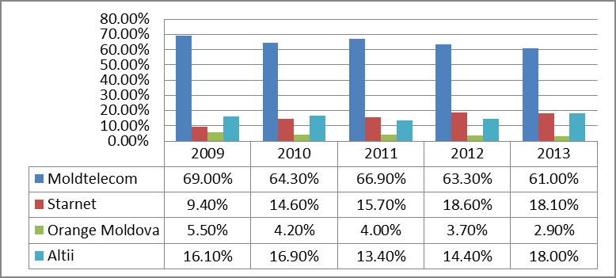
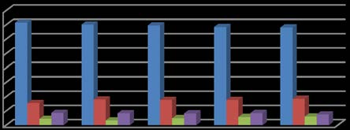

 
СОВЕТ ПО  
КОНКУРЕНЦИИ 
CONSILIUL 
 CONCURENŢEI 
 
PLENUL CONSILIULUI CONCURENŢEI 
 
DECIZIE 
 
 
Nr. APD – 15                                                                                          mun. Chişinău 
din 14.04.2016 
 
 
Plenul Consiliului Concurenţei, 
acționând în temeiul art. 41 alin. (1) lit. h) şi art. 93 alin. (5) ale Legii 
concurenţei nr. 183 din 11.07.2012, Hotărârii Parlamentului nr. 179 din 12.07.2013 
privind numirea în funcţie a membrilor Plenului Consiliului Concurenţei, precum și 
Hotărârii Parlamentului nr. 220 din 27.09.2013 privind numirea în funcţie a unui 
membru al Plenului Consiliului Concurenţei,   
analizând raportul de investigaţie asupra cazului iniţiat prin Dispoziţia 
Consiliului Administrativ al Agenţiei Naţionale pentru Protecţia Concurenţei1 (în 
continuare ANPC) nr. 47 din 13.10.2010, observaţiile făcute de părţi asupra raportului 
de investigaţie şi materialele acumulate în cadrul investigaţiei, 
 
A CONSTATAT: 
 
La data de 28.09.2010 în adresa ANPC a parvenit plângerea „StarNet” S.R.L. nr. 
04-02/1254 cu privire la presupusele acţiuni anticoncurenţiale ale „Moldtelecom” 
S.A. prin practicarea unor prețuri monopoliste joase la lansarea pachetului MaxDSL 
pico pe piaţa serviciilor de acces la Internet din Republica Moldova.  
Consiliul Administrativ al ANPC, prin Dispoziția nr. 47 din 13.10.2010, a inițiat 
investigația referitor la semnele încălcării prevederilor art. 6 din Legea nr. 1103-XIV 
din 30.06.2000 cu privire la protecţia concurenţei de către „Moldtelecom” S.A. 
 
                                                 
1 Conform art. 93 alin. (2) al Legii concurenței nr. 183 din 11.07.2012, succesor de drepturi al Agenţiei Naţionale pentru 
Protecţia Concurenţei este Consiliul Concurenţei. 
 
1 
 

I. 
Părţile implicate 
„Moldtelecom” S.A. - IDNO 1002600048836, este operatorul naţional şi cea 
mai mare companie de telecomunicaţii din Republica Moldova, a cărui fondator şi 
unic acţionar este statul. În prezent întreprinderea prestează o gamă largă de servicii 
de telecomunicaţii: telefonie fixă, telefonie mobilă, Internet, transport de date, 
televiziune digitală ș.a. 
„StarNet” S.R.L. - IDNO 1003600083670, în perioada examinată a fost unul 
dintre cei mai mari operatori în domeniul telecomunicaţiilor din Republica Moldova, 
prestând servicii de Internet, telefonie fixă NGN, televiziune digitală, servicii Data 
Centru, servicii IP tranzit pentru alţi operatori, soluţii licenţiate de protecţie a 
calculatoarelor ș.a.  
Prin Decizia Consiliului de Administrație al ANRCETI nr. 48 din 20.03.2014 a 
fost aprobată cesionarea către „StarNet Soluţii” S.R.L. (IDNO 1013600032967) a 
licenţelor de utilizare a resurselor de numerotare şi a deciziei de atribuire a blocurilor 
de numere deţinute de către „StarNet” S.R.L. 
II. 
Piaţa relevantă: piaţa relevantă a produsului şi piaţa geografică 
relevantă 
Piaţa relevantă a produsului 
Conform art. 4 din Legea concurenței nr. 183 din 11.07.2012 piaţa relevantă a 
produsului cuprinde toate produsele considerate de consumatori ca interschimbabile 
sau substituibile datorită utilizării date acestora, caracteristicilor fizice, funcţionale şi 
a preţului. 
Potrivit 
plângerii 
„StarNet” 
S.R.L., 
presupusa 
încălcare 
din 
partea 
„Moldtelecom” S.A. a avut loc pe piaţa serviciilor de acces la Internet. 
Conform Raportului privind activitatea ANRCETI şi evoluţia pieţelor de 
comunicaţii electronice în anul 2009, piaţa serviciilor de acces la Internet şi 
transmisiuni date cuprindea serviciile de acces la Internet la puncte fixe şi la puncte 
mobile. Serviciile de acces la Internet la puncte fixe erau prestate prin intermediul a 2 
tipuri de tehnologii: DialUp, care cuprindea 8,14% din piaţa accesului la Internet la 
puncte fixe, şi în bandă largă, cu 91,86% din piaţă. Pentru a asigura prestarea 
serviciilor de acces la Internet la puncte fixe în bandă largă operatorii utilizau 
următoarele tehnologii: ADSL, FTTBN/LAN, Cablu TV şi WLL. Planul tarifar 
MaxDSL pico presupune accesul persoanelor fizice la Internet prin intermediul 
tehnologiei ADSL.  
Totodată, este important de menționat că, la data lansării pachetului MaxDSl 
pico, viteza de acces maximal disponibilă caracteristică planului tarifar era de 64 kbps 
 
2 
 

pentru accesul la resursele Internet şi de 256 kbps (128 kbps în cazul MaxDSL pico 
limited) pentru accesul la resurse MD-IX (Moldova Internet Exchange). Cu toate 
acestea, viteza de acces de facto a abonatului se stabilea în funcţie de parametrii 
tehnici ai liniei telefonice. Conform informaţiilor plasate pe pagina electronică a 
întreprinderii „Moldtelecom” S.A, începând cu 13.11.2009 a fost majorată viteza de 
acces la Internet pentru abonaţii Internet MaxDSL, inclusiv pentru planul tarifar 
MaxDSL pico a avut loc o creştere a vitezei maximale până la 512/512 kbps (atât la 
resursele Internet, cât şi la resursele MD-IX). Ulterior, începând cu 01.12.2011, viteza 
de acces la Internet pentru abonaţii MaxDSL pico a fost majorată până la 1/1 Mbps. 
În vederea aprecierii faptului dacă concurenţii „Moldtelecom” S.A. au prestat în 
perioada 2009-2010 servicii de acces la Internet în bandă largă cu amănuntul în 
condiţii similare cu planul tarifar MaxDSL pico, Consiliul Concurenţei a solicitat 
principalilor concurenţi – „StarNet” S.R.L. şi „Arax-Impex” S.R.L., prin scrisorile nr. 
APD-06/94-349 şi respectiv nr. APD-06/93-350 din 21.03.2014, copiile ordinelor de 
lansare a pachetelor propuse clienţilor în perioada 2009-2010. 
Din datele prezentate de către întreprinderi, Consiliul Concurenței a constatat că 
cel mai mic pachet oferit de către „Arax Impex” S.R.L., cu o viteză de 1/1 Mbts/sec 
(dublu faţă de viteza MaxDSL pico pentru anul 2010), costa 180 de lei, mai apoi fiind 
redus până la 148 de lei (100 lei abonamentul propriu zis + 48 lei suplimentar pentru 
arenda buclei locale). La compararea pachetul MaxDSL pico cu alte pachete ADSL 
oferite persoanelor fizice de către acelaşi operator - „Moldtelecom” S.A., prezentate 
prin scrisoarea nr. 01-10-03/6091 din 23.06.2014, se constată că cel mai apropiat ca 
preţ la sfârşitul anului 2009 era planul tarifar MaxDSL nano – 120 lei/lună. Acest 
pachet presupunea aceeaşi viteză de acces către resursele MD-IX ca şi MaxDSL pico 
– 512/512 kbps, însă către resursele externe viteza era de 4 ori mai mare pentru 
download şi de 2 ori mai mare pentru upload (2/1 Mbps).  
Prin urmare, din informaţiile deţinute de Consiliul Concurenţei, în anul 2009 pe 
piaţa accesului cu amănuntul la Internet în puncte fixe nu exista un plan tarifar 
comparabil ca preţ şi ca viteză de acces cu pachetul MaxDSL pico, pachetul dat fiind 
cea mai ieftină alternativă oferită pe piaţă, în acelaşi timp fiind caracterizată şi prin cei 
mai mici parametri de viteză.  
Astfel, reieșind din cele expuse mai sus, se constată că pachetul MaxDSL pico 
nu era substituibil cu alte pachete disponibile pe piață la momentul lansării acestuia 
din punct de vedere al funcționalității (vitezei de acces) și a prețului. Prin urmare, 
presupusa acţiune anticoncurenţială a „Moldtelecom” S.A. a avut loc pe piaţa 
prestării serviciilor de acces la Internet de mică viteză la puncte fixe prin tehnologia 
ADSL cu amănuntul. 
 
3 
 

În acelaşi timp, prin scrisoarea nr. 01-DREA/172 din 21.02.2012 ANRCETI a 
comunicat că „Moldtelecom” S.A. reprezintă un furnizor integrat pe verticală, care 
deţine controlul resurselor esenţiale pentru prestarea cu amănuntul a serviciilor de 
acces în bandă largă şi este cel mai semnificativ furnizor pe această piaţă cu 
amănuntul. Astfel, în vederea determinării faptului dacă activitatea „Moldtelecom” 
S.A. pe piaţa în amonte afectează activitatea concurenților săi pe piaţa cu amănuntul, 
este necesară examinarea pieţei de acces cu ridicata la infrastructura de rețea la un 
punct fix. Prin Hotărârea Consiliul de Administrație al ANRCETI nr. 9 din  
18.03.2010 a fost identificată piața relevantă piața accesului cu ridicata la 
infrastructura de reţea la un punct fix, care cuprinde serviciul de acces la 
bucla/subbucla locală constituită dintr-o pereche de fire metalice din cupru (inclusiv 
acces total sau partajat la bucla/subbucla locală) pe teritoriul Republicii Moldova. 
Astfel, având în vedere cele expuse mai sus, în sensul prezentei investigaţii se 
definesc două pieţe relevante ale produsului: 
1.  Piaţa prestării serviciilor de acces cu amănuntul la Internet de mică viteză la 
puncte fixe prin tehnologia ADSL. 
2. Piaţa prestării serviciilor de acces cu ridicata la infrastructura de rețea la un 
punct fix. 
Piaţa geografică relevantă 
Conform art. 4 din Legea concurenței nr. 183 din 11.07.2012 piața geografică 
relevantă este zona în care întreprinderile sunt implicate în oferta sau cererea de pe 
piața relevantă a produsului. 
Prin urmare, în cadrul investigației au fost luate în considerare atât zona unde 
„Moldtelecom” S.A. prestează consumatorilor finali servicii de acces la Internet de 
mică viteză în bandă largă prin tehnologia ADSL cu amănuntul, cât şi zona unde 
„Moldtelecom” S.A. prestează servicii de acces la infrastructură concurenţilor săi de 
pe piaţa în aval.  
Întrucât reţeaua de telefonie fixă deţinută de „Moldtelecom” S.A., prin care erau 
prestate serviciile de acces la Internet în bandă largă prin tehnologia ADSL și 
serviciile de acces cu ridicata la infrastructura asociată şi bucla locală, avea acoperire 
naţională la data depunerii plângerii, piaţa geografică relevantă se defineşte ca 
teritoriul Republicii Moldova. 
 
 
 
 
 
4 
 

Prin urmare, în sensul cazului investigat, se definesc următoarele piețe relevante: 
1. Piaţa prestării serviciilor de acces cu amănuntul la Internet de mică viteză 
la puncte fixe prin tehnologia ADSL pe teritoriul Republicii Moldova. 
2. Piaţa prestării serviciilor de acces cu ridicata la infrastructura de rețea la un 
punct fix pe teritoriul Republicii Moldova. 
Poziţia dominantă 
Potrivit art. 93 alin. (5) al Legii concurenţei nr. 183 din 11.07.2012 plângerile şi 
cauzele ale căror proceduri de examinare de către Agenţia Naţională pentru Protecţia 
Concurenţei nu s-au încheiat până la data intrării în vigoare a prezentei legi se 
examinează conform normelor de procedură prevăzute de prezenta lege şi normelor 
materiale, inclusiv celor privind răspunderea pentru încălcarea legislaţiei 
concurenţiale, prevăzute de legea în vigoare la data comiterii încălcării. 
În conformitate cu art. 2 din Legea nr. 1103 din 30.06.2000 cu privire la protecția 
concurenței, care era în vigoare la data lansării pachetului MaxDSL pico, situaţia 
dominantă pe piaţă este situaţia exclusivă a agentului economic pe piaţa de mărfuri, 
care îi dă acestuia, singur sau împreună cu alţi agenţi economici, posibilitatea de a 
exercita influenţă decisivă asupra condiţiilor generale de circulaţie a mărfii pe piaţa 
respectivă sau de a împiedica accesul pe piaţă unor alţi agenţi economici. Nu poate fi 
recunoscută dominantă situaţia agentului economic a cărui cotă pe piaţa unei 
anumite mărfi nu depăşeşte 35 la sută. 
În anul 2009 „Moldtelecom” S.A. era singurul operator de telecomunicaţii care 
deţinea o reţea de telefonie fixă cu acoperire naţională, astfel fiind şi singurul 
gestionar al infrastructurii de reţea naţionale necesare prestării serviciilor de acces la 
Internet în bandă largă. Consiliului de Administrație al ANRCETI, prin Hotărârea nr. 
30 din 28.09.2010, a stabilit „Moldtelecom” S.A. drept furnizor cu putere 
semnificativă pe piaţa accesului cu ridicata la infrastructura de reţea la un punct fix, 
iar prin Hotărârea nr. 05 din 28.03.2011 întreprinderii „Moldtelecom” S.A. i-au fost 
impuse obligaţii speciale preventive în legătură cu puterea sa semnificativă pe piața 
sus menționată.  
Astfel, reieșind din cele expuse mai sus, se constată că „Moldtelecom” S.A.  se 
afla în situație dominantă pe piaţa prestării serviciilor de acces cu ridicata la 
infrastructura de rețea la un punct fix pe teritoriul Republicii Moldova în perioada 
examinată. 
Totodată, potrivit Raportului privind activitatea ANRCETI şi evoluţia pieţelor de 
comunicaţii electronice în anul 2009, cota „Moldtelecom” S.A. pe piaţa accesului la 
Internet şi transmisiuni date în funcţie de cifra de afaceri a constituit 69%, 
 
5 
 

întreprinderii „StarNet” S.R.L. îi reveneau 9,4% din piaţă, „Orange Moldova” S.A. 
(succesorul „Telemedia Group” S.A.) deţinea 5,5%,  iar restul companiilor cuprindeau 
cumulativ 16,1%. 
În funcţie de numărul de utilizatori, în anul 2009 cea mai mare cotă pe piaţa 
accesului la Internet în bandă largă a fost deţinută de asemenea de „Moldtelecom” 
S.A. – 71,5%, iar întreprinderii „StarNet” S.R.L. îi reveneau 15,5% din piaţă, „Orange 
Moldova” S.A. deţinea 1,00%, „Sun Communications” S.R.L. – 4,4%, restul 7,6% din 
numărul total de utilizatori erau abonaţii celorlalţi operatori. 
Totuși, Consiliul Concurenței nu dispune de informații despre cotele deținute de 
către „Moldtelecom” S.A. pe piața prestării serviciilor de acces la Internet de mică 
viteză la puncte fixe prin tehnologia ADSL cu amănuntul pe teritoriul Republicii 
Moldova la momentul lansării pachetului MaxDSL pico, întrucât aceste date nu sunt 
publicate în rapoartele ANRCETI și nu au putut fi obținute în volum deplin de la 
întreprinderi din cauza expirării termenului de păstrare a informației. Astfel, situația 
dominantă a întreprinderii „Moldtelecom” S.A. pe piața prestării serviciilor de acces 
la Internet de mică viteză la puncte fixe prin tehnologia ADSL cu amănuntul pe 
teritoriul Republicii Moldova în anul 2009, când a fost lansat planul tarifar MaxDSL 
pico, nu poate fi stabilită. 
III. 
Acte şi fapte constatate 
În plângerea nr. 04-02/1254 din 28.09.2010 „StarNet” S.R.L. a comunicat că 
„Moldtelecom” S.A., prin lansarea pachetului MaxDSL pico cu plata abonamentului 
lunar în sumă de 80 de lei, face abuz de situația sa dominantă prin stabilirea unor 
preţuri monopoliste joase pe piaţa serviciilor de acces la Internet din Republica 
Moldova. În baza plângerii sus menţionate, prin Dispoziţia Consiliului Administrativ 
al ANPC nr. 47 din 13.10.2010, a fost iniţiată acţiunea referitor la semnele încălcării 
prevederilor art. 6 din Legea nr. 1103-XIV din 30.06.2000 cu privire la protecţia 
concurenţei privind aplicarea unor tarife sub nivelul minim al costului pentru pachetul 
MaxDSL pico şi subvenționarea încrucişată a serviciilor de către „Moldtelecom” S.A.  
Pachetul MaxDSL pico a fost lansat la data de 17.08.2009 prin ordinul 
„Moldtelecom” S.A. nr. 348, prezentat ca anexă la scrisoarea „Moldtelecom” S.A. nr. 
01-10-03/3156 din 02.04.2014. Potrivit ordinului, acest plan tarifar a fost lansat în 
scopul sporirii gradului de atractivitate a ofertelor MaxDSL, stimulării vânzărilor şi 
atragerii noilor clienţi. În dependenţă de regiune, planul tarifar MaxDSL pico a fost 
oferit sub 2 forme: MaxDSL pico, disponibil doar pentru regiunile cu capacităţi de 
acces sporite – or. Chişinău, centrele raionale şi localităţile rurale conectate la reţeaua 
de transport date prin link-uri FE/GE (100/1000Mbps), şi MaxDSL pico limited, 
 
6 
 

disponibil pentru localităţile care sunt conectate la reţeaua de transport date prin link-
uri E1 (suburbiile mun. Chişinău şi localităţile rurale). Serviciile urmau să fie prestate 
la un abonament lunar de 80 de lei, inclusiv TVA, în baza tehnologiei ADSL 
(SSG/ISG) persoanelor fizice. La data lansării pachetului, viteza de acces maximal 
disponibilă caracteristică planului tarifar era de 64 kbps pentru accesul la resursele 
Internet şi de 256 kbps (128 kbps în cazul MaxDSL pico limited) pentru accesul la 
resurse MD-IX (Moldova Internet Exchange). Cu toate acestea, viteza de acces de 
facto a abonatului se stabilea în funcţie de parametrii tehnici ai liniei telefonice.  
La data de 21.06.2013, prin ordinul „Moldtelecom” S.A. nr. 488, planul tarifar 
MaxDSL pico a fost redenumit în MaxDSL 90, respectiv plata abonamentului lunar a 
fost majorată de la 80 la 90 de lei.  
Prin ordinul nr. 242 din 24.03.2014 pachetul MaxDSL 90 a fost redenumit în 
MaxDSL 95, cu majorarea plăţii lunare de la 90 la 95 lei pentru toţi abonaţii. 
De asemenea, conform informaţiilor plasate pe pagina electronică a întreprinderii 
„Moldtelecom” S.A, începând cu 13.11.2009 a fost majorată viteza de acces la 
Internet pentru abonaţii Internet MaxDSL, inclusiv pentru planul tarifar MaxDSL pico 
a avut loc o creştere a vitezei maximale până la 512/512 kbps (atât la resursele 
Internet cât şi la resursele MD-IX). Ulterior, începând cu 01.12.2011, viteza de acces 
la Internet pentru abonaţii MaxDSL pico a fost majorată până la 1/1 Mbps. 
În vederea confirmării sau infirmării faptului că „Moldtelecom” S.A. a practicat 
preţuri de ruinare prin lansarea planului tarifar MaxDSL pico, ANPC, prin scrisoarea 
nr. APD-13/466-1610 din 17.11.2010, a solicitat reclamatului să prezinte descifrarea 
tarifului în valoare de 80 de lei aplicat pentru acest pachet. Prin scrisoarea nr. 01-04-
11/106 din 05.01.2011 „Moldtelecom” S.A. a comunicat că nu a aplicat tarife sub 
nivelul minim al costului pentru pachetul MaxDSL pico şi a prezentat Algoritmul de 
Calcul al Tarifelor pentru Serviciile MaxDSL şi MaxFiber pentru 9 luni 2009 şi 
Determinarea cheltuielilor perioadei de gestiune aferente serviciului MaxDSL şi 
MaxFiber, elaborate în baza Metodologiei de calcul a tarifelor pentru serviciile de 
telecomunicaţii şi informatică, aprobată prin Hotărârea Guvernului Republicii 
Moldova nr. 323 din 18.03.2002. Potrivit calculelor prezentate de către 
„Moldtelecom” S.A., costul fix a unui pachet MaxDSL şi MaxFiber a constituit […] 
lei/lună, cheltuielile perioadei de gestiune pentru un pachet - […] lei/lună, iar costul 
variabil -  […] lei/lună. Prin urmare, costul total al unui pachet MaxDSL pico a 
constituit […] lei/lună. Astfel, se constată că la preţul pachetului de 80 de lei 
operatorul obţinea un profit de […] (80lei/lună*100%/120% = 66,66 lei/lună venit 
fără TVA; 66,66-[…]=[…] lei/lună profit). În acest caz profitabilitatea planului tarifar 
este de […]% ([…] lei/ 80 lei *100%).  
 
7 
 

Este important de specificat faptul că la calculul costului unitar al pachetului 
MaxDSL pico costul accesului partajat la bucla locală a fost identic cu tariful practicat 
de către „Moldtelecom” S.A. pentru acest serviciu pentru furnizorii alternativi – 40 de 
lei. Prin urmare, „Moldtelecom” S.A. a realizat calculul de cost al pachetului luând în 
considerare costul accesului la infrastructură de parcă acesta ar fi fost procurat de la 
un furnizor străin, ceea ce exclude posibilitatea aplicării unei practici de micșorare a 
marjei prin intermediul lansării pachetului MaxDSL pico. 
Prin scrisoarea nr. APD-12/354-1350 din 21.09.2011 ANPC a solicitat ANRCETI 
să îşi expună poziţia referitor la calculele cu privire la descifrarea tarifului prezentate 
de către „Moldtelecom” S.A. prin scrisoarea nr. 01-04-11/106 din 05.01.2011. 
În scrisoarea nr. 01-DREA/172 din 21.02.2012 ANRCETI a comunicat că 
„Moldtelecom” S.A. reprezintă un furnizor integrat pe verticală, care deţine controlul 
resurselor esenţiale pentru activitatea cu amănuntul pe piaţa serviciilor de acces la 
Internet în bandă largă şi este cel mai semnificativ furnizor pe această piaţă cu 
amănuntul. În acest context, ANRCETI a accentuat importanţa efectuării testului 
concurentului la fel de eficient pentru a identifica dacă a avut loc un abuz de poziție 
dominantă din partea „Moldtelecom” S.A. Acest test constă în cercetarea faptului 
dacă un furnizor ipotetic, care prestează servicii de acces la Internet în bandă largă 
prin ADSL şi are aceeaşi structură a costurilor ca şi „Moldtelecom” S.A. (cu condiţia 
că resursele interne ale „Moldtelecom” S.A. să fie utilizate astfel, de parcă ar fi 
achiziţionate de la o companie separată), ar putea să activeze în mod profitabil pe 
piaţa cu amănuntul. 
Potrivit ANRCETI, înainte de a face testul concurentului la fel de eficient, este 
necesar să se identifice dacă oferta dată va fi luată ca o activitate aparte (ceea ce ar 
presupune raportarea costurilor specifice acestui pachet la tariful cu amănuntul) sau ca 
parte componentă a activităţii cu amănuntul de prestare a serviciilor în bandă largă (în 
acest caz costurile totale ale activităţii de acces la Internet în bandă largă pentru 
persoane fizice ar urma să fie raportate la veniturile generate de aceste servicii). În 
viziunea ANRCETI, examinarea planului tarifar MaxDSL pico drept o activitate 
distinctă şi analiza competitivităţii sub acest aspect este potrivită în cazurile când 
există o segmentare anumită a pieţei, iar tarifele de ruinare aplicate pe anumite 
segmente ale pieţei pot produce excluderea concurenţilor îngust specializaţi. Piaţa 
serviciilor de acces la Internet în bandă largă în 2009 nu era caracterizată prin astfel 
de specializări înguste pe segmente de piaţă. Astfel, majoritatea concurenţilor aveau 
oferte corespondente pentru majoritatea segmentelor de piaţă pentru sectorul 
rezidenţial. Din aceste considerente ANRCETI consideră oportun să fie examinate 
 
8 
 

toate serviciile prestate de „Moldtelecom” S.A. prin ADSL persoanelor fizice prin 
prisma profitabilităţii activităţii date cu ajutorul testului concurentului egal de eficient. 
ANRCETI a analizat costurile prezentate de „Moldtelecom” S.A. prin scrisoarea 
nr. 01-04-11/106 din 05.01.2011 şi a comunicat ANPC că nu este de acord cu 
raţionamentele „Moldtelecom” S.A. pe o serie de puncte şi, drept urmare, consideră 
că rezultatul final obţinut de „Moldtelecom” S.A. nu reflectă costul economic al 
serviciilor date. ANRCETI a comunicat că, din experienţa sa, repartizarea consumului 
şi cheltuielilor pe tipuri de activităţi conform tabelului şi procedurilor interne al 
„Moldtelecom” S.A. permit o repartizare sumară a costurilor, şi există îndoieli cu 
privire la faptul dacă costurile indirecte şi comune au fost obiectiv alocate între 
această activitate şi activităţile tradiţionale ale întreprinderii. Spre exemplu, eforturile 
administrative ale „Moldtelecom” S.A. pentru gestionarea producerii, promovării şi 
operării serviciului Internet au reprezentat în anul 2009 […]% din efortul 
administrativ al întreprinderii (raportul costurilor administrative şi generale ale 
„Moldtelecom” S.A. atribuite activităţii Internet la total costuri generale şi 
administrative ale întreprinderii). În opinia ANRCETI un furnizor egal de eficient de 
talia „Moldtelecom” S.A. nu ar reuşi să gestioneze activităţile date cu asemenea 
cheltuieli. Totodată, raportul dintre cheltuielile comerciale ale unităţii Internet la 
consumurile de producere este de […]%, faţă de raportul similar de […]% a 
cheltuielilor comerciale ale telefoniei fixe locale. Mărimea cheltuielilor comerciale ale 
unităţii Internet denotă că sunt alocate doar cheltuielile comerciale directe ale 
activităţii Internet, iar cheltuielile comerciale indirecte (împărţite cu alte activităţi 
tradiţionale) sunt în mare parte alocate activităţilor tradiţionale.  
Ţinând cont de obiecţiile prezentate de către ANRCETI prin scrisoarea nr. 01-
DREA/172 din 21.02.2012, a apărut necesitatea verificării anumitor poziţii din 
calculul tarifului prezentat de către „Moldtelecom” S.A. Astfel, prin scrisoarea nr. 
APD-12/39-134 din 01.03.2013 adresată „Moldtelecom” S.A., Consiliul Concurenţei 
a solicitat prezentarea cheltuielilor legate de pachetul MaxDSL pico (lunar pentru un 
pachet): uzura utilajului, salarizarea, reclama, accesul la resursele Internet ş.a. Prin 
scrisoarea nr. 01-10-02/2197 din 19.03.2013 „Moldtelecom” S.A. a comunicat că nu 
este posibil de prezentat cheltuielile pentru pachetul MaxDSL pico pe articole 
deoarece evidenţa cheltuielilor pentru serviciul MaxDSL/Max Fiber se efectuează 
pentru întreg serviciul, dar nu pentru fiecare pachet separat. Astfel, din cauza lipsei 
unei contabilizări separate a cheltuielilor, verificarea cu precizie a suspiciunilor 
ANRCETI enumerate mai sus nu este posibilă.   
Astfel, se constată că, deși în perioada când a avut loc lansarea pachetului 
MaxDSL pico „Moldtelecom” S.A. nu ducea o contabilitate separată a cheltuielilor, 
 
9 
 

conform calculului prezentat Consiliului Concurenței și explicațiilor ulterioare pe 
marginea acestuia, „Moldtelecom” S.A. nu a înregistrat pierderi în urma practicării 
pachetului MaxDSL pico, veniturile medii obținute fiind mai mari decât costurile 
medii totale suportate. 
Totodată, Consiliul Concurenţei a cercetat posibilitatea aplicării de către 
„Moldtelecom” S.A. a practicii de micşorare a marjei (margin squeeze) la prestarea 
serviciului de acces partajat la bucla locală operatorilor alternativi.  
Bucla locală reprezintă circuitul fizic cu conductor dublu torsadat metalic care 
conectează punctul terminal al reţelei de la locuinţa abonatului cu repartitorul 
principal sau o facilitate echivalentă în reţeaua de telefonie publică fixă.  
Conform Programului de dezvoltare a accesului la Internet în bandă largă pe anii 
2010-2013, aprobat prin Hotărârea Guvernului Republicii Moldova nr. 1077 din  
17.11.2010, pe parcursul anului 2009 numărul utilizatorilor conectaţi la Internet prin 
intermediul tehnologiei ADSL a constituit 76% din numărul total de conectări în 
bandă largă. Cota sporită de conectări la Internet prin intermediul xDSL este 
condiţionată de limitarea de către S.A. „Moldtelecom” a accesului furnizorilor 
alternativi la infrastructura asociată, bucla locală şi reţeaua magistrală. Ca rezultat, 
creşterea numărului de abonaţi la serviciile de acces în bandă largă la Internet în 
baza tehnologiei xDSL, în mare măsură, este determinată de un singur furnizor – S.A. 
„Moldtelecom”. Această situaţie se explică şi prin creşterea cererii pentru serviciile 
în bandă largă în localităţile rurale, unde furnizorul nu are concurenţi. 
Din informaţiile prezentate de „Moldtelecom” S.A. în scrisoarea nr. 01-10-
03/3156 din 02.04.2014, se constată că în perioada 2008-2009 tariful pentru accesul 
partajat la bucla locală constituia 48 de lei, inclusiv TVA, aprobat prin ordinul 
„Moldtelecom” S.A. nr. 148 din 13.05.2004. La momentul aprobării tarifului costul 
lunar al acestui serviciu era de […] lei (menţionat de către reclamant în scrisoarea nr. 
01-10-02/2197 din 19.03.2013), pentru ca mai apoi în calculul de cost (Tabelul 1) să 
fie indicată suma de […] lei. La prestarea serviciilor de acces partajat la bucla locală 
„Moldtelecom” S.A. a înregistrat o rată a profitabilităţii de […]%, respectiv un profit 
de […] lei pentru fiecare unitate închiriată. În acelaşi timp, „Moldtelecom” S.A. a 
comunicat că acest tarif nu a fost aprobat de ANRTI (în prezent ANRCETI), dar nici 
nu au parvenit nici un comentariu la capitolul respectiv. 
Prin Hotărârea Consiliului de Administraţie al ANRCETI nr. 56 din 26.09.2013 
cu privire la impunerea obligaţiilor speciale preventive „Moldtelecom” S.A. în 
legătură cu puterea sa semnificativă pe piaţa accesului cu ridicata la infrastructura de 
reţea în punct fix, preţul lunar maximal, fără TVA, pentru accesul partajat la bucla 
 
10 
 

locală de cupru este de 35 de lei. În acelaşi timp, preţul de 35 de lei (fără TVA) pentru 
plata lunară pentru acces partajat la bucla locală este menţionat în Anexa 3 a Ofertei 
de referinţă pentru acces publicată pe adresa electronică a reclamatului.2 În legătură 
cu acest fapt, prin scrisoarea nr. 01-10-03/609 din 23.06.2014, „Moldtelecom” S.A. a 
comunicat că tariful pentru accesul partajat la bucla locală a fost modificat şi aprobat 
în mărime de 35 de lei prin ordinul nr. 409 din 30.06.2011, după impunerea 
obligaţiilor speciale preventive pentru „Moldtelecom” S.A. în legătură cu puterea sa 
semnificativă pe piaţa accesului la infrastructura de reţea la un punct fix.  
Din tabelul 1 se observă că în anul 2009 „Moldtelecom” S.A. a oferit […] unităţi 
de buclă locală partajată, obţinând un venit de […] mii lei, iar în 2010 au fost oferite 
[…] unităţi de buclă locală partajată cu un venit de […] mii lei.  
Tabelul 1 
Serviciul de acces partajat la bucla locală în 2009-2010 oferit de „Moldtelecom” SA 
Venitul obţinut, 
mii lei (incl.TVA) 
2009 
2010 
2009 
2010 
1. 
StarNet 
[…] 
[…] 
 
 
2. 
Orange 
[…] 
[…] 
 
 
3. 
Alit 
[…] 
[…] 
 
 
4. 
Arax 
[…] 
[…] 
 
 
5. 
Sun Communications 
[…] 
[…] 
 
 
6. 
Nordlinks 
[…] 
[…] 
 
 
Total 
[…] 
[…] 
[…] 
[…] 
 Sursa: Anexa la scrisoarea „Moldtelecom” S.A. nr. 01-10-02/2197 din 19.03.2013 
Cantitatea buclei 
Nr. 
Denumirea 
întreprinderii 
locale partajate 
De asemenea, potrivit Raportului ANRCETI cu privire la analiza pieței cu 
ridicata în bandă largă la data de 24.09.2010, piaţa de acces cu ridicata la bucla locală 
este în proporţie de 95% self-supply  (95% din cantitatea de buclă locală era folosită 
de însuşi „Moldtelecom” S.A.). Astfel, cantitatea de buclă locală partajată operatorilor 
alternativi este nesemnificativă în raport cu autofurnizările „Moldtelecom” S.A. 
Totuşi, din datele prezentate în tabelul 1 se constată că cea mai mare cantitate de buclă 
locală a fost închiriată de către „StarNet” S.R.L. – 2614 unităţi în anul 2009 şi 1739 
unităţi în anul 2010.  
Prin scrisoarea nr. SN14/456 din 07.07.2014 „StarNet” S.R.L. a comunicat că 
accesul la bucla locală de cupru este necesar doar pentru deservirea abonaţilor prin 
intermediul tehnologiei ADSL. Din Tabelul 2 se observă că „StarNet” S.R.L. în 
                                                 
2http://www.moldtelecom.md/common/documents/OFERTA%20DE%20REFERIN%C5%A2%C4%82%20PENTRU%2
0ACCES-2014_0.pdf 
 
11 
 

perioada 2009-2010 presta servicii clienţilor săi în proporţie de 91-93% prin 
tehnologia FTTx, tehnologie care nu presupune necesitatea accesului la bucla locală. 
 Tabelul 2 
 Numărul de utilizatori deserviţi de „StarNet” S.R.L. în dependenţă de tehnologia 
utilizată: 
Nr. 
Tipul tehnologiei  
2009 
Cota, % 
2010 
Cota, % 
1. 
ADSL 
[…] 
[…] 
[…] 
[…] 
2. 
FTTx 
[…] 
[…] 
[…] 
[…] 
3. 
Wi Fi 
[…] 
[…] 
[…] 
[…] 
 
Total 
[…] 
[…] 
[…] 
[…] 
Sursa: Elaborat în baza informaţiilor prezentate prin scrisoarea „StarNet” SRL nr. SN14/456 
din 07.07.2014 
Astfel, în 2009-2010 „StarNet” S.R.L. depindea în măsură de […]% de serviciile cu 
ridicata de acces partajat la bucla locală prestate de „Moldtelecom” S.A. De aici 
rezultă că un posibil abuz prin micşorarea marjei din partea „Moldtelecom” S.A. nu ar 
fi afectat în mare măsură activitatea „StarNet” S.R.L., respectiv nu ar fi fost posibilă 
excluderea concurentului de pe piaţă. 
De asemenea, analizând informaţiile prezentate în tabelele 1 și 2, se observă că în anul 
2009 „StarNet” S.R.L. a închiriat […] unităţi de buclă locală de la „Moldtelecom” 
S.A., deservind numai […] abonaţi prin intermediul tehnologiei ADSL. În anul 2010 
cantitatea de buclă închiriată de „StarNet” S.R.L. a constituit numai […] de unităţi, pe 
când numărul abonaţilor deserviţi prin ADSL a crescut până la […] abonaţi. Astfel, se 
constată că în anul 2010 „StarNet” S.R.L. şi-a redus dependenţa de serviciile de acces 
la infrastructură prestate de către „Moldtelecom” S.A., dat fiind faptul că aproape 
jumătate din abonaţii deserviţi prin intermediul tehnologiei ADSL erau conectaţi la 
reţea prin infrastructura proprie construită de operator.  
Totodată, conform rapoartelor ANRCETI, în anul 2010 ponderea conexiunilor la 
Internet în bandă largă în baza tehnologiei FTTx a crescut cu 14,7% şi a constituit 
34,2% din volumul total de conexiuni, iar cea a conexiunilor ADSL a scăzut cu 13,3% 
şi a alcătuit 62,4%. Creşterea ponderii conexiunilor FTTx se explică prin expansiunea 
acestor tipuri de reţele în zonele urbane dens populate, mai ales în mun. Chişinău. În 
acelaşi timp, tehnologia ADSL are un potenţial mare de extindere în zonele rurale şi 
cele urbane cu o densitate redusă, unde reţelele optice active nu pot să asigure 
economii comparabile de scară şi densitate, iar infrastructura telefonică tradiţională 
poate fi utilizată mai eficient. Tendinţa enunţată mai sus s-a păstrat şi în anul 2011 – 
conectările prin FTTx au constituit 39,7%, iar prin ADSL – 55,4%. 
În vederea evaluării dacă concurenţii „Moldtelecom” S.A. au prestat în perioada 
2009-2010 servicii de acces la Internet în bandă largă cu amănuntul în condiţii 
 
12 
 

similare cu planul tarifar MaxDSL pico, Consiliul Concurenţei a solicitat principalilor 
concurenţi – „StarNet” S.R.L. şi „Arax-Impex” S.R.L., prin scrisorile nr. APD-06/94-
349 şi respectiv nr. APD-06/93-350 din 21.03.2014, copiile ordinelor de lansare a 
pachetelor propuse clienţilor în perioada 2009-2010, cu specificarea tehnologiei de 
transmitere a datelor utilizată, parametrilor şi condiţiilor contractuale propuse. Totuşi, 
din cauza expirării termenului de păstrare a informaţiilor (conform art. 20 alin. (3) lit. 
c) din Legea comunicaţiilor electronice nr. 241 din 15.11.2007 informaţiile ce ţin de 
reţeaua Internet vor fi păstrate pe o perioadă de 6 luni şi prezentate organelor 
împuternicite potrivit legii, iar ordinele de lansare/modificare a ofertelor nu cad sub 
incidenţa documentelor de strictă evidenţă), nu a fost posibilă o analiză comparativă 
complexă a pachetului MaxDSL pico cu ofertele celorlalţi operatori pe piaţă în 
perioada supusă examinării.  
Astfel, prin scrisoarea nr. SNr1/364 din 29.05.2014 „StarNet” S.R.L. a 
comunicat că nu deține informaţia cu privire la oferta de prestare a serviciilor Internet 
în perioada 2009-2010. 
Din datele de care dispune, Consiliul Concurenței a constatat că prin ordinul 
intern „Arax Impex” S.R.L. nr. 20/IF din 28.04.2010 cu privire la modificarea preţului 
la pachetele acces Internet pentru persoane fizice (prezentat prin scrisoarea nr. 1 din 
02.04.2014), au fost micşorate preţurile pentru o serie de pachete de bază pentru acces 
la Internet prin ADSL - Unlimited (fără limită de trafic). Astfel, cel mai mic pachet, cu 
o viteză de 1/1 Mbts/sec (dublu faţă de viteza MaxDSL pico pentru anul 2010), costa 
180 de lei, mai apoi fiind redus până la 148 de lei (100 lei abonamentul propriu zis + 
48 lei suplimentar pentru arenda buclei locale). 
La compararea pachetul MaxDSL pico cu alte pachete ADSL oferite persoanelor 
fizice de către acelaşi operator - „Moldtelecom” S.A., prezentate prin scrisoarea nr. 
01-10-03/6091 din 23.06.2014, se constată că cel mai apropiat ca preţ la sfârşitul 
anului 2009 era planul tarifar MaxDSL nano – 120 lei/lună. Acest pachet presupunea 
aceeaşi viteză de acces către resursele MD-IX ca şi MaxDSL pico – 512/512 kbps, 
însă către resursele externe viteza era de 4 ori mai mare pentru download şi de 2 ori 
mai mare pentru upload (2/1 Mbps). 
Prin urmare, din informaţiile deţinute de Consiliul Concurenţei, în anul 2009 pe 
piaţa accesului cu amănuntul la Internet în puncte fixe nu exista un plan tarifar 
comparabil ca preţ şi ca viteză de acces cu pachetul MaxDSL pico, pachetul dat fiind 
cea mai ieftină alternativă oferită pe piaţă, în acelaşi timp fiind caracterizată şi prin cei 
mai mici parametri de viteză. 
Un aspect important şi esenţial care urmează a fi analizat este faptul dacă 
 
13 
 

acţiunile „Moldtelecom” S.A. au afectat concurenţa sau au fost lezate interesele 
consumatorilor. În această ordine de idei se constată următoarele. 
Prin scrisorile nr. 01-10-02/2197 din 19.03.2013 şi nr. 01-10-03/3156 din 
02.04.2014 „Moldtelecom” S.A. a prezentat evoluţia numărului de abonaţi la pachetul 
MaxDSL pico pe parcursul perioadei examinate:  
Tabelul 3  
Dinamica numărului de abonaţi la pachetul MaxDSL pico în 2009-2013 
Nr. 
Indicatori 
2009 
2010 
2011 
2012 
2013 
1. 
Numărul de abonaţi la sfârşitul anului […] 
[…] 
[…] 
[…] 
[…] 
 
[…] 
[…] 
[…] 
[…] 
2.  
Numărul de abonaţi noi conectaţi pe 
parcursul anului 
 
[…] 
[…] 
[…] 
[…] 
3. 
Numărul 
de 
abonaţi 
plecaţi 
pe 
parcursul anului 
Numărul 
total 
de 
abonaţi 
prin 
tehnologia 
ADSL 
în 
Republica 
Moldova 
141 508 167 775 
140 964  
203 000 
207 700 
 
4. 
Ponderea abonaţilor la planul tarifar 
MaxDSL pico în total abonaţi prin 
ADSL în Republica Moldova 
 
[…] 
 
[…] 
 
[…] 
 
[…] 
 
[…] 
 
 
5. 
 
 
 
6. 
Numărul total de abonaţi în bandă 
largă în Republica Moldova 
186 973 269 067 
355 099 
417 200 
467 100 
[…] 
[…] 
[…] 
[…] 
[…] 
Ponderea abonaţilor la planul tarifar 
MaxDSL pico în total abonaţi în 
bandă largă în Republica Moldova 
 
7. 
Sursa: Elaborat în baza scrisorilor „Moldtelecom” S.A. nr. 01-10-02/2197 din 19.03.2013 şi nr. 01-10-
03/3156 din 02.04.2014 şi rapoartelor ANRCETI 
Din datele prezentate în Tabelul 3 se observă că în perioada supusă examinării 
numărul abonaţilor la planul tarifar MaxDSL pico a variat între […] şi […] abonaţi, 
fiind într-o descreştere constantă începând cu anul 2011. Examinând raportul dintre 
numărul de abonaţi MaxDSL pico şi numărul total de abonaţi pe piaţa serviciilor de 
acces la Internet se constată că acest plan tarifar a ocupat nu mai mult de […]% din 
numărul total de abonaţi pe piaţa serviciilor de accesul la Internet prin tehnologia 
ADSL şi nu mai mult de […]% din numărul de abonaţi care beneficiază de servicii de 
acces la Internet în bandă largă. Prin urmare, ţinând cont de cota scăzută de piaţă în 
funcţie de numărul de abonaţi, se constată că planul tarifar MaxDSL pico oferit de 
către „Moldtelecom” S.A. nu ar fi putut să influenţeze în mod semnificativ mediul 
concurenţial.    
 
14 
 

Totodată, în vederea aprecierii efectului practicării de către „Moldtelecom” S.A. 
a planului tarifar MaxDSL pico, este necesar să examinăm evoluția cotelor 
operatorilor pe piaţa relevantă. Totuși, ținând cont de faptul că Consiliul Concurenței 
nu deține informații despre evoluția cotelor deținute de către întreprinderi pe piața 
prestării serviciilor de acces la Internet de mică viteză la puncte fixe prin tehnologia 
ADSL cu amănuntul pe teritoriul Republicii Moldova, a fost examinată evoluția 
cotelor de piață în perioada 2009-2013 pe piața serviciilor de acces la Internet, care 
este o piață mai largă decât piața relevantă. 
Potrivit raportului anual al ANRCETI, în anul 2009 pe piaţa serviciilor de acces 
la Internet şi transmisiuni date au activat 50 de furnizori. Din figura de mai jos se 
observă că, conform situaţiei din 31.12.2009, cele mai mari cote de piaţă în funcţie 
de cifra de afaceri au fost deţinute de „Moldtelecom” S.A. – 69%, „StarNet” S.R.L. 
– 9,4% şi „Orange Moldova” S.A. – 5,5%. 
Figura 1. Evoluţia cotelor de piaţă a furnizorilor, în funcţie de cifra de afaceri 

 
              Sursa: Rapoartele ANRCETI 
Ceilalţi 47 de furnizori au înregistrat cote de piaţă nesemnificative, deţinând 
cumulativ 16,9% din piaţă în funcţie de cifra de afaceri. În 2010, următorul an după 
lansarea planului tarifar Max DSL pico, cota „Moldtelecom” S.A. a înregistrat o 
reducere de 4,7%, cumulând 64,3 %, în timp ce cota „StarNet” S.R.L. s-a majorat 
până la 14,6%. În anul 2011 „Moldtelecom” S.A. şi-a majorat cota până la 66,9%, iar 
„StarNet” S.R.L. – până la 15,7%. Începând cu anul 2012 cota „Moldtelecom” S.A. a 
fost în descreştere – 63,3% în 2012 şi 61% în 2013. Cota „StarNet”  S.R.L. în anul 
2012 a constituit 18,6%, iar în 2013 – 18,1%.  
În acelaşi timp, a fost analizată evoluţia cotelor de piaţă a operatorilor în funcţie 
de numărul de utilizatori. Din figura 2 se observă că, cota de piaţă a „Moldtelecom” 
S.A. a fost într-o descreştere continuă pe parcursul perioadei examinate, începând cu 
71,5% în anul 2009 şi până la 68,1% în anul 2013. Cota „StarNet” S.R.L. a înregistrat 
 
15 
 

o creştere semnificativă în anul 2010 faţă de 2009 de la 15,5% la 18%. În perioada 
2011-2012 cota „StarNet” S.R.L. a constituit 17,06%, iar în 2013 s-a majorat până la 
18,4% din piaţă în funcţie de numărul de utilizatori. 
Figura 2. Evoluţia cotelor de piaţă a furnizorilor, în funcţie de numărul utilizatorilor

0.00%
10.00%
20.00%
30.00%
40.00%
50.00%
60.00%
70.00%
80.00%
2009
2010
2011
2012
2013
Moldtelecom
71.50%
70.10%
69.50%
68.40%
68.10%
Starnet
15.50%
18.00%
17.60%
17.60%
18.40%
Sun Communications
4.40%
3.30%
4.80%
5.70%
6.00%
Altii
8.60%
8.30%
8.10%
8.40%
7.50%
 
Sursa: Rapoartele ANRCETI 
Prin urmare, ţinând cont de faptul că cotele de piață a concurenților 
„Moldtelecom” S.A. au crescut continuu pe baza descreșterii cotei de piață a 
„Moldtelecom” S.A., se constată faptul că lansarea pachetului MaxDSL Pico. nu a 
avut ca efect restrângerea, împiedicarea sau denaturarea concurenței pe piața prestării 
serviciilor de acces la internet. 
Prin scrisorile nr. APD-05/52-258, nr. APD-05/51-257 și nr. APD-05/50-256 din 
18.02.2016, în conformitate cu prevederile art. 59 al Legii concurenței nr. 183 din 
11.07.2012, Consiliul Concurenței a remis părților implicate raportul de investigație 
pentru a le oferi acestora posibilitatea de a prezenta observații pe marginea acestuia. 
„Moldtelecom” S.A., prin scrisoarea nr. 01-10-03/1911 din 25.02.2016, a 
comunicat că problema abordată a fost elucidată de către Consiliul Concurenței 
complet și în mod obiectiv, iar concluziile sunt justificate. „StarNet” S.R.L. și 
„StarNet Soluții” S.R.L. nu au prezentat observaţii în termenul prevăzut de art. 59 
alin. (3) al Legii concurenţei nr. 183 din 11.07.2012. 
IV. 
Calificarea legală a acţiunilor constatate 
Analizând acţiunile descrise mai sus, Consiliul Concurenţei reţine următoarele: 
• În anul 2009 pe piaţa prestării serviciilor de acces la Internet în puncte fixe cu 
amănuntul nu exista un plan tarifar comparabil ca preţ şi ca viteză de acces cu 
pachetul MaxDSL pico, pachetul dat fiind cea mai ieftină alternativă oferită pe piaţă, 
în acelaşi timp fiind caracterizată şi prin cei mai mici parametri de viteză. 
 
16 
 

• Deși în perioada lansării pachetului MaxDSL pico „Moldtelecom” S.A. nu 
realiza contabilizarea separată a costurilor și cheltuielilor întreprinderii pe activități, 
potrivit calculelor prezentate de către „Moldtelecom” S.A. și explicațiilor pe marginea 
acestora venitul mediu lunar obținut din practicarea pachetului MaxDSL pico a 
depășit costurile medii totale aferente acestei activități. 
• Începând cu anul 2009, pachetul MaxDSL pico a deţinut cel mult de […]% din 
piaţa serviciilor de acces la Internet în bandă largă, numărul abonaţilor fiind într-o 
descreştere continuă începând cu anul 2011. 
• Lansarea planului tarifar MaxDSL pico nu a avut ca efect limitarea concurenţei 
pe piaţa prestării serviciilor de acces la Internet în bandă largă cu amănuntul, întrucât 
în perioada 2009-2010 cota de piaţă a „Moldtelecom” S.A. a fost în descreştere atât în 
dependenţă de cifra de afaceri, cât şi în dependenţă de numărul de utilizatori, pe când 
cota deţinută de „StarNet” S.R.L. a crescut.  
• Ținând cont de faptul că în 2009-2010 „StarNet” S.R.L. depindea în măsură de 
[…]% de serviciile cu ridicata de acces partajat la bucla locală prestate de 
„Moldtelecom” S.A., un posibil abuz de poziție dominantă prin micşorarea marjei din 
partea „Moldtelecom” S.A. nu ar fi afectat în mare măsură activitatea „StarNet” 
S.R.L., respectiv nu ar fi fost posibilă excluderea concurentului de pe piaţă 
Prin urmare, având în vedere că, conform calculului de cost prezentat de către 
„Moldtelecom” S.A., lansarea planului tarifar MaxDSL pico a fost profitabilă, se 
constată că pe parcursul desfășurării investigației nu au fost stabilite probe suficiente 
privind încălcarea prevederilor art. 6 din Legea nr. 1103-XIV din 30.06.2000 cu 
privire la protecţia concurenţei de către „Moldtelecom” S.A. care ar justifica aplicarea 
de măsuri corective sau sancțiuni. 
Reieşind din constatările expuse mai sus, în temeiul art. 39, art. 41, precum și 
art. 93 alin. (5) al Legii concurenţei nr. 183 din 11.07.2012, Plenul Consiliul 
Concurenţei 
 
DECIDE: 
1.     A înceta examinarea cazului iniţiat prin Dispoziția Consiliului de Administrare al 
Agenției Naționale pentru Protecția Concurenței nr. 47 din 13.10.2010 deoarece pe 
parcursul desfăşurării acesteia nu au fost descoperite probe suficiente privind 
încălcarea prevederilor art. 6 al Legii nr. 1103-XIV din 30.06.2000 cu privire la 
protecţia concurenţei, care ar justifica aplicarea de măsuri corective sau sancţiuni. 
 
17 
 

2.   Prezenta Decizie intră în vigoare la data adoptării şi va fi adusă la cunoştinţă 
părţilor. 
 
 
 
Preşedintele Plenului  
Consiliului Concurenţei                                                                 Viorica CĂRARE 
 
18 
 
