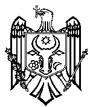

 
СОВЕТ ПО  
КОНКУРЕНЦИИ 
CONSILIUL 
 CONCURENŢEI 
 
PLENUL CONSILIULUI CONCURENŢEI 
 
DECIZIE 
 
 
Nr. APD – 52                                                                                     mun. Chişinău 
din 07.12.2016 
 
Plenul Consiliului Concurenţei, 
 
acționând în temeiul art. 41 alin. (1) lit. h) al Legii concurenţei nr. 183 din 
11.07.2012, Hotărârii Parlamentului nr. 179 din 12.07.2013 privind numirea în 
funcţie a membrilor Plenului Consiliului Concurenţei, precum și Hotărârii 
Parlamentului nr. 220 din 27.09.2013 privind numirea în funcţie a unui membru al 
Plenului Consiliului Concurenţei,  
 
analizând raportul de investigaţie asupra cazului iniţiat prin Dispoziţia 
Plenului Consiliului Concurenţei nr. 8 din 29.08.2014, materialele acumulate în 
cadrul investigaţiei, observaţiile făcute de părţi asupra raportului de investigaţie, 
precum și după desfășurarea audierilor, 
 
A CONSTATAT: 
La data de 17.07.2014 în adresa Consiliului Concurenței a parvenit 
plângerea cu numărul de intrare 1235 depusă de […], referitor la refuzul Asociaţiei 
Obşteşti Asociaţia „Drepturi de Autor şi Conexe” (în continuare AsDAC) de a 
prezenta Agenţiei de Stat pentru Proprietate Intelectuală (în continuare AGEPI), 
conform Protocolului şedinţei din 24.01.2014, informaţii cu referire la cotele ce îi 
revin din volumul total al obiectelor drepturilor de autor şi conexe valorificate. Ca 
urmare a examinării preliminare a plângerii, Plenul Consiliului Concurenţei prin 
Dispoziţia nr. 8 din 29.08.2014, a iniţiat investigația referitor la semnele încălcării 
art. 11 al Legii concurenţei nr. 183 din 11.07.2012 de către AsDAC. 
 
I. Părţile implicate 
Reclamantul: […] 
 
Reclamatul: Asociaţia Obştească Asociaţia „Drepturi de Autor şi 
Conexe” - IDNO 1010620009034, asociație obștească necomercială și 
nonguvernamentală constituită la 21.05.1999 prin libera asociere a autorilor și 
1 
 

interpreților, având ca activitate principală administrarea pe principii colective a 
drepturilor patrimoniale de autor și, ca activitate secundară, a drepturilor conexe.  
Agenția de Stat pentru Proprietatea Intelectuală - este o instituție publică 
aflată în subordinea Guvernului, responsabilă de promovarea și realizarea 
activităților în domeniul protecției juridice a proprietății intelectuale privind 
drepturile de proprietate industrială, dreptul de autor și drepturile conexe. AGEPI 
își desfășoară activitatea pe principiile autogestiunii și autofinanțării; are statut de 
persoană juridică cu sediul în municipiul Chișinău str. Andrei Doga nr. 24, bloc 1. 
Una din atribuțiile AGEPI în domeniul protecției juridice a proprietății intelectuale 
privind dreptul de autor și drepturile conexe este avizarea, monitorizarea și 
supravegherea activității organizațiilor de gestiune colectivă a dreptului de autor 
și/sau a drepturilor conexe. 
 
II. Piaţa relevantă: piaţa relevantă a produsului şi piaţa geografică 
relevantă. 
 Piaţa relevantă a produsului  
În conformitate cu art. 4 al Legii concurenței nr. 183 din 11.07.2012, piaţa 
relevantă a produsului cuprinde toate produsele considerate de consumatori ca 
interschimbabile sau substituibile datorită utilizării date acestora, datorită 
caracteristicilor fizice, funcţionale şi a preţului. 
Ținând cont că acţiunea reclamată de către […] se referă la refuzul AsDAC 
de a prezenta AGEPI, conform Protocolului şedinţei din 24.01.2014, informaţii cu 
referire la cotele ce îi revin din volumul total al obiectelor drepturilor de autor şi 
conexe valorificate, piaţa relevantă a produsului în sensul cazului investigat se 
defineşte ca piața prestării serviciilor de gestionare a drepturilor patrimoniale ale 
titularilor drepturilor de autor şi conexe. 
Piaţa geografică relevantă 
Conform art. 4 al Legii concurenței nr. 183 din 11.07.2012, piaţă geografică 
relevantă reprezintă o zonă în care întreprinderile sunt implicate în oferta sau 
cererea de pe piaţa relevantă a produsului, în care condiţiile de concurenţă sunt 
suficient de omogene şi care poate fi deosebită de zonele geografice învecinate 
prin condiţii de concurenţă ce diferă în mod apreciabil. 
Astfel, potrivit art. 48 alin. (4) al Legii nr. 139 din 02.07.2010 privind 
dreptul de autor şi drepturile conexe, organizaţiile de gestiune colectivă îşi 
desfăşoară activitatea în conformitate cu prezenta lege, cu alte acte normative 
relevante ale Republicii Moldova, în baza statutelor proprii şi, cu excepţia cazurilor 
prevăzute la alin. (13), în limitele împuternicirilor care le-au fost delegate de 
titularii dreptului de autor şi/sau ai drepturilor conexe, funcționând potrivit 
reglementărilor privind asociaţiile fără scop lucrativ.  
Reieșind din prevederile art. 48 alin. (4) al Legii nr. 139 din 02.07.2010 
2 
 

privind dreptul de autor şi drepturile conexe, în coroborare cu prevederile statutelor 
proprii al Organizațiilor de gestiune colectivă (în continuare OGC-uri) și potrivit 
reglementărilor privind asociaţiile fără scop lucrativ, OGC-urile își desfășoară 
activitatea pe teritoriul Republicii Moldova. Astfel, piaţa geografică relevantă se 
defineşte ca teritoriul Republicii Moldova. 
Prin urmare, în sensul cazului investigat piața relevantă se definește ca 
piața prestării serviciilor de gestionare a drepturilor patrimoniale ale titularilor 
drepturilor de autor şi conexe pe teritoriul Republicii Moldova. 
Poziţia dominantă 
În conformitate cu art. 48 alin. (5) al Legii nr. 139 din 02.07.2010 privind 
dreptul de autor şi drepturile conexe, Organizaţia de gestiune colectivă îşi 
desfăşoară activitatea dacă: 
a) este înregistrată ca organizaţie în conformitate cu prevederile legislaţiei în 
vigoare; 
b) este avizată în calitate de organizaţie de gestiune colectivă de către 
AGEPI. 
De asemenea, alin. (6) a aceluiași articol stabilește faptul că AGEPI avizează 
o organizaţie de gestiune colectivă în modul stabilit de Guvern dacă aceasta 
întruneşte condiţiile prevăzute în acest alineat. Mai mult ca atât, art. 48 alin. (8) al 
Legii nr. 139 din 02.07.2010 privind dreptul de autor şi drepturile conexe prevede 
faptul că, în cazul în care mai multe organizaţii au depus cereri de eliberare a 
avizului în privinţa gestionării aceloraşi categorii de drepturi ale aceloraşi categorii 
de titulari de drepturi, AGEPI va elibera aviz acelei organizaţii care într-o măsură 
mai mare întruneşte condiţiile stipulate la alin. (6). 
Astfel, pe teritoriul Republicii Moldova își desfășoară activitatea 
următoarele organizații de gestiune colectivă a drepturilor de autor și drepturilor 
conexe: 
1. Asociația Obștească Asociaţia „Drepturi de Autor şi Conexe” (AsDAC) 
- activitatea principală este gestiunea drepturilor de autor, iar activitatea secundară 
- gestiunea drepturilor conexe. Potrivit listei membrilor actualizată la 31.07.2013, 
AsDAC are 3071 de membri. De asemenea, potrivit listei contractelor de 
reprezentare reciprocă încheiate de către AsDAC cu organizații similare din 
străinătate actualizată la 18.07.2014, aceasta are încheiate 40 de contracte de 
reprezentare cu organizații similare din străinătate, pentru drepturile de autor, și 3 
contracte de reprezentare pentru drepturile conexe. Începând cu 25.11.2016, ca 
urmare a adoptării de către AGEPI a Deciziei nr. 14/3240 din 22.11.2016, AsDAC 
nu poate desfășura activitatea în calitate de organizaţie de gestiune colectivă a 
drepturilor patrimoniale de autor și/sau conexe. 
2. Asociația Obștească „Asociația Națională pentru Protecția Creației 
Intelectuale" (ANPCI) - gestionează drepturile de autor și drepturile conexe. 
3 
 

ANPCI are 184 de membri și nu are încheiate acorduri cu organizații similare din 
străinătate. În prezent, ca urmare a Deciziei nr. 11/107 din 25.01.2016, Comisia de 
avizare a organizaților de gestiune colectivă a drepturilor patrimoniale de autor 
și/sau conexe a AGEPI a retras avizul ANPCI nr. 1-3/1566 din 18.10.2013 emis în 
baza Deciziei nr. 1/57 din 12.01.2012 și a Deciziei nr. 3/1566 din 20.09.2013. 
3. Asociația Obștească ,,ReproMold”- gestionează drepturile de autor, 
gestiunea colectivă obligatorie în virtutea legii, și alte drepturi prevăzute în 
contractele cu titularii drepturilor de autor sau cu societățile locale sau străine de 
gestiune colectivă. Asociația Obștească „ReproMold” are 65 de membri și nu are 
încheiate contracte de reprezentare reciprocă cu organizații similare din străinătate. 
4. Instituţia Privată „Centrul de Licenţiere şi Administrare a Drepturilor” 
(CLAD) - a fost creată de către ORDA şi ANCO, și are ca scop gestionarea 
drepturilor de autor și a drepturilor conexe. ANCO are 61 membri titulari de 
drepturi, iar ORDA conform listei membrilor actualizată la 31.12.2013, are 108 
membri și nu are încheiate contracte de reprezentare reciprocă cu organizații 
similare din străinătate, însă are încheiat acord de colaborare cu ANCO.  
Potrivit art. 11 alin. (4) al Legii concurenței nr. 183 din 11.07.2012, se 
prezumă, până la proba contrară, că una sau mai multe întreprinderi se află în 
poziţie dominantă pe o piaţă relevantă dacă cota ori cotele cumulate pe piaţa 
relevantă în cauză, înregistrate în perioada supusă analizei, depăşesc 50%. 
Astfel, reieşind din faptul că AsDAC are un număr de membri titulari de 
drepturi de autor și conexe ce depășește 50% din numărul total de titulari de 
drepturi de autor și conexe care sunt membrii ai altor OGC-urii, şi are cele mai 
multe contracte de reprezentare a OGC-urilor din străinătate, se constată că 
AsDAC deţine poziţie dominantă pe piața prestării serviciilor de gestionare a 
drepturilor patrimoniale ale titularilor drepturilor de autor şi conexe pe teritoriul 
Republicii Moldova. 
Perioada de timp supusă examinării  
Ținând cont de faptul că, Protocolul comun a fost semnat la data de 
24.01.2014, iar acțiunea reclamată o constituie refuzul AsDAC de a prezenta 
conform Protocolului comun cota sa pe care o deține din volumul total de drepturi, 
perioada de timp supusă examinării se consideră 24.01.2014 - până în prezent. 
 
III. 
Acte şi fapte constatate 
Conform plângerii nr. de intrare 1235 din 17.07.2014 […] a comunicat că 
AsDAC, prin refuzul de a prezenta AGEPI, conform Protocolului şedinţei din 
24.01.2014, informaţii cu referire la cotele ce îi revin din volumul total al 
obiectelor drepturilor de autor şi conexe valorificate, face abuz de poziţie 
dominantă. Astfel, după părerea reclamantului, AsDAC a încălcat interdicţiile 
stabilite prin art. 11 alin. (1) şi alin. (2) lit. b) din Legea concurenţei nr. 183 din 
4 
 

11.07.2012 prin limitarea producţiei, comercializării sau dezvoltării tehnologice în 
dezavantajul consumatorilor.  
Astfel, potrivit celor expuse în plângere, AsDAC refuză să prezinte AGEPI, 
conform Protocolului şedinţei din 24.01.2014, informaţii cu referire la cotele ce îi 
revin din volumul total al obiectelor drepturilor de autor şi conexe valorificate, 
ceea ce creează impedimente majore altor OGC-uri, inclusiv […], de a-şi începe 
activitatea, suportând cheltuieli nejustificate, fără a avea posibilitatea de a-şi 
realiza atribuţiile de bază. Prin comportamentul anticoncurenţial practicat de 
AsDAC, reclamantul consideră că sunt încălcate normele stabilite prin Legea 
concurenţei nr. 183 din 11.07.2012 şi anume art. 3 alin. (2), art. 11 alin. (1) şi alin. 
(2) lit. b) şi solicită Consiliului Concurenţei întreprinderea măsurilor în vederea 
neutralizării monopolului deţinut ilegal de către AsDAC şi anume să oblige 
reclamatul să prezinte la AGEPI rapoartele privind cotele procentuale deţinute de 
organizaţia sa în dependenţă de repertoriul gestionat şi cota delimitată pentru 
obiectele drepturilor de autor şi conexe neidentificate şi, după caz, să decidă asupra 
aplicării unei amenzi în privinţa AsDAC. 
În urma examinării cadrului legislativ şi a materialelor acumulate pe 
parcursul investigației, s-au constatat următoarele. 
În conformitate cu prevederile art. 48 alin. (3) al Legii nr. 139 din 
02.07.2010 privind dreptul de autor şi drepturile conexe, se admite înfiinţarea 
organizaţiilor de gestiune colectivă a drepturilor câtorva categorii de titulari de 
drepturi privind un anumit drept sau a organizaţiilor de gestiune colectivă a mai 
multor drepturi în interesul unei categorii de titulari ai drepturilor de autor, precum 
şi înfiinţarea organizaţiilor de gestiune colectivă a diferitelor drepturi şi în interesul 
diferitelor categorii de titulari de drepturi. 
De asemenea, în conformitate cu prevederile art. 4 alin. (1) lit. h) al Legii nr. 
139 din 02.07.2010 privind dreptul de autor şi drepturile conexe, AGEPI avizează, 
monitorizează şi supraveghează activitatea organizaţiilor de gestiune colectivă a 
dreptului de autor şi/sau a drepturilor conexe. Totodată, o prevedere similară se 
conține și în art. 7 alin. (2) lit. s) al Legii cu privire la Agenția de Stat pentru 
Proprietatea Intelectuală nr. 114 din 03.07.2014. 
Prin scrisoarea nr. 1860 din 21.08.2014 AGEPI a comunicat că, ținând cont 
de faptul că Decizia nr. 2/2146 din 05.12.2012 a fost contestată de mai multe 
organizaţii de gestiune colectivă, precum şi în urma analizei cererilor titularilor de 
drepturi şi ale utilizatorilor, atât în formă scrisă, cât şi cele făcute publice în cadrul 
şedinţelor organizate de AGEPI, ca drepturile să le fie gestionate de organizaţia de 
gestiune colectivă căreia i le-au încredinţat în gestiune, precum și la recomandarea 
unor deputaţi din Parlamentul Republicii Moldova, Comisia de avizare a 
organizaţiilor de gestiune colectivă din cadrul AGEPI a emis Decizia nr. 3/1566 
din 20.09.2013 privind avizarea tuturor organizaţiilor de gestiune colectivă să 
5 
 

administreze, de sine stătător sau în comun, în bază de acord, toate drepturile care 
le-au fost încredinţate în gestiune. 
Astfel, tuturor OGC-urilor le-au fost eliberate avize cu indicarea categoriilor 
de titulari și categoriilor de drepturi ce urmează a fi gestionate de fiecare 
organizaţie, pentru avizele eliberate anterior fiind încetat orice efect juridic. 
Prin urmare, începând cu 04.10.2013, toţi utilizatorii trebuie să dispună de 
licenţe şi să achite remuneraţia de autor următoarelor OGC-uri: ANPCI - pentru 
membrii săi, în baza Deciziei AGEPI nr. 1/57 din 12.01.2012, AsDAC, ANCO şi 
ORDA - pentru titularii drepturile cărora le-au fost încredinţate în gestiune, atât 
prin contract direct, cât şi prin contracte de reprezentare, în baza Deciziei AGEPI 
nr. 3/1566 din 20.09.2013. 
Totodată, în scopul optimizării funcţiilor de colectare, ORDA şi ANCO au 
creat Instituţia Privată „Centrul de Licenţiere şi Administrare a Drepturilor” 
(CLAD), înregistrată la Ministerul Justiţiei la 22.05.2014, care urma să elibereze 
licenţe comune pentru cele două OGC-uri fondatoare. 
În ceea ce priveşte drepturile ce cad sub incidenţa licenţei extinse şi 
obligatorii ale titularilor de drepturi care nu sunt membri la nici o organizaţie de 
gestiune colectivă din Republica Moldova, şi care nici nu le-au încredinţat 
gestiunea drepturilor sale în alt mod, acestea urmează fi gestionate după principiul 
rotaţiei, conform listei indicate la pct. 2 al Deciziei AGEPI nr. 3/1566 din 
20.09.2013, adică fiecare OGC va gestiona aceste categorii de drepturi pe 
parcursul unui an, iar în cazul în care OGC nu va dispune de capacitate pentru 
gestiunea acestor drepturi, drepturile respective vor fi gestionate de către 
următoarea organizaţie din listă. Astfel, în perioada 04.10.2013 - 31.12.2013, 
drepturile titularilor nemembri urmau să fie gestionate de către ANPCI, în anul 
2014 de către ORDA, în anul 2015  de către AsDAC, în anul 2016 de către ANCO, 
după care gestiunea drepturilor indicate la pct. 2 din Decizia AGEPI nr. 3/1566 din 
20.09.2013 va reveni iarăşi la ANPCI în anul 2017 şi va continua conform listei.  
Principiul rotaţiei a fost considerat de către membrii Comisiei drept un mod 
echitabil pasibil de aplicat pentru a oferi posibilităţi egale OGC-urilor să 
gestioneze drepturile pentru nemembri. Ordinea OGC-urilor a fost dispusă reieşind 
din data cererilor de avizare depuse la AGEPI şi rezultatele controalelor efectuate 
în perioada 2011-2013, în baza Actelor de Control întocmite de Comisia AGEPI. 
Prin scrisoarea nr. 1860 din 21.06.2014, AGEPI a informat Consiliul 
Concurenţei despre faptul că limitarea ANPCI doar pentru perioada rămasă a 
anului 2013 a fost condiţionată de faptul că Decizia AGEPI nr. 1/57 din 
12.01.2012 privind avizarea ANPCI era suspendată prin încheierea Judecătoriei 
sectorului Râșcani din 21.02.2013, în cadrul dosarului nr. 3c/a-15/14/13, care era 
încă pe rol, respectiv, ANPCI nu era în drept să elibereze utilizatorilor licenţe. 
 
Totodată, potrivit celor comunicate de AGEPI prin scrisoarea nr. 1860 din 
6 
 

21.08.2014, ca urmare a emiterii Deciziei nr. 3/1566 din 20.09.2013, pe piaţă s-a 
creat o situaţie incertă pentru utilizatori, unii achitând remuneraţia unei singure 
organizaţii, alţii doresc să achite, dar nu cunosc care este cuantumul remuneraţiei 
datorate fiecărei organizaţii, iar altă parte nu achită deloc, fapt ce duce la utilizarea 
drepturilor respective fără a fi colectate remuneraţiile de autor din cauza lipsei unui 
contract. Astfel, la AGEPI au început să parvină mai multe solicitări de clarificare 
a situaţiei din partea utilizatorilor, şi, întru redresarea situaţiei create, AGEPI a 
achiziţionat Baza de date a pieselor muzicale difuzate pe parcursul anului 2013, 
semnând totodată Protocolul comun din 24.01.2014 între reprezentanţii AGEPI şi 
ai OGC-urilor, astfel, ca fiecare organizaţie în dependenţă de repertoriul gestionat 
să-şi calculeze cotele procentuale din volumul total al obiectelor drepturilor de 
autor şi conexe valorificate, acestea urmând a fi aplicate la colectarea remuneraţiei 
ce urmează a fi achitată de către utilizatori pentru anul 2014. 
Ca urmare a examinării Protocolului comun din 24.01.2014 încheiat între 
AGEPI şi reprezentanţii OGC-urilor, remis de AGEPI prin scrisoarea nr. 1860 din 
21.08.2014, se constată că acest Protocol a fost semnat de AGEPI, ANPCI, ANCO 
și ORDA. AsDAC nu a semnat Protocolul, făcând în partea de jos a Protocolului 
anumite mențiuni, printre care și faptul că subsemnează la pct. 1 din Protocol.  
Potrivit pct. 1 din Protocolul comun din 24.01.2014, AGEPI de comun acord 
cu organizațiile de gestiune colectivă vor desemna una sau două persoane 
responsabile pentru crearea unui Grup de lucru care va analiza, în mod transparent 
şi echidistant, posibilităţile de delimitare a cotelor anuale ce le revin fiecărei 
organizaţii din volumul total al obiectelor drepturilor de autor şi conexe 
valorificate, inclusiv cota pentru drepturile ce cad sub incidenţa licenţei extinse şi 
obligatorii ale titularilor de drepturi, care nu sunt membri la nici o organizaţie de 
gestiune colectivă din Republica Moldova, şi care nici nu le-au încredinţat 
gestiunea drepturilor sale în alt mod.  
Acest Grup de lucru creat urma să prezinte în termen de 1 lună raportul 
privind cotele procentuale delimitate pentru fiecare organizaţie în dependenţă de 
repertoriul gestionat şi cota delimitată pentru obiectele drepturilor de autor şi 
conexe neidentificate. Totodată, OGC-urile urmau să informeze utilizatorii cu 
privire la cota procentuală delimitată în baza drepturilor pe care le gestionează, şi 
să o aplice la colectarea remuneraţiilor achitate de utilizatori pentru anul 2014, 
precum şi la repartizarea remuneraţiei acumulate în anul 2013. 
Totodată, prin semnarea acestui Protocol, OGC-urile (cu excepția AsDAC, 
care a subsemnat doar la pct. 1 din Protocol) s-au obligat să prezinte până la data 
de 08.02.2014 informaţii cu privire la distribuirea sumelor colectate în perioada 
04.10.2013 - 31.12.2013, urmând ulterior să prezinte informaţia dată trimestrial 
până la data de 15 a lunii următoare sfârșitului de trimestru (15 aprilie, 15 iulie, 15 
octombrie, 15 ianuarie). De asemenea, OGC-urile s-au obligat la data de 
7 
 

08.02.2014 să facă publice pe paginile lor web listele titularilor de drepturi 
reprezentaţi cu indicarea drepturilor gestionate de acestea şi să transmită AGEPI 
informaţia dată pentru a fi publicată pe pagina www.agepi.gov.md, urmând ulterior 
să publice şi să transmită la AGEPI până la data de 15 a fiecărei luni datele 
actualizate. 
Prin urmare, se constată faptul că toate OGC-urile au semnat acest Protocol, 
cu excepția AsDAC, care a subsemnat doar pentru pct. 1 din Protocol, cu unele 
obiecţii la redacţia acestuia şi la termenul de 1 lună pentru prezentarea cotelor 
procentuale delimitate pentru fiecare organizaţie în dependenţă de repertoriul 
gestionat şi cota delimitată pentru obiectele drepturilor de autor şi conexe 
neidentificate. 
Prin scrisoarea nr. 1-07/245 din 23.10.2014, AsDAC a remis în adresa 
Consiliului Concurenței copia scrisorii către AGEPI nr. 1-05/27 din 28.01.2014, 
prin care, conform pct. 1 din Protocolul comun din 24.01.2014, AsDAC a 
desemnat reprezentanți și a propus posibilități de delimitare a cotelor. 
Totodată, prin scrisoarea nr. 1462 din 12.07.2016, AGEPI a remis copia 
procesului - verbal a ședinței din 28.01.2014 la care au participat reprezentanții 
AGEPI, AsDAC, ANPCI, ANCO, ORDA și reprezentanții Mediaforest. 
 În aceeași ordine de idei, menționăm că AGEPI, prin scrisorile nr. 1782 din 
13.08.2014 şi nr. 1860 din 21.08.2014, a comunicat că până în prezent AsDAC nu 
a prezentat informaţia privind cota sa din volumul total de drepturi, invocând mai 
multe motive neplauzibile potrivit AGEPI, cum ar fi: lipsa de timp şi de personal, 
alte priorităţi în activitatea AsDAC, confidenţialitatea datelor. Acest fapt potrivit 
AGEPI creează impedimente majore în activitatea celorlalte OGC-uri, care şi-au 
onorat obligaţiile, dar nu pot să încaseze banii de la utilizatori, fiindcă nu poate fi 
calculată cota pentru licenţa extinsă/obligatorie a celor care nu sunt membri a unui 
OGC. 
Totodată, AGEPI prin scrisoarea nr. 1860 din 21.08.2014, a comunicat că, 
deşi a solicitat de multiple ori prezentarea datelor şi a prelungit termenul iniţial, 
AsDAC nu a prezentat nici o informaţie care să confirme cota sa pe piaţa 
drepturilor de autor şi conexe, în aceste condiţii AGEPI nedispunând de 
competenţe legale de a suspenda activitatea de colectare a remuneraţiei de către 
AsDAC.  
Referitor la acest subiect, AGEPI s-a expus şi în scrisoarea nr. 1782 din 
13.08.2014, prezentată de către […] ca informaţie suplimentară la plângere, la data 
de 18.08.2014, făcând referire la faptul că conform art. 51 alin. (5) din Legea nr. 
139 din 02.07.2010 privind dreptul de autor şi drepturile conexe, dacă în urma 
controlului activităţii OGC-ului se constată că aceasta nu mai îndeplineşte 
condiţiile ori nu activează în conformitate cu normele legale, AGEPI atenţionează 
organizaţia în privinţa neregulilor constatate, acordându-i un termen rezonabil 
8 
 

pentru a aduce activitatea sa în concordanţă cu legislaţia în vigoare, iar în cazul în 
care OGC-ul nu se conformează acestei dispoziţii, AGEPI poate solicita 
suspendarea activităţii acesteia în conformitate cu prevederile legislaţiei privind 
asociaţiile obşteşti. 
De asemenea, în scrisoarea nr. 1782 din 13.08.2014, AGEPI a comunicat că 
art. 43 din Legea nr. 837-XIII din 17.05.1996 cu privire la asociaţiile obşteşti 
prevede în acest sens o etapă de avertizare de organul care i-a înregistrat statutul, în 
cazul dat Ministerul Justiţiei, pentru lichidarea încălcărilor depistate, şi doar dacă 
nu sunt îndeplinite cerinţele în termen de 10 zile, activitatea asociaţiei obşteşti 
poate fi suspendată prin hotărâre a instanţei de judecată, pe un termen de până la 6 
luni, la propunerea Ministerului Justiţiei. Aşadar, în lipsa unui mecanism legal, 
AGEPI nu poate sancţiona OGC-urile în cazul nerespectării obligaţiilor sale, 
respectiv, protecţia drepturilor urmând a fi examinată de către instanţa de judecată. 
Totodată, AGEPI a mai comunicat că, OGC-urile avizate, conform 
Deciziilor AGEPI nr. 1/57 din 12.01.2012 şi nr. 3/1566 din 20.09.2013, pot 
negocia cu diferite categorii de utilizatori cuantumul remuneraţiei, precum şi alte 
condiţii de licenţiere aplicabile modurilor de valorificare a obiectelor ale căror 
drepturi le-au fost delegate în gestiune, însă nu pot stabili un anumit tarif, deoarece 
acesta depinde de cota drepturilor din volumul total al creaţiilor valorificate, fiind 
imposibil de a argumenta solicitarea unui anumit tarif în lipsa unei cote stabilite 
legal. 
Prin scrisoarea nr. APD-06/313-1492 din 16.10.2014, Consiliul Concurenţei 
a solicitat de la AsDAC să comunice motivul neprezentării informațiilor către 
AGEPI în conformitate cu Protocolul ședinței din 24.01.2014, cu atașarea probelor 
confirmative. 
Ca răspuns la această solicitare, AsDAC a expediat în adresa Consiliului 
Concurenței scrisoarea nr. 1-07/245 din 23.10.2014, prin care a comunicat că 
directorul general AsDAC a semnat respectivul Protocolul comun din 24.01.2014 
doar în ceea ce privește pct. 1 care se referă la formarea unui grup de lucru în 
vederea identificării soluțiilor de delimitare a cotelor remunerației. 
De asemenea, AsDAC a comunicat că a semnat acest Protocol comun din 
24.01.2014, deoarece bănuia că nesemnarea de către AsDAC a acestui Protocol ar 
servi pentru AGEPI și celelalte OGC-uri drept mijloc de a o arăta pe AsDAC într-o 
lumină proastă, respectiv de a exercita, astfel, presiuni asupra sa. Un alt motiv care 
a determinat refuzul de a semna Protocolul comun din 29.10.2014, invocat de către 
AsDAC, este faptul că AsDAC nu a fost de acord cu soluția oferită în acest 
Protocol, considerând că această soluție a fost adoptată în mod unilateral de către 
AGEPI și remisă spre semnare OGC-urilor. Mai mult ca atât, AsDAC a comunicat 
că nu a subsemnat Protocolul comun din 24.01.2014 și astfel nu poate fi impusă la 
executarea unor obligațiuni neasumate. În același timp, AsDAC a comunicat că 
9 
 

Protocolul respectiv este un act lovit de nulitate bazându-se pe argumentele 
invocate mai sus. 
AsDAC a invocat faptul că, potrivit prevederilor art. 49 alin. (2) al Legii nr. 
139 din 02.07.2010 privind dreptul de autor și drepturilor conexe, OGC-urile, 
separat sau în comun, au dreptul legal de a solicita de la utilizatorii de opere 
rapoartele privind operele valorificate, respectiv celor din urmă revenindu-le 
obligația opozabilă de a le prezenta. Astfel, după recepționarea respectivelor 
rapoarte, fiecare OGC poate să-și identifice operele aflate în gestiunea sa, respectiv 
să-și aprecieze cota procentuală de valorificare și a tarifului spre plată. 
De asemenea, AsDAC a comunicat că sistemele de monitorizare pot servi 
doar ca mijloc de verificare a veridicității unor date pe care le conțin rapoartele 
utilizatorilor, și nu ca bază de repartiție a remunerației, și de stabilire a cotelor. Mai 
mult ca atât, a subliniat faptul că practica impusă de AGEPI de a colecta 
remunerația de autor pentru perioada curentă în baza/conform valorificărilor 
operelor din anul precedent este una profund defectuoasă, astfel de practici nefiind 
întâlnite nicăieri în lume. Pe lângă aceasta, AsDAC consideră că practica 
respectivă este una inechitabilă și chiar ilegală deoarece, de exemplu, în anul 2013 
au fost în vogă anumite piese/hituri, fiind valorificate de câteva ori pe zi de către 
posturile TV/Radio, dar care în anul 2014 acestea fiind practic nevalorificate. 
AsDAC a comunicat că a depus eforturi în vederea calculării cotelor, altfel 
spus al evitării plății duble a remunerației. Astfel, AsDAC, prin scrisorile din 
21.08.2014 cu nr. 1-05/215, nr. 1-05/216 și nr. 01-05/217, a solicitat ANPCI, 
ORDA și ANCO să prezinte AsDAC listele titularilor reprezentați de aceasta, însă 
aceștia nu au răspuns până în prezent.  
La fel, AsDAC susține că a încercat să soluționeze de sine stătător problema 
tarifelor remunerației, întreprinzând mai multe măsuri în acest sens, inclusiv 
încheind un contract de prestare a unor asemenea servicii cu o companie de 
consultanță, care, însă, ulterior a renunțat motivând că prestarea acestora ar implica 
mai multe costuri decât apreciase inițial. 
Mai mult ca atât, AsDAC a comunicat în scrisoare că, delimitarea cotelor 
este doar o scuză, de fapt urmărindu-se anihilarea sa. Ca argumentare la această 
afirmație AsDAC a comunicat că ANPCI, cât și ORDA au înaintat față de AsDAC 
reclamații de peste 10 000 000 lei fiecare, iar ANPCI a reușit să obțină și 
sechestrarea conturilor și mijloacelor fixe ale AsDAC, aceasta confirmându-se prin 
încheierea judecătoriei Botanica mun. Chișinău din 04.06.2014, prin care s-a 
dispus aplicarea sechestrului asupra mijloacelor bănești și fixe ale AsDAC în 
valoare de 5 000 000 lei, încheierea judecătoriei Botanica mun. Chișinău din 
11.10.2013, prin care s-a aplicat sechestru pe conturile bancare ale AsDAC în 
sumă de 2 256 824,52 lei, și încheierea judecătoriei Botanica mun. Chișinău din 
12.09.2014, prin care s-a aplicat sechestru pe conturile bancare ale AsDAC în 
10 
 

sumă de 3 000 000 lei. 
Potrivit informaţiilor prezentate de către AGEPI prin scrisoarea nr. 535 din 
24.02.2015, la data 10.10.2014 CLAD a depus o cerere de chemare în judecată la 
judecătoria Râșcani către AGEPI, intervenient accesoriu AsDAC, cu privire la 
contestarea actului administrativ. CLAD a solicitat instanței asigurarea acțiunii 
prin suspendarea activității AsDAC în partea ce ține de colectarea remunerației 
pentru drepturile de autor și conexe, până la soluționarea cauzei în fond, și 
obligarea AGEPI să îndeplinească toate măsurile în vederea aplicării prezentei 
măsuri. 
În motivarea cererii de asigurare a acțiunii, CLAD a menționat că aplicarea 
măsurii de asigurare solicitate este rațională și temeinică, deoarece în prezent 
AsDAC colectează în mod abuziv remunerația pentru drepturi de autor și conexe 
de la majoritatea utilizatorilor, plasând sursele obținute pe conturile sale bancare. 
De asemenea, CLAD a comunicat că nu se cunoaște ce sume au fost colectate de 
către AsDAC și cât urmează să achite altor OGC-uri, deoarece AsDAC colectează 
în întregime de la utilizatori remunerația fără delimitarea cotelor procentuale ce le 
revin fiecărei organizații de gestiune a drepturilor de autor și conexe din volumul 
total al obiectelor drepturilor de autor și conexe valorificate, inclusiv cota pentru 
drepturile ce cad sub incidența licenței extinse și obligatorii ale titularilor de 
drepturi, care nu sunt membri la nici o organizație de gestiune colectivă a 
drepturilor sale în alt mod. 
La solicitarea CLAD, la data de 20.11.2014 Judecătoria Râșcani a pronunțat 
o încheiere prin care s-a dispus suspendarea activității AsDAC în partea ce ține de 
colectarea remunerației pentru drepturile de autor și conexe până la soluționarea 
cauzei în fond. De asemenea, s-a impus în sarcina AGEPI să îndeplinească toate 
măsurile necesare întru aplicarea măsurii de asigurare.  
Încheierea Judecătoriei Râșcani din 20.11.2014 a fost atacată cu recurs la 
Curtea de Apel Chișinău de către AGEPI și AsDAC. Ca urmare a examinării 
cererilor de recurs depuse de AGEPI și AsDAC, Colegiul Civil al Curții de Apel 
Chișinău a dispus respingerea cererii de recurs depusă de AsDAC ca tardivă, și 
respingerea cererii de recurs a AGEPI, cu menținerea încheierii Judecătoriei 
Râșcani, mun. Chișinău din 20.11.2014. 
Ca urmare a celor menționate mai sus, la data de 15.12.2014 Comisia de 
avizare a organizaților de gestiune colectivă a drepturilor patrimoniale de autor 
și/sau conexe a AGEPI a adoptat Decizia nr. 6/3030 din 15.12.2014, prin care a 
suspendat Decizia nr. 3/1566 din 20.09.2013 privind avizarea AsDAC în partea ce 
ține de colectarea remunerației pentru drepturile de autor și conexe până la 
soluționarea cauzei în fond. Prin urmare, activitatea AsDAC în partea ce ține de 
colectarea remunerației pentru drepturile de autor și conexe este suspendată prin 
Decizia AGEPI nr. 6/3030 din 15.12.2014. 
11 
 

Totodată, la data de 21.10.2014 Comisia de avizare a organizaților de 
gestiune colectivă a drepturilor patrimoniale de autor și/sau conexe a AGEPI a 
adoptat Decizia nr. 5/2285 cu privire la suspendarea Deciziei nr. 1/57 din 
12.01.2012 privind avizarea ANPCI. Astfel, până la rămânerea definitivă a 
hotărârii pe cauza respectivă activitatea ANPCI de eliberare a licențelor și 
colectare a remunerației drepturilor de autor și conexe pentru membrii săi este 
suspendată.  
De asemenea, Comisia de avizare a organizaților de gestiune colectivă a 
drepturilor patrimoniale de autor și/sau conexe a AGEPI a adoptat Decizia nr. 
11/107 din 25.01.2016 cu privire la abrogarea Deciziei nr. 1/57 din 12.01.2012 şi a 
pct. 5.1 din Decizia nr. 3/1566 din 20.09.2013 referitoare la ANPCI. Astfel, 
Comisia de avizare a organizaților de gestiune colectivă a drepturilor patrimoniale 
de autor și/sau conexe a AGEPI, ca urmare a neconformităţile identificate în 
activitatea ANPCI, a abrogat Decizia nr. 1/57 privind avizarea ANPCI din 
12.01.2012, pct. 5.1 din Decizia nr. 3/1566 din 20.09.2013 privind avizarea 
organizaţiilor de gestiune colectivă a drepturilor patrimoniale de autor şi/sau 
conexe și a retras avizul nr. 1-3/1566 din 18.10.2013 emis în baza Deciziei nr. 1/57 
din 12.01.2012 și a Deciziei nr. 3/1566 din 20.09.2013. 
Prin urmare, ANPCI nu poate desfășura activitatea în calitate de organizaţie 
de gestiune colectivă a drepturilor patrimoniale de autor și/sau conexe.  
În aceeași ordine de idei, reiterăm că, Decizia nr. 11/107 din 25.01.2016 prin 
care a fost retras avizul ANPCI, a fost suspendată pe perioada efectuării controlului 
general anual al activității organizației desfășurat de AGEPI în perioada 
27.09.2016 - 08.11.2016 prin Decizia AGEPI nr. 13/1931 din 30.09.2016.  
În altă ordine de idei, Comisia de avizare a organizaților de gestiune 
colectivă a drepturilor patrimoniale de autor și/sau conexe a AGEPI a adoptat 
Decizia nr. 7/258 din 31.01.2015 cu privire la executare punctului 2 și 3 ale 
Deciziei nr. 3/1566 din 20.09.2013. Astfel, prin această Decizie s-a dispus 
desemnarea ANCO să gestioneze pentru anul 2015 drepturile ce cad sub incidența 
licenței extinse și obligatorii ale titularilor de drepturi care nu sunt membri la nici o 
organizație de gestiune colectivă din Republica Moldova și care nici nu le-au 
încredințat gestiunea drepturilor sale în alt mod.  
În același context menționăm că, Comisia de avizare a organizațiilor de 
gestiune colectivă a drepturilor patrimoniale de autor și/sau conexe a AGEPI a 
adoptat Decizia nr. 10/3269 din 29.12.2015 cu privire la desemnarea organizaţiei 
care să gestioneze drepturile ce cad sub incidenţa licenţei extinse şi obligatorii ale 
titularilor de drepturi, care nu sunt membri la nici o organizaţie de gestiune 
colectivă din Republica Moldova şi care nici nu le-au încredinţat gestiunea 
drepturilor lor în alt mod. Astfel, Comisia de avizare a organizațiilor de gestiune 
colectivă a drepturilor patrimoniale de autor și/sau conexe a AGEPI a abrogat pct. 
12 
 

2 şi 3 din Decizia nr. 3/1566 din 20.09.2013, și a desemnat ANCO să gestioneze 
pentru perioada 01.01.2016 - 31.12.2017 drepturile ce cad sub incidenţa licenţei 
extinse şi obligatorii ale titularilor de drepturi, care nu sunt membri la nici o 
organizaţie de gestiune colectivă din Republica Moldova şi care nici nu le-au 
încredinţat gestiunea drepturilor lor în alt mod. 
În altă ordine de idei, potrivit art. 49 alin. (1) lit. g) al Legii nr. 139 din 
02.07.2010 privind dreptul de autor şi drepturile conexe, organizaţia de gestiune 
colectivă, în numele titularilor de drepturi pe care îi reprezintă şi în limitele 
împuternicirilor acordate de aceştia, iar în cazurile pentru care se prevede gestiunea 
colectivă obligatorie şi în numele celor pe care nu-i reprezintă, întreprinde orice 
alte acţiuni în limitele împuternicirilor care i-au fost delegate de către titularii 
dreptului de autor şi ai drepturilor conexe. 
Această prevedere oferă posibilitatea organizaţiilor de gestiune colectivă să 
efectueze și alte acțiuni, cât și să încheie între ele anumite acte juridice cum ar fi 
acorduri de cooperare, protocoale comune, sau alte acte juridice în limita 
împuternicirilor acordate prin statut. Astfel, în pct. 2.9 lit. f) din statutul AsDAC 
înregistrat la Ministerul Justiției în redacție nouă la data de 10.11.2005, este 
prevăzut că AsDAC are dreptul să semneze contracte de reprezentare reciprocă a 
intereselor cu societăţi similare din ţară şi de peste hotare, să adere şi să participe la 
forurile internaţionale vizând administrarea pe principii colective a drepturilor 
patrimoniale. 
Mai mult ca atât, Legea nr. 139 din 02.07.2010 privind dreptul de autor şi 
drepturile conexe nu conține prevederi cu privire la obligația OGC-urilor de a 
încheia acte juridice comune, și nici prevederi exprese care să instituie obligația 
OGC-urilor de a prezenta informaţii cu referire la cotele ce îi revin din volumul 
total al obiectelor drepturilor de autor şi conexe valorificate. Totuși, potrivit art. 7 
alin. (2) lit. h) al Legii cu privire la Agenția de Stat pentru Proprietatea Intelectuală 
nr. 114 din 03.07.2014, AGEPI poate elabora şi aproba regulamente şi instrucţiuni, 
formulare-tip şi alte acte de procedură necesare executării prevederilor legislaţiei 
în domeniul proprietăţii intelectuale. 
Astfel, se constată că Protocolul comun din 24.01.2014 propus de AGEPI 
este un act de procedură care a fost necesar pentru executarea prevederilor Legii 
nr. 139 din 02.07.2010 privind dreptul de autor şi drepturile conexe. AGEPI și 
OGC-urile au semnat acest Protocol, cu excepția AsDAC care a subsemnat doar 
pentru pct. 1 din Protocol.  
Totodată, obligația AsDAC de a prezenta AGEPI, conform Protocolului 
comun din 24.01.2014, informaţii cu referire la cotele ce îi revin din volumul total 
al obiectelor drepturilor de autor şi conexe valorificate, nu rezultă expres din 
prevederile Legii nr. 139 din 02.07.2010 privind dreptul de autor şi drepturile 
conexe, sau un angajament asumat în baza unui act juridic. 
13 
 

În altă ordine de idei, se constată faptul că Comisia de avizare a 
organizaţiilor de gestiune colectivă a drepturilor patrimoniale de autor şi/sau 
conexe a AGEPI, acționând în temeiul art. 48 și 51 din Legea nr. 139 din 
02.07.2010 privind dreptul de autor şi drepturile conexe, art. 7 alin. 2 lit. s) din 
Legea nr. 114 din 03.07.2014 cu privire la Agenţia de Stat pentru Proprietatea 
Intelectuală, prin Decizia AGEPI nr. 9/3268 din 29.12.2015, a obligat organizaţiile 
de gestiune colectivă AsDAC, ANPCI, ANCO, ReproMold și ORDA să 
repartizeze remuneraţia acumulată pe parcursul anilor 2013-2014 până la 
31.01.2016, iar remuneraţia acumulată pe parcursul anului 2015 până la 
15.02.2016, cu publicarea informaţiei privind distribuirea sumelor colectate pe 
paginile sale web şi cu prezentarea la adresa AGEPI a rapoartelor de distribuire, 
inclusiv cu specificarea pentru fiecare titular al drepturilor de autor şi conexe în 
parte. 
 
În conformitate cu prevederile art. 59 din Legea concurenţei nr. 183 din 
11.07.2012, la data de 23.02.2016 prin scrisorile nr. APD-05/61-278 către […], și 
nr. APD-05/61-278 către AsDAC, Consiliul Concurenței a remis raportul asupra 
investigaţiei inițiate prin Dispoziția Plenului Consiliului Concurenței nr. 8 din 
29.08.2014.  
Prin scrisoarea nr. 1-05/384 din 26.02.2016 AsDAC a comunicat că este de 
acord cu constatările din raportul de investigație, iar […] prin scrisoarea nr. 72 din 
23.03.2016 a prezentat obiecții asupra raportului de investigație, aceste obiecții 
nefiind expuse în contextul în care sunt similare cu informațiile relatate în plângere 
și cele prezentate pe parcursul investigației de […], astfel, obiecțiile fiind 
combătute prin cele expuse în raportul de investigație. 
În altă ordine de idei, reieșind din materialele anexate la scrisoarea AsDAC 
nr. 1-07/436 din 21.06.2016 se constată că din necesitatea perfecționării 
mecanismului de acumulare și distribuire a remunerației cuvenite pentru 
valorificarea obiectelor drepturilor de autor și conexe cât și din necesitatea 
colaborării dintre OGC-uri la data de 01.02.2016 între reprezentanții AGEPI, 
AsDAC, ANCO și ORDA a fost încheiat un Memorandum. Acest Memorandum 
prevedea instituirea unui colector unic, precum și instituirea și aplicarea unui tarif 
unic față de utilizatori.  
De asemenea, Memorandumul mai prevedea stabilirea unor cote 
proporționale repertoriului valorificat, depunerea eforturilor necesare întru 
anularea măsurilor de asigurare a acțiunii care au dus la suspendarea activității 
OGC-urilor similare, obligația OGC-urilor să colaboreze, obligația OGC-urilor de 
a repartiza remunerația acumulată pe parcursul anilor 2013-2014 până la 
31.01.2016, obligația OGC-urilor de a prezenta la AGEPI cotele rezultate în 
perioada 2013-2015 ca urmare a valorificării repertoriului său cât și alte obligații în 
acest sens. Potrivit celor comunicate în cadrul audierilor organizate la sediul 
14 
 

Consiliului Concurenței la data de 21.06.2016 cu  reprezentanții […] și AsDAC și 
audierile organizate la data de 20.07.2016 cu reprezentanții AGEPI, reprezentanții 
[…], AsDAC și AGEPI au comunicat că Memorandumul semnat la data de 
01.02.2016 nu a fost pus în aplicare. 
În altă ordine de idei, potrivit art. 48 alin. (6) lit. c) al Legii nr. 139 din 
02.07.2010 privind dreptul de autor şi drepturile conexe, AGEPI avizează o 
organizaţie de gestiune colectivă în modul stabilit de Guvern dacă aceasta are 
capacitatea de a gestiona, pe principii colective, drepturile patrimoniale 
corespunzătoare, inclusiv dispune de personal şi de mijloace tehnice adecvate, iar 
potrivit lit. d) a aceluiași articol, dacă dispune de mecanisme adecvate de 
acumulare, distribuire şi de plată a remuneraţiei de autor sau a remuneraţiei 
cuvenite titularilor de drepturi conexe.  
De asemenea, potrivit art. 49 alin. (2) al Legii nr. 139 din 02.07.2010 privind 
dreptul de autor şi drepturile conexe, organizaţia de gestiune colectivă are dreptul 
să ceară utilizatorilor de opere şi/sau de obiecte ale drepturilor conexe prezentarea 
rapoartelor privind operele valorificate (identificate după titularii de drepturi), a 
altor documente şi informaţii referitoare la orice mod de valorificare, ce 
corespunde unui drept care cade sub incidenţa gestiunii respectivei organizaţii, 
precum şi a altei informaţii necesare pentru calcularea, acumularea şi repartizarea 
remuneraţiei. 
Astfel, modalitatea de stabilire a cotelor ce îi revin fiecărui OGC din 
volumul total al obiectelor drepturilor de autor şi conexe valorificate ține de 
competența OGC-urilor care gestionează drepturile patrimoniale de autor și/sau 
conexe, acestea pot determina cotele, în mod individual sau în comun cu alte OGC-
uri. 
Prin urmare, refuzul AsDAC de a prezenta AGEPI, conform Protocolului 
comun din 24.01.2014, informaţii cu referire la cotele ce îi revin din volumul total 
al obiectelor drepturilor de autor şi conexe valorificate nu reprezintă o practică 
anticoncurențială în sensul Legii concurenţei nr. 183 din 11.07.2012. 
În altă ordine de idei, din cele expuse mai sus se constată că AGEPI pe 
parcursul anilor 2014 - 2015 a încercat prin semnarea Protocolului comun din 
24.01.2014, precum și prin alte acțiuni întreprinse (ședințe, solicitări adresate 
OGC-urilor, Memorandumul din 01.02.2016, Decizii) să soluționeze problemele 
apărute în sistemul de gestiune colectivă din Republica Moldova odată cu 
adoptarea Deciziei nr. 3/1566 din 20.09.2013, prin care toate organizaţiile de 
gestiune colectivă au fost avizate să administreze, de sine stătător sau în comun, în 
bază de acord, toate drepturile care le-au fost încredinţate. 
Totodată, la data de 22.11.2016, Comisia de avizare a organizaţiilor de 
gestiune colectivă a drepturilor patrimoniale de autor şi/sau conexe din cadrul 
AGEPI a adoptat Decizia nr. 14/3240 din 22.11.2016 cu privire la abrogarea 
15 
 

Deciziei nr. 3/1566 din 20.09.2013 în partea ce ține de avizarea AsDAC, în vigoare 
din 25.11.2016.  
Comisia de avizare a organizaţiilor de gestiune colectivă a drepturilor 
patrimoniale de autor şi/sau conexe din cadrul AGEPI a adoptat Decizia nr. 
14/3240 din 22.11.2016 având în vedere concluziile Comisiei de control a 
activității organizațiilor de gestiune colectivă a drepturilor de autor și/sau conexe 
din cadrul AGEPI expuse în actul de control nr. 10/2 din 17.11.2016 privind 
controlul general al activității AsDAC în perioada 01.01.2014-31.12.2015, având 
în vedere faptul că pe perioada efectuării controlului AsDAC nu a respectat 
obligațiile sale legale de a prezenta AGEPI documentele indispensabile pentru a 
verifica corespunderea activității organizației cu prevederile legale, și reieșind din 
considerentul că AsDAC nu are capacitatea de a gestiona pe principii colective, 
drepturile patrimoniale încredințate în gestiune, inclusiv din lipsă de personal și 
mijloace tehnice adecvate pentru buna desfășurare a activității. 
Astfel, prin Decizia nr. 14/3240 din 22.11.2016 s-a abrogat Decizia AGEPI 
nr. 3/1566 din 20.09.2013 privind avizarea organizațiilor de gestiune colectivă a 
drepturilor patrimoniale de autor și/sau conexe, în partea ce ține de avizarea 
AsDAC, în vigoare din 25.11.2016, a fost retras avizul AsDAC nr. 2-3/1566 din 
18.10.2013 eliberat conform pct. 5.2 din Decizia AGEPI nr. 3/1566 din 20.09.2013 
și s-a obligat AsDAC să restituie acest aviz.  
Prin urmare, în contextul adoptării de către AGEPI a Deciziei nr. 14/3240 
din 22.11.2016 începând cu 25.11.2016 AsDAC nu poate desfășura activitatea în 
calitate de organizaţie de gestiune colectivă a drepturilor patrimoniale de autor 
și/sau conexe. 
 
IV. Calificarea legală a acţiunilor constatate conform prevederilor Legii 
concurenţei nr. 183 din 11.07.2012  
Potrivit plângerii, refuzul AsDAC de a prezenta AGEPI, conform 
Protocolului comun din 24.01.2014, informaţii cu referire la cotele ce îi revin din 
volumul total al obiectelor drepturilor de autor şi conexe valorificate reprezintă un 
abuz de poziție dominantă din partea AsDAC, întrucât creează impedimente pentru 
activitatea sa și activitatea altor OGC-uri, cât și generează suportarea de cheltuieli 
nejustificate. 
În acest context, precum și analizând acțiunile descrise mai sus Consiliul 
Concurenței reține următoarele: 
Potrivit art. 48 alin. (6) lit. c) al Legii nr. 139 din 02.07.2010 privind dreptul 
de autor şi drepturile conexe, una din condițiile pe care trebuie să le îndeplinească 
un OGC pentru a fi avizat de AGEPI este ca OGC-ul să dispună de capacitatea de a 
gestiona, pe principii colective, drepturile patrimoniale corespunzătoare, inclusiv 
să dispună de personal şi de mijloace tehnice adecvate, iar potrivit art. 48 alin. (6) 
16 
 

lit. d) al aceleiași legi OGC-ul trebuie să dispună de mecanisme adecvate de 
acumulare, distribuire şi de plată a remuneraţiei de autor sau a remuneraţiei 
cuvenite titularilor de drepturi conexe. 
De asemenea, conform prevederilor art. 49 alin. (2) al Legii nr. 139 din 
02.07.2010 privind dreptul de autor şi drepturile conexe, organizaţia de gestiune 
colectivă are dreptul să ceară utilizatorilor de opere şi/sau de obiecte ale drepturilor 
conexe prezentarea rapoartelor privind operele valorificate, a altor documente şi 
informaţii referitoare la orice mod de valorificare, ce corespunde unui drept care 
cade sub incidenţa gestiunii respectivei organizaţii, precum şi a altei informaţii 
necesare pentru calcularea, acumularea şi repartizarea remuneraţiei. 
Astfel, modalitatea de stabilire a cotelor ce îi revin fiecărui OGC din 
volumul total al obiectelor drepturilor de autor şi conexe valorificate ține de 
competența OGC-urilor care gestionează drepturile patrimoniale de autor și/sau 
conexe, care pot determina cotele, în mod individual sau în comun cu alte OGC-
uri. 
Obligația AsDAC de a prezenta AGEPI, conform Protocolului comun din 
24.01.2014, informaţii cu referire la cotele ce îi revin din volumul total al 
obiectelor drepturilor de autor şi conexe valorificate, nu rezultă expres din 
prevederile Legii nr. 139 din 02.07.2010 privind dreptul de autor şi drepturile 
conexe sau dintr-un angajament asumat în baza unui act juridic. 
Ținând cont de faptul că prezentarea de către o OGC către AGEPI a 
informaţiei cu referire la cotele ce îi revin din volumul total al obiectelor 
drepturilor de autor şi conexe valorificate nu este indispensabilă pentru calcularea, 
acumularea şi repartizarea remuneraţiei cuvenite titularilor drepturilor de autor 
și/sau conexe, se constată că refuzul AsDAC nu reprezintă o practică abuzivă în 
sensul art. 11 al Legii concurenţei nr. 183 din 11.07.2012.  
Astfel, se constată că pe parcursul desfăşurării investigației, nu au fost 
descoperite probe suficiente privind încălcarea prevederilor art. 11 al Legii 
concurenţei nr. 183 din 11.07.2012 de către AsDAC prin refuzul de a prezenta 
AGEPI, conform Protocolului comun din 24.01.2014, informaţii cu referire la 
cotele ce îi revin din volumul total al obiectelor drepturilor de autor şi conexe 
valorificate. 
În altă ordine de idei, potrivit art. 7 alin. (1) lit. b) al Legii cu privire la 
Agenția de Stat pentru Proprietatea Intelectuală nr. 114 din 03.07.2014, AGEPI 
organizează şi gestionează funcţionarea sistemului naţional de proprietate 
intelectuală în conformitate cu legislaţia Republicii Moldova şi cu tratatele 
internaţionale la care Republica Moldova este parte, iar conform art. 7 alin. (2) lit. 
s) al aceleași legi AGEPI avizează, monitorizează şi supraveghează activitatea 
organizaţiilor de gestiune colectivă a dreptului de autor şi/sau a drepturilor conexe. 
Totodată, potrivit prevederilor art. 4 alin. (1) lit. h) și art. 51 al Legii nr. 139 
17 
 

din 02.07.2010 privind dreptul de autor şi drepturile conexe, AGEPI avizează, 
monitorizează şi supraveghează activitatea organizaţiilor de gestiune colectivă a 
dreptului de autor şi/sau a drepturilor conexe. În acest scop, organizaţiile de 
gestiune colectivă prezintă AGEPI bilanţul anual, rapoartele anuale privind 
remuneraţia achitată, cu specificarea pentru fiecare titular al drepturilor de autor şi 
al drepturilor conexe în parte, rezultatele auditului intern şi extern, în cazul 
efectuării lui. 
În această ordine de idei, se constată că monitorizarea activității 
organizațiilor de gestiune colectivă a drepturilor de autor și conexe conform Legii 
nr. 139 din 02.07.2010 privind dreptul de autor şi drepturile conexe, cât și potrivit 
Legii cu privire la Agenția de Stat pentru Proprietatea Intelectuală nr. 114 din 
03.07.2014, este de competenţa AGEPI. 
Astfel, în contextul în care Protocolul comun din 24.01.2014 a fost încheiat 
reieșind și din necesitatea implementării Deciziei AGEPI nr. 3/1566 din 
20.09.2013, AGEPI, în calitate de autoritate care are funcții de organizare şi 
gestionare a sistemului naţional de proprietate intelectuală, are atribuția de a 
monitoriza și supraveghea modul în care OGC-urile (inclusiv AsDAC, care a 
subsemnat doar la pct. 1 din Protocol) își realizează obligațiile pe care fiecare în 
parte și le-a asumat prin semnarea Protocolului comun din 24.01.2014, obligațiile 
ce rezultă din Decizia AGEPI nr. 3/1566 din 20.09.2013, și cele ce rezultă din 
prevederile Legii nr. 139 din 02.07.2010 privind dreptul de autor şi drepturile 
conexe.  
Mai mult ca atât, în temeiul atribuțiilor de avizare, monitorizare şi 
supraveghere a activității organizaţiilor de gestiune colectivă a dreptului de autor 
şi/sau a drepturilor conexe stabilite în art. 4 alin. (1) lit. h) și art. 51 al Legii nr. 139 
din 02.07.2010 privind dreptul de autor şi drepturile conexe, AGEPI urmează să 
întreprindă un șir de acțiuni în vederea soluționării problemelor apărute. Un 
exemplu în acest sens îl constituie Decizia nr. 9/3268 din 29.12.2015 a Comisiei de 
avizare a organizaţiilor de gestiune colectivă a drepturilor patrimoniale de autor 
şi/sau conexe a AGEPI, prin care organizaţiile de gestiune colectivă AsDAC, 
ANPCI, ANCO, ReproMold și ORDA au fost obligate să repartizeze remuneraţia 
acumulată pe parcursul anilor 2013-2014 până la 31.01.2016, iar remuneraţia 
acumulată pe parcursul anului 2015 până la 15.02.2016. 
În altă ordine de idei, potrivit art. 48 alin. (3) al Legii nr. 139 din 02.07.2010 
privind dreptul de autor şi drepturile conexe, se admite înfiinţarea organizaţiilor de 
gestiune colectivă a drepturilor câtorva categorii de titulari de drepturi privind un 
anumit drept sau a organizaţiilor de gestiune colectivă a mai multor drepturi în 
interesul unei categorii de titulari ai drepturilor de autor, precum şi înfiinţarea 
organizaţiilor de gestiune colectivă a diferitelor drepturi şi în interesul diferitelor 
categorii de titulari de drepturi.  
18 
 

Totodată, potrivit art. 48 alin. (5) al Legii nr. 139 din 02.07.2010 privind 
dreptul de autor şi drepturile conexe, organizaţia de gestiune colectivă îşi 
desfăşoară activitatea dacă este înregistrată ca organizaţie în conformitate cu 
prevederile legislaţiei în vigoare şi dacă este avizată în calitate de organizaţie de 
gestiune colectivă de către AGEPI.  
Astfel, începând cu 04.10.2013, ANPCI a fost avizată să gestioneze toate 
drepturile pentru membrii săi, în baza Deciziei AGEPI nr. 1/57 din 12.01.2012, 
AsDAC, ANCO şi ORDA au fost avizate, prin Decizia AGEPI nr. 3/1566 din 
20.09.2013, să gestioneze toate drepturile care le-au fost încredinţate în gestiune, 
prin contractele încheiate cu titularii de drepturi, şi cele care cad sub incidenţa 
licenţei obligatorii, de sine stătător sau în comun, în bază de acord. Totodată, pct. 
1.2 din Decizia AGEPI nr. 3/1566 din 20.09.2013 prevede că AsDAC, ANCO şi 
ORDA au fost avizate să gestioneze doar drepturile titularilor pe care-i reprezintă 
în baza contractelor încheiate cu aceştia şi cele care cad sub incidenţa licenţei 
obligatorii, de sine stătător sau în comun, în bază de acord.  
Din cele expuse mai sus, rezultă faptul că ANPCI, AsDAC, ANCO şi 
ORDA activau după principiul prevăzut în art. 48 alin. (3) al Legii nr. 139 din 
02.07.2010 privind dreptul de autor şi drepturile conexe, şi anume gestionarea 
diferitor drepturi şi în interesul diferitor categorii de titulari de drepturi. Astfel, 
reieşind din numărul de titulari şi repertoriul pe care îl gestiona fiecare OGC s-a 
creat situaţia în care toate OGC-urile gestionau drepturile prevăzute de Legea nr. 
139 din 02.07.2010 privind dreptul de autor şi drepturile conexe, acestea 
concurând între ele prin tarifele pe care le stabileau pentru utilizatori, cât şi prin 
comisionul de gestiune perceput de fiecare OGC, comision care se deduce din 
suma remuneraţiei cuvenite titularului de drepturi care a încredinţat în gestiunea 
OGC-ului drepturile sale. 
 În această ordine de idei, reiterăm faptul că Legea nr. 139 din 02.07.2010 
privind dreptul de autor şi drepturile conexe nu stabilește obligaţia OGC - urilor 
care gestionează aceeași categorie de drepturi pentru diferiţi titulari să colaboreze 
între ele şi nici nu prevede un mecanism în acest sens. De asemenea, Legea nr. 139 
din 02.07.2010 privind dreptul de autor şi drepturile conexe nu conţine prevederi 
cu referire la o procedură care ar facilita obţinerea licenţei de către utilizatori în 
cazul în care mai multe OGC - uri gestionează aceeași categorie de drepturi pentru 
diferiţi titulari de drepturi. 
Totodată, potrivit celor comunicate de AGEPI prin scrisoarea nr. 1860 din 
21.08.2014, ca urmare a emiterii în temeiul art. 48 al Legii nr. 139 din 02.07.2010 
privind dreptul de autor şi drepturile conexe a Deciziei nr. 3/1566 din 20.09.2013, 
pe piaţă s-a creat o situaţie incertă pentru utilizatori. Astfel, unii utilizatori achitând 
remuneraţia unei singure organizaţii, alţii doresc să achite, dar nu cunosc care este 
cuantumul remuneraţiei datorate fiecărei organizaţii, iar altă parte nu achită deloc, 
19 
 

fapt ce duce la utilizarea drepturilor respective fără a fi colectate remuneraţiile de 
autor din lipsa unui contract. Prin aceasta se denotă faptul că, problemele apărute 
în sistemul de gestiune colectivă au avut mai multe cauze, printre care și lacunele 
existente în Legea nr. 139 din 02.07.2010 privind dreptul de autor şi drepturile 
conexe,  
Mai mult ca atât, în prezent, domeniul drepturilor de autor și conexe se 
confruntă cu anumite dificultăți determinate de cooperarea defectuoasă a 
organizațiilor de gestiune colectivă a drepturilor de autor și conexe, ceea ce în 
consecință are un impact negativ asupra titularilor de drepturi, cât și asupra 
utilizatorilor de opere.  
În acest context, relevante sunt prevederile art. 291 din Acordul de Asociere 
între Republica Moldova, pe de o parte, și Uniunea Europeană și Comunitatea 
Europeană a Energiei Atomice și statele membre ale acestora, pe de altă parte, 
ratificat prin Legea nr. 112 din 02.07.2014, care stabileşte că părțile depun eforturi 
pentru a promova dialogul și cooperarea între societățile lor respective de gestiune 
colectivă a drepturilor de autor în scopul de a promova disponibilitatea operelor și 
a altor elemente protejate și transferul de redevențe pentru utilizarea acestor opere 
sau a altor elemente protejate. 
Astfel, potrivit art. 6 alin. (1) al Legii cu privire la Agenția de Stat pentru 
Proprietatea Intelectuală nr. 114 din 03.07.2014, AGEPI este o instituţie publică 
aflată în subordinea Guvernului, responsabilă de promovarea şi realizarea 
activităţilor în domeniul protecţiei juridice a proprietăţii intelectuale privind 
drepturile de proprietate industrială, dreptul de autor şi drepturile conexe, iar 
potrivit art. 7 alin. (1) lit. c) a aceleași legi, AGEPI asigură promovarea 
propunerilor referitoare la cadrul normativ privind protecţia proprietăţii 
intelectuale şi perfecţionarea legislaţiei naţionale în domeniu. 
Prin urmare, AGEPI dispune de competența de a întreprinde acţiuni în 
vederea elaborării și promovării unei propuneri de modificare a cadrului normativ 
din domeniu, prin care se va stabili dialogul și cooperarea între organizațiile de 
gestiune colectivă a drepturilor de autor și a celor conexe, în scopul de a promova 
disponibilitatea operelor și a altor elemente protejate, și transferul de redevențe 
către autori pentru utilizarea acestor opere sau a altor elemente protejate. 
 
Reieşind din constatările expuse mai sus, în temeiul art. 39, art. 41 și art. 65 
al Legii concurenţei nr. 183 din 11.07.2012, Plenul Consiliului Concurenţei 
 
DECIDE: 
 
1. A înceta examinarea cazului iniţiat prin Dispoziţia Plenului Consiliului 
Concurenţei nr. 8 din 29.08.2014, în legătură cu faptul că pe parcursul 
20 
 

desfășurării investigației nu au fost descoperite probe suficiente privind 
încălcarea de către Asociația Obștească Asociaţia „Drepturi de Autor şi 
Conexe” a prevederilor art. 11 al Legii concurenței nr. 183 din 11.07.2012 care 
ar justifica aplicarea de măsuri corective sau sancţiuni.  
2. Agenția de Stat pentru Proprietatea Intelectuală va întreprinde acțiuni în 
vederea elaborării și promovării propunerilor de perfecționare a cadrului 
normativ din domeniu care va asigura transferul de redevențe către autori 
pentru utilizarea operelor sau a altor elemente protejate și va informa Consiliul 
Concurenței cu referire la acest fapt până la sfârșitul trimestrului IV al anului 
2017. 
3. A informa Guvernul Republicii Moldova cu privire la prezenta Decizie. 
4. Prezenta Decizie intră în vigoare la data adoptării şi va fi adusă la cunoştinţă 
părţilor. 
 
Preşedintele Plenului  
Consiliului Concurenţei                                                         Viorica CĂRARE 
21 
 
