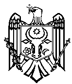

CONSILIUL 
CONCURENŢEI 
 
СОВЕТ ПО 
КОНКУРЕНЦИИ 
 
 
 
 
PLENUL CONSILIULUI CONCURENŢEI 
 
DECIZIE 
 
Nr.  ASO - 09                                                                        
din 15.03.2016                                                                    mun. Chişinău 
 
Plenul Consiliului Concurenţei, acționând în temeiul art. 41 al Legii concurenţei 
nr. 183 din 11.07.2012, art. 2 şi art. 10 al Legii cu privire la ajutorul de stat nr. 139 
din 15.06.2012, Hotărârii Parlamentului privind numirea în funcţie a membrilor 
Plenului Consiliului Concurenţei nr. 179 din 12.07.2013, Hotărârii Parlamentului 
privind numirea în funcţie a unui membru al Plenului Consiliului Concurenţei nr. 220 
din 27.09.2013, 
în conformitate cu prevederile Regulamentului cu privire la forma de notificare, 
procedura de examinare şi adoptare a deciziilor cu privire la ajutorul de stat, aprobat 
prin Hotărârea Plenului Consiliului Concurenţei nr. 1 din 30.08.2013, prevederile 
Regulamentului privind ajutorul de stat pentru protecția mediului, aprobat prin 
Hotărârea Consiliului Concurenţei nr. 9 din 30.08.2013, 
analizând nota informativă referitor la notificarea depusă de Fondul pentru 
Eficienţă Energetică prin adresarea nr. 18 din 15.01.2016, privind măsurile de sprijin 
acordate în baza Apelului de Propuneri de Proiect nr. 3 în domeniul Eficienţei 
Energetice şi valorificării Surselor de Energie Regenerabilă adresat solicitanților de 
finanțare din sectorul public şi materialele anexate, 
 
 
1 
 

A CONSTATAT: 
 
Prin scrisoarea nr. 18 din 15.01.2016, în baza art. 8 din Legea cu privire la 
ajutorul de stat nr. 139 din 15.06.2012 și Regulamentului privind forma de notificare, 
procedura de examinare și adoptare a deciziilor cu privire la ajutorul de stat,  aprobat 
prin Hotărârea Plenului Consiliului Concurenţei nr. 1 din 30.08.2013, Fondul pentru 
Eficienţă Energetică a notificat măsurile de sprijin acordate în baza Apelului de 
Propuneri de Proiect nr. 3 în domeniul eficienţei energetice şi valorificării surselor de 
energie regenerabilă adresat solicitanților de finanțare din sectorul public, anexat fiind 
inclusiv formularul general şi special de notificare al ajutorului de stat acordat. 
Notificarea a devenit efectivă la data de 15.01.2016. 
Baza legală pentru acordarea măsurii de sprijin constituie: 
• Legea energiei regenerabile nr. 160 din 12.07.2007; 
• Legea cu privire la eficienţa energetică nr. 142 din 02.07.2010; 
• Hotărârea Guvernului cu privire la Fondul pentru Eficienţă Energetică nr. 401 
din 12.06.2012; 
• Manualul operațional aprobat prin Procesul verbal nr. 7 din 17.12.2012 al 
Consiliului de administrare al Fondului pentru Eficiență Energetică; 
• Apelul de propuneri de proiect nr. 3 aprobat prin Procesul verbal nr. 17 din 
13.12.2013 al Consiliului de administrare al Fondului pentru Eficiență Energetică. 
Beneficiarii măsurilor de sprijin menționate sunt reprezentanţii autorizaţi ai 
obiectivelor de menire socială aflate în proprietatea publică centrală şi locală de toate 
nivelele. 
Obiectivul principal a măsurilor de sprijin este de a susţine proiectele din 
Republica Moldova, depuse de către solicitanții de finanțare, axate pe promovarea 
eficienţei energetice şi valorificarea surselor de energie regenerabilă, care au impact 
pozitiv asupra reducerii emisiilor gazelor cu efect de seră. 
2 
 

Valoarea totală a măsurilor de sprijin preconizate a fi acordate sub formă de 
granturi, în baza deciziei Consiliului de administrare al Fondului pentru Eficiență 
Energetică, este estimată de minim 150 000 000 lei și maxim 250 000 000 lei, cu un 
termen de finanțare de până la 5 ani.  Valoarea totală a alocărilor poate fi revizuită 
prin deciziile Consiliului de administrare al Fondului pentru Eficiență Energetică, în 
dependență de disponibilitățile acestuia, corelate cu existența proiectelor de investiții 
calitative elaborate și depuse la Fondul pentru Eficiență Energetică.  
Indiferent de numărul de propuneri de proiect depuse de solicitant în cadrul 
acestui Apel, suma totală care poate fi solicitată de la Fondul pentru Eficiență 
Energetică, prin cumulul propunerilor sale nu poate depăși 5 000 000 lei. 
Suportul financiar din partea Fondului pentru Eficiență Energetică va acoperi cel 
mult 75% din costul total eligibil al proiectului, iar aportul propriu al solicitantului de 
finanțare trebuie să fie de cel puțin 25%.  
Granturile din partea Fondului pentru Eficiență Energetică, pentru proiectele 
aprobate în cadrul acestui Apel, vor fi oferite pentru propunerile de proiect care vor 
trece cu succes procedurile de evaluare și vor fi aprobate de către Consiliul de 
administrare al Fondului pentru Eficiență Energetică. 
Măsurile de sprijin menționate vizează două categorii de obiective/clădiri:  
- 
Categoria A: Clădiri sau complexe de clădiri, care sunt operaționale și 
oferă servicii pentru cetățeni cel puțin 16 ore pe zi, 7 zile pe săptămână (de exemplu 
spitale etc.). Bugetul alocat inițial pentru investiții în clădiri de categoria A este de 
minim 75 000 000 lei.  
- 
Categoria B: Clădiri care sunt operaționale cel puțin 7 ore pe zi, 5 zile pe 
săptămână (de exemplu licee etc.). Bugetul inițial alocat pentru investiții în clădiri de 
categoria B este de minim 75 000 000 lei. 
Fondul pentru Eficiență Energetică, în cooperare cu autoritățile competente 
(după caz), monitorizează implementarea proiectelor pentru a verifica conformitatea 
cu Acordul de finanțare și cu legislația relevantă în domeniu. Instrumentul vital pentru 
3 
 

monitorizarea proiectelor constituie Raportul de progres. Raportul de progres este 
elaborat de către beneficiarul de finanțare și prezentat Fondului pentru Eficiență 
Energetică. Un alt element important al monitorizării sunt vizitele pe teren realizate 
de către specialiștii Fondului pentru Eficiență Energetică (sau reprezentanții săi 
desemnați) și de alte autorități competente. În timpul vizitelor pe teren (la obiect), 
personalul Fondului pentru Eficiență Energetică informează beneficiarul de proiect 
despre constatările și recomandările sale. Fondul pentru Eficiență Energetică are 
dreptul să inspecteze materialele, echipamentele și alte livrări, anterior datei de 
începere a implementării proiectului sau în orice moment. 
În urma examinării măsurilor de sprijin notificate de către Fondul pentru 
Eficiență Energetică, s-a constatat că acestea întrunesc cumulativ cele patru condiții 
specificate în art. 3 din Legea nr. 139 din 15.06.2012, pentru stabilirea existenței 
ajutorului de stat și anume:  
a) sunt acordate de furnizor din resurse de stat sau din resursele unităţilor 
administrativ - teritoriale sub orice formă - măsurilor de sprijin notificate vor fi 
acordate din bugetul Fondului pentru Eficiență Energetică, prin urmare, din resurse de 
stat. 
b) conferă beneficiarului un avantaj economic care nu ar fi fost obţinut în 
condiţii normale de piaţă - aceste măsuri vor oferi un avantaj economic beneficiarilor 
datorită faptului că în condiții normale de piață nu pot fi obținute finanțări similare 
granturilor oferite care nu necesită rambursare; 
c) sunt acordate în mod selectiv - schema prevede condiţii de eligibilitate, iar 
caracterul de selectivitate decurge din modalitatea discreţionară de alegere de către 
Consiliul de Administrare a Fondului pentru Eficiență Energetică, a proiectelor spre 
cofinanţare. Totodată, un argument în plus în favoarea selectivității reprezintă și 
faptul că sectorul privat nu este eligibil pentru acordarea măsurilor de sprijin 
menționate; 
4 
 

d) denaturează sau riscă să denatureze concurenţa - în cazul în care beneficiarul 
măsurii de sprijin practică o activitate economică, în sensul art. 4 a Legii concurenței 
nr. 183 din 11.07.2012, există riscul de denaturare a concurenței, având în vedere că 
printre efectele măsurilor de sprijin se numără diminuarea costurilor pentru energie, 
ceea ce va duce respectiv, la reducerea costurilor generale, fapt care poate contribui la 
sporirea competitivității întreprinderii. 
Măsurile de sprijin notificate se consideră compatibile cu un mediu concurențial 
normal, în baza evaluării acestora prin prisma prevederilor Regulamentului privind 
ajutorul de stat pentru protecția mediului, aprobat prin Hotărârea Plenului Consiliului 
Concurenţei nr.9 din 30.08.2013. 
Reieşind din constatările expuse, ținând cont de prevederile legislaţiei Republicii 
Moldova, în temeiul art. 41, alin. 1, lit. k) din Legea concurenţei nr. 183 din 
11.07.2012 și art. 10 alin. (2) lit. b) din Legea cu privire la ajutorul de stat nr. 139 din 
15.06.2012, Plenul Consiliului Concurenţei, 
 
DECIDE: 
 
1. A constata faptul că măsurile de sprijin notificate de către Fondul pentru 
Eficienţă Energetică constituie ajutor de stat, în sensul art. 3 din Legea cu 
privire la ajutorul de stat nr. 139 din 15.06.2012, în cazul beneficiarilor ce 
desfășoară o activitate economică. 
2. A autoriza schema de ajutor de stat ”Apel de propuneri de proiect nr. 3 în 
domeniul Eficienței Energetice și valorificării Surselor de Energie Regenerabilă 
adresat solicitanților de finanțare din sectorul public”. 
3. Fondul pentru Eficienţă Energetică anual, până la 31 martie, va transmite 
Consiliului Concurenței informații privind ajutorul de stat acordat în baza 
schemei, în vederea completării Registrului ajutorului de stat, în conformitate 
cu prevederile art. 19 din Legea cu privire la ajutorul de stat nr. 139 din 
15.06.2012. 
5 
 

4. Prezenta Decizie intră în vigoare la data adoptării şi va fi adusă la cunoştinţă 
Fondului pentru Eficienţă Energetică. 
5. Partea dispozitivă a prezentei Decizii va fi publicată în Monitorul Oficial al 
Republicii Moldova. 
 
 
Preşedintele Plenului  
Consiliului Concurenţei 
 
 
 
 
Viorica CĂRARE 
6 
 
