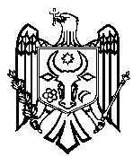

 
 

CONSILIUL 
CONCURENŢEI 
 
СОВЕТ ПО 
КОНКУРЕНЦИИ 
 
 
 
 
PLENUL CONSILIULUI CONCURENŢEI 
 
DECIZIE 
 
Nr.  ASO - 22                                                                        
din 19.05.2016                                                                                   mun. Chişinău 
 
Plenul Consiliului Concurenţei, acționând în temeiul art. 41 al Legii concurenţei 
nr.183 din 11.07.2012, art. 2 şi art. 10 al Legii nr. 139 din 15.06.2012 cu privire la 
ajutorul de stat, Hotărârii Parlamentului nr. 179 din 12.07.2013 privind numirea în 
funcţie a membrilor Plenului Consiliului Concurenţei, Hotărârii Parlamentului nr. 220 
din 27.09.2013 privind numirea în funcţie a unui membru al Plenului Consiliului 
Concurenţei, 
în conformitate cu prevederile Regulamentului cu privire la forma de notificare, 
procedura de examinare şi adoptare a deciziilor cu privire la ajutorul de stat, aprobat 
prin Hotărârea Plenului Consiliului Concurenţei nr. 1 din 30.08.2013, prevederile 
Regulamentului privind ajutorul de stat pentru dezvoltare regională, aprobat prin 
Hotărârea Consiliului Concurenţei nr. 4 din 30.08.2013, 
analizând nota examinatorului, referitor la notificarea depusă de Ministerul 
Economiei prin adresarea nr. 170 din 23.03.2016, privind măsura de sprijin acordată 
Societății pe Acțiuni „Companie de închiriere a activelor neutilizate” (în continuare 
S.A. „CAAN”) şi materialele anexate, 
 
 
 
1 
 

A CONSTATAT: 
 
Prin notificarea nr. 170 din 23.03.2016 parvenită prin intermediul Sistemului 
informațional automatizat „Registrul ajutoarelor de stat” (în continuare SIRASM), în 
baza art. 8 din Legea nr. 139 din 15.06.2012 privind ajutorul de stat și a Regulamentului 
privind forma de notificare, procedura de examinare și adoptare a deciziilor cu privire la 
ajutorul de stat, aprobat prin Hotărârea Plenului Consiliului Concurenţei nr. 1 din 
30.08.2013, Ministerul Economiei a notificat măsura de sprijin planificată de a fi 
acordată S.A. „CAAN” - întreprinderea administratoare a Parcului Industrial „CAAN”, 
anexat fiind inclusiv formularul general, special de notificare a ajutorului de stat pentru 
dezvoltare regională și formularul special de notificare privind ajutorul de stat regional 
pentru proiectele mari de investiții. 
Prin adresarea nr. ASO-14/59-546 din 01.04.2016, Consiliul Concurenței a 
solicitat Ministerului Economiei recompletarea Formularului general, precum și 
anexarea unor materiale informative suplimentare. 
Ministerul Economiei a remis răspunsul la informațiile solicitate prin SIRASM la 
data de 01.04.2016 și 04.04.2016. 
Notificarea a devenit efectivă la data de 04.04.2016. 
Baza legală pentru acordarea măsurii de sprijin constituie: 
 Legea privind prețul normativ și modul de vânzare-cumpărare a pământului nr. 
1308 din 25.07.1997; 
 Legea cu privire la parcurile industriale nr. 182 din 15.07.2010; 
 Hotărârea Guvernului cu privire la acordarea titlului de parc industrial Societății 
pe Acțiuni „CAAN” nr. 451 din 28.06.2013; 
 Hotărârea Guvernului nr. 522 din 28.04.2016 cu privire la modificarea și 
completarea Hotărârii Guvernului nr. 451 din 28.06.2013; 
 Proiectul de Lege privind aprobarea Strategiei Naționale de Dezvoltare 
Regională 2016-2020; 
 Proiectul Hotărârii de Guvern cu privire la modificarea și completarea Hotărârii 
Guvernului nr. 451 din 28.06.2013. 
2 
 

Beneficiarul măsurii de sprijin acordate este S.A. „CAAN”, care în baza Hotărârii 
de Guvern nr. 451 din 28.06.2013, S.A. „CAAN” a obținut titlul de parc industrial. S.A. 
„CAAN” a fost înregistrată la Camera Înregistrării de Stat ca Societate pe Acțiuni 
„Companie de închiriere a activelor neutilizate” la data de 27.12.1995, cu numărul de 
identificare de stat și codul fiscal (IDNO): 1005600014663, cu sediul în or. Strășeni, str. 
V. Crăsescu 1, MD-3701. 
 Obiectivul principal al măsurii de sprijin menționate este de a susține dezvoltarea 
Parcului Industrial „CAAN”. Conform notei informative la proiectul hotărârii de 
Guvern cu privire la modificarea și completarea Hotărârii Guvernului nr. 451 din 
28.06.2013, volumul total al investițiilor pentru crearea și reabilitarea infrastructurii 
tehnice de producție a Parcului Industrial „CAAN” este preconizat în sumă de 41,5 mil. 
Euro, care urmează a fi investite în 2 etape în decursul a 24 luni. Crearea parcului va 
avea un impact direct asupra dezvoltării economice și creșterii nivelului de 
industrializare a regiunii, precum și va duce la utilizarea eficientă a potențialului de 
resurse ale acesteia, prin: 
 Crearea a peste 2000 de locuri de muncă; 
 Sporirea defalcărilor la bugetul public național cu peste 700 mii Euro către anul 
2025; 
 Sporirea volumului contribuțiilor de asigurări medicale cu peste 1,6 mil. Euro 
către anul 2025; 
 Creșterea veniturilor din vânzări în regiune în valoare de cca 90 mil. Euro către 
anul 2025. 
Măsura de sprijin în valoare de 4 719,9 mii lei, notificată de Ministerul Economiei, 
urmează a fi acordată S.A. „CAAN”, în baza art. 12 alin. (4) a Legii nr. 1308 din 
25.07.1997 privind prețul normativ și modul de vânzare-cumpărare a pământului, 
privind scutirea de la compensarea pierderilor cauzate de excluderea terenului privat cu 
suprafața de 9,5135 ha din categoria de terenuri cu destinație agricolă, cu trecerea în 
categoria de terenuri destinate industriei, transporturilor, telecomunicațiilor și cu alte 
destinații speciale, în urma extinderii suprafeței Parcului Industrial „CAAN”, aprobată 
3 
 

prin Hotărârea Guvernului nr. 522 din 28.04.2016 cu privire la modificarea și 
completarea Hotărârii Guvernului nr. 451 din 28.06.2013. 
În urma examinării măsurii de sprijin notificate de către Ministerul Economiei, s-a 
constatat că aceasta întrunește cumulativ cele patru condiții specificate în art. 3 din 
Legea nr. 139 din 15.06.2012, pentru stabilirea existenței ajutorului de stat. Respectiv, 
măsura de sprijin acordată  S.A. „CAAN” este ajutor de stat și intră sub incidența Legii 
nr. 139 din 15.06.2012 cu privire la ajutorul de stat. 
Reieșind din faptul că obiectivul declarat, în formularul general de notificare a 
ajutorului de stat, al acestei măsuri de sprijin constituie dezvoltarea regională, evaluarea 
compatibilității ajutorului de stat în cauză cu mediul concurențial normal a fost efectuată 
în conformitate cu condițiile prevăzute de Regulamentul privind ajutorul de stat pentru 
dezvoltare regională, aprobat prin Hotărârea Consiliului Concurenţei nr. 4 din 
30.08.2013. 
În conformitate cu Harta ajutoarelor de stat regionale pentru Republica Moldova 
(anexa 5 la Regulament), intensitatea maximă a ajutorului de stat pentru regiunea 
Centru este de 50,00%. Având în vedere că, ajutorul de stat se acordă pentru realizarea 
unui proiect mare de investiții, potrivit pct. 41 din Regulament, S.A. „CAAN” nu poate 
beneficia de majorările prevăzute în pct. 33 din Regulament. 
Reieșind din faptul că, valoarea ajutorului de stat notificat este de 4 719,9 mii lei, 
iar costurile eligibile ale proiectului sunt de 348 300,0 mii lei, în urma calculelor 
efectuate, a rezultat că intensitatea ajutorului de stat este de 1,36%. Prin urmare, 
intensitatea ajutorului de stat calculată este mai mică de 50,00%, astfel fiind respectate 
prevederile Regulamentului. 
 
Totodată, potrivit calculelor efectuate, conform pct. 40 din Regulament, s-a 
constatat că valoarea ajutorului de stat ce urmează a fi acordat S.A. „CAAN” nu 
depășește valoarea maximă permisă a ajutorului, conform prevederilor Regulamentului. 
De asemenea, în conformitate cu pct. 27 din Regulament, beneficiarul urmează să 
aducă o contribuție financiară de cel puțin 25,00% din costurile eligibile, din resursele 
proprii sau din finanțări externe într-o formă care să nu implice ajutor public.  
Constatând faptul că Hotărârea de Guvern nr. 522 cu privire la modificarea și 
completarea Hotărârii Guvernului nr. 451 din 28.06.2013 a fost adoptată până la luarea 
4 
 

unei decizii de către Plenul Consiliului Concurenței, și, reieşind din cele expuse, ținând 
cont de prevederile legislaţiei Republicii Moldova, în temeiul art. 41 din Legea 
concurenţei nr. 183 din 11.07.2012 și art. 10 alin. (2) lit. b) din Legea nr. 139 din 
15.06.2012 cu privire la ajutorul de stat, Plenul Consiliului Concurenţei, 
 
DECIDE: 
 
1.  Măsura notificată de către Ministerul Economiei, având ca beneficiar S.A. 
„CAAN”, constituie ajutor de stat în sensul art. 3 din Legea nr. 139 din 
15.06.2012 cu privire la ajutorul de stat. 
2. A autoriza ajutorul de stat pentru dezvoltare regională acordat S.A. „CAAN” 
pentru dezvoltarea Parcului Industrial „CAAN”. 
3. S.A. „CAAN” va asigura în termen de 24 luni volumul necesar al investițiilor 
pentru crearea și reabilitarea infrastructurii tehnice de producție a Parcului 
Industrial „CAAN”.  
4. Ministerul Economiei va monitoriza ajutorul de stat acordat S.A. „CAAN” pentru 
a nu fi depășită intensitatea maximă admisă prevăzută de pct. 44 din 
Regulamentul privind ajutorul de stat pentru dezvoltare regională, aprobat prin 
Hotărârea Consiliului Concurenţei nr. 4 din 30.08.2013, în condițiile cumulului 
de ajutoare de stat pentru același beneficiar. 
5. Ministerul Economiei va transmite anual Consiliului Concurenței informații 
privind ajutorul de stat care face obiectul prezentei decizii, în vederea actualizării 
și completării Registrului ajutorului de stat, în conformitate cu prevederile art. 19 
din Legea nr. 139 din 15.06.2012 cu privire la ajutorul de stat. 
6. Prezenta Decizie intră în vigoare la data adoptării şi va fi adusă la cunoştinţă 
părților. 
7. Partea dispozitivă a prezentei Decizii va fi publicată în Monitorul Oficial al 
Republicii Moldova. 
 
 
Preşedintele Plenului  
Consiliului Concurenţei 
 
 
 
 
 
         Viorica CĂRARE 
5 
 
