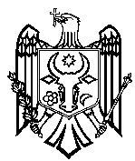

CONSILIUL 
CONCURENŢEI 
СОВЕТ ПО 
КОНКУРЕНЦИИ 
 
 
 
 
 
 PLENUL CONSILIULUI CONCURENȚEI 
 
DECIZIE 
 
 
Nr. ASR-41                                                                                     mun. Chișinău 
din 26.08.2016 
 
 
Plenul Consiliului Concurenţei, acționând în temeiul art. 41 al Legii 
Concurenţei nr. 183 din 11.07.2012, art.10 al Legii nr. 139 din 15.06.2012 cu 
privire la ajutorul de stat, Hotărârii Parlamentului nr. 179 din 12.07.2013 privind 
numirea în funcţie a membrilor Plenului Consiliului Concurenţei, Hotărârii 
Parlamentului nr. 220 din 27.09.2013 privind numirea în funcţie a unui membru al 
Plenului Consiliului Concurenţei, 
în conformitate cu prevederile Regulamentului cu privire la forma de 
notificare, procedura de examinare şi adoptare a deciziilor cu privire la ajutorul de 
stat, aprobat prin Hotărârea Plenului Consiliului Concurenţei nr.1 din 30.08.2013, 
prevederile Regulamentului privind ajutorul de stat pentru dezvoltare regională, 
aprobat prin Hotărârea Plenului Consiliului Concurenței nr.4 din 30.08.2013, 
prevederile Regulamentului privind ajutorul de stat acordat beneficiarilor ce 
prestează servicii de interes economic general, aprobat prin Hotărârea Plenului 
Consiliului Concurenţei nr.11 din 30.08.2013, 
analizând nota examinatorului privind notificarea măsurii de sprijin acordate 
Î.M.„Sămășcani - Servicii”, parvenită de la Primăria satului Sămășcani, raionul 
Șoldănești prin adresările nr. 197/02 din 14.06.16 și nr. 457 din 27.06.16 și 
materialele anexate, 
 
A CONSTATAT: 
 
La data de 28.06.2016, în baza art. 8 din Legea nr. 139 din 15.06.2012 cu 
privire la ajutorul de stat, notificarea măsurii de sprijin acordată Î.M.„Sămășcani - 
Servicii” a devenit efectivă.  
Baza legală pentru acordarea măsurii de sprijin: 
• Legea nr. 1402-XV din 24.10.2002 serviciilor publice de gospodărie 
comunală; 
• Legea nr. 121-XVI din 04.05.2007 privind administrarea și deetatizarea 
proprietății publice; 
• Legea nr. 435-XVI din 28.12.2006 privind descentralizarea administrativă; 
• Legea nr. 436-XVI din 28.12.2006 privind administrația publică locală; 
• Legea nr. 303 din 13.12.2013 privind serviciul public de alimentare cu apă și 
de canalizare; 
1 
 

• Decizia Consiliului Sătesc Sămășcani nr. 2/3 din 07.04.2014 cu privire la 
fondarea Întreprinderii Municipale „Sămășcani –Servicii”; 
• Decizia Consiliului sătesc Sămășcani nr. 1/8 din 16 februarie 2015 cu privire 
la transmiterea mijloacelor și bunurilor materiale de la Primăria satului 
Sămășcani la Î.M.„Sămășcani - Servicii”;  
• Decizia Consiliului local nr.3/2 din 10 iunie 2016 cu privire la atribuirea 
serviciului de interes economic general Întreprinderii Municipale 
„Sămășcani –Servicii”. 
Măsura de sprijin constă în transmiterea în gestiune a bunurilor materiale 
(patrimoniul format în cadrul proiectului „Aprovizionarea cu apă potabilă a 
locuitorilor satului Sămășcani, raionul Șoldănești ”) în valoare de 3271,1 mii lei. 
 
Tabelul nr.1 Bunurile materiale transmise Î.M ”Sămășcani - Servicii”,mii lei 
Nr. Denumirea mijloacelor fixe și bunurilor materiale 
Suma 
1. 
Rețeaua de apeduct 
3271,1 
Total 
3271,1 
Sursa: Formularul de notificare 
 
Beneficiarul măsurii de sprijin este Î.M.„Sămășcani-Servicii”, raionul 
Șoldănești (IDNO 1014606001184), fondatorul căreia este Consiliul sătesc 
Sămășcani. Întreprinderea a fost înființată în baza Deciziei Consiliului sătesc nr. 
2/3 din 07 aprilie 2014 cu privire la fondarea Întreprinderii Municipale „Sămășcani 
–Servicii”, ca unitate economică cu personalitate juridică, care funcționează pe 
bază de gestiune economică și autonomie financiară, în scopul administrării 
bunurilor din domeniul public (sistemele de alimentare cu apă și canalizare). 
Adresa juridică este raionul Șoldănești, satul Sămășcani, MD-7233. Serviciile de 
alimentare cu apă sunt organizate sub coordonarea și controlul autorității publice 
locale, în virtutea principiului autonomiei locale.  
Întreprinderea activează pe teritoriul satului Sămășcani, raionul Șoldănești, 
fiind o piață de interes local. 
 
Pentru a constitui ajutor de stat conform art. 3 din Legea nr. 139 din 
15.06.2012 cu privire la ajutorul de stat, măsura de sprijin trebuie să îndeplinească 
cumulativ următoarele condiții: 
• să fie acordată din resurse de stat sau din resursele unităților administrativ-
teritoriale sub orice formă; 
• să fie acordată în mod selectiv; 
• să confere beneficiarului un avantaj economic care nu ar fi fost obținut în 
condiții normale de piață; 
• să denatureze sau riscă să denatureze concurența. 
Bunurile transmise fac parte din domeniul privat al Primăriei satului 
Sămășcani, raionul Șoldănești, respectiv măsura de sprijin este acordată din 
resursele unității administrativ–teritoriale. 
Măsura de sprijin a fost acordată doar Î.M.„Sămășcani - Servicii”, fără 
realizarea unui concurs, respectiv, aceasta a fost selectivă. 
2 
 

Autoritatea publică locală nu va percepe o contraprestație pentru exploatarea 
bunurilor transmise în gestiunea întreprinderii. Astfel, Î.M.„Sămășcani - Servicii” 
i-a fost acordat un avantaj economic care nu ar fi fost obținut în condiții normale 
de piață. 
Conform art. 14 (1) din Legea nr. 1402 din 24.10.2002 serviciilor publice de 
gospodărie comunală, autorităţile administraţiei publice locale au competenţa 
exclusivă privind înfiinţarea, organizarea, coordonarea, monitorizarea şi controlul 
funcţionării serviciilor publice de gospodărie comunală, precum şi crearea, 
administrarea şi exploatarea bunurilor proprietate publică din infrastructura 
edilitară a unităţilor administrativ-teritoriale respective. Chiar dacă întreprinderea 
este unica care prestează servicii de alimentare cu apă și canalizare în raza satului 
Sămășcani, raionul Șoldănești acest fapt nu exclude posibilitatea transmiterii 
bunurilor proprietate publică în gestiunea altei întreprinderi. Astfel, măsura de 
sprijin riscă să distorsioneze concurența. 
Ținând cont de cele menționate în context, se constată că măsura de sprijin 
întrunește criteriile ajutorului de stat, conform art. 3 din Legea nr. 139 din 
15.06.2012 cu privire la ajutorul de stat. 
Obiectivele acordării prezentului ajutor de stat sunt: 
- dezvoltarea regională, și anume dezvoltarea satului Sămășcani, raionul 
Șoldănești, Regiunea de Dezvoltare Centru; 
- susținerea beneficiarilor care prestează servicii de interes economic general, 
servicii de alimentare cu apă. 
Potrivit punctului 3 din Regulamentul privind ajutorul de stat pentru 
dezvoltare regională, aprobat prin Hotărârea Plenului Consiliului Concurenței nr.4 
din 30.08.2013, acordarea ajutoarelor de stat pentru investiţii este justificată de 
necesitatea susţinerii dezvoltării regionale prin sprijinirea investiţiilor şi a creării 
de noi locuri de muncă, prin extinderea şi diversificarea activităţilor economice ale 
întreprinderilor situate în regiunile slab dezvoltate şi prin încurajarea 
întreprinderilor să înfiinţeze noi unităţi în aceste regiuni. 
Un alt obiectiv al acordării ajutorului de stat este asigurarea infrastructurii 
pentru prestarea serviciului de alimentare cu apă pentru cetățenii din satul 
Sămășcani, aceasta fiind considerată o obligație de serviciu public.  
Pentru a fi compatibil, un ajutor de stat acordat beneficiarilor care prestează 
servicii pentru interes economic general trebuie să îndeplinească următoarele 
condiții: 
• ajutorul de stat este necesar în vederea operării SIEG; 
• ajutorul de stat nu denaturează în mod nejustificat concurenţa. 
Cu referire la pct. 55 și 56 din Regulamentul privind forma de notificare, 
procedura de examinare și adoptare a deciziilor cu privire la ajutorul de stat 
aprobat prin Hotărârea Plenului Consiliului Concurenței nr. 1 din 30 august 2013, 
evaluarea compatibilității cu mediul concurențial normal va fi realizată prin analiza 
comparativă. Evaluarea compatibilității ajutorului de stat prin analiza comparativă 
a efectelor negative asupra concurenței și efectelor pozitive ale ajutorului de stat, 
pornește de la contribuția acestuia la îndeplinirea unor obiective bine stabilite de 
3 
 

interes public. La compararea acestor efecte se ține seama de impactul ajutorului 
asupra bunăstării sociale. 
         Conform Programului Regional Sectorial de Alimentare cu Apă și de 
Canalizare pentru Regiunea de Dezvoltare Centru, până în 2020 în raionul 
Șoldănești vor fi asigurate condiții de acces la servicii sigure, suportabile și 
durabile de aprovizionare cu apă potabilă pentru 100% din populația urbană și 50% 
din populația rurală, alimentate atât pe grupuri de localități prin apeducte regionale 
din sursele de apă (de suprafață), cât și prin soluții locale din surse subterane. 
Concomitent, se vor asigura serviciile suportabile și durabile de canalizare pentru 
85% din populația urbană și 24% din populația rurală, apele uzate fiind tratate 
conform normelor în vigoare la stații de epurare regionale, cât și la stații locale, 
asigurând condițiile sanitare și de mediu ale raionului. 
Serviciile de utilitate publică au ca obiectiv asigurarea condițiilor de viață 
mai bune pentru populație și prezintă o importanță socială majoră pentru 
administrația publică. Prezentul ajutor de stat este destinat dezvoltării localității 
Sămășcani, raionul Șoldănești și anume pentru îmbunătățirea condițiilor de trai a 
populației, asigurarea cu apă potabilă, ridicarea nivelului social și igienic al 
populației. Construcția sistemului de alimentare cu apă va duce la minimalizarea 
cheltuielilor privind aprovizionarea cu apă a locuitorilor, creșterea rentabilității 
industriei prelucrătoare a produselor agricole, protejarea monumentelor naturale 
ale Republicii Moldova.  
Până la construcția rețelei de apeduct, care are o lungime de 13 km,  
populația satului Sămășcani, raionul Șoldănești se alimenta cu apă din fântâni cu 
adâncime mică, care, însă era foarte poluată și nu corespundea cerințelor și 
normelor sanitaro - igienice, au fost cazuri de boli gastrointestinale și infecțioase 
care a alarmat foarte mult administrația Primăriei.  
         Î.M.„Sămășcani - Servicii” este unica întreprindere care prestează servicii de 
alimentare cu apă în satul Sămășcani, raionul Șoldănești. Ajutorul de stat acordat 
este strict necesar pentru a opera în condiții normale de continuitate și siguranță 
serviciul public centralizat de alimentare cu apă. În condiţiile existenţei unei pieţe 
reglementate, întreprinderea nu poate percepe pentru furnizarea acestui serviciu un 
preţ care să depășească costurile de exploatare şi un profit rezonabil. Ultima dată 
tarifele la prestarea serviciilor de alimentare cu apă au fost aprobate la data de 16 
februarie 2015 prin Decizia Consiliului sătesc nr. 1/8 și constituie pentru utilizatori 
persoane fizice, până la 3 m3 - 7 lei/m3 de apă, iar de la 3 m3 - 9 lei m3 de apă.  
Construcția sistemului de alimentare cu apă, cât și a sistemului de canalizare 
va permite conectarea la apă de calitate a celor 1800 de locuitori, evacuarea apelor 
uzate de la cele 540 de gospodării și 5 instituții social-culturale printr-un sistem de 
canalizare eficient. Rezultatele reale ale efectului ecologic va duce la prevenirea și 
stoparea poluării apelor de suprafață și freatice, ameliorarea stării sanitaro- 
epidemiologice a localității Sămășcani. 
          Potențialul tehnic și de personal existent la întreprindere oferă oportunități 
reale pentru dezvoltarea serviciului, astfel încât să acopere întreaga localitate și să 
se extindă și în localitățile din zona adiacentă (satul Peciște, raionul Rezina și satul 
4 
 

Fuzăuca, raionul Șoldănești). Construcția sistemului de alimentare cu apă potabilă 
a avut drept obiectiv și realizarea de noi oportunități pentru dezvoltarea economică, 
atragerea investițiilor și creșterea calității vieții.  
Gestionarea eficientă a acestuia va produce următoarele efecte: 
- îmbunătățirea sănătății populației (prevenirea bolilor și reducerea mortalității 
cauzată de poluarea mediului înconjurător); 
- aprovizionarea instituțiilor și a cetățenilor cu apă, ca product de primă 
necesitate pentru funcționarea și dezvoltare umană normală; 
- amenajarea zonelor stricte de protecție sanitară a sondei și rezervorului de 
apă și excluderea pericolului de afectare a sursei de apă; 
- îmbunătățirea condițiilor de trai și a calității vieții cetățenilor și astfel, 
ameliorarea stării sanitaro-epidemiologice a localităților, reducerea îmbolnăvirilor 
în rândul copiilor și bătrânilor.      
    Este necesară, astfel, asigurarea unui nivel înalt al condițiilor de trai și al 
sănătății cetățenilor și a unui mediu ambiant curat și sănătos, prin dezvoltarea 
durabilă a infrastructurii de alimentare cu apă și prin prestarea serviciilor calitative. 
Serviciile publice de alimentare cu apă şi canalizare au un rol decisiv pentru 
îmbunătăţirea calităţii vieţii tuturor cetăţenilor şi pentru evitarea excluderii sociale 
şi izolării. Ţinând cont de importanţa lor pentru economie şi pentru producerea de 
alte bunuri şi servicii, eficienţa şi calitatea acestora constituie un factor de 
competitivitate şi de cea mai mare coeziune, în special datorită faptului că permit 
atragerea investiţiilor în regiuni mai puţin favorizate.  
        În vederea executării prevederilor pct. 11 și 12 din Regulamentul privind 
ajutorul de stat acordat beneficiarilor ce prestează servicii de interes economic 
general, aprobat prin Hotărârea Plenului Consiliului Concurenţei nr. 11 din         
30.08.2013, în anul 2016, au fost revizuite și îmbunătățite actele prin care au fost 
transmise în gestiune bunurile unității administrativ-teritoriale. Astfel, prin Decizia 
nr. 3/2 din 10 iunie 2016 cu privire la atribuirea serviciului de interes economic 
general Întreprinderii Municipale „Sămășcani - Servicii” a fost aprobat actul de 
atribuire a serviciului de interes economic general Î.M. „Sămășcani Servicii” și au 
fost operate modificări la contractul de delegare a gestiunii serviciilor publice de 
alimentare cu apă nr. 97 din 02.03.2015, încheiat între Primăria satului Sămășcani 
și Î.M. „Sămășcani – Servicii”. 
          Ajutorul de stat acordat Î.M. „Sămășcani Servicii” este necesar în vederea 
operării serviciului de alimentare cu apă. 
Ca urmare a evaluării compatibilităţii ajutorului de stat prin analiza 
comparativă, în conformitate cu punctul 68 din Regulamentul privind forma de 
notificare, procedura de examinare și adoptare a deciziilor cu privire la ajutorul de 
stat, aprobat prin Hotărârea Plenului Consiliului Concurenței nr. 1 din 30 august 
2013, ajutorul produce efecte pozitive clare în favoarea cetățenilor, inclusiv pe 
termen lung, iar efectele negative sunt limitate și nu denaturează în mod 
semnificativ concurența. 
5 
 

Astfel, ajutorul de stat acordat Î.M. „Sămășcani – Servicii” în scopul 
prestării serviciilor de alimentare cu apă, este compatibil cu mediul concurențial 
normal. 
Reieșind din constatările expuse și ținând cont de prevederile legislației 
Republicii Moldova, în temeiul art. 41 din Legea concurenței nr. 183 din 
11.07.2012 și art. 10 alin. (2) lit. b) din Legea nr. 139 din 15.06.2012 cu privire la 
ajutorul de stat, Plenul Consiliului Concurenței 
 
DECIDE: 
 
1. A constata faptul că măsura notificată de către Primăria satului Sămășcani 
raionul Șoldănești, având ca beneficiar Î.M.„Sămășcani Servicii” și constând 
în transmiterea în gestiune a unor bunuri, constituie ajutorul de stat în sensul 
art. 3 din Legea nr. 139 din 15.06.2012 cu privire la ajutorul de stat. 
2. A autoriza ajutorul de stat pentru prestarea serviciului public de alimentare 
cu apă acordat Î.M. „Sămășcani Servicii” raionul Șoldănești. 
3. Primăria satului Sămășcani, raionul Șoldănești va transmite până la 
31.03.2017 Consiliului Concurenței informații privind ajutorul de stat care 
face obiectul prezentei decizii, în vederea actualizării Registrului ajutorului 
de stat, conform art. 19 din Legea nr. 139 din 15.06.2012 cu privire la 
ajutorul de stat. 
4. Prezenta Decizie intră în vigoare la data adoptării. 
5. Partea dispozitivă a prezentei Decizii va fi publicată în Monitorul Oficial al 
Republicii Moldova. 
 
      Președintele  
      Consiliului Concurenței 
  Viorica CĂRARE 
6 
 
