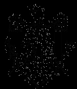

 
CONSILIUL  
CONCURENŢEI 
СОВЕТ ПО 
КОНКУРЕНЦИЙ 
 
 

 
PLENUL CONSILIULUI CONCURENŢEI 
 
DECIZIE 
 
Nr. ASS - 21 
din 21.04.2016 
mun. Chișinău 
 
Plenul Consiliului Concurenţei, acționând în temeiul art. 41 al Legii 
concurenţei nr.183 din 11.07.2012, art. 2 şi art. 10 al Legii nr. 139 din 15.06.2012 
cu privire la ajutorul de stat, Hotărârii Parlamentului nr. 179 din 12.07.2013 privind 
numirea în funcţie a membrilor Plenului Consiliului Concurenţei, Hotărârii 
Parlamentului nr. 220 din 27.09.2013 privind numirea în funcţie a unui membru al 
Plenului Consiliului Concurenţei, 
 
în conformitate cu prevederile Regulamentului cu privire la forma de 
notificare, procedura de examinare şi adoptare a deciziilor cu privire la ajutorul de 
stat, aprobat prin Hotărârea Plenului Consiliului Concurenţei nr. 1 din 30.08.2013, 
prevederile Regulamentului privind ajutorului de stat acordat beneficiarilor ce 
prestează servicii de interes economic general, aprobat prin Hotărârea Plenului 
Consiliului Concurenţei nr. 11 din 30.08.2013, 
 
analizând nota informativă referitor la notificarea depusă de Serviciul Vamal 
privind măsura de sprijin acordată întreprinderilor ce prestează servicii de colectare, 
prelucrare și reciclare a deșeurilor menajere, sub forma scutirii de la plata T.V.A., în 
conformitate cu prevederile art. 103 alin. (1) pct. 31 din Codul fiscal, şi materialele 
anexate, 
 
A CONSTATAT: 
 
Prin adresarea nr. 28/20-14408 din 26.11.2015, în baza art. 8 din Legea nr. 139 
din 15.06.2012 cu privire la ajutorul de stat și Regulamentul privind forma de 
notificare, procedura de examinare și adoptare a deciziilor cu privire la ajutorul de 
stat, Serviciul Vamal, a prezentat anexat formularul general de notificare a ajutorului 
de stat și formularul special de notificare a ajutorului de stat acordat beneficiarilor ce 
prestează servicii de interes economic general (în continuare SIEG). 
 
1 
 

Notificarea a devenit efectivă în data de 25.02.2016. Comunicatul privind 
examinarea notificării a fost plasat pe pagina electronică a autorităţii în data de 
09.03.2016, în compartimentul Transparență, subcompartimentul Transparență 
decizională.  
 
Potrivit prevederilor pct. 22 al Regulamentului privind forma de notificare, 
procedura de examinare şi adoptare a deciziilor cu privire la ajutorul de stat aprobat 
prin Hotărârea Plenului Consiliului Concurenţei nr. 1 din 30.08.2013, furnizorul 
şi/sau iniţiatorul unui ajutor de stat ilegal şi asupra căruia Consiliul Concurenţei nu a 
iniţiat procedura privind ajutorul ilegal sau ajutorul utilizat abuziv, prevăzută la 
art.13 din Legea nr. 139 din 15.06.2012 cu privire la ajutorul de stat, poate să-l 
notifice pentru a fi autorizat. 
Luând în vedere prevederile pct. 22 menționat mai sus, Serviciul Vamal a 
notificat măsura de sprijin acordată întreprinderilor ce prestează servicii de colectare, 
prelucrare și reciclare a deșeurilor menajere. 
 
Baza legală 
• Codul fiscal nr.1163-XIII din 24.04.1997 (în continuare Cod fiscal). 
 
Descrierea măsurii de sprijin 
Conform art. 103 alin. (1) pct. 31 din Codul fiscal, T.V.A. nu se aplică la 
importul şi livrările de containere din plastic pentru colectarea separată a deşeurilor; 
furnale şi cuptoare pentru incinerarea gunoiului; utilaje pentru mărunţirea, presarea, 
balotarea deşeurilor menajere; autovehicule pentru colectarea şi transportarea 
deşeurilor menajere. Beneficiari ai facilității fiscale respective pot fi întreprinderile 
care deţin autorizaţie pentru desfăşurarea activităţii de colectare, prelucrare și 
reciclare a deşeurilor menajere.   
Activitatea de colectare, prelucrare și reciclare a deșeurilor menajere 
reprezintă un SIEG, măsura de sprijin fiind acordată întreprinderilor ce prestează 
acest serviciu.  
 
În urma examinării măsurii de sprijin notificată de către Serviciul Vamal, s-a 
constatat că aceasta întrunește cumulativ cele patru condiții specificate în art. 3 din 
Legea nr. 139 din 15.06.2012, pentru stabilirea existenței ajutorului de stat și anume: 
 
1. este acordat de furnizor din resurse de stat sau din resursele unităţilor 
administrativ - teritoriale sub orice formă – prin acordarea facilităţii 
respective statul renunţă la veniturile care urmau a fi încasate în buget de la 
întreprinderile importatoare a utilajelor din art. 103 alin. (1) pct. 31 a Codului 
fiscal. Dat fiind specificul aplicării T.V.A. măsura de sprijin este acordată din 
resurse de stat în cazul întreprinderilor neînregistrate ca plătitori de T.V.A., 
statul ratând încasările la buget. În cazul întreprinderilor înregistrate ca 
plătitori de T.V.A., ținând cont de principiile aplicării T.V.A. scutirea de plată 
2 
 

a T.V.A. la import nu va reduce suma finală a T.V.A. vărsată la buget. 
2. conferă beneficiarului un avantaj economic care nu ar fi fost obţinut în 
condiţii normale de piaţă – scutirea de la plata T.V.A. în baza art. 103 alin. (1) 
pct. 31 a Codului fiscal, constituie un avantaj economic pentru întreprinderea 
importatoare. 
3. este acordat în mod selectiv – facilitatea fiscală în examinare reprezintă o 
derogare de la sistemul de referință, nu este justificată de natura sau schema 
generală a sistemului de referință, fiind astfel selectivă. 
4. denaturează sau riscă să denatureze concurenţa – există riscul denaturării 
mediului concurențial pe piața prestării serviciului de colectare, prelucrare și 
reciclare a deşeurilor menajere. Totodată din considerentul că beneficiarii 
măsurii de sprijin ar putea transfera avantajul economic obținut ca urmare a 
măsurii de sprijin pe o altă piaţă unde prestează un alt serviciu, nefiind 
obligate să ţină contabilitate separată, există riscul denaturării mediului 
concurențial pe alte piețe. 
  
Această măsură este analizată în contextul îndeplinirii de către întreprinderile 
beneficiare de scutirea de la plata T.V.A. a obligației de SIEG și anume prestarea 
serviciilor de colectare, prelucrare și reciclare a deșeurilor menajere. 
În conformitate cu pct. 9 din Regulamentul privind ajutorul de stat acordat 
beneficiarilor ce prestează servicii de interes economic general, aprobat prin 
Hotărârea Plenului Consiliului Concurenţei nr.11 din 30.08.2013, pot constitui ajutor 
de stat compatibil cu mediul concurențial normal, daca se respectă următoarele 
condiții: 
• ajutorul de stat este necesar în vederea operării SIEG; 
• ajutorul de stat nu denaturează în mod nejustificativ concurența. 
 
Măsura de sprijin este necesară în vederea operării SIEG în scopul menţinerii 
nivelului de tarif acceptabil beneficiarilor finali ai serviciului de colectare, prelucrare 
și reciclare a deșeurilor menajere.     
Luând în vedere faptul că întreprinderile, ce prestează servicii de colectare, 
prelucrare și reciclare a deșeurilor menajere, oferă serviciile respective în zone 
geografice delimitate, adesea întreprinderile respective deservind individual anumite 
localități, se constată faptul că probabilitatea denaturării mediului concurențial este 
mică. Acordarea facilităţii fiscale, potrivit prevederilor art. 103 alin. (1), pct. 31, este 
orientată inclusiv în vederea protejării mediului înconjurător şi realizarea Strategiei 
de gestionare a deşeurilor în Republica Moldova pentru anii 2013-2027 aprobată prin 
Hotărârea Guvernului nr. 248 din 10.04.2013, unde politica în domeniul gestionării 
deşeurilor propune dezvoltarea infrastructurii şi a serviciilor necesare în vederea 
protejării în mod adecvat a mediului înconjurător la nivel global, naţional şi local de 
efectele asociate cu managementul deşeurilor generate de cetăţeni, întreprinderi şi 
instituţii.  
3 
 

Ținând cont de importanța prestării SIEG-ului de colectare, prelucrare și 
reciclare a deșeurilor menajere precum și de efectul acestuia asupra mediului nu 
constată denaturarea în mod nejustificativ a concurenței. 
 
Astfel, având în vedere cele expuse anterior, sunt îndeplinite cumulativ cele 
două condiții stipulate în pct. 9 din Regulamentul privind ajutorul de stat acordat 
beneficiarilor ce prestează servicii de interes economic general pentru a aprecia că 
măsura de sprijin acordată întreprinderilor ce prestează servicii de colectare, 
prelucrare și reciclare a deșeurilor menajere, constituie măsură de sprijin compatibilă 
cu mediul concurențial normal. 
 
 
Reieşind din constatările expuse, ținând cont de prevederile legislaţiei 
Republicii Moldova, în temeiul art. 41 din Legea concurenţei nr. 183 din 11.07.2012 
și art. 10 alin. (2) lit. b) din Legea nr. 139 din 15.06.2012 cu privire la ajutorul de 
stat, Plenul Consiliului Concurenţei, 
 
DECIDE: 
 
1. A constata faptul că măsura notificată de către Serviciul Vamal, privind 
scutirea de la plata T.V.A. la importul mărfurilor potrivit art. 103 alin. (1) pct. 
31 din Codul fiscal, având ca beneficiari întreprinderile, neînregistrate ca 
plătitori de T.V.A.,  ce prestează servicii de colectare, prelucrare și reciclare a 
deșeurilor menajere, constituie ajutor de stat în sensul art. 3 din Legea nr. 139 
din 15.06.2012 cu privire la ajutorul de stat. 
2. A autoriza ajutorul de stat acordat în baza art. 103 alin. (1) pct. 31 din Codul 
fiscal, privind scutirea de la plata T.V.A., având ca beneficiari întreprinderile 
neînregistrate ca plătitori de T.V.A., în vederea prestării serviciului de 
colectare, prelucrare și reciclare a deșeurilor menajere. 
3. Serviciul Vamal va transmite anual Consiliului Concurenței informații privind 
ajutorul de stat care face obiectul prezentei decizii, în vederea actualizării și 
completării Registrului ajutorului de stat, în conformitate cu prevederile art. 19 
din Legea nr. 139 din 15.06.2012 cu privire la ajutorul de stat. 
4. Prezenta Decizie intră în vigoare la data adoptării şi va fi adusă la cunoştinţă 
Serviciului Vamal. 
5. Partea dispozitivă a prezentei Decizii va fi publicată în Monitorul Oficial al 
Republicii Moldova. 
 
 
 
Preşedintele Plenului 
Viorica CĂRARE 
Consiliului Concurenţei 
 
 
4 
 
