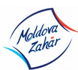
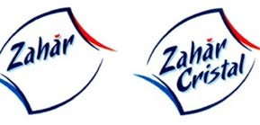
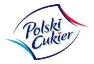
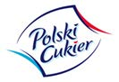
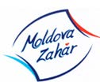

 
СОВЕТ ПО 
КОНКУРЕНЦИИ 
 

CONSILIUL 
CONCURENŢEI 
 
PLENUL CONSILIULUI CONCURENȚEI 
DECIZIE 
nr. CN – 28 
din 03.06.2016                                                                                 mun. Chișinău 
 
 
Plenul Consiliului Concurenţei, 
 
 
acţionând în temeiul art. 41 alin. (1) lit. h) al Legii concurenţei nr. 183 din 
11.07.2012, Hotărârii Parlamentului nr. 179 din 12.07.2013 privind numirea în 
funcţie a membrilor Plenului Consiliului Concurenţei, precum și Hotărârii 
Parlamentului nr. 220 din 27.09.2013 privind numirea în funcţie a unui membru al 
Plenului Consiliului Concurenţei, 
analizând raportul de investigaţie asupra cazului iniţiat prin Dispoziţia 
Plenului Consiliului Concurenței nr. 38 din 17.12.2015, observațiile prezentate de 
părți, declarațiile din cadrul audierilor și alte materiale acumulate în cadrul 
investigaţiei, 
A CONSTATAT: 
 
La data 10.11.2015 în adresa Consiliului Concurenței a parvenit plângerea 
cu nr. 01/2-540 din 09.11.2015 din partea întreprinderii „Sudzucker-Moldova” 
S.A. privind presupusele acțiuni de concurență neloială a întreprinderii „Moldova 
Zahăr” S.R.L. Prin Dispoziţia nr. 38 din 17.12.2015, Plenul Consiliului 
Concurenței, a iniţiat acţiunea referitor la semnele  încălcării  prevederilor art. 17 și 
art. 19 alin. (1) lit. a) ale Legii  concurenței nr. 183 din 11.07.2012,  de  către  
întreprinderea  „Moldova Zahăr” S.R.L.  
 
 
1 
 

I. 
Părțile implicate 
 
Reclamant – Î.M. „Sudzucker-Moldoava” S.A., IDNO - 1002600008706, 
adresa: MD-5201, or. Drochia,  str. 27 August, nr. 1. 
Întreprinderea „Sudzucker-Moldoava” S.A. este o întreprindere moldo-
germană creată în mai 2001 prin unificarea a trei fabrici de zahăr: din or. 
Dondușeni, or. Fălești și or. Drochia de către acționarul principal al companiei – 
concernul european Sudzucker AG.  
Printre genurile de activitate nelicențiate ale întreprinderii sus menționate se 
numără – fabricarea și comercializarea zahărului. 
 
Reclamat – Î.C.S. „Moldova Zahăr” S.R.L., IDNO - 1011604000182, 
adresa: MD- 4626, r-l Edineț, or. Cupcini, str. Renașterii, nr. 3. 
Întreprinderea „Moldova Zahăr” S.R.L., este o întreprindere fondată în 
ianuarie 2011, de către întreprinderea poloneză  „Krajowa Spolka Cukrowa” S.A., 
iar în luna mai al aceluiași an a fost achiziționată fabrica de zahăr din or. Cupcini.  
Printre genurile de activitate nelicențiate practicate de către întreprinderea 
„Moldova Zahăr” S.R.L., se numără – fabricarea și comercializarea zahărului. 
 
II. Piaţa relevantă: piaţa relevantă a produsului şi piaţa geografică 
relevantă 
 
Piața relevantă – este piața, în cadrul căreia se evaluează o anumită problemă 
de concurență și care se determină prin raportarea pieței relevante a produsului la 
piața geografică relevantă.  
Piața relevantă a produsului - reieșind din faptul că genul de activitate a 
întreprinderilor este fabricarea și comercializarea produsului - zahăr, vom defini 
fabricarea și comercializarea produsului zahăr - ca fiind piața relevantă a 
produsului.  
Piața relevantă geografică – piața relevantă geografică o constituie teritoriul 
Republicii Moldova, dat fiind faptul că cele două întreprinderi comercializează 
produsele în perimetrul acestei zone.  
2 
 

          Astfel, piața relevantă – în sensul examinării cazului dat, o constituie 
fabricarea și comercializarea produsului – zahăr, pe teritoriul Republicii 
Moldova. 
 
III. Acte și fapte constatate 
Întreprinderea 
„Sudzucker-Moldova” 
S.A. 
susține 
că 
întreprinderea 
„Moldova Zahăr” S.R.L., comite acțiuni de concurență neloială contrare 
reglementărilor din art. 17, 18, 19 ale Legii concurenței nr. 183 din 11.07.2012. 
Potrivit celor invocate în plângere, întreprinderea „Moldova Zahăr” S.R.L.: 
1. Utilizează o denumire de întreprindere similară întreprinderii reclamante, 
în acest mod asemănarea dintre denumirile societăților, asociată unor activități 
identice și similare denotă intenția contrară uzanțelor comerciale cinstite a 
reclamatului,  „Moldova Zahăr” S.R.L.;  
2. Folosește ilegal secretul comercial prin intermediul fostului angajat al 
întreprinderii „Sudzucker-Moldova” S.A., dl. …, drept urmare a activității la 
întreprinderea reclamantă a preluat modelele contractuale și tehnologiile de 
contractare, folosite actualmente de „Moldova Zahăr” S.R.L..  

3. Folosește ilegal logo-ul 
, care este asemănător cu marca 

comercială întreprinderii „Sudzucker-Moldova” S.A. 
. 
Ca rezultat al examinării preliminare a materialelor plângerii sus-numite, s-a 
constatat că întreprinderea „Sudzucker-Moldova” S.A. nu a prezentat probe, care 
să  susțină  acțiunea  de  concurență  neloială  invocată  întreprinderii  „Moldova 
Zahăr” S.R.L., manifestată prin deturnarea clientelei concurentului, în condițiile 
prevăzute la art. 18 al Legii concurenței nr. 183 din 11.07.2012. 
Prin urmare, Plenul Consiliului Concurenței, prin Dispoziţia nr. 38 din 
17.12.2015 a inițiat investigația referitor la semnele încălcării  prevederilor art. 17 
și art. 19 alin. (1) lit. a) al Legii concurenței nr. 183 din 11.07.2012, de către 
întreprinderea „Moldova Zahăr” S.R.L.    
3 
 

În procesul examinării cauzei, la solicitarea Consiliului Concurenței, 
întreprinderea „Moldova Zahăr” S.R.L. a comunicat următoarea informație:   
- La data de 14.09.2009 întreprinderea „Krajowa Spolka Cukrowa” S.A. 
(Polonia), a lansat la Expoziția internațională a industriei alimentare din 

or. Poznani, logotipul „Polski Cukier” -
;  

- Ulterior, la data de 20.01.2011 logotipul 
a fost înregistrat la 
organul abilitat polonez pentru înregistrarea mărcii comerciale (Urzad 
Patentowy Rzeczypospolitej Polskiej), cu nr. de protecție 23548; 
- Totodată, la  data  de  21.01.2011  întreprinderea  „Krajowa Spolka 
Cukrowa” S.A. (Polonia) devine fondator al Î.C.S. „Moldova Zahăr” 
S.R.L., iar pentru transmiterea drepturilor de utilizare a elementelor 
grafice și a culorilor mărcii sus-menționate a fost încheiat contractul de 
licență exclusivă; 
- La data de 20.09.2012 întreprinderea „Moldova Zahăr” S.R.L., a depus la 

AGEPI cerere pentru înregistrarea creației grafice
ca marcă 
comercială pentru clasele 30 și 35, conform Clasificării de la Nisa1. Ca 
replică la solicitarea dată, întreprinderea „Sudzucker-Moldova” S.A., a 
depus cerere de opoziție cu nr. 956 din 28.02.2013;  
- Prin Decizia din 17.02.2014, AGEPI a respins cererea de înregistrare a 

mărcii 
pentru clasele 30, 35 conform clasificării de la Nisa, 
depusă de către întreprinderea „Moldova-Zahăr” S.R.L., pe motivul 
opunerii cu marca națională combinată nr. 23458 din 03.05.2011 
                                                          
1 Conform clasificatorului de la Nisa, clasa  30 - cafea , ceai, cacao, zahar, orez etc. 
  clasa 35- publicitate; gestiune a afacerilor comerciale; administrație comerciala; lucrări de birou. 
 
4 
 

. În conformitate cu prevederile art. 8 alin. (1) lit. b) al 
Legii nr. 38 din 29.02.2008 privind protecția mărcilor, se refuză 
înregistrarea în cazul când marca: este identică ori similară cu o marcă 
anterioară și, identității ori similitudinii produselor și/sau serviciilor pe 
care le desemnează cele două mărci, există riscul de confuzie pentru 
consumator, inclusiv riscul de asociere cu  marca anterioară; 
- La 18.04.2014 întreprinderile „Krajowa Spolka Cukrowa” S.A. (Polonia) 
și „Moldova Zahăr” S.R.L. au depus cerere de chemare în judecată către 
întreprinderea 
„Sudzucker-Moldova” 
S.A., 
intervenient 
accesoriu 
AGEPI, privind declararea nulității mărcii nr. 23458, înregistrate la data 
de 02.09.2012; 
- Prin Hotărârea Curții de Apel Chișinău din 05.03.2015 și Decizia Curții 
Supreme de Justiție din 22.07.2015 a fost respinsă cererea de chemare în 
judecată depusă de întreprinderile „Krajowa Spolka Cukrowa” S.A. 
(Polonia) și „Moldova Zahăr” S.R.L. În argumentare, instanțele de 
judecată au concluzionat că, certificatul de înregistrare a mărcii nr. 23429 
al întreprinderii „Krajowa Spolka Cukrowa” S.A. (Polonia) confirmă 

existența dreptului exclusiv asupra mărcii 
doar pe teritoriul 
Republicii Polone. Conform principiului teritorialității dreptului la marcă, 
drepturile obținute pe teritoriul Republicii Polone nu își extind efectele 
juridice pe teritoriul Republicii Moldova. Totodată, instanțele consideră 
că materialul probator administrat și dovezile de înregistrare a mărcii în 
străinătate nu sunt relevante și nu întemeiază afirmațiile privind 
înregistrarea de către întreprinderea „Sudzucker-Moldova” S.A. la 
AGEPI, cu rea-credință a mărcii similare cu cea a „Krajowa Spolka 
Cukrowa” S.A. (Polonia).    
5 
 

         În același timp, la solicitarea Consiliul Concurenței, întreprinderea 
„Sudzucker-Moldova” S.A. a prezentat următoarele: 
• probe (contractul individual de muncă nr. SCMP 13/07.06 din 01.07.2006, 
fișa postului și angajamentul de confidențialitate), ce demonstrează durata și 
funcția deținută de dl ... la întreprinderea „Sudzucker-Moldova” S.R.L.; 
• probe (copiile contractelor: de vânzare-cumpărare a sfeclei de zahăr; de 
achiziționare a sfeclei de zahăr etc. a întreprinderilor „Sudzucker-Moldova” 
S.A. și „Moldova Zahăr” S.R.L.), ce demonstrează faptul asemănării 
contractelor  întreprinderilor vizate; 
• copia contractului de prestare a serviciilor în domeniul comunicațiilor 
publice nr. 01/12-2007 din 28.12.2007, semnat de întreprinderile 
„Sudzucker-Moldova” S.A. și „Parc Comunicații” S.R.L. și copia actului de 
îndeplinire a serviciilor nr. 06-01 din 31.01.2009, ce denotă faptul elaborării 
logotipului și conceptului designului pentru ambalajul produsului nou 
„Zahăr Cristal”, cu greutate de 1 kg;   
• dovada utilizării mărcii nr. 23458 de către întreprinderea „Sudzucker-
Moldova” S.A.  
La data de 15.04.2016 prin scrisorile cu nr. CN-06/147-660 și nr. CN-
06/146-661 Consiliul Concurenței a remis părţilor implicate raportul asupra 
investigaţiei inițiate prin Dispoziția Plenului Consiliului Concurenței nr. 38 din 
17.12.2015 pentru prezentarea obiecţiilor şi propunerilor pe baza acestuia.  
Întreprinderea „Sudzucker-Moldova” S.A. prin scrisoarea nr. 01/2-394 (nr. 
de intrare 1553) din 16.05.2016 a expus următoarele considerente: 
- Utilizarea de către reclamat a denumirii de întreprindere similare, acțiune 
invocată în plângerea din 09.11.2015; 
- Efectul de confuzie produs între denumiri se confirmă prin datele 
sondajului anexat la plângerea cazului. 
În acest context, întreprinderea „Sudzucker-Moldova” S.A. a solicitat 
obligarea întreprinderii „Moldova Zahăr” S.R.L. să-și schimbe denumirea de firmă 
6 
 

ca fiind de natură să creeze o confuzie cu cea folosită în mod legal de către 
reclamant.  
Cu  privire  la  această  mențiune,  este important de menționat că potrivit 
art. 25 al Legii nr. 845 din 03.01.1992 cu privire la antreprenoriat și întreprinderi 
„întreprinderea nu poate să folosească firma care coincide sau, după cum constată 
organul înregistrării de stat, se aseamănă cu firma altei întreprinderi, care este 
deja înregistrată”. Camera Înregistrării de Stat, prin emiterea Deciziei de 
înregistrare a întreprinderii cu capital străin „Moldova Zahăr” S.R.L., a aprobat 
denumirea societății, iar această Decizie nu a fost contestată. 
La data de 02.06.2016 întreprinderea „Moldova Zahăr” S.R.L. prin 
scrisoarea nr. 1759 a prezentat următoarele obiecții la raportul de investigație: 
- Dezacordul cu concluziile din raport privind utilizarea ilegală a logo-ului 
asemănător cu marca deținută de întreprinderea „Sudzucker-Moldova” S.A. 

Ca argumentare se aduce faptul înregistrării mărcii 
 la organul 
abilitat din Polonia la data de 16.09.2009 cu transmiterea ulterioară a 
drepturilor de utilizare a alementelor grafice și culorile mărcii comerciale; 

- Faptul înregistrării mărcii 
la nivel international, relatat pe site-
urile WIPO și EUIPO. 
Conform art. 60 al Legii concurenței, întreprinderile și asociațiile de 
întreprinderi care fac obiectul procedurilor desfășurate de Consiliul Concurenței au 
dreptul de acces la dosarul Consiliului Concurenței, ca urmare a transmiterii 
raportului de investigație, iar art. 64 al Legii concurenței prevede: „Părțile cărora 
le-a fost transmis raportul de investigație sunt în drept să solicite audieri.” Însă, 
acces la dosar nu a fost solicitat nici de una din părți, iar audierile au fost dispuse 
din oficiu.  
Ca urmare a examinării materialelor investigației, inițiate prin Dispoziția 
Plenului Consiliului Concurenței nr. 38 din 17.12.2015, a obiecțiilor prezentate de 
7 
 

către părți asupra raportului de investigației și a audierilor din 02.06.2016 s-au 
constatat următoarele: 
(1) Materialele prezentate de întreprinderea „Sudzucker-Moldova” S.A. în 
cadrul investigației cazului nu conțin probe privind încălcarea prevederilor art. 17 
al Legii concurenței nr. 183 din 11.07.2012, prin folosirea ilegală a informațiilor ce 
constituie secret comercial al concurentului, invocată în plângere. Este important 
de menționat faptul că art. 7 al Legii nr. 171 din 06.07.1994 cu privire la secretul 
comercial prevede expres mecanismul stabilirii modului de apărare a secretului 
comercial. Subiecții secretului comercial elaborează instrucțiuni, regulamente 
privind asigurarea păstrării secretului comercial în care se stabilesc: conținutul și 
volumul informațiilor ce constituie secret comercial; modul de atribuire 
informațiilor, lucrărilor și articolelor a mențiunii „Secretul întreprinderii”; modul 
de folosire, evidență, păstrare și marcare a documentelor și a altor purtători de 
informație, a articolelor, obiectul cărora constituie secret comercial etc. Totodată, 
art. 2 al Legii cu privire la secretul comercial stabilește careva cerințe față de 
informațiile ce constituie secret comercial, cum ar fi: să nu fie, conform legislației, 
notorii sau accesibile, să aibă mențiunea ce ar corespunde cu desfășurarea de către 
agenții 
economici 
a 
măsurilor 
respective 
necesare 
pentru 
păstrarea 
confidențialității lor prin aplicarea sistemului de clasificare a informațiilor date, 
elaborarea regulamentelor interne de secretizare, marcarea corespunzătoare a 
documentelor și a altor purtători de informație etc.; 
(2) Utilizarea de către întreprinderea „Moldova Zahăr” S.R.L. a denumirii de 
întreprindere similară întreprinderii reclamante, fapt ce creează confuzie în 
rândurile consumatorilor, nu a fost probată. Rezultatul sondajului „Studierea 
cunoașterii mărcii „Sudzucker Moldova” de către consumatori – persoane fizice și 
clienți persoane juridice”, efectuat de întreprinderea „Magenta Consulting” S.R.L. 
în luna octombrie 2014, oferit de întreprinderea „Sudzucker-Moldova” S.A. drept 
dovadă a creării confuziei dintre denumirile companiilor vizate și produsele 
acestora, arată că doar 11% din personae fizice și 5% din persoane juridice din 
respondenți consideră că denumirile „Moldova Zahăr” și „Sudzucker Moldova” 
8 
 

sunt aceleași denumiri în două limbi diferite. Iar, sintagma „Moldova Zahăr” nu 
este percepută nici vizual și nici auditiv ca și sintagma „Sudzucker Moldova”. 
Totodată, este important de menționat faptul că legalitatea utilizării sintagmei 
„Moldova”2 nu a fost probată nici de o parte vizată. Prin scrisorile nr. CN-06/650-
2101 din 23.12.2015 și CN-06/38-141 din 01.02.2016 Consiliul Concurenței a 
solicitat prezentarea acordului autorității competente, care permite utilizarea 
desemnării „Moldova” în denumirea întreprinderii, însă întreprinderea „Sudzucker-
Moldova” S.A. nu a prezentat acest act, iar întreprinderea  „Moldova Zahăr” 
S.R.L. a declarat că prin Decizia Camerei Înregistrării de Stat, Oficiul Teritorial 
Edineț, a fost aprobată denumirea societății;  
(3) Cu referire la încălcarea prevederilor art. 19 alin. (1) lit. a) al Legii nr. 183 
din 11.07.2012 menționăm următoarele:  
• Întreprinderea „Sudzucker-Moldova” S.A. deține certificatul de înregistrare 
a mărcii  nr. 23458 din 02.09.2012 eliberat de către AGEPI, prin care a fost 

obținută protecția mărcii 
 pe teritoriul Republicii 
Moldova pentru o perioadă de 10 ani;  

• Marca 
 - „Polski Cukier”, este înregistrată cu nr. 008778466 la 
Organizația Mondială a Proprietății Intelectuale (OMPI sau conform 
denumirii originale din engleză: „The World Intellectual Property 
Organization” - WIPO) din 28.06.2010, având o protecție la nivelul statelor 
membre ale Uniunii Europene (UEIPO Trademark);  
• În această ordine de idei, utilizarea echivalentului mărcii „Polski Cukier”3 – 
ca „Moldova Zahăr” de către întreprinderea „Moldova-Zahăr” S.R.L., pe 
teritoriu Republicii Moldova – este ilegală, dat fiind faptul că teritorial este 
înregistrată o altă marcă, asemănătoare, iar utilizarea parțială a mărcii date 
                                                          
2 Conform Hotărârii Guvernului nr. 1425 din 02.12.2003 privind modul de acordare a permisiunii de folosire a 
denumirii oficiale sau istorice a statului în marca de produs și/sau de serviciu, precum și în desenul sau modelul 
industrial, Monitorul Oficial nr. 244-247 din 12.12.2003. 
3 Traducere aproximativă din limba poloneză în limba română „Polski Cukier” – „Zahăr Polonez”.  
9 
 

este de natură să creeze o confuzie cu cea folosită în mod legal de către 
întreprinderea „Sudzucker Moldova” S.A. 

         Elementele de asemănare dintre marca nr. 23458 – 
(„Zahăr” „Zahăr Cristal”), executată grafic deosebit a întreprinderii „Sudzucker-

Moldova” S.A. și creația grafică 
 - „Moldova Zahar” utilizată de către 
întreprinderea „Moldova Zahăr” S.R.L.”., sunt culorile celor două creații, sintagma 
„zahăr” și cadrul stilizat comun.  
 
Culorile revendicate în marca nr. 23458 - albastru închis, albastru deschis, 
roșu și alb4, în timp ce creația grafică „Moldova Zahar” este redată cu ajutorul 
culorilor albastru, albastru deschis și roșu5. Din enumerarea sus-redată se 
conturează existența unui număr de culori caracteristice ambelor creații, în speță 
culorile albastru, albastru deschis și roșu.  
Existența culorilor asemănătoare, a sintagmei „zahăr” și a cadrului stilizat 
comun, pun în dificultate consumatorul în diferențierea ambalajelor produsului - 
zahăr al celor două întreprinderi. Consumatorii produsului – zahăr pot asocia 
ambele mărci între ele, creându-se, astfel, o confuzie vădită între marca înregistrată 
nr. 23458 de către întreprinderea „Sudzucker-Moldova” S.A și creația utilizată de 
către întreprinderea „Moldova Zahăr” S.R.L. 
 
IV. Calificarea legală a acțiunilor constatate conform prevederilor Legii 
concurenței nr. 183 din 11.07.2012 
Constituția Republicii Moldova statuează prin intermediul art. 126 faptul că 
statul trebuie să asigure ”libertatea comerţului şi activităţii de întreprinzător, 
protecţia concurenţei loiale, crearea unui cadru favorabil valorificării tuturor 
factorilor de producţie”.  
                                                          
4 Culori enumerate în Certificatul de înregistrare a mărcii nr. 23458.  
5 Culori menționate în cererea de înregistrare a mărcii „Moldova Zahăr” cu nr. de depozit 031798.  
10 
 

Conform art. 10 bis alin. (3) lit. a) al Convenției de la Paris pentru protecția 
proprietății industriale din 20.03.18836, vor fi interzise mai ales orice fapte care 
sunt de natură să creeze, prin oricare mijloc, o confuzie cu întreprinderea, 
produsele sau activitatea industrială sau comercială a unui concurent. Dispozițiile 
art. 10 bis ale Convenției de la Paris pentru protecția proprietății industriale, indică 
că: „Țările Uniunii sunt obligate să asigure cetățenilor uniunii o protecție efectivă 
împotriva concurenței neloiale. Constituie un act de concurență neloială orice act 
de concurență contrar practicilor cinstite în materie industrială sau comercială. 
Vor trebui să fie interzise mai ales: 
a) orice fapte care sunt de natură să creeze, prin oricare mijloc, o confuzie 
cu întreprinderea, produsele sau activitatea industrială sau comercială a uni 
concurent.”  
         Totodată, prevederile art. 14 alin. (1) al Legii concurenței nr. 183 din 
11.07.2012 interzic întreprinderilor să realizeze acțiuni de concurență neloială.  
În conformitate cu art. 4 al Legii concurenței nr. 183 din 11.07.2012, 
concurență neloială – orice acţiune, realizată de întreprinderi în procesul 
concurenţei, care este contrară uzanţelor oneste în activitatea economică.  
Art. 9 alin. (1) lit. b) al Legii privind protecția mărcilor nr. 38 din 
29.02.2008, prevede că înregistrarea mărcii conferă titularului dreptul exclusiv 
asupra acesteia. Titularul mărcii este în drept să interzică terților să utilizeze în 
activitatea lor comercială, fără consimțământul său, un semn, care din cauza 
identităţii ori similitudinii cu marca înregistrată şi identităţii ori similitudinii 
produselor sau serviciilor acoperite de semn şi de marcă, generează riscul de 
confuzie în percepţia consumatorului; riscul de confuzie include şi riscul de 
asociere între semn şi marcă. De asemenea, art. 9 alin. (2) ale legii sus menționate, 
stipulează că în aplicarea alin. (1) al aceluiași articol, titularul mărcii poate cere să 
fie interzise următoarele acţiuni ale terţilor: oferirea produselor spre comercializare 
sau comercializarea ori stocarea lor în aceste scopuri sau, după caz, oferirea ori 
                                                          
6 Republica Moldova a aderat la Convenția de la Paris pentru protecția proprietății industriale din 20.03.1983 în baza 
Hotărârii Parlamentului Republicii Moldova nr. 1328 din 11.03.1983. 
11 
 

prestarea serviciilor sub acest semn;  utilizarea semnului pe documentele de afaceri 
şi în publicitate. 
Prin Decizia irevocabilă din 22.07.2015, Curtea Supremă de Justiție a 
menținut Hotărârea Curții de Apel din 05.03.2015, care a respins, ca neîntemeiată, 
cererea de chemare în judecată depusă de Î.C.S. „Moldova Zahăr” S.R.L. și 
„Krajova Spolka Cukrowa” către Î.M. „Sudzucker-Moldova” S.A., intervenient 
accesoriu AGEPI privind recunoașterea nulității mărcii nr. 23458, înregistrată pe 
numele Î.M. „Sudzucker-Moldova” S.A. și obligarea AGEPI să anuleze 
înregistrarea mărcii sus nominalizate.  
Având în vedere că nu au fost prezentate probe, calcule, care ar permite 
cuantificarea prejudiciului cauzat întreprinderii „Sudzucker-Moldova” S.A., în 
conformitate cu art. 77 al Legii concurenței nr. 183 din 2012, sancțiunea aplicată, 
va constitui o amendă în mărime de …% din cifra totală de afaceri realizată de 
întreprinderea „Moldova Zahăr” S.R.L., în anul anterior sancţionării. 
În anul 2015 întreprinderea „Moldova Zahăr” S.R.L. a realizat o cifră totală 
de afaceri în sumă de … lei (… lei). 
 Potrivit art. 36 alin. (5) al Legii concurenței nr. 183  din 11.07.2012, sumele 
ce reprezintă amenzi sau alte sancțiuni aplicate de Consiliul Concurenței, se fac 
venit la bugetul de stat și urmează a fi transferate pe contul trezorerial de încasări: 
Cod IBAN - MD85TRGAAA14349141020000.  
În conformitate cu art. 43 alin. (2) din Codul de executare nr. 443-XV din 
24.12.2004 în cazul în care sumele se încasează în beneficiul statului, calitatea de 
creditor este exercitată de către Ministerul Finanțelor. 
Debitor este întreprinderea „Moldova Zahăr” S.R.L., IDNO 1011604000182, 
cu adresa: MD-4626, raionul Edineț, or. Cupcini, str. Renașterii, 3,  date bancare:  
… 
 
 
12 
 

         Ținând cont de cele constatate, precum și în conformitate cu 
prevederile art. 39 lit. f), art. 41 alin. (1) lit. h) și art. 77 al Legii concurenței nr. 
183 din 11.07.2012, Plenul Consiliului Concurenței 
 
DECIDE: 
1. 
A constata încălcarea prevederilor art. 19 alin. (1) lit. a) din Legea 
concurenței nr. 183 din  11.07.2012  de  către  întreprinderea  „Moldova Zahăr” 
S.R.L., IDNO 1011604000182, prin folosirea parțială a mărcii cu nr. 23458, ce 
aparține întreprinderii  „Sudzucker-Moldova” S.A.; 
2. 
A 
aplica 
întreprinderii 
„Moldova 
Zahăr” 
S.R.L., 
IDNO 
1011604000182, amendă în mărime de 56070 lei 10 bani (cinzeci și șase mii 
șaptezeci lei, 10 bani); 
3. 
 Încetarea de către întreprinderea „Moldova Zahăr” S.R.L. a actului de 
concurență neloială prevăzut la art. 19 alin. (1) lit. a) al Legii concurenţei nr. 183 
din 11 iulie 2012 și retragerea de pe piață, a articolelor sale cu logo-ul asemănător 
cu marca deținută de întreprinderea „Sudzucker-Moldova” S.A. până la data de 
01.09.2016. Despre înlăturarea încălcărilor se va informa Consiliul Concurenței  
până la data de 12.09.2016.  
4. 
Suma prevăzută la pct. 2 se va achita de către întreprinderea  
„Moldova 
Zahăr” 
S.R.L. 
la 
bugetul 
de 
stat 
(Cod 
IBAN 
- 
MD85TRGAAA14349141020000) timp de 60 de zile lucrătoare de la data 
comunicării prezentei Decizii, cu mențiunea: „amendă aplicată de către Consiliul 
Concurenței în conformitate cu Legea concurenței nr. 183 din 11.07.2012”. O 
copie a actului care confirmă plata va fi transmisă Consiliului Concurenței.  
5. 
Prezenta Decizie intră în vigoare la data adoptării și va fi adusă la 
cunoștința părților.  
 
 
Președintele Plenului 
Consiliului Concurenței                                             Viorica CĂRARE 
13 
 
