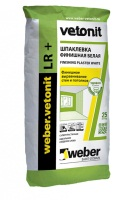
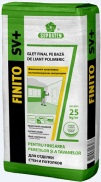
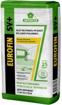

CONSILIUL 
CONCURENŢEI 
СОВЕТ ПО 
КОНКУРЕНЦИИ 
 
 
PLENUL CONSILIULUI CONCURENŢEI 
 
DECIZIE 
 
 
Nr. CN – 36                                                                       mun. Chişinău 
din 21.07.2016        
 
Plenul Consiliului Concurenţei, 
acţionând în temeiul art. 41 alin. (1) lit. h) al Legii concurenţei nr. 183 
din 11 iulie 2012, Hotărârii Parlamentului nr. 179 din 12 iulie 2013 privind 
numirea în funcţie a membrilor Plenului Consiliului Concurenţei, precum și 
Hotărârii Parlamentului nr. 220 din 27 septembrie 2013 privind numirea în 
funcţie a unui membru al Plenului Consiliului Concurenţei,  
analizând raportul de investigaţie asupra cazului inițiat prin Dispoziţia 
Plenului Consiliului Concurenței nr. 1 din 03 martie 2016, privind presupusa 
încălcare a prevederilor art. 19 alin. (1) lit. b)  al Legii concurenței nr. 183 din 
11 iulie 2012 (în continuare – Legea concurenței) de către întreprinderea 
„Supraten” S.A. în raport cu întreprinderea „Saint-Gobain Byggprodukter 
AB”, Suedia, prin copierea ambalajului produsului întreprinderii reclamante și 
plasarea produsului respectiv pe piață, observațiile părților, audierile 
desfășurate și materialele acumulate în cadrul investigării, 
 
A CONSTATAT: 
 
La data de 12 ianuarie 2016, a parvenit cererea nr. 44 (în continuare -
plângere) depusă în baza procurii de către întreprinderea „Intels-MDV” 
S.R.L., în numele întreprinderii „Saint-Gobain Byggprodukter AB”, Suedia, 
privind presupusele acţiuni de concurență neloială, realizate de către 
întreprinderea „Supraten” S.A.    
Potrivit celor invocate în plângere, presupusele acțiuni de concurență 
neloială realizate de către întreprinderea „Supraten” S.A. se manifestă prin 
copierea ambalajului produsului WEBER.VETONIT pentru produse identice 
și plasarea produselor respective pe piață.  
 

Urmare a examinării preliminare a plângerii, în conformitate cu 
prevederile art. 55 alin. (1) din Legea concurenței, în temeiul prevederilor art. 
41 alin. (1) lit. f) din Legea concurenței, Plenul Consiliului Concurenței, prin 
Dispoziția nr. 1 din 03 martie 2016, a dispus inițierea investigației privind 
presupusa încălcare a prevederilor art. 19 alin. (1) lit. b) al Legii concurenței, 
de către întreprinderea „Supraten” S.A., prin copierea ambalajului produsului 
întreprinderii „Saint-Gobain Byggprodukter AB”, Suedia, și plasarea 
produsului respectiv pe piață. 
 
1. 
Părțile implicate 
 
Reclamant:  
Întreprinderea „Saint-Gobain Byggprodukter AB”, adresa juridică: 
Suedia, or. Sollentuna, Box 415, SE-191 24, reprezentată de către 
întreprinderea  „Intels-MDV” S.R.L., cu sediul în mun. Chișinău, str. Drumul 
Viilor, nr. 42/3, ap. 37, MD-2021, IDNO 1003600121293. 
„Saint-Gobain Byggprodukter AB” este un grup internațional de 
companii care produce și distribuie materiale de construcție. Activitatea 
concernului este divizată în patru sectoare: materiale de înaltă performanță, 
produse pentru construcții, sticlă și distribuția materialelor de construcții. 
 
Reclamat: 
Întreprinderea „Supraten” S.A., adresa juridică: mun. Chișinău,                
str. Petricani,  nr. 84, MD-2059, IDNO 1003600005791. 
Întreprinderea „Supraten” S.A. produce și comercializează materiale de 
construcție.  
 
2. 
Piaţa relevantă 
 
Piaţa relevantă este piaţa în cadrul căreia se evaluează o anumită 
problemă de concurenţă şi care se determină prin raportarea pieţei relevante a 
produsului la piaţa geografică relevantă. 
Piaţa relevantă a produsului - piață a produselor considerate de către 
consumatori ca interschimbabile sau substituibile datorită utilizării date 
acestora, datorită caracteristicilor fizice, funcţionale şi a preţului. 
Luând în considerație faptul că reclamantul invocă copierea ambalajului 
pentru amestecul uscat pentru construcții și plasarea pe piață a produselor 
respective, precum și faptul că ambele întreprinderi comercializează materiale 
de construcție, piaţa relevantă a produsului, în sensul cazului investigat, se 
defineşte ca piaţa comercializării amestecului uscat pentru construcții. 
2 
 

Piaţa relevantă geografică - este zona în care întreprinderile sunt 
implicate în oferta sau cererea de pe piaţa relevantă a produsului, în care 
condiţiile de concurenţă sunt suficient de omogene.  
Ținând cont de faptul că amblajul presupus a fi copiat de către 
întreprinderea  „Supraten” S.A., a fost plasat pe piața Republicii Moldova, 
piaţa relevantă geografică o constituie teritoriul Republicii Moldova. 
Piaţa relevantă este piaţa comercializării amestecului uscat pentru 
construcții pe teritoriul Republicii Moldova. 
 
3. 
Acte şi fapte constatate 
 
La 
data 
de 
12 
ianuarie 
2016, 
întreprinderea 
„Saint-Gobain 
Byggprodukter AB”, Suedia, prin intermediul întreprinderii „Intels-MDV” 
S.R.L., a înaintat Consiliului Concurenței plângerea nr. 44, împotriva 
întreprinderii „Supraten” S.A. și a solicitat constatarea faptului comiterii 
acțiunilor de concurență neloială cu obligarea întreprinderii „Supraten” S.A. 
să înceteze acțiunile de concurență neloială și să retragă din vânzare cu 
ridicata și cu amănuntul toate produsele cu denumirea FINITO SV+ și 
EUROFIN SV+ în ambalaje, care copiază aspectul exterior al ambalajului 
reclamantului. 
Sintagmele WEBER.VETONIT, EUROFIN SV+ și FINITO SV+ se 
utilizează pentru desemnarea amestecurilor uscate pentru construcție, de 
regulă, ambalate în saci. 
Potrivit celor invocate în plângere, întreprinderea „Supraten” S.A. copie 
ambalajul (aspectul exterior al ambalajului) produsului de amestec uscat 

pentru construcție WEBER.VETONIT 
 pentru produsele sale cu 

destinație similară: FINITO SV+
 și  EUROFIN SV+
, precum și 
plasează aceste produse pe piață. Totodată, întreprinderea reclamantă mai 
comunică despre faptul că în anul 2015 a aflat despre următoarele fapte ale 
întreprinderii „Supraten” S.A.: 
- 
la data de 03 aprilie 2015 a depus o cerere de înregistrare a mărcii 
WETTONYTT pentru clasa 19, conform clasificării de la Nisa, nr. de 
depozit 036822; 
3 
 

- 
la data de 10 martie 2015 a depus cererea de înregistrare a design-ului 
industrial al ambalajului pentru amestecurile uscate WETTONYTT SV+ 
și FINITO SV+, nr. de depozit f 2015 0011, identic cu design-ul 
ambalajului întreprinderii reclamante; 
- 
a obținut Certificatul de conformitate nr. OCpr-019 11 A000583-15 din     
29 aprilie 2015 (valabil până la 28 aprilie 2018) pentru amestecurile 
uscate pe bază de polimeri pentru lucrări de construcții: FINITO SV+,           
EUROFIN SV+ și WETTONYTT SV+. 
Întreprinderea „Saint-Gobain Byggprodukter AB”, Suedia, este titulara 
următoarelor mărci comerciale pe teritoriul Republicii Moldova: 
1) 
VETONIT, certificat de înregistrare a mărcii nr. R 14689. Marca 
respectivă este înregistrată pentru clasele 01, 02, 17, 19, 37 și beneficiază 
de protecție începând cu data de 14 decembrie 2005 până la data de 14 
decembrie 2025; 
2) 
ВЕТОНИТ, certificat de înregistrare a mărcii nr. R 14690. Marca 
respectivă este înregistrată pentru clasele 01, 02, 17, 19, 37 și beneficiază 
de protecție începând cu data de 14 decembrie 2005 până la data de 14 
decembrie 2025; 
3) 
WEBER.VETONIT LR+, certificat de înregistrare a mărcii nr. 23953. 
Marca respectivă este înregistrată pentru clasa 19 și beneficiază de 
protecție începând cu data de 28 februarie 2012 până la data de 28 
februarie 2022. 
Design-ul ambalajului pentru amestecul uscat pentru construcții, al 
întreprinderii „Saint-Gobain Byggprodukter AB” nu a fost înregistrat în 
calitate de desen/model industrial, însă, invocă  reclamantul, acesta a fost 
livrat pe piața din Republica Moldova, era accesibil publicului și a devenit 
cunoscut consumatorilor datorită calității sale. 
Potrivit celor invocate în plângere, începând cu anul 2005, pe teritoriul 
Republicii 
Moldova 
sunt 
importate 
amestecuri 
pentru 
construcții 
WEBER.VETONIT în ambalaje cu gama de culori alb-verde-galben-negru, cu 
amplasare originală a elementelor figurative și imaginea literei „Z”, care are o 
poziție dominantă pe ambalaj.  
În conformitate cu Actul de constatare a faptului din 09 decembrie 2015, 
al executorului judecătoresc …, a fost stabilit faptul că imaginea ambalajului 
pentru produsele de amestec uscat WEBER.VETONIT ale întreprinderii 
„Saint-Gobain Byggprodukter AB”, Suedia, la data de 09 decembrie 2015, era 
difuzată pe paginile web: www.econstruct.md, www.999.md, www.veloxi.md 
și www.liderconstruct.md. Potrivit imaginilor nr. 3 și 4, anexate la Actul de 
constatare, rezultă că anunțul cu imaginea ambalajului produsului de 
4 
 

amestecuri uscate WEBER.VETONIT a fost plasat pe pagina web 
www.999.md la data de 14 februarie 2015.  
Suplimentar, la sediul Consiliului Concurenței a fost prezentat ambalajul, 
în original, al amestecurilor uscate WEBER.VETONIT, pe care este indicată 
data de 31 octombrie 2014. 
Totodată, au fost prezentate Consiliului Concurenței copiile contractelor      
nr. 29/05 din 15 martie 2005, nr. 70/07 din 01 ianuarie 2008, nr. 73/11 din          
08 septembrie 2011, însă în conținutul acestora și al anexelor la acestea nu 
sunt menționate prevederi referitor la ambalaj. Respectiv, în baza prevederilor 
contractuale și a anexelor, nu se poate ajunge la o concluzie în privința 
ambalajului în care au fost vândute materialele de construcție. 
Întreprinderea „Supraten” S.A. a comunicat despre faptul că în anul 
2015, luna aprilie, a elaborat și plasat pe piață produsul nou EUROFIN SV+. 
Pentru a-l diferenția de produsul EUROFIN, înregistrat și plasat pe piață în 
anul 2004, a fost modificat design-ul și cantitatea produsului în ambalaj.  
În anul 2015, luna mai, a fost plasat pe piață produsul nou FINITO SV+. 
Pentru a-l diferenția de produsul FINITO, înregistrat și plasat pe piață în anul 
2014, a fost modificat design-ul și cantitatea produsului în ambalaj. 
Întreprinderea reclamată menționează, în scrisoarea nr. 929 din 30 martie 
2016,  că la momentul plasării produsului FINITO SV+ nu a cunoscut despre 
faptul existenței pe piață a produselor ambalate în ambalaj asemănător, 
produse de către întreprinderea „Saint-Gobain Byggprodukter AB”, Suedia. 
Însă din momentul în care a fost notificată de către întreprinderea „Intels-
MDV” S.R.L., ambalajul asemănător a fost retras din circuitul comercial.  
În ceea ce privește design-ul ambalajelor, întreprinderea „Supraten” S.A. 
susține că ea însăși este autorul acestora. 
Referitor la produsul WETTONYT SV+, întreprinderea reclamată a 
comunicat că acesta nu este plasat pe piață, deoarece nu are înregistrată o 
astfel de marcă comercială.  
Prin scrisoarea nr. 261 din 05 februarie 2016, întreprinderea         
„Supraten” S.A. a comunicat că practic toate ambalajele de pe piața 
materialelor de construcții sunt identice, însă ulterior, prin scrisoarea nr. 929 
din 30 martie 2016, a comunicat că nu cunoaște alți producători de materiale 
de construcții, care utilizează ambalaj cu design asemănător.  
Potrivit Actului de constatare a faptului din 09 decembrie 2015, al 
executorului judecătoresc …, a fost stabilit faptul că pe pagina web 
www.supraten.md, la data de 09 decembrie 2015, se difuza imaginea 
ambalajului pentru produsele de amestec uscat FINITO SV+, care aparține 
întreprinderii „Supraten” S.A. Conform descrierilor executorului judecătoresc 
și al imaginilor anexate la Actul de constatare, rezultă că ambalajul FINITO 
5 
 

SV+ al întreprinderii „Supraten” S.A. este asemănător cu ambalajul 
WEBER.VETONIT al întreprinderii „Saint-Gobain Byggprodukter AB”, 
Suedia.  
Totodată, prin același Act de constatare, de pe pagina web 
www.supraten.md, a fost extrasă imaginea Certificatului de conformitate          
nr. OCpr-019 11 A000583-15 din 29 aprilie 2015, valabil până la 28 aprilie 
2018. Prin acest Certificat se confirmă faptul că produsele: FINITO SV+, 
EUROFIN SV+ și WETTONYTT SV+ sunt conforme cu cerințele obligatorii 
stabilite în Standartul SM 262:2005 și RNI nr. 06.5.3.35-2001. 
Această constatare vine să probeze intenția întreprinderii „Supraten” S.A.  
de a plasa pe piață produsul WETTONYTT SV+, care este asemănător cu 
marca VETONIT, ce parține întreprinderii „Saint-Gobain Byggprodukter AB”, 
Suedia. 
În conformitate cu art. 4 alin. (2) lit. c) și alin. (3) din Legea nr. 161 din 
12 iulie 2007 privind protecția desenelor și modelelor industriale, „Pe 
teritoriul Republicii Moldova sînt recunoscute şi protejate: c) desenele sau 
modelele industriale neînregistrate în cazul în care au fost făcute publice în 
conformitate cu prezenta lege. (3) Desenele şi modelele industriale protejate 
prin prezenta lege beneficiază şi de protecţia acordată aceleiaşi persoane sau, 
cu consimţămîntul ei, unei alte persoane în conformitate cu legislaţia privind 
drepturile de autor, cu începere de la data la care au fost create sau fixate sub 
orice formă”. În continuare, prevederile art. 10 alin. (1) lit. b) al aceluiași act 
normativ, menționează următoarele: „În sensul aplicării art.7 şi art.8, se 
consideră că un desen sau un model industrial a fost făcut public dacă a fost 
expus sau a fost publicat, utilizat, comercializat sau dezvăluit în alt mod, cu 
excepţia cazurilor în care aceste acţiuni nu puteau deveni cunoscute în mod 
rezonabil şi în cursul normal al activităţii unor persoane fizice sau juridice 
din Republica Moldova, specializate în domeniul respectiv: b) în cazul 
desenului sau modelului industrial neînregistrat, înainte de data la care a fost 
dezvăluit pentru prima oară”. 
Dat fiind faptul că nici una dintre întreprinderile implicate în investigația 
concurențială nu are înregistrat desenul industrial în cauză la AGEPI sau la o 
altă autoritate de nivel internațional, drepturi asupra desenului industrial 
respectiv va avea acea întreprindere care prima l-a făcut public. 
În acest sens, se constată faptul că întreprinderea „Saint-Gobain 
Byggprodukter AB”, Suedia, a utilizat desenul industrial al ambalajului pentru 
amestecuri uscate WEBER.VETONIT la data de 31 octombrie 2014 – dată 
indicată pe ambalajul pentru amestecuri uscate WEBER.VETONIT, prezentat 
Consiliului Concurenței. Totodată, se constată faptul că imaginea ambalajului 
6 
 

pentru amestecuri uscate WEBER.VETONIT a fost publicată la data de            
14 februarie 2015 pe pagina web www.999.md.  
Pe de altă parte, întreprinderea „Supraten” S.A. a comunicat faptul că a 
plasat pe piață produsele de amestec uscat EUROFIN SV+  și FINITO SV+, 
în ambalajele care se pretind a fi copiate, în anul 2015, luna aprilie, și 
respectiv, luna mai. 
Astfel, rezultă faptul că protecția juridică a desenului industrial al 
ambalajului pentru amestecuri uscate WEBER.VETONIT se va realiza în 
favoarea întreprinderii „Saint-Gobain Byggprodukter AB”. 
Mai mult decât atât, legislația concurențială protejează ambalajul 
produselor împotriva copierii, indiferent de calificarea acestuia prin prisma 
legislației proprietății intelectuale. Astfel, odată stabilit că ambalajul 
produselor 
WEBER.VETONIT 
aparține 
întreprinderii 
„Saint-Gobain 
Byggprodukter AB”, fapt susținut de ambele părți ale cauzei, orice copiere a 
acestuia se poate califica drept acțiune de concurență neloială. Este 
inadmisibilă realizarea acțiunilor de natură să creeze confuzie, în speță 
copierea ambalajului, or acestea pot aduce atingere intereselor legitime ale 
concurentului. 
La sediul Consiliului Concurenței au fost prezentate mostre de ambalaj 
ale produselor WEBER.VETONIT, EUROFIN SV+ și FINITO SV+. Drept 
urmare a analizei aspectului exterior al acestor ambalaje, se constată că au un 
șir de asemănări și puține deosebiri. Aspectul exterior al ambalajelor 
produselor EUROFIN SV+ și FINITO SV+ imită caracteristicile liniilor, 
culorilor 
și 
ornamentația 
elementelor 
grafice 
ale 
ambalajului 
WEBER.VETONIT. Pe aceleași locuri de pe ambalaje se indică aceleași date 
(spre ex: denumirea produsului, cantitatea ș.a.), figuri și culori. Elementele 
distinctive ale ambalajelor întreprinderii „Supraten” S.A., față de cel al 
întreprinderii Saint-Gobain Byggprodukter AB, Suedia, sunt insignifiante, 
respectiv, nu sunt în stare să realizeze o deosebire clară între acestea.  
În acest sens, este iminent riscul ca decizia consumatorului de a procura 
produsele întreprinderii „Supraten” S.A. sau a întreprinderii „Saint-Gobain 
Byggprodukter AB”, să fie slab diferențiată, or calitățile produselor unei 
întreprinderi, popularitatea întreprinderii, asociativ pot fi atribuite alteia. 
Reieșind din cele menționate mai sus, se conchide că întreprinderea 
„Supraten” S.A. a întreprins acțiuni care sunt de natură să creeze o 
confuzie cu întreprinderea „Saint-Gobain Byggprodukter AB”, Suedia, 
cu produsele și activitatea economică a acesteia prin copierea ilegală a 
ambalajului produsului WEBER.VETONIT, pentru produsele FINITO 
SV+, EUROFIN SV+ și plasarea acestora pe piață, aceste acțiuni fiind în 
stare de a aduce atingere intereselor legitime ale reclamantului.  
7 
 

La data de 22 aprilie 2016, prin scrisorile nr. CN-06/160-753 și               
CN-06/159-754, Consiliul Concurenței a remis părților implicate Raportul de 
investigație asupra cazului inițiat prin Dispoziția Plenului Consiliului 
Concurenței nr. 1 din 03 martie 2016 pentru informare și, după caz, expunerea 
observațiilor pe baza acestuia. 
Dat fiind faptul că, pe parcursul investigației, părțile au inițiat procedura 
de soluționare pe cale amiabilă a conflictului, la solicitarea acestora în acest 
scop și în temeiul art. 59 alin. (4) al Legii concurenței, Consiliul Concurenței 
a prelungit termenul de prezentare a observațiilor. 
Prin scrisoarea nr. 1952 din 23 iunie 2016, „Supraten” S.A. a prezentat 
observații asupra Raportului de Investigație.  
Observația nr. 1 
Întreprinderea „Supraten” S.A. menționează că un desen industrial 
neînregistrat se bucură de protecție pentru un termen de 3 ani de zile de la 
prima aducere la cunoștința publicului a acestuia. Potrivit reclamantei, aceasta 
a distribuit pe teritoriul Republicii Moldova produsele la care pretinde încă 
din perioada anului 2005, iar contractele de distribuție învederate de către 
reclamantă datează din anii 2005, 2008 și 2011. Echipa de investigație nu a 
avut niciun motiv să desconsidere aceste circumstanțe.  
Pe 
paginile 
web 
www.otzovik.com, 
www.td-stroymir.ru 
și 
www.strojklass48.ru se conțin referințe la ambalajele învederate de către 
reclamantă ce datează din anul 2012. Astfel, se solicită să se constate că 
forma ambalajului revendicat de către reclamantă a fost adusă la cunoștința 
publicului cu mult înainte de 3 ani până la depunerea plângerii și aceasta nu 
beneficiază de niciun fel de protecție. 
Raportat la aceste observații, se menționează că obiectul investigației 
concurențiale este copierea ambalajului, indiferent de calificarea acestuia prin 
prisma legislației proprietății intelectuale. Protecția ambalajului, de către 
Legea concurenței, împotriva copierii, se realizează în favoarea titularului, or 
utilizarea îndelungată de către o întreprindere a unui anumit ambalaj creează o 
asociere între aceste două.  
Probele prezentate de „Supraten” S.A. vin să demonstreze că reclamantul 
cu mult timp înainte utilizează ambalajul revendicat și, respectiv, copierea 
acestuia de către altă întreprindere este de natură să creeze confuzie. 
Observația nr. 2 
Întreprinderea reclamată invocă faptul că în privința ambalajului utilizat 
la ambalarea produselor EUROFIN SV+ și FINITO SV+ nu există nici o 
constatare a faptului că graficienii antrenați la realizarea acestora ar fi plagiat 
în vreun anumit fel ambalajul revendicat de către reclamantă.  
8 
 

Referitor la această observație, se menționează faptul că pe parcursul 
investigației  au  fost  administrate  un  șir  de  probe  în  acest  sens,  printre 
care: (1) asemănarea sporită dintre design-ul ambalajelor; (2) ambalajul 
produselor EUROFIN SV+ și FINITO SV+ a fost creat ulterior ambalajului 
produselor WEBER.VETONIT. 
Observația nr. 3 
Întreprinderea „Supraten” S.A., în observațiile sale, consideră că 
ambalajele sunt diferite. Analiza exhaustivă demonstrează că ambalajele nu 
sunt similare și mai cu seamă nu sunt în stare să nu producă asupra 
utilizatorului avizat o impresie vizuală globală diferită. 
Chestiunea „impresiei dintre ambalaje” poate fi apreciată exclusiv și 
stabilită în baza chestionării consumatorului avizat din piața comercializării 
amestecului uscat pentru construcții. 
Asupra acestui aspect se comunică faptul că realizarea acțiunilor de 
natură să creeze confuzie a fost constatată de către echipa de investigație. 
Nicio probă nu are prioritate și valoare prestabilită dinainte, toate informațiile 
sunt examinate în ansamblu. 
La data de 19 iulie 2016, orele 11:00, la sediul Consiliului Concurenței 
au avut loc audieri, la care au participat reprezentanții întreprinderilor 
„Supraten” S.A. și „Saint-Gobain Byggprodukter AB”, Suedia. În cadrul 
audierilor reprezentantul întreprinderii „Saint-Gobain Byggprodukter AB”, 
Suedia, întreprinderea „Intels-MDV” S.R.L., în persoana dnei …, a declarat 
că părțile au ajuns la un consens și sunt la etapa definitivării procesului de 
semnare a tranzacției de împăcare. În acest context, au fost discutate acțiunile 
întreprinse de către întreprinderea „Supraten” S.A. timp de trei luni, de la data 
recepționării raportului de investigație, în vederea încetării actului de 
concurență neloială investigat. Afirmațiile părților referitor la acest aspect 
fiind contrare: inițial … a declarat că acțiunile anticoncurențiale au încetat, 
apoi a spus că ele vor înceta timp de 25 de zile de la data semnării tranzacției 
de împăcare a părților, reprezentantul „Supraten ” S.A., dl …, la rândul lui, a 
vorbit despre viitoarea retragere a produselor de pe piață, fapt ce contravine 
afirmațiilor întreprinderii „Supraten” S.A. din scrisoarea cu nr. 15 parvenită în 
adresa Consiliului Concurenței pe data de 30 martie 2016, unde se declară: 
„Din momentul notificării de către compania „Intels-MDV” S.R.L., ambalajul 
asemănător a fost retras din circuitul comercial și utilizat.”   
În cadrul audierilor de la reclamat s-a solicitat prezentarea probelor 
privind măsurile întreprinse în vederea încetării acțiunilor anticoncurențiale. 
Prin scrisoarea nr. 2174 din 19 iulie 2016 „Supraten” S.A. a prezentat copia 
Dispoziției nr. 145/1 din 26 aprilie 2016 cu privire la atribuirea 
responsabilităților în procesul excluderii presupusei similitudini a design-ului 
9 
 

industrial al ambalajului la produsele FINITO SV+ și EUROFIN SV+ cu 
produsul WEBER VETONIT al companiei „Saint-Gobain Byggprodukter 
AB”. 
Prin scrisoarea nr. 2162 din 19 iulie 2016 părțile cauzei au depus cerere 
despre acceptarea angajamentelor părților și încetarea procedurii de 
investigare a cazului, la care a fost anexată o copie a tranzacției de împăcare a 
părților. Cererea de acceptare a angajamentelor în cauză nu corespunde 
cerințelor Regulamentului privind acceptarea angajamentelor propuse de către 
întreprinderi, aprobat prin Hotărârea nr. 2 din 22 ianuarie 2015, care stabileşte 
principiile generale aplicabile angajamentelor de către Consiliul Concurenţei 
și prevede expres tipurile de angajamente, condiţiile pe care trebuie să le 
îndeplinească propunerile de angajamente, termenele şi procedura pentru 
acceptarea şi evaluarea angajamentelor propuse de întreprinderi. Cu referire la 
tranzacția de împăcare - nu întrunește condițiile de valabilitate a actului 
juridic prevăzute de legislația civilă, cum ar fi data semnării tranzacției, 
competența și identificarea persoanelor care au semnat tranzacția etc. 
Totodată, conform art. 65 alin. (1) al Legii concurenței, după examinarea 
observaţiilor făcute de  părţi asupra raportului de investigaţie şi, după caz, 
după   desfăşurarea   audierilor,   Plenul   Consiliului   Concurenţei   decide:  
a) încetarea investigaţiei cazului, deoarece pe parcursul desfăşurării acesteia 
nu au fost descoperite probe suficiente privind încălcarea prevederilor legii 
care ar justifica aplicarea de măsuri corective sau sancţiuni; sau b) adoptarea 
unei decizii sau prescripţii în temeiul art. 41 alin. (1) lit. h)–l) şi u) al legii 
menționate. Astfel, raportul de investigație asupra cazului a fost expediat 
părților pe data de 22 aprilie 2016 (recepționat pe data de 25 aprilie 2016), 
observațiile de la reclamat au parvenit pe data de 23 iunie 2016, iar audierile 
au fost desfășurate pe data de 19 iulie 2016. Respectiv, în contextul celor 
menționate,  Plenul  nu  poate adopta o altă decizie,  decât cele prevăzute la 
art. 65 alin. (1) al Legii concurenței.       
Prin urmare, generalizând informațiile administrate la dosarul cauzei pe 
parcursul examinării, se stabilește că întreprinderea „Supraten” S.A. încalcă 
regulile concurențiale prin faptul că acțiunile sale sunt de natură să creeze 
confuzie cu întreprinderea „Saint-Gobain Byggprodukter AB”, Suedia, cu 
produsele și activitatea economică a acesteia. Copierea ilegală a ambalajului 
produsului WEBER.VETONIT, pentru produsele FINITO SV+, EUROFIN 
SV+ și plasarea acestora pe piață de către „Supraten” S.A. este de natură să 
creeze o confuzie cu întreprinderea „Saint-Gobain Byggprodukter AB”, 
Suedia, cu produsele și activitatea economică a acesteia și poate aduce 
atingere intereselor legitime ale reclamantului. 
 
10 
 

4. 
Calificarea legală a acțiunilor constatate 
 
În conformitate cu prevederile art. 14 alin. (1) din Legea concurenței, „se 
interzice întreprinderilor să realizeze acţiuni de concurenţă neloială”. Art. 4 
al aceluiași act normativ, definește concurenţa neloială drept „orice acţiune, 
realizată de întreprinderi în procesul concurenţei, care este contrară 
uzanţelor oneste în activitatea economică”. Totodată, conform prevederilor 
normei sus menționate, întreprinderea reprezintă „orice entitate, inclusiv 
asociaţie de  întreprinderi, angajată în activitate economică, indiferent de 
statutul juridic şi de modul de finanţare al acesteia”.  
Potrivit art. 14 alin. (2) al Legii concurenței, „acţiunile de concurenţă 
neloială interzise prin prevederile art. 15–19 se examinează de către 
Consiliul Concurenţei, la plângerea privind presupusele acţiuni de 
concurenţă neloială depusă de către întreprinderea ale cărei interese legitime 
au fost lezate, în condiţiile stipulate la art. 49 alin. (2)–(4)”. 
Reieșind din circumstanțele de fapt constatate în cadrul prezentei 
examinări, acțiunile întreprinderii „Supraten” S.A., manifestate prin copierea 
ilegală a ambalajului produsului WEBER.VETONIT, pentru produsele 
FINITO SV+, EUROFIN SV+ și plasarea acestora pe piață, întrunesc semnele 
constitutive ale confuziei. 
Confuzia, în sensul cazului investigat, este o acțiune de concurență 
neloială prevăzută la art. 19 alin. (1) lit. b) al Legii concurenței, unde se 
menționează că: „Sunt interzise orice acţiuni sau fapte care sunt de natură să 
creeze, prin orice mijloc, o confuzie cu întreprinderea, produsele sau 
activitatea economică a unui concurent, realizate prin: b) copierea ilegală a 
formei, a ambalajului şi/sau a aspectului exterior al produsului 
unei  întreprinderi şi plasarea produsului respectiv pe piaţă, copierea ilegală 
a publicităţii unei întreprinderi, dacă aceasta a adus sau poate aduce 
atingere intereselor legitime ale concurentului”. 
În conformitate cu art. 77 al Legii concurenței, sancțiunea aplicată pentru 
comiterea faptelor de concurență neloială constituie o amendă în mărime de 
până la 0,5% din cifra totală de afaceri realizată de întreprinderea în cauză în 
anul anterior sancționării. 
La stabilirea cuantumului amenzii au fost luate în calcul următoarele 
circumstanțe: 
1) Intenția părților implicate de a soluționa conflictul pe cale amiabilă; 
2) Inițierea procedurii de înlăturare a încălcării; 
3) Durata redusă a acțiunilor anticoncurențiale - mai puțin de un an. 
În anul 2015, întreprinderea „Supraten” S.A. a realizat o cifră totală de 
afaceri în sumă de … lei (…). 
11 
 

 
Potrivit art. 36 alin. (5) al Legii concurenței, sumele ce reprezintă amenzi 
sau alte sancțiuni aplicate de Consiliul Concurenței se fac venit la bugetul de 
stat 
și 
urmează 
a 
fi 
transferat 
pe 
contul 
IBAN: 
MD24TRGAAA14349101500000. 
În conformitate cu art. 43 alin. (2) din Codul de Executare nr. 443 din 24 
decembrie 2004, în cazul în care sumele se încasează în beneficiul statului, 
calitatea de creditor o exercită Ministerul Finanţelor  prin intermediul 
organelor fiscale teritoriale. 
Debitor este întreprinderea „Supraten” S.A., IDNO 1003600005791, cu 
sediul juridic în mun. Chișinău, str. Petricani,  nr. 84, MD-2059, cu 
următoarele date bancare: 
 
… 
 
 
Reieșind din circumstanțele de drept și de fapt constatate, în temeiul 
prevederilor art. 14 alin. (9), art. 39 lit. f), art. 41 alin. (1) lit. h) și art. 77 ale 
Legii concurenței nr. 183 din 11 iulie 2012, Plenul Consiliului Concurenței 
 
 
DECIDE: 
 
1. 
A constata încălcarea art. 19 alin. (1) lit. b) al Legii concurenței nr. 183 
din 11 iulie 2012 de către întreprinderea „Supraten” S.A., manifestată 
prin copierea ilegală a ambalajului produsului WEBER.VETONIT, care-
i aparține întreprinderii „Saint-Gobain Byggprodukter AB”, Suedia, 
pentru produsele FINITO SV+, EUROFIN SV+ și plasarea acestora pe 
piață;  
2. 
A aplica întreprinderii „Supraten” S.A., IDNO 1003600005791, cu 
sediul juridic în mun. Chișinău, str. Petricani, nr. 84, MD-2059, amendă 
în mărime de 1 051 775,65 lei (un milion, cinzeci și unu mii, șapte sute 
șaptezeci și cinci lei, 65 bani); 
3. 
Încetarea de către întreprinderea „Supraten” S.A. a actului de concurență 
neloială prevăzut la art. 19 alin. (1) lit. b) al Legii concurenței nr. 183 din 
11 iulie 2012. Despre înlăturarea încălcărilor se va informa Consiliul 
Concurenței până la data de 01 septembrie 2016.  
4. 
Suma amenzii prevăzută la pct. 2 se va achita de către „Supraten” S.A. la 
bugetul de stat (contul IBAN: MD24TRGAAA14349101500000) în 
termen de 60 zile lucrătoare de la data comunicării prezentei Decizii, 
12 
 

cu mențiunea: „amendă aplicată de către Consiliul Concurenței în 
conformitate cu Legea concurenței nr. 183 din 11 iulie 2012”. O copie 
a actului care confirmă plata va fi transmisă Consiliului Concurenței; 
5. 
Prezenta Decizie intră în vigoare la data adoptării și va fi adusă la 
cunoștința părților. 
 
 
 
Președintele Plenului                                                  Viorica CĂRARE 
Consiliului Concurenței 
13 
 
