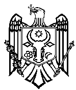

 

 
 
СОВЕТ ПО 
КОНКУРЕНЦИИ 
CONSILIUL 
CONCURENŢEI 
 
 
 
 
 
PLENUL CONSILIUL CONCURENȚEI 
 
 
 
D E C I Z I E 
 
Nr. DA-24 
din 19.05.2016                                                                                  mun. Chișinău             
 
Plenul Consiliului Concurenței, 
 
acţionând în temeiul art. 41 al Legii concurenței nr. 183 din 11.07.2012, 
Hotărârii Parlamentului nr. 179 din 12.07.2013 şi Hotărârii Parlamentului           
nr. 220 din 27.09.2013, 
examinând raportul de investigație, propunerile de angajamente în cadrul 
cazului inițiat prin Dispoziția Consiliului Administrativ al Agenției Naționale 
pentru Protecția Concurenței nr. AA-28 din 13.05.2011 modificată prin Hotărârea 
Consiliului Administrativ al Agenției Naționale pentru Protecția Concurenței         
nr. AA-12 din 01.03.2012 și prin Decizia Plenului Consiliului Concurenței           
nr. 1 din 30.08.2013, informațiile acumulate pe parcursul investigaţiei, 
 
 
A CONSTATAT: 
 
 
La 25.03.2015 și 26.03.2015, în adresa Consiliului Concurenței au parvenit 
cereri din partea tur-operatorilor SRL „Scavolin”, SRL „Anesto-Tur”, SRL „Voiaj 
International & Co”, ÎCS „Tez Tour” SRL, SRL „Transenca-Tur”, SRL „Forsbeta”, 
SRL „Solei-Turism” cu privire la intenția de a iniția discuții de acceptare a 
angajamentelor în cadrul investigării cazului inițiat prin Dispoziția Consiliului 
Administrativ al Agenției Naționale pentru Protecția Concurenței nr. AA-28 din 
13.05.2011 modificată prin Hotărârea Consiliului Administrativ al Agenției 
Naționale pentru Protecția Concurenței nr. AA-12 din 01.03.2012 și prin Decizia 
Plenului Consiliului Concurenței nr. 1 din 30.08.2013 
 
La 24.04.2015, ÎSCA „Air Moldova” expune disponibilitatea de a depune 
cerere privind intenția de a iniția discuții de acceptare a angajamentelor urmare a 
 
1

 
comunicării de către Consiliul Concurenței în conformitate cu pct. 27 din 
Regulamentul privind acceptarea angajamentelor propuse de către întreprinderi, 
aprobat prin Hotărârea Plenului Consiliului Concurenței nr. 2 din 22.01.2015, 
publicat în Monitorul Oficial nr. 39-45 art. 329 la 20.02.2015 (în continuare 
Regulament). 
 
În cadrul ședinței din 26.05.2015, Plenul Consiliului Concurenței decide că 
este oportună inițierea discuțiilor privind acceptarea angajamentelor înaintate de 
către SRL „Scavolin”, SRL „Anesto-Tur”, SRL „Voiaj International & Co”, ÎCS 
„Tez Tour” SRL, SRL „Transenca-Tur”, SRL „Forsbeta”, SRL „Solei-Turism”, 
ÎSCA „Air Moldova”, fapt despre care acestea au fost informate conform 
prevederilor pct. 31 din Regulament. 
 
I. 
Părţile implicate 
ÎSCA „Air Moldova” - întreprindere de stat, înregistrată la Camera 
Înregistrării de Stat la 12.01.1993, IDNO 1002600001718. Genuri de activitate-
transporturi aeriene pe bază de grafic, transporturi aeriene ocazionale, alte activități 
anexe transporturilor de călători și mărfuri etc. 
ÎM „Moldavian Airlines” SA – înregistrată la Camera Înregistrării de Stat la 
03.03.2012, IDNO 1003600085010. Genuri de activitate-transporturi aeriene pe 
bază de grafic, transporturi aeriene ocazionale, închirierea mijloacelor de transport 
fără echipaj etc. 
Turk Hava Yollari (în continuare – „Turkish Airlines”) - compania aeriană 
naţională din Turcia cu sediul în Istanbul. Compania operează o reţea de transport 
de pasageri pe cale aeriană.  
AtlasJet Havacilik AS - (în continuare – „AtlasJet”) - compania aeriană 
naţională din Turcia cu sediul în Istanbul. Compania operează o reţea de transport 
de pasageri pe cale aeriană. 
 
SRL „Holiday-Service” - înregistrată la Camera Înregistrării de Stat la 
27.01.1996, IDNO 1014600032632. Genuri de activitate - activitate de turism, 
publicitate, alte activități anexe transporturilor de călători și mărfuri etc. 
 
Biroul de Excursii şi Turism „Voiaj International & Co” SRL           
(în continuare - SRL „Voiaj International”) - înregistrat la Camera Înregistrării de 
Stat la 31.07.2003, IDNO-1003600078179. Genuri de activitate - activitate de 
turism, închirierea bunurilor imobiliare proprii, alte activități anexe tranporturilor 
 
2

 
de călători și mărfuri, hoteluri etc. 
 
SRL „Solei-Turism” - înregistrată la Camera Înregistrării de Stat la 
09.02.2001, IDNO 1002600019715. Genuri de activitate – activități ale agențiilor 
de voiaj și ale ghizilor, transporturi terestre de călători pe bază de grafic etc. 
 
ÎCS „Tez Tour” SRL - înregistrată la Camera Înregistrării de Stat la 
21.02.2008, IDNO 1008600010035. Genuri de activitate – activități ale agențiilor 
de voiaj și ale ghizilor, transporturi aeriene ocazionale, transporturi aeriene pe bază 
de grafic etc. 
 
SRL „Scavolin” - înregistrată la Camera Înregistrării de Stat la de 03.07.2002, 
IDNO 1003600036481. Genuri activitate – activitate de turism, transportul auto de 
călători, inclusiv taximetrie, cu excepția transportului auto de călători interurban 
din raza unui județ, a transportului auto de călători urban și a transportului auto de 
călători suburban etc. 
 
SRL „Transenca-Tur” – înregistrată la Camera Înregistrării de Stat la 
05.09.2000, IDNO 1002600020920. Genuri de activitate – activități ale agențiilor 
de voiaj și ale ghizilor, transporturi aeriene pe bază de grafic, alte activități de 
servicii individuale etc. 
 
SRL „Anesto-Tur” - înregistrată la Camera Înregistrării de Stat la 10.12.1998, 
IDNO 1003600027432. Genuri de activitate – activități ale agențiilor de voiaj și ale 
ghizilor, alte transporturi terestre de călători, reproducerea înregistrărilor pe suporți 
etc. 
 
SRL „Forsbeta” - înregistrată la Camera Înregistrării de Stat la 22.06.2007, 
IDNO 1007600038874. Genuri de activitate – activitate de turism, alte activități 
anexe transporturilor de călători de mărfuri etc. 
 
II. 
Piaţa relevantă: piaţa relevantă a produsului şi piaţa 
geografică relevantă.  
În cadrul investigaţiei, pentru soluţionarea problemelor de ordin concurenţial 
un rol important îl are definirea pieţei relevante. 
Piaţa relevantă are două componente: piaţa produsului şi piaţa geografică. 
Cu considerarea faptului, că:  
1. problema concurenţială este aferentă cursei de pasageri Chișinău - Antalya-
Chișinău (KIV-AYT-KIV), 
 
3

 
2. în perioada anilor 2007-2013, un număr limitat de tur-operatori au cumpărat 
servicii de transport aerian de pasageri prin încheierea de contracte de 
transport aerian de tip charter cu companiile aeriene, care efectuează cursa 
KIV-AYT-KIV, pentru toate cursele, indiferent de statutul acestora - regulate 
sau neregulate, 
3. tur-operatorii respectivi au obţinut dreptul de a valorifica de sine stătător 
toate locurile în aeronave prin: 
a. comercializarea locurilor/bilete avia la cursele cu destinaţia KIV-
AYT-KIV altor tur-operatori sau/şi consumatorilor finali  
şi  
b. utilizarea biletelor avia cu destinaţia KIV-AYT-KIV în calitate de 
parte componentă a pachetelor turistice pentru comercializarea 
acestora agenţiilor de turism sau/şi consumatorilor finali, 
 
în sensul prezentei examinări, sunt determinate drept pieţe relevante ale produsului: 
 
1. piaţa prestării serviciilor de transport aerian de pasageri la cursele cu 
destinaţia KIV-AYT-KIV (piaţa operării zborurilor cu destinaţia KIV-AYT-
KIV); 
2. piaţa achiziţionării serviciilor transport aerian de pasageri la cursele cu 
destinaţia KIV-AYT-KIV;  
3. piaţa comercializării biletelor avia la cursele cu destinaţia KIV-AYT-KIV; 
4. piaţa comercializării pachetelor turistice - zona turistică Antalya (în 
continuare - piaţa comercializării pachetelor turistice cu destinaţia turistică 
Antalya).  
 
 
 
Piața geografică relevantă 
 
 
 
Conform art. 4 din Legea concurenței nr. 183 din 11.07.2012, piața 
geografică reprezintă o zonă în care întreprinderile sunt implicate în oferta sau 
cererea de pe piața relevantă a produsului, în care condițiile de concurență sunt 
suficient de omogene și care poate fi deosebită de zonele geografice învecinate prin 
condiții de concurență ce diferă în mod apreciabil. 
Piaţa geografică cuprinde teritoriul cu condiţii omogene de concurenţă. 
Acoperirea naţională a produselor nominalizate şi faptul, că nu există careva 
condiţii speciale de prestare, achiziţionare, comercializare a produselor în cauză în 
funcţie de teritoriu, determină piaţa geografică aferentă acestora - Republica 
Moldova. 
 
 
4

 
III. Acte şi fapte constatate 
 
În perioada anilor 2007-2013, ÎSCA „Air Moldova”, pentru efectuarea curselor 
cu destinaţia KIV-AYT-KIV, încheie contracte de transport aerian cu tur-operatorul 
SRL „Holiday-Service”. 
Conform contractului, beneficiarul cursei poate să se aprovizioneze doar de la 
ÎSCA „Air Moldova”, iar în combinaţie cu obligaţiunea ÎSCA „Air Moldova” de   
a-şi vinde produsele doar beneficiarului cursei conduce la limitarea concurenţei pe 
piaţă. 
În perioada anilor 2007-2013, compania aeriană „Turkish Airlines”, pentru 
efectuarea curselor aeriene cu destinaţia KIV-AYT-KIV, încheie contracte charter 
cu tur-operatorul SRL „Scavolin”.  
În anul 2010 compania aeriană „AtlasJet” încheie contracte charter de transport 
aerian pentru efectuarea curselor cu destinaţia KIV-AYT-KIV cu SRL „MOBSEB 
GRUP”, iar în perioada anilor 2011-2013 respectivele contracte sunt încheiate cu 
tur-operatorul SRL „Scavolin”, care reprezintă interesele unui grup restrâns de tur-
operatori în baza contractelor de colaborare încheiate.  
În anii 2012-2013, compania aeriană ÎM „Moldavian Airlines” SA încheie 
contracte de transport charter cu destinaţia KIV-AYT-KIV, cu tur-operatorul SRL 
„Voiaj International”. 
În contextul celor expuse, în esenţă se atestă, că fiecare din companiile aeriene 
nominalizate mai sus, pentru efectuarea curselor aeriene regulate cu destinaţia KIV-
AYT-KIV, încheie contracte de transport aerian doar cu unul şi acelaşi tur-operator, 
pe întreaga perioada expusă mai sus, fără a ţine cont de condiţiile cu privire la 
operarea acestor zboruri prevăzute în tratate, acte legislative şi normative. 
Tur-operatorii deserviţi de o companie aeriană în privinţa consolidării cursei 
aeriene, nu utilizează serviciile unei alte companii aeriene care deservește un 
alt tur-operator. 
Încheierea şi realizarea unor contracte de transport aerian de efectuare a 
curselor cu destinaţia KIV-AYT-KIV între o companie aeriană şi tur-operator, pe 
întreaga perioadă estivală, impun obligaţia de a servi şi a se deservi doar parte pe 
parte a aceluiaşi contract.  
În contextul celor sus-menţionate, contractele ”charter” de transport aerian 
pentru efectuarea curselor cu destinaţia KIV-AYT-KIV, prin efectul cumulativ al 
presupuselor reţelele verticale similare practicate de companiile aeriene şi tur-
 
5

 
operatori, conduc la eliminarea concurenţei pe piaţa serviciilor de transport aerian, 
limitarea accesului pe piaţă pentru alţi tur-operatori şi la împărţirea pieţei şi 
surselor de aprovizionare.  
Ținând cont de cele relatate, în perioada anilor 2007-2013, se atestă existența 
pe piață a semnelor de rețelele paralele de acorduri verticale, realizarea cărora 
presupune limitarea cercului de cumpărători, împărțirea pieței și a surselor de 
aprovizionare, precum și limitarea și împiedicarea accesului pe piață, fapt interzis 
de prevederile art. 7 alin. (2) din Legea nr. 1103-XIV din 30.06.2000 cu privire la 
protecția concurenței și art. 5 alin. (3) lit. c) și e) din Legea concurenței nr. 183 din 
11.07.2012. 
 
Astfel, începând cu anul 2007 și până în anul 2013 beneficiarii acestor 
contracte sunt unii și aceeași tur-operatorii conectați la unele și același surse de 
aprovizionare (companii aeriene), care aplică unele și aceleași scheme de 
comercializare a biletelor avia la cursele cu destinația KIV-AYT-KIV. În esență, 
aplicarea acestor scheme conduce la stabilirea neconcurențială a prețurilor la 
biletele avia și în cosecință distorsionează piața comercializării pachetelor turistice, 
fortificând puterea de piață a tur-operatorilor cu care companiile aeriene au semnat 
contracte de tip charter pentru servicii aeriene în direcția Antalya și limitând 
accesul altor tur-operatori la piață, în rezultat și vânzările acestora, transformându-i 
în concurenți neefectivi. 
Totodată, SRL „Voiaj International” susţine că, în momentul ce se semnează 
un contract de transport aerian pentru cursa KIV-AYT-KIV, beneficiarul devine 
monopolist pe locuri la aeronava dispusă pentru cursa respectivă cu dreptul de a 
revinde din locuri şi dispune de posibilitatea de a dicta indirect preţul de 
comercializare a biletului avia şi, indirect pe piaţa pachetelor turistice cu destinaţia 
turistică Antalya. 
 
Prin urmare, în perioada anilor 2007, 2008, 2009 tur-operatorii SRL 
„Holiday-Service”, SRL „Solei-Turism” şi SRL „Voiaj International” încheie, 
pentru fiecare an în parte, pe perioada estivală contract de colaborare. 
Obiectul contractelor constituie colaborarea părților referitor la organizarea 
programului charter pe perioda estivală privind transportarea pasagerilor la cursa 
KIV-AYT-KIV cursa KIV-AYT-KIV cu ÎSCA „Air Moldova”. 
Contractele de colaborare încheiate pe perioada analizată conţin prevederi, ce 
indică expres intenţia comună a părţilor de a se comporta pe piaţă într-un mod 
identic. 
 
6

 
Comportamentul acestora constă în prezentarea unul către celălalt a 
informațiilor de genul: prețul fix de comercializare a unui loc la cursa KIV-AYT-
KIV, prezentarea contragenților și repartizarea acestora.  
În perioada anilor 2007, 2008, 2009 tur-operatorii SRL „Holiday-Service”, 
SRL „Voiaj-International”, SRL „Solei-Turism” în fapt, practică același preț de 
comercializare a biletului avia la cursa KIV-AYT-KIV către contragenţii săi.  
În ceea ce priveşte comercializarea pachetului turistic, în anul 2007,           
tur-operatorii 
SRL 
„Holiday-Service”, 
SRL 
„Voiaj-International”,           
SRL „Solei-Turism”  stabilesc aceeași mărime a adaosului comercial la costul total 
inclus în pachetul turistic. 
În privinţa comercializării biletului avia/loc la cursa KIV-AYT-KIV           
tur-operatorul SRL „Scavolin” practică aceeași schemă aplicată de către           
tur-operatorul SRL „Holiday-Service”. Astfel, tur-operatorul SRL „Scavolin” 
încheie în perioada anilor 2007, 2008, 2009, 2010, 2011, 2012 pentru fiecare an în 
parte, contract de colaborare cu tur-operatorii SRL „Transenca-Tur”, SRL 
„Anesto-Tur” şi SRL „Tur-34” (până în anul 2009). 
Ținând cont de constatările expuse mai sus se susține, că contractele de 
colaborare încheiate între tur-operatorii SRL „Holiday-Service”, SRL „Voiaj-
International”, SRL „Solei-Turism” și contractele de colaborare încheiate între    
tur-operatorii SRL „Scavolin”, SRL „Anesto-Tur” și SRL „Transenca-Tur” sunt 
semne a unor acorduri anticoncurențiale în sensul art. 7 alin. (1) Legii cu privire la 
protecția concurenței nr. 1103-XIV din 30.06.2000. 
Contractele încheiate în anii 2010, 2011, 2012, 2013 între tur-operatorii           
SRL „Holiday-Service” şi ÎCS „Tez Tour” SRL sunt, conform denumirii, contracte 
de achiziţionare a blocului de locuri în cadrul programului charter pentru 
respectivii ani. Se reține că, subiecţii acestor contracte sunt parte la contractul de 
transport aerian, care au obligaţiunea solidară de a-l executa, fapt ce presupune o 
colaborare întru executarea acestuia.  
Respectivele contracte conţin repartizarea locurilor către tur-opratorul           
ÎCS „Tez Tour” SRL, indicarea costului unui loc, care trebuie achitat de către 
acesta. 
Prețul este identic pentru toţi tur-operatorii cu care SRL „Holiday-Service” are 
încheiate contracte, prin care se achiziţionează un anumit număr de locuri pentru 
programa charter la cursele cu destinaţia KIV-AYT-KIV - sezonul de vară an. 2010, 
2011, 2012, 2013. 
 
7

 
Faptul, că tur-operatorii SRL „Holiday-Service”, ÎCS „Tez Tour” SRL, cu 
considerarea raporturilor lor de cooperare generate de obligaţia de a respecta 
contractul de transport aerian, stabilesc printr-un acord de achiziţie un preţ de 
procurare a locurilor avia pentru ÎCS „Tez Tour” SRL, care depăşeşte costul (cu 
taxe incluse) unui loc în navă, şi că nu există o explicaţie a aplicării acestui preţ 
decât generarea respectivului prin presupusa înţelegere între părţi, permite 
expunerea în privința existenței semnelor unui acord anticoncurenţial între 
respectivii tur-operatori de stabilire a preţului. Impactul negativ direct al 
presupusului acord, constă în fixarea unui preţ la procurarea biletului avia, care 
fiind parte componentă a pachetului turistic influenţează direct preţul ultimului. 
Pachetul turistic este, la rândul său, vândut agenţiilor de turism, care au sarcina de a 
vinde consumatorului final.  
Tur-operatorii SRL „Voiaj International & Co”, SRL „Solei-Turism”,           
SRL „Forsbeta” (în perioada anilor 2011-2013), SRL „Transenca-Tur” (în anul 
2013) împart locurile între ei la cursele efectuate de către ÎM „Moldavian Airlines” 
SA, fapt ce presupune limitarea accesului agențiilor de turism și altor actori la 
bilete avia pentru cursa KIV-AYT-KIV.  
 Raportul de investigație, cu constatările sus enumerate, a fost remis în adresa 
părților implicate în cadrul dosarului sus nominalizat. 
 
 
La 25.03.2015 și 26.03.2013 din partea tur-operatorilor SRL „Scavolin”, 
SRL „Anesto-Tur”, SRL „Voiaj International & Co”, ÎCS „Tez Tour” SRL,           
SRL „Transenca-Tur”, SRL „Forsbeta”, SRL „Solei-Turism” au parvenit cererile 
privind intenția de a iniția discuții de acceptare a angajamentelor. 
 
Scopul principal urmărit de Consiliul Concurenței prin acceptarea 
angajamentelor este restabilirea rapidă a mediului concurențial, prin luarea unor 
măsuri de natură de a înlătura situația care a determinat autoritatea de concurență să 
declanșeze investigația. Prin acceptarea de angajamente sunt urmărite obiective 
precum înlăturarea rapidă a îngrijorărilor legate de concurență pe baza unor soluții 
viabile ajustate la aceste îngrijorări, îmbunătățirea mediului concurențial și 
realizarea unei economii de procedură. 
 
Faptul că, prin acceptarea de către Consiliul Concurenţei a angajamentelor, 
întreprinderile evită constatarea unei încălcări a regulilor de concurenţă şi eventuala 
aplicare a unei amenzi nu modifică scopul principal urmărit prin acceptarea de 
angajamente 
 
Înaintarea propunerii de angajamente nu poate fi calificată ca acțiune de 
recunoaștere de către întreprinderi a existenței unei încălcări. Totodată, Consiliul 
 
8

 
Concurenței nu va folosi propunerile de angajamente de către întreprinderi pentru 
probarea unei decizii ulterioare de constatare a practicii anticoncurențiale. 
 
Inițiativa formulării de propuneri de angajamente aparține exclusiv           
tur-operatorilor SRL „Scavolin”, SRL „Anesto-Tur”, SRL „Voiaj International & 
Co”, ÎCS „Tez Tour” SRL, SRL „Transenca-Tur”, SRL „Forsbeta”, SRL „Solei-
Turism” față de care s-a inițiat investigația și disponibilitatea înaintării intenției de 
a iniția discuții de acceptare a angajamentelor este voința ÎSCA „Air Moldova”. 
 
Ținând cont de faptul, că întreprinderile au libertatea de a decide cu privire la 
natura, conținutul și durata angajamentelor pe care le propun în vederea înlăturării 
situației care a determinat inițierea investigației, tur-operatorii SRL „Scavolin”, 
SRL „Anesto-Tur”, SRL „Voiaj International & Co”, ÎCS „Tez Tour” SRL,        
SRL „Transenca-Tur”, SRL „Forsbeta”, SRL „Solei-Turism” propun aplicarea 
măsurilor necesare pentru armonizarea contractelor/clauzelor contractuale cu 
prevederile legislației în vigoare. De asemenea, aceștia propun adoptarea unui 
comportament pe piață în raport cu partenerii de afaceri, pornind de la interesele 
consumatorului precum și nelimitarea operatorilor sau agenților în posibilitatea de 
a-și rezerva locuri la blocul de locuri contractat prin asigurarea accesului tuturor în 
limita numărului disponibil de fotolii la condițiile dictate de factorii obiectivi. 
Totodată, tur-operatorul ÎCS „Tez Tour” SRL notează, că după primirea raportului 
de investigație a refuzat semnarea unui contract analogic celor investigate cu          
SRL „Holiday-Service”, fiind în căutarea unor noi modalități de asigurare 
consumatorul cu transfer aerian.  
 
Conform pct. 27 din Regulament, în cazul în care investigația vizează două 
sau mai multe întreprinderi, iar Consiliul Concurenței a fost contactat doar de o 
singură întreprindere sau de câteva din întreprinderile vizate în vederea inițierii 
discuțiilor în privința angajamentelor, Consiliul Concurenței în termen de 3 zile 
lucrătoare de la primirea intenției de a propune angajamente, va informa celelalte 
întreprinderi cu privire la acest fapt. Prin urmare, Consiliul Concurenței a informat 
tur-operatorul SRL „Holiday-Service” și companiile aeriene ÎSCA „Air Moldova”, 
ÎM „Moldavian Airlines” SA, „Turkish Airlines” și „Atlas-Jet” (scrisorile nr. DA-06/81-473 
din 27.03.2015, nr. DA-06/82-476 din 27.03.2015) cu privire la dispunerea intenției de inițiere a 
discuțiilor în privința angajamentelor din partea unor întreprinderi vizate pe 
marginea investigației nominalizate mai sus. 
 
La 24.04.2015, Consiliul Concurenței a fost informat cu privire la 
disponibilitatea de a depune cerere privind intenția de a iniția discuții de acceptare 
a angajamentelor din partea ÎSCA „Air Moldova”. 
 
 
 
9

 
 
ÎM „Moldavian Airlines” SA a comunicat Consiliului Concurenței despre 
imposibilitatea asumării angajamentelor din considerentul, că întreprinderea nu mai 
deține Certificat de Operator Aerian începând cu 11.02.2015, motiv pentru care 
activitatea companiei aeriene este sistată (scrisoarea nr. 827 din 06.04.2015). 
 
Totodată, a fost returnată în legătură cu modificarea adresei juridice a 
scrisorii Consiliului Concurenței nr. DA-06/82-476 din 27.03.2015 (scrisoare de 
informare cu privire la inițierea discuțiilor în privința angajamentelor) remisă în adresa companiei 
aeriene „Atlas Jet”. 
 
 
Compania 
aeriană 
„Turkish 
Airlines” 
și 
tur-operatorul           
SRL „Holiday-Service” nu și-au exprimat disponibilitatea de a depune cererea 
privind intenția de a iniția discuții de acceptare a angajamentelor și nu au oferit 
răspuns la scrisoarea nr. DA-06/82-476 din 27.03.2015. 
 
Ținând cont de prevederile pct. 27 sbpct. (2) din Regulament (dacă nu toate 
întreprinderile vizate își exprimă disponibilitatea de a formula angajamente, în 
termenul indicat, Plenul Consiliului Concurenței, în funcție de circumstanțe, poate 
decide dacă este oportună inițierea discuțiilor privind acceptarea angajamentelor 
din partea unei singure întreprinderi sau mai multor din întreprinderile vizate, 
dacă se va stabili că prin adoptarea unei decizii de acceptare de angajamente ar 
putea fi atins scopul acestor angajamente), Plenul Consiliului Concurenței în 
cadrul ședinței din 26.05.2015 a decis, că este oportună inițierea discuțiilor privind 
acceptarea angajamentelor, fapt despre care au fost informați tur-operatorii SRL 
„Scavolin”, SRL „Anesto-Tur”, SRL „Voiaj International & Co”, ÎCS „Tez Tour” 
SRL, SRL „Transenca-Tur”, SRL „Forsbeta”, SRL „Solei-Turism” și compania 
aeriană ÎSCA „Air Moldova”. 
 
Prin 
urmare, 
tur-operatorii 
SRL 
„Scavolin”, 
SRL 
„Anesto-Tur”,           
SRL „Voiaj International & Co”, ÎCS „Tez Tour” SRL, SRL „Transenca-Tur”, SRL 
„Forsbeta”, SRL „Solei-Turism” și compania aeriană ÎSCA „Air Moldova” au 
înaintat propuneri de angajamente. 
 
Propunerile 
de 
angajamente 
ale 
tur-operatorilor 
SRL 
„Scavolin”,           
SRL „Anesto-Tur”, SRL „Voiaj International & Co”, ÎCS „Tez Tour” SRL,         
SRL „Transenca-Tur”, SRL „Forsbeta”, SRL „Solei-Turism” și companiei aeriene  
ÎSCA „Air Moldova” au fost formulate în conformitate cu cerințele 
Regulamentului, acestea constituind o ofertă fermă, neechivocă, precisă, completă 
necondiționată și irevocabilă a acestora de a-și asuma o serie de obligații, 
îndeplinirea cărora ar permite înlăturarea rapidă, completă, eficientă și durabilă a 
îngrijorărilor concurențiale exprimate de Consiliul Concurenței și consolidarea 
mediului concurențial pe piață. 
 
10

 
Propunerile de angajamente ale tur-operatorilor SRL „Voiaj International & 
Co”, ÎCS „Tez Tour” SRL, SRL „Transenca-Tur”, SRL „Forsbeta”,           
SRL „Solei-Turism” 
 
Tur-operatorii SRL „Voiaj International & Co”, ÎCS „Tez Tour” SRL, SRL 
„Transenca-Tur”, SRL „Forsbeta”, SRL „Solei-Turism propun: 
 
1. la semnarea contractelor de transport aerian, SRL „Voiaj International & Co”, 
ÎCS 
„Tez 
Tour” 
SRL, 
SRL 
„Transenca-Tur”, 
SRL 
„Forsbeta”,           
SRL „Solei-Turism” vor plasa public informația privind disponibilitatea de 
fotolii cu ridicata și amănuntul, asigurând în acest sens transparența acestui 
proces; 
2. la semnarea contractelor nu vor admite și nu vor utiliza clauze ce ar limita 
concurența, în special obligațiunile de exclusivitate și coordonarea prețurilor de 
vânzare. 
 
În partea ce ține de comercializarea blocurilor de locuri pentru transportul 
internațional de pasageri și bagaje la cursele contractate, tur-operatorii SRL „Voiaj 
International & Co”, ÎCS „Tez Tour” SRL, SRL „Transenca-Tur”, SRL „Forsbeta”, 
SRL „Solei-Turism” vor implementa o procedură nouă de selecție a partenerilor, 
asigurând posibilități egale de cooperare pentru toți.  
În acest sens, respectivii tur-operatori se angajează de a exclude în 
comportamentul său presupusele acțiuni anticoncurențiale prin asumarea 
următoarelor angajamente: 
 
 
1. de a acorda acces liber oricăror solicitanți la fotoliile libere pe care le 
gestionează din nava închiriată în funcție de disponibilitatea acestora în 
aeronavă; 
2. de a nu limita nici un operator în posibilitatea de a procura locuri disponibile în 
aeronava contractantă, la condițiile dictate de factorii obiectivi, după principiul 
primul venit, primul servit; 
3. partenerii care procură un număr de locuri cu ridicata vor avea libera discreție 
de a dispune de fotoliile disponibile din navă comercializându-le la prețul pe 
care îl vor fixa de sine stătător asigurând plasarea în vânzare liberă a biletelor, 
angajament, care este deja implimentat; 
4. de a diversifica mijloacele de publicitate a ofertei de către agențiile de turism 
interesate pentru a avea acces diversificat și condiții similare; 
5. de a promova îndemnul agențiilor de turism de a se implica mai activ în 
asigurarea necesității pieții, asumându-și riscurile aferente precum și cheltuielile 
 
11

 
necesare și utile, luând în considerație că o bună parte din agenții se limitează 
doar la rolul de intermediere, fără a forma și a propune propriul produs turistic; 
6. de a adopta un comportament pe piață în raport cu partenerii și alte agenții de 
turism, ținând cont în principal de interesele consumatorului. 
 
Totodată, tur-operatorii SRL „Voiaj International & Co”, ÎCS „Tez Tour” 
SRL, SRL „Transenca-Tur”, SRL „Forsbeta”, SRL „Solei-Turism” susțin, că au 
întreprins toate măsurile necesare pentru armonizarea contractelor/clauzelor 
contractuale cu prevederile legislației în vigoare asigurând restabilirea rapidă a 
mediului concurențial, prin luarea unor măsuri de înlăturare a situației care a 
determinat Consiliul Concurenței să dispună inițierea investigației. 
 
Asigurarea accesului liber în condiții egale și echitabile la blocurile de locuri 
a tuturor solicitanților va exclude stabilirea prețurilor artificiale la biletele avia, fapt 
ce va oferi posibilitatea formării libere a prețului de comercializare a biletului avia 
și a pachetului turistic cu destinația Antalya. 
 
Durata angajamentelor asumate de către tur-operatorii SRL „Voiaj International 
& Co”, ÎCS „Tez Tour” SRL, SRL „Transenca-Tur”, SRL „Forsbeta”,           
SRL „Solei-Turism”  
 
 
Ținând cont de faptul, că tur-operatorii SRL „Voiaj International & Co”,    
ÎCS „Tez Tour” SRL, SRL „Transenca-Tur”, SRL „Forsbeta”, SRL „Solei-Turism” 
au libertatea de a decide cu privire la natura, conținutul și durata angajamentelor 
pe care le propun în vederea înlăturării situației care a determinat inițierea 
investigației, aceștia nu stabilesc durata aplicării acestora.  
 
Prin urmare, cu considerarea prevederilor pct. 46 din Regulament obligația 
întreprinderii de a respecta angajamentele încetează la data expirării perioadei 
indicate în decizia de acceptare a angajamentelor, durata acestora este de 3 ani din 
momentul expirării termenului de implementare a prezentei Decizii. 
 
Monitorizarea angajamentelor propuse de către tur-operatorii SRL „Voiaj 
International & Co”, ÎCS „Tez Tour” SRL, SRL „Transenca-Tur”,           
SRL „Forsbeta”, SRL „Solei-Turism” 
 
 
Întru monitorizarea respectării angajamentelor propuse de către tur-operatorii 
SRL „Voiaj International & Co”, ÎCS „Tez Tour” SRL, SRL „Transenca-Tur”, SRL 
„Forsbeta”, SRL „Solei-Turism”, aceștia vor plasa pe pagina web a sa un anunț 
oficial cu privire la angajamentele asumate și conținutul acestora în vederea 
excluderii îngrijorărilor concurențiale ce au stat la baza inițierii a cazului sus 
menționat. Totodată, tur-operatorii SRL „Voiaj International & Co”, ÎCS „Tez 
 
12

 
Tour” SRL, SRL „Transenca-Tur”, SRL „Forsbeta”, SRL „Solei-Turism” vor face 
mențiuni în privința faptului, că în caz de nerespectare a angajamentelor asumate 
de către aceștea, terții pot depune plângeri la Consiliul Concurenței. 
 
Tur-operatorii SRL „Voiaj International & Co”, ÎCS „Tez Tour” SRL,       
SRL „Transenca-Tur”, SRL „Forsbeta”, SRL „Solei-Turism”, anual până la 31 
martie, în decurs de 3 ani vor prezenta Consiliului Concurenței copiile actelor 
indicate în anexa nr. 1 al prezentei decizii. 
 
Consiliul Concurenței va monitoriza paginile web a tur-operatorilor SRL 
„Voiaj International & Co”, ÎCS „Tez Tour” SRL, SRL „Transenca-Tur”,           
SRL „Forsbeta”, SRL „Solei-Turism” cu privire la plasarea anunțului oficial 
privind angajamentele asumate și va examina plângerile după caz, depuse de către 
terți cu privire la nerespectarea acestora și copiile actelor specificate în anexa nr. 1 
a prezentei Decizii. 
 
Propunerile 
de 
angajamente 
ale 
tur-operatorilor 
SRL 
„Scavolin” 
și           
SRL „Anesto-Tur” 
 
Tur-operatorii SRL „Scavolin” și SRL „Anesto-Tur”, propun: 
 
 
1. contractele de transport aerian de pasageri (tip charter) nu vor conține clauze de 
interdicție față de companiile aeriene cu privire la vânzarea biletului avia către 
părțile terțe;  
2. contractele de transport aerian de pasageri (tip charter) nu vor conține clauze de 
interdicție față de companiile aeriene cu privire la încheierea unui astfel de 
contract cu părțile terțe; 
3. contractele de transport aerian de pasageri (tip charter) nu vor conține clauze cu 
privire la pragul minim sa maxim al prețului de vânzare către terți;  
4. contractele de transport aerian să nu vor conține clauze în privința pragului 
minim sau maxim a prețului la cursa aeriană (tip charter) în cazul încheierii 
contractelor cu terțele părți; 
5. contractele de transport aerian de pasageri (tip charter) nu vor conține clauze de 
interdicție față de tur-operatori cu privire la vânzarea biletului avia către terți 
(persoane fizice și/sau juridice inclusiv, participanții activi pe piața 
comercializării pachetelor turistice cu destinația KIV-AYT-KIV); 
6. contractele de transport aerian nu vor conține clauze de interdicție față de       
tur-operatori cu privire la contractarea cursei KIV-AYT-KIV de la alte companii 
aeriene (persoane fizice și/sau juridice inclusiv, participanții activi pe piața 
comercializării pachetelor turistice cu destinația KIV-AYT-KIV); 
 
13

 
7. contractele de transport aerian de pasageri (tip charter) nu vor conține clauze cu 
privire la pragul minim sa maxim al prețului de vânzare a biletului avia către 
terți (persoane fizice și/sau juridice inclusiv, participanții activi pe piața 
comercializării pachetelor turistice cu destinația KIV-AYT-KIV);  
8. contractele de transport aerian de tip charter să nu vor conține clauze în privința 
stabilirii pragului minim sau maxim a prețului la cursa aeriană (tip charter) în 
cazul încheierii contractelor cu alte companii aeriene. 
9. contractele de colaborare încheiate în scopul organizării programului charter nu 
vor conține clauze de interdicție cu privire la vânzarea biletului avia către terți 
(persoane fizice și/sau juridice inclusiv, participanții activi pe piața 
comercializării pachetelor turistice cu destinația KIV-AYT-KIV);  
10. contractele de colaborare încheiate în scopul organizării programului charter nu 
vor conține clauze de stabilire a pragul minim sau maxim a prețului de 
comercializare a biletului avia către părțile terțe (persoane fizice și/sau juridice 
inclusiv, participanții activi pe piața comercializării pachetelor turistice cu 
destinația KIV-AYT-KIV); 
11. contractele de colaborare încheiate între tur-operatori, în scopul organizării 
programului charter nu vor conține clauze de interdicție cu privire la procurarea 
de sine stătătoare a biletelor avia de la părțile contractante ale contractului de 
colaborare (persoane fizice și/sau juridice inclusiv, participanții activi pe piața 
comercializării pachetelor turistice cu destinația KIV-AYT-KIV); 
12. contractele de colaborare încheiateîntre tur-operatori în scopul organizării 
programului charter nu vor conține clauze de interdicție cu privire la 
contractarea cursei aeriene de sine stătătoare de la compania aeriană 
contractantă sau de la o altă companie aeriană; 
13. contractele de colaborare încheiate între tur-operatori în scopul organizării 
programului charter nu vor conține clauze de interdicție cu privire la stabilirea 
pragului minim sau maxim la cursa aeriană de tip charter în condițiile de 
încheiere de sine stătătoare a contractelor cu aceeași companie aeriană sau alta; 
14. stabilirea politicii de formare a prețului de comercializare a biletului avia, 
reieșind din situația economico-comercială a întreprinderii, competitivitatea 
produsului și conjuctura pieții cu excluderea influenței asupra formării prețului 
la biletul avia din partea transportatorilor și participanților pe piața acordării 
serviciilor turistice. 
 
Conform tur-operatorilor SRL „Scavolin” și SRL „Anesto-Tur” acceptarea și 
punerea în aplicarea a angajamentelor sus enumerate conduce la asigurarea 
accesului liber în condiții egale și echitabile la serviciile de transport aerian la cursa 
 
14

 
KIV-AYT-KIV (fie prin metoda achiziționării biletelor avia și/sau încheierea 
contractelor de transport aerian de tip charter) pentru persoanele fizice și/sau 
juridice ale Republicii Moldova și libera formare a prețului la serviciile de transport 
aerian la cursa KIV-AYT-KIV (fie prin procurarea biletelor avia și/sau încheierea 
contractului de transporta aerian de tip charter). 
 
Durata angajamentelor asumate de către tur-operatorii SRL „Scavolin” și      
SRL „Anesto-Tur”  
 
 
Ținând cont de faptul, că tur-operatorii SRL „Scavolin” și SRL „Anesto-Tur”  
au libertatea de a decide cu privire la natura, conținutul și durata angajamentelor 
pe care le propun în vederea înlăturării situației care a determinat inițierea 
investigației, aceștia nu stabilesc durata aplicării acestora.  
 
Prin urmare, cu considerarea prevederilor pct. 46 din Regulament obligația 
întreprinderii de a respecta angajamentele încetează la data expirării perioadei 
indicate în decizia de acceptare a angajamentelor, durata acestora este de 3 ani din 
momentul expirării termenului de implementare a prezentei Decizii. 
 
Monitorizarea 
angajamentelor 
propuse 
de 
către 
SRL 
„Scavolin” 
și           
SRL „Anesto-Tur” 
 
 
Întru monitorizarea respectării angajamentelor propuse de către tur-operatorii 
SRL „Scavolin” și SRL „Anesto-Tur”, respectivii vor plasa pe pagina web a sa un 
anunț oficial cu privire la angajamentele asumate și conținutul acestora, în vederea 
excluderii îngrijorărilor concurențiale ce au stat la baza inițierii din oficiu a cazului 
sus menționat. Totodată, SRL „Scavolin” și SRL „Anesto-Tur”, vor face mențiuni 
în privința faptului, că în caz de nerespectare a angajamentelor asumate de către 
acestea, terții pot depune plângeri la Consiliul Concurenței. 
 
 
Tur-operatorii SRL „Scavolin” și SRL „Anesto-Tur”, anual până la 31 martie 
în decurs de 3 ani vor prezenta Consiliului Concurenței copiile actelor indicate în 
anexa nr. 1 al prezentei Decizii: 
 
Consiliul Concurenței va monitoriza paginile web a tur-operatorilor SRL 
„Scavolin” și SRL „Anesto-Tur” cu privire la plasarea anunțului oficial referitor la  
angajamentele asumate și după caz, va examina plângerile depuse de către terți cu 
privire la nerespectarea acestora și copiile actelor indicate în anexa nr. 1 a prezentei 
Decizii. 
 
 
 
 
15

 
Propunerile de angajamente ale ÎSCA „Air Moldova” 
 
ÎSCA „Air Moldova” propune: 
 
a) înlăturarea și evitarea includerii clauzei exclusivității la încheierea 
contractelor de transport aerian, în ceea ce privește prezența obligației 
reciproce vis-a-vis de a nu desface mărfuri produse de concurenți și respectiv 
de a nu încheia contracte cu alți tur-operatori; 
b) asigurarea unei transparențe maxime la disponibilitatea examinării ofertelor 
de încheiere a contractelor cu toți tur-operatorii interesați, care vor prezenta 
condiții avantajoase reciproce în acest domeniu, în vederea respectării 
legislației concurențiale. 
 
 
Acceptarea și punerea în aplicare a respectivelor angajamente asigură 
concurența între mărci pe piața serviciilor de transport aerian de pasager la cursa 
KIV-AYT-KIV și oferă posibilitatea desfacerii mărfurilor de produse între 
concurenți, posibilitatea intrării unui furnizor potențial de servicii de transport 
aerian. 
 
Durata angajamentelor asumate de către ÎSCA „Air Moldova” 
 
 
Ținând cont de faptul, că ÎSCA „Air Moldova” are libertatea de a decide cu 
privire la natura, conținutul și durata angajamentelor pe care le propune în 
vederea înlăturării situației care a determinat inițierea investigației, aceasta nu 
stabilește durata aplicării acestora.  
 
Prin urmare, cu considerarea prevederilor pct. 46 din Regulament obligația 
întreprinderii de a respecta angajamentele încetează la data expirării perioadei 
indicate în decizia de acceptare a angajamentelor, durata acestora este de 3 ani data 
expirării termenului de implementare a prezentei Decizii. 
 
Monitorizarea angajamentelor propuse de către ÎSCA „Air Moldova” 
 
 
Întru 
monitorizarea 
respectării 
angajamentelor 
propuse 
de 
către           
ÎSCA „Air Moldova”, aceasta va plasa pe pagina web un anunț oficial cu privire la 
angajamentele asumate și conținutul acestora, în vederea excluderii îngrijorărilor 
concurențiale ce au stat la baza inițierii din oficiu a cazului nominalizat mai sus. 
ÎSCA „Air Moldova”, totodată va face mențiuni în privința faptului, că în caz de 
nerespectare a acestora de către respectiva companie aeriană, terții pot depune 
plângeri la Consiliul Concurenței. 
 
ÎSCA „Air Moldova” anual până la 31 martie, în decurs de 3 ani va prezenta 
Consiliului Concurenței copiile actelor indicate în anexa nr. 1 a prezentei decizii. 
 
16

 
 
Consiliul Concurenței va monitoriza pagina web a ÎSCA „Air Moldova” cu 
privire la plasarea anunțului oficial referitor la angajamentele asumate și va 
examina plângerile după caz, depuse de către terți cu privire la nerespectarea 
acestora și copiile actelor indicate în anexa nr. 1 a prezentei Decizii. 
 
 
Angajamentele propuse de către tur-operatorii SRL „Scavolin”, SRL. 
„Anesto-Tur”, SRL „Voiaj International & Co”, ÎCS „Tez Tour” SRL,           
SRL „Transenca-Tur”, SRL „Forsbeta”, SRL „Solei-Turism” îndeplinesc condițiile 
prevăzute la pct. 14, pct. 15 și pct. 17 din Regulament. 
 
Cu considerarea acestui fapt, Consiliul Concurenței la 09.10.2015 a efectuat 
testul de piață prin publicarea versiunii neconfidențiale a angajamentelor și a 
rezumatului 
cazului 
pe 
pagina 
web 
a 
autorității 
de 
concurență 
www.competition.md. 
 
 În termenii stabiliți, în adresa Consiliului Concurenței nu au parvenit 
observații sau propuneri pe marginea angajamentelor propuse de către           
SRL „Scavolin”, SRL „Anesto-Tur”, SRL „Voiaj International & Co”,           
ÎCS „Tez Tour” SRL, SRL „Transenca-Tur”, SRL „Forsbeta”, SRL „Solei-Turism”, 
ÎSCA „Air Moldova”. 
 
Ținând cont de cele expuse mai sus, în temeiul art. 39 și art. 41 alin. (1) lit. 
u) din Legea concurenței nr. 183 din 11.07.2012, Plenul Consiliului Concurenței, 
 
DECIDE: 
 
1. 
A accepta angajamentele propuse de către tur-operatorii SRL „Scavolin”,   
SRL „Anesto-Tur”, SRL „Voiaj International & Co”, ÎCS „Tez Tour” SRL,           
SRL „Transenca-Tur”, SRL „Forsbeta”, SRL „Solei-Turism” și compania aeriană  
ÎSCA „Air Moldova” pe marginea investigației inițiate prin prin Dispoziția 
Consiliului Administrativ al Agenției Naționale pentru Protecția Concurenței nr. 
AA-28 din 13.05.2011 modificată prin Hotărârea Consiliului Administrativ al 
Agenției Naționale pentru Protecția Concurenței nr. AA-12 din 01.03.2012 și prin 
Decizia Plenului Consiliului Concurenței nr. 1 din 30.08.2013. 
2. 
A înceta investigația inițiată prin Dispoziția Consiliului Administrativ  al 
Agenției Naționale pentru Protecția Concurenței nr. AA-28 din 13.05.2011 
modificată prin Hotărârea Consiliului Administrativ al Agenției Naționale pentru 
Protecția Concurenței nr. AA-12 din 01.03.2012 și prin Decizia Plenului 
Consiliului Concurenței nr. 1 din 30.08.2013 odată cu adoptarea prezentei Decizii. 
 
 
 
17

 
3. 
Tur-operatorii SRL „Scavolin”, SRL „Anesto-Tur”, SRL „Voiaj International 
& Co”, ÎCS „Tez Tour” SRL, SRL „Transenca-Tur”, SRL „Forsbeta”, SRL „Solei-
Turism” și compania aeriană ÎSCA „Air Moldova”, pe parcursul a 60 zile 
lucrătoare de la data comunicării prezentei Decizii, vor pune în aplicare 
angajamentele asumate. 
 
4. 
Durata angajamentelor propuse de către tur-operatorii SRL „Voiaj 
International & Co”, ÎCS „Tez Tour” SRL, SRL „Transenca-Tur”, SRL „Forsbeta”, 
SRL „Solei-Turism” și compania aeriană ÎSCA „Air Moldova” este de 3 ani 
începând cu data punerii în aplicare a angajamentelor asumate. 
 
5. 
Tur-operatorii SRL „Scavolin”, SRL „Anesto-Tur”, SRL „Voiaj International 
& Co”, ÎCS „Tez Tour” SRL, SRL „Transenca-Tur”, SRL „Forsbeta”,           
SRL „Solei-Turism” și compania aeriană ÎSCA „Air Moldova”, vor prezenta 
Consiliului Concurenței, anual până la 31 martie, în decurs de 3 ani de la data 
implementării prezentei Decizii, copiile actelor indicate în anexa nr.1.  
 
6. 
Consiliul Concurenței, în decurs de 3 ani de la data punerii în aplicare a 
angajamentelor asumate de către tur-operatorii SRL „Voiaj International & Co”, 
ÎCS „Tez Tour” SRL, SRL „Transenca-Tur”, SRL „Forsbeta”, SRL „Solei-Turism” 
și compania aeriană ÎSCA „Air Moldova”, va monitoriza anunțul acestora cu 
privire la angajamentele asumate, plasat pe pagina oficială a acestora și după caz, 
va examina plângerile depuse din partea terților cu privire la nerespectarea 
angajamentelor. 
 
7. 
Decizia intră în vigoare la data adoptării. 
 
 
 
 
 
 
 
 
 
 
 
 
 
 
 
 
 
 
 
 
 
 
 
 
 
 
 
 
 
 
 
Preşedintele Plenului  
Consiliului Concurenţei                                              Viorica CĂRARE 
 
 
 
 
 
 
 
18

 
Anexa nr. 1 
 
cu privire la copiile actelor prin care se confirmă îndeplinirea angajamentelor asumate, 
ce urmează a fi prezentate Consiliului Concurenței de către tur-operatorii SRL „Voiaj 
International & Co”, ÎCS „Tez Tour” SRL, SRL „Transenca-Tur”, SRL „Forsbeta”, SRL 
„Solei-Turism”, 
SRL 
„Scavolin”, 
SRL 
„Anesto-Tur” 
și 
compania 
aeriană            
ÎSCA „Air Moldova”  
 
Tur-operatorii SRL „Voiaj International & Co”, ÎCS „Tez Tour” SRL,         
SRL  „Transenca-Tur”, SRL „Forsbeta”, SRL „Solei-Turism” SRL „Scavolin”,    
SRL „Anesto-Tur” vor prezenta Consiliului Concurenței următoarele acte:  
 
1. 
copiile contractelor de transport aerian încheiate între beneficiar și compania 
aeriană pentru efectuarea cursei aeriene cu destinația KIV-AYT-KIV; 
2. 
copiile contractelor de achiziționare a blocurilor de locuri/bilete avia 
încheiate cu alți tur-operatori activi pe piața comercializării pachetelor turistice cu 
destinația Antalya; 
3. 
lista tur-operatorilor solicitanți de achiziționa blocuri de locuri/bilete avia la 
cursele cu destinația KIV-AYT-KIV și solicitările acestora; 
4. 
actul prin care se conferă solicitanților blocuri de locuri/bilete avia la cursele 
KIV-AYT-KIV; 
5. 
actul prin care se confirmă plasarea anunțului dat, public cu privire la 
disponibilitatea de fotolii angro și cu amănuntul; 
6. 
actul întocmit la discreția întreprinderilor nominalizate cu privire la prețul de 
comercializare a unui loc/bilet avia la cursa KIV-AYT-KIV către solicitanți în 
scopul prezentării acestuia Consiliului Concurenței; 
7. 
alte acte relevante prin care se atestă repectarea angajamentelor asumate. 
 
 
Compania aeriană ÎSCA „Air Moldova” va prezenta Consiliului Concurenței 
următoarele acte:  
 
1. 
copiile contractelor de transport aerian încheiat între ÎSCA „Air Moldova” și 
beneficiarii cursei KIV-AYI-KIV; 
2. 
actul prin care se confirmă plasarea anunțului dat, public cu privire la 
organizarea concursului în vederea consolidării cursei aeriene neregulate           
tur-operatorilor; 
3. 
procesul-verbal de selectare a contractantului curselor aeriene neregulate; 
4. 
ofertele participanților; 
5. 
alte acte relevante prin care se atestă respectarea angajamentelor asumate. 
 
19
