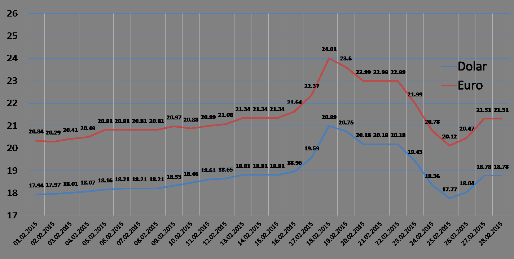

CONSILIUL 
СОВЕТ ПО 
CONCURENŢEI 
 
КОНКУРЕНЦИИ 
PLENUL CONSILIULUI CONCURENȚEI 
 
DECIZIE 
 
Nr. APD – 33                                                                                     mun. Chişinău 
din 14.07.2017 
 
 
Plenul Consiliului Concurenţei, 
acţionând în temeiul art. 41 al Legii concurenţei nr. 183 din 11.07.2012, 
Hotărârii Parlamentului nr. 179 din 12.07.2013 privind numirea în funcţie a 
membrilor Plenului Consiliului Concurenţei, precum și Hotărârii Parlamentului nr. 
220 din 27.09.2013 privind numirea în funcţie a unui membru al Plenului 
Consiliului Concurenţei,  
analizând raportul de investigaţie asupra cazului iniţiat prin Dispoziţia 
Plenului Consiliului Concurenței nr. 7 din 04.03.2015 şi materialele acumulate în 
cadrul investigaţiei, 
 
A CONSTATAT: 
În perioada 17.02.2015-18.02.2015 în diferite mijloace de informare a fost 
abordată problema  majorării exagerate a prețurilor la produsele electrocasnice. 
Conform informațiilor din presă, majorarea prețurilor la produsele electrocasnice a 
avut loc simultan la toate rețelele de magazine de electrocasnice în urma majorării 
cursului de vânzare / cumpărare a valutei, și a constituit în mediu cu 50% față de 
zilele anterioare. 
Plenul Consiliului Concurenţei, ţinând cont de semnele încălcării legislației 
concurențiale de către rețelele de magazine de produse electrocasnice privind 
majorarea exagerată și concomitentă a prețurilor la electrocasnice în luna februarie, 
anul 2015, a iniţiat din oficiu, prin Dispoziţia nr. 7 din 04.03.2015, investigația 
referitor la semnele încălcării prevederilor Legii concurenţei nr. 183 din 
11.07.2012 (în continuare Legea concurenței) de către rețelele de magazine de 
produse electrocasnice. 
 
 
1 
 

I. Părţile implicate 
 
„Rolling International” SRL – IDNO 1007600068268, întreprindere ce 
administrează rețeaua de magazine de produse electrocasnice „FoxMart”. A fost 
înregistrată în Registrul de stat al persoanelor juridice la data de 26.11.2007, având 
sediul juridic în mun. Chișinău, bd. Moscova, nr. 5.  
 
Conform Extrasului din Registrul de stat al persoanelor juridice nr. 10717 
din 18.04.2014, obiectul principal de activitate al întreprinderii constituie comerțul 
cu ridicata al aparatelor electrice de uz casnic și aparatelor de radio; comerțul cu 
amănuntul al articolelor și aparatelor electrice de uz casnic și aparatelor de radio; 
comerțul cu ridicata pe bază de tarife sau contracte; comerțul cu ridicata al 
materialelor lemnoase, al materialelor de construcție și echipamentului sanitar; alte 
tipuri de comerț cu amănuntul neefectuat prin magazine; reparații de articole și 
aparate electrice de uz casnic; construcțiile de clădiri și (sau) construcții 
inginerești, instalații și rețele tehnico-edilitare, reconstrucțiile, consolidările, 
restaurările. 
 
Conform Acordului de preluare a activității de comerț cu mărfuri 
electrocasnice, tehnoredactat la data de 01.12.2013, „Rolling International” SRL a 
preluat de la […] rețeaua de magazine de produse electrocasnice „FoxMart” cu 
preluarea obligațiunilor aferente genului de activitate – comercializarea mărfurilor 
cu exploatare de lungă durată la care sunt prevăzute termene de garanție. 
„Maxiteh-ST” SRL – IDNO 1002600027413, întreprindere care a 
administrat rețeaua de magazine de produse electrocasnice „Maximum”. A fost 
înregistrată în Registrul de stat al persoanelor juridice la data de 26.10.2000, având 
sediul juridic în mun. Chișinău, bd. Decebal, nr. 139.  
Conform Clasificatorului Activităţilor din Economia Moldovei pentru anul 
2015, „Maxiteh-ST” SRL a avut ca activitate de bază comerțul cu amănuntul a 
articolelor și a aparatelor electrocasnice în magazine specializate. 
Conform informațiilor de la ÎS „Camera Înregistrării de Stat”, „Maxiteh-ST” 
SRL a fost radiată din Registrul de stat al persoanelor juridice la data de 
26.09.2016 în rezultatul lichidării conform deciziei asociaților din 08.09.2016. În 
prezent, rețeaua de magazine de produse electrocasnice „Maximum” este 
administrată de către întreprinderea „Maximum Electronic” SRL, fiind fondată de 
aceeași fondatori ai „Maxiteh-ST” SRL. 
 „AV Electronic” SRL – IDNO 1012600025568, întreprindere ce 
administrează rețeaua de magazine de produse electrocasnice „Alina Electronic”. 
A fost înregistrată în Registrul de stat al persoanelor juridice la data de 11.09.2012, 
având sediul juridic în mun. Chișinău, bd. Ștefan cel Mare și Sfânt, nr. 3. 
Conform Extrasului din Registrul de stat al persoanelor juridice nr. 13070 
din 15.05.2015, obiectul principal de activitate al întreprinderii constituie comerțul 
cu ridicata pe bază de tarife sau contracte; comerțul cu ridicata al aparatelor 
electrice de uz casnic și aparatelor de radio; comerțul cu ridicata al altor produse 
2 
 

nealimentare de larg consum; comerțul cu amănuntul al mobilei și echipamentelor 
de uz casnic; reparații de articole și aparate electrice de uz casnic. 
„BM Technotrade” SRL – IDNO 1012600030830, întreprindere ce 
administrează rețeaua de magazine de produse electrocasnice „Bomba”. A fost 
înregistrată în Registrul de stat al persoanelor juridice la data de 09.10.2012 având 
sediul juridic în mun. Chișinău, bd. Dimitrie Cantemir, nr. 1. 
Conform Extrasului din Registrul de stat al persoanelor juridice nr. 9576 din 
06.04.2015, obiectul principal de activitate al întreprinderii constituie comerțul cu 
ridicata pe bază de tarife sau contracte; comerțul cu ridicata al aparatelor electrice 
de uz casnic și aparatelor de radio; comerțul cu ridicata al altor produse 
nealimentare de larg consum; comerțul cu amănuntul al mobilei și echipamentelor 
de uz casnic; comerțul cu amănuntul al articolelor și aparatelor electrice de uz 
casnic și aparatelor de radio; reparații de articole și aparate electrice de uz casnic. 
 
II. Piaţa relevantă: piaţa relevantă a produsului şi piaţa geografică 
relevantă 
Examinarea problemelor concurenţiale şi evaluarea unei cauze de concurenţă 
se efectuează în cadrul pieţei relevante.  
Determinarea pieţei relevante reprezintă un instrument de identificare şi de 
definire a cadrului în care se exercită concurenţa. În funcţie de natura problemei 
concurenţiale, dimensiunile pieţei relevante pot fi diferite. 
Piața relevantă se determină prin raportarea pieţei relevante a produsului la 
piaţa geografică relevantă. 
Piața relevantă a produsului 
Principala particularitate specifică desfășurării activității întreprinderilor 
investigate reprezintă comercializarea unei game largi de produse, prin definiție 
numite produse electrocasnice. Totodată, aceste produse au un grad ridicat de 
diferențiere atât datorită caracteristicilor fizice, funcţionale, cât şi a preţului. 
Presupusele acțiuni anticoncurențiale ale rețelelor de magazine de produse 
electrocasnice se referă la majorarea exagerată și concomitentă a prețurilor, în luna 
februarie a anului 2015, la produsele comercializate de către acestea. 
În cazul de față, pentru individualizarea pieței relevante a produsului, s-a 
avut în vedere atât aspecte generale privind definirea pieței relevante menționate 
anterior, cât și particularități specifice ale desfășurării activității întreprinderilor 
implicate în investigația Consiliului Concurenței. 
Astfel, ținând cont de tipul produselor comercializate de către rețelele de 
magazine de produse electrocasnice, precum și de faptul că presupusele acțiuni 
investigate pot avea efecte asupra întreg spectrului de produse comercializate prin 
rețelele de magazine de produse electrocasnice, piața relevantă a produsului este 
definită ca piața comercializării produselor electrocasnice. 
 
3 
 

Piața geografică relevantă 
 
Conform art. 4 din Legea concurenței, piața geografică relevantă este zona în 
care întreprinderile sunt implicate în oferta sau cererea de pe piața relevantă a 
produsului. 
 
Activitățile de comercializare a produselor electrocasnice de către rețelele de 
magazine de produse electrocasnice se desfășoară atât în incintele propriilor filiale 
la nivel local, cât și în regim online cu livrare pe întreg teritoriul național. 
Ținând cont de cele expuse mai sus, precum și de activitatea desfășurată de 
întreprinderile ce administrează rețelele de magazine de produse electrocasnice, 
piața geografică este definită în scopul prezentei investigații ca fiind teritoriul 
Republicii Moldova. 
Prin urmare, în cazul investigației inițiate referitor la posibila încălcare a 
Legii concurenței nr. 183 din 11.07.2012 de către întreprinderile „Rolling 
International” SRL, „Maxiteh-ST” SRL, „AV Electronic” SRL și „BM-
Technotrade” SRL, piața relevantă este reprezentată de piața comercializării 
produselor electrocasnice pe teritoriul Republicii Moldova. 
Poziția dominantă 
Articolul 11 din Legea concurenţei se aplică întreprinderilor care deţin o 
poziţie dominantă pe una sau mai multe pieţe relevante. 
Conceptul de poziţie dominantă este definit în art. 4 din Legea concurenței 
ca fiind o poziţie de putere economică de care beneficiază o întreprindere ce îi 
permite să împiedice menţinerea unei concurenţe efective pe o piaţă relevantă, 
acordându-i posibilitatea de a se comporta, în mare măsură, în mod independent 
faţă de concurenţi, de clienţii săi şi, în ultimă instanţă, faţă de consumatori. 
În cazul produselor cu un grad ridicat de diferenţiere se consideră că 
valoarea vânzărilor şi cota de piaţă corespunzătoare lor reflectă mai bine poziţia pe 
piaţă a întreprinderii. 
Prin urmare, pentru a determina dacă una din întreprinderile investigate 
deține sau nu poziție dominantă pe piața relevantă determinată au fost analizate 
cotele de piață în funcție de cifra de afaceri a […] de întreprinderi care au activat 
pe piața comercializării produselor electrocasnice pe teritoriul Republicii Moldova 
în anul 2015, având ca activitate de bază comerțul cu amănuntul a articolelor și a 
aparatelor electrocasnice în magazine specializate.  
Datele analizate au fost obținute din Clasificatorul Activităţilor din 
Economia Moldovei pentru anul 2015. 
Astfel, „Rolling International” SRL, în funcție de cifra de afaceri realizată în 
anul 2015, deținea […]% din piața comercializării produselor electrocasnice, 
„Maxiteh-ST” SRL – […]%, „AV Electronic” SRL – […]% și „BM Technotrade” 
SRL – […]%.  
Prin urmare, niciuna din cele 4 întreprinderi investigate nu deține mai mult 
de […]%, în funcție de cifra de afaceri de pe piața comercializării produselor 
4 
 

electrocasnice. Conform pct. 13 din Regulamentul privind stabilirea poziției 
dominante și evaluarea abuzului de poziție dominantă, o poziţie dominantă este 
puţin probabilă în cazul în care cota de piaţă a întreprinderii este mai mică de 
40% pe piaţa relevantă. 
Analizând gradul de concentrare a pieței, indicele Herfindahl - Hirschmann, 
care reprezintă un indicator posibil al puterii de piață sau al concurenței dintre 
întreprinderi, s-a determinat faptul că concentrarea pe piața comercializării 
produselor electrocasnice pe teritoriul Republicii Moldova este slabă, indicele 
Herfindahl - Hirschmann având o valoarea de 1290. 
În concluzie, s-a determinat faptul că niciuna din cele 4 întreprinderi 
implicate în investigația Consiliului Concurenței nu deține poziție dominantă pe 
piața comercializării produselor electrocasnice. 
III. Acte şi fapte constatate 
În perioada 17.02.2015 – 18.02.2015 în mijloacele de informare a fost 
abordată problema majorării exagerate a prețurilor la produsele electrocasnice. 
Conform acestor informații, majorarea prețurilor la produsele electrocasnice a avut 
loc simultan în toate rețelele de magazine de electrocasnice ca urmare a majorării 
cursului de vânzare / cumpărare a valutei, în mediu, cu 50% față de zilele 
anterioare. 
Acțiunea susmenționată a fost examinată prin prisma art. 5 și art. 11 din 
Legea concurenței. 
În vederea confirmării sau infirmării acestor informații au fost verificate 
importurile pentru perioada ianuarie-februarie 2015 la cele mai importante 
categorii de produse electrocasnice.  
Potrivit informațiilor prezentate de „Rolling International” SRL, „AV 
Electronic” SRL și „BM Technotrade” SRL, produsele de tip televizoare, de tip 
mașini de spălat și de tip frigidere, reprezintă cele mai importante categorii de 
produse după volumul vânzărilor din peste 85 de categorii de produse 
comercializate în rețelele de magazine administrate de acestea. Conform 
informațiilor prezentate de întreprinderile investigate, categoria televizoare 
reprezintă aproximativ 25-28% din totalul vânzărilor, categoria mașini de spălat - 
aproximativ 13-17% din totalul vânzărilor, categoria frigidere - aproximativ 12-
14% din totalul vânzărilor. Următoarea categorie de produse electrocasnice 
comercializate de către cele 4 întreprinderi investigate înregistrează sub 4% din 
totalul vânzărilor. 
Astfel, din analiza informației Serviciului Vamal s-a constatat că în perioada 
16.02.2015 – 18.02.2015, când au fost înregistrate cele mai mari cursuri de vânzare 
/ cumpărare a valutei, nu s-au realizat importuri de tehnică de uz casnic de tip 
televizoare, mașini de spălat și frigidere, cu mici excepții. Astfel, au existat 
suspiciuni că majorarea prețurilor la produsele electrocasnice de către rețelele de 
magazine în perioada 17.02.2015 – 18.02.2015, odată cu creșterea cursului de 
5 
 

vânzare / cumpărare a valutei, nu este justificată din punct de vedere economic, 
întrucât importuri în această perioadă nu au avut loc. 
În același timp, majorarea prețurilor la electrocasnice afectează în mod direct 
bunăstarea consumatorilor finali, care realizează venituri în lei moldovenești. 
Astfel, odată cu majorarea prețurilor, puterea de cumpărare a consumatorilor scade 
considerabil, ceea ce duce la înrăutățirea calității vieții și creșterea sărăciei. Prin 
urmare, s-a constatat un interes major din partea societății în legătură cu majorarea 
prețurilor la electrocasnice. 
Ținând cont de cele expuse mai sus, Consiliul Concurenței a constatat că 
există semne ale încălcării legislației concurențiale prin presupusele acțiuni de 
majorare a prețurilor la produsele electrocasnice de către rețelele de magazine 
electrocasnice. Urmare a acestui fapt, Plenul Consiliului Concurenței a iniţiat prin 
Dispoziţia nr. 7 din 04.03.2015 investigația referitor la semnele încălcării 
prevederilor Legii concurenţei de către rețelele de magazine de produse 
electrocasnice.  
Conform art. 11 din Legea concurenței este interzisă folosirea unei poziţii 
dominante pe piaţa relevantă în măsura în care aceasta poate afecta concurenţa sau 
leza interesele colective ale consumatorilor finali. Articolul 11 se aplică 
întreprinderilor care dețin o poziție dominantă pe o piață relevantă. În cadrul 
prezentei investigații nu a fost constatată deținerea poziției dominante pe piața 
comercializării produselor electrocasnice pe teritoriul Republicii Moldova de către 
una din cele 4 întreprinderi investigate. 
Totodată, în scopul realizării unei examinări detaliate și evaluării depline a 
cazului prin prisma prevederilor art. 5 din Legea concurenței, au fost solicitate de 
la părțile implicate informații privind elementele constitutive ale prețurilor 
practicate de rețelele de magazine de produse electrocasnice.  
 
Conform celor comunicate de către „Rolling International” SRL, valoarea 
prețului de vânzare se determină în baza costului de intrare și a aplicării unui adaos 
comercial. Determinarea costurilor de intrare are loc în strictă conformitate cu 
SNC „Stocuri” care prevede includerea tuturor costurilor aferente achiziției de 
mărfuri: 
- cheltuieli de achiziționare; 
- cheltuieli de transport; 
- procedurile, taxele și alte servicii vamale, 
tot aici menționând că adaosul comercial, aplicat la formarea prețului de vânzare, 
nu se reglementează de acte normative, ci are menirea de a crea un preț just, o 
valoare cu care ar putea fi schimbat benevol un activ în cadrul unei tranzacții 
desfășurate în condiții normale între părțile interesate, independente și bine 
informate. 
„Maxiteh-ST” SRL a comunicat Consiliului Concurenței că formarea 
prețului de vânzare se realizează în conformitate cu Hotărârea Guvernului nr. 547 
6 
 

din 04.08.1995 cu privire la măsurile de coordonare și reglementare către stat a 
prețurilor (tarifelor)1.  
La stabilirea și calculul prețurilor de vânzare la produsele importate se ia în 
considerare: 
- costul produsului în valută, convertit în valută națională la cursul comercial 
al băncilor la care se deservește întreprinderea; 
- proceduri, taxe, accize și alte servicii vamale; 
- cheltuieli de transport; 
- cheltuielile cu serviciilor de brokeraj și alte organizații; 
- TVA. 
La stabilirea și calculul prețurilor de vânzare la produsele achiziționate de pe 
piața Republicii Moldova se ia în considerare cheltuielile comerciale de realizare a 
produselor, cheltuieli cu spațiul de stocare, cheltuieli cu afișarea produsului în 
spațiile comerciale, cheltuieli cu utilajul necesar pentru comercializarea acestor 
produse. 
La stabilirea și calculul prețurilor de vânzare la toate produsele 
comercializate de către „Maxiteh-ST” SRL se mai ia în considerare: 
- dobânda suportată pentru creditele în valută; 
- cheltuielile cu diferența de curs valutar apărută la achitarea în rate sau în 
avans a produselor importate; 
- cheltuielile cu închirierea spațiilor comerciale, cheltuielile cu publicitatea, 
achitarea cărora se fac în majoritatea cazurilor în valută străină la cursul 
Băncii Naționale sau băncilor comerciale din Republica Moldova; 
- cheltuielile cu salariații, cheltuielile cu amortizarea, întreținerea și deservirea 
tehnică a activelor pe termen lung, cheltuielile cu ambalarea, cheltuielile cu 
transportarea, păstrarea, sortarea mărfii, cheltuielile de marketing și 
publicitate, cheltuielile de certificare, cheltuielile cu returnarea produselor și 
reducerile de preț; 
- cheltuielile 
administrative, 
legate 
de 
deservirea 
și 
administrarea 
întreprinderii. 
„AV Electronic” SRL și „BM Technotrade” SRL au comunicat că prețurile 
la vânzarea produselor electrocasnice sunt stabilite conform Hotărârii Guvernului 
nr. 547 din 04.08.1995 cu privire la măsurile de coordonare și reglementare către 
stat a prețurilor (tarifelor), menționând totodată că ... mărfurile de larg consum ... 
se comercializează la prețuri (tarife) libere de livrare. Se permite, ... persoanelor 
fizice și juridice ... să aplice pentru mărfuri în procesul stabilirii prețurilor libere 
cu amănuntul, mărimea adaosului comercial liber. Principiul dat este menținut și 
prin Hotărârea Guvernului nr. 774 din 20.06.2016 cu privire la prețurile de 
comercializare a produselor social importante.  
                                          
1 abrogată prin Hotărârea Guvernului nr. 774 din 20.06.2016 cu privire la prețurile de comercializare a produselor 
social importante. 
7 
 

Prin scrisorile nr. 2-27/2017 din 27.02.2017, respectiv nr. 307/17 din 
07.03.2017, „AV Electronic” SRL și „BM Technotrade” SRL au adus argumente 
privind majorarea prețurilor la produse în perioada 01.02.2015-28.02.2015. Astfel, 
toate 
produsele 
electrocasnice, 
electronice, echipamente 
de comunicații 
electronice, accesoriile aferente acestora comercializate pe teritoriul Republicii 
Moldova, sunt importate din alte țări. Prețul acestor produse este stabilit de către 
producător sau furnizor în valută străină. Transferurile în valută străină pe conturile 
de decontare ale furnizorilor și producătorilor au avut loc de câteva ori pe 
săptămână, respectiv în fiecare săptămână au avut loc operații de cumpărare a 
valutei, operații de achitare a livrărilor în avans în valută străină. Prin urmare, 
consideră „AV Electronic” SRL și „BM Technotrade” SRL, că datorită acestor 
circumstanțe, modificarea prețurilor la o parte din produse care trebuiau sa fie 
achiziționate în perioada respectivă în valută străină, a fost inevitabilă. 
În aceeași ordine de idei, în urma analizei informațiilor ridicate în cadrul 
inspecției desfășurate în zilele de 04.03.2015 - 05.03.2015 în încăperile deținute de 
către „Rolling International” SRL, s-a determinat că întreprinderea în perioada 
12.01.2015 – 24.02.2015 a realizat cumpărări de valută, USD și EUR, pentru 
efectuarea plăților către furnizorii străini de produse electrocasnice, conform 
tabelului 1, ceea ce vine să confirme faptul că plățile către producătorii / furnizorii 
/ importatorii de produse electrocasnice se efectuează cel puțin o dată pe 
săptămână. 
 
 
 
Tabel 1 
Informații privind sumele în valută cumpărate de „Rolling International” SRL în perioada 
12.01.2015-24.02.2015, prin intermediul BC „Comerțbank” SA 
 
[…] 
 
Sursă: Informații ridicate de către Consiliul Concurenței în cadrul inspecțiilor din 04.03.2015-05.03.2015 
de la „Rolling International” SRL 
Cu referire la aspectul enunțat, precum că majorările de preț la produsele 
comercializate de către acestea în perioada 01.02.2015 – 28.02.2015 s-au datorat 
devalorizării monedei naționale față de valutele USD și EUR, principalele valute în 
care sunt procurate produsele electrocasnice de la producătorii străini, mai jos este 
prezentat graficul evoluției monedei naționale față de principalele valute străine, 
USD și EUR, pentru perioada respectivă, conform cursului afișat de Banca 
Națională a Moldovei. 
 
 
 
8 
 

Grafic 1 
Evoluția monedei naționale față de USD și EUR,  
conform cursului BNM, în perioada 01.02.2015 – 28.02.2015 

 
Sursă: http://www.curs.md/ro/grafic_evolutii 
Majoritatea produsele electrocasnice, comercializate în rețelele de magazine 
sunt produse importate. Conform celor menționate de către întreprinderile 
investigate, achitarea produselor către producătorii / furnizorii străini / importatori 
se realizează în valută străină, USD sau EUR, și se face atât ulterior livrării 
produselor către întreprinderi, cât și în avans, de câteva ori pe săptămână.  
Cu referire la modalitatea de achitare a mărfii au fost analizate o serie de 
contracte de livrare a produselor electrocasnice încheiate de către „Rolling 
International” SRL și „Maxiteh-ST” SRL cu producătorii/ furnizorii străini (tabel 
2, tabel 3): 
Tabel 2 
Informații privind modalitate de achitare a mărfii de către „Rolling International” SRL 
procurate de la producători/ furnizori străini 
 
[…] 
 
Sursă: Informație ridicată în cadrul inspecției desfășurate la sediul „Rolling International” SRL din 04.03.2015 
 
Tabel 3 
Informații privind modalitate de achitare a mărfii de către „Maxiteh-ST” SRL 
procurate de la producători/ furnizori străini 
 
[…] 
 
Sursă: Scrisoare de la „Maxiteh-ST” SRL nr. 95 din 20.05.2015 
Astfel, în contractele încheiate de către „Rolling International” SRL și 
„Maxiteh-ST” SRL cu o serie de producători străini / furnizori străini / importatori 
9 
 

au fost depistate clauze ce confirmă faptul că achitarea produselor importate se 
face în avans, în proporții de […]%, precum și cu eșalonare a plății cu până la […] 
de zile de la data livrării mărfii.  
Cu referire la presupusa acțiune de majorare concomitentă a prețurilor la 
produsele electrocasnice, de către Consiliul Concurenței au fost analizate o serie de 
informații obținute de la „Rolling International” SRL, „Maxiteh-ST” SRL, „AV 
Electronic” SRL, „BM Technotrade” SRL în urma solicitărilor de informații cu 
privire la ordine, indicații, acte de reevaluare a mărfurilor ș.a. prin care au fost 
modificate prețurile la produsele electrocasnice în perioada 01.02.2015 - 
28.02.2015. 
Scopul analizei informațiilor solicitate a constat în depistarea unor 
similitudini în ceea ce privește graficul de modificare a prețurilor, precum și 
nivelul majorării / micșorării prețurilor de către cele 4 întreprinderi investigate, la 
produsele electrocasnice, în perioada analizată. 
Astfel, conform scrisorii nr. 95 din 20.05.2015 de la „Maxiteh-ST” SRL și 
scrisorii nr. 29/290415 din 29.04.2015 de la „Rolling International” SRL prețurile 
la produse comercializate în rețeaua de magazine de produse electrocasnice sunt 
aprobate / modificate prin ordinele / dispozițiile directorului întreprinderii. 
Prin scrisorile nr. 2-27/2017 din 27.02.2017, respectiv nr. 307/17 din 
07.03.2017, „AV Electronic” SRL și „BM Technotrade” SRL au comunicat faptul 
că reieșind din cantitatea produselor puse în vânzare (peste […] de produse), 
întreprinderile nu utilizează ordine / dispoziții sau alte acte pentru a stabili și/ sau 
modifica prețurile la produse. Mecanismul de modificare a prețurilor este aplicat 
cu ajutorul programului […] de către conducerea întreprinderii sau de către 
persoanele responsabile numite de către conducerea întreprinderii, care dețin 
drepturile exclusive atribuite utilizatorilor autorizați. Astfel, toate subdiviziunile au 
acces la acest program electronic prin care nemijlocit persoana împuternicită 
stabilește și modifică prețurile, reflectate ulterior de fiecare subdiviziune pe 
indicatoarele de prețuri lângă produse. 
Cu referire la procedura de modificare a prețurilor la produsele 
electrocasnice, s-a determinat următoarele: 
1) „Rolling International” SRL la dispoziția de ajustare a prețurilor atașează 
o anexă în care sunt indicate: grupele de produse pe categorii; prețul total al grupei 
de produse pe categorii până la ajustare; prețul total al grupei după ajustare. 
În perioada 01.02.2015 – 28.02.2015 au fost emise […] dispoziții de ajustare 
a prețurilor (tabelul 4). 
Tabel 4 
Graficul de ajustare a prețurilor în perioada 01.02.2015 – 28.02.2015  
de către „Rolling International” SRL la produsele în stoc 
 
[…] 
Sursă: Scrisoarea nr. 29 din 29.04.2015 de la „Rolling International” SRL 
10 
 

Analizând listele cu prețuri anexate la Dispozițiile privind ajustarea 
prețurilor la produsele în stoc s-a determinat faptul că prețurile la produsele 
electrocasnice comercializate în rețeaua de magazine sub marca „FoxMart” au fost 
majorate față de ultima dispoziție de modificare a prețurilor, în ordinea după cum 
au fost aprobate, cu aproximativ […]% la data de […], cu […]% - […], cu […]% - 
[…] și aproximativ cu […]% la data de […]. Apoi a urmat o diminuare a prețurilor 
la data de […] cu […]% față de ultima modificare efectuată, și respectiv […]% la 
data de […] față de ultima modificare efectuată. 
2) „Maxiteh-ST” SRL la ordinul de ajustare a prețurilor a atașat listele de 
prețuri schimbate, în care este indicat fiecare produs pentru care va fi ajustat prețul, 
prețurile înainte de ajustare, prețurile ajustate pentru magazinele rețelei 
„Maximum” din mun. Chișinău, prețurile ajustate pentru magazinele rețelei 
„Maximum” din regiuni, precum și prețurile ajustate pentru magazinul rețelei de pe 
adresa online www.maximum.md. 
În perioada 01.02.2015 – 28.02.2015 au fost emise […] dispoziții de ajustare 
a prețurilor (vezi tabelul 5). 
 
Tabel 5 
Graficul de ajustare a prețurilor în perioada 01.02.2015 – 28.02.2015  
de către „Maxiteh-ST” SRL la produsele în stoc 
 
[…] 
 
Sursă: Scrisoarea nr. 95 din 20.05.2015 de la „Maxiteh-ST” SRL 
 
Analizând listele cu prețuri anexate la Ordinele cu privire la aprobarea 
prețurilor s-a determinat faptul că prețurile la produsele electrocasnice 
comercializate în rețeaua de magazine sub marca „Maximum” au fost majorate la 
fiecare modificare efectuată conform ordinelor aprobate, cu excepția modificărilor 
efectuate la data de […], când au fost reduse prețurile la produsele care și-au 
pierdut calitățile de consum, au avut defecte mecanice sau funcționale sau și-au 
pierdut aspectul exterior prezentabil. 
3)  „AV Electronic” SRL modifică prețurile exclusiv în programul electronic 
[…], neutilizând ordine / dispoziții sau alte acte în format de tipar pentru a stabili și 
/ sau modifica prețurile. 
Prin scrisoarea nr. 2-27/2017 din 27.02.2017 „AV Electronic” SRL a 
transmis Consiliului Concurenței informații cu privire la prețurile (modificate și 
nemodificate) pe toate produsele oferite pentru vânzare în toate subdiviziunile sale 
în perioada 01.02.2015 – 28.02.2015. 
Astfel, în perioada 01.02.2015 – 28.02.2015 activități de ajustare a prețului 
au fost înregistrate, […], în anumite zile fiind înregistrate modificări de preț la o 
pondere mai mare de produse (vezi tabelul 6). 
 
11 
 

Tabel 6 
Graficul de ajustare a prețurilor în perioada 01.02.2015 – 28.02.2015  
de către „AV Electronic” SRL la produsele în stoc 
 
[…] 
 
Sursă: Scrisoarea nr. 2-27/2017 din 27.02.2017 de la „AV Electronic” SRL 
 
Analizând informațiile cu privire la prețurile modificate la produsele oferite 
în vânzare s-a determinat faptul că prețurile au crescut constant până la data de 
[…], când au fost efectuate micșorări de preț la o serie de produse electrocasnice, 
modificările în acest sens continuând și în data de […]. 
4)  Prețurile în rețeaua de magazine administrată de către „BM Technotrade” 
SRL sunt stabilite / modificate nemijlocit de către persoana împuternicită de 
conducerea întreprinderii prin introducerea datelor în programul […], neutilizându-
se ordine / dispoziții sau alte acte în format de tipar privind ajustarea prețurilor. 
Prin scrisoarea nr. 307/17 din 07.03.2017 „BM Technotrade” SRL a 
prezentat Consiliului Concurenței informații desfășurate cu privire la prețurile 
(modificate și nemodificate) pe toată gama de produse oferite pentru vânzare în 
cele 9 subdiviziuni ale sale, inclusiv magazinul online www.bomba.md în perioada 
01.02.2015 – 28.02.2015. 
Astfel, în perioada 01.02.2015 – 28.02.2015 activitățile de ajustare a prețului 
au fost înregistrate, […], în anumite zile fiind înregistrate modificări de preț la o 
pondere mai mare de produse (vezi tabelul 7). 
Tabel 7 
Graficul de ajustare a prețurilor în perioada 01.02.2015 – 28.02.2015  
de către „BM Technotrade” SRL la produsele în stoc 
 
[…] 
 
Sursă: Scrisoarea nr. 307/17 din 07.03.2017 de la „BM Technotrade” SRL 
Analiza informațiilor cu privire la prețurile modificate la produsele oferite în 
vânzare de către rețeaua de magazine sub marca „Bomba” a relevat faptul că 
întreprinderea „BM Technotrade” SRL a modificat prețurile atât în sensul 
majorării acestora, cât și în sensul reducerii lor. Reduceri de preț au fost 
înregistrate inclusiv la data de […], pe când în celelalte 3 rețele de magazine de 
produse electrocasnice, în aceeași perioadă, au fost înregistrate majorări de preț. 
Prin urmare, majorarea prețurilor în rețelele de magazine „FoxMart”, „Maximum”, 
„Alina Electronic” și „Bomba”  la produsele electrocasnice a avut loc nu doar în 
perioada 17.02.2015-18.02.2015, când a fost înregistrată cea mai mare depreciere a 
monedei naționale față de principalele valute străine. Acțiuni de majorare a 
prețurilor au fost înregistrate pe tot parcursului lunii februarie, iar graficul și 
trendul modificărilor de preț reflectând într-o mare măsura evoluția monedei 
12 
 

naționale pe piața valutară.  
Totodată, plățile către furnizorii de produse electrocasnice se efectuează în 
avans, în valută străină USD și EUR, de câteva ori pe săptămână, fapt ce justifică 
majorările de preț la produsele electrocasnice comercializate în cele 4 rețele de 
magazine și în zilele în care nu au fost efectuate importuri de produse 
electrocasnice. 
În concluzie, cu referire la presupusele acțiuni care au stat la baza inițierii 
prezentei investigații, s-a determinat faptul că nu a existat o modalitate prestabilită, 
cu referire la metodele de ajustare a prețului, graficul ajustărilor de preț, evoluția 
prețurilor, folosită de întreprinderi pentru a modifica prețurile în perioada 
01.02.2015-28.02.2015, astfel încât acțiunile acestora să producă efecte 
anticoncurențiale pe piața comercializării produselor electrocasnice. 
Astfel, acțiunile celor 4 întreprinderi investigate privind majorarea prețurilor 
în perioada 01.02.2015-28.02.2015 la produsele electrocasnice comercializate prin 
intermediul rețelelor de magazine administrate de către acestea nu constituie 
practici concertate.  
 
IV. Calificarea legală a acţiunilor constatate conform prevederilor Legii 
concurenţei nr. 183 din 11.07.2012 
În conformitate cu prevederile art. 5 alin. (1) și art. 11 alin. (1) din Legea 
Concurenței nr. 183 din 11.07.2012, sunt interzise orice acorduri între întreprinderi 
şi orice practici concertate care au ca obiect sau efect împiedicarea, restrângerea 
sau denaturarea concurenţei pe piaţa Republicii Moldova sau pe o parte a acesteia, 
precum și este interzisă folosirea unei poziţii dominante pe piaţa relevantă în 
măsura în care aceasta poate afecta concurenţa sau leza interesele colective ale 
consumatorilor finali prin majorarea concomitentă și exagerată a prețurilor. 
Cu referire la presupusele acțiuni de majorare concomitentă a prețurilor la 
produsele electrocasnice comercializate de către „Rolling International” SRL, 
„Maxiteh-ST” SRL, „AV Electronic” SRL și „BM Technotrade” SRL nu au fost 
depistate probe privind practicarea unor practici concertate de majorare a 
prețurilor, în perioada 01.02.2015-28.02.2015. 
Totodată, subiect al componenţei de încălcare a prevederilor art. 11 al Legii 
concurenței nr. 183 din 11.07.2012 poate fi întreprinderea care deține o poziție 
dominantă pe o piață relevantă. În cadrul prezentei investigații nu a fost constatată 
deținerea poziției dominante pe piața comercializării produselor electrocasnice pe 
teritoriul Republicii Moldova de către una din cele 4 întreprinderi investigate. 
La data de 03.05.2017 prin scrisorile nr. APD – 05/139-944, nr. APD – 
05/140-945 și nr. APD-05/141-947, Consiliul Concurenței a remis către „AV 
Electronic” SRL, „BM Technotrade” SRL și „Rolling International” SRL raportul 
de investigație pentru prezentarea de obiecții și propuneri în baza acestuia. Astfel, 
toate cele 3 întreprinderi au comunicat lipsa obiecțiilor. Totodată, raportul de 
13 
 

investigație a fost remis în adresa fondatorilor întreprinderii „Maxiteh-ST” SRL 
prin scrisoarea nr. APD-05/142-960 la data de 04.05.2017, aceasta fiind 
nereclamată. Aceeași scrisoare a fost remisă repetat pe data de 23.05.2017 
întreprinderii „Maximum Electronic” SRL, care administrează în prezent rețeaua 
de magazine „Maximum” și care a fost fondată de aceeași fondatori ai 
întreprinderii „Maxiteh-ST” SRL, în prezent lichidată. Nu au parvenit careva 
observații pe marginea raportului de investigație de la aceștia. 
Reieşind din constatările expuse mai sus, în temeiul art. 39 și art. 41 alin. (1) 
lit. h) din Legea concurenţei nr. 183 din 11.07.2012, Plenul Consiliului 
Concurenţei 
DECIDE: 
1. A înceta investigația cazului inițiat prin Dispoziția Plenului Consiliului 
Concurenței nr. 7 din 04.03.2015 deoarece pe parcursul desfăşurării acesteia 
nu au fost descoperite probe suficiente privind constatarea încălcării 
prevederilor Legii concurenței nr. 183 din 11.07.2012 care ar justifica 
aplicarea de măsuri corective sau sancţiuni. 
2. Prezenta Decizie intră în vigoare la data adoptării şi va fi adusă la cunoştinţă 
părţilor. 
 
Preşedintele Plenului  
Consiliului Concurenţei                                                              Viorica CĂRARE 
14 
 
