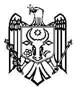

 

CONSILIUL 
CONCURENŢEI 
 
СОВЕТ ПО 
КОНКУРЕНЦИИ 
 
 
 
 
 
PLENUL CONSILIULUI CONCURENŢEI 
 
DECIZIE 
 
Nr.  ASO - 4                                                                        
din 23.02.2017                                                                   mun. Chişinău 
 
Plenul Consiliului Concurenţei, acționând în temeiul art. 41 al Legii concurenţei 
nr. 183 din 11.07.2012, art. 2 şi art. 10 al Legii nr. 139 din 15.06.2012 cu privire la 
ajutorul de stat, Hotărârii Parlamentului nr. 179 din 12.07.2013 privind numirea în 
funcţie a membrilor Plenului Consiliului Concurenţei, Hotărârii Parlamentului nr. 220 
din 27.09.2013 privind numirea în funcţie a unui membru al Plenului Consiliului 
Concurenţei, 
în conformitate cu prevederile Regulamentului cu privire la forma de notificare, 
procedura de examinare şi adoptare a deciziilor cu privire la ajutorul de stat, aprobat 
prin Hotărârea Plenului Consiliului Concurenţei nr. 1 din 30.08.2013 și prevederile 
Regulamentului privind ajutorul de stat pentru dezvoltare regională, aprobat prin 
Hotărârea Plenului Consiliului Concurenţei nr. 4 din 30.08.2013, 
analizând notificarea depusă de Ministerul Finanțelor prin adresarea nr. 13/3-07-
483 din 28.11.2016, privind măsurile de sprijin planificate de a fi acordate în cadrul 
implementării Creditului de asistență condiționată finanțat din contul creditului 
Guvernului Republicii Polone acordat Guvernului Republicii Moldova pentru 
realizarea proiectelor în domeniul agriculturii, procesării produselor alimentare și 
infrastructurii aferente acestora și altele, precum şi materialele anexate, 
1 
 

 
A CONSTATAT: 
 
Prin scrisoarea nr. 13/3-07-483 din 28.11.2016, în baza art. 8 din Legea nr. 139 
din 15.06.2012 privind ajutorul de stat și Regulamentului privind forma de notificare, 
procedura de examinare și adoptare a deciziilor cu privire la ajutorul de stat, aprobat 
prin Hotărârea Plenului Consiliului Concurenţei nr. 1 din 30.08.2013, Ministerul 
Finanțelor a notificat ajutorul de stat, sub formă de schemă, planificat de a fi acordat 
în cadrul implementării Creditului de asistență (în continuare - Credit) oferit 
Guvernului Republicii Moldova de Guvernul Republicii Polone pentru realizarea 
proiectelor în domeniul agriculturii, procesării produselor alimentare, inclusiv 
infrastructura aferentă acestora și altele, în baza formularului general și formularului 
special de notificare a ajutorului de stat pentru dezvoltare regională. 
Notificarea a devenit efectivă la data de 04.01.2017, fapt despre care a fost 
informat Ministerul Finanțelor prin scrisoarea nr. ASO-02/07-43 din 17.01.2017. 
Baza legală 
Baza legală pentru acordarea măsurilor de sprijin constituie: 
 Acordul dintre Guvernul Republicii Moldova și Guvernul Republicii Polone 
nr. B02114 din 14.05.2014 privind obținerea unui credit de asistență; 
 Legea nr. 134 din 11.07.2015 pentru ratificarea Acordului dintre Guvernul 
Republicii Moldova și Guvernul Republicii Polone privind obținerea unui credit de 
asistență; 
 Legea nr. 419 din 22.12.2006 cu privire la datoria sectorului public, 
garanțiile de stat și recreditarea de stat; 
 Hotărârea Guvernului nr. 841 din 07.07.2016 cu privire la unele măsuri 
pentru implementarea creditului de asistență oferit de Guvemul Republicii Polone; 
 Hotărârea Guvernului nr. 1133 din 12.10.2016 pentru aprobarea Manualului 
de Operațiuni privind implementarea creditului de asistență oferit de Guvernul 
Republicii Polone; 
2 
 

 Hotărârea Guvernului nr. 1136 din 18.10.2007 cu privire la unele măsuri de 
executare la Legii nr. 419-XVI din 22.12.2006 cu privire la datoria sectorului public, 
garanțiile de stat și recreditarea de stat. 
Beneficiarii măsurilor de sprijin 
 Întreprinderi eligibile din Republica Moldova. 
Descrierea măsurii de sprijin 
Obiectivul primar a schemei de ajutor de stat, conform formularului general de 
notificare, este dezvoltarea regională, acțiunea acesteia fiind extinsă pe întreg 
teritoriul Republicii Moldova. Totodată, obiectivul secundar a schemei de ajutor de 
stat este cel sectorial și anume, modernizarea sectorului agroindustrial şi a altor 
sectoare ale economiei naționale ale Republicii Moldova. 
Măsurile de sprijin planificate de a fi oferite, în cadrul unei scheme de ajutor de 
stat, vor avea ca temei Creditul în baza unui Acord bilateral (în continuare Acord) 
ratificat prin Legea nr. 134 din 11.07.2015 pentru ratificarea Acordului dintre 
Guvernul Republicii Moldova și Guvernul Republicii Polone privind obținerea unui 
credit de asistență.  
În conformitate cu prevederile Acordului, Guvernul Republicii Polone va acorda 
un Credit cu următoarele condiții esențiale: 
- Valoarea Creditului nu va depăși 100 milioane euro; 
- Creditul va fi utilizat pentru finanțarea a 95% din valoarea contractelor pentru 
livrările de bunuri și servicii din Republica Polonă către Republica Moldova, iar 5% 
din valoarea contractului va fi achitată de către întreprinderile eligibile din Republica 
Moldova ca o plată în avans; 
- Rambursarea utilizării Creditului de către Guvernul Republicii Moldova în 
favoarea Guvernului Republicii Polone va avea loc în 40 rate egale, semianuale și 
consecutive, achitate în euro la data de 15 martie şi 15 septembrie a unui an anumit, 
după o perioadă de graţie de 5 ani din data utilizării Creditului respectiv; 
- Creditul utilizat este purtător de o dobândă la rata de 0,15 % pe an; 
- Valoarea minimă a unui contract finanțat este de 0,5 milioane euro; 
- Valoarea bunurilor și serviciilor de origine poloneză în cadrul contractului, 
finanțate în baza Acordului, nu va fi mai mică de 60% din valoarea contractului. 
3 
 

În conformitate cu Manualul de operațiuni aprobat, operațiunile de recreditare 
ale Ministerului Finanţelor vor fi efectuate prin intermediul instituțiilor financiare 
participante selectate. 
De asemenea, conform Manualului de operațiuni, Creditul corespunde cadrului 
de priorități strategice de dezvoltare a sectorului respectiv, promovat conform 
Strategiei naționale de dezvoltare agricolă şi rurală pentru anii 2014 - 2020 și 
Strategiei naționale de atragere a investițiilor și promovare a exporturilor pentru anii 
2016 - 2020. Acesta urmează să contribuie la asigurarea implementării prevederilor 
Acordului de Asociere între Republica Moldova şi Uniunea Europeană, la creșterea 
competitivității sectorului agroindustrial, precum și la alte sectoare ale economiei 
naționale, și la beneficierea de pe urma stabilirii Zonei de liber schimb, aprofundat şi 
cuprinzător cu Uniunea Europeană. Toate proiectele, precum și contractele 
individuale care urmează a fi finanțate în temeiul Acordului, vor corespunde 
reglementărilor OCDE privind ajutorul condiționat, așa cum este definit în Acordul 
privind Creditele la Export, care beneficiază de Sprijin Public și alte documente 
OCDE relevante și prevederilor legislației în vigoare a Republicii Moldova. 
Fondurile Creditului pot fi utilizate pentru finanțarea cheltuielilor subproiectelor 
eligibile privind procurarea de bunuri și servicii în domeniile principale de activitate: 
a) înființarea, modernizarea și restructurarea întreprinderilor specializate în 
producția de produse agroalimentare de origine vegetală și animalieră şi în producția 
industrială prin asigurarea unei infrastructuri moderne; 
b) investiții în tehnologii moderne privind recoltarea, procesarea primară, 
păstrarea, sortarea, ambalarea și desfacerea produselor agricole; 
c) construcția și dotarea unităților de producție industrială; 
d) modernizarea halelor de producție industrială și agroindustrială prin 
asigurarea unei infrastructuri moderne; 
e) procurarea echipamentelor și utilajelor; 
f) investiții în tehnologii moderne și inovații în scopul conformării la 
standardele UE privind siguranța alimentelor și cerințele de calitate; 
g) alte activități conform contractelor părților. 
Totodată, următoarele cheltuieli și activități nu pot fi finanțate: 
4 
 

a) achiziționarea de bunuri foste în utilizare (second-hand); 
b) achiziționarea de bunuri și servicii pentru recomercializare; 
c) plata taxei pe valoare adăugată și alte taxe și impozite; 
d) comisioane bancare, costurile garanțiilor bancare și cheltuieli similare; 
e) costuri de schimb valutar, taxe și pierderi generate de schimburile valutare; 
f) tipuri de investiții interzise de regulamentele ONU. 
Măsurile de sprijin notificate și ce urmează a fi acordate, în urma examinării, au 
fost divizate după cum urmează: 
I. Măsuri de sprijin în cadrul operațiunilor de recreditare ce se vor efectua în 
baza contractelor de recreditare (act juridic semnat între Ministerul Finanțelor și 
instituțiile financiare participante selectate, prin care Ministerul Finanțelor le va 
acorda împrumuturi, cu o dobândă la rata de 0,15 % pe an, din fondurile Creditului 
pentru recreditarea întreprinderilor eligibile și finanțarea cheltuielilor eligibile pentru 
procurarea de bunuri și servicii) cu instituțiile financiare participante selectate care își 
vor asuma toate riscurile legate de recreditare și vor asigura rambursabilitatea 
fondurilor către Ministerul Finanţelor; 
II. Măsuri de sprijin în cadrul subîmprumuturilor (în condiții preferențiale, cu o 
valoare maximă per întreprindere de 5 milioane Euro și cu maturitatea de până la 12 
ani), acordate de către instituțiile financiare participante întreprinderilor eligibile în 
conformitate cu criteriile stabilite în Manualul de operaţiuni corespunzător. Dobânda 
pentru subîmprumut va reflecta riscurile de credit şi se va negocia de comun acord 
între instituţiile financiare participante și întreprinderile eligibile. Marja de risc 
maximă aplicată de instituţiile financiare participante către întreprinderea eligibilă, la 
rata dobânzii aplicate de Ministerul Finanţelor al Republicii Moldova către instituţiile 
financiare participante, e stabilită în limita de până la 3,5 p.p.; 
III. Măsuri de sprijin în cadrul aplicării T.V.A., taxei pentru efectuarea 
procedurilor vamale și taxei vamale la cota zero pentru importul de către 
întreprinderile eligibile a bunurilor și serviciilor finanțate din sursele Creditului. 
În scopul stabilirii dacă o măsură de sprijin intră sub incidența Legii nr.139 din 
15.06.2012 cu privire la ajutorul de stat, aceasta trebuie să îndeplinească cumulativ 
5 
 

patru condiții. Conform art. 3, alin. (1) a Legii nr. 139 din 15.06.2012, ajutor de stat 
este orice măsură de sprijin care întrunește cumulativ următoarele condiții: 
a) este acordată de furnizor din resurse de stat sau din resursele unităţilor 
administrativ-teritoriale sub orice formă; 
b) conferă beneficiarului un avantaj economic care nu ar fi fost obţinut în 
condiţii normale de piaţă; 
c) este acordată în mod selectiv; 
d) denaturează sau riscă să denatureze concurenţa. 
În cazul primei modalități, mijloacele financiare vor fi acordate instituțiilor 
financiare participante selectate, în baza contractelor de recreditare, de către 
Ministerul Finanțelor a Republicii Moldova și ca urmare, s-a constatat că măsurile de 
sprijin se vor acorda din resurse de stat. 
Totodată, având în vedere existența unor criterii specifici de eligibilitate, acest 
fapt impune existența unui proces de selecție care se va solda cu alegerea doar unui 
anumit număr de instituții financiare participante eligibile. Respectiv, caracterul de 
selectivitate decurge din modalitatea discreţionară de alegere a instituțiilor financiare 
participante eligibile de către Ministerul Finanţelor /Consiliul Directoratului Liniei de 
Credit.  
În partea ce ține de conferirea beneficiarilor unui avantaj economic ce nu ar fi 
fost obţinut în condiţii normale de piaţă, aici urmează de precizat existența unor 
condiții preferențiale la obținerea împrumuturilor, cu o dobândă la rata de 0,15 % pe 
an, de către instituţiile financiare participante din fondurile creditului de asistență, 
pentru recreditarea întreprinderilor eligibile și finanțarea cheltuielilor eligibile pentru 
procurarea de bunuri și servicii. Totodată, rata medie ponderată ale dobânzilor la 
depozitele noi atrase în piață, la situația din septembrie 2016, era de 3,06 %. Având în 
vedere că, în conformitate cu pct. 47 al Regulamentului privind forma de notificare, 
procedura de examinare și adoptare a deciziilor cu privire la ajutorul de stat, aprobat 
prin Hotărârea nr. 1 a Plenului Consiliului Concurenței din 30.08.2013, elementul de 
ajutor de stat în cazul acordării unor împrumuturi cu dobânzi preferențiale este 
diferența dintre dobânda de piață și dobânda efectiv plătită respectiv, diferența între 
aceste două dobânzi și va prezenta avantajul economic ce nu ar fi fost obţinut în 
6 
 

condiţii normale de piaţă. Ca rezultat, măsura riscă să denatureze concurenţa oferind 
beneficiarilor avantaje pe care aceștia nu le-ar fi obținut în condiții normale de piață. 
Prin urmare, s-a constatat că măsura de sprijin examinată constituie ajutor de stat în 
sensul art. 3 al Legii cu privire la ajutorul de stat nr. 139 din 15.06.2012. 
În cazul celei de a doua modalitate, subîmprumuturile acordate de către 
instituțiile financiare participante, în calitate de intermediari, întreprinderilor eligibile 
provin din împrumuturile acordate de către Ministerul Finanțelor și respectiv, s-a 
constatat existența unui transfer de resurse de stat și ca rezultat, s-a dedus că măsurile 
de sprijin se vor acorda din resurse de stat. 
Totodată, având în vedere existența unor criterii specifici de eligibilitate, acest 
fapt impune existența unui proces de selecție care se va solda cu alegerea doar unui 
anumit număr de întreprinderi. Respectiv, caracterul de selectivitate decurge din 
modalitatea discreţionară de alegere a întreprinderilor de către instituțiile financiare 
participante eligibile și de către Ministerul Finanţelor a Republicii Moldova. 
Având în vedere că, subîmprumuturile vor fi acordate în condiții preferențiale, 
cu aplicarea de către instituţiile financiare participante a unei marje de risc maxime 
de până la 3,5 p.p., ceea ce prezintă o finanțare la o rată mai redusă față de nivelul 
ratei medii pe piață, care la situația din septembrie 2016 era de 5,27 %, acest fapt 
conferă un avantaj economic întreprinderilor eligibile ce nu ar fi fost obţinut în 
condiţii normale de piaţă și ca rezultat, apare și riscul de denaturare a concurenţei. 
Prin urmare, s-a constatat că măsura de sprijin examinată constituie ajutor de stat în 
sensul art. 3 al Legii cu privire la ajutorul de stat nr. 139 din 15.06.2012. 
Referitor la cea de a treia modalitate, urmează de menționat că prin acordarea 
facilităţilor respective și anume, aplicarea T.V.A., taxei pentru efectuarea 
procedurilor vamale și taxei vamale la cota zero pentru importul bunurilor și 
serviciilor finanțate din sursele Creditului de către întreprinderile eligibile, statul 
renunţă la veniturile care urmau a fi încasate în bugetul de stat și respectiv, acestea au 
fost calificate ca acordate din resurse de stat. 
Referitor la condiția de selectivitate, aici trebuie de menționat că în cazul unor 
astfel de măsuri de sprijin, acestea urmează a fi evaluate prin intermediul unei analize 
în trei etape (conform pct. 127-128 a Comunicării Comisiei privind noțiunea de ajutor 
7 
 

de stat astfel cum este menționată la articolul 107 alineatul (1) din Tratatul privind 
funcționarea Uniunii Europene (2016/C 262/01)). 
Astfel, prima etapă presupune identificarea sistemului de referință. În cazul 
examinat, acesta reprezintă Codul fiscal al Republicii Moldova nr. 1163 
din  24.04.1997, Codul vamal al Republicii Moldova nr. 1149 din 20.07.2000, Legea 
cu privire la tariful vamal nr. 1380 din 20.11.1997 și Hotărârea Guvernului cu privire 
la modul de aplicare a cotei zero a T.V.A. la livrările de mărfuri, servicii efectuate pe 
teritoriul ţării şi de acordare a facilităţilor fiscale şi vamale pentru proiectele de 
asistenţă tehnică şi investiţională în derulare, care cad sub incidenţa tratatelor 
internaţionale la care Republica Moldova este parte nr. 246 din 08.04.2010.  
A doua etapă presupune stabilirea faptului dacă o anumită măsură constituie o 
derogare de la sistemul de referință respectiv. Trebuie de menționat că, conform 
lit.c1) art. 104 a Codului Fiscal, importul şi/sau livrarea pe teritoriul ţării a mărfurilor, 
serviciilor destinate proiectelor de asistenţă investiţională, finanţate din contul 
împrumuturilor şi granturilor acordate Guvernului sau acordate cu garanţie de stat, 
din contul împrumuturilor acordate de organismele financiare internaţionale (inclusiv 
din cota-parte a Guvernului), precum şi din contul granturilor acordate instituţiilor 
finanţate de la buget se impozitează la cota zero a T.V.A., iar lista tratatelor 
internaţionale la care Republica Moldova este parte, lista proiectelor de asistenţă 
tehnică, lista împrumuturilor şi granturilor acordate Guvernului sau acordate cu 
garanţie de stat, din contul împrumuturilor acordate de organismele financiare 
internaţionale (inclusiv din cota-parte a Guvernului), din contul granturilor acordate 
instituţiilor finanţate de la buget, precum şi modul de aplicare a cotei zero a T.V.A. la 
livrarea pe teritoriul ţării a mărfurilor, serviciilor destinate proiectelor respective se 
stabilesc de Guvern. De asemenea, pct. n) din art. 28 a Legii cu privire la tariful 
vamal nr. 1380 din 20.11.1997 prevede scutirea de taxa vamală a mărfurilor 
importate pe teritoriul Republicii Moldova din contul împrumuturilor şi granturilor 
acordate Guvernului sau acordate cu garanţie de stat, din contul împrumuturilor 
acordate de organismele financiare internaţionale (inclusiv din cota-parte a 
Guvernului), destinate realizării proiectelor respective, precum şi din contul 
granturilor acordate instituţiilor finanţate de la buget, conform listei aprobate de 
8 
 

Guvern. Totodată, prin pct. 1 al Hotărârii Guvernului cu privire la modul de aplicare 
a cotei zero a T.V.A. la livrările de mărfuri, servicii efectuate pe teritoriul ţării şi de 
acordare a facilităţilor fiscale şi vamale pentru proiectele de asistenţă tehnică şi 
investiţională în derulare, care cad sub incidenţa tratatelor internaţionale la care 
Republica Moldova este parte nr. 246 din 08.04.2010, se aprobă lista împrumuturilor 
şi granturilor acordate Guvernului Republicii Moldova sau acordate cu garanţie de 
stat, din contul împrumuturilor acordate de organismele financiare internaţionale 
(inclusiv din cota parte a Guvernului), din contul granturilor acordate instituţiilor 
finanţate de la buget, destinate realizării proiectelor de asistenţă investiţională, din 
contul cărora vor fi importate sau achiziţionate mărfuri (lucrări, servicii) scutite de 
plata taxei vamale, taxei pentru efectuarea procedurilor vamale, impozitate la cota 
zero a TVA, conform anexei 2 la Hotărârea Guvernului menționate. Astfel, pct. 37 
din Anexa nr. 2 la Hotărârea Guvernului nominalizată, conține și Acordul dintre 
Guvernul Republicii Moldova şi Guvernul Republicii Polone privind obţinerea unui 
Credit, semnat la Varşovia la 14 mai 2014, ratificat prin Legea nr. 134 din 11 iulie 
2014. Respectiv, având în vedere cele menționate anterior, se deduce că măsurile date 
de sprijin nu prezintă o derogare de la sistemul de referință și ca rezultat, acestea nu 
sunt selective. Ca urmare, condiția de selectivitate nefiind îndeplinită, s-a ajuns la 
concluzia că măsura dată de sprijin nu constituie ajutor de stat în sensul art. 3 al Legii 
cu privire la ajutorul de stat nr. 139 din 15.06.2012. 
În conformitate cu pct. 47 al Regulamentului privind forma de notificare, 
procedura de examinare și adoptare a deciziilor cu privire la ajutorul de stat, aprobat 
prin Hotărârea nr.1 a Plenului Consiliului Concurenței din 30.08.2013, în cazul în 
care ajutorul de stat se acordă sub forma împrumuturilor cu dobânzi preferențiele, 
elementul de ajutor este diferența dintre dobânda de piață și dobânda efectiv plătită, 
dobânda de piață reprezentând dobânda calculată în baza ratei medii a dobânzii pe 
sistemul bancar la creditele noi în luna acordării împrumutului, corespunzător cu 
durata împrumutului. 
În cazul primei modalități, conform calculelor prezentate, valoarea maximă 
ajutorului de stat acordat în baza schemei va constitui 528164,9 mii lei (la rata de 
9 
 

schimb 1 euro = 22,0 lei), iar valoarea actualizată pentru perioada 2017 - 2028, 
constituie 347551,8 mii lei. 
În cazul celei de a doua modalități, conform calculelor prezentate, valoarea 
maximă ajutorului de stat acordat în baza schemei va constitui 294029,9 mii lei (la 
rata de schimb 1 euro = 22,0 lei), iar valoarea actualizată pentru perioada 2017 - 
2028, constituie 152323,8 mii lei. 
Dat fiind faptul că, o parte din credit poate fi acordat pentru investiții în sectorul 
agricol, domeniu ce nu cade sub incidența Legii cu privire la ajutorul de stat nr. 139 
din 15.06.2012 (lista produselor agricole exceptate sunt stabilite în anexa 1 la 
Regulamentul privind forma de notificare, procedura de examinare și adoptare a 
deciziilor cu privire la ajutor de stat, aprobat prin Hotărârea Plenului Consiliului 
Concurenței nr.1 din 30 august 2013), acea parte nu face obiectul prezentei decizii. 
Valoarea ajutorului de stat, acordat de facto, prin intermediul prezentei scheme 
va fi stabilită în urma raportării, în modul stabilit de art. 19, alin. (3) a Legii cu privire 
la ajutorul de stat nr. 139 din 15.06.2012, ajutorului de stat acordat, cu excepția 
finanțării agriculturii primare (lista produselor agricole exceptate sunt stabilite în 
anexa 1 la Regulamentul privind forma de notificare, procedura de examinare și 
adoptare a deciziilor cu privire la ajutor de stat, aprobat prin Hotărârea Plenului 
Consiliului Concurenței nr. 1 din 30 august 2013). 
Având în vedere că măsurile de sprijin notificate se referă la întreprinderi 
definite într-un mod general și abstract, precum și faptul că acestea nu sunt legate de 
careva proiecte detaliate, intensitatea exactă, costurile eligibile precise și existența 
unor proiecte mari de investiții nu a putut fi cunoscută și determinată la etapa 
examinării notificării.  
Întrucât, conform art. 5, alin. (1) pct. j) a Legii nr. 139 din 15.06.2012 cu privire 
la ajutorul de stat, poate fi considerat compatibil cu mediul concurențial normal 
ajutorul de stat pentru dezvoltarea regională, este necesar ca acesta să corespundă 
cerințelor prevăzute de Regulamentul privind ajutorul de stat pentru dezvoltare 
regională, aprobat prin Hotărârea Plenului Consiliului Concurenței nr. 4 din 
30.08.2013. 
10 
 

De asemenea, dat fiind faptul că măsurile de sprijin vor fi acordate sub forma 
unei scheme de ajutor de stat, s-a constatat că sunt îndeplinite cerințele pct. 25 al  
Regulamentul privind ajutorul de stat pentru dezvoltare regională privind procedurile 
de aprobare spre finanțare a proiectelor și monitorizare a implementării 
corespunzătoare a acestora, prevăzute în Manualul de operațiuni. 
În urma examinării măsurilor de sprijin notificate de către Ministerul Finanțelor, 
s-a constatat că primele 2 modalități de acordare ale acestora întrunesc cumulativ cele 
patru condiții specificate în art. 3 din Legea nr. 139 din 15.06.2012, pentru stabilirea 
existenței ajutorului de stat. Totodată, în privința celei de a treia modalitate, s-a 
constatat că aceasta nu întrunește cumulativ cele patru condiții specificate în art. 3 din 
Legea nr. 139 din 15.06.2012, pentru stabilirea existenței ajutorului de stat. 
În urma evaluării măsurilor de sprijin menționate prin prisma prevederilor 
Regulamentului privind ajutorul de stat pentru dezvoltare regională, aprobat prin 
Hotărârea Plenului Consiliului Concurenţei nr. 4 din 30.08.2013, s-a constatat că 
acestea pot fi considerate compatibile cu un mediu concurențial normal cu condiția 
respectării de către furnizori a cerințelor Regulamentului menționat. 
Totodată, urmează de menționat existența Deciziei Plenului Consiliului 
Concurenței nr. ASO - 51 din 22.07.2015 cu privire la autorizarea schemei de ajutor 
de stat instituite în cadrul Programului de asistență condiționată finanțat din contul 
creditului Guvernului Republicii Polone acordat Guvernului Republicii Moldova 
pentru realizarea proiectelor în domeniul agriculturii, procesării produselor 
alimentare și infrastructurii aferente acestora. La data notificării măsurilor de sprijin 
examinate, nu a fost acordat nici un ajutor de stat în baza Deciziei Plenului 
Consiliului Concurenței nr. ASO - 51 din 22.07.2015, din motivul abrogării unui șir 
de acte normative ce reglementau acordarea ajutorului de stat autorizat. 
Reieșind din constatările expuse, ținând cont de prevederile legislației Republicii 
Moldova, în temeiul art. 41 a Legii concurenței nr. 183 din 11 iulie 2012 și art. 10, 
alin. (2), lit. b) din Legea nr. 139 din 15 iunie 2012 cu privire la ajutorul de stat, 
Plenul Consiliului Concurenţei: 
 
 
 
11 
 

DECIDE: 
 
1. A constata că măsurile de sprijin notificate de către Ministerul Finanțelor și 
planificate de a fi acordate sub forma unei scheme, prin împrumuturi și 
subîmprumuturi în condiții preferențiale, în cadrul implementării Creditului de 
asistență oferit Guvernului Republicii Moldova de Guvernul Republicii Polone 
pentru realizarea proiectelor în domeniul agriculturii, procesării produselor 
alimentare, inclusiv infrastructura aferentă acestora și altele, constituie ajutor 
de stat în sensul art. 3 din Legea cu privire la ajutorul de stat nr. 139 din 
15.06.2012. 
2. A autoriza schema de ajutor de stat în condițiile actelor normative aferente 
implementării Creditului de asistență oferit Guvernului Republicii Moldova de 
Guvernul Republicii Polone pentru realizarea proiectelor în domeniul 
agriculturii, procesării produselor alimentare, inclusiv infrastructura aferentă 
acestora și altele. 
3. Ministerul Finanțelor va transmite anual Consiliului Concurenței informații 
privind ajutorul de stat care face obiectul prezentei Decizii, în vederea 
actualizării și completării Registrului ajutorului de stat, în conformitate cu 
prevederile art. 19 din Legea nr. 139 din 15.06.2012 cu privire la ajutorul de 
stat, cu excepția sectorului agricol, în conformitate cu lista exhaustivă a 
produselor exceptate, aferentă Regulamentului privind forma de notificare, 
procedura de examinare și adoptare a deciziilor cu privire la ajutor de stat, 
aprobat prin Hotărârea Plenului Consiliului Concurenței nr. 1 din 30 august 
2013. 
4. Prezenta Decizie intră în vigoare la data adoptării şi va fi adusă la cunoştinţă 
Ministerului Finanțelor. 
5. Partea dispozitivă a prezentei Decizii va fi publicată în Monitorul Oficial al 
Republicii Moldova. 
 
Preşedintele Plenului  
Consiliului Concurenţei 
 
 
 
 
 
Viorica CĂRARE 
 
12 
 
