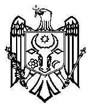

CONSILIUL 
CONCURENŢEI 
СОВЕТ ПО 
КОНКУРЕНЦИИ 
 
 
PLENUL CONSILIULUI CONCURENŢEI 
DECIZIE 
 
Nr. ASR - 6 
din  06.03.2017                                                                                  mun.Chişinău 
 
Plenul Consiliului Concurenţei, acționând în temeiul art. 41 al Legii 
Concurenţei nr. 183 din 11.07.2012, art.10 al Legii nr. 139 din 15.06.2012 cu privire 
la ajutorul de stat, Hotărârii Parlamentului nr. 179 din 12.07.2013 privind numirea 
în funcţie a membrilor Plenului Consiliului Concurenţei, Hotărârii Parlamentului nr. 
220 din 27.09.2013 privind numirea în funcţie a unui membru al Plenului 
Consiliului Concurenţei, 
în conformitate cu prevederile Regulamentului cu privire la forma de 
notificare, procedura de examinare şi adoptare a deciziilor cu privire la ajutorul de 
stat, aprobat prin Hotărârea Plenului Consiliului Concurenţei nr.1 din 30.08.2013, 
prevederile Regulamentului privind ajutorul de stat pentru dezvoltare regională, 
aprobat prin Hotărârea Plenului Consiliului Concurenței nr.4 din 30.08.2013, 
prevederile Regulamentului privind ajutorul de stat acordat beneficiarilor ce 
prestează servicii de interes economic general, aprobat prin Hotărârea Plenului 
Consiliului Concurenţei nr.11 din 30.08.2013, 
analizând notificarea măsurii de sprijin  acordate Î.M.„Cărpineni Servicii” 
parvenită de la Primăria comunei Cărpineni  prin adresarea  nr. 12 din 03.01.2017 și 
nr.20 din 04.01.2017, materialele anexate și nota examinatorului, 
 
A CONSTATAT: 
La data de 04.01.2017, în baza art. 8 din Legea nr. 139 din 15.06.2012 cu 
privire la ajutorul de stat, notificarea măsurii de sprijin acordată Î.M. „Cărpineni 
Servicii” de către Primăria comunei Cărpineni, a devenit efectivă. 
     Baza legală pentru acordarea măsurii de sprijin: 
 Legea serviciilor publice de gospodărie comunală nr. 1402 -XV din   
24.10.2002. 
  Legea privind administraţia publică locală nr. 436 din  28.12.2006. 
 Decizia Consiliului comunal Cărpineni nr.07/02 din 21 noiembrie 2011 „Cu 
privire la fondarea Î.M. „Cărpineni Servicii”. 
1 
 

 Decizia Consiliului comunal Cărpineni nr.01/10 din 28.02.2014 „Cu privire 
la alocarea resurselor financiare pentru expertizarea proiectului tehnic 
„sistemul de canalizare cu stație de epurare etapa I a satului Cărpineni, r-ul 
Hâncești”.  
 Decizia Consiliului comunal Cărpineni nr.03/01 din 30 martie 2012 „Cu 
privire la aprobarea contribuției pentru implementarea proiectului de 
aprovizionare cu apă potabilă”.  
 Decizia Consiliului comunal Cărpineni nr.03/07 din 30 martie 2012 „Cu 
privire la aprobarea planului de acțiuni propus de proiectul Elveției de Apă și 
Sanitație în Republica Moldova APA SAN”. 
 Decizia Consiliului comunal Cărpineni nr.01/07 din 13 februarie 2013 „Cu 
privire la alocarea surselor financiare pentru studiul de fezabilitate a comunei 
Cărpineni pentru perioada 2016-2018”. 
 Decizia Consiliului comunal Cărpineni nr.02/10 din 15 aprilie 2015 „Cu 
privire la transmiterea în folosință și gestiune a apeductului „Târlichici-Cot” 
și „Gagarin” cu lungimea de 68,67 km către  Î.M. „Cărpineni Servicii”. 
 Decizia Consiliului comunal Cărpineni nr.8/18 din 01 noiembrie 2016  „Cu 
privire la atribuirea unor servicii de interes economic general Î.M. „Cărpineni 
Servicii”  din comuna Cărpineni. 
 Decizia Consiliului comunal Cărpineni nr.05/20 din 07 decembrie 2015 „Cu 
privire la aprobarea contractului de delegare a gestiunii serviciilor publice de 
alimentare cu apă”.  
     Măsura de sprijin constă în transmiterea în gestiune a rețelelor de apeduct și 
fântânilor arteziene, în valoare de 14220,35 mii lei.  
 
Tabelul nr. 1 Mijloacele fixe și bunurile materiale transmise Î.M.„Cărpineni Servicii” 
r-ul  Hâncești  
 
Nr. Denumirea mijloacelor fixe și bunurilor materiale 
Suma 
totală, 
mii lei  
1. 
Rețelele de apeduct în sectoarele „Gagarin”, „Mărgelați”, 
„Târlichici” cu lungimea de 68,67 km 
13925,05 
2. 
Fântâni arteziene „Gagarin” - trei 
295,3 
3. 
Total 
14220,35 
           Sursa: Formularul de notificare 
Beneficiarul măsurii de sprijin este Î.M. „Cărpineni Servicii” (IDNO 
1011605002600), fondatorul căreia este Consiliul comunei Cărpineni. Întreprinderea 
a fost înființată în baza Deciziei Consiliului comunal  nr. 07/02 din 21 noiembrie 
2011, ca unitate economică cu personalitate juridică, care funcționează pe bază de 
gestiune economică și autonomie financiară, în scopul administrării bunurilor din 
domeniul public (sistemele de alimentare cu apă). Întreprinderea prestează serviciile 
2 
 

de alimentare cu apă pe teritoriul comunei Cărpineni, fiind o piață de interes local.  
Serviciul public de alimentare cu apă este organizat sub coordonarea și controlul 
autorității publice locale, în virtutea principiului autonomiei locale.  
Pentru a constitui ajutor de stat conform art.3 din Legea nr. 139 din 
15.06.2012 cu privire la ajutorul de stat, măsura de sprijin trebuie să îndeplinească 
cumulativ următoarele condiții: 
 să fie acordată din resurse de stat sau din resursele unităților administrativ- 
teritoriale sub orice formă; 
 să fie acordată în mod selectiv; 
 să confere beneficiarului un avantaj economic care nu ar fi fost obținut în 
condiții normale de piață;  
 să denatureze sau riscă să denatureze concurența. 
Bunurile transmise fac parte din domeniul privat al autorității publice locale a 
comunei Cărpineni, respectiv măsura de sprijin este acordată din resursele unității 
administrativ – teritoriale. 
Măsura de sprijin a fost acordată doar Î.M. „Cărpineni Servicii”, fără 
realizarea unui concurs, respectiv, aceasta a fost selectivă. 
Autoritatea publică locală nu va percepe o contraprestație pentru exploatarea 
bunurilor transmise în gestiunea întreprinderii. Astfel, Î.M. „Cărpineni Servicii” i-a 
fost acordat un avantaj economic care nu ar fi fost obținut în condiții normale de 
piață. 
Conform art. 14 alin. (1) din Legea serviciilor publice de gospodărie 
comunală nr. 1402-XV din 24.10.2002,  autorităţile administraţiei publice locale au 
competenţa exclusivă privind înfiinţarea, organizarea, coordonarea, monitorizarea şi 
controlul funcţionării serviciilor publice de gospodărie comunală, precum şi crearea, 
administrarea şi exploatarea bunurilor proprietate publică din infrastructura edilitară 
a unităţilor administrativ-teritoriale respective. Chiar dacă întreprinderea e unica 
care prestează servicii de alimentare cu apă și canalizare în raza comunei Cărpineni, 
acest fapt nu exclude posibilitatea transmiterii bunurilor proprietate publică în 
gestiunea altei întreprinderi. Astfel, măsura de sprijin riscă să distorsioneze 
concurența. 
         Ținând cont de cele menționate în context, se constată că măsura de sprijin 
întrunește criteriile ajutorului de stat, conform art. 3 din Legea nr. 139 din 
15.06.2012 cu privire la ajutorul de stat. 
         Obiectivele acordării prezentului ajutor de stat sunt: 
- dezvoltarea regională, și anume dezvoltarea comunei Cărpineni, r-ul Hâncești, 
Regiunea de Dezvoltare Centru; 
3 
 

- susținerea beneficiarilor care prestează servicii de interes economic general, 
servicii de alimentare cu apă.  
Potrivit punctului 3 din Regulamentul privind ajutorul de stat pentru 
dezvoltare regională, aprobat prin Hotărârea Plenului Consiliului Concurenței nr.4 
din 30.08.2013, acordarea ajutoarelor de stat pentru investiţii este justificată de 
necesitatea susţinerii dezvoltării regionale prin sprijinirea investiţiilor şi a creării de 
noi locuri de muncă, prin extinderea şi diversificarea activităţilor economice ale 
întreprinderilor situate în regiunile slab dezvoltate şi prin încurajarea întreprinderilor 
să înfiinţeze noi unităţi în aceste regiuni. 
Un alt obiectiv al acordării ajutorului de stat este asigurarea infrastructurii 
pentru prestarea serviciului de alimentare cu apă pentru populația din comuna 
Cărpineni, aceasta fiind considerată o obligație de serviciu public.  
Pentru a fi compatibil, un ajutor de stat acordat beneficiarilor care prestează 
servicii pentru interes economic general trebuie să îndeplinească următoarele 
condiții: 
 ajutorul de stat este necesar în vederea operării SIEG; 
 ajutorul de stat nu denaturează în mod nejustificat concurenţa. 
Cu referire la pct. 55 și 56 din Regulamentul privind forma de notificare, 
procedura de examinare și adoptare a deciziilor cu privire la ajutorul de stat aprobat 
prin Hotărârea Plenului Consiliului Concurenței nr. 1 din 30 august 2013, evaluarea 
compatibilității cu mediul concurențial normal va fi realizată prin analiza 
comparativă. Evaluarea compatibilității ajutorului de stat prin analiza comparativă a 
efectelor negative asupra concurenței și efectelor pozitive ale ajutorului de stat, 
pornește de la contribuția acestuia la îndeplinirea unor obiective bine stabilite de 
interes public. La compararea acestor efecte se ține seama de impactul ajutorului 
asupra bunăstării sociale. 
         Strategia de alimentare cu apă și sanitație (2014 -2028), aprobată prin 
Hotărărea Guvernului nr. 199 din 20.03.2014, are drept obiectiv asigurarea 
accesului la apă sigură și sanitație adecvată pentru toate localitățile și populația 
Republicii Moldova, contribuind astfel la îmbunătățirea sănătății și calității vieții la 
dezvoltarea economică a țării.  
 Î.M. „Cărpineni Servicii” este unica întreprindere care prestează servicii de 
alimentare cu apă și canalizare și evacuare a apelor uzate în comuna Cărpineni. 
Comuna este compusă din satul Cărpineni și satul Horjești, fiind divizat în sectoare: 
Bucos, Topor, Vărzăreasca, Margilați, Târlichici-Cot și Gagarin. 
 Serviciile de utilitate publică au ca obiectiv asigurarea condițiilor de viață mai 
bune pentru populație și prezintă o importanță socială majoră pentru administrația 
publică și aceasta: se confirmă prin elaborarea mai multor  planuri de dezvoltare 
4 
 

social-economică a comunității pe domenii de activitate pe parcursul anilor (2012-
2020).  
         Prezentul ajutor de stat este destinat dezvoltării localității Cărpineni și anume 
pentru îmbunătățirea condițiilor de trai a populației, asigurarea cu apă potabilă, 
ridicarea nivelului social și igienic al populației. 
         Până la construcția rețelei de apeduct populația satului Cărpineni se alimenta 
cu apă din izvoarele captate existente, din fântânile de mină situate pe teritoriul 
respectiv.  
         Dezvoltarea rețelei de aprovizionare cu apă potabilă și canalizare a avut un 
ritm scăzut și nu asigură accesul la apă potabilă și canalizare de calitate, pentru 
marea majoritate a locuitorilor. În aceste condiții a fost necesar de inițiat activitățile 
de extindere a rețelei de apeduct și canalizare, pentru a permite accesul tuturor 
locuitorilor la apă potabilă de calitate.  
         Prin construcția sistemului de canalizare s-a redus poluarea solului, apele 
freatice și a bazinului răului Lăpușnița (afluent al râului Prut). Poluarea a fost 
excesivă din lipsa sistemului de evacuare și epurare a apelor uzate. Concomitent a 
fost necesar de construit stația de epurare a apelor reziduale pentru a exclude 
poluarea apei bazinului răului Lăpușnița. 
         Scopul organizării serviciului de aprovizionare cu apă potabilă, reconstrucția 
sistemelor de epurare și canalizare, în comuna Cărpineni, r-ul Hâncești este: 
     -   Extinderea sistemului de alimentare cu apă potabilă și construcția sistemului 
de evacuare și epurarea apelor uzate din stația de pompare cu capacitatea 82,80 
m3/h (23,00 l/s), construită anterior cu amenajarea rezervuarului  de apă - Gagarin 
de  50-100 m3, rezolvarea stringentă de asigurare a unui consum ecologic de apă de 
către populație, creșterea calității vieții a populației localității prin asigurarea 
accesului la servicii durabile de alimentare cu apă și sanitație, luare de măsuri 
sanitaro-epidemiologice de profilaxie, respectarea ecologiei și mediului, prevenirea  
îmbolnăvirilor, dezvoltarea social-economică a comunei, extinderea businessul mic 
și mijlociu, etc. 
    -    Accesul la o sursă de apă de calitate a locuitorilor comunei. 
    -   Evacuarea apelor uzate de la cele 3900 de gospodării și 16 obiecte de menire 
social-culturală, cât și agenții economici din localitate.  
-   Asigurarea protecției solului, apelor și a solului de suprafață, sporirea nivelului 
de trai, a situației igienice și scăderea nivelului de îmbolnăviri a populației locale.  
-    Captarea, epurarea și distribuția apei. 
-  Eliminarea deșeurilor și a apelor uzate, asanarea, salubrizarea și activități 
similare, etc. 
5 
 

        Sistemul de apeduct nou construit în sectoarele „Gagarin”, „Mărgelați”, 
„Târlichici” cu lungimea totală de 68,67 km, va avea rezervoare de acumulare cu 
apă de100 m3, rezervuar de acumulare de 180 m3 și un castel de apă 50 m3, care 
vor aproviziona cu apă potabilă 1550 de gospodării, ce constituie aproximativ 40%  
din numărul total de gospodării (3900), iar numărul instituțiilor publice conectate la 
apeduct vor avea cca. 80% apă potabilă din totalul acestora. Rețeaua de apeduct a 
fost construită în perioada 2013- 2016, care asigură accesul la servicii de apă de 
calitate la circa 4200 locuitori, ce cuprinde  partea de nord-sud a satului din teritoriul 
comunei, iar sistemul de canalizare în localitate nu-i funcțional, evacuarea se 
efectuează în rezervoare de stocare a apelor uzate amplasate în fiecare gospodărie, 
iar pomparea și transportarea se face mecanic, prin intermediul unui agent 
economic. 
       Serviciul public centralizat de alimentare cu apă și de canalizare cuprinde: 
-  serviciul de alimentare cu apă, care are drept scop asigurarea cu apă a tuturor 
consumatorilor din comuna Cărpineni. Apa este destinată, în ordinea priorităților, 
pentru consumul menajer, consumul instituțiilor medicale, de învățământ, serviciilor 
publice, precum și consumului necesar în activitățile productive și comerciale de 
stingere a incendiilor. 
-  serviciul de canalizare, care are drept scop asigurarea serviciului de canalizare 
pentru toți consumatorii din comuna Cărpineni.  
          Î.M. „Cărpineni Servicii” este unica întreprindere care prestează serviciile de 
alimentare cu apă, canalizare  și evacuare a apelor uzate în comuna Cărpineni. În 
conformitate cu Strategia de Dezvoltare locală a comunei Cărpineni 2016 - 2020, 
furnizorul de servicii e responsabil de asigurarea exploatării, întreținerii și reparării 
rețelelor publice, în conformitate cu instrucțiunile tehnice specifice, pe baza unui 
program anual de revizii tehnice și reparații curente. Totodată, acesta trebuie să 
asigure funcționarea sistemului public de alimentare cu apă, precum și continuitatea 
sistemului de canalizare, evacuării apelor uzate de la toți consumatorii de servicii, în 
funcție de categoria de asigurare a sistemului de alimentare cu apă și de canalizare 
din localitatea dată în conformitate cu Proiectul de execuție „Evacuarea și epurarea 
apelor uzate” din s. Cărpineni r-ul Hâncești, elaborat de „Metiolis” SRL în 2013 
pentru anii 2016 – 2018.  
        Se preconizează construcția rețelei de canalizare și a stației de epurare tip 
M.B.B.R. din inox cu termoizolare de capacitatea 1200 m3/zi, cu patru module de 
epurare biologică a câte 300 m3 fiecare. Apele uzate menajere se vor acumula în 
stația de epurare biologică cu lichidarea concomitentă  a gropilor de acumulare din 
localitate și va avea efect de prevenire și diminuarea poluării solului, apelor de 
suprafață și freatice în baza proiectului elaborat și aprobat în ordinea stabilită. 
6 
 

          Conform  Strategiei de Dezvoltare Locală „Migrație și Dezvoltare Locală”, 
elaborată de PNUD în iulie 2016 și Proiectul de execuție „Extinderea sistemului de 
alimentare cu apă în satul Cărpineni, comuna Cărpineni, raionul Hâncești elaborat 
de SRL „Nova Global”  în august 2015, privitor la dezvoltare și îmbunătățire a 
activității Î.M. „Cărpineni Servicii”, pentru perioada (2016-2020), serviciile de 
utilitate publică au ca obiectiv asigurarea condițiilor de viață mai bune pentru 
populație și prezintă o importanță socială majoră pentru administrația publică.          
Astfel, una   din   condițiile   de   bază  privind   înregistrarea unor succese reale atât  
în planul administrației comunei, cât și în planul serviciilor de utilitate publică este 
colaborarea instituțională eficientă. Oportunitățile de dezvoltare a Î.M. „Cărpineni 
Servicii” – sunt în directă dependență de deciziile și obiectivele Consiliului comunal 
Cărpineni.  
        Totodată, întreprinderea trebuie să adopte criteriile principale la stabilirea 
priorităților pentru: 
     -   crearea de noi locuri de muncă; 
- asigurarea egalității de tratament; 
- îmbunătățirea accesului la serviciile de AAC de bună calitate; 
- accesibilitatea prin prisma suportabilității serviciilor; 
- recuperarea în totalitate de către operatori a costurilor furnizării/ prestării 
serviciilor;  
- reducerea scurgerilor, inclusiv a siguranței lucrărilor; 
- respectarea normelor și standardelor Republicii Moldova și ale UE; 
- asigurarea unui regim de funcționare continuu; 
- creșterea calității și a condițiilor de trai, în special în zonele rurale; 
- asigurarea autonomiei financiare; 
- transparența operațiunilor organizatorice și comerciale. 
         Serviciile publice de alimentare cu apă și canalizare au un rol decisiv pentru 
îmbunătăţirea calităţii vieţii tuturor cetăţenilor şi pentru evitarea excluderii sociale şi 
izolării. Ţinând cont de importanţa lor pentru economie şi pentru producerea de alte 
bunuri şi servicii, eficienţa şi calitatea acestora constituie un factor de 
competitivitate şi de cea mai mare coeziune, în special datorită faptului că permit 
atragerea investiţiilor în regiuni mai puţin favorizate.  
        În vederea executării prevederilor pct. 11 și 12 din Regulamentul privind 
ajutorul de stat acordat beneficiarilor ce prestează servicii de interes economic 
general, aprobat prin Hotărârea Plenului Consiliului Concurenţei nr. 11 din 30. 
08.2013, în anul 2016, au fost revizuite și îmbunătățite actele prin care au fost 
transmise în gestiune bunurile unității administrativ–teritoriale. Astfel, prin  Decizia 
Consiliului comunal Cărpineni nr. 8/18 din 01 noiembrie 2016  cu privire la 
atribuirea serviciului de interes economic general Întreprinderii Municipale 
7 
 

”Cărpineni Servicii” a fost aprobat actul de atribuire a serviciului de interes 
economic general Întreprinderii Municipale „Cărpineni Servicii” (captarea, tratarea 
și distribuția apei prin sistem de apeduct)  și  a fost semnat contractul de delegare a 
gestiunii serviciilor publice de alimentare cu apă conform Deciziei nr. 05/20 din 
07.12.2015, încheiat  între  Primăria comunei Cărpineni și Î.M. „Cărpineni Servicii”. 
       Ajutorul de stat acordat Î.M. „Cărpineni Servicii” este necesar în vederea 
operării serviciului de alimentare cu apă.  
       Ca urmare a evaluării compatibilităţii ajutorului de stat prin analiza 
comparativă, în conformitate cu punctul 68 din Regulamentul privind forma de 
notificare, procedura de examinare și adoptare a deciziilor cu privire la ajutorul de 
stat, aprobat prin Hotărârea Plenului Consiliului Concurenței nr. 1 din 30 august 
2013, se constată că ajutorul produce efecte pozitive clare în favoarea populației, 
inclusiv pe termen lung, iar efectele negative sunt limitate și nu denaturează în mod 
semnificativ concurența. 
      Astfel, ajutorul de stat acordat Î.M.„Cărpineni Servicii” în scopul prestării 
serviciilor de alimentare cu apă este compatibil cu mediul concurențial normal. 
      Reieşind din constatările expuse, ținând cont de prevederile legislaţiei Republicii 
Moldova, în temeiul art.41 din Legea concurenţei nr. 183 din 11.07.2012 şi art. 10 
alin. (2) lit. b) din Legea nr. 139 din 15.06.2012 cu privire la ajutorul de stat, Plenul 
Consiliului Concurenței 
                                                                                                    
                                                      DECIDE: 
1. A constata faptul că măsura notificată de către Primăria comunei Cărpineni, 
raionul Hâncești,  având ca beneficiar  Î.M. „Cărpineni Servicii” şi constând 
în transmiterea în gestiune a unor bunuri, constituie ajutor de stat în sensul art. 
3 din Legea nr. 139 din 15.06.2012 cu privire la ajutorul de stat. 
2. A autoriza ajutorul de stat pentru prestarea serviciului public de alimentare cu 
apă acordat Î.M. „Cărpineni Servicii”. 
3. Primăria comunei Cărpineni, raionul Hâncești va transmite anual Consiliului 
Concurenţei informaţii privind ajutorul de stat care face obiectul prezentei 
decizii, în vederea actualizării Registrului ajutorului de stat, conform art. 19 
din Legea nr. 139 din 15.06.2012 cu privire la ajutorul de stat. 
4. Prezenta Decizie intră în vigoare la data adoptării. 
5. Partea dispozitivă a prezentei Decizii va fi publicată în Monitorul Oficial al 
Republicii Moldova. 
 
          Preşedintele                                                                       
          Consiliului Concurenţei                                                 Viorica CĂRARE 
8 
 
