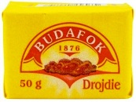
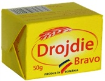
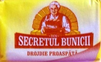

 

CONSILIUL 
CONCURENŢEI 
СОВЕТ ПО 
КОНКУРЕНЦИИ 
 
 
PLENUL CONSILIULUI CONCURENŢEI 
 
DECIZIE 
 
 
nr. CN – 52                                                                           mun. Chişinău 
din 20.10.2017    
 
Plenul Consiliului Concurenţei, 
acţionând în temeiul art. 41 alin. (1) lit. h) al Legii concurenţei nr. 183 din 
11.07.2012 (în continuare Legea concurenței), Hotărârii Parlamentului nr. 179 din 
12.07.2013 privind numirea în funcţie a membrilor Plenului Consiliului 
Concurenţei, precum și Hotărârii Parlamentului nr. 220 din 27.09.2013 privind 
numirea în funcţie a unui membru al Plenului Consiliului Concurenţei,  
analizând raportul de investigaţie asupra cazului inițiat prin Dispoziţia 
Plenului Consiliului Concurenței nr. 17 din 28.09.2016, privind presupusa 
încălcare a prevederilor art. 19 alin. (1) lit. b) al Legii concurenței de către 
„Augur-Perla” SA în raport cu întreprinderea „Cuptorul Fermecat” SRL, 
observațiile părților, audierile desfășurate şi materialele acumulate în cadrul 
investigării, 
 
A CONSTATAT: 
 
La data de 03.08.2016 în cadrul Consiliul Concurenței, a parvenit plângerea 
întreprinderii „Cuptorul Fermecat” SRL cu nr. de intrare 2281 referitor la 
presupusele acțiuni de concurență neloială ale întreprinderii „Augur-Perla” SA, 
manifestate prin copierea ambalajului produsului de drojdie „Budafok” pentru 
produsul de drojdie „Bravo” cu plasarea produsului respectiv pe piață, fapt care 
indică la semnele încălcării art. 19 al Legii concurenței nr. 183 din 11.07.2012.  
Urmare a examinării preliminare a plângerii, în conformitate cu prevederile 
art. 55 alin. (1) din Legea concurenței, în temeiul prevederilor art. 41 alin. (1)     
lit. f) din Legea concurenței, Plenul Consiliului Concurenței, prin Dispoziția       
nr. 17 din 28.09.2016, a dispus inițierea investigației privind presupusa încălcare 
a prevederilor art. 19 alin. (1) lit. b) al Legii concurenței, de către întreprinderea 
1 
 

„Augur-Perla” SA, prin copierea ilegală a formei, a ambalajului și/sau a 
aspectului exterior al produsului și plasarea produsului respectiv pe piață. 
 
1. 
Părțile implicate 
 
Reclamant:  
Societatea Comercială „Cuptorul Fermecat” SRL, adresa juridică:          
mun. Bălți, str. Sorocii, nr. 117 A, IDNO 1003602008280. 
 „Cuptorul Fermecat” SRL a fost constituită în anul 1998 fiind o 
întreprindere de producție și comerț. Pe lângă producerea produselor de 
panificație, cofetăriei și fast-food, întreprinderea este distribuitor de materii prime 
pentru brutării, cofetării și alți producători industriali. Începând cu anul 1998, 
„Cuptorul Fermecat” SRL este distribuitor pe teritoriul Republicii Moldova al 
companiei „Lesaffre”, Ungaria – producător de drojdii de panificație și 
biotehnologii. Una din pozițiile cheie din gama de produse ale „Lesaffre” este 
drojdia de panificație „Budafok” (Secretul bunicii) de 50 g., produsă în Ungaria. 
 
Reclamat: 
Întreprinderea „Augur-Perla” SA, adresa juridică: mun. Chișinău, str. Alexei 
Șciusev,  nr. 111, IDNO 1002600047714. 
Întreprinderea „Augur-Perla” SA a fost constituită în anul 1994, având ca și 
gen principal de activitate comerțul produselor alimentare. Întreprinderea mai 
produce paste făinoase și operează în calitate de procesator de carne. Începând cu 
anul 2014, „Augur-Perla” SA este distribuitor pe teritoriul Republicii Moldova al 
produselor de drojdie „Bravo” și „Pakmaya”, produse de către „Rompak” SRL, 
România.  
 
2. 
Piaţa relevantă 
 
Piaţa relevantă este piaţa în cadrul căreia se evaluează o anumită problemă 
de concurenţă şi care se determină prin raportarea pieţei relevante a produsului la 
piaţa geografică relevantă. 
Piaţa relevantă a produsului - piață a produselor considerate de către 
consumatori ca interschimbabile sau substituibile datorită utilizării date acestora, 
datorită caracteristicilor fizice, funcţionale şi a preţului. 
Luând în considerație faptul că problema concurențială invocată se referă la 
presupusa confuzie dintre ambalajele produselor de drojdie, iar ambele 
întreprinderi sunt comercianți de produse de drojdie, piaţa relevantă a produsului, 
în sensul cazului investigat, se defineşte ca piaţa comercializării cu amănuntul 
produselor de drojdie. 
2 
 

Piaţa relevantă geografică - zona în care întreprinderile sunt implicate în 
oferta sau cererea de pe piaţa relevantă a produsului, în care condiţiile de 
concurenţă sunt suficient de omogene.  
Ținând cont de faptul că ambele întreprinderi sunt rezidente ale Republicii 
Moldova, iar activitatea de distribuire și comerț, de asemenea, se realizează pe 
teritoriul Republicii Moldova,  piaţa relevantă geografică o constituie teritoriul 
Republicii Moldova. 
 
Piaţa relevantă este piaţa comercializării cu amănuntul produselor de 
drojdie pe teritoriul Republicii Moldova. 
 
3. 
Acte şi fapte constatate 
 
La data de 03.08.2016 în cadrul Consiliul Concurenței, a parvenit plângerea 
întreprinderii „Cuptorul Fermecat” SRL cu nr. de intrare 2281 referitor la 
presupusele acțiuni de concurență neloială ale întreprinderii „Augur-Perla” SA, 

manifestate prin copierea ambalajului produsului de drojdie „Budafok” 

pentru produsul de drojdie „Bravo” 
cu plasarea produsului respectiv pe 
piață, fapt care indică la semnele încălcării art. 19 al Legii concurenței. 
Potrivit datelor prezentate în plângere, rezultă că, începând cu anul 1998, 
„Cuptorul Fermecat” SRL este distribuitorul întreprinderii „Lesaffre”, Ungaria și 
comercializează pe teritoriul Republicii Moldova produse de drojdie „Budafok”, 
sub formă de cub, cu greutatea de 50 g., ambalate în hârtie de culoare galbenă. 
Totodată, produsele de drojdie respective, în procesul comercializării, sunt 
amplasate în cutii de culoare galbenă pe care sunt imprimate marca „Budafok”, a 
câte 50 unități.  
Pe parcursul anilor 1998-2016, ambalajul drojdiei „Budafok” și al cutiei, în 
care sunt amplasate produsele de drojdie „Budafok”, nu au suferit nici o 
modificare, cu excepția faptului că începând cu luna mai 2016, pe ambalaj și pe 

cutie a fost adăugată emblema „Secretul Bunicii” 
. 
Acestea fiind menționate, „Cuptorul Fermecat” SRL invocă faptul că  
„Augur Perla” SA, începând cu luna septembrie 2015, a plasat pe piață drojdia 
„Bravo”, produsă de „Rompak” SRL, România, sub formă de cub, cu greutatea de 
50 g., ambalat în hârtie de culoare galbenă. Produsele de drojdie respective, în 
procesul comercializării, de asemenea, sunt amplasate în cutii de culoare galbenă 
cu inscripția „Drojdie Bravo”, a câte 50 unități. Anterior, „Augur Perla” SA 
comercializa asemenea produs, însă în ambalaj de culoare roșie.  
3 
 

Astfel, „Cuptorul Fermecat” SRL consideră că „Augur Perla” SA     
folosindu-se de imaginea produsului de drojdie „Budafok”, ca unul foarte 
calitativ, a schimbat ambalajul produsului propriu din culoare roșie în galbenă, a 
copiat forma cutiei în care sunt amplasate produsele de drojdie și, drept urmare, a 
creat confuzie pe piața acestor produse. Întreprinderea reclamantă menționează că 
din cauza faptului că denumirea „Budafok” nu prea are sonoritate în limba 
română, clienții acordă atenție în alegerea drojdiei doar culorii ambalajului. Iar pe 
parcursul anilor, drojdia „Budafok” s-a recomandat  ca fiind cel mai calitativ 
produs și consumatorilor li s-a creat părerea că cea mai bună drojdie este cea 
galbenă (cu ambalaj galben). 
În conformitate cu extrasul din baza de date globală a mărcilor 
www.wipo.int, gestionată de Organizația Mondială a Proprietății Intelectuale 
(OMPI), marca comercială „Budafok 1876” aparține întreprinderii „Lesaffre”, 
Ungaria și este înregistrată la nivel internațional, cu protecție în Republica 
Moldova și Serbia, pentru un termen de 10 ani: 30.11.2015 - 30.11.2025. Aceasta 
este înregistrată pentru clasa 30 (drojdie, praf pentru creștere) conform clasificării 
de la Nisa1, iar culorile revendicate sunt galben și maro.  
Întreprinderea „Augur-Perla” SA nu recunoaște faptele imputate și consideră 
plângerea tardivă, neîntemeiată și fără suport probator. Aceasta mai menționează  
faptul că, creșterea vânzărilor drojdiei „Bravo” nu se datorează formei și culorii 
galbene a ambalajului, dar se datorează sistemului de distribuție utilizat și 
acțiunilor de marketing. Sistemul de distribuție al „Augur-Perla” SA este unul 
direct (cu amănuntul) destinat în totalitate consumatorului casnic. 
 „Augur-Perla” SA a informat că, începând cu luna februarie 2014, este 
distribuitor al produselor de drojdie „Bravo” și „Pakmaya” pe teritoriul Republicii 
Moldova, care sunt produse și ambalate de către „Rompak” SRL, România. 
Inițial, în lunile februarie – noiembrie ale anului 2014, în Republica 
Moldova a fost comercializată drojdia „Bravo” 50 g., în ambalaj de culoare roșie. 
Ulterior, începând cu luna octombrie 2014, a fost introdusă pe piața din Republica 
Moldova drojdia „Pakmaya” 50 g., în ambalaj de culoare roșie, care, practic, a 
înlocuit drojdia „Bravo” 50 g., în ambalaj de culoare roșie. 
Mai comunică reclamata că, în luna septembrie 2015 a fost introdusă 
simultan pe piața din Republica Moldova și din România, drojdia „Bravo” 50 g., 
cu ambalaj de culoare galbenă. Producătorul nu a dorit să renunțe la 
comercializarea drojdiei sub marca „Bravo”, iar motivul pentru alegerea culorii 
galbene a fost dictat de calitatea și natura produsului. Reclamata invocă că drojdia 
este un produs folosit în panificație, iar culoarea galbenă reprezintă culoarea 
grânelor coapte, totodată culoarea galbenă a ambalajului drojdiei fiind utilizată de 
majoritatea producătorilor din mai multe state. 
                                                 
1 Aranjamentul de la Nisa privind clasificarea internațională a produselor și serviciilor în scopul înregistrării 
mărcilor din 15 iunie 1957, ratificată prin Hotărârea Parlamentului Republicii Moldova nr. 1251 din 10.07.1997. 
4 
 

Întreprinderea 
„Rompak” 
SRL, 
România 
este 
titulara 
mărcii             
„Bravo fresh yeast” cu protecție în România pentru o perioadă de 10 ani: 
19.06.2015 - 19.06.2025. Marca este înregistrată pentru clasa 30 (drojdie de 
panificație) conform clasificării de la Nisa, iar culorile revendicate sunt galben, 
roșu, ocru, alb și maro.  
În cadrul investigației a fost constatat faptul că în România sunt propuse spre 
vânzare online, produsele de drojdie „Bravo” și „Budafok” în ambalaje identice 
cu cele care fac obiect al prezentei investigații. Din acest considerent, prin 
scrisoarea nr. CN-03/107-601 din 28.03.2017 a fost solicitată opinia Consiliului 
Concurenței din România (România, de asemenea, este semnatară a Convenției 
de la Paris pentru protecția proprietății industriale din 20.03.1883). Prin 
scrisoarea cu nr. de intrare 2516 din 05.06.2017, Consiliul Concurenței din 
România a menționat că: „Ținând cont de faptul că, utilizarea unui ambalaj 
conținând elemente/semne specifice aparținând unei mărci înregistrate, fără 
consimțământul titularului, nu are aptitudinea de a constitui o practică de 
concurență neloială, în înțelesul art. 2 alin. (2) din Legea nr. 11/1991 (privind 
combaterea concurenței neloiale, din România), precum și de faptul că, protecția 
drepturilor asupra mărcilor este incidentă unui domeniu reglementat, atât la 
nivel național, cât și la nivel comunitar, clarificarea aspectelor privind dreptul 
asupra acesteia vizează direct titularii săi legitimi”. 
În altă ordine de idei, pentru examinarea detaliată și aprofundată a cauzei, a 
fost analizată evoluția vânzărilor pe piața Republicii Moldova a produselor de 
drojdie „Budafok” și „Bravo”. 
Potrivit informațiilor prezentate de părțile cauzei, cota de piață deținută de 
acestea pe piața comercializării produselor de drojdie în Moldova, este prezentată 
(cu aproximație) în următorul tabel: 
 
--- 
Sursa: Scrisoarea „Augur-Perla” SA nr. 2761 din 25.10.2016 (f.d. 83, vol. 1) și nr. 3011 
din 28.11.2016 (f.d. 211, vol. 1). Scrisoarea „Cuptorul-Fermecat” SRL nr. 3027 din 29.11.2016 
(f.d. 214, vol. 1).   
 
Totodată, urmare a analizei evoluției importului drojdiilor „Budafok” și 
„Bravo” pe teritoriul Republicii Moldova, în cadrul perioadei ianuarie 2014 – 
octombrie 2016, se observă faptul că părțile cauzei importă drojdii în cantități 
variabile, iar anumite legități nu au fost constatate. Datele sunt dinamice, fapt ce 
complică posibilitatea indicării unor date medii. Cu toate acestea, totuși, în cazul 
importului drojdiei „Budafok” se evidențiază o scădere, care începe, aproximativ, 
din luna martie 2014 și dureză până în luna septembrie 2016. În ceea ce privește 
importul drojdiei „Bravo” în ambalaj galben, se evidențiază o creștere începând 
cu luna iulie 2015 până în luna iunie 2016. 
5 
 

Prin scrisorile nr. CN-06/237-1550 și nr. CN-06/238-1551 din 04.07.2017, 
Consiliul Concurenței a remis părților cauzei Raportul de investigație asupra 
cazului inițiat prin Dispoziția Plenului Consiliului Concurenței nr. 17 din 
28.09.2016 pentru informare și, după caz, expunerea observațiilor pe baza 
acestuia.  
În conformitate cu constatările din Raportul de investigație, nu au fost 
identificate semne ale copierii ambalajului drojdiei „Budafok” pe ambalajul 
produselor de drojdie comercializate de către „Augur-Perla” SA – „Bravo”. 
În acest context, nu poate fi constatată încălcarea prevederilor art. 19      
alin. (1) lit. b) din Legea concurenței de către „Augur-Perla” SA.  
Motivele care fundamentează această concluzie sunt următoarele: 
1. 
Urmare a analizei ambalajelor produselor de drojdie „Budafok” și 
„Bravo”, se constată faptul că elementele figurative ale acestora și inscripțiile 
sunt diferite. În ceea ce privește culorile ambalajelor, se constată faptul că 
majoritatea inscripțiilor sunt de culoare maro (brun-roșcat) pe fundalul culorii 
galbene. Însă, nu se poate considera ca unic criteriu de copiere a ambalajului, 
culoarea acestuia, or nu poate fi atribuită unei întreprinderi posibilitatea exclusivă 
de utilizare a unei anumite culori. Urmare a analizei cutiilor în care sunt 
amplasate produsele de drojdie „Budafok” și „Bravo”, se atestă un grad sporit de 
asemănare dintre formele acestora și culoarea de fundal, galbenă. Însă, 
aranjamentul desenelor, a inscripțiilor și a elementelor figurative nu permit 
crearea unei identități și asocieri între acestea.  
Mai mult decât atât, „Cuptorul Fermecat” SRL menționează că, începând cu 
luna mai 2016, pe ambalajul drojdiei „Budafok”, cât și pe cutia unde sunt 
amplasate produsele, mai este aplicat un semn de distincție și anume emblema 
„Secretul bunicii” fapt ce conduce către un grad mai mare de distincție.  
2. 
Ambalajele produselor de drojdie „Budafok” și „Bravo”, precum și 
forma cutiilor în care sunt plasate acestea nu sunt obiecte ale proprietății 
industriale pe teritoriul Republicii Moldova; 
3. 
Potrivit 
informațiilor 
prezentate 
de 
către 
întreprinderile        
„Cuptorul Fermecat” SRL și „Augur-Perla” SA, rezultă că, în privința 
ambalajelor produselor de drojdie „Budafok” și „Bravo”, precum și a cutiilor în 
care sunt plasate acestea, în Republica Moldova, cât și în alte state, nu există 
vreun litigiu. Mai mult decât atât, în cadrul investigației a fost constatat faptul că 
în România sunt propuse spre vânzare online, pe paginile web www.enevila.ro, 
www.nasticom.ro, www.emag.ro și www.carefour-online.ro, produsele de drojdie 
„Bravo” în ambalaj de 50 g. și de 500 g.; „Budafok” în ambalaj de 50 g. și de  
500 g.; și „Secretul Bunicii” în ambalaj de 50 g. Aceste ambalaje sunt identice cu 
cele care se examinează în prezenta investigație; 
4. 
Nu a fost identificată vreo condiționare a scăderii importului, 
vânzărilor, drojdiei „Budafok” de apariția pe piață a drojdiei „Bravo” în ambalaj 
6 
 

de culoare galbenă. Scăderile importului, respectiv, a vânzărilor drojdiei 
„Budafok”, au început înainte de luna septembrie 2015 – perioada în care se 
invocă că pe piață a apărut drojdia „Bravo” în ambalaj galben. Este posibil ca 
scăderea vânzărilor drojdiei „Budafok” să fie o consecință a apariției pe piață a 
produselor similare – drojdiile „Pakmaya” și „Bravo”. 
Ulterior remiterii Raportului de investigație părților, „Augur-Perla” SA nu a 
prezentat careva observații, însă „Cuptorul Fermecat” SRL, prin scrisoarea         
nr. 3333 din 22.08.2017, a prezentat argumente suplimentare pentru susținerea 
celor invocate în plângere. 
În acest sens, reclamanta a prezentat „Studiul confuziei dintre ambalajele 
producătorilor 
de 
drojdie 
proaspătă, 
august 
2017”, 
realizat 
de            
„Magenta Consulting” SRL, accentuând următoarele concluzii din acesta: 
a) 
Consumatorii per general nu cunosc mărcile producătorilor de 
drojdie, iar atunci când au nevoie de drojdie, cumpărăturile le fac fiind obișnuiți 
să caute ambalajul de culoare galbenă. Unii consumatori nici nu au observat că pe 
piață există mai mulți producători cu ambalaj similar (ambalaj galben cu text și 
elemente de culoare roșie). 
Poziția Consiliului Concurenței: 
Nu poate exista confuzie între mărci sau produse, care nici nu sunt cunoscute 
de către consumatori. Din studiul prezentat, rezultă faptul că la consumatori nu 
există asociere între culoarea galbenă și drojdia „Budafok”, astfel nu poate fi 
confundată ambalajul drojdiei „Bravo” cu „Budafok”, sau invers.  
Totodată, în studiu nu se constată faptul că, consumatorul, dorind să 
cumpere anume drojdia „Budafok”, se confundă și procură drojdia „Bravo”. 
Potrivit studiului (f.d. 20, vol. 2), toți 30 de respondenți care au participat la 
studiu, au fost întrebați „care drojdie proaspătă procură de obicei?”. Majoritatea 
au spus că nu țin minte denumirea sau nu știu denumirea. Totodată, la această 
întrebare, de cele mai multe ori, s-a răspuns cu calificative:  
- culoare – 17 respondenți: galbenă sau galbenă cu roșu; 
- formă - pătrată, dreptunghiulară, pătrățel; 
- greutate – 50 g., 100 g.; 
- originea – Moldova, România, Turcia. 
Drept urmare, observăm că criteriile de delimitare a drojdiilor sunt mai 
numeroase și nu se limitează doar la culoare. 
b) 
Ambalajul drojdiei „Secretul bunicii” și ambalajul drojdiei „Bravo” 
sunt confundate. 
Poziția Consiliului Concurenței: 
Având în vedere faptul că indicatorul presupus creator de confuzie este 
culoarea galbenă comună a ambalajelor, nu poate fi acordată exclusivitate unei 
întreprinderi pentru a utiliza o anumită culoare.  
7 
 

Hotarul de deosebire a ambalajele drojdiilor, care, relativ, au o mărime mică 
și elementele de identificare, care, de asemenea, sunt mici, nu este bine pronunțat.  
Prin informațiile prezentate, „Cuptorul Fermecat” SRL nu a reușit să 
demonstreze legitimitatea interesului față de culoarea galbenă și nici faptul 
copierii celorlalte elemente ale ambalajului. 
Potrivit studiului, compartimentul Întrebări deschise (f.d. 34, vol. 2), 
întrebarea „Aspecte importante în alegerea drojdiei”, se menționează că pentru 
toți consumatorii de drojdie intervievați cel mai mult contează termenul de 
valabilitate și ambalajul intact, un gramaj micuț, calitatea superioară, un miros 
neînțepător și prețul produsului (ultima fiind menționată de 5 din 30 de 
respondenți). 
În același timp, se consideră defectuoasă utilizarea, nemijlocit în conținutul 
studiului, a noțiunilor „majoritatea”, „unii”, „puțini”, „de cele mai multe ori”, 
„aproape jumătate”, „cei mai mulți”, deoarece acestea nu exprimă un cuantum 
concret.  
La data de 26.09.2017, la sediul Consiliului Concurenței au avut loc audieri 
la care au participat reprezentanții întreprinderilor „Cuptorul Fermecat” SRL și 
„Augur-Perla” SA. 
La ședința de audiere, reprezentantul reclamantei a prezentat „Studiul 
confuziei dintre ambalajele producătorilor de drojdie proaspătă, septembrie 
2017”, realizat de „Magenta Consulting” SRL. Acest studiu este format din 2 
capitole: I capitol – respondenți sunt consumatorii de drojdie; al II-lea capitol – 
respondenți sunt vânzătorii din magazine cu vânzare la tejghea. În ceea ce 
privește primul capitol al studiului, se constată că este identic cu „Studiul 
confuziei dintre ambalajele producătorilor de drojdie proaspătă, august 2017” 
prezentat de reclamantă după primirea Raportului de investigație, asupra căruia 
ne-am expus mai sus. 
Concluziile relevante ale capitolului 2 din studiu sunt următoarele: „Aproape 
jumătate dintre vânzătorii intervievați nu pot numi denumirile mărcilor de 
drojdie pe care le comercializează. De cele mai multe ori vânzătorii numesc 
caracteristicile ambalajului în loc de denumirile mărcilor, spunând „galbenă” 
sau „roșie”, ambalajul galben fiind cel mai des menționat. Vânzătorii care 
cunosc vreo denumire de marcă de cele mai multe ori au numit Budafok, Secretul 
Bunicii, și Pakmaya. Unii vânzători sunt de părerea că comercializează marca 
Budafok care deja nu mai există, dar apropiindu-se de raft și citind denumirea de 
pe ambalaj și-au dat seama că au în vânzare marca Bravo”. „Majoritatea 
consumatorilor cumpărând drojdie cer de la vânzători pur și simplu „drojdie”, 
iar consumatorii care specifică vreo caracteristică cer „drojdia galbenă”. 
Denumirile mărcilor în timpul procurării sunt numite de puțini cumpărători”. 
Raportat la aceste concluzii ale studiului, se reiterează aceleași contra 
argumente expuse asupra studiului prezentat inițial de reclamantă, deoarece 
8 
 

acesta nu conține constatări noi sau argumente adăugătoare în probarea existenței 
confuziei. Faptul că, consumatorii solicită în unele cazuri „drojdie galbenă”, nu 
reprezintă un indicator că aceștia au în vedere drojdia „Budafok” sau „Bravo”. 
Prin scrisoarea nr. 3740 din 03.10.2017 (f.d. 66, vol. 2), întreprinderea 
„Cuptorul Fermecat” SRL a prezentat o serie de acte, înregistrări foto, video și 
audio cu scopul de a demonstra faptul difuzării publicității în favoarea drojdiei 
„Budafok”.  
Urmare a analizei acestor probe, se constată faptul difuzării publicității 
drojdiei „Budafok” în mai multe localități din Republica Moldova pe parcursul 
anilor precedent apariției pe piață a drojdiei „Bravo” în ambalaj galben (anul 
2015). 
Reieșind din circumstanțele expuse și informațiile administrate la 
dosarul cauzei pe parcursul examinării, se stabilește că, nu poate fi 
constatată încălcarea regulilor concurențiale pe piața relevantă, iar    
„Augur-Perla” SA nu a realizat careva acțiuni sau fapte care ar fi de natură 
să creeze confuzie cu drojdia „Budafok”, sau cu activitatea economică a  
întreprinderii „Cuptorul fermecat” SRL prin copierea ilegală a formei, a 
ambalajului și/sau a aspectului exterior al produsului de drojdie „Budafok”. 
Nu poate fi atribuită unei întreprinderi posibilitatea exclusivă de utilizare a 
unei anumite culori atunci când aceasta nu îmbracă o formă deosebită de 
reprezentare (semne, linii, figuri ș.a.). Faptul că „Cuptorul Fermecat” SRL a 
promovat drojdia „Budafok”, punând accent pe culoarea galbenă, nu îi conferă un 
drept prioritar asupra acestei culori. Culorile aparțin tuturor, acestea nu reprezintă 
o noutate, o invenție sau o modalitate deosebită de individualizare. Întreprinderile 
trebuie să concureze pe piață cu produsele lor prin promovarea caracteristicilor 
proprii, deosebite, originale. Promovarea unui produs, punând accent pe o anumită 
culoare, în privința căreia nu este instituit vreun drept și care este disponibilă și 
accesibilă tuturor, este riscul întreprinderii că alți concurenți tot vor utiliza această 
culoare pentru produsele lor.   
Interzicerea plasării pe piața relevantă a drojdiei „Bravo” în ambalajul a cărei 
culoare predominantă este galbenă, la fel ca cel al drojdiei „Budafok”, ar constitui 
o barieră de intrare pe piață în baza caracteristicii culorii, care este accesibilă 
tuturor în orice moment și loc. 
Referitor la celelalte caracteristici ale ambalajului drojdiei „Bravo”, nu au 
fost identificate semne ale copierii formei, a ambalajului și/sau a aspectului 
exterior al produsului de drojdie „Budafok”. Adăugător se menționează că, 
începând cu luna mai 2016, pe ambalajul drojdiei „Budafok”, cât și pe cutia unde 
sunt amplasate produsele de drojdie, mai este aplicat un semn de distincție și 
anume emblema „Secretul bunicii”, aceasta nepermițând asocierea produselor 
concurente ca fiind identice. 
 
9 
 

4. 
Calificarea legală a acțiunilor constatate 
 
Potrivit art. 19 alin. (1) lit. b) al Legii concurenței nr. 183 din 11 iulie 2012 
„Sunt interzise orice acţiuni sau fapte care sunt de natură să creeze, prin orice 
mijloc, o confuzie cu întreprinderea, produsele sau activitatea economică a unui 
concurent, realizate prin copierea ilegală a formei, a ambalajului şi/sau a 
aspectului exterior al produsului unei  întreprinderi şi plasarea produsului 
respectiv pe piaţă, copierea ilegală a publicităţii unei întreprinderi, dacă aceasta 
a adus sau poate aduce atingere intereselor legitime ale concurentului”. 
În cadrul examinării cauzei nu au fost identificat interesul legitim lezat al 
întreprinderii „Cuptorul Fermecat” SRL, prin plasarea pe piața relevantă a 
produsului de drojdie „Bravo” în ambalaj galben. Faptul că întreprinderea 
„Cuptorul Fermecat” SRL a investitit în promovarea produsului de drojdie 
„Budafok” în ambalaj de culoare galbenă, iar „drojdia de culoare galbenă” a 
devenit cunoscută publicului, nu îi conferă un drept exclusiv asupra utilizării 
culorii galbene. Totodată nu a fost identificat faptul copierii aspectului exterior al 
drojdiei „Budafok” în favoarea drojdiei „Bravo”, or ambalajele acestora conțin 
reprezentări grafice distincte. Respectiv, nu se constată acțiuni ale „Augur-Perla” 
SA creatoare de confuzie sau de natură să creeze confuzie. 
Ambalajele produselor de drojdie „Budafok” și „Bravo”, precum și forma 
cutiilor în care sunt plasate acestea nu sunt obiecte ale proprietății industriale pe 
teritoriul Republicii Moldova. În conformitate cu prevederile art. 6 alin. (1), (3) 
din Legea privind protecția desenelor și modelelor industriale „(1)Poate fi 
protejat în calitate de desen sau de model industrial aspectul exterior al unui 
produs sau al unei părţi a acestuia, rezultat în special din caracteristicile liniilor, 
contururilor, culorilor, formei, texturii şi/sau ale materialelor şi/sau ale 
ornamentaţiei produsului în sine. (3) Se asigură protecţie pentru desenul sau 
modelul industrial numai dacă acesta este nou şi are un caracter individual”. 
Referitor la marca comercială „Budafok 1876”, cu protecție pe teritoriul 
Republicii Moldova, aparține întreprinderii „Lesaffre” Ungaria. Urmare a 
examinării cazului, a fost constatat că pe alte piețe geografice unde concurează 
produsele de drojdie „Budafok” și „Bravo” în ambalaje galbene, nu există careva 
litigii. În acest sens, conform prevederilor art. 9 alin. (1) din Legea privind 
protecția mărcilor „Înregistrarea mărcii conferă titularului dreptul exclusiv 
asupra acesteia. Titularul mărcii este în drept să interzică terţilor să utilizeze în 
activitatea lor comercială, fără consimţămîntul său …”. 
În conformitate cu prevederile art. 52 alin. (1) „La sesizarea presupuselor 
acţiuni anticoncurenţiale, autorul plângerii trebuie să prezinte probe în 
susţinerea faptelor pe care îşi întemeiază plângerea”. Iar conform art. 52 alin. (3) 
al Legii concurenței, „În procedura de examinare a presupuselor cazuri de 
10 
 

încălcare a legislaţiei concurenţiale, sarcina probei încălcării îi revine 
Consiliului Concurenţei”.  
Totodată, potrivit art. 14 alin. (8) al Legii concurenței,  „În urma examinării 
cazului de concurenţă neloială, Plenul Consiliului Concurenţei adoptă o decizie 
privind constatarea acţiunilor de concurenţă neloială sau privind lipsa acestora”. 
Având în vedere actele și faptele constatate în cadrul examinării cauzei, 
acțiunile întreprinderii „Augur-Perla” SA, nu întrunesc elementele constitutive 
ale acţiunilor de concurenţă neloială interzise prin prevederile art. 19 alin. (1)    
lit. b) din Legea concurenţei.  
 
Reieșind din circumstanțele de drept și de fapt expuse, precum și în temeiul 
prevederilor art. 14 alin. (8), art. 39, art. 41, art. 65 alin. (1) lit. a) ale Legii 
Concurenței, Plenul Consiliului Concurenței  
 
DECIDE: 
 
1. 
A înceta investigația cazului inițiat prin Dispoziția Plenului Consiliului 
Concurenței nr. 17 din 28.09.2016 în privința „Augur-Perla” SA, deoarece 
pe parcursul desfășurării acesteia nu au fost identificate probe suficiente 
privind încălcarea prevederilor art. 19 alin. (1) lit. b) din Legea concurenței 
nr. 183 din 11.07.2012 care ar justifica aplicarea sancțiunilor. 
 
2. 
Prezenta Decizie intră în vigoare la data adoptării și va fi adusă la cunoștința 
părților. 
 
 
 
Președintele Plenului                                                  Viorica CĂRARE 
Consiliului Concurenței 
 
 
 
 
 
11 
 
