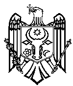

 

 
 
СОВЕТ ПО 
КОНКУРЕНЦИИ 
CONSILIUL 
CONCURENŢEI 
 
 
 
 
 
PLENUL CONSILIUL CONCURENȚEI            
 
 
 
D E C I Z I E 
 
Nr. DA-26 
din 21.06.2017                                                                                 mun. Chișinău              
 
 
Plenul Consiliului Concurenței, 
 
acţionând în temeiul art. 41 al Legii concurenței nr. 183 din 11.07.2012, 
Hotărârii Parlamentului nr. 179 din 12.07.2013 şi Hotărârii Parlamentului           
nr. 220 din 27.09.2013, 
examinând nota examinatorului nr. DA-07/199 din 17.06.2017 cu privire la 
neprezentarea de către SRL „Transenca-Tur” a informațiilor solicitate de către 
Consiliul Concurenței în cadrul monitorizării angajamentelor asumate de către 
aceasta în cadrul investigației inițiate prin Dispoziția Plenului Consiliului 
Administrativ al Agenției Naționale pentru Protecția Concurenței nr. AA-28 din 
13.05.2011, modificată prin Hotărârea Consiliului Administrativ al Agenției 
Naționale pentru Protecția Concurenței nr. AA-12 din 01.03.2012 și Decizia 
Plenului Consiliului Concurenței nr. 1 din 30.08.2013, scrisoarea de solicitare a 
informațiilor nr. DA-06/147-935 din 03.05.2017, scrisoarea de solicitare repetată a 
informațiilor nr. DA-06/160-1057 din 17.05.2017 și avizele de recepție din 
04.05.2017 și 18.05.2017, 
 
 
A CONSTATAT: 
 
În vederea monitorizării respectării angajamentelor acceptate de Plenul 
Consiliului Concurenței prin Decizia Plenului Consiliului Concurenței nr. DA-24 
din 19.05.2016, în temeiul art. 54 din Legea concurenței nr. 183 din 11.07.2012 (în 
continuare Legea concurenței), Consiliul Concurenței prin intermediul scrisorii           
nr. DA-06/147-935 din 03.05.2017, a solicitat SRL „Transenca-Tur” prezentarea în 
termen de 5 zile a copiilor documentelor indicate în anexa nr. 1 al deciziei 
 
1

 
respective și alte informații, totodată informând întreprinderea în cauză despre 
aplicarea sancțiunilor, în conformitate cu prevederile art. 68-70 din Legea 
concurenței. 
SRL „Transenca-Tur” a recepționat scrisoarea Consiliului Concurenței la 
04.05.2017 și conform termenului acordat aceasta urma să prezinte informațiile 
solicitate până la 11.05.2017.  
SRL „Transenca-Tur” nu a prezentat în termenul stabilit informațiile 
solicitate prin scrisoarea Consiliului Concurenței nr. DA-06/147-935 din 
03.05.2017. 
Ulterior la 17.05.2017, prin intermediul scrisorii nr. DA-06/160-1057 din 
17.05.2017, Consiliul Concurenței a solicitat repetat SRL „Transenca-Tur”, 
prezentarea în termen de 3 zile lucrătoare a informațiilor stipulate în scrisoarea           
nr. DA-06/147-935 din 03.05.2017, de asemenea informând-o în privința aplicării 
sancțiunilor în temeiul art. 68-70 a Legii concurenței, pentru nefurnizarea, 
furnizarea informațiilor inexacte, incomplete sau care induc în eroare sau 
nefurnizarea în termenul stabilit. 
La 18.05.2017, SRL „Transenca-Tur” a recepționat scrisoarea Consiliului 
Concurenței nr. DA-06/160-1057 din 17.05.2017 și conform termenului acordat 
aceasta urma să prezinte informațiile solicitate până la 24.05.2017.  
SRL „Transenca-Tur” nu a prezentat în termenul stabilit informațiile 
solicitate.  
Este de notat faptul că, conform pct. 5 din dispozitivul Deciziei Plenului 
Consiliului Concurenței nr. DA-24 din 19.05.2016, SRL „Transenca-Tur” urma să 
prezinte până la 31.03.2017, copiile actelor indicate în anexa nr. 1 al deciziei date și 
să plaseze pe pagina web un anunț oficial cu privire la angajamentele asumate și 
conținutul acestora și, totodată, să facă mențiuni în privința faptului, că în cazul 
nerespectării acestora, terții pot depune plângeri la Consiliul Concurenței. 
Conform prevederilor art. 54 al Legii concurenţei, Consiliul Concurenţei este 
în drept să obțină documentele și informațiile necesare și de a stabili un termen 
rezonabil pentru furnizarea acestora.  
Potrivit art. 68 alin. (1) lit. a) al Legii concurenţei, nefurnizarea informaţiilor 
solicitate de către Consiliul Concurenței în termenul stabilit constituie încălcare ale 
normelor de procedură ale legislaţiei concurenţiale.  
Conform prevederilor art. 69 alin. (1) al Legii concurenţei, nivelul de bază al 
amenzii pentru încălcarea normelor de procedură ale legislaţiei concurenţiale se 
determină în funcţie de gravitatea şi durata faptei.  
La evaluarea gravităţii încălcării, s-au luat în considerare următoarele 
 
2

 
elemente: 
 
- prin Decizia Plenului Consiliului Concurenței nr. DA-24 din 19.05.2016 au 
fost acceptate angajamentele propuse de către SRL „Transenca-Tur” pe 
marginea investigației inițiate prin Dispoziția Consiliului Administrativ al 
Agenției Naționale pentru Protecția Concurenței nr. AA-28 din 13.05.2011 
modificată prin Hotărârea Consiliului Administrativ al Agenției Naționale 
pentru Protecția Concurenței nr. AA-12 din 01.03.2012 și prin Decizia 
Plenului Consiliului Concurenței nr. 1 din 30.08.2013 și încetată învestigația 
în cauză; 
- nefurnizarea informațiilor de către SRL „Transenca-Tur” conform termenilor 
stabiliți de către Consiliul Concurenței în temeiul art. 54 al Legii concurenței 
și ignorarea solicitării repetate, crează impedimente considerabile, 
tergiversează și obstrucționează monitorizarea respectării angajamentelor 
asumate de către întreprinderea în cauză.  
 
 
Având în vedere cele sus-menţionate şi în conformitate cu prevederile art. 69 
alin. (3) lit. b) al Legii concurenţei, fapta se încadrează la încălcările de gravitate 
mare pentru care nivelul de bază al amenzei se stabilește în cuantum de la 0,25 
până la 0,45% din cifra totală de afaceri din anul anterior sancţionării. 
Ținând cont de faptul că SRL „Transenca-Tur” urma să prezinte informațiile 
solicitate prin scrisoarea nr. DA-06/147-935 din 03.05.2017 la 11.05.2017 și la 
24.05.2017 în urma solicitării repetate prin scrisoarea nr. DA-06/160-1057 din 
17.05.2017, dar nu le-a prezentat până la data ședinței Plenului Consiliului 
Concurenței din 21.06.2017, conform art. 69 alin. (5) lit. b) al Legii concurenței,      
fapta se încadrează la încălcări de lungă durată (peste 30 de zile) – factor 1,4.  
Circumstanţe agravante şi circumstanţe atenuante, prevăzute la art. 70 din 
Legea concurenţei nu au fost identificate. 
În anul 2016 întreprinderea SRL „Transenca-Tur” a realizat o cifră totală de 
afaceri în valoare de (…) lei. 
Potrivit art. 76 alin. (1) din Legea concurenţei, Plenul Consiliului 
Concurenţei poate aplica, prin decizie, întreprinderilor penalităţi în sumă de pînă la 
5% din cifra de afaceri zilnică medie realizată de întreprinderea în cauză în anul 
anterior sancţionării, pentru fiecare zi de întârziere, calculate de la o dată ulterioară 
stabilită în decizie, pentru a le obliga să furnizeze în mod complet şi corect 
informaţiile şi documentele care le-au fost solicitate în conformitate cu           
art. 54 din Lege prin intermediul scrisorilor Consiliului Concurenței           
nr. DA - 06/147-935 din 03.05.2017 și DA - 06/160-1057 din 17.05.2017. 
 
3

 
Potrivit art. 36 alin. (5) din Legea concurenţei nr. 183 din 11.07.2012 sumele 
ce reprezintă amenzi sau alte sancţiuni aplicate de Consiliul Concurenţei se fac 
venit la bugetul de stat, în condiţiile legii și urmează a fi transferate pe codul de 
incasări IBAN: MD34TRGAAA14349101300000 de către SRL „Transenca-Tur” 
(IDNO 1002600020920); beneficiar: Ministerul Finanțelor, codul fiscal: 
1006601000037; prestator beneficiar: Ministerul Finanțelor – Trezoreria de Stat; 
destinația plății /A 102/.  
În conformitate cu art. 43 alin. (2) din Codul de executare nr. 443-XV din 
24.12.2004 în cazul în care sumele se încasează în beneficiul statului, calitatea de 
creditor este exercitată de către Ministerul Finanţelor. 
Debitor este SRL „Transenca-Tur” mun. Chişnău, bd. C. Negruzii, 4/2, 
IDNO 1002600020920, IBAN: (…) (leu moldovenesc). 
Țînând cont de cele constatate, Plenul Consiliului Concurenței, în temeiul     
art. 36 alin. (5), art. 41, art. 56, art. 67, art. 68, art. 69, art. 76, al Legii concurenţei           
nr. 183 din 11.07.2012, art. 43 alin. (2) din Codul de executare nr. 443-XV din 
24.12.2004, 
 
DECIDE: 
 
1. A constata acțiunea de nefurnizare de către SRL „Transenca-Tur” a 
informaţiilor solicitate în termenii stabiliţi de Consiliul Concurenţei în 
conformitate cu art. 54 al Legii concurenţei, drept încălcare a normelor de 
procedură a legislaţiei concurenţiale prevăzute la art. 68 alin. (1) lit. a) al Legii 
concurenţei. 
 
2. A aplica SRL „Transenca-Tur” (IDNO 1002600020920), cu adresa juridică: 
mun. Chișinău, bd. Negruzzi 4/2, o amendă pentru nefurnizarea în termenii 
stabiliți a informațiilor solicitate în conformitate cu art. 54 din Legea 
concurenței în mărime de 390 356,14 lei, ceea ce reprezintă (…) din cifra totală 
de afaceri realizată în anul 2016, înmulțit cu factorul 1,4. 
 
3. A obliga SRL „Transenca-Tur” (IDNO 1002600020920) până la 05.07.2017 de 
a prezenta informațiile solicitate de către Consiliul Concurenței prin scrisoarea        
nr. DA-06/147-935 din 03.05.2017. 
 
4. A aplica din 06.07.2017, SRL „Transenca-Tur” (IDNO 1002600020920), cu 
adresa juridică mun. Chișinău, bd. Negruzzi 4/2, o amendă cu titlu cominatoriu 
în sumă de 8 464,65 lei, reprezentând (…) din cifra zilnică de afaceri medie 
realizată în anul 2016, pentru fiecare zi de neprezentare a informațiilor 
 
4

 
solicitate prin scrisoarea nr. DA-06/147-935 din 03.05.2017.  
5. Sumele prevăzute la pct. 2 și 4 se vor achita în bugetul de stat de către           
SRL „Transenca-Tur” (IDNO 1002600020920), cu mențiune: „amendă aplicată 
de către Consiliul Concurenței în conformitate cu Legea concurenței. O copie 
care confirmă plata va fi transmisă Consiliului Concurenței. 
 
6. Prezenta Decizie intră în vigoare la data adoptării și va fi adusă la cunoștință         
SRL „Transenca-Tur” (IDNO 1002600020920), cu adresa juridică: mun. 
Chișinău, bd. Negruzzi 4/2. 
 
 
 
 
 
 
 
 
 
 
 
 
 
 
 
 
 
 
 
 
 
 
 
 
 
 
 
 
 
 
 
 
 
 
 
 
 
 
 
Preşedintele Plenului  
Consiliului Concurenţei                                              Viorica CĂRARE 
 
 
 
 
 
5
