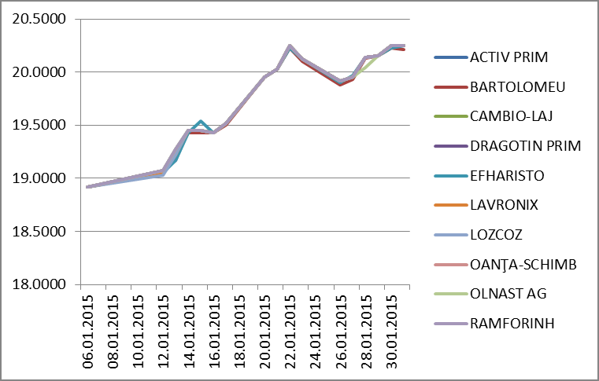
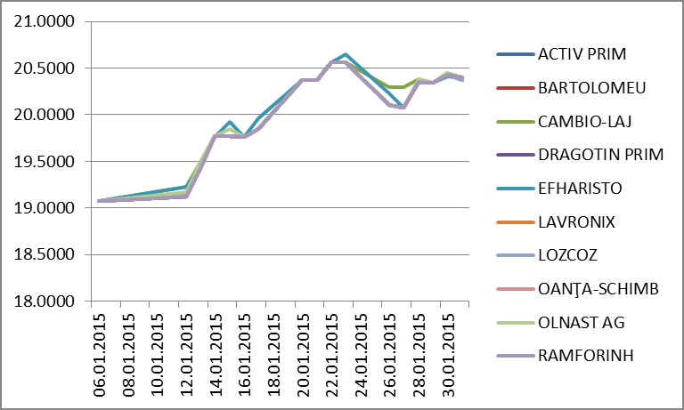
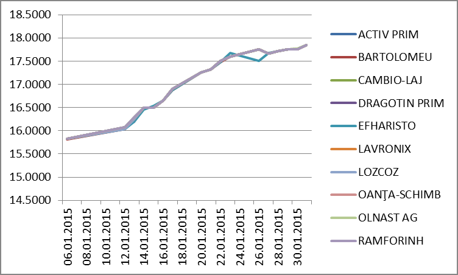
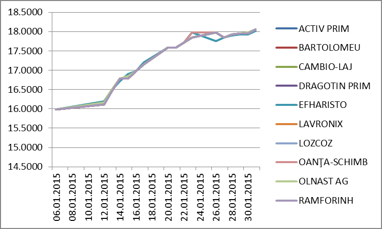
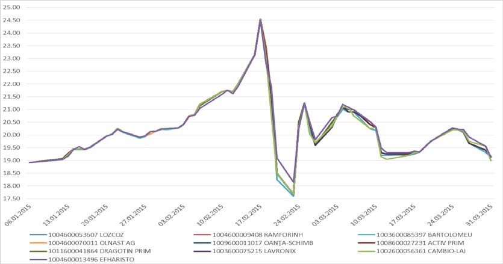
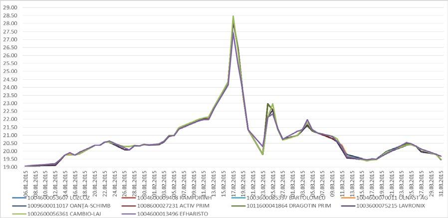
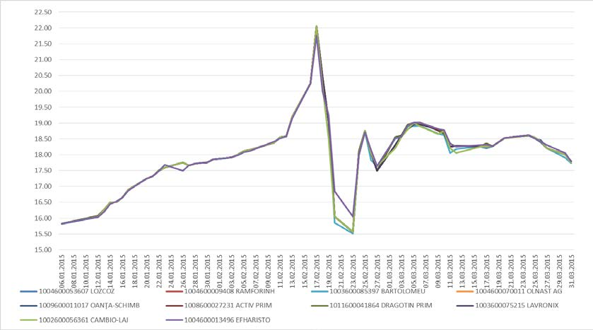
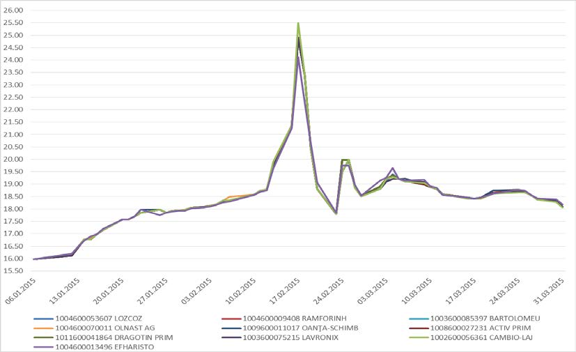

 
 
 

CONSILIUL 
CONCURENŢEI 
 
СОВЕТ ПО 
КОНКУРЕНЦИИ 
 
PLENUL CONSILIULUI CONCURENȚEI 
 
D E C I Z I E 
 
Nr. DA – 45  
din 28.09.2017                                                                                       mun. Chișinău 
 
Plenul Consiliului Concurenței, 
 
acționând în temeiul art. 41 al Legii concurenței nr. 183 din 11.07.2012, Hotărârii 
Parlamentului nr. 179 din 12.07.2013 şi Hotărârii Parlamentului nr. 220 din 27.09.2013, 
analizând raportul de investigație pe cazul inițiat prin Dispoziția Plenului 
Consiliului Concurenței nr.2 din 31.01.2015, informațiile acumulate în cadrul 
investigației, observațiile făcute de părţi asupra raportului de investigaţie,  
 
A CONSTATAT: 
 
În rezultatul examinării notei informative nr. DA – 16/34 din 30.01.2015, precum și 
a materialelor acumulate, Plenul Consiliul Concurenţei, la 31.01.2015 a emis Dispoziţia 
de inițiere a investigației nr. 2 cu privire la semnele încălcării art. 5 din Legea concurenței 
nr. 183 din 11.07.2012 (în continuarea – Legea concurenței) de unitățile de schimb valutar 
la stabilirea cursului valutar pentru efectuarea operațiunilor de schimb valutar. 
Potrivit art. 4 al Legii concurenței, o anumită problemă de concurenţă trebuie 
evaluată în cadrul pieţei relevante care se determină prin raportarea pieţei relevante a 
produsului la piaţa geografică relevantă. 
Piața relevantă a produsului: piaţă a produselor considerate de consumatori ca 
interschimbabile sau substituibile datorită utilizării date acestora, datorită caracteristicilor 
fizice, funcţionale şi preţului. 
Conform art. 35 alin. (2) din Legea privind reglementarea valutară nr. 62 din 
21.03.2008, operațiunile de schimb valutar sunt operațiuni de cumpărare și vânzare a 
valutei străine contra monedei naționale sau contra altei valute străine, precum şi, după 
caz, operaţiuni de cumpărare şi vânzare a cecurilor în valută străină. 
Operațiunile de schimb valutar în numerar cu persoanele fizice reprezintă o categorie 
distinctă de operațiuni, iar schimbul Euro și dolar SUA, conform datelor Băncii Naționale 
a Moldovei deține o pondere de circa 85% din cumpărările/vânzările de valută străină 
contra lei moldovenești (în continuare - MDL) pe piaţa valutară internă în numerar. 
În sensul cazului investigat, se definesc următoarele piețe relevante a produsului: 
1. cumpărarea în numerar de persoane fizice a Euro contra MDL; 
2. vânzarea în numerar persoanelor fizice a Euro contra MDL;  
3. cumpărarea în numerar de persoane fizice a dolarului SUA contra MDL; 
1 
 
 

 
 
 
4. vânzarea în numerar persoanelor fizice a dolarului SUA contra MDL. 
 
Piața geografică relevantă: zonă în care întreprinderile sunt implicate în oferta sau 
cererea de pe piaţa relevantă a produsului, în care condiţiile de concurenţă sânt suficient 
de omogene şi care poate fi deosebită de zonele geografice învecinate prin condiţii de 
concurenţă, ce diferă în mod apreciabil. 
Prezenta investigație a fost inițiată, în contextul afișării de către casele de schimb 
valutar amplasate pe str. Armenească, mun. Chișinău în limitele străzilor bd. Ștefan cel 
Mare și Sfânt și str. Columna, a unui curs valutar identic.  
Zona geografică str. Armenească, mun. Chișinău în limitele străzilor bd. Ștefan cel 
Mare și Sfânt și str. Columna este o piață geografică separată din următoarele 
considerente: 
1. această porțiune de drum se află în zona Întreprinderii Municipale „Piața 
Centrală” și a Gării Chișinău Centru a Î.S. „Gările și Stațiile Auto”; 
2. pe această porțiune de drum și în imediata apropiere se află un număr mare de 
unități comerciale; 
3. există un flux mare de persoane, inclusiv din regiunile rurale,  
4. persoanele fizice care efectuează operațiuni de schimb valutar în numerar nu 
dispun de informația deplină privind cursul valutar din alte zone ale orașului; 
5. deplasarea în alt sector al orașului Chișinău pentru efectuarea unei operațiuni 
de schimb valutar presupune cheltuieli adiționale de timp și resurse, fapt care 
face această deplasare dezavantajoasă.  
 
În sensul prezentei investigații au fost identificate următoarele piețe relevante: 
1. cumpărarea în numerar de persoane fizice a Euro contra MDL pe str. 
Armenească mun. Chișinău în limita bd. Ștefan cel Mare și Sfînt și str. 
Columna; 
2. vânzarea în numerar persoanelor fizice a Euro contra MDL pe str. Armenească 
mun. Chișinău, în limita bd. Ștefan cel Mare și Sfînt și str. Columna; 
3. cumpărarea în numerar de persoane fizice a dolarului SUA contra MDL pe str. 
Armenească mun. Chișinău, în limita bd. Ștefan cel Mare și Sfînt și str. 
Columna; 
4. vânzarea în numerar persoanelor fizice a dolarului SUA contra MDL pe str. 
Armenească mun. Chișinău, în limita bd. Ștefan cel Mare și Sfânt și str. 
Columna. 
 
Perioada supusă investigației este 01.01.2015 – 30.09.2016. 
 
Operațiunile de cumpărare și vânzare în numerar cu persoanele fizice a principalelor 
valute de referință Euro și dolar SUA, au fost operate de mai multe unități de schimb 
valutar amplasate pe str. Armenească mun. Chișinău în limita bd. Ștefan cel Mare și Sfânt 
și str. Columna. În cadrul investigației a fost examinată activitatea a 10 case de schimb 
valutar cu politică comercială asemănătoare, fiind excluse unitățile de schimb valutar a 
băncilor comerciale, deoarece cursurile pentru operațiunile de schimb valutar a acestora 
sunt stabilite de banca licențiată. 
 
2 
 
 

 
 
 
Casele de schimb valutar ce au efectuat în perioada supusă investigației operațiuni 
de cumpărare și vânzare în numerar cu persoanele fizice a valutelor Euro și dolar SUA 
contra MDL pe str. Armenească mun. Chișinău, în limita bd. Ștefan cel Mare și Sfînt și 
str. Columna (în continuare - Casele de schimb valutar investigate) sunt următoarele: 
1. C.S.V. „Activ Prim” SRL – IDNO 1008600027231, cu adresa juridică MD-2060, 
mun. Chişinău, bd. Dacia 44, ap. 60, licența Băncii Naţionale a Moldovei nr. 000308, 
pentru efectuarea operaţiunilor de schimb valutar în numerar cu persoanele fizice pe 
teritoriul Republicii Moldova.   
2. C.S.V. „Bartolomeu” SRL – IDNO 1003600085397, cu adresa juridică MD-2012, 
mun. Chișinău str. Armenească 53, licența Băncii Naţionale a Moldovei nr. 000138, 
pentru efectuarea operaţiunilor de schimb valutar în numerar cu persoanele fizice pe 
teritoriul Republicii Moldova. 
3. C.S.V. „Cambio Laj” SRL – IDNO 1002600056361, cu adresa juridică MD-2068, 
mun. Chișinău bd. Moscova 16, of. 138, licența Băncii Naţionale a Moldovei nr. 000088, 
pentru efectuarea operaţiunilor de schimb valutar în numerar cu persoanele fizice pe 
teritoriul Republicii Moldova. 
4. C.S.V. „Dragotin Prim” SRL – IDNO 1011600041864, cu adresa juridică MD-
2071, mun. Chișinău, localitatea Dumbrava, str. Prieteniei 1A, licența Băncii Naţionale a 
Moldovei nr. 000747, pentru efectuarea operaţiunilor de schimb valutar în numerar cu 
persoanele fizice pe teritoriul Republicii Moldova. 
5. C.S.V. „Efharisto” SRL – IDNO 1004600013496, cu adresa juridică MD-2068, 
mun. Chișinău str. Alecu Russo 1, licența Băncii Naționale a Moldovei nr. 000264, pentru 
efectuarea operaţiunilor de schimb valutar în numerar cu persoanele fizice pe teritoriul 
Republicii Moldova.   
6. C.S.V. „Lavronix” SRL – IDNO 1003600075215, cu adresa juridică MD-2051, 
mun. Chișinău, str. Ion Pelivan, 34/1, ap.200, licența Băncii Naţionale a Moldovei nr. 
000564, pentru efectuarea operaţiunilor de schimb valutar în numerar cu persoanele fizice 
pe teritoriul Republicii Moldova.   
7. C.S.V. „Lozcoz” SRL – IDNO 1004600053607, cu adresa juridică MD-2012, mun. 
Chișinău, str. Armenească 48, licența Băncii Naţionale a Moldovei nr. 000171, pentru 
efectuarea operaţiunilor de schimb valutar în numerar cu persoanele fizice pe teritoriul 
Republicii Moldova. 
8. C.S.V. „Oanța – Schimb” SRL – IDNO 1009600011017, cu adresa juridică MD-
2051, mun. Chișinău, str. Ion Pelivan, 34/1, ap. 200, licența Băncii Naţionale a Moldovei 
nr. 000303, pentru efectuarea operaţiunilor de schimb valutar în numerar cu persoanele 
fizice pe teritoriul Republicii Moldova. 
9. C.S.V. „Olnast AG” SRL – IDNO 1004600070011, cu adresa juridică MD-2071, 
mun. Chişinău, str. Alba-Iulia 188/8 ap.47, licența Băncii Naţionale a Moldovei nr. 
000509, pentru efectuarea operaţiunilor de schimb valutar în numerar cu persoanele fizice 
pe teritoriul Republicii Moldova.   
10. C.S.V. „Ramforinh” SRL – IDNO 1004600009408, cu adresa juridică MD-2071, 
mun. Chișinău, str. Alba-Iulia 200/5, ap. 32, licența Băncii Naţionale a Moldovei nr. 
000462, pentru efectuarea operaţiunilor de schimb valutar în numerar cu persoanele fizice 
pe teritoriul Republicii Moldova.  
 
 
3 
 
 

 
 
 
Conform notei informative nr. DA-16/34 din 30.01.2015, s-a constatat faptul că, 
cursul valutar la cumpărarea și vânzarea valutei Euro și dolarul SUA afișat la panou, în 
perioada 01.01.2015 - 30.01.2015, de către casele de schimb valutar investigate, era 
practic identic. 
 
I. 
În baza informației recepționate de la Banca Națională a Moldovei, în graficele 
nr.1-4 s-a reflectat evoluția cursului valutar a valutei Euro și dolarul SUA în 
raport cu MDL (în continuare - MDL), pentru luna ianuarie 2015. 
 
Graficul nr. 1 
Evoluția cursului de cumpărare în numerar de persoane fizice a Euro contra MDL, 
stabilit de casele de schimb valutar investigate în ianuarie 2015 

 
 
 
Graficul nr. 1 reflectă că, cursul de cumpărare în numerar de persoane fizice a Euro 
contra MDL stabilit de casele de schimb valutar investigate înregistrează aceeași tendință 
și valori aproape identice. 
 
Graficul nr. 2 
Evoluția cursului de vânzare în numerar persoanelor fizice a Euro contra MDL, stabilit 
de casele de schimb valutar investigate în ianuarie 2015 
 

 
4 
 
 

 
 
 
 
Graficul nr. 2 reflectă că, cursul de vânzare în numerar persoanelor fizice a Euro 
contra MDL stabilit de casele de schimb valutar investigate, înregistrează aceeași tendință, 
și valori identice cu excepția C.S.V. „Efharisto” SRL, și C.S.V.„Cambio Laj” SRL. 
Graficul nr. 3 
Evoluția cursului de cumpărare în numerar de la persoanele fizice a dolarilor SUA contra 
MDL, stabilit de casele de schimb valutar investigate în ianuarie 2015 

 
 
Graficul nr. 3 reflectă că, cursul de cumpărare în numerar de la persoanele fizice a 
dolarilor SUA contra MDL stabilit de casele de schimb valutar investigate, cu excepția 
C.S.V. „Efharisto” SRL, înregistrează aceeași tendință și valori identice. 
Graficul nr. 4 
Evoluția cursului de vânzare în numerar persoanelor fizice a a dolarilor SUA contra 
MDL, stabilit de casele de schimb valutar investigate în ianuarie 2015 

 
 
Graficul nr. 4 reflectă că, cursul de vânzare în numerar persoanelor fizice a dolarilor 
SUA contra MDL stabilit de casele de schimb valutar investigate, înregistrează aceeași 
tendință și valori identice, cu excepția C.S.V. „Efharisto” SRL. 
 
Analiza graficelor nr. 1-4 evidențiază comportamentul identic, manifestat prin 
creștere și/sau descreșterea cursului valutar pentru operațiunile de cumpărare și vânzare în 
5 
 
 

 
 
 
numerar al persoanelor fizice a valutelor Euro și dolar SUA, de către întreprinderile 
„Activ Prim” SRL, „Bartolomeu” SRL, „Dragotin Prim” SRL, „Lavronix” SRL, „Lozcoz” 
SRL,  „Oanța – Schimb” SRL, „Olnast AG” SRL, „Ramforinh” SRL. 
 
II. 
În baza informației recepționate de la Banca Națională a Moldovei, în graficele 
nr.5-8 s-a reflectat evoluția cursului valutar a valutei Euro și dolarul SUA în 
raport cu moneda națională, pentru perioada ianuarie – martie 2015. 
Graficul nr. 5 
Evoluția cursului de cumpărare în numerar de persoane fizice a Euro contra MDL, 
stabilit de casele de schimb valutar investigate în ianuarie – martie 2015 

 
 
 
 
Graficul nr. 5 reflectă că, cursul de cumpărare în numerar de persoane fizice a Euro 
contra MDL stabilit de casele de schimb valutar investigate în perioada ianuarie – martie 
2015 înregistrează aceeași tendință și valori aproape identice. Excepție reprezintă 
activitatea C.S.V. „Efharisto” SRL, și C.S.V.„Cambio Laj” SRL care deși respectă 
dinamica evoluției pieței valutare stabilesc cursuri valutare diferite. 
Graficul nr. 6 
Evoluția cursului de vânzare în numerar persoanelor fizice a Euro contra MDL, stabilit de 
casele de schimb valutar investigate în ianuarie – martie 2015 
 

 
 
6 
 
 

 
 
 
Graficul nr. 6 reflectă că, cursul de vânzare în numerar pentru persoanele fizice a 
Euro contra MDL stabilit de casele de schimb valutar investigate în perioada ianuarie – 
martie 2015 înregistrează aceeași tendință și valori aproape identice. Excepție reprezintă 
cursul de vânzare în numerar pentru persoanele fizice a Euro contra MDL stabilit de 
C.S.V. „Efharisto” SRL, și C.S.V.„Cambio Laj” SRL care deși respectă dinamica 
evoluției pieței valutare stabilesc cursuri valutare diferite. 
Graficul nr. 7 
Evoluția cursului de cumpărare în numerar de la persoanele fizice a dolarilor SUA contra 
MDL, stabilit de casele de schimb valutar investigate în ianuarie-martie 2015 

 
Graficul nr. 7 reflectă că, cursul de cumpărare în numerar pentru persoanele fizice a 
dolarilor SUA contra MDL stabilit de casele de schimb valutar investigate în perioada 
ianuarie – martie 2015 înregistrează aceeași tendință și valori aproape identice. Excepție 
reprezintă cursul de vânzare în numerar pentru persoanele fizice a Euro contra MDL 
stabilit de C.S.V. „Efharisto” SRL, și C.S.V.„Cambio Laj” SRL care deși respectă 
dinamica evoluției pieței valutare stabilesc cursuri valutare diferite. 
Graficul nr. 8 
Evoluția cursului de vânzare în numerar persoanelor fizice a a dolarilor SUA contra 
MDL, stabilit de casele de schimb valutar investigate în ianuarie-martie 2015 

 
7 
 
 

 
 
 
Analiza graficelor expuse mai sus, denotă clar o afișare a cursurilor practic identice 
pe zile. În condițiile de incertitudine, imposibilitatea de prezicere a tendinței de stabilire a 
unei valori, stabilirea cursului identic nu poate fi explicată decât fiind făcută în urma unei 
înțelegeri prealabile dintre factorii de decizie a unităților de schimb valutar vizate în 
investigație.  
 
III. În cadrul investigației, în baza informației parvenite de la Banca Națională a 
Moldovei s-a efectuat analiza statistică a datelor privind cursul valutar stabilit de casele de 
schimb valutar investigate.  
În scopul identificării comportamentului coordonat a fost determinată valoarea 
modală a cursurilor de vânzare/cumpărare a dolarului SUA și Euro stabilite de casele de 
schimb valutar investigate, care au fost comparate cu cursurile de vânzare/cumpărare a 
valutei stabilite de fiecare casă de schimb valutar investigată pentru perioada 01.01.2015 – 
31.12.2015 și pentru perioada 01.01.2015 – 30.09.2016. 
Valoarea modală a unii serii este dată de varianta cu frecvența cea mai mare de 
apariţie. Coincidența frecventă a cursurilor de vânzare/cumpărare a dolarului SUA și Euro 
stabilite de fiecare casă de schimb valutar investigată cu valoarea modală a cursurilor de 
vânzare/cumpărare a dolarului SUA și Euro stabilite de casele de schimb valutar 
investigate confirmă comportamentul coordonat a unor case de schimb valutar investigate. 
 
În tabelul nr. 1 și nr. 2 s-a expus nivelul de coincidență dintre cursurile de 
vânzare/cumpărare a Euro și dolarului SUA contra MDL stabilite de fiecare casă de 
schimb valutar investigată cu valoarea modală a cursului vânzare/cumpărare a Euro și 
dolarului SUA contra MDL stabilit de casele de schimb valutar investigate pentru 
perioada 01.01.2015 - 31.12.2015. 
Tabel nr. 1 
Nivelul de coincidență cu valoarea modală a cursului valutar Euro contra MDL în 
perioada 01.01.2015 – 31.12.2015 
 
Nivelul de coincidență, % 
Nr. 
Case de schimb valutar 
investigate 
cumpărare 
vânzare 
1 
C.S.V.  „ACTIV PRIM” SRL 
98.8 
100.0 
2 
C.S.V. „BARTOLOMEU” SRL 
63.1 
94.7 
3 
C.S.V. „CAMBIO-LAJ” SRL 
42.9 
31.6 
4 
C.S.V. „DRAGOTIN PRIM” SRL 
86.9 
84.2 
5 
C.S.V. „EFHARISTO” SRL 
34.5 
15.8 
6 
C.S.V. „LAVRONIX” SRL 
87.3 
73.7 
7 
C.S.V. „LOZCOZ” SRL 
86.1 
73.7 
8 
C.S.V. „OANŢA-SCHIMB” SRL 
93.7 
100.0 
9 
C.S.V. „OLNAST AG” SRL 
92.1 
100.0 
10 C.S.V. „RAMFORINH” SRL 
94.4 
94.7 
 
Analiza datelor tabelului nr.1 permite să constatăm că în decursul anului 2015 
nivelul de coincidență dintre cursurile de cumpărare în numerar pentru persoane fizice a 
8 
 
 

 
 
 
Euro contra MDL stabilite de fiecare casă de schimb valutar investigată (cu excepția 
C.S.V. „CAMBIO-LAJ” SRL și C.S.V. „EFHARISTO” SRL) cu valoarea modală a 
cursului de cumpărare a Euro contra MDL, stabilit de casele de schimb valutar investigate, 
este în mediu de 87,8%.  
Nivelul de coincidență dintre cursurile de vânzare în numerar pentru persoane fizice 
a Euro contra MDL stabilite de fiecare casă de schimb valutar investigată (cu excepția 
C.S.V. „CAMBIO-LAJ” SRL și C.S.V. „EFHARISTO” SRL) cu valoarea modală a 
cursului de vânzare a Euro contra MDL stabilit de casele de schimb valutar investigate în 
decursul anului 2015 este în mediu de 90,1%.  
Nivelul înalt de coincidență (circa 90%) confirmă comportamentul coordonat la 
stabilirea cursurilor de vânzare/cumpărare a Euro contra MDL dintre întreprinderile 
„Activ Prim” SRL, „Bartolomeu” SRL, „Dragotin Prim” SRL, „Lavronix” SRL, „Lozcoz” 
SRL,  „Oanța – Schimb” SRL, „Olnast AG” SRL, „Ramforinh” SRL.  
Tabel nr. 2 
Nivelul de coincidență cu valoarea modală a cursului valutar dolar SUA contra MDL 
în perioada 01.01.2015 – 31.12.2015 
 
Nivelul de coincidență, % 
Nr. 
Case de schimb valutar 
investigate 
cumpărare 
vânzare 
1 
C.S.V.  „ACTIV PRIM” SRL 
99.2 
95.2 
2 
C.S.V. „BARTOLOMEU” SRL 
63.1 
93.7 
3 
C.S.V. „CAMBIO-LAJ” SRL 
21.0 
14.3 
4 
C.S.V. „DRAGOTIN PRIM”SRL 
89.3 
85.7 
5 
C.S.V. „EFHARISTO” SRL 
38.5 
23.0 
6 
C.S.V. „LAVRONIX” SRL 
85.7 
87.7 
7 
C.S.V. „LOZCOZ” SRL 
84.9 
86.1 
8 
C.S.V. „OANŢA-SCHIMB”SRL 
92.5 
88.1 
9 
C.S.V. „OLNAST AG” SRL 
97.6 
84.9 
10 C.S.V. „RAMFORINH” SRL 
96.4 
91.3 
 
Analiza datelor tabelului nr. 2 permite să constatăm că în decursul anului 2015 
nivelul de coincidență dintre cursurile de cumpărare în numerar pentru persoane fizice a 
dolarului SUA contra MDL stabilite de fiecare casă de schimb valutar investigată (cu 
excepția C.S.V. „CAMBIO-LAJ” SRL și C.S.V. „EFHARISTO” SRL) cu valoarea 
modală a cursului de cumpărare a dolarului SUA contra MDL stabilit de casele de schimb 
valutar investigate este în mediu de 88,6%.  
Nivelul de coincidență dintre cursurile de vânzare în numerar pentru persoane fizice 
a dolarului SUA contra MDL stabilite de fiecare casă de schimb valutar investigată (cu 
excepția C.S.V. „CAMBIO-LAJ” SRL și C.S.V. „EFHARISTO” SRL) cu valoarea 
modală a cursului de vânzare a dolarului SUA contra MDL, stabilit de casele de schimb 
valutar investigate în decursul anului 2015 este în mediu de 89,1%.  
Nivelul înalt de coincidență (circa 90%) confirmă comportamentul coordonat la 
stabilirea la cursurilor de vânzare/cumpărare a dolarului SUA contra MDL dintre 
9 
 
 

 
 
 
întreprinderile „Activ Prim” SRL, „Bartolomeu” SRL, „Dragotin Prim” SRL, „Lavronix” 
SRL, „Lozcoz” SRL,  „Oanța – Schimb” SRL, „Olnast AG” SRL, „Ramforinh” SRL.  
În tabelul nr. 3 și nr. 4 s-a expus nivelul de coincidență dintre cursurile de 
vânzare/cumpărare a Euro și dolarului SUA contra MDL, stabilite de fiecare casă de 
schimb valutar investigată cu valoarea modală a cursului vânzare/cumpărare a Euro și 
dolarului SUA contra MDL stabilit de casele de schimb valutar investigate pentru 
perioada 01.01.2015 – 30.09.2016. 
Tabel nr. 3 
Nivelul de coincidență cu valoarea modală a cursului valutar EURO contra MDL în 
perioada  01.01.2015 – 30.09.2016 
 
Nivelul de coincidență, % 
Nr. 
Case de schimb valutar 
investigate 
cumpărare 
vânzare 
1 C.S.V.  „ACTIV PRIM” SRL 
99.3 
97.1 
2 C.S.V. „BARTOLOMEU” SRL 
78.9 
98.0 
3 C.S.V. „CAMBIO-LAJ” SRL 
55.6 
37.6 
4 C.S.V. „DRAGOTIN PRIM”SRL 
87.3 
85.0 
5 C.S.V. „EFHARISTO” SRL 
33.8 
24.3 
6 C.S.V. „LAVRONIX” SRL 
87.3 
84.4 
7 C.S.V. „LOZCOZ” SRL 
86.2 
84.4 
8 C.S.V. „OANŢA-SCHIMB” SRL 
95.0 
92.1 
9 C.S.V. „OLNAST AG” SRL 
95.5 
65.8 
10 C.S.V. „RAMFORINH” SRL 
96.8 
83.9 
 
 
Analiza datelor tabelului nr. 3 permite să constatăm că în decursul perioadei de 1 an 
și 9 luni, nivelul de coincidență dintre cursurile de cumpărare în numerar pentru persoane 
fizice a Euro contra MDL stabilite de fiecare casă de schimb valutar investigată (cu 
excepția C.S.V. „CAMBIO-LAJ” SRL și C.S.V. „EFHARISTO” SRL) cu valoarea 
modală a cursului de cumpărare a Euro contra MDL stabilit de casele de schimb valutar 
investigate este în mediu de 90,8%.  
Nivelul de coincidență dintre cursurile de vânzare în numerar pentru persoane fizice 
a Euro contra MDL stabilite de fiecare casă de schimb valutar investigată (cu excepția 
C.S.V. „CAMBIO-LAJ” SRL și C.S.V. „EFHARISTO” SRL) cu valoarea modală a 
cursului de vânzare a Euro contra MDL stabilit de casele de schimb valutar investigate în 
decursul perioadei analizate este în mediu de 86,3%.  
Nivelul înalt de coincidență a cursurilor valutare stabilite de casele de schimb 
valutar investigate (cu excepția C.S.V. „CAMBIO-LAJ” SRL și C.S.V. „EFHARISTO” 
SRL) cu valoarea modală a cursului valutar EURO contra MDL stabilit de casele de 
schimb valutar investigate, (circa 90%) în mediu pe parcursul a 1 an și 9 luni, confirmă 
comportamentul coordonat la stabilirea la cursurilor de vânzare/cumpărare a Euro contra 
MDL dintre întreprinderile „Activ Prim” SRL, „Bartolomeu” SRL, „Dragotin Prim” SRL, 
„Lavronix” SRL, „Lozcoz” SRL,  „Oanța – Schimb” SRL, „Olnast AG” SRL, 
„Ramforinh” SRL. 
 
 
10 
 
 

 
 
 
Tabel nr. 3 
Nivelul de coincidență cu valoarea modală a cursului valutar dolar SUA contra MDL 
în perioada 01.01.2015 – 30.09.2016 
 
Nivelul de coincidență, % 
Nr. 
Case de schimb valutar 
investigate 
cumpărare 
vânzare 
1 
C.S.V.  „ACTIV PRIM” SRL 
99.3 
90.7 
2 
C.S.V. „BARTOLOMEU” SRL 
71.7 
91.6 
3 
C.S.V. „CAMBIO-LAJ” SRL 
42.6 
33.1 
4 
C.S.V. „DRAGOTIN PRIM” SRL 
89.1 
84.1 
5 
C.S.V. „EFHARISTO” SRL 
40.6 
24.9 
6 
C.S.V. „LAVRONIX” SRL 
86.4 
87.5 
7 
C.S.V. „LOZCOZ” SRL 
85.7 
86.2 
8 
C.S.V. „OANŢA-SCHIMB” SRL 
94.1 
87.1 
9 
C.S.V. „OLNAST AG” SRL 
97.1 
71.0 
10 C.S.V. „RAMFORINH” SRL 
92.5 
83.0 
 
Analiza datelor tabelului nr. 4 permite de a constata că în decurs de 1 an și 9 luni, 
nivelul de coincidență dintre cursurile de cumpărare în numerar pentru persoane fizice a 
dolarului SUA contra MDL stabilite de fiecare casă de schimb valutar investigată (cu 
excepția C.S.V. „CAMBIO-LAJ” SRL și C.S.V. „EFHARISTO” SRL) cu valoarea 
modală a cursului de cumpărare a dolarului SUA contra MDL stabilit de casele de schimb 
valutar investigate este în mediu de 89,5%.  
Nivelul de coincidență dintre cursurile de vânzare în numerar pentru persoane fizice 
a dolarului SUA contra MDL stabilite de fiecare casă de schimb valutar investigată (cu 
excepția C.S.V. „CAMBIO-LAJ” SRL și C.S.V. „EFHARISTO” SRL) cu valoarea 
modală a cursului de vânzare a dolarului SUA contra MDL stabilit de casele de schimb 
valutar investigate în decurs de 1 an și 9 luni este în mediu de 85,2%.  
Nivelul înalt de coincidență a cursurilor valutare stabilite de casele de schimb 
valutar investigate (cu excepția C.S.V. „CAMBIO-LAJ” SRL și C.S.V. „EFHARISTO” 
SRL) cu valoarea modală a cursului dolarului SUA contra MDL stabilit de casele de 
schimb valutar investigate, între 85-90% în mediu, pe parcursul a 1 an și 9 luni, confirmă 
comportamentul coordonat la stabilirea la cursurilor de vânzare/cumpărare a dolarului 
SUA contra MDL dintre întreprinderile „Activ Prim” SRL, „Bartolomeu” SRL, „Dragotin 
Prim” SRL, „Lavronix” SRL, „Lozcoz” SRL,  „Oanța – Schimb” SRL, „Olnast AG” SRL, 
„Ramforinh” SRL.  
 
Reieșind din faptul că stabilirea cursului valutar identic pe parcursul a 1 an și 9 luni 
la mai multe case de schimb valutar nu poate fi posibile întrucât fiecare întreprindere are 
puterea sa economică specifică, cheltuieli diferite, organizarea activității după propriile 
decizii ale fiecărei întreprinderi etc. Ponderea atât de mare circa 90% a cursurilor identice, 
exclude orice posibilitate de stabilire a cursului valutar în lipsa unei înțelegeri. 
 
IV. În perioada 26.07.2016 – 01.08.2016 au fost intervievați reprezentanții 
factorilor de decizie a unităților de schimb valutar „Activ Prim” SRL, „Bartolomeu” SRL, 
11 
 
 

 
 
 
„Cambio Laj” SRL, „Dragotin Prim” SRL, „Efharisto” SRL, „Lavronix” SRL, „Lozcoz” 
SRL,  „Oanța – Schimb” SRL, „Olnast AG” SRL, „Ramforinh” SRL. Astfel: 
a)  la 26.07.2016, la sediul Consiliului Concurenței a fost intervievat administratorul 
casei de schimb valutar „Efharisto”SRL. În cadrul interviului dumnealui a relatat că există 
unele conflicte cu reprezentanții caselor de schimb valutar din vecinătate, în deosebi cu 
administratorul „Lozcoz” SRL, deoarece, acesta periodic se apropie de casierul casei de 
schimb valutar „Efharisto” și îl instigă la modificarea cursului valutar afișat la panou în 
concordanță cu cursul afișat de către unitățile de schimb valutar din preajmă. 
Suplimentar, în cadrul interviului, administratorul casei de schimb valutar 
„Efharisto” SRL a comunicat că ei, adică administratorii caselor de schimb valutar „Activ 
Prim” SRL, „Bartolomeu” SRL, „Dragotin Prim” SRL, „Lavronix” SRL, „Lozcoz” SRL,  
„Oanța – Schimb” SRL, „Olnast AG” SRL, „Ramforinh” SRL, se întâlnesc periodic și 
discută despre modalitatea de stabilire a cursului de schimb valutar, în vederea adoptării 
unei decizii comune. 
De asemenea, a relatat, că el anterior a participat la întâlnirile și discuțiile de acest 
gen, însă ulterior, a hotărât să nu mai participe la discuțiile respective. 
b) la 01.08.2016 a fost intervievat administratorul casei de schimb valutar „Cambio 
Laj” SRL. În cadrul interviului dumnealui a relatat că cursul de schimb valutar pentru 
întreprinderea „Cambio Laj” SRL îl stabilește individual fără a se consulta cu alte 
persoane. De asemenea, a comunicat că concurenții din apropierea casei de schimb valutar 
vin și copie cursul afișat de dânsul la panoul informativ. 
c) totodată, în cadrul intervievărilor, declarațiile administratorilor unităților de 
schimb valutar „Activ Prim” SRL, „Bartolomeu” SRL, „Dragotin Prim” SRL, „Lavronix” 
SRL, „Lozcoz” SRL,  „Oanța – Schimb” SRL, „Olnast AG” SRL, „Ramforinh” SRL, 
practic au un conținut asemănător. Fiecare în parte a relatat faptul că ei se cunosc între ei 
și când se întâlnesc discută la general. Despre activitatea care o desfășoară, abordează 
unele subiecte, care, în viziunea lor sunt discuții ordinare ce nu țin nemijlocit de 
activitatea ce o desfășoară. Majoritatea subiectelor abordate se referă la cele mai bine 
vândute valute, cotațiile pe piața internațională, etc. De asemenea, au relatat faptul că nu 
pun în discuție modalitatea și calculul de stabilirea și/sau fixarea a cursului valutar ce 
urmează a fi afișat la panoul informativ, deciziile ce țin de activitatea unităților de schimb 
valutar sunt luate individual de fiecare în parte. În contextul de a explica modalitatea de 
stabilire a cursului valutar pentru desfășurarea activității, majoritatea administratorilor au 
relatat faptul că se conduc de cotațiile Forex, cursul afișat de către alte bănci comerciale 
din Republica Moldova și nu în ultimul rând de disponibilitatea mijloacelor financiare 
care o au la dispoziție. 
V. La 27.04.2017 prin scrisoarea nr. DA – 06/143-893, Consiliul Concurenţei a 
remis părţilor în cauză raportul asupra investigaţiei inițiate prin Dispoziția Plenului 
Consiliului Concurenței nr. 2 din 31.01.2015 pentru prezentarea de obiecţii şi propuneri pe 
baza acestuia. Observații la raportul de investigație au parvenit de la „Ramforinh”SRL, 
„Bartolomeu” SRL și „Cambio-Laj” SRL.  
Pe data de 07.07.2017 în conformitate cu prevederile art. 64 din Legea concurenței 
nr. 183 din 11.07.2012 au avut loc audieri la care au participat reprezentanți ai 
următoarelor unități de schimb valutar: „Activ Prim” SRL, „Bartolomeu” SRL, „Dragotin 
Prim” SRL, „Lavronix” SRL, „Lozcoz” SRL,  „Olnast AG” SRL, „Ramforinh” SRL și 
„Cambio – Laj” SRL. 
 
12 
 
 

 
 
 
Calificarea legală a acţiunilor constatate conform prevederilor Legii 
Concurenţei 183 din 11.07.2012. 
Potrivit art. 5 din Legea concurenței, sunt interzise, fără a fi necesară o decizie 
prealabilă în acest sens, orice acorduri între întreprinderi sau asociaţii de întreprinderi, 
orice decizii ale asociaţiilor de întreprinderi şi orice practici concertate care au ca obiect 
sau efect împiedicarea, restrângerea sau denaturarea concurenţei pe piaţa Republicii 
Moldova sau pe o parte a acesteia, inclusiv stabilirea directă sau indirectă a preţurilor de 
cumpărare sau de vânzare sau a oricăror alte condiţii de tranzacţionare. 
Stabilirea prețului pentru operațiunile de vînzare/cumpărare în numerar cu 
persoanele fizice a principalelor valute de referință Euro și dolar SUA contra MDL de 
întreprinderile „Activ Prim” SRL, „Bartolomeu” SRL, „Dragotin Prim” SRL, „Lavronix” 
SRL, „Lozcoz” SRL, „Oanța – Schimb” SRL, „Olnast AG” SRL, „Ramforinh” SRL 
întrunește elementele constitutive ale unui acord anticoncurențial orizontal din 
următoarele considerente: 
- nivelul mediu de coincidență a cursului valutar stabilit de casele de schimb valutar în 
perioada de 01.01.2015 – 30.09.2016, este de circa 90%; 
- pe o piaţă concurențială normală, astfel de coincidențe nu sunt posibile întrucât fiecare 
întreprindere are puterea sa economică specifică, dispune de dotare tehnică diferită, 
capacitate financiară diferită, costuri salariale diferite și nu în ultimul rând de 
disponibilitatea mijloacelor financiare care o au la dispoziție. Toate aceste elemente 
conduc la cheltuieli și venituri diferite care în mod normal trebuie să se diferențieze 
prin ofertele propuse. 
- reprezentanții unităților de schimb valutar  se întâlnesc periodic, iar întâlnirile acestora 
sunt urmate de afișarea la panoul informativ a cursului valutar identic; 
- existența unor conflicte dintre membrii acordului cu reprezentanții caselor de schimb 
valutar care nu se aliniază comportamentului coordonat. 
 
Potrivit art. 72 alin. (1) din Legea concurenței nr. 183 din 11.07.2012, nivelul de bază 
al amenzii pentru încălcarea normelor materiale ale legislaţiei concurenţiale se determină 
în funcţie de gravitatea şi durata faptei.  
În conformitate cu art. 72 alin. (3) lit. c) al Legii concurenței nr. 183 din 11.07.2012, 
fapta se încadrează la încălcările de gravitate mare pentru care nivelul de bază al amenzii 
se stabilește în cuantum de la 2 % până la 4 % din cifra totală de afaceri din anul anterior 
sancționării.  
Referitor la durata faptei se reține că stabilirea cursurilor de schimb valutar la 
valutele de referință – dolar SUA și euro a fost constatată pe întreaga perioadă supusă ă 
investigației – 01.01.2015 – 30.09.2016 (1 an și 9 luni). Astfel, acordul anticoncurențial 
dintre „Activ Prim” SRL, „Bartolomeu” SRL, „Dragotin Prim” SRL, „Lavronix” SRL, 
„Lozcoz” SRL,  „Oanța – Schimb” SRL, „Olnast AG” SRL, „Ramforinh” SRL constituie 
o faptă de durată medie (de la un an la cinci ani), urmând a fi aplicat factor 1,2.  
Nivelul de bază al amenzii, în conformitate cu art. 69 alin. (1) al Legii concurenţei nr. 
183 din 11.07.2012, se stabilește din cifra totală de afaceri înregistrată în anul 2016 de 
către „Activ Prim” SRL - (…) lei, „Bartolomeu” SRL - (…) lei, „Dragotin Prim” SRL - 
(…) lei, „Lavronix” SRL - (…) lei, „Lozcoz” SRL - (…) lei, „Oanța – Schimb” SRL - 
(…) lei, „Olnast AG” SRL - (…) lei, „Ramforinh” SRL – (…) lei. 
Întreprinderile „Lavronix” SRL și „Oanța-Schimb”SRL sunt întreprinderi 
dependente, având aceiași fondatori, care au participat la acordul anticoncurențial cu 
13 
 
 

 
 
 
următoarele întreprinderi independente: „Activ Prim” SRL, „Bartolomeu” SRL, „Dragotin 
Prim” SRL, „Lozcoz” SRL, „Olnast AG” SRL, „Ramforinh” SRL.  
Circumstanţe agravante şi circumstanţe atenuante, prevăzute la art.73 din Legea 
concurenţei nr. 183 din 11.07.2012 nu au fost reţinute. 
Potrivit art. 36 alin. (5) din Legea concurenţei nr. 183 din 11.07.2012 sumele ce 
reprezintă amenzi sau alte sancţiuni aplicate de Consiliul Concurenţei se fac venit la 
bugetul de stat, în condiţiile legii și urmează a fi transferate la conturile menționate în 
tabelul nr.5. În conformitate cu art. 43 alin. (2) din Codul de executare nr. 443-XV din 
24.12.2004, în cazul în care sumele se încasează în beneficiul statului, calitatea de creditor 
este exercitată de către Ministerul Finanțelor. 
 
Tabelul nr.5 
Rechizitele bancare ale creditorului 
Denumirea 
întreprinderii 
Contul IBAN 
Beneficiar 
Prestatorul 
beneficiar 
Ramforinh SRL 
Ministerul 
Finanțelor – 
Trezoreria de 
Lavronix SRL 
Olnast AG SRL 
Dragotin Prim SRL 
Oanța-Schimb SRL 
Lozcoz SRL 
MD34TRGAAA14349101300000 
Bartolomeu SRL 
Activ Prim SRL 
MD44TRGAAA14349101100000 
 
MD39TRGAAA14349101200000 
Ministerul 
Finanțelor,  
codul fiscal: 
1006601000037 
Stat; 
destinația 
plății /A 
102/. 
În conformitate cu art.11 și art.14 din Codul de executare nr.443 din 24.12.2004, 
decizia Consiliul Concurenţei privind aplicarea sancțiunilor pecuniare trebuie să conțină 
denumirea debitorului, codul fiscal, sediul lor, datele bancare de identificare.  
Tabelul 6 
Datele debitorilor 
Nr. 
Denumirea debitorului, codul fiscal, sediul 
Denumirea băncii,  
cod IBAN 
1 
„Activ Prim” SRL (1008600027231) MD-2060, mun. 
Chişinău, bd. Dacia 44, ap. 60 
 
2 
„Bartolomeu” SRL (1003600085397) MD-2012, mun. 
Chișinău str. Armenească 53 
 
3 
„Dragotin Prim” SRL (1011600041864) MD-2071, mun. 
Chișinău, localitatea Dumbrava, str. Prieteniei 1A 
 
4 
„Lavronix” SRL, (1003600075215) MD-2051, mun. 
Chișinău, str. Ion Pelivan, 34/1, ap.200 
 
5 
„Lozcoz” SRL, (1004600053607) MD-2012, mun. 
Chișinău, str. Armenească 48 
 
6 
„Oanța-Schimb”SRL, (1009600011017) MD-2051, mun. 
Chișinău, str. Ion Pelivan, 34/1, ap. 200 
 
7 
„Olnast AG” SRL, (1004600070011) MD-2071, mun.  
Chişinău, str. Alba-Iulia 188/8 ap.47 
 
8 
„Ramforinh” SRL (1004600009408 MD-2071, mun. 
Chișinău, str. Alba-Iulia 200/5, ap. 32 
 
Reieşind din constatările expuse, în temeiul art. 39 lit. f), art. 41 alin. (1) lit. h), art.71 
lit. a) și art.72 din Legea concurenţei nr.183 din 11.07.2014, Plenul Consiliului 
Concurenţei 
14 
 
 

 
 
 
DECIDE: 
1. A constata încălcarea prevederilor art. 5 din Legea concurenței nr.183 din 11.07.2012 de 
către întreprinderile „Activ Prim” SRL, „Bartolomeu” SRL, „Dragotin Prim” SRL, 
„Lavronix” SRL, „Lozcoz” SRL, „Oanța-Schimb” SRL, „Olnast AG” SRL, „Ramforinh” 
SRL.  
2. A aplica întreprinderii „Activ Prim” SRL (IDNO-1008600027231), o amendă în mărime 
de 16692,52 lei (șaisprezece mii șase sute nouăzeci și doi lei, 52 bani), reprezentând (…) 
% din cifra de afaceri realizată în anul 2016, cu aplicarea factorului 1,2. 
3. A aplica întreprinderii „Bartolomeu” SRL (IDNO-1003600085397), o amendă în mărime 
de 3823,87 lei (trei mii opt sute douăzeci și trei lei, 87 bani), reprezentând (…) % din 
cifra de afaceri realizată în anul 2016, cu aplicarea factorului 1,2. 
4. A aplica întreprinderii „Dragotin Prim” SRL (IDNO-1011600041864), o amendă în 
mărime de 1461,31 lei (o mie patru sute șaizeci și unu lei, 31 bani), reprezentând (…) % 
din cifra de afaceri realizată în anul 2016, cu aplicarea factorului 1,2. 
5. A aplica întreprinderii „Lavronix” SRL (IDNO-1003600075215), o amendă în mărime 
de 1943,88 lei (o mie nouă sute patruzeci și trei lei, 88 bani), reprezentând (…) % din 
cifra de afaceri realizată în anul 2016, cu aplicarea factorului 1,2. 
6. A aplica întreprinderii „Lozcoz” SRL (IDNO-1004600053607), o amendă în mărime de 
3063,55 lei (trei mii șaizeci și trei lei, 55 bani), reprezentând (…) % din cifra de afaceri 
realizată în anul 2016, cu aplicarea factorului 1,2. 
7. A aplica întreprinderii „Oanța – Schimb” SRL (IDNO-1009600011017), o amendă în 
mărime de 359,52 lei (trei sute cinci zeci și nouă lei, 52 bani), reprezentând (…) % din 
cifra de afaceri realizată în anul 2016, cu aplicarea factorului 1,2. 
8. A aplica întreprinderii „Olnast AG” SRL (IDNO-1004600070011), o amendă în mărime 
de 2583,38 lei (două mii cinci sute optzeci și trei lei, 38 bani), reprezentând (…) % din 
cifra de afaceri realizată în anul 2016, cu aplicarea factorului 1,2.  
9. A aplica întreprinderii „Ramforinh” SRL (IDNO-1004600009408), o amendă în mărime 
de 15146,52 lei (cincisprezece mii o sută patruzeci și șase lei 52 bani), reprezentând (…) 
% din cifra de afaceri realizată în anul 2016, cu aplicarea factorului 1,2. 
10. Sumele prevăzute la pct. 2-9 se vor achita la bugetul de stat timp de 60 de zile 
lucrătoare de la data comunicării prezentei decizii, cu mențiunea: „amendă aplicată de 
Consiliul Concurenței în conformitate cu Legea concurenței nr.183 din 11.07.2012”. O 
copie a actului care confirmă plata va fi transmisă Consiliului Concurenței. 
11. Prezenta decizie intră în vigoare la data adoptării și va fi adusă la cunoștință părților.  
 
 
 
 
Președintele Plenului  
Consiliului Concurenței  
 
 
 
 
 
Viorica CĂRARE 
15 
 
 
