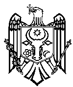

 

 
 
СОВЕТ ПО 
КОНКУРЕНЦИИ 
CONSILIUL 
CONCURENŢEI 
 
 
 
 
PLENUL CONSILIUL CONCURENȚEI            
 
 
 
D E C I Z I E 
 
Nr. DA-3/15-01 
din 22.01.2018                                                                            mun. Chișinău                   
 
 
Plenul Consiliului Concurenței, 
 
acţionând în temeiul art. 41 al Legii concurenței nr. 183 din 11.07.2012, 
Hotărârii Parlamentului nr. 179 din 12.07.2013 şi Hotărârii Parlamentului           
nr. 220 din 27.09.2013, 
examinând propunerile de angajamente formulate de către lanțul de unități 
comerciale cu profil alimentar Î.C.S. „Fourchette-M” S.R.L. și furnizorul           
„Azamet-Grup” S.R.L. în cadrul cazului inițiat prin Dispoziția Plenului Consiliului 
Concurenței nr. 3 din 05.02.2015 în coraborare cu constatările expuse în Decizia 
Plenului Consiliului Concurenței nr. DA-69 din 29.12.2017, 
 
 
A CONSTATAT: 
 
 
 
În baza notei examinatorului nr. APD-10/33 din 03.02.2015, Plenul 
Consiliului Concurenței prin Dispoziția nr. 3 din 05.02.2015 a dispus inițierea 
investigației cu privire la semnele încălcării art. 5 din Legea concurenței nr. 183 din 
11.07.2012, de către lanțurile de unități comerciale cu profil alimentar și furnizorii 
acestora. 
Problemele concurențiale au fost expuse în partea discriptivă a Deciziei 
Plenului Consiliului Concurenței nr. DA-69 din 29.12.2017. 
 
 
 
La 12.01.2018, lanțul de unități comerciale cu profil alimentar           
Î.C.S. „Fourchette-M” S.R.L., IDNO 1006602005006 prin scrisoarea nr. 02 și-a 
asumat angajamentul de a respecta Codul de Bune Practici privind relația dintre 
lanțurile de unități comerciale cu profil alimentar și furnizorii acestora (în 
continuare Codul de Bune Practici) adus în concordanță cu propunerile și 
 
1

 
observațiile înaintate, publicat pe pagina web a Consiliului Concurenței.  
 
Furnizorul „Azamet-Grup” S.R.L., IDNO 1005600049513 prin scrisoarea de 
intrare în cadrul Consiliului Concurenței nr. 126 din 18.01.2018 și-a asumat 
angajamentul de a respecta Codul de Bune Practici. 
 
 
Inițiativa formulării propunerilor de angajamente de a respecta Codul de 
Bune Practici aparține exclusiv lanțului de unități comercial cu profil alimentar 
Î.C.S. „Fourchette-M” S.R.L. și furnizorului „Azamet-Grup” S.R.L. 
 
Ținând cont de faptul, că potrivit pct. 11 din Regulamentul privind 
acceptarea angajamentelor propuse de către întreprinderi, aprobat prin Hotărârea 
Plenului Consiliului Concurenței nr. 2 din 22.01.2015, publicat în Monitorul 
Oficial nr. 39-45 art. 329 la 20.02.2015 (în continuare Regulament) întreprinderile 
au libertatea de a decide cu privire la natura, conținutul și durata angajamentelor pe 
care le propun în vederea înlăturării situației care a determinat inițierea 
investigației, 
lanțul 
de 
unități 
comerciale 
cu 
profil 
alimentar           
Î.C.S. „Fourchette-M” S.R.L. și furnizorul „Azamet-Grup” S.R.L. au formulat 
angajamentele de a respecta Codul de Bune Practici. 
 
Conform pct. 10 din Regulament, scopul principal urmărit de Consiliul 
Concurenței prin acceptarea angajamentelor este restabilirea rapidă a mediului 
concurențial, prin luarea unor măsuri de natură de a înlătura situația care a 
determinat autoritatea de concurență să declanșeze investigația. Prin acceptarea de 
angajamente sunt urmărite obiective precum înlăturarea rapidă a îngrijorărilor 
legate de concurență pe baza unor soluții viabile ajustate la aceste îngrijorări, 
îmbunătățirea mediului concurențial și realizarea unei economii de procedură. 
 
Prin acceptarea de către Consiliul Concurenţei a angajamentelor, 
întreprinderile evită constatarea unei încălcări a regulilor de concurenţă şi eventuala 
aplicare a unei amenzi, nu se pereclitează atingerea scopului principal urmărit prin 
acceptarea de angajamente. 
 
Potrivit pct. 32 din Regulament, înaintarea propunerii de angajamente nu 
poate fi calificată ca acțiune de recunoaștere de către întreprinderi a existenței unei 
încălcări. Consiliul Concurenței nu va folosi propunerile de angajamente de către 
întreprinderi pentru probarea unei decizii ulterioare de constatare a practicii 
anticoncurențiale. 
 
Codul de Bune Practici este un set de reguli cu privire la interacțiunea 
echitabilă între lanțurile de unități comerciale cu profil alimentar și furnizorii de 
produse și conțin dispoziții referitoare la modalitatea de aplicare a acestora.                     
 
Dispozițiile angajamentului Codul de Bune Practici sunt obligatorii pentru 
lanțurile de unități comerciale cu profil alimentar și/sau furnizori ce se aplică 
 
2

 
produselor, inclusiv celor de marcă proprie, dacă respectivul cod nu prevede altfel. 
 
Codul de Bune Practici conduce la eliminarea completă, imediată și 
definitivă a îngrijorărilor concurențiale, asigură promovarea unui mediu competitiv. 
 
Asumarea angajamentului de a respecta Codul de Bune Practici corespunde 
cerințelor de fond și poate fi considerată suficientă de a conduce la restabilirea 
mediului concurențial prin înlăturarea problemelor concurențiale. 
 
 
Ținând 
cont 
de 
cele 
expuse 
mai 
sus, 
în 
temeiul           
art. 41 alin. (1) lit. u) și alin. (4) din Legea concurenței nr. 183 din 11.07.2012, 
Plenul Consiliului Concurenței, 
 
DECIDE: 
 
 
1. A accepta angajamentele asumate de către Î.C.S.„Fourchette-M” S.R.L. și 
„Azamet-Grup” S.R.L. în cadrul investigației inițiate prin Dispoziția Plenului 
Consiliului Concurenței nr. 3 din 05.02.2015. 
 
2. A înceta investigația inițiată prin Dispoziția Plenului Consiliului Concurenței           
nr. 3 din 05.02.2015 în privința Î.C.S. „Fourchette-M” S.R.L. și           
„Azamet-Grup” S.R.L.  
 
3. Durata angajamentelor asumate de către Î.C.S. „Fourchette-M” S.R.L. și 
„Azamet-Grup” S.R.L. este de 3 ani. 
 
4. Raportul de monitorizare privind îndeplinirea angajamentelor asumate se va 
prezenta anual. 
 
5. Decizia intră în vigoare la data adoptării. 
 
 
 
 
 
 
 
 
 
 
 
 
 
 
 
 
 
 
 
 
 
 
 
 
 
 
 
 
Preşedintele Plenului  
Consiliului Concurenţei                                              Viorica CĂRARE 
 
3
