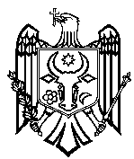

 

 
 
СОВЕТ ПО 
КОНКУРЕНЦИИ 
CONSILIUL 
CONCURENŢEI 
 
 
 
 
PLENUL CONSILIUL CONCURENȚEI            
 
 
D E C I Z I E 
 
Nr. DA-3/15-06 
din 15.02.2018                                                                                mun. Chișinău               
 
 
Plenul Consiliului Concurenței, 
 
acţionând în temeiul art. 41 al Legii concurenței nr. 183 din 11.07.2012, 
Hotărârii Parlamentului nr. 179 din 12.07.2013 şi Hotărârii Parlamentului           
nr. 220 din 27.09.2013, 
examinând propunerile de angajamente formulate de către furnizorii           
„Forward International” S.R.L., „Olimp” S.R.L., Î.C.S. „Trigor AVD” S.R.L. și  
„Gupa-Grup” S.R.L. în cadrul investigației inițiate prin Dispoziția Plenului 
Consiliului Concurenței nr. 3 din 05.02.2015 în coraborare cu constatările expuse 
în Decizia Plenului Consiliului Concurenței nr. DA-69 din 29.12.2017, 
 
 
A CONSTATAT: 
 
 
 
În baza notei examinatorului nr. APD-10/33 din 03.02.2015, Plenul 
Consiliului Concurenței prin Dispoziția nr. 3 din 05.02.2015 a dispus inițierea 
investigației cu privire la semnele încălcării art. 5 din Legea concurenței nr. 183 din 
11.07.2012, de către lanțurile de unități comerciale cu profil alimentar și furnizorii 
acestora. 
Problemele concurențiale au fost expuse în partea discriptivă a Deciziei 
Plenului Consiliului Concurenței nr. DA-69 din 29.12.2017. 
 
 
 
La 
07.02.2018, 
furnizorul 
„Forward 
International” 
S.R.L., 
IDNO 
1003600056900 prin scrisoarea nr. 033/18 și-a asumat angajamentul de a respecta 
Codul de Bune Practici privind relația dintre lanțurile de unități comerciale cu 
profil alimentar și furnizorii de produse (în continuare Codul de Bune Practici) 
 
1

 
adus în concordanță cu propunerile și observațiile înaintate, publicat pe pagina web 
a Consiliului Concurenței.  
 
Furnizorul „Olimp” S.R.L., IDNO 1003611000716 prin scrisoarea de intrare 
în cadrul Consiliului Concurenței nr. 472 din 08.02.2018 și-a asumat angajamentul 
de a respecta Codul de Bune Practici. 
 
La 
09.02.2018, 
furnizorul 
Î.C.S. 
„Trigor 
AVD” 
S.R.L., 
IDNO 
1002600041675 prin scrisoarea nr. E/401 și-a asumat angajamentul de a respecta 
Codul de Bune Practici. 
 
Furnizorul „Gupa-Grup” S.R.L., IDNO 1003600019457 prin scrisoarea de 
intrare în cadrul Consiliului Concurenței nr. 536 din 12.02.2018 și-a asumat 
angajamentul de a respecta Codul de Bune Practici. 
 
 
 
Inițiativa formulării propunerilor de angajamente de a respecta Codul de 
Bune Practici aparține exclusiv furnizorilor „Forward International” S.R.L., 
„Olimp” S.R.L., Î.C.S. „Trigor AVD” S.R.L. și „Gupa-Grup” S.R.L. 
 
Ținând cont de faptul, că potrivit pct. 11 din Regulamentul privind 
acceptarea angajamentelor propuse de către întreprinderi, aprobat prin Hotărârea 
Plenului Consiliului Concurenței nr. 2 din 22.01.2015, publicat în Monitorul 
Oficial nr. 39-45 art. 329 la 20.02.2015 întreprinderile au libertatea de a decide cu 
privire la natura, conținutul și durata angajamentelor pe care le propun în vederea 
înlăturării 
situației 
care 
a 
determinat 
inițierea 
investigației, 
furnizorii           
„Forward International” S.R.L., „Olimp” S.R.L., Î.C.S. „Trigor AVD” S.R.L. și 
„Gupa-Grup” S.R.L. au formulat angajamentele de a respecta Codul de Bune 
Practici. 
 
Conform pct. 10 din Regulamentul privind acceptarea angajamentelor 
propuse de către întreprinderi, aprobat prin Hotărârea Plenului Consiliului 
Concurenței nr. 2 din 22.01.2015, scopul principal urmărit de Consiliul 
Concurenței prin acceptarea angajamentelor este restabilirea rapidă a mediului 
concurențial, prin luarea unor măsuri de natură de a înlătura situația care a 
determinat autoritatea de concurență să declanșeze investigația. Prin acceptarea de 
angajamente sunt urmărite obiective precum înlăturarea rapidă a îngrijorărilor 
legate de concurență pe baza unor soluții viabile ajustate la aceste îngrijorări, 
îmbunătățirea mediului concurențial și realizarea unei economii de procedură. 
 
Deși prin acceptarea angajamentelor, întreprinderile evită constatarea unei 
încălcări a regulilor de concurenţă şi eventuala aplicare a unei amenzi, acest fapt nu 
pereclitează scopul principal urmărit de Consiliul Concurenței.  
 
Codul de Bune Practici este un set de reguli cu privire la interacțiunea 
echitabilă între lanțurile de unități comerciale cu profil alimentar și furnizorii de 
 
2

 
produse și conțin dispoziții referitoare la modalitatea de aplicare a acestora.                     
 
Asumarea angajamentelor de a respecta Codul de Bune Practici corespunde 
cerințelor de fond și poate fi considerată suficientă pentru a conduce la restabilirea 
mediului concurențial prin înlăturarea problemelor concurențiale. 
 
Angajamentele prezentate de către furnizorii „Forward International” S.R.L., 
„Olimp” S.R.L., Î.C.S. „Trigor AVD” S.R.L. și „Gupa-Grup” S.R.L. pot fi 
implementate într-o perioadă scurtă de timp și asigură promovarea unui mediu 
concurențial pe piață. 
 
 
Ținând 
cont 
de 
cele 
expuse 
mai 
sus, 
în 
temeiul           
art. 41 alin. (1) lit. u) și alin. (4) din Legea concurenței nr. 183 din 11.07.2012, 
Plenul Consiliului Concurenței, 
 
DECIDE: 
 
 
1. A accepta angajamentele asumate de către „Forward International” S.R.L., 
„Olimp” S.R.L., Î.C.S. „Trigor AVD” S.R.L. și „Gupa-Grup” S.R.L. în cadrul 
investigației inițiate prin Dispoziția Plenului Consiliului Concurenței nr. 3 din 
05.02.2015. 
 
2. A înceta investigația inițiată prin Dispoziția Plenului Consiliului Concurenței           
nr. 3 din 05.02.2015 în privința „Forward International” S.R.L. „Olimp” S.R.L., 
Î.C.S. „Trigor AVD” S.R.L. și „Gupa-Grup” S.R.L. 
 
3. Durata angajamentelor asumate de către „Forward International” S.R.L. 
„Olimp” S.R.L., Î.C.S. „Trigor AVD” S.R.L. și „Gupa-Grup” S.R.L. este de 3 
ani. 
 
4. Raportul de monitorizare privind îndeplinirea angajamentelor asumate se va 
prezenta anual. 
 
5. Decizia intră în vigoare la data adoptării. 
 
 
 
 
 
 
 
 
 
 
 
 
 
 
 
 
 
 
 
 
Preşedintele Plenului  
Consiliului Concurenţei                                              Viorica CĂRARE 
 
3
