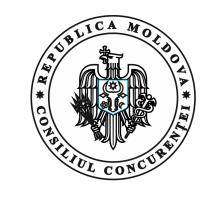
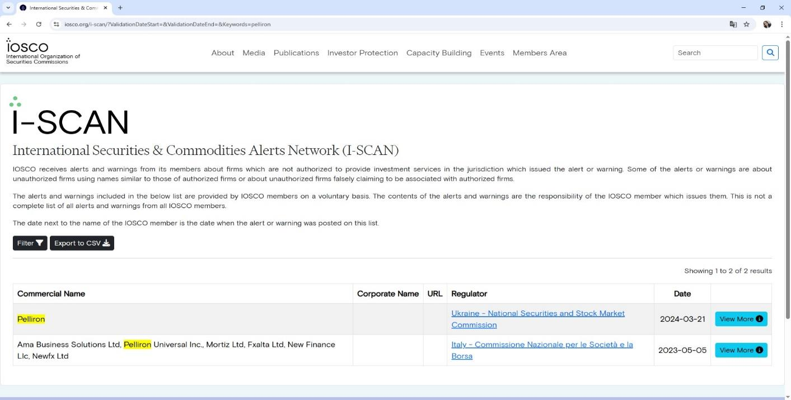
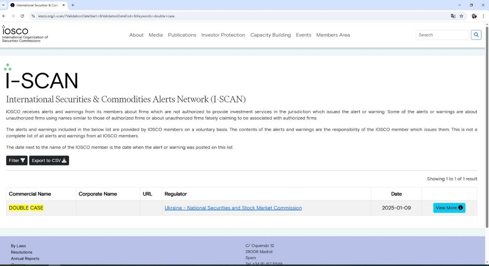

P L E N U L 
CONSILIULUI    CONCURENŢEI 
 
 
 
 
 
 
 
 
 Republica Moldova, MD- 2068, Сhişinău, str. Alecu Russo 1 
E-mail: office@competition.md; www.competition.md 
 
 
 
 
DECIZIE 
mun. Chișinău 
 
   din 10.07.2025                                     
 
 
                   Nr. APR -18 
 
Plenul Consiliului Concurenței,  
acționând în temeiul art. 41 alin. (1) lit. f) și art. 53 alin. (5) lit. a) din Legea 
concurenței nr. 183 din 11.07.2012, Hotărârii Parlamentului nr. 33 din 17.02.2022 
privind numirea în funcție a unui membru și președinte al Plenului Consiliului 
Concurenței, Hotărârii Parlamentului nr. 210 din 31.07.2024 privind numirea în 
funcția de vicepreședinte al Plenului Consiliului Concurenței, Hotărârii 
Parlamentului nr. 381 din 07.12.2023 privind numirea în funcția de membru al 
Plenului Consiliului Concurenței, Hotărârii Parlamentului nr. 211 din 31.07.2024 
privind numirea în funcția de membru al Plenului Consiliului Concurenței, 
analizând plângerea înregistrată nr. 2460 din 07.05.2025, privind eventuale 
acțiuni anticoncurențiale ale Comisiei Naționale a Pieței Financiare din Republica 
Moldova cu privire la publicarea pe pagina web oficială a unui comunicat cu titlul 
„Atenție la companii neautorizate!”, în care se comunică că compania Pelliron 
prezentă în spațiul public prin paginile web: www.pelliron.md și www.pelliron.com 
nu este înregistrată în Registrul persoanelor autorizate și licențiate pe piața de 
capital, materialele acumulate în procesul examinării preliminare, precum și a 
observațiilor parvenite 
A CONSTATAT: 
1. La data de 07.05.2025, în adresa Consiliului Concurenței a parvenit 
plângerea „Double – Case Consulting Group” SRL și „Double Case” SRL 
1 
 

 
 
 
 
 
 
înregistrată cu nr. 2460 referitor la presupusele acțiuni anticoncurențiale ale 
Comisiei Naționale a Pieței Financiare cu privire la publicarea pe pagina web 
oficială https://www.cnpf.md/ro a unui comunicat cu titlul „Atenție la companii 
neautorizate”, în care se comunică că compania Pelliron, prezentă în spațiul public 
prin paginile web: www.pelliron.md și www.pelliron.com nu este înregistrată în 
Registrul persoanelor autorizate și licențiate pe piața de capital, prezumate a fi 
contrare prevederilor art. 12 alin. (2) lit. b) din Legea concurenței nr. 183 din 
11.07.2012 (în continuare - Legea concurenței). 
Reclamanți 
2. „Double – Case Consulting Group” SRL, IDNO 1011609003638, cu 
sediul în mun. Chișinău, str. Mihai Viteazul 4, of. 501, este o întreprindere prezentă 
pe piața serviciilor de consultanță pentru afaceri și management, în special 
consultanță și instruire în domeniul tranzacționării la bursele internaționale de valori.  
3. „Double Case” SRL,  IDNO 1017607004873, cu sediul în mun. Chișinău, 
str. Mihai Viteazul 4, of. 501, este o întreprindere prezentă pe piața serviciilor de 
consultanță pentru afaceri și management, în special consultanță și instruire în 
domeniul tranzacționării la bursele internaționale de valori. 
Reclamat 
4. Comisia Națională a Pieței Financiare (în continuare - CNPF), mun. 
Chișinău, (IDNO 1007601001293), este o autoritate publică autonomă, 
responsabilă față de Parlament, care, în exercitarea atribuțiilor sale, este învestită 
cu putere de decizie, de dispensă, de interdicție, de intervenție, de control și de 
sancționare, în limitele stabilite de legislație.  
 
Obiectul examinării preliminare 
5. Conform celor invocate în plângere, la data de 04.03.2025, pe pagina web 
https://www.cnpf.md/ro a CNPF a fost plasat un comunicat cu titlul „Atenție la 
companii neautorizate!”, în care se comunică că compania Pelliron, prezentă în 
spațiul public prin paginile web: www.pelliron.md și www.pelliron.com nu este 
2 
 

 
 
 
 
 
 
înregistrată în Registrul persoanelor autorizate și licențiate pe piața de capital, prin 
urmare, nu deține un act permisiv pentru desfășurarea activității pe piața de capital 
din Republica Moldova, conform Legii nr. 171/2012 privind piața de capital. În 
comunicat se mai indică că nu a fost identificată țara în care aceasta este autorizată 
pe piața de capital. În comunicatul său, CNPF recomandă ca „[…] inclusiv în cazul 
în care beneficiați de servicii de training în domeniul investițiilor, să fie evitate 
direcționarea către platforme sau brokeri neautorizați. În petițiile parvenite la 
CNPF, investitorii au invocat colaborarea Companiei Pelliron cu entitățile SRL 
„Double Case” și SRL „Double Case Consulting Group […]”. 
6. Totodată, reclamanții menționează că la data de 05.03.2025 au adresat 
CNPF notificări prealabile prin care au solicitat: i) informarea despre faptul dacă, 
activităților desfășurate de către SRL „Double Case” și SRL „Double Case 
Consulting Group”, eventual compania Pelliron, le sunt incidente prevederile Legii 
nr. 171/2012 sau le sunt aplicabile excepțiile de la art. 3 din lege; ii) rectificarea 
comunicatului informativ difuzat pe pagina oficială a CNPF  prin excluderea 
informației ce se referă la SRL „Double Case” și SRL „Double Case Consulting 
Group”; iii) publicarea unui comunicat informativ pe pagina oficială a CNPF, prin 
care să fie dezmințită informația care se referă la activitatea SRL „Double Case”. 
7. Ulterior, potrivit celor relatate în plângere, la data de 25.03.2025, SRL 
„Double Case” și SRL „Double Case Consulting Group” au expediat către CNPF o 
cerere privind completarea cerințelor din notificările prealabile din 05.03.2025. 
8. Prin Hotărârea CNPF nr. 17/3 din 01.04.2025, s-a admis pct. 21 din cererea 
privind completarea cerințelor din notificările prealabile din 05.03.2025 și s-au 
respins cerințele de retragere a comunicatului informativ de pe pagina oficială a 
CNPF, de rectificare a comunicatului informativ difuzat pe pagina oficială a CNPF 
 
1 „[…] 2. Informarea despre faptul dacă: i) activităților desfășurare de către SRL „Double Case” și SRL „Double 
Case Consulting Group” eventual compania Pelliron le sunt incidente prevederile Legii nr. 171/2012 privind piața 
de capital sau le sunt aplicabile excepțiile de la art. 3 din Lege; ii) Există la moment vreun alt broker care acționează 
pe piața nereglementată înregistrată în Registrul persoanelor autorizate și licențiate pe piața de capital; iii) Care 
autorizație urmează a fi deținută de către compania Pelliron pentru a presta servicii în mediul online pentru 
cetățenii RM....”  
3 
 

 
 
 
 
 
 
prin excluderea informațiilor ce se referă la activitatea reclamanților și de publicare 
a unui nou comunicat informativ prin care să fie dezmințite informațiile ce se referă 
la activitatea SRL „Double Case” și SRL „Double Case Consulting Group”. 
9. Reclamanții mai indică că urmare a analizei paginii web a CNPF nu a fost 
menționat un alt broker care activează pe piața nereglementată în comunicatele 
autorității publice, într-o manieră ce creează un tratament discriminatoriu, contrar 
art. 23 alin. (1) din Codul administrativ nr.116/2018. 
10. Totodată, în plângere se mai indică că, urmare a emiterii și plasării 
comunicatului informativ pe pagina oficială a CNPF a fost afectată reputația 
companiei și veniturile acesteia, care s-au redus cu 20-30%.  
11. De asemenea, SRL „Double Case” și SRL „Double Case Consulting 
Group” au solicitat Consiliului Concurenței: 
- stabilirea încălcării art. 12 alin. (2) lit. b) din Legea concurenței de către 
CNPF; 
- dispunerea inițierii investigației pe marginea plângerii și emiterea unei 
Decizii prin care să fie obligată CNPF să retragă comunicatul informativ plasat pe 
pagina sa web oficială www.cnpf.md, „Atenție la companii neautorizate” cu 
plasarea unui comunicat informativ în acest sens. 
12. Urmare a examinării actelor normative în vigoare din domeniu, a 
plângerii, precum și a materialelor acumulate s-au constatat următoarele. 
13. În conformitate cu art. 3 din Legea nr. 192/1998 privind Comisia 
Naţională a Pieţei Financiare, ultima are drept obiective de bază: asigurarea 
stabilității, transparenței, siguranței și eficienței pe piața de capital și în raport cu 
fondurile de pensii facultative și cu organismele de plasament colectiv, prevenirea 
riscurilor sistemice și a manipulării pe piața de capital, precum și protejarea 
drepturilor consumatorilor de servicii financiare, în limitele stabilite de legislație. 
14. Concomitent, în corespundere cu art. 8 lit. a) din legea menționată supra, 
în scopul realizării obiectivelor sale, CNPF are ca și atribuție elaborarea și 
promovarea documentelor de politici în domeniile supravegheate, participă la 
4 
 

 
 
 
 
 
 
elaborarea, promovarea și implementarea documentelor de politici în domeniul 
incluziunii și educației financiare. 
15. Subsidiar, art. 1 din Legea nr. 171/2012 privind piața de capital, atribuie 
CNPF competența de reglementare și supraveghere a activităților pe piața de 
capital, iar în conformitate cu art. 5 din aceeași lege, printre obiectivele de 
reglementare ale CNPF se numără: menținerea și promovarea echității, eficienței, 
transparenței și ordinii pe piața de capital; protejarea drepturilor și intereselor 
persoanelor care investesc în instrumente financiare în cadrul ofertelor publice 
și/sau care apelează la servicii de investiții; prevenirea cazurilor de încălcare a 
legislației în domeniul pieței de capital, precum și instruirea publicului larg privind 
piața de capital, instrumentele financiare, serviciile și activitățile de investiții. 
16. În aceeași ordine de idei, în conformitate cu prevederile art. 36 alin. (1) 
lit. f) din Legea nr. 105/2005 privind protecția consumatorului, CNPF este 
autoritatea publică abilitată cu funcții de reglementare în domeniul protecției 
consumatorilor, în limita domeniului de competență. 
17. Urmare a coroborării dispozițiilor citate supra rezultă că competența 
CNPF se extinde și asupra investitorilor, inclusiv prin implementarea 
instrumentelor educației financiare, instruirea publicului larg privind piața de 
capital, instrumentele financiare, serviciile și activitățile de investiții, precum și a 
protecției drepturilor și intereselor persoanelor care investesc în instrumente 
financiare și/sau care apelează la servicii de investiții. 
18. Prin intermediul scrisorii nr. 06-4/2177 din 20.05.2025, CNPF a 
comunicat că potrivit datelor din Registrul participanților profesioniști pe piața de 
capital din Republica Moldova, deținut de către CNPF, entitățile „Pelliron”, 
„Double Case” SRL și „Double-Case Consulting Group” SRL nu sunt înregistrate 
ca participanți autorizați și, prin urmare, nu dețin dreptul de a desfășura activități 
pe piața de capital din Republica Moldova în condițiile Legii nr. 171/2012. 
19. În scrisoare se mai indică că menționarea entităților „Double Case” SRL 
și „Double-Case Consulting Group” SRL, în comunicatul plasat pe pagina web 
5 
 

 
 
 
 
 
 
www.cnpf.md, se bazează pe sesizările și plângerile primite de la investitori, 
inclusiv cu solicitări de intervenție, din care reiese posibila implicare a acestora în 
activități de promovare sau colaborare cu entități neautorizate. 
20. Subsidiar, prin scrisoarea menționată ante, CNPF a comunicat că a fost 
informată de către Procuratura pentru Combaterea Criminalității Organizate și 
Cauze Speciale (PCCOCS), cât și de Inspectoratul General al Poliției (IGP) privind 
existența mai multor dosare penale inițiate pe marginea plângerilor cetățenilor 
adresate împotriva „Double Case” SRL, „Double-Case Consulting Group” SRL și 
„Pelliron”, cu implicarea unor pierderi financiare considerabile. 
21. Totodată, CNPF menționează că Organizația Internațională a Comisiilor 
de Valori Mobiliare (IOSCO) a primit mai multe alerte și avertismente din partea 
membrilor săi cu privire la întreprinderi care nu sunt autorizate să furnizeze servicii 
de investiții în jurisdicțiile respective, iar printre aceste entități se numără: 
„Pelliron” și „Double Case”2.  
22. La fel, autoritățile financiare din mai multe țări, inclusiv CNPF au 
avertizat cu privire la riscurile de a utiliza platformele care nu sunt reglementate și 
licențiate corespunzător, deoarece aceste platforme pot înșela sau expune 
investitorii la pierderi financiare semnificative.  
23. CNPF a mai comunicat că „Pelliron” și „Double Case”au fost incluse de 
către regulatorul ucrainean în lista proiectelor dubioase. 
24. Plasarea comunicatului în cauză a avut loc urmare a recepționării 
sesizărilor și solicitărilor de intervenție din partea investitorilor, precum și a 
existenței unor dosare penale în curs de investigare, dar și a faptului că compania 
Pelliron nu se regăsește în Registrul participanților profesioniști pe piața de capital 
din Moldova. 
25. Conform prevederilor art. 12 alin. (2) lit. b) din Legea concurenței, „sunt 
interzise orice acțiuni sau inacțiuni ale autorităților publice care restrâng, 
 
2 https://www.iosco.org/i-scan/?ValidationDateStart=&ValidationDateEnd=&Keywords=pelliron 
https://www.iosco.org/i-scan/?ValidationDateStart=&ValidationDateEnd=&Keywords=double+case 
6 
 

 
 
 
 
 
 
împiedică sau denaturează concurența, precum stabilirea de condiții 
discriminatorii sau acordarea de privilegii pentru activitatea întreprinderilor, în 
cazul în care acestea nu sunt prevăzute de lege”. 
26. Astfel, în sensul calificării faptelor invocate în conformitate cu prevederile 
art. 12 alin. (2) lit. b) din Legea concurenței, necesită întrunirea cumulativă a 
următoarelor condiții:  
• existența subiectului - a autorității publice;  
• existența faptei - a acțiunii sau inacțiunii autorității publice interzise, 
manifestate prin stabilirea de condiții discriminatorii sau acordarea de 
privilegii pentru activitatea întreprinderilor, în cazul în care acestea nu sunt 
prevăzute de lege; 
• efectul negativ - restrângerea, împiedicarea sau denaturarea concurenței. 
27. La caz, se atestă lipsa acțiunii CNPF interzise de art. 12 alin. (2) lit. b) din 
Legea concurenței, ce are ca efect restrângerea sau denaturarea concurenței, or,: 
• comunicatul „Atenție la companii neautorizate!”, plasat pe pagina oficială 
a instituției nu instituie nici o condiție, per general, cu atât mai mult 
discriminatorie pentru reclamanți, nu presupune acordarea de privilegii, 
care să restrângă, să împiedice sau să denatureze concurența. 
• potrivit informațiilor furnizate de către CNPF, precum și a textului regăsit în 
cadrul comunicatului în cauză, ultimul se bazează inclusiv pe sesizările și 
plângerile primite de la investitori, inclusiv cu solicitări de intervenție: „[…] 
în virtutea obiectivelor și competențelor sale legale, urmare a sesizărilor 
parvenite, informează investitorii...”; 
• totodată, CNPF invocă existența mai multor alerte și avertismente din partea 
Organizației Internaționale a Comisiilor de Valori Mobiliare (IOSCO) cu 
privire la întreprinderi care nu sunt autorizate să furnizeze servicii de 
investiții în jurisdicțiile respective, iar printre aceste entități se numără 
7 
 

 
 
 
 
 
 
„Pelliron”3.  
28. Prin urmare, se constată că prin plasarea comunicatului „Atenție la 
companii neautorizate!” pe pagina oficială a CNPF nu a fost stabilită nici o 
condiție discriminatorie pentru activitatea „Double Case” SRL și „Double – Case 
Consulting Group” SRL, nu au fost acordate privilegii pentru activitatea altor 
întreprinderi concurente neprevăzute de lege care restrâng, împiedică sau 
denaturează concurența, ceea ce echivalează cu lipsa faptei – acțiunii sau inacțiuni 
CNPF interzise de art. 12 alin. (2) lit. b) din Legea concurenței. 
29. Totodată, menționăm că susținerile reclamanților referitor la o pretinsă 
scădere a veniturilor întreprinderilor cu 20-30%, adiționalul faptului că nu 
constituie un aspect care ar necesita examinarea de către Consiliul Concurenței, în 
virtutea faptului că acțiunea CNPF nu constituie obiect al încălcării imputate, nu 
au fost probate de către reclamanți și au caracter declarativ.  
30. Dacă prin acțiunile CNPF a fost cauzat un prejudiciu întreprinderilor, 
aceste acțiuni urmează a fi contestate în instanță de judecată, iar prejudicial – 
recuperate în baza hotărârii instanței. În acest context, indicăm asupra faptului că 
reclamantul s-a adresat în instanța de judecată privind aspectele legate de 
verificarea legalității emiterii comunicatului informativ de către CNPF și, respectiv 
retragerea comunicatului în cauză de pe pagina oficială a CNPF, cu plasarea unui 
alt comunicat informativ în acest sens. Determinarea existenței competenței și a 
dreptului CNPF de a emite comunicatul „Atenție la companii neautorizate!”, 
publicat pe pagina web oficială https://www.cnpf.md/ro a CNPF, precum și 
aprecierea legalității conținutului acestuia, depășesc limita atribuțiilor Consiliului 
Concurenței și intră în sfera de competență a instanței de judecată. 
31. Drept urmare a examinării preliminare a plângerii, Consiliul Concurenței 
prin scrisoarea nr. APR-06/108-832 din 02.06.2025 a informat „Double Case” SRL 
și „Double – Case Consulting Group” SRL referitor la lipsa temeiurilor rezonabile 
 
3 https://www.iosco.org/i-scan/?ValidationDateStart=&ValidationDateEnd=&Keywords=pelliron  
 
8 
 

 
 
 
 
 
 
de suspectare a încălcării art. 12 alin. (2) lit. b) al Legii concurenței nr. 183/2012 
de către CNPF. 
32. Ulterior, prin intermediul scrisorii înregistrate cu nr. 2765 din 10.06.2025, 
reclamanții „Double Case” SRL și „Double – Case Consulting Group” SRL au 
formulat și prezentat observații asupra poziției Consiliului Concurenței, expuse în 
continuare.  
Observațiile reclamanților: 
33. „ […] În scrisoarea nr. APR-04/05-06 din 09.01.2025 se menționează că 
deși Consiliul Concurenței transpune în răspunsul său un șir de prevederi legale, 
acesta nu explică în ce măsură sunt incidente speței. Or, Consiliul Concurenței a 
ignorat prevederile art. 4, 8 din Legea privind CNPF, din care rezultă în mod 
indubitabil că „Double Case” SRL și „Double – Case Consulting Group” SRL, cât 
și compania Pelliron, reieșind din activitatea pe care o desfășoară, nu sunt subiecți 
ai raporturilor ce cad sub incidența reglementării, supravegherii și controlului 
Comisiei. În consecință, CNPF, cu derogare de la atribuțiile acordate prin lege, s-
a expus asupra activității unor subiecți, care nu cad în sfera de competență. Nici o 
prevedere legală citată, precum și nicio altă prevedere legală, la moment, nu-i 
acordă dreptul CNPF-ului de a emite comunicate de genul dat asupra unor subiecți 
ai raporturilor care nu cad sub incidența reglementării din partea sa.” 
34. „CNPF omite să menționeze faptul că companiei Pelliron nu-i sunt 
incidente prevederile Legii cu privire la piața de capital și respectiv pentru 
desfășurarea activității, inclusiv prestarea serviciilor pentru cetățenii RM, 
domeniul tranzacționării la bursele internaționale de valori (piața nereglementată) 
în mediul online, nu-i este necesară deținerea vreunei autorizații.”  
Poziția Consiliului Concurenței 
35. Cu referire la cele invocate, conchidem că verificarea legalității emiterii 
comunicatului de către CNPF, precum și a competenței CNPF de a se pronunța 
asupra activității reclamanților ține exclusiv de atribuțiile instanței de judecată. De 
9 
 

 
 
 
 
 
 
altfel, reclamantul a depus o acțiune în instanța de judecată în acest sens, iar aceste 
aspecte urmează a fi analizate și soluționate pe calea judiciară. Stabilirea 
competenței CNPF de a emite astfel de comunicate, dar și a faptului dacă „Double 
Case” SRL și „Double – Case Consulting Group” SRL, reieșind din activitatea pe 
care o desfășoară, sunt sau nu subiecți ai raporturilor ce cad sub incidența 
reglementării, supravegherii și controlului CNPF excede competența Consiliului 
Concurenței.  
Observațiile reclamanților: 
36. „Cu referire la argumentul invocat de CNPF în scrisoarea nr. 06-4/2177 
din 20.05.2025, precum că ar fi primit sesizări și plângeri de la investitori, inclusiv 
a fost informată de către organele statutului despre existența unor cauze penale, 
menționăm că acesta este în contradicție cu cele declarate de către reprezentanții 
CNPF-ului în ședința din 25.03.2025, prin care a menționat că comunicatul a fost 
emis din oficiu, iar de acte și/sau petiții nu dispun. Aceste circumstanțe se confirmă 
prin copia procesului verbal de audiere a participantului la procedura prealabilă 
din 25.03.2025.” 
Poziția Consiliului Concurenței 
37. CNPF prin scrisoarea nr. 06-4/2177 din 20.05.2025 a furnizat copiile 
sesizărilor parvenite de la investitori, inclusiv cu solicitări de intervenție, 
menționând, totodată, și despre existența unor dosare penale inițiate pe marginea 
plângerii cetățenilor împotriva  „Double Case” SRL, „Double – Case Consulting 
Group” și „Pelliron”, în baza cărora a fost plasat comunicatul informativ: „Atenție 
la companii neautorizate”! 
Observațiile reclamanților: 
38. „Referitor la mențiunile efectuate de către Organizația Internațională a 
Comisiilor de Valori Mobiliare, accesând linkul www.iosco.org/i-scan/ în lista 
companiilor respective, Pelliron nu a fost identificat, nici în urma utilizării 
motorului de căutare, contrar celor afirmate de către CNPF. La fel este incertă și 
situația în care Consiliul Concurenței face trimitere și la „Double Case” SRL, în 
10 
 

 
 
 
 
 
 
condițiile în care nici CNPF nu a menționat că compania respectivă s-ar fi regăsit 
pe pagina web a IOSCO.” 
Poziția Consiliului Concurenței - acceptat parțial 
39. Cu referire la aceste aspecte, menționăm că informațiile au fost furnizate 
Consiliului Concurenței de către CNPF prin scrisoarea nr. 06-4/2177 din 
20.05.2025. Consiliul Concurenței a indicat în mod expres sursa informațiilor. 
40. Totodată, accesarea linkurilor indicate de CNPF confirmă că compania 
„Pelliron”, cât și entitatea „Double Case” figurează în lista de atenționări publicată 
de IOSCO. „Double Case” SRL nu se regăsește în lista respectivă, după cum poate 
fi observat din capturile de ecran expuse în Figura 1 și 2. 
 
Figura 1 

 
 
 
 
 
 
 
 
 
 
 
 
 
 
 
 
 
11 
 

 
 
 
 
 
 
Figura 2 

 
 
 
 
 
 
 
 
   
 
   Sursa: pagina web accesată conform linkurilor prevăzute la pct. 21 din prezenta decizie.  
 
Observațiile reclamanților: 
41. „Per se, inițierea investigației nu prejudecă fondul cauzei și nu stabilește 
comiterea unei încălcări a legislației concurențiale, or, încălcarea se constată prin 
decizie a Plenului Consiliului Concurenței, raționament ce rezidă expres din 
prevederile art. 55 alin. (4) din Legea concurenței. La etapa preliminară nu se cere 
prezența unui probatoriu incontestabil și a unei baze argumentative indubitabile 
asupra vinovăției persoanei în sensul încălcării legii concurențiale, elemente care 
se elucidează în definitiv la etapa investigației în care urmează a fi cercetate 
minuțios substanța probelor și alegațiilor participanților implicați în diferendul 
concurențial. Din perspectiva unui observator obiectiv și rezonabil, argumentele 
petiționarilor invocate în plângere sunt plauzibile și suficiente pentru a putea 
purcede la etapa de investigații și a verifica în detaliu circumstanțele invocate în 
plângere, în cadrul căreia Consiliul Concurenței este investit cu un arsenal de 
instrumente juridice elocvente și adecvate pentru elucidarea circumstanțelor 
importante ale cazului concurențial, stabilirea adevărului și identificarea, după 
caz, a relei - credințe a autorilor plângerii. Consiliul Concurenței nu a oferit 
12 
 

 
 
 
 
 
 
atenția cuvenită circumstanțelor potrivit cărora CNPF a emis comunicatul, în 
rezultatul cărora au fost limitate drepturile „Double Case” SRL și „Double – Case 
Consulting Group” SRL, fapt prin care s-au acordat privilegii neprevăzute de lege 
concurenților, plasând petiționarii într-o situație negativă în raport cu clienții săi. 
Urmare a comunicatului emis cu încălcarea prevederilor legale și cu rea-credință 
s-au adus atingere competitivității „Double Case” SRL și „Double – Case 
Consulting Group” SRL pe piață, afectând în mod direct desfășurarea activității 
economice a acesteia.” 
42. „Refuzul de a iniția investigația pe faptul acțiunilor anticoncurențiale 
invocate în plângere va fi contrar și practicii constante prin care au fost anulate 
actele emise de Consiliul Concurenței, în acest sens, cu titlu de exemplu, invocăm 
cauza intentată de „Viloterm” SRL împotriva Consiliului Concurenței.” 
Poziția Consiliului Concurenței 
43. Examinarea preliminară a plângerii a fost realizată în corespundere cu 
prevederile Legii concurenței.  
44. Suportul probatoriul prezentat de către reclamanți, precum și cel 
acumulat de către Consiliul Concurenței, la etapa de examinare preliminară a 
plângerii, a permis a conchide lipsa temeiurilor rezonabile de a suspecta încălcarea 
art. 12 alin. (2) lit. b) din Legea concurenței de către CNPF.  
45. Prin plasarea comunicatului informativ de către CNPF pe pagina oficială 
a instituției nu au fost stabilite careva condiții, în special discriminatorii față 
de reclamanți sau acordate privilegii neprevăzute de lege față de activitatea 
altor întreprinderi concurente, care ar limita drepturile întreprinderilor 
reclamante, or, comunicatul în sine nu conține prevederi care ar putea fi considerate 
ca condiții discriminatorii. 
46. La caz, nu se atestă existența obiectului- acțiunii CNPF interzise de art. 
12 alin. (2) lit. b) din Legea concurenței.  
47. Un eventual impact negativ asupra activității economice a „Double 
Case” SRL și „Double Case Consulting Group” SRL pretins a fi cauzat de 
13 
 

 
 
 
 
 
 
publicarea comunicatului emis de către CNPF, ar putea fi examinat doar ca urmare 
a constatării existenței faptei, acțiunii CNPF interzise de art. 12 alin. (2) lit. b) din 
Legea concurenței. În absența faptei (acțiunea sau inacțiunea autorității publice, 
manifestate prin stabilirea de condiții discriminatorii sau acordarea de privilegii 
pentru activitatea întreprinderilor, în cazul în care acestea nu sunt prevăzute de 
lege), examinarea efectelor economice pretinse devine lipsă de relevanță juridică. 
Mai mult, aspectul privind pierderile financiare suportate, invocate de reclamanți, 
nu a fost susținut prin probe concludente și pertinente. 
48. Subsidiar, invocarea de către reclamant a cauzei „Viloterm” SRL 
împotriva Consiliului Concurenței nu este relevantă în contextul de față, întrucât 
situația de fapt și temeiurile juridice examinate în acea speță sunt substanțial 
diferite de cele expuse în prezenta plângere.  
49. Pe cale de consecință, se constată că obiecțiile prezentate de „Double 
Case” SRL și „Double Case Consulting Group” SRL nu au dus la o nouă evaluare 
a actelor și faptelor expuse în plângere. 
50. Totodată, subliniem că plasarea de către CNPF sau de o altă autoritate 
publică pe paginile oficiale a acestora a anumitor informații presupuse a fi eronate 
nu cad sub incidența art. 12 alin. (2) lit. b) din Legea concurenței, atât timp cât 
acestea nu instituie condiții discriminatorii sau acordă privilegii pentru activitatea 
întreprinderilor, care au ca efect restrângerea, împiedicarea sau denaturarea 
concurenței pe piață.  
51. În lipsa demonstrării efectului în cauză, eventualele demersuri din partea 
întreprinderilor afectate de plasarea informațiilor cu caracter eronat privind 
dezmințirea și/sau solicitarea recuperării de prejudicii, se circumscriu atribuțiilor 
instanțelor de judecată, or, în acest sens, competența Consiliului Concurenței cu 
privire la aceste aspecte decade. 
52. Informațiile incluse în comunicatul emis de către CNPF nu impun nici o 
condiție discriminatorie reclamanților și nu implică acordarea de privilegii pentru 
activitatea altor întreprinderi concurente, care să restrângă, împiedice sau să 
14 
 

 
 
 
 
 
 
denatureze concurența.  
53. Urmare a examinării plângerii, precum și a observațiilor înaintate nu a 
fost posibilă determinarea existenței temeiurilor rezonabile pentru a suspecta 
încălcarea art. 12 alin. (2) lit. b) din Legea concurenței de către CNPF prin 
publicarea pe pagina web oficială a unui comunicat cu titlul „Atenție la companii 
neautorizate!”, în care se comunică că compania Pelliron prezentă în spațiul public 
prin paginile web: www.pelliron.md și www.pelliron.com nu este înregistrată în 
Registrul persoanelor autorizate și licențiate pe piața de capital. 
54. În acest context, reieșind din circumstanțele de fapt și de drept expuse, 
în conformitate cu prevederile art. 53 alin. (5) lit. a) ale Legii concurenței și în 
temeiul art. 41 alin. (1) lit. f) din Legea concurenței, Plenul Consiliului Concurenței 
DECIDE: 
1. A respinge plângerea nr. 2460 din 07.05.2025 depusă de către „Double Case” 
SRL și „Double Case Consulting Group” SRL în legătura cu lipsa temeiurilor 
rezonabile pentru a suspecta încălcarea art. 12 alin. (2) lit. b) din Legea 
concurenței nr. 183/2012 de către Comisia Națională a Pieței Financiare prin 
publicarea, la data de 04.03.2025, pe pagina web oficială a unui comunicat 
cu titlul „Atenție la companii neautorizate!”. 
2. Decizia poate fi contestată, în termen de 30 de zile calendaristice de la 
primirea acesteia de către părți, la Judecătoria Chișinău, sediul Râșcani, 
specializat în materie de contencios administrativ (mun. Chișinău, str. Kiev, 
3). 
3. Prezenta decizie intră în vigoare la data adoptării și va fi adusă la cunoștința 
reclamanților. 
                                                    Alexei GHERȚESCU 
 
                                                  Președinte 
15 
 
