PLENUL 
CONSILIULUI CONCURENTEI 
MD- 2068, Republica Moldova, mun. 
str. Alecu Russo, I 
tel:+ 373 (22) 274 565, 273 443; fax: + 373 (22) 270 606; E-mail: office@competition.md: www.competition.md 
DECIZIE 
mun. 
Nr. DCE-17 
din 10.06.2025 
Plenul Consiliului Concurentei, 
actionand in temeiul art. 41 din Legea concurentei nr. 183 din 11.07.2012 (fn continuare -
Legea concurenfei) , Hotararii Parlamentului nr. 33/2022 privind numirea in functie a unui 
membru 
a Plenului Consiliului Concurentei, Hotararii Parlamentului Republicii 
Moldova nr. 3 81/2023 privind numirea in functia de membru al Plenului Consiliului Concurentei 
Hotararii Parlamentului nr. 211/2024 privind numirea in functia de membru al Plenului 
Consiliului Concurentei, 
analizand formularul complet privind notificarea unei concentrari economice depus de 
catre intreprinderea ,,Now Oil Retail" SRL, inregistrat cu nr. de intrare :?<, cererea de derogare 
inregistrata cu nr. de intrare :?< 
materialele acumulate in procesul de examinare a operatiunii 
de concentrare economica 
A CONSTATAT: 
1. 
La data de :?< , la Consiliul Concurentei a fost depus formularul complet privind 
notificarea unei concentrari economice, inregistrat cu numarul de intrare :?< , care se refera la 
preluarea in locatiune a activului amplasat in mun. 
str. Calea Orheiului 32, de catre 
intreprinderea ,,Now Oil Retail" SRL. Activul ce urmeaza a fi preluat, este in proprietatea 
intreprinderii ,,BDD Premium Capital" SRL, insa a fost gestionat de intreprinderea ,,Vento 
Retail" SRL pana la data de :?< . 
2. 
Partile implicate in operatiunea de concentrare economica sunt prezente pe piata 
comercializarii cu amanuntul a produselor petroliere. Atat intreprinderea ,,Now Oil Retail" SRL, 
cat 
activul care urmeaza a fi preluat au 
gen de activitate. 
3. 
Notificarea a devenit efectiva la :?< - data la care au fost receptionate 
inregistrate la 
Consiliul Concurentei informatiile care confirma caracterul exact 
complet al notificarii. 
I. 
Partile implicate in operafiunea de concentrare economica 
Partea care preia controlul: 
4. 
,,Now Oil Retail" SRL, intreprindere inregistrata la data de 17.06.2019, IDNO 
1019600028926, cu sediul in Republica Moldova, mun. 
str. Petricani 32. :?< . 
Principalul gen de activitate al intreprinderii ,,Now Oil Retail" SRL, conform 
Clasificatorului Activitatilor din Economia Moldovei 2 (fn continuare - CAEM Rev.2), este 
comerful cu amanuntul al carburanfilor pentru autovehicule fn magazin e specializat e, 04730. 
in conformitate cu prevederile art. 4 
art. 24 alin. (4) din Legea concurenfei, din 
grupul de intreprinderi al par/ii achizitoare Jae parte urmatoarele fntreprinderi (toate 
intreprinderile carefac parte din grupul par/ii achizitoare in continuare - grupul "NOW''): 

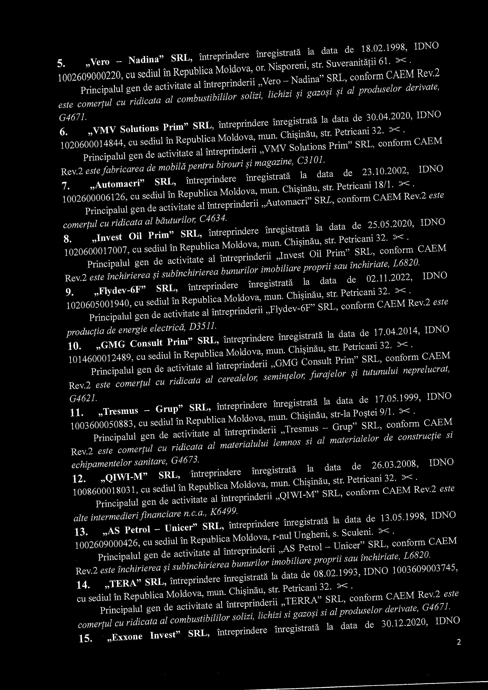
5. 
,,Vero -
Nadina" SRL, intreprindere inregistrata la data de 18.02.1998, IDNO 
1002609000220, cu sediul in Republica Moldova, or. Nisporeni, str. Suveranitatii 61. :x . 
Principalul gen de activitate al intreprinderii ,,Vero - Nadina" SRL, conform CAEM Rev.2 
este comerful cu ridicata al combustibililor solizi, lichizi .;i gazo.;i .;i al produselor derivat e, 
G4671. 
6. 
,,VMV Solutions Prim" SRL, mtreprindere inregistrata la data de 30.04.2020, IDNO 
1020600014844, cu sediul in Republica Moldova, mun. 
str. Petricani 32. :x. 
Principalul gen de activitate al intreprinderii ,,VMV Solutions Prim" SRL, conform CAEM 
Rev.2 este fabric area de mobila pentru birouri .;i magazine, CJ I 01. 
7. 
,,Automacri" SRL, intreprindere inregistrata 
la data 
de 
23.10.2002, IDNO 
1002600006126, cu sediul in Republica Moldova, mun. 
str. Petricani 1811. :x . 
Principalul gen de activitate al mtreprinderii ,,Automacri" SRL , conform CAEM Rev.2 este 
comerful cu ridicata al bauturilor, C4634. 
8. 
,,Invest Oil Prim" SRL, mtreprindere inregistrata la data de 25.05.2020, IDNO 
1020600017007, cu sediul in Republica Moldova, mun. 
str. Petricani 32. :x . 
Principalul gen de activitate al intreprinderii ,,Invest Oil Prim" SRL, conform CAEM 
Rev.2 este fnchirierea .;i subfnchirierea bunurilor imobiliare proprii sau fnchiriate, L6820 . 
9. 
,,Flydev-6F" 
SRL, 
intreprindere 
inregistrata 
la data 
de 
02.11.2022, IDNO 
1020605001940, cu sediulln Republica Moldova, mun. 
str. Petricani 32. :x . 
Principalul gen de activitate al intreprinderii ,,Flydev-6F" SRL, conform CAEM Rev.2 este 
producfia de energie electrica, D3511. 
10. 
,,GMG Consult Prim" SRL, mtreprindere inregistrata la data de 17.04.2014, IDNO 
1014600012489, cu sediul in Republica Moldova, mun. 
str. Petricani 32. :x . 
Principalul gen de activitate al intreprinderii ,,GMG Consult Prim" SRL, conform CAEM 
Rev.2 este comerful cu ridicata al cerealelor, seminfelor, furajelor .;i tutunului neprelucrat, 
G4621. 
11. 
,,Tresmus -
Grup" SRL, mtreprindere inregistrata la data de 17.05.1999, IDNO 
1003600050883, cu sediul in Republica Moldova, mun. 
str-la 
9/1. :x . 
Principalul gen de activitate al mtreprinderii ,,Tresmus - Grup" SRL, conform CAEM 
Rev.2 este comerful cu ridicata al materialului lemnos si al materialelor de construcfie si 
echipamentelor sanitare, G4673. 
12. 
,,QIWl-M" 
SRL, 
intreprindere 
inregistrata 
la 
data 
de 
26.03.2008, 
IDNO 
1008600018031, cu sediul inRepublicaMoldova, mun. 
str. Petricani 32. :x. 
Principalul gen de activitate al intreprinderii ,,QIWI-M" SRL, conform CAEM Rev.2 este 
alte intermedieri .financiare n.c.a., K6499. 
13. 
,,AS Petrol - Unicer" SRL, intreprindere inregistrata la data de 13.05.1998, IDNO 
1002609000426, cu sediul ill Republica Moldova, r-nul Ungheni, s. Sculeni. :x . 
Principalul gen de activitate al intreprinderii ,,AS Petrol - Unicer" SRL, conform CAEM 
Rev.2 este fnchirierea .;i subfnchirierea bunurilor imobiliare proprii sau fnchiriate, L6820. 
14. 
,,TERA" SRL, intreprindere inregistrata la data de 08.02.1993, IDNO 1003609003745, 
cu sediul in Republica Moldova, mun. 
str. Petricani 32. :x . 
Principalul gen de activitate al intreprinderii ,,TERRA" SRL, conform CAEM Rev.2 este 
comerful cu ridicata al combustibililor solizi, lichizi si gazo.;i si al produselor derivate, G4671. 
15. 
,,Exxone Invest" SRL, intreprindere inregistrata la data de 30.12.2020, IDNO 
2 

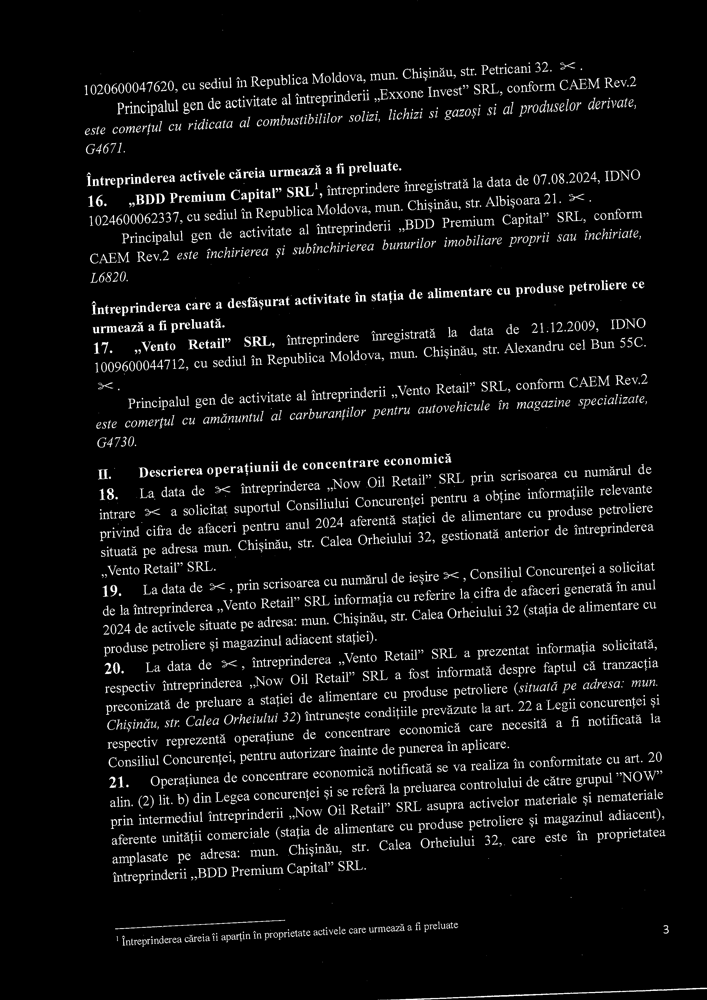
1020600047620, cu sediul in Republica Moldova, mun. 
str. Petricani 32. 
Principalul gen de activitate al intreprinderii ,,Exxone Invest" SRL, conform CAEM Rev.2 
este comer/ul cu ridicata al combustibililor solizi, lichizi si gazo.}i si al produselor derivate, 
G4671. 
Intreprinderea activele careia urmeaza a fi preluate. 
16. 
,,BDD Premium Capital" SRL 1, intreprindere inregistrata la data de 07.08.2024, IDNO 
1024600062337, cu sediul in Republica Moldova, mun. 
str. 
21. 
Principalul gen de activitate al intreprinderii ,,BDD Premium Capital" SRL, conform 
CAEM Rev.2 este fnchirierea $i subfnchirierea bunurilor imobiliare proprii sau fnchiriate, 
L6820. 
intreprinderea care a 
activitate in stafia de alimentare cu produse petroliere ce 
urmcaza a fi preluata. 
17. 
,,Vento Retail" SRL, intreprindere inregistrata la data de 21.12.2009, IDNO 
1009600044712, cu sediul in Republica Moldova, mun. 
str. Alexandru eel Bun SSC. 
Principalul gen de activitate al intreprinderii ,,Vento Retail" SRL, conform CAEM Rev.2 
este comerful cu amanuntul al carburanfilor pentru autov ehicule in magazine specializate , 
G4730. 
II. 
Descrierea operafiunii de concentrare economica 
18. 
La. data de 
intreprinderea ,,Now Oil Retail" SRL prin scrisoarea cu numarul de 
intrare 
a solicitat suportul Consiliului Concurentei pentru a obtine informatiile relevante 
privind cifra de afaceri pentru anul 2024 aferenta statiei de alimentare cu produse petroliere 
situata pe adresa mun. 
str. Calea Orheiului 32, gestionata anterior de intreprinderea 
,,Vento Retail" SRL. 
19. 
La data de 
prin scrisoarea cu numarul de 
Consiliul Concurentei a solicitat 
de la intreprinderea ,,Vento Retail" SRL informatia cu referire la cifra de afaceri generata in anul 
2024 de activele situate pe adresa: mun. 
str. Calea Orheiului 32 (statia de alimentare cu 
produse petroliere 
magazinul adiacent statiei). 
20. 
La data de :'}<, intreprinderea ,,Vento Retail" SRL a prezentat informatia solicitata, 
respectiv intreprinderea ,,Now Oil Retail" SRL a fost informata despre faptul ca tranzactia 
preconizata de preluare a statiei de alimentare cu produse petroliere (situata pe adresa: mun. 
Chi$inau, str. Calea Orheiului 32) 
conditiile prevazute la art. 22 a Legii concurentei 
respectiv reprezenta operatiune de concentrare economica care necesita a fi notificata la 
Consiliul Concurentei, pentru autorizare inainte de punerea in aplicare. 
21. 
Operatiunea de concentrare economica notificata se va realiza in conformitate cu art. 20 
alin. (2) lit. b) din Legea concurentei 
se refera la preluarea controlului de catre grupul "NOW" 
prin intermediul intreprinderii ,,Now Oil Retail" SRL asupra activelor materiale 
nemateriale 
aferente unitatii comerciale (statia de alimentare cu produse petroliere 
magazinul adiacent), 
amplasate pe adresa: mun. 
str. Calea Orheiului 32, care este in proprietatea 
intreprinderii ,,BDD Premium Capital" SRL. 
1 f ntreprindere a ciireia Ii apartin In proprietate active le care urmeazii a fi preluat e 
3 

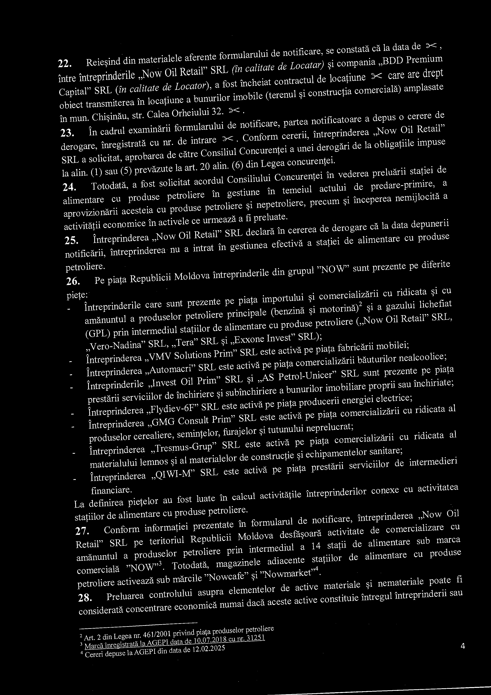
22. 
din materialele aferente formularului de notificare, se constata ca la data de :x , 
intre intreprinderile ,,Now Oil Retail" SRL (fn calitate de Locatar) 
compania ,,BDD Premium 
Capital" SRL (fn calitate de Locator) , a fost incheiat contractul de locatiune X 
care are drept 
obiect transmiterea in locatiune a bunurilor imobile (terenul 
constructia comerciala) amplasate 
in mun. 
str. Calea Orheiului 32. :x . 
23. 
In cadrul examinarii formularului de notificare , partea notificatoare a depus o cerere de 
derogare, inregistrata cu nr. de intrare 
di< . Conform cererii, intreprinderea ,,Now Oil Retail " 
SRL a solicitat , aprobarea de catre Consiliul Concurentei a unei derogari de la obligafiile irnpuse 
la alin. (1) sau ( 5) prevazute la art. 20 alin. ( 6) din Legea concurentei. 
24. 
Totodata , a fost solicitat acordul Consiliului Concurentei in vederea preluarii statiei de 
alimentare 
cu produse 
petroliere in gestiune 
in temeiul actului de predare-prirnire , a 
aprovizionarii acesteia cu produse petroliere 
nepetroliere , precum 
inceperea nemijlocita a 
activitatii economice in activele ce urmeaza a fi preluate. 
25. 
Intreprinderea ,,Now Oil Retail" SRL declara in cererea de derogare ca la data depunerii 
notificarii, intreprinderea nu a intrat in gestiunea efectiva a statiei de alimentare cu produse 
petroliere . 
26. 
Pe piata Republicii Moldova intreprinderile din grupul "NOW'' sunt prezente pe diferite 
piete: 
Intreprinderile care sunt prezente pe piata irnportului 
comercializarii cu ridicata 
cu 
amanuntul a produselor petroliere principale (benzina 
motorina) 2 
a gazului lichefiat 
(GPL) prin intermediul statiilor de alimentare cu produse petroliere (,,Now Oil Retail " SRL, 
,,Vero-Nadina" SRL, ,,Tera" SRL 
,,Exxone Invest " SRL); 
intreprinderea ,,VMV Solutions Prim" SRL este activa pe piata fabricarii mobilei ; 
Intreprinderea ,,Automacri " SRL este activa pe piata comercializarii bauturilor nealcoolice ; 
intreprinderile ,,Invest Oil Prim" SRL 
,,AS Petrol-Unicer" SRL sunt prezente pe piata 
prestarii serviciilor de inchiriere 
subinchiriere a bunurilor imo biliare proprii sau inchiri ate; 
Intreprinderea ,,Flydiev-6F" SRL este activa pe piata producerii energiei electrice; 
intreprinderea ,,GMG Consult Prim" SRL este activa pe piata comercializarii cu ridicata al 
produselor cerealiere, semintelor, furajelor 
tutunului neprelucrat; 
intreprinderea ,,Tresmus-Grup" SRL este activa pe piata comercializarii cu ridicata al 
materialului lemnos 
al materialelor de constructie 
echipamentelor sanitare ; 
intreprinderea ,,QIWI-M" SRL este activa pe piata prestarii serviciilor de intermedieri 
financiare. 
La definirea pietelor au fost luate ill calcul activitatile intreprinderilor conexe cu activitatea 
statiilor de alimentare cu produse petroliere . 
27. 
Conform informatiei prezentate in formularul de notificare , intreprinderea ,,Now Oil 
Retail" SRL pe teritoriul Republicii Moldova 
activitate de comercializare 
cu 
amanuntul a produselor petroliere prin intermediul a 14 statii de alimentare sub marca 
comerciala "NOW" 3. Totodata , magazinele adiacente statiilor de alimentare cu produse 
petroliere activeaza sub marcile "Nowcafe " 
"Nowmarket"
4
. 
28. 
Preluarea controlului asupra elementelor de active materiale 
nemateriale poate fi 
considerata concentrare economica numai daca aceste active constituie intregul intreprinderii sau 
2 Art. 2 din Legea nr. 461/200 I privind piata produselor petroliere 
3 Marca lnregistratii laAGE PI data de 10.07.201 8 cu nr. 3 1251 
4 Cereri depuse la AGEPI din data de 12.02.2025 
4 

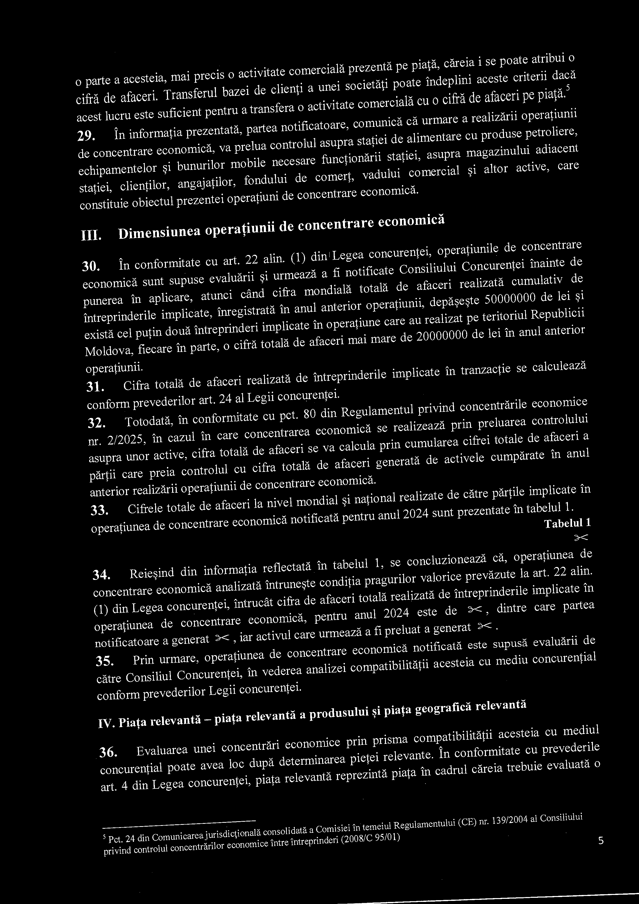
o parte a acesteia, mai precis o activitate comerciala prezenta pe piata, careia i se poate atribui o 
cifra de afaceri. Transferul bazei de clienti a unei societati poate mdeplini aceste criterii daca 
acest lucru este suficient pentru a transfera o activitate comerciala cu o cifra de afaceri pe piata. 
5 
29. 
In informatia prezentata, partea notificatoare, comunica ca urmare a realizarii operatiunii 
de concentrare economica, va prelua controlul asupra statiei de alimentare cu produse petroliere, 
echipamentelor 
bunurilor mobile necesare functionarii statiei, asupra magazinului adiacent 
statiei, clientilor, angajatilor, fondului de comert, vadului comercial 
altor active, care 
constituie obiectul prezentei operatiuni de concentrare economica. 
III. 
Dimensiunea operafiunii de concentrare economica 
30. 
In conformitate cu art. 22 alin. (1) din 1 Legea concurentei, operatiunile de concentrare 
economica sunt supuse evaluarii 
urmeaza a fi notificate Consiliului Concurentei inainte de 
punerea in aplicare, atunci cand cifra mondiala totala de afaceri realizata cumulativ de 
intreprinderile implicate, inregistrata in anul anterior operatiunii, 
50000000 de lei 
exista eel putin doua intreprinderi implicate in operatiune care au realizat pe teritoriul Republicii 
Moldova, fiecare in parte, o cifra totala de afaceri mai mare de 20000000 de lei in anul anterior 
operatiunii. 
31. 
Cifra totala de afaceri realizata de mtreprinderile implicate in tranzactie se calculeaza 
conform prevederilor art. 24 al Legii concurentei. 
32. 
Totodata, in conformitate cu pct. 80 din Regulamentul privind concentrarile economice 
nr. 2/2025, in cazul in care concentrarea economica se realizeaza prin preluarea controlului 
asupra unor active, cifra totala de afaceri se va calcula prin cumularea cifrei totale de afaceri a 
partii care preia controlul cu ci:fra totala de afaceri generata de activele cumparate in anul 
anterior realizarii operatiunii de concentrare economica. 
33. 
Cifrele totale de afaceri la nivel mondial 
national realizate de catre partile implicate in 
operatiunea de concentrare economica notificata pentru anul 2024 sunt prezentate in tabelul 1. 
Tabelul 1 
::'}< 
34. 
din informatia reflectata in tabelul 1, se concluzioneaza ca, operatiunea de 
concentrare economica analizata 
conditia pragurilor valorice prevazute la art. 22 alin. 
(1) din Legea concurentei, intrucat cifra de afaceri totala realizata de mtreprinderile implicate in 
operatiunea de concentrare economica, pentru anul 2024 este de 
::'}< , dintre care partea 
notificatoare a generat :;}< 
, iar activul care urmeaza a fi preluat a generat ::'}< . 
35. 
Prin urmare, operatiunea de concentrare economica notificata este supusa evaluarii de 
catre Consiliul Concurentei, in vederea analizei compatibilitatii acesteia cu mediu concurential 
conform prevederilor Legii concurentei. 
IV. Piafa relevanta - piafa relevanta a produsului 
piafa geografica relevanta 
36. 
Evaluarea unei concentrari economice prin prisma compatibilitatii acesteia cu mediul 
concurential poate avea loc dupa determinarea pietei relevante. In conformitate cu prevederile 
art. 4 din Legea concurentei, piata relevanta reprezinta piata in cadrul careia trebuie evaluata o 
5 Pct. 24 din Comunicareajuri sdictionala consolidata a Comisiei In temeiul Regulamentului (CE) nr. 139/2004 al Consiliului 
privind controlul concentrarilor economice !ntre lntreprinderi (2008/C 9510 I) 
5 

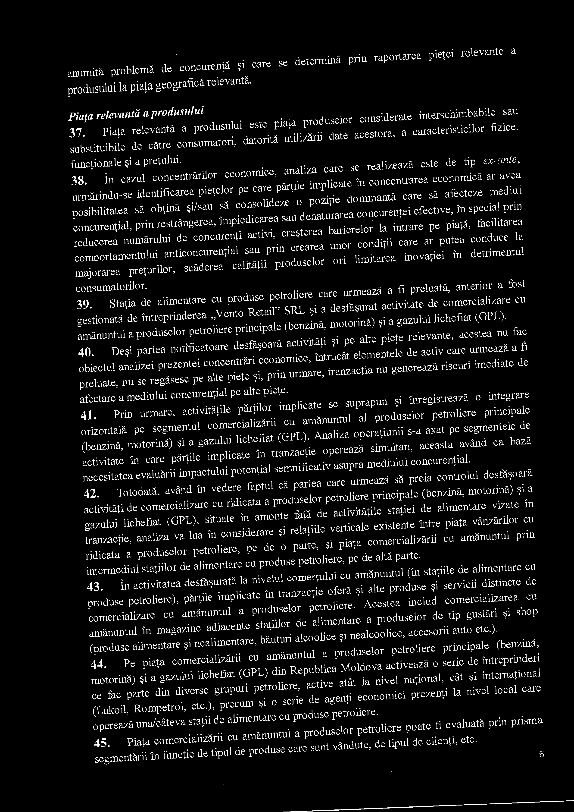
anumita problema de concurenta 
care se determina pnn raportarea pietei relevante a 
produsului la piata geografica relevanta. 
Piafa relevanta a produsului 
37. 
Piata relevanta a produsului este piata produselor considerate interschimbabile sau 
substituibile de catre consumatori, datorita utilizarii date acestora, a caracteristicilor fizice, 
functionale 
a pretului. 
38. 
In cazul concentrarilor economice, analiza care se realizeaza este de tip ex-ante, 
urmarindu-se identificarea pietelor pe care partile implicate in concentrarea economica ar avea 
posibilitatea sa obtina 
sa consolideze o pozitie dominanta care sa afecteze mediul 
concurential, prin restrangerea, impiedicarea sau denaturarea concurentei efective, in special prin 
reducerea numarului de concurenti activi, 
barierelor la intrare pe piata, facilitarea 
comportamentului anticoncurential sau prin crearea unor conditii care ar putea conduce la 
majorarea preturilor, scaderea calitatii produselor on limitarea inovatiei in detrimentul 
consumatorilor. 
39. 
Statia de alimentare cu produse petroliere care urmeaza a fi preluata, anterior a fost 
gestionata de intreprinderea ,,Vento Retail" SRL 
a 
activitate de comercializare cu 
amanuntul a produselor petroliere principale (benzina, motorina) 
a gazului lichefiat (GPL). 
40. 
partea notificatoare 
activitati 
pe alte piete relevante, acestea nu fac 
obiectul analizei prezentei concentrari economice, intrucat elementele de activ care urmeaza a fi 
preluate, nu se regasesc pe alte piete 
prin urmare, tranzactia nu genereaza riscuri imediate de 
afectare a mediului concurential pe alte piete. 
41. 
Prin urmare, activitatile partilor implicate se suprapun 
inregistreaza o integrare 
orizontala pe segmentul comercializarii cu amanuntul al produselor petroliere principale 
(benzina, motorina) 
a gazului lichefiat (GPL). Analiza operatiunii s-a axat pe segmentele de 
activitate in care partile implicate in tranzactie opereaza simultan, aceasta avand ca baza 
necesitatea evaluarii impactului potential semnificativ asupra mediului concurential. 
42. 
Totodata, avand in vedere faptul ca partea care urmeaza sa preia controlul 
activitati de comercializare cu ridicata a produselor petroliere principale (benzina, motorina) 
a 
gazului lichefiat (GPL), situate in amonte fata de activitatile statiei de alimentare vizate in 
tranzactie, analiza va lua in considerare 
relatiile verticale existente intre pia1a vanzarilor cu 
ridicata a produselor petroliere, pe de o parte, 
piata comercializarii cu amanuntul prin 
intermediul statiilor de alimentare cu produse petroliere, pe de alta parte. 
43. 
In activitatea 
la nivelul comertului cu amanuntul (in statiile de alimentare cu 
produse petroliere), partile implicate in tranzactie ofera 
alte produse 
servicii distincte de 
comercializare cu amanuntul a produselor petroliere. Acestea includ comercializarea cu 
amanuntul in magazine adiacente statiilor de alimentare a produselor de tip gustari 
shop 
(produse alimentare 
nealimentare, bauturi alcoolice 
nealcoolice, accesorii auto etc.). 
44. 
Pe piata comercializarii cu amanuntul a produselor petroliere principale (benzina, 
motorina) 
a gazului lichefiat (GPL) din Republica Moldova activeaza o serie de intreprinderi 
ce fac parte din diverse grupuri petroliere, active atat la nivel national, cat 
international 
(Lukoil, Rompetrol, etc.), precum 
o serie de agenti economici prezenti la nivel local care 
opereaza una/cateva statii de alimentare cu produse petroliere. 
45. 
Piata comercializarii cu amanuntul a produselor petroliere poate fi evaluata prin prisma 
segmentarii in functie de tipul de produse care sunt vandute, de tipul de clienti, etc. 
6 

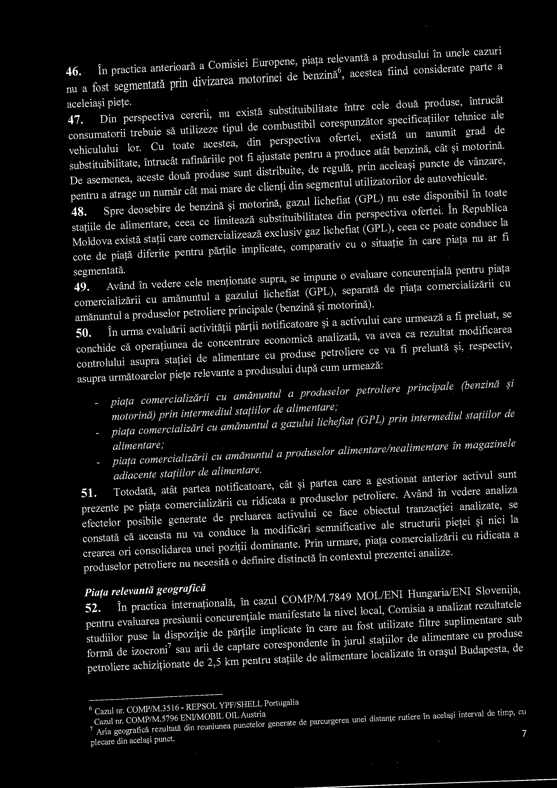
46. . In practica anterioara a Comisiei Europene, piata relevanta a produsului 11 unele cazuri 
nu a fost segmentata prin divizarea motorinei de benzina 6, acestea fiind considerate parte a 
piete. 
47. 
Din perspectiva cererii, nu exista substituibilitate intre cele doua produse, intrucat 
consumatorii trebuie sa utilizeze tipul de combustibil corespunzator specificatiilor tehnice ale 
vehiculului lor. Cu toate acestea, din perspectiva ofertei, exista un anumit grad de 
substituibilitate, intrucat rafinariile pot fi ajustate pentru a produce atat benzina, cat 
motorina. 
De asemenea, aceste doua produse sunt distribuite, de regula, prin 
puncte de vanzare, 
pentru a atrage un numar cat mai mare de clienti din segmentul utilizatorilor de autovehicule. 
48. 
Spre deosebire de benzina 
motorina, gazul lichefiat (GPL) nu este disponibil in toate 
statiile de alimentare , ceea ce limiteaza substituibilitatea din perspectiva ofertei. In Republica 
Moldova exista statii care comercializeaza exclusiv gaz lichefiat (GPL), ceea ce poate conduce la 
cote de piata diferite pentru paqile implicate , comparativ cu o situatie in care piata nu ar fi 
segmentata. 
49. 
Avand in vedere cele mentionate supra, se impune o evaluare concurentiala pentru piata 
comercializarii cu amanuntul a gazului lichefiat (GPL), separata de piata comercializi'irii cu 
amanuntul a produselor petroliere principale (benzina 
motorina). 
50. 
In urma evaluarii activitatii partii notificatoare 
a activului care urmeaza a fi preluat , se 
conchide ca operatiunea de concentrare economica analizata, va avea ca rezultat modificarea 
controlului asupra statiei de alimentare cu produse petroliere ce va fi preluata 
respectiv , 
asupra urmatoarelor piete relevante a produsului dupa cum urmeaza: 
piafa comercializarii cu amanuntul a produselor petroliere prin cipale (benzina 9i 
motorina) prin intermediul stafiilor de alimentare ,· 
piafa comercializari cu amanuntul a gazului lichefiat (GPL) prin intermediul stafiilor de 
alimentare; 
piafa comercializarii cu amanuntul a produselor alimentar e/nealimentare fn magazin ele 
adiacente stafiilor de alimentare . 
51. 
Totodata, atat partea notificatoare, cat 
partea care a gestionat anterior activul sunt 
prezente pe piata comercializarii cu ridicata a produselor petroliere. A vand in vedere analiza 
efectelor posibile generate de preluarea activului ce face obiectul tranzactiei analizate, se 
constata ca aceasta nu va conduce la modificari semnificative ale structurii pietei 
nici Ia 
crearea ori consolidarea unei pozitii dominante. Prin unnare , piata comercializi'irii cu ridicata a 
produselor petroliere nu necesita o definire distincta in contextul prezentei analize. 
Piaf a relevanta geografica 
52. 
In practica internationala , in cazul COMP/M.7849 MOL/ENI Hungaria/ENI Slovenija, 
pentru evaluarea presiunii concurentiale manifestate la nivel local, Comisia a analizat rezultatele 
studiilor puse la dispozitie de partile implicate in care au fost utilizate filtre suplimentare sub 
forma de izocroni 7 sau arii de captare corespondente in jurul statiilor de alimentare cu produse 
petroliere achizitionate de 2,5 km pentru statiile de alimentare localizate in 
Budapesta , de 
6 Cazul nr. COMP/M.3516 - REPSOL YPF/SHELL Portugalia 
Cazul nr. COMP/M.5796 ENI/MOBIL OIL Austria 
7 Aria geografica rezultata din reuniune a punctelor generate de parcurgerea unei distante rutiere In acela<?i interval de timp, cu 
plecare din acelaiii punct. 
7 

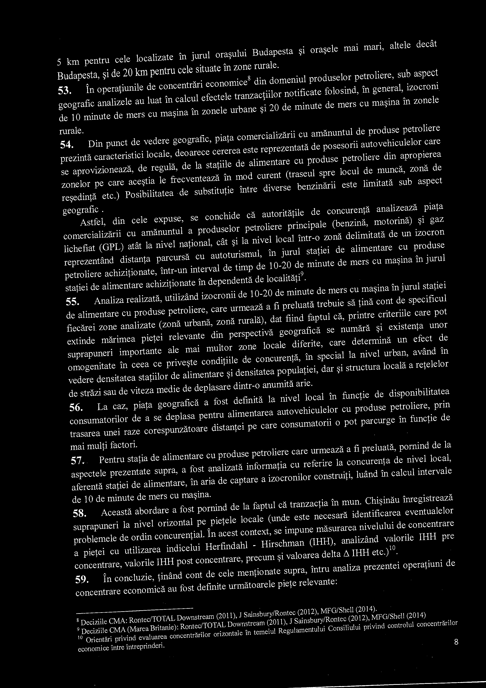
5 km pentru cele localizate in jurul 
Budapesta 
mai mari, altele decat 
Budapesta, 
de 20 km pentru cele situate in zone rurale. 
53. 
In operatiunile de concentrari economice 8 din domeniul produselor petroliere, sub aspect 
geografic analizele au luat in calcul efectele tranzactiilor notificate folosind, ill general, izocroni 
de 10 minute de mers cu 
in zonele urbane 
20 de minute de mers cu 
ill zone le 
rurale. 
54. 
Din punct de vedere geografic, piata comercializarii cu amanuntul de produse petroliere 
prezinta caracteristici locale, deoarece cererea este reprezentata de posesorii autovehiculelor care 
se aprovizioneaza, de regula, de la statiile de alimentare cu produse petroliere din apropierea 
zonelor pe care 
le frecventeaza in mod curent (traseul spre locul de munca, zona de 
etc.) Posibilitatea de substitutie illtre diverse benzinarii este limitata sub aspect 
geografic . 
Astfel, din cele expuse, se conchide ca autoritatile de concurenta analizeaza piata 
comercializarii cu amanuntul a produselor petroliere principale (benzina, motorina) 
gaz 
lichefiat (GPL) atat la nivel national, cat 
la nivel local illtr-o zona delimitata de un izocron 
reprezentand distanta parcursa cu autoturismul, in jurul statiei de alimentare cu produse 
petroliere achizitionate, intr-un interval de timp de 10-20 de minute de mers cu 
ill jurul 
statiei de alimentare achizitionate in dependenta de localitati 9. 
55. 
Analiza realizata, utilizand izocronii de 10-20 de minute de mers cu 
ill jurul statiei 
de alimentare cu produse petroliere, care urmeaza a fi preluata trebuie sa tina cont de specificul 
fiecarei zone analizate (zona urbana, zona rurala), dat fiind faptul ca, printre criteriile care pot 
extinde marimea pietei relevante din perspectiva geografica se numara 
existenta unor 
suprapuneri importai.'1.te ale mai multor zone locale diferite, care determina un efect de 
omogenitate in ceea ce privqte conditiile de concurenta, ill special la nivel urbaµ, avand in 
vedere densitatea statiilor de alimentare 
densitatea populatiei, dar 
structura locala a retelelor 
de strazi sau de viteza medie de deplasare dintr-o anumita arie. 
56. 
La caz, piata geografica a fost definita la nivel local ill functie de disponibilitatea 
consumatorilor de a se deplasa pentru alimentarea autovehiculelor cu produse petroliere, prin 
trasarea tmei raze corespunzatoare distantei pe care consumatorii o pot parcurge ill functie de 
mai multi factori. 
57. 
Pentru statia de alimentare cu produse petroliere care urmeaza a fi preluata , pomind de la 
aspectele prezentate supra, a fost analizata informatia cu referire la concurenta de nivel local, 
aferenta statiei de alimentare, in aria de captare a izocronilor construiti , luand ill calcul intervale 
de 10 de minute de mers cu 
58. 
Aceasta abordare a fost pornind de la faptul ca tranzactia ill mun. 
inregistreaza 
suprapuneri la nivel orizontal pe pietele locale (unde este necesara identificarea eventualelor 
problemele de ordin concurential. in acest context, se in1pune masurarea nivelului de concentrare 
a pietei cu utilizarea indicelui Herfindahl - Hirschman (IHH), analizand valorile IHH pre 
concentrare, valorile IHH post concentrare , precum 
valoarea delta /1 IHH etc.) 10. 
59. 
in concluzie, tinand cont de cele mentionate supra, illtru analiza prezentei operatiuni de 
concentrate economica au fost definite urmatoarele piete relevante: 
8 Deciziile CMA: Rontec/TOTAL Downstream (2011), J Sainsbury/Rontec (2012), MFG/Shell (2014). 
9 Deciziile CMA (Marea Britanie): Rontec /TOTAL Downstream (2011), J Sainsbury/Rontec (2012), MFG/Shell (2014) 
10 Orientari privind evaluarea concentriirilor orizontale In temeiul Regulamentului Consiliului privind controlul concentriirilor 
economice !ntre !ntreprinderi . 
8 

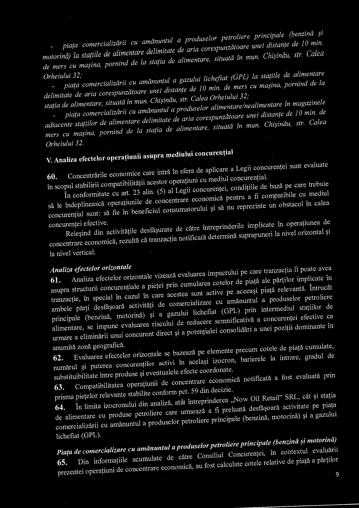
piafa comercializarii cu amanuntul a produselor petrolier e principal e (benzina 9i 
motorina) la stafiile de alimentare de/imitate de aria corespunzatoar e unei distanfe de I 0 min. 
de mers cu ma9ina, pornind de la stafia de alimentare , situata fn mun. Chi)iJinau, str. Calea 
Orheiului 32; 
piafa comercializarii cu amiinuntul a gazului lichefiat (GPL) la stafiile de alimentare 
de/imitate de aria corespunzatoare unei distanfe de I 0 min. de mers cu ma9ina, pornind de la 
stafia de alimentare, situata fn mun. Chi$inau, str. Calea Orheiului 32; 
piafa comercializarii cu amanuntul a produselor alimentare /nealimentare fn magazinele 
adiacente stafiilor de alimentare de/imitate de aria corespunzatoare unei distanfe de I 0 min. de 
mers cu ma9ina, pornind de la staff a de alimentare, situata fn mun. Chi$iniiu, str. Calea 
Orheiului 32. 
V. Analiza efectelor operafiunii asupra mediului concurenfial 
60. 
Concentrarile economice care intra in sfera de aplicare a Legii concurentei sunt evaluate 
in scopul stabilirii compatibilitatii acestor operatiuni cu mediul concurenfial. 
in conformitate cu art. 23 alin. (5) al Legii concurentei, conditiile de baza pe care trebuie 
sa le indeplineasca operatiunile de concentrare economica pentru a fi compatibile cu mediul 
concurential sunt: sa fie in beneficiul consumatorului 
sa nu reprezinte un obstacol in calea 
concurentei efective. 
din activitatile 
de catre intreprinderile implicate in operatiunea de 
concenfrare economica, rezulta ca tranzactia notificata determina suprapuneri la nivel orizontal 
la nivel vertical. 
Analiza efectelor orizontale 
61. 
Analiza efectelor orizontale vizeaza evaluarea impactului pe care tranzactia il poate avea 
asupra structurii concurentiale a pietei prin cumularea cotelor de piata ale pfu1:ilor implicate in 
tranzactie, in special in cazul in care acestea sunt active pe 
piata relevanta. Intrucat 
ambele parti 
activitati de comercializare cu amanuntul a produselor petroliere 
principale (benzina, motorina) 
a gazului lichefiat (GPL) prin intermediul statiilor de 
alimentare, se impune evaluarea riscului de reducere semnificativa a concurentei efective ca 
urmare a eliminarii unui concurent direct 
a potentialei consolidari a unei pozitii dominante in 
anumita zona geografica. 
62. 
Evaluarea efectelor orizontale se bazeaza pe elemente precum cotele de piata cumulate, 
numarul 
puterea concurentilor activi in 
izocron, barierele la intrnre, gradul de 
substituibilitate intre produse 
eventualele efecte coordonate. 
63. 
Compatibilitatea operatiunii de concentrare economica notificata a fost evaluata prin 
prisma pietelor relevante stabilite conform pct. 59 din decizie. 
64. 
in limita izocronului din analiza, atat intreprinderea ,,Now Oil Retail" SRL, cat 
statia 
de alimentare cu produse petroliere care urmeaza a fi preluata 
activitate pe piata 
cori1ercializarii cu amanuntul a produselor petroliere principale (benzina; motorina) 
a gazului 
lichefiat (GPL). 
Piaf a de comercializare cu amanuntul a produselor petroliere principale (benzina 
motorinii) 
65. 
Din informatiile acumulate de catre Consiliul Concurentei, in conteA.iul evaluarii 
' 
' 
. 
. 
prezentei operatiuni de concentrare economica, au fost calculate cotele relative de piata a partilor 
9 

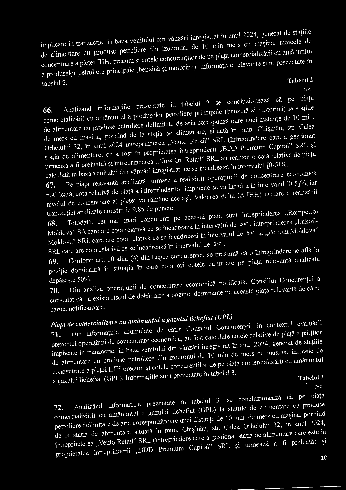
implicate in tranzactie, in baza venitului din vanzari illregistrat ln anul 2024, generat de statiile 
de alimentare cu produse petroliere din izocronul de 10 min mers cu 
indicele de 
concentrare a pietei IHH, precum 
cotele concurentilor de pe piata comercializarii cu amanuntul 
a produselor petroliere principale (benzina 
motorina). Informatiile relevante sunt prezentate 1n 
tabelul 2. 
Tabelul 2 
66. 
Analizand informatiile prezentate in tabelul 2 se concluzioneaza ca pe piata 
comercializarii cu amanuntul a produselor petroliere principale (benzina 
rnotorina) la statiile 
de alimentare cu produse petroliere delimitate de aria corespunzatoare unei distante de 10 min. 
de mers cu 
pornind de la statia de alimentare, situata 1n mun. 
str. Calea 
Orheiului 32, in anul 2024 intreprinderea ,,Vento Retail" SRL (mtreprindere care a gestionat 
statia de alimentare, ce a fost in proprietatea intreprinderii ,,BDD Premium Capital" SRL 
urmeaza a fi preluata) 
intreprinderea ,,Now Oil Retail" SRL au realizat o cota relativa de piata 
calculata in baza venitului din vanzari illregistrat, ce se incadreaza in intervalul [0-5]%. 
67. 
Pe piata relevanta analizata, urmare a realizarii operatiunii de concentrare economica 
notificata, cota relativa de piata a mtreprinderilor implicate se va incadra in intervalul [0-5]%, iar 
nivelul de concentrare al pietei va ramane 
Valoarea delta (L1 IHH) urmare a realizarii 
tranzactiei analizate constituie 9,85 de puncte. 
68. 
Totodata, cei mai mari concurenti pe aceasta piata sunt intreprinderea ,,Rompetrol 
Moldova" SA care are cota relativa ce se incadreaza in intervalul de 
intreprinderea ,,Lukoil-
Moldova" SRL care are cota relativa ce se incadreaza in intervalul de 
,,Petrom Moldova" 
SRL care are cota relativa ce se incadreaza 1n intervalul de 
. 
69. 
Conform art. 10 alin. ( 4) din Legea concurentei, se prezuma ca o mtreprindere se afla in 
pozitie dominanta in situatia 1n care cota ori cotele cumulate pe piata relevanta analizata 
50%. 
70. 
Din analiza operatiunii de concentrare economica notificata, Consiliul Concurentei a 
constatat ca nu exista riscul de dobandire a pozitiei dominante pe aceasta piata relevanta de catre 
partea notificatoare. 
Pia/a de comercializare cu amiinuntul a gazului lichefiat (GPL) 
71. 
Din informatiile acumulate de catre Consiliul Concurentei, in contextul evaluarii 
prezentei operatiuni de concentrare economica, au fost calculate cotele relative de piata a partilor 
implicate in tranzacjie, in baza venitului din vanzari inregistrat ln anul 2024, generat de statiile 
de alimentare cu produse petroliere din izocronul de 10 min de mers cu 
indicele de 
concentrare a pietei IHH precum 
cotele concurentilor de pe piata comercializarii cu amanuntul 
a gazului lichefiat (GPL). Informatiile sunt prezentate in tabelul 3. 
Tabelul 3 
72. 
Analizand informatiile prezentate in tabelul 3, se concluzioneaza ca pe piata 
cornercializarii cu amanuntul a gazului lichefiat (GPL) la statiile de alimentare cu produse 
petroliere delirnitate de aria corespunzatoare unei distante de 10 min. de mers cu 
pornind 
de la statia de alimentare situata in mun. 
str. Calea Orheiului 32, in anul 2024, 
intreprinderea ,,Vento Retail" SRL (lntreprindere care a gestionat statia de alirnentare care este in 
proprietatea intreprinderii ,,BDD Premium Capital" SRL 
urmeaza a fi preluata) 
10 

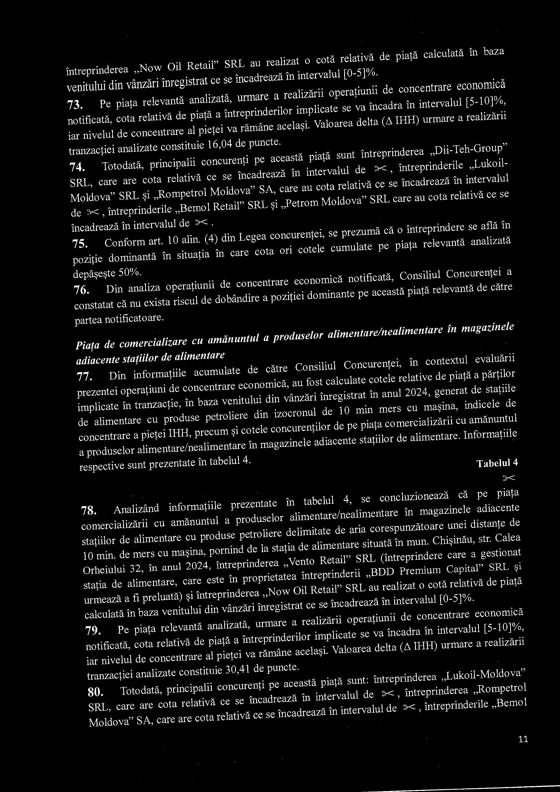
intreprinderea ,,Now Oil Retail" SRL au realizat o cota relativa de piata calculata in baza 
venitului din vanzari inregistrat ce se incadreaza in intervalul [0-5]%. 
73. 
Pe piata relevanta analizata, urmare a realizarii operatiunii de concentrare economica 
notificata, cota relativa de piata a intreprinderilor implicate se va incadra in intervalul [5-10]%, 
iar nivelul de concentrare al pietei va ramane 
Valoarea delta (.0. IHH) urmare a realizarii 
tranzactiei analizate constituie 16,04 de puncte. 
74. 
Totodata, principalii concurenti pe aceasta piata sunt intreprinderea ,,Dii-Teh-Group" 
SRL, care are cota relativa ce se incadreaza in intervalul de :x:, intreprinderile ,,Lukoil-
Moldova" SRL 
,,Rompetrol Moldova" SA, care au cota relativa ce se incadreaza in intervalul 
de ?<, intreprinderile ,,Bemol Retail" SRL 
,,Petrom Moldova" SRL care au co ta relativa ce se 
incadreaza in intervalul de :x: . 
75. 
Conform art. 10 alin. ( 4) din Legea concurentei, se prezuma ca o intreprindere se afla in 
pozitie dominanta in situatia in care cota ori cotele cumulate pe piata relevanta analizata 
50%. 
76. 
Din analiza operatiunii de concentrare economica notificata, Consiliul Concurentei a 
constatat ca nu exista riscul de dobandire a pozitiei dominante pe aceasta piata relevanta de catre 
partea notificatoare. 
Piafa de comercializare cu amiinuntul a produselor alimentare/nealimentare in magazinele 
adiacente stafiilor de alimentare 
77. 
Din informatiile acumulate de catre Consiliul Concurentei, in contextul evaluarii 
prezentei operatiuni de concentrare economica, au fost calculate cotele relative de piata a partilor 
implicate in tranzactie, !n baza venitului din vanzari inregistrat in anul 2024, generat de statiile 
de alimentare cu produse pctroliere din izocronul de 10 min mers cu 
indicele de 
concentrare a pietei IHH, precum 
cotele concurentilor de pe piata comercializarii cu amanuntul 
a produselor alimentare /nealimentare in magazinele adiacente statiilor de alimentare. Informatiile 
respective sunt prezentate in tabelul 4. 
Tabelul 4 
:x: 
78. 
Analizand informatiile prezentate in tabelul 4, se concluzioneaza 
ca pe piata 
comercializarii cu amanuntul a produselor alimentare/nealimentare in magazinele adiacente 
statiilor de alimentare cu produse petroliere delimitate de aria corespunzatoare unei distante de 
10 min. de mers cu 
pornind de la statia de alimentare situata in mun. 
str. Calea 
Orheiului 32, In anul 2024, intreprinderea ,,Vento Retail" SRL (intreprindere care a gestionat 
statia de alirnentare, care este in proprietatea intreprinderii ,,BDD Premium Capital" SRL 
urmeaza a fi preluata) 
intreprinderea ,,Now Oil Retail" SRL au realizat o cota relativa de piata 
calculata in baza venitului din vanzari inregistrat ce se incadreaza in intervalul [0-5]%. 
79. 
Pe piata relevanta analizata, urmare a realizarii operatiunii de concentrare economica 
notificata, cota relativa de piata a intreprinderilor implicate se va incadra in intervalul [ 5-10]%, 
iar nivelul de concentrare al pietei va ramane 
Valoarea delta (.0. IHH) urmare a realizarii 
tranzactiei analizate constituie 30,41 de puncte. 
80. 
Totodata, principalii concurenti pe aceasta piata sunt: intreprinderea ,,Lukoil-Moldova" 
SRL, care are cota relativa ce se incadreaza !n intervalul de :x:, intreprinderea ,,Rompetrol 
Moldova" SA, care are cota relativa ce se incadreaza in intervalul de :x: , intreprinderile ,,Bemol 
11 

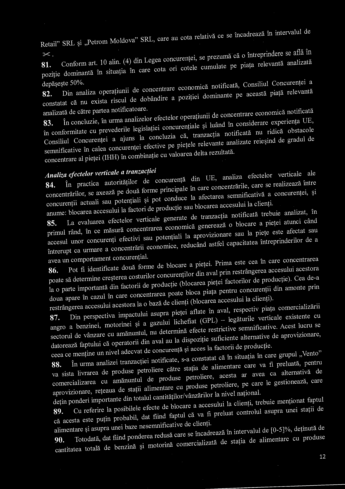
Retail" SRL 
,,Petrom Moldova" SRL, care au cota relativa ce se illcadreaza ill intervalul de 
x
. 
81. 
Conform art. 10 alin. ( 4) din Legea concurentei, se prezuma ca o intreprindere se afla in 
pozitie dominanta in situatia in care cota ori cotele cumulate pe piata relevanta analizata 
50%. 
82. 
Din analiza operatiunii de concentrare economica notificata, Consiliul Concurentei a 
constatat ca nu exista riscul de dobandire a pozitiei dominante pe aceasta piata relevanta 
analizata de catre partea notificatoare. 
83. 
in concluzie, ill urma analizelor efectelor operatiunii de concentrare economica notificata 
in conformitate cu prevederile legislatiei concurentiale 
luand ill considerare experienta UE, 
Consiliul Concurentei a ajuns la concluzia ca, tranzactia notificata nu ridica obstacole 
semnificative in calea concurentei efective pe pietele relevante analizate reiqind de gradul de 
concentrare al pietei (IHH) in combinatie cu valoarea delta rezultata. 
Analiza efectelor verticale a tranzacfiei 
84. 
In practica autoritatilor de concurenta din UE, analiza efectelor verticale ale 
concentrarilor, se axeaza pe doua forme principale in care concentrarile, care se realizeaza illtre 
concurentii actuali sau potentiali 
pot conduce la afectarea semnificativa a concurentei, 
anume: blocarea accesului la factori de productie sau blocarea accesului la clienti. 
85. 
La evaluarea efectelor verticale generate de tranzactia notificata trebuie analizat, in 
primul rand, ill ce masura concentrarea economica genereaza o blocare a pietei atunci cand 
accesul unor concurenti efectivi sau potentiali la aprovizionare sau la piete este afectat sau 
intrerupt ca urmare a concentrarii economice, reducand astfel capacitatea intreprinderilor de a 
avea un comportament concurential. 
86. 
Pot fi identificate doua forme de blocare a pietei. Prima este cea ill care concentrarea 
poate sa determine 
costurilor concurentilor din aval prin restrangerea accesului acestora 
la o parte importanta din factorii de productie (blocarea pietei factorilor de productie). Cea de-a 
doua apare ill cazul ill care concentrarea poate bloca piata pentru concurentii din amonte prin 
restrangerea accesului acestora la o baza de clienti (blocarea accesului la clienti). 
87. 
Din perspectiva impactului asupra pietei aflate ill aval, respectiv piata comercializarii 
angro a benzinei, motorinei 
a gazului lichefiat (GPL) - legaturile verticale existente cu 
sectorul de vanzare cu amanuntul, nu determina efecte restrictive semnificative . Acest lucru se 
datoreaza faptului ca operatorii din aval au la dispozitie suficiente alternative de aprovizionare, 
ceea ce mentine un nivel adecvat de concurenta 
acces la factorii de productie. 
88. 
In urma analizei tranzactiei notificate, s-a constatat ca ill situatia ill care grupul ,,Vento" 
va sista livrarea de produse petroliere catre statia de alimentare care va fi preluata, pentru 
comercializarea cu amanuntul de produse petroliere, acesta ar avea ca alternativa de 
aprovizionare, reteaua de statii alimentare cu produse petroliere, pe care le gestioneaza, care 
detin ponderi importante din totalul cantitatilor/vanzarilor la nivel national. 
89. 
Cu referire la posibilele efecte de blocare a accesului la clienti, trebuie mentionat faptul 
ca acesta este putin probabil, dat fiind faptul ca va fi preluat controlul asupra unei statii de 
alimentare 
asupra unei baze nesemnificative de clienti. 
90. 
Totodata, dat fiind ponderea redusa care se illcadreaza ill intervalul de [0-5]%, detinuta de 
cantitatea totala de benzina 
motorina comercializata de statia de alimentare cu produse 
12 

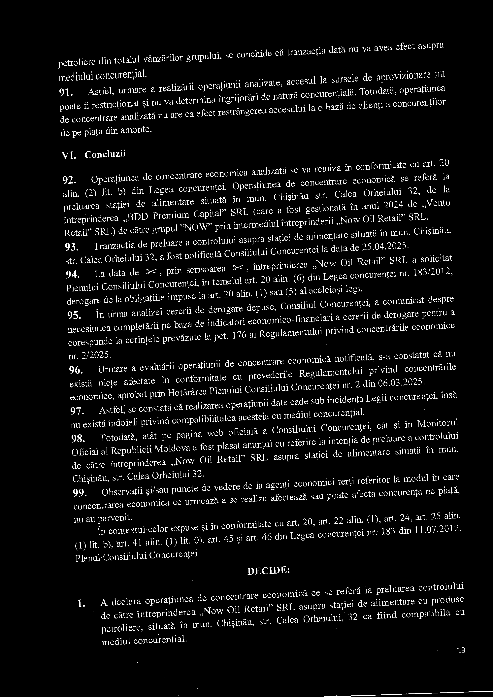
petroliere din totalul vanzarilor grupului, se conchide ca tranzactia data nu va avea efect asupra 
mediului concurential. 
91. 
Astfel, urmare a realizarii operatiunii analizate, accesul la sursele de aprovizionare nu 
poate fi restrictionat 
nu va determina ingrijorari de natura concurentiala. Totodata, operatiunea 
de concentrare analizata nu are ca efect restrangerea accesului la o baza de clienti a concurentilor 
de pe piata din amonte. 
VI. Concluzii 
92. 
Operatiunea de concentrare economica analizata se va realiza in conformitate cu art. 20 
alin. (2) lit. b) din Legea concurentei. Operatiunea de concentrare economica se refera la 
preluarea statiei de alimentare situata in mun. 
str. Calea Orheiului 32, de la 
intreprinderea ,,BDD Premium Capital" SRL (care a fost gestionata in anul 2024 de ,,Vento 
Retail" SRL) de catre grupul "NOW" prin intermediul intreprinderii ,,Now Oil Retail" SRL. 
93. 
Tranzactia de preluare a controlului asupra statiei de alimentare situata in mun. 
str. Calea Orheiului 32, a fost notificata Consiliului Concurentei la data de 25.04.2025. 
94. 
La data de 
prin scrisoarea 
intreprinderea ,,Now Oil Retail" SRL a solicitat 
Plenului Consiliului Concurentei, in temeiul art. 20 alin. ( 6) din Legea concurentei nr. 183/2012, 
derogare de la obligatiile impuse la art. 20 alin. (1) sau (5) al 
legi. 
95. 
In urma analizei cererii de derogare depuse, Consiliul Concurentei, a comunicat despre 
necesitatea completarii pe baza de indicatori economico-financiari a cererii de derogare pentru a 
corespunde la cerintele prevazute la pct. 176 al Regulamentului privind concentrarile economice 
nr. 2/2025. 
96. 
Urmare a evaluarii opera1iunii de concentrare economica notificata, s-a constatat ca nu 
exista piete afectate in conformitate cu prevederile Regulamentului privind concentrarile 
economice, aprobat prin Hotararea Plenului Consiliului Concurentei nr. 2 din 06.03.2025. 
97. 
Astfel, se constata ca realizarea operatiunii date cade sub incidenta Legii concurentei, 1nsa 
nu exista indoieli privind compatibilitatea acesteia cu mediul concurential. 
98. 
Totodata , atat pe pagina web oficiala a Consiliului Concurentei , cat 
in Monitorul 
Oficial al Republicii Moldova a fost plasat anuntul cu referire la intentia de preluare a controlului 
de catre intreprinderea ,,Now Oil Retail" SRL asupra statiei de alimentare situata in mun. 
str. Calea Orheiului 32. 
99. 
Observatii 
puncte de vedere de la agenti economici terti referitor la modul in care 
concentrarea econornica ce urmeaza a se realiza afecteaza sau poate afecta concurenta pe piata, 
nu au parvenit. 
In contextul celor expuse 
in conformitate cu art. 20, art. 22 alin. (1 ), art. 24, art. 25 alin. 
(1) lit. b), art. 41 alin. (1) lit. 0), art. 45 
art. 46 din Legea concurentei nr. 183 din 11.07.2012 , 
Plenul Consiliului Concurentei 
DECIDE: 
1. 
A declara operatiunea de concentrare economica ce se refera la preluarea controlului 
de catre intreprinderea ,,Now Oil Retail" SRL asupra statiei de alimentare cu produse 
petroliere, situata in mun. 
str. Calea Orheiului, 32 ca fiind compatib ila cu 
mediul concurential. 
13 

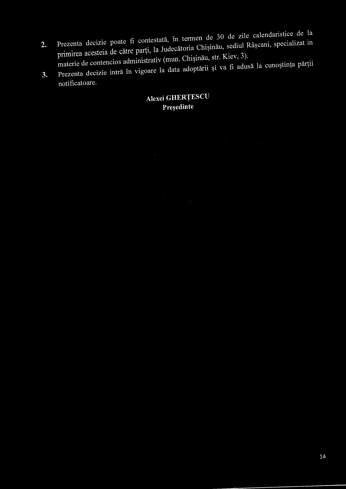
2. 
Prezenta decizie poate fi contestata, in termen de 30 de zile calendaristice de la 
primirea acesteia de catre parti, la Judecatoria 
sediul 
specializat in 
materie de contencios administrativ (mun. 
str. Kiev, 3). 
3. 
Prezenta decizie intra in vigoare la data adoptarii $i va fi adusa la cuno$tinta partii 
notifi catoare. 
Alexei GHERTESCU 
14 
