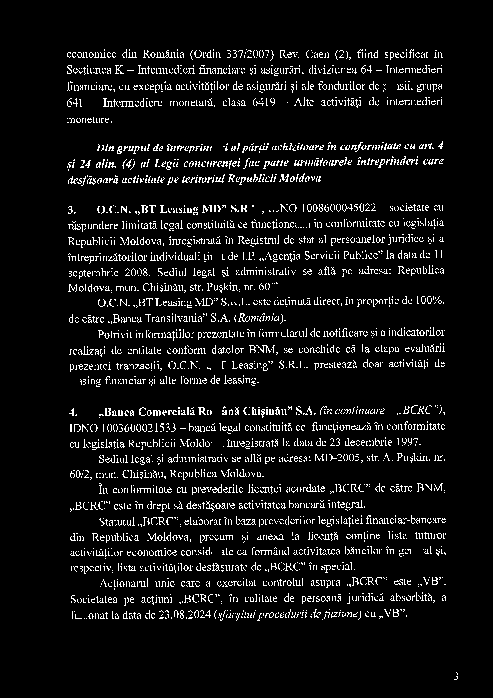
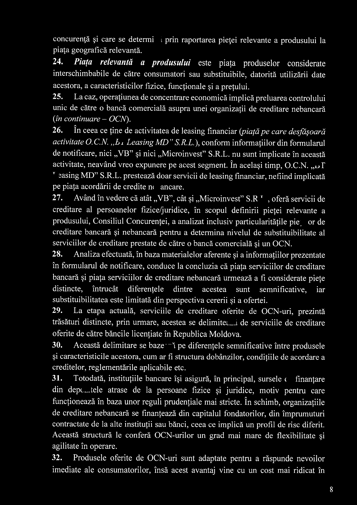
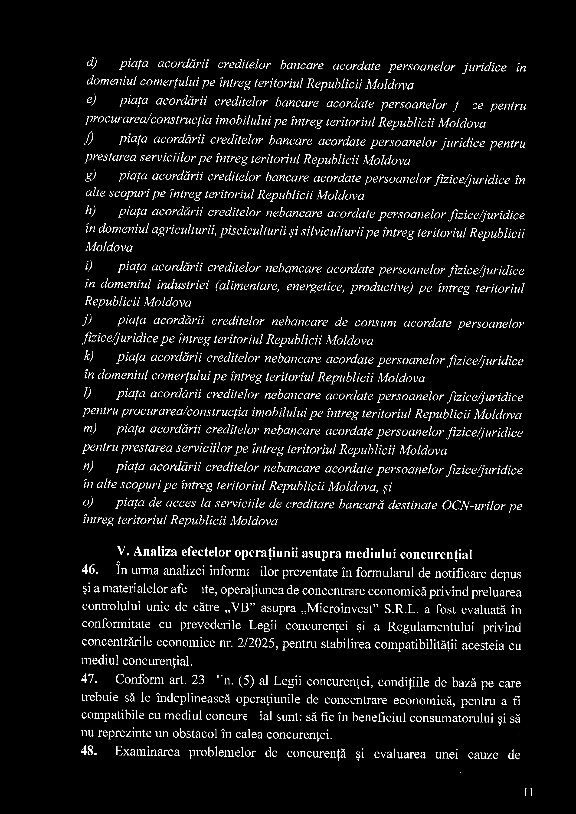
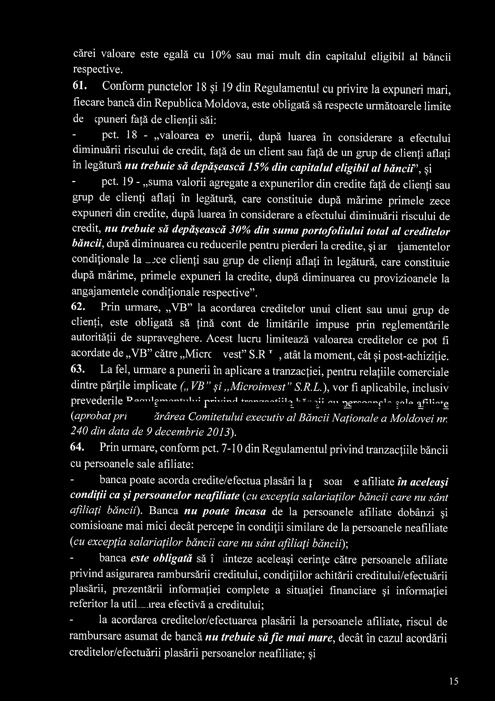
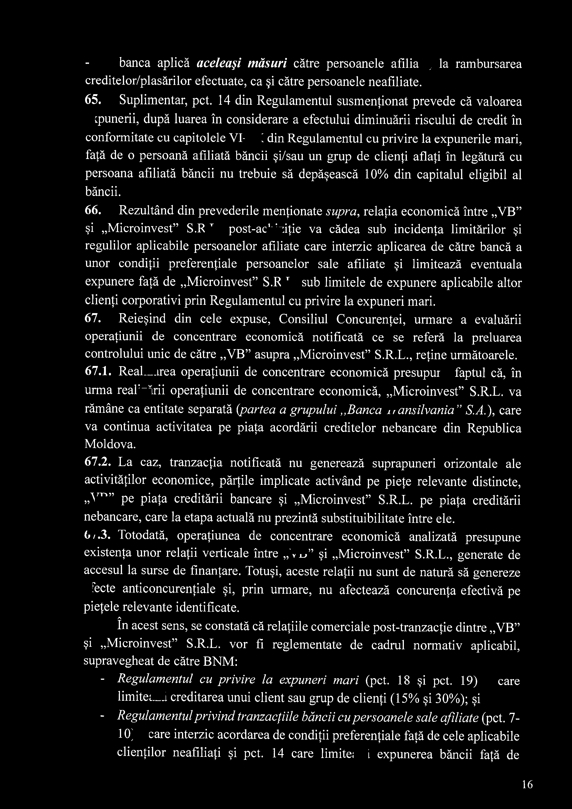
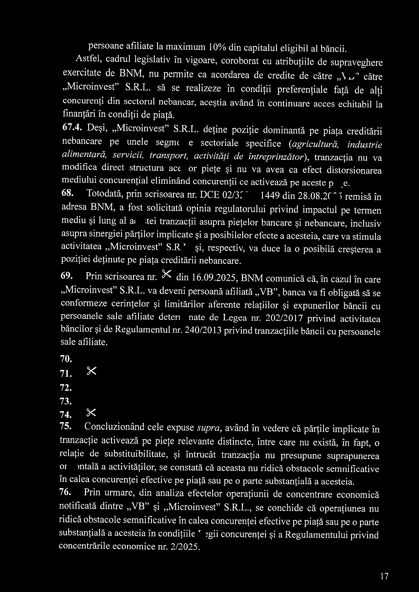
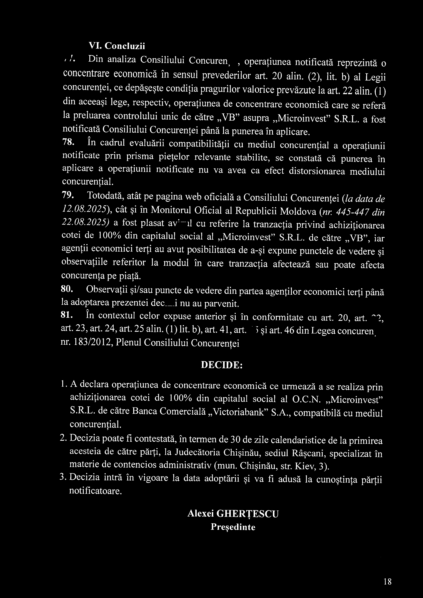

PLENUL 
CONSILIULUI CONCURENTEI 
MD- 2068, Republica Moldova, mun. C hi ~ in liu , str. Alecu Russo, I 
E-mail: office@competition.md; www.competition. 
DECIZIE 
mun. Chisinau 
' 
nr. DCE-29 
din 18.09.2025 
Plenul Consiliului Concurentei, 
actionand in temeiul art. 41 din Legea concurentei nr. 183 din 11.07.2012 
republicata, cu modificarile ~i completarile ulterioare (in continuare - Legea 
concurenfei), Hotararii Parlamentului nr. 33/2022 privind numirea in functie a 
unui membru 
~i pre~edinte al Plenului Consiliului Concurentei, Hotararii 
Parlamentului nr. 380/2023 privind numirea in functia de vicepre~edinte al 
Plenului Consiliului Concurentei, Hotararii Parlamentului nr. 210/2024 privind 
numirea in functia de 
vicepre~edinte al Plenului Consiliului Concurentei, 
Hotararii Parlamentului nr. 381/2023 privind numirea in funqia de membru al 
Plenului Consiliului Concurentei ~i Hotararii Parlamentului nr. 21112024 privind 
numirea in functia de membru al Plenului Consiliului Concurentei, 
analizand formularul complet privind notificarea unei concentrari 
economice inregistrat cu numarul de intrare 2581 din 20.05.2025 ~i materialele 
aferente acumulate in cadrul examinarii notificarii parvenite prin scrisorile 
inregistrate cu numarul de intrare 2789 din 13.06.2025, nr. 2901 din 25.06.2025, 
nr. 3137 din 23.07.2025, nr. 3301 din 08.08.2025 ~i nr. 3304 din 08.08.2025 
A CONSTATAT: 
La data de 20.05.2025, prin formularul de notificare inregistrat cu numarul 
de intrare 2581, B.C. ,,Victoriabank" S.A., 1 a notificat, in conformitate cu art. 20 
alin. (2) lit. b) din Legea concurentei ~i pct. 9.2. din Regulamentul privind 
concentrarile economice aprobat, prin Hotararea Plenului Consiliului Concurentei 
nr. 2 din 06.03 .2025 (in continuare - Regulamentul privind concentrarile 
economice nr. 212025), concentrarea economica ce urmeaza a se realiza prin 
achizitionarea a 100% din capitalul social al O.C.N. ,,Microinvest" S.R.L. 
Notificarea a devenit efectiva la data de 08.08.2025, data la care au fost 
receptionate 
~i inregistrate la Consiliul Concurentei ultimele informatii ce 
confirma caracterul exact ~i complet al notificarii. 
1 Prin intennediul reprezentantului desemnat conform Procurii Nr. 709/RP din 16.05.2025 

I. Partile implicate la operatiunea de concentrare economica 
Partea achizitoare: 
1. 
Banca Comerciala ,,Victoriabank" S.A. (in continuare - ,, VB"), IDNO 
1002600001338 - banca legal constituita ce functioneaza in conformitate cu 
legislatia Republicii Moldova, inregistrata in Registrul de stat al persoanelor 
juridice ~i a intreprinzatorilor individuali tinut de LP. ,,Agentia Servicii Publice" 
la data de 22 februarie 1990. Sediul legal ~i administrativ se afla pe adresa: MD-
2004, str. 31August1989, nr. 141, mun. Chi~inau, Republica Moldova. 
Potrivit licentei acordate ,,VB" de catre Banca Nationala a Moldovei (in 
continuare - BNM), ,,VB" este in drept sa des:fa~oare activitatea bancara integral. 
Statutul ,,VB", elaborat in baza prevederilor legislatiei financiar-bancare din 
Republica Moldova, precum ~i anexa la licenta contine lista tuturor activitatilor 
economice considerate ca formand activitatea bancilor in general ~i, respectiv, 
lista activitatilor des:fa~urate de ,, VB". 
Aditional, ,,VB" detine licenta de societate de investitii de categoria ,,C" cu 
dreptul de a des:fa~ura serviciile ~i activitatile de investitii acordata de catre 
Comisia Nationala a Pietei Financiare. 
' 
' 
Structura actionarilor ,,VB" este prezentata in tabelul 1. 
Tabelul 1 
Actionariatul ,,VB" la data depunerii formularului de notificare 
Nr. 
Numele persoanei fizice!juridice inregistratii in calitate de 
Cota, (%) ac(ionarilor in 
ac(ionar 
cadrul societii(ii VB 
1 
VB Investment Holdings B.V.2 
72,19 
2 
Turcan Victor 
10,76 
3 
Turcan Valentina 
8,07 
4 
Artemenco Elena 
4,95 
5 
Prodisvet Galina 
1,58 
6 
Alfii 
2,45 
Sursa: Elaborat de Consiliul Concurenfei in baza date/or rejlectate informularul comp/et de notificare 
Conform formularului de notificare, ,,Banca Transilvania" S.A. (Romania), 
prin intermediul societatii ,,VB Investment Holding B.V." ( X ), detine pachetul 
majoritar de actiuni ~i exercita controlul asupra ,,VB". 
2. 
,,Banca Transilvania" S.A. - banca legal constituita ce functioneaza in 
conformitate cu legislatia Romaniei, inregistrata la data de 16 decembrie 1993 in 
Registrul Comertului sub nr. de ordine J12/4155/1993 
~i Codul Unic de 
Inregistrare (CUI) 5022670. Sediul legal ~i administrativ se afla pe adresa: 
municipiul Cluj-Napoca, str. George Baritiu, nr. 8, Judetul Cluj, Romania. 
Conform Actului constitutiv al Bancii Transilvania S.A. - obiectul principal 
de activitate al acesteia este determinat conform codificarii activitatilor 
2 VB Investment Holdings B. V. - adresajuridica: Westerdoksdijk 423, 10 l 3BX, Amsterdam, Olanda, IDNO 62931601 
2 

econom1ce din Romania (Ordin 337/2007) Rev. Caen (2), fiind specificat in 
Sectiunea K - Intermedieri financiare ~i asigurari, diviziunea 64 - Intermedieri 
financiare, cu exceptia activitatilor de asigurari ~i ale fondurilor de pensii, grupa 
641 -
Intermediere monetara, clasa 6419 - Alte activitati de intermedieri 

' 
monetare. 
Din grupul de intreprinderi al par(ii achizitoare In conformitate cu art. 4 

~i 24 alin. (4) al Legii concurenfei Jae parte urmatoarele intreprinderi care 
desfii~oarii activitate pe teritoriul Republicii Moldova 

3. 
O.C.N. ,,BT Leasing MD" S.R.L., IDNO 1008600045022 - societate cu 
raspundere limitata legal constituita ce functioneaza in conformitate cu legislatia 
Republicii Moldova, inregistrata in Registrul de stat al persoanelor juridice ~i a 
intreprinzatorilor individuali tinut de I.P. ,,Agentia Servicii Publice" la data de 11 
septembrie 2008. Sediul legal 
~i administrativ se afla pe adresa: Republica 
Moldova, mun. Chi~inau, str. Pu~kin, nr. 60/2. 

O.C.N. ,,BT Leasing MD" S.R.L. este detinuta direct, in proportie de 100%, 
de catre ,,Banca Transilvania" S.A. (Romania). 
Potrivit informatiilor prezentate in formularul de notificare ~i a indicatorilor 
realizati de entitate conform datelor BNM, se conchide ca la etapa evaluarii 
prezentei tranzactii, O.C.N. ,,BT Leasing" S.R.L. presteaza doar activitati de 
leasing financiar ~i alte forme de leasing. 

4. 
,,Banca Comerciala Romana Chi~inau" S.A. (in continuare - ,,BCRC''), 
IDNO 1003600021533 - banca legal constituita ce functioneaza in conformitate 
cu legislatia Republicii Moldova, inregistrata la data de 23 decembrie 1997. 

Sediul legal ~i administrativ se afla pe adresa: MD-2005, str. A. Pu~kin, nr. 
6012, mun. Chi~inau, Republica Moldova. 
in conformitate cu prevederile licentei acordate ,,BCRC" de catre BNM, 
,,BCRC" este in drept sa desra~oare activitatea bancara integral. 
Statutul ,,BCRC", elaborat in baza prevederilor legislatiei financiar-bancare 
din Republica Moldova, precum 
~i anexa la licenta contine lista tuturor 
activitatilor economice considerate ca formand activitatea bancilor in general ~i, 
respectiv, lista activitatilor desra~urate de ,,BCRC" in special. 

Actionarul unic care a exercitat controlul asupra ,,BCRC" este ,,VB". 
Societatea pe actiuni ,,BCRC", in calitate de persoana juridica absorbita, a 
fuzionat la data de 23.08.2024 (sfdr~itul procedurii de fuziune) cu ,,VB". 

3 

Partea achizitionata: 
' 
5. 
O.C.N. ,,Microinvest" S.R.L. (in continuare -
,, Microinvest" S.R.L.) 
IDNO 1003600053518 -
societate cu raspundere limitata inregistrata in 
conformitate cu legislatia Republicii Moldova la data de 29.03.2003. Sediul legal 
al intreprinderii se afla pe adresa: Republica Moldova, mun. Chi~inau, bd. 
Renasterii Nationale nr. 12. 
' 
' 
Asociatii 
intreprinderii 
,,Microinvest" 
S.R.L., 
la 
data 
depunerii 
formularului de notificare, sunt prezentati in tabelul 2. 
Tabelul 2 
Asociatii ,,Microinvest" S.R.L. la data depunerii formularului de notificare 
Nr. 
Numele persoanei fizice/juridice inregistratii in calitate de ac(ionar 
Cota, (%) asocia(ilor 
in cadrul societii(ii 
1 
x 
x 
2 
x 
x 
3 
x 
x 
4 
x 
x 
Sursa: Elaborat de Consiliul Concuren/ei in baza date/or reflectate informularul comp/et de notificare 
In conformitate cu Clasificatorul Activitatilor din Economia Moldovei - 2 
' 
(CAEM-2) ~i a actelor de constituire ale ,,Microinvest" S.R.L., genul principal de 
activitate este acordarea de credite nebancare. 
6. 
,,Microinvest Technology" S.R.L. IDNO 1023600031802 - societate cu 
raspundere limitata inregistrata in conformitate cu legislatia Republicii Moldova 
la data del4.06.2023. Sediul legal al intreprinderii se afla pe adresa: Republica 
Moldova, mun. Chi~inau, bd. Rena~terii Nationale nr. 12. 
Asociatul unic al intreprinderii ,,Microinvest Technology" S.R.L. este 
,,Microinvest" S.R.L., care detine 100% din capitalul social al acesteia. 
Scopul de baza al intreprinderii este X , beneficiind concomitent de 
regimul fiscal preferential acordat rezidentilor Parcului pentru tehnologia 
informatiei ,,Moldova IT Park" (,,MITP"). 
Astfel, dupa inregistrare, Microinvest Technology S.R.L. a devenit 
rezidentul MITP4. X . 
II. Descrierea operatiunii de concentrare economica 
7. 
Operatiunea de concentrare economica notificata urmeaza a se realiza in 
conformitate cu prevederile art. 20, alin. (2), lit. b) din Legea concurentei ~i 
pct. 9.2. din Regulamentul privind concentrarile economice nr. 2/2025 ~i se refera 
la intentia de achizitionare de catre ,,VB" a 1 OOo/o din capitalul social al 
,,Microinvest" S.R.L. 
4 

8. 
Conform formularului de notificare, operatiunea de concentrare economica 
notificata reflecta strategia investitionala a intreprinderii ,,Microinvest" S.R.L., 
care vizeaza atragerea partenerilor strategici ~i evaluarea periodica a eficientei 
operationale ~i a portofoliului de credite. In contextul acestor actiuni, asociatii 
,,Microinvest" S.R.L. au analizat optiunile de diversificare sau reorganizare a 
structurii corporative ~i au examinat eventualele oferte de parteneriat sau cesium! 
a participatiilor. 
9. 
Prin urmare, au fost initiate discutii cu potentiali investitori interesati de 
achizitionarea pachetului de actiuni ~i de continuarea dezvoltarii activitatilor de 
creditare nebancara desra~urate de ,,Microinvest" S.R.L. 
10. 
Partea notificatoare comunica ca, in baza unei analize detaliate a ofertelor 
prezentate de catre investitori, incluzand evaluarea conditiilor financiare, 
reputatiei investitorilor ~i impactului potential asupra activitatii ,,Microinvest" 
S.R.L., a fost selectata optiunea de cesiune a participatiei de capital catre un 
investitor strategic cu experienta semnificativa in domeniul serviciilor financiare. 
11. 
La data de 11 aprilie 2025, intre asociatii ,,Microinvest" S.R.L., in calitate 
de vanzatori, ~i ,,VB", in calitate de cumparator, a fost semnat contractul de 
vanzare-cumparare conditionat, prin care paqile au agreat, de principiu, termenii 
~i conditiile tranzactiei notificate, realizarea careia este conditionata de o serie de 
autorizatii ~i permisiuni ce urmeaza a fi obtinute de parti, inclusiv aprobarea de 
catre Plenul Consiliului Concurentei a operatiunii de concentrare economica 
notificata. 
12. 
Conform contractului de vanzare-cumparare agreat de catre paqile 
implicate, concentrarea economica notificata se va realiza sub forma dobandirii 
controlului unic direct de catre ,,VB", parte a Grupului Banca Transilvania S.A. 
(Romania), asupra ,,Microinvest" S.R.L., prin achizitionarea a 100% din capitalul 
social al intreprinderii. 
13. 
Urmare a realizarii operatiunii de concentrare economica notificata, 
controlul asupra intreprinderii ,,Microinvest" S.R.L. va fi exercitat de catre ,,VB". 
14. 
Structura asociatilor ,,Microinvest" S.R.L., pana la realizarea operatiunii 
propuse spre autorizare ~i dupa realizarea acesteia, este reflectata in tabelul 3. 
Tabelul 3 
Structura asociatilor ,,Microinvest" S.R.L. pana la realizarea operatiunii de 
concentrare economica ~i dupa realizarea acesteia 
Nr. 
Asociatul 
Cota parte, % 
Asociatul ,,Microinvest" S.R.L. pana la realizarea operatiunii de concentrare economica 
1. 
x 
x 
2. 
x 
x 
3. 
x 
x 
5 

4. 
I ~< 
I x 
Asociatul ,,Microinvest" S.R.L. dupa la realizarea operatiunii de concentrare economica 
1. 
I VB" 
,, 
I 
100 
Sursa: Elaborat de Consiliul Concurenfei in baza date/or reflectate informularul comp/et de notificare 
15. 
Conform informatiilor din formularul de notificare, X 
16. 
Scopul operatiunii de concentrare economica mentionat in formularul de 
notificare consta in extinderea bazei de clientela ~i consolidarea segmentului de 
creditare dedicat persoanelor fizice ~i intreprinderilor mici, prin intrarea pe piata 
creditelor nebancare. Tranzactia este 1n deplina concordanta cu misiunea 
strategica a grupului ,,Banca Transilvania" S.A., de a sustine mediul 
antreprenorial, de a promova incluziunea financiara ~i de a contribui activ la 
dezvoltarea sustenabila a economiei locale. 
III. Dimensiunea operatiunii de concentrare economica 
17. 
Operatiunile de concentrare economica conform art. 22 alin. (1) din Legea 
concurentei sunt supuse evaluarii 
~i urmeaza a fi notificate Consiliului 
Concurentei inainte de punerea in aplicare, atunci cand cifra mondiala totala de 
afaceri realizata cumulativ de intreprinderile implicate, inregistrata in anul 
anterior operatiunii, 
depa~e~te 50000000 de lei 
~i exista eel putin doua 
intreprinderi implicate in operatiune care au realizat pe teritoriul Republicii 
Moldova, fiecare in parte, o cifra totala de afaceri mai mare de 20000000 de lei in 
anul anterior operatiunii. 
18. 
Cifra totala de afaceri realizata de intreprinderile implicate se calculeaza 
conform prevederilor art. 24 alin. (4) din Legea concurentei. Potrivit art. 24 
alin. (2) din Legea concurentei, cifra de afaceri realizata pe teritoriul Republicii 
Moldova, cuprinde produsele vandute intreprinderilor sau direct consumatorilor 
din Republica Moldova. 
19. 
Avand in vedere specificul activitatii partilor implicate in tranzactie, ~i in 
conformitate cu art. 4 din Legea concurentei, in scopul calcularii cifrei de afaceri 
la bancile ~i institutiile care acorda imprumuturi cifra de afaceri este asimilata cu 
suma veniturilor aferente dobanzilor ~i suma veniturilor neaferente dobanzilor, 
dupa deducerea impozitelor ~i taxelor legate direct de acestea. 
20. 
In tabelul 4 este reflectata cifra totala de afaceri realizata in anul 2024 de 
catre partile implicate, calculata in conformitate cu prevederile art. 24 din Legea 
concurentei. 
' 
6 

Tabelul 4 
Cifra de afaceri realizata de catre intreprinderile implicate in tranzactie in anul 2024 
intreprinderile din grupul 
Cifra de af aceri 
Cifra de af aceri realizatd pe 
realizatd la nivel 
teritoriul Republicii Moldova, mii 
piir/ii achizitoare 
mondia/3, mii lei 
lei 
Nr. 
,,VB" 
x 
x 
1 
O.C.N. ,,BT Leasing" S.R.L. 
x 
x 
2 
B.C.R. ,, Chi~inau" S.A. 
x 
x 
3 
Grup ,,Banca Transilvania" 
x 
x 
S.A. 
4 
Total partea achizitoare 
x 
x 
intreprinderile din grupul 
Cifra de af aceri 
Cifra de af aceri realizatii pe 
realizatii la nivel 
teritoriul Republicii Moldova, mii 
piir/ii achizi/ionate 
mondial, mii lei 
lei 
Nr. 
0.C.N. ,,Microinvest" S.R.L. 
x 
x 
I 
,,Microinvest Tehnology" 
x 
x 
S.R.L. 
2 
Total partea achizitionata 
x 
x 
Total partile implicate in tranzactie 
x 
x 
Sursa: Elaborat de Consiliul Concurenfei in baza date/or rejlectate in f ormularul comp/et de notificare 
21. 
Operatiunea de concentrare economica indepline~te cumulativ conditiile de 
prag prevazute la art.22 alin.( 1) din Legea concurentei, intrucat cifra totala de 
afaceri realizata de intreprinderile implicate in operatiunea de concentrare 
economica in anul 2024, constituie X 
~i exista eel putin doua intreprinderi 
implicate in tranzactie care au realizat pe teritoriul Republicii Moldova, fiecare in 
parte, o cifra totala de afaceri mai mare de 20 000 000 lei, in anul anterior 
operatiunii. Aceste intreprinderi sunt ,,VB" ~i ,,Microinvest" S.R.L., care au 
realizat o cifra de afaceri de X ~i, respectiv X pe teritoriul Republicii Moldova. 
22. 
Astfel, se concluzioneaza ca, operatiunea notificata intrune~te cumulativ 
conditia pragurilor valorice prevazute la art. 22 alin. ( 1) din Legea concurentei. 
IV. Piata relevanta - piata relevanta a produsului ~i piata geografica 
relevanta 
23. 
Evaluarea unei concentrari economice prin prisma compatibilitatii acesteia 
cu mediul concurential poate avea loc dupa determinarea pietei relevante. in 
conformitate cu prevederile art. 4 din Legea concurentei, piata relevanta 
reprezinta piata in cadrul careia trebuie evaluata o anumita problema de 
3ln scopul calcularii cifrei de afaceri la nivelul mondial, pentru intreprinderile implicate, care este denominata in alte 
valute, decat MDL, a fost aplicat cursul oficial mediu al RON/MDL ~i, respectiv, EUR/MDL stabilit de BNM pentru 
anul 2024, dupa cum urmeaza: IRON =3,8702 MDL, respectiv 1 EUR =l 9,2533MDL 
7 

concurenta ~i care se determina prin raportarea pietei relevante a produsului la 
piata geografica relevanta. 
24. 
Pia{a relevantii a produsului este piata produselor considerate 
interschimbabile de catre consumatori sau substituibile, datorita utilizarii date 
acestora, a caracteristicilor fizice, functionale ~i a pretului. 
25. 
La caz, operatiunea de concentrare economica implica preluarea controlului 
unic de catre o banca comerciala asupra unei organizatii de creditare nebancara 
(fn continuare - OCN). 

26. 
In ceea ce tine de activitatea de leasing financiar (piafa pe care desfa~oara 
activitate 0 . C.N. ,,BT Leasing MD" S.R.L. ), conform informatiilor din formularul 
de notificare, nici ,,VB" ~i nici ,,Microinvest" S.R.L. nu sunt implicate in aceasta 
activitate, neavand vreo expunere pe acest segment. in acela~i timp, O.C.N. ,,BT 
Leasing MD" S.R.L. presteaza doar servicii de leasing financiar, nefiind implicata 
pe piata acordarii de credite nebancare. 

27. 
Avand in vedere ca atat ,,VB", cat ~i ,,Microinvest" S.R.L., ofera servicii de 
creditare al persoanelor fizice/juridice, in scopul definirii pietei relevante a 
produsului, Consiliul Concurentei, a analizat inclusiv particularitatile pietelor de 
creditare bancara ~i nebancara pentru a determina nivelul de substituibilitate al 
serviciilor de creditare prestate de catre o banca comerciala ~i un OCN. 
28. 
Analiza efectuata, in baza materialelor aferente ~i a informatiilor prezentate 
in formularul de notificare, conduce la concluzia ca piata serviciilor de creditare 
bancara ~i piata serviciilor de creditare nebancara urmeaza a fi considerate piete 
distincte, 
intrucat 
diferentele 
dintre 
acestea 
sunt 
semnificative, 
iar 
substituibilitatea este limitata din perspectiva cererii ~i a ofertei. 
29. 
La etapa actuala, serviciile de creditare oferite de OCN-uri, prezinta 
trasaturi distincte, prin urmare, acestea se delimiteaza de serviciile de creditare 
oferite de catre bancile licentiate in Republica Moldova. 
30. 
Aceasta delimitare se bazeaza pe diferentele semnificative intre produsele 

~i caracteristicile acestora, cum ar fi structura dobanzilor, conditiile de acordare a 
creditelor, reglementarile aplicabile etc. 
31. 
Totodata, institutiile bancare i~i asigura, in principal, sursele de finantare 
din depozitele atrase de la persoane fizice 
~i juridice, motiv pentru care 
functioneaza in baza unor reguli prudentiale mai stricte. In schimb, organizatiile 
de creditare nebancara se finanteaza din capitalul fondatorilor, din imprumuturi 
contractate de la alte institutii sau banci, ceea ce implica un profil de rise diferit. 
Aceasta structura le confera OCN-urilor un grad mai mare de flexibilitate ~i 
agilitate in operare. 
32. 
Produsele oferite de OCN-uri sunt adaptate pentru a raspunde nevoilor 
imediate ale consumatorilor, insa acest avantaj vine cu un cost mai ridicat in 

8 

comparatie cu imprumuturile bancare. Practic, consumatorul plate~te pentru 
accesul rapid ~i flexibilitatea crescuta a acestor servicii. 
33. 
De asemenea, exista diferente semnificative in ceea ce prive~te valoarea 
creditelor ~i durata maxima de rambursare. Creditele bancare ofera, de regula, 
sume mai mari ~i perioade de rambursare extinse. in plus, dobanzile practicate de 
catre banci sunt, in general, mai avantajoase, ceea ce presupune costuri totale mai 
recluse comparativ cu cele aferente produselor oferite de OCN-uri. 
34. 
Totodata, din analiza cadrului legal aplicabil bancilor comerciale ~i OCN-
urilor, cu toate ca ambele sectoare sunt reglementate ~i supravegheate de BNM, 
se constata diferentiere de reglementare care genereaza caracteristici structurale 
~i comportamentale diferite intre cele doua tipuri de institutii. 
35. 
in acela~i timp, pentru o analiza mai aprofundata a impactului operatiunii 
de concentrare economica, avand in vedere diferentele semnificative in 
caracteristicile produselor de creditare ~i comportamentul consumatorului, este 
oportuna examinarea posibilitatii de sub-segmentare a pietei. 
36. 
Sub-segmentarea este justificata in cazul in care produsele nu sunt 
substituibile in mod real din perspectiva consumatorului final iar piata este 
organizata in functie de nevoile distincte 
~i modele de afaceri specializate. 
Aceasta abordare este in conformitate cu practica Comisiei Europene, care, in 
numeroase decizii4, a recunoscut diferentierea interna a pietei creditarii, in functie 
de scopul creditului ~i profilul consumatorului final. 
37. 
La caz, din analiza portofoliului de servicii de creditare oferite de catre 
partile implicate in tranzactiei, aceste doua categorii mari de credite ( bancare ~i 
nebancare ), pot fi sub-segmentate dupa produse de creditare specifice (ramura 
creditului) ~i dupa categorii de destinatari (persoane fizice ~i persoane juridice ). 
38. 
in scopul determinarii pietei relevante, a fost analizata inclusiv practica 
Comisiei Europene ~i a autoritatilor de concurenta din statele membre ale Uniunii 
Europene in examinarea cazurilor similare stabilind ca, serviciile oferite de 
entitati bancare ~i cele oferite de entitati nebancare pot constitui piete separate, in 
functie de caracteristicile produselor, reglementarile sectorului ~i substituibilitatea 
acestora. 
39. 
Astfel, in decizia Comisiei Europene M.7137 -BNP Paribas/LaSer5, in care 
a fast analizata piata serviciilor de creditare acordate consumatorilor, Comisia a 
4Spre exemplu Decizia COMP M.6168 RBI/EFG EUROBANK/JV, pct. 12, Comisia examinand piata bancara 
identifica mai multe segmente de produse 'in sute de servicii bancare pentru persoane fizice, inclusiv credite de 
consum, credite ipotecare, carduri, servicii de plati etc. Textul deciziei mentioneaza inclusiv practica anterioara, care 
a retinut creditele ipotecare un sub-segment distinct 'in cadrul pietei. Banking 
https://ec.europa.eu/competition/mergers/cases/decisions/m6168 124 2.pdf 
5 https://ec.europa.eu/competition/mergers/cases/decisions/m7153 20140410 20310 3618357 FR.pdf 
9 

constatat ca institutiile bancare ~i cele nebancare opereaza pe piete distincte, 1n 
special, 'in ceea ce prive~te creditele de consum. 
40. 
La fel, in cazul COMP M.7078 - Banco Santander/ECI/FECI6, Comisia 
Europeana a analizat fuziunea dintre Banco Santander si doua entitati financiare. 
' 
. 
Comisia a considerat ca serviciile de creditare oferite de FECI sunt distincte de 
cele ale bancilor comerciale, avand in vedere ca FECI fumiza credite exclusiv 
pentru achizitiile efectuate in magazinele grupului ECI ~i in magazinele cu care 
avea acorduri bilaterale. 
41. 
Concluzionand cele expuse supra, din analiza formularului de notificare, a 
cadrului legal aplicabil ~i a practicii autoritatilor din statele membre UE, rezulta 
ca activitatile de creditare bancara ~i nebancara desra~urate de intreprinderile 
implicate in operatiunea de concentrare economica inregistreaza prezenta pe piete 
distincte. 
42. 
Astfel, din punct de vedere a efectelor asupra concurentei, piata relevanta a 
produsului 'in cazul examinat este piafa serviciilor de creditare bancara # piafa 
serviciilor de creditare nebancara caracterizate de subiectul si destinatia 
. 
. 
creditului acordat. 
43. 
Piafa geografica relevanta este zona in care intreprinderile sunt implicate 
in oferta sau cererea de pe piata relevanta a produsului, in care conditiile de 
concurenta sunt suficient de omogene ~i care poate fi deosebita de zonele 
geografice invecinate prin conditii de concurenta ce difera in mod apreciabil. 
44. 
A vand 'in vedere reglementarile sectoarelor aplicabile la nivel national, 
faptul ca atat bancile licentiate, cat ~i OCN-urile7 opereaza la nivel national ~i 
ofera servicii accesibile consumatorilor din diverse regiuni ale tarii (inclusiv prin 
metode online), piafa relevantii geograficii in sensul examinarii operatiunii 
notificate prezinta acoperire nationala. 
45. 
Prin urmare, in sensul examinarii prezentei operatiuni de concentrare 
economica, au fost stabilite urmatoarele piete relevante: 
a) 
pia/a acordarii creditelor bancare acordate persoanelor juridice fn 
domeniul agriculturii, pisciculturii $i silviculturii pe fntreg teritoriul Republicii 
Moldova 
b) 
piafa acordarii creditelor bancare acordate persoanelor juridice in 
domeniul industriei (alimentare, energetice, productive) pe intreg teritoriul 
Republicii Moldova 
c) 
piafa acordarii creditelor bancare de consum acordate persoanelor fizice 
pe fntreg teritoriul Republicii Moldova 
6 https://ec.europa.eu/competition/mergers/cases/decisions/m 7078 20140129 20310 3505600 EN.pdf (pct. 34-46) 
7 ,,Microinvest" SRL mregistreaza prezenta in mun. Chi ~ inau, mun. Balti, mun. Comrat, or. Cahul, or. Cau~eni , or. 
Drochia, or. Edinet, or. Flore~ti , or. Ocnita, or. Orhei, or. R'i~cani, or. Soroca, or. ~oldane~ti ~i or. Ungheni. 
10 

d) 
piafa acordarii creditelor bancare acordate persoanelor juridice in 
domeniul comerfului pe fntreg teritoriul Republicii Moldova 
e) 
piafa acordarii creditelor bancare acordate persoanelor fizice pentru 
procurarea/construcfia imobilului pe intreg teritoriul Republicii Moldova 
f) 
piafa acordarii creditelor bancare acordate persoanelor juridice pentru 
prestarea serviciilor pe intreg teritoriul Republicii Moldova 

g) 
piafa acordarii creditelor bancare acordate persoanelor fizice/juridice in 
alte scopuri pe intreg teritoriul Republicii Moldova 
h) 
piafa acordarii creditelor nebancare acordate persoanelor fizice/juridice 
in domeniul agriculturii, pisciculturii $i silviculturii pe intreg teritoriul Republicii 
Moldova 
i) 
piafa acordarii creditelor nebancare acordate persoanelor fizice/juridice 
in domeniul industriei (alimentare, energetice, productive) pe intreg teritoriul 
Republicii Moldova 
j) 
piafa acordarii creditelor nebancare de consum acordate persoanelor 
fizice/juridice pe intreg teritoriul Republicii Moldova 
k) 
piafa acordarii creditelor nebancare acordate persoanelor fizice/juridice 
in domeniul comerfului pe intreg teritoriul Republicii Moldova 
l) 
piafa acordarii creditelor nebancare acordate persoanelor fizice/juridice 
pentru procurarea/construcfia imobilului pe intreg teritoriul Republicii Moldova 
m) 
piafa acordarii creditelor nebancare acordate persoanelor fizice/juridice 
pentru prestarea serviciilor pe intreg teritoriul Republicii Moldova 
n) 
piafa acordarii creditelor nebancare acordate persoanelor fizice/juridice 
fn alte scopuri pe intreg teritoriul Republicii Moldova, $i 
o) 
piafa de acces la serviciile de creditare bancara destinate OCN-urilor pe 
intreg teritoriul Republicii Moldova 
V. Analiza efectelor operatiunii asupra mediului concurential 
46. 
In urma analizei informatiilor prezentate in formularul de notificare depus 

~i a material el or aferente, operatiunea de concentrare economica privind preluarea 
controlului unic de catre ,,VB" asupra ,,Microinvest" S.R.L. a fost evaluata in 
conformitate cu prevederile Legii concurentei 
~i a Regulamentului privind 
concentrarile economice nr. 2/2025, pentru stabilirea compatibilitatii acesteia cu 
mediul concurential. 
' 
47. 
Conform art. 23 alin. (5) al Legii concurentei, conditiile de baza pe care 
trebuie sa le 1ndeplineasca operatiunile de concentrare economica, pentru a fi 
compatibile cu mediul concurential sunt: sa fie 1n beneficiul consumatorului ~i sa 
nu reprezinte un obstacol in calea concurentei. 
48. 
Examinarea problemelor de concurenta 
~1 evaluarea une1 cauze de 

11 

concurenta se efectueaza in cadrul pietelor relevante stabilite. 
49. 
In scopul analizei efectelor realizarii operatiunii notificate asupra mediului 
concurential, prin prisma pietelor relevante stabilite, au fost utilizate rapoartele 
statistice publicate de catre BNM, precum ~i instrumentul de baza de date 
interactiva a regulatorului8. De asemenea, prin scrisoarea nr. DCE - 02/221 - 958 
din 20.06.2025 remisa in adresa BNM, Consiliul Concurentei a solicitat informatii 
relevante privind activitatea pietei bancare ~i pietei nebancare In scopul analizei 
compatibilitatii cu mediul concurential al tranzactie. 
Pia/a creditelor bancare pe intreg teritoriul Republicii Moldova 
50. 
Din rapoartele statistice publicate de catre BNM, instrumentul de baza de 
date interactiva a regulatorului bancar, au fost calculate cotele de piata realizate 
In anul 2024 de catre ,,VB" ~i de concurentii acesteia pe piata acordarii creditelor 
bancare pe lntreg teritoriul Republicii Moldova. 
51. 
In tabelul 5 sunt prezentate cotele de piata realizate de ,,VB" in anul 2024, 
calculate pe baza soldului creditelor acordate de banca in dependenta de produsele 
de creditare specifice (ramura creditului) ~i totodata dupa categoria de destinatari 
(persoane fizice $i persoane juridice ). 
Tabelul 5 
Cotele de piata realizate de ,,VB", in anul 2024, calculate pe baza soldului creditelor acordate 
raportate la totalul pe sectorul bancar 
x 
x 
x 
x 
x 
x 
x 
x 
Credite acordate industriei 
alimentare 
Credite de consum 
Credite acordate comertului 
Credite acordate pentru 
procurarea/constructia 
imobilului 
Credite acordate In 
domeniul prestarii 
serviciilor 
Credite acordate pentru alte 
scopuri 
Sursa: Calcule din oficiu in baza informafiilor prezentate de BNM la solicitarea nr. DCE 958 din 20.06.2025 
52. 
In acela~i timp, din analiza indicatorilor lnregistrati de catre bancile 
comerciale ~i prezentati de BNM rezulta ca, pe segmental bancar, conform 
intregului portofoliu de servicii prestate, ,,VB" a realizat in anul 2024 o cota de 
[ 10-15]% ( cumulativ cu co ta realizata de ,, BCRC "). 
8 https://www.bnm.md/ro 
12 

Pia/a creditelor nebancare pe intreg teritoriul Republicii Moldova 
53. 
Din rapoartele statistice publicate de catre BNM, instrumentul de baza de 
date interactiva a regulatorului bancar, au fost calculate cotele de piata realizate 
in anul 2024 de catre ,,Microinvest" S.R.L. ~i de concurentii acesteia pe piata 
acordarii creditelor nebancare pe intreg teritoriul Republicii Moldova. 
54. 
In tabelul 6 sunt prezentate cotele de piata realizate de ,,Microinvest" 
S.R.L., in anul 2024, calculate pe baza soldului creditelor acordate de OCN-uri in 
dependenta de produsele de creditare specifice (ramura creditului) ~i totodata 
dupa categoria de destinatari (persoane fizice $i persoane juridice ). 
Tabelul 6 
Cotele de piata realizate de ,,Microinvest" S.R.L., in anul 2024, calculate pe baza soldului 
creditelor acordate ra ortata la totalul inre istrat e sectorul nebancar 
pisciculturii ~ i silviculturii 
02 
-
domeniul 
industriei 
alimentare 
03 - domeniul constructiilor 
04 
cons um 
( acordate 
persoanelor 
fizice 
pentru 
cheltuieli gospodrtre~ti , de familie 
~ i alte cheltuieli personale) 
05 
-
domeniul 
industriei 
energetice 
07 
-
domeniul 
industriei 
productive 
x 
x 
x 
x 
x 
x 
x 
x 
08 - domeniul comer(ului 
10 
-
imobiliar 
(acordate 
persoanelor 
fizice 
pentru 
procurarea/construc\ia 
bunului 
imobil) 
12 - persoane fizice care practicrt 
activitate duprt cum sunt definite 
la art.3 pct.9 lit.b) ~i pct.1 0 lit.b) 
din Legea nr.62/2008 privind 
reglementarea valutarrt 
13 -
domeniul transportului, 
telecomunica\iilor ~ i dezvoltrtrii 
re\elei 
14 - domeniul prestrtrii serviciilor 
(hotel iere, 
de 
sprtlrttorie, 
medicale, 
de 
restaurant, 
consultatii 
juridice 
contabilitate etc.) 
sau 
de 
credite 
nebancare/leasing 
financiar 
acordate clienfilor care nu pot ti 
reflectate la codurile 01 -14 
15 
altele 
Sursa: Calcule din oficiu in baza informafiilor prezentate de BNM la solicitarea nr. DCE 958 din 20.06.2025 
55. 
Din analiza rapoartelor statistice publicate de catre BNM, rezulta ca pe 
segmental nebancar, conform intregului portofoliu de servicii de creditare 
prestate, ,,Microinvest" S.R.L. a realizat in anul 2024 o cota de [35-40]%. 
13 

56. 
In procesul de evaluare a compatibilitatii cu mediul concurential al 
operatiunii de concentrare economica notificata, 
reie~ind din informatiile 
reflectate in tabelul 6, se concluzioneaza ca, ,,VB" ar obtine controlul unic asupra 
liderului de piata al creditarii nebancare ~i care detine pozitie dominanta pe 
urmatoarele segmente ale pietei creditarii nebancare: 
acordarea creditelor fn agricultura persoanelor juridice; 
acordarea creditelor in domeniul industriei alimentare persoanelor 
juridice; 
acordarea creditelor catre persoanele fizice care practica activitate 
conform art. 3 pct. 9 lit. b) ~i pct. 10 lit. b) din Legea nr. 6212008 privind 
reglementarea 
valutara 
(persoane fizice 
care practica activitate 
de 
fntreprinzator); 
acordarea creditelor in domeniul transportului, telecomunica/iilor ~i 
dezvoltarii re/elei persoanelor juridice; ~i 
acordarea creditelor in domeniul prestarii serviciilor persoanelor juridice; 
57. 
De asemenea, tinand cont de pozitia semnificativa a ,,VB" pe piata bancara 
(pozifia 3 din 10 banci licentiate), prezenta operatiune de concentrare economica 
a fost analizata prin prisma potentialului impact asupra concurentei efective pe 
termen mediu ~i lung, prin acces preferential al ,,Microinvest" S.R.L. la resursele 
financiare ale ,,VB", pe care alte intreprinderi concurente din sectorul nebancar 
nu le-ar avea. 
58. 
Astfel, ,,Microinvest" S.R.L. ar putea obtine acces prioritar la credite de la 
,,VB" in conditii mai bune (dobanzi mai mici, termene maiflexibile, garan/ii mai 
reduse) fata de alte OCN-uri. Totodata, ,,Microinvest" S.R.L. ar putea beneficia 
de linii de credit permanente sau surse stabile de finantare, in timp ce concurentii 
ar depinde de conditiile pietei sau alte banci. 
59. 
Cu toate acestea, piata bancara In general ~i piata creditelor bancare, In 
special, este o piata reglementata ~i supravegheata, respectiv, analizand cadrul 
legal aplicabil In contextul acestei tranzactii, se conchide ca urmare a punerii In 
aplicare a operatiunii de concentrare economica, ,,VB" va fi supusa anumitor 
limitari de creditare ~i expunere. 
60. 
In conformitate cu prevederile Regulamentului cu privire la expuneri mari 
(aprobat prin Hotararea Comitetului executiv al Bancii Nafionale a Moldovei nr. 
10912019), expunerea este definita ca valoarea oricarui activ sau element extra-
bilantier mentionat In Regulamentul cu privire la tratamentul riscului de credit 
pentru banci potrivit abordarii standardizate, aprobat prin Hotararea Comitetului 
executiv al Bancii N ationale a Moldovei nr.111 din 24 mai 2018, pana la aplicarea 
ponderilor de rise sau a gradelor de rise. 0 expunere mare este definita ca 
expunerea unei banci fata de un client sau un grup de clienti aflati In legatura, a 
14 

carei valoare este egala cu 10% sau mai mult din capitalul eligibil al bancii 
respective. 
61. 
Conform punctelor 18 ~i 19 din Regulamentul cu privire la expuneri mari, 
fiecare banca din Republica Moldova, este obligata sa respecte urmatoarele limite 
de expuneri fata de clientii sai: 

pct. 18 - ,,valoarea expunerii, dupa luarea in considerare a efectului 
diminuarii riscului de credit, fata de un client sau fata de un grup de clienti aflati 
in legatura nu trebuie sa depa~easca 15% din capitalul eligibil al bancii'', ~i 

pct. 19 - ,,suma valorii agregate a expunerilor din credite fata de clienti sau 
grup de clienti aflati in legatura, care constituie dupa marime primele zece 
expuneri din credite, dupa luarea in considerare a efectului diminuarii riscului de 
credit, nu trebuie sa depa~easca 30% din suma portofoliului total al creditelor 
bancii, dupa diminuarea cu reducerile pentru pierderi la credite, ~i angajamentelor 
conditionale la zece clienti sau grup de clienti aflati in legatura, care constituie 
dupa marime, primele expuneri la credite, dupa diminuarea cu provizioanele la 
angajamentele conditionale respective". 
62. 
Prin urmare, ,,VB" la acordarea creditelor unui client sau unui grup de 
clienti, este obligata sa tina cont de limitarile impuse prin reglementarile 
autoritatii de supraveghere. Acest lucru limiteaza valoarea creditelor ce pot fi 
acordate de ,,VB" catre ,,Microinvest" S.R.L., atat la moment, cat ~i post-achizitie. 
63. 
La fel, urmare a punerii in aplicare a tranzactiei, pentru relatiile comerciale 
dintre partile implicate {,, VB" ~i ,,Micro invest" S.R.L. ), vor fi aplicabile, inclusiv 
prevederile Regulamentului privind tranzactiile bancii cu persoanele sale afiliate 
(aprobat prin Hotararea Comitetului executiv al Bancii Nafionale a Moldovei nr. 
240 din data de 9 decembrie 2013). 
64. 
Prin urmare, conform pct. 7-10 din Regulamentul privind tranzactiile bancii 
cu persoanele sale afiliate: 

banca poate acorda credite/efectua plasari la persoanele afiliate in acelea$i 
condiJii ca $i persoanelor neafiliate (cu excep/ia salariafilor bane ii care nu sant 
afilia/i bancii). Banca nu poate incasa de la persoanele afiliate dobanzi ~i 
comisioane mai mici decat percepe in conditii similare de la persoanele neafiliate 
(cu excep/ia salaria/ilor bancii care nu sant afilia/i bancii); 

banca este obligata sa inainteze acelea~i cerinte catre persoanele afiliate 
privind asigurarea rambursarii creditului, conditiilor achitarii creditului/efectuarii 
plasarii, prezentarii informatiei complete a situatiei financiare 
~i informatiei 
referitor la utilizarea efectiva a creditului; 

la acordarea creditelor/efectuarea plasarii la persoanele afiliate, riscul de 
rambursare asumat de banca nu trebuie sa fie mai mare, decat in cazul acordarii 
creditelor/efectuarii plasarii persoanelor neafiliate; ~i 
15 

banca aplica ace/ea# miisuri catre persoanele afiliate, la rambursarea 
creditelor/plasarilor efectuate, ca ~i catre persoanele neafiliate. 
65. 
Suplimentar, pct. 14 din Regulamentul susmentionat prevede ca valoarea 
expunerii, dupa luarea in considerare a efectului diminuarii riscului de credit in 
conformitate cu capitolele VI-IX din Regulamentul cu privire la expunerile mari, 
fata de o persoana afiliata bancii ~i/sau un grup de clienti aflati in legatura cu 
persoana afiliata bancii nu trebuie sa depa~easca 10% din capitalul eligibil al 
bancii. 
66. 
Rezultand din prevederile mentionate supra, relatia economica intre ,,VB" 

~i ,,Microinvest" S.R.L. post-achizitie va cadea sub incidenta limitarilor ~i 
regulilor aplicabile persoanelor afiliate care interzic aplicarea de catre banca a 
unor conditii preferentiale persoanelor sale afiliate 
~i limiteaza eventuala 
expunere fata de ,,Microinvest" S.R.L. sub limitele de expunere aplicabile altor 
clienti corporativi prin Regulamentul cu privire la expuneri mari. 
67. 
Reie~ind din cele expuse, Consiliul Concurentei, urmare a evaluarii 
operatiunii de concentrare economica notificata ce se refera la preluarea 
controlului unic de catre ,,VB" asupra ,,Microinvest" S.R.L., retine urmatoarele. 
67 .1. Realizarea operatiunii de concentrare economica presupune faptul ca, in 
urma realizarii operatiunii de concentrare economica, ,,Microinvest" S.R.L. va 
ramane ca entitate separata (partea a grupului ,,Banca Transilvania" S.A. ), care 
va continua activitatea pe piata acordarii creditelor nebancare din Republica 
Moldova. 
67.2. La caz, tranzactia notificata nu genereaza suprapuneri orizontale ale 
activitatilor economice, paqile implicate activand pe piete relevante distincte, 
,,VB" pe piata creditarii bancare ~i ,,Microinvest" S.R.L. pe piata creditarii 
nebancare, care la etapa actuala nu prezinta substituibilitate intre ele. 
67 .3. Totodata, operatiunea de concentrare economica analizata presupune 
existenta unor relatii verticale intre ,,VB" ~i ,,Microinvest" S.R.L., generate de 
accesul la surse de finantare. Totu~i, aceste relatii nu sunt de natura sa genereze 
efecte anticoncurentiale ~i, prin urmare, nu afecteaza concurenta efectiva pe 
pietele relevante identificate. 

In acest sens, se constata ca relatiile comerciale post-tranzactie dintre ,,VB" 
~i ,,Microinvest" S.R.L. vor fi reglementate de cadrul normativ aplicabil, 
supravegheat de catre BNM: 
-
Regulamentul cu privire la expuneri mari (pct. 18 ~i pct. 19) - care 

limiteaza creditarea unui client sau grup de clienti (15o/o ~i 30%); ~i 
-
Regulamentul privind tranzacfiile bancii cu persoanele sale afiliate (pct. 7-

10) - care interzic acordarea de conditii preferentiale fata de cele aplicabile 
clientilor neafiliati ~i pct. 14 care limiteaza expunerea bancii fata de 

16 

persoane afiliate la maximum 10% din capitalul eligibil al bancii. 
Astfel, cadrul legislativ in vigoare, coroborat cu atributiile de supraveghere 

exercitate de BNM, nu permite ca acordarea de credite de catre ,,VB" catre 
,,Microinvest" S.R.L. sa se realizeze in conditii preferentiale fata de alti 
concurenti din sectorul nebancar, ace~tia avand in continuare acces echitabil la 
finantari in conditii de piata. 
67.4. De~i, ,,Microinvest" S.R.L. detine pozitie dominanta pe piata creditarii 
nebancare pe unele segmente sectoriale specifice (agricultura, industrie 
alimentara, servicii, transport, activitafi de fntreprinzator), tranzactia nu va 
modifica direct structura acestor piete ~i nu va avea ca efect distorsionarea 
mediului concurential eliminand concurentii ce activeaza pe aceste piete. 
68. 
Totodata, prin scrisoarea nr. DCE 02/322 - 1449 din 28.08.2025 remisa in 
adresa BNM, a fost solicitata opinia regulatorului privind impactul pe termen 
mediu ~i lung al acestei tranzactii asupra pietelor bancare ~i nebancare, inclusiv 
asupra sinergiei partilor implicate ~i a posibilelor efecte a acesteia, care va stimula 
activitatea ,,Microinvest" S.R.L. ~i, respectiv, va duce la o posibila cre~terea a 
pozitiei detinute pe piata creditarii nebancare. 

69. 
Prin scrisoarea nr. X din 16.09.2025, BNM comunica ca, in cazul in care 
,,Microinvest" S.R.L. va deveni persoana afiliata ,,VB", banca va fi obligata sa se 
conformeze cerintelor ~i limitarilor aferente relatiilor ~i expunerilor bancii cu 
persoanele sale afiliate determinate de Legea nr. 202/2017 privind activitatea 
bancilor ~i de Regulamentul nr. 240/2013 privind tranzactiile bancii cu persoanele 
sale afiliate. 

70. x 

71. 
x 
72. 
x 
73. x 
74. x 
75. 
Concluzionand cele expuse supra, avand in vedere ca partile implicate in 
tranzactie activeaza pe piete relevante distincte, intre care nu exista, in fapt, o 
relatie de substituibilitate, 
~i intrucat tranzactia nu presupune suprapunerea 
orizontala a activitatilor, se constata ca aceasta nu ridica obstacole semnificative 
in calea concurentei efective pe piata sau pe o parte substantiala a acesteia. 
76. 
Prin urmare, din analiza efectelor operatiunii de concentrare economica 
notificata dintre ,,VB" ~i ,,Microinvest" S.R.L., se conchide ca operatiunea nu 
ridica obstacole semnificative in calea concurentei efective pe piata sau pe o parte 

substantiala a acesteia in conditiile Legii concurentei ~i a Regulamentului privind 
concentrarile economice nr. 2/2025. 

17 

VI. Concluzii 
77. 
Din analiza Consiliului Concurentei, operatiunea notificata reprezinta o 
concentrare economica in sensul prevederilor art. 20 alin. (2), lit. b) al Legii 
concurentei, ce depa~e~te conditia pragurilor valorice prevazute la art. 22 alin. (1) 
din aceea~i lege, respectiv, operatiunea de concentrare economica care se refera 
la preluarea controlului unic de catre ,,VB" asupra ,,Microinvest" S.R.L. a fost 
notificata Consiliului Concurentei pana la punerea in aplicare. 
78. 
In cadrul evaluarii compatibilitatii cu mediul concurential a operatiunii 
notificate prin prisma pietelor relevante stabilite, se constata ca punerea in 
aplicare a operatiunii notificate nu va avea ca efect distorsionarea mediului 
concurential. 
' 
79. 
Totodata, atat pe pagina web oficiala a Consiliului Concurentei (la data de 
12.08.2025), cat ~i in Monitorul Oficial al Republicii Moldova (nr. 445-447 diri 
22. 08.2025) a fost plasat avizul cu referire la tranzactia privind achizitionarea 
cotei de 100% din capitalul social al ,,Microinvest" S.R.L. de catre ,,VB", iar 
agentii economici terti au avut posibilitatea de a-~i expune punctele de vedere ~i 
observatiile referitor la modul in care tranzactia afecteaza sau poate afecta 
concurenta pe piata. 
80. 
Observatii ~i/sau puncte de vedere din partea agentilor economici terti pana 
la adoptarea prezentei decizii nu au parvenit. 
81. 
In contextul celor expuse anterior ~i in conformitate cu art. 20, art. 22, 
art. 23, art. 24, art. 25 alin. (1) lit. b ), art. 41, art. 45 ~i art. 46 din Legea concurentei 
nr. 183/2012, Plenul Consiliului Concurentei 

DECIDE: 
1. A declara operatiunea de concentrare economica ce urmeaza a se realiza prin 
achizitionarea cotei de 100% din capitalul social al O.C.N. ,,Micro invest" 
S.R.L. de catre Banca Comerciala ,,Victoriabank" S.A., compatibila cu mediul 
concurential. 
' 
2. Decizia poate fi contestata, in termen de 30 de zile calendaristice de la primirea 
acesteia de catre parti, la Judecatoria Chi~inau, sediul Ra~cani, specializat in 
materie de contencios administrativ (mun. Chi~inau, str. Kiev, 3). 
3. Decizia intra in vigoare la data adoptarii ~i va fi adusa la cuno~tinta partii 
notificatoare. 
Alexei GHERTESCU 
. 
Pre~edinte 
18 
