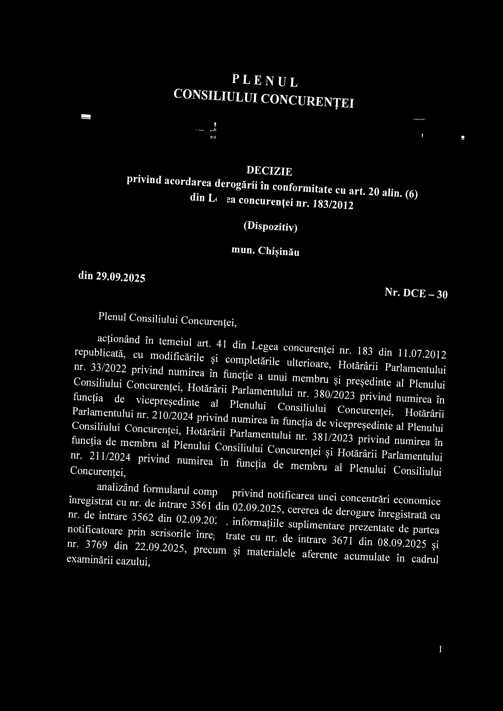
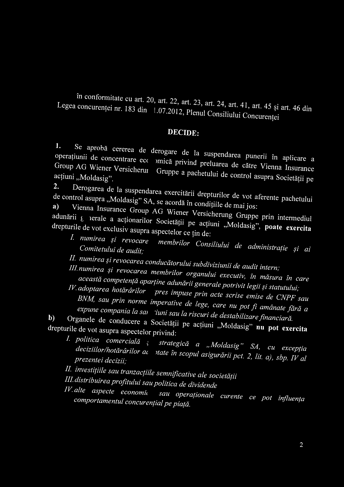
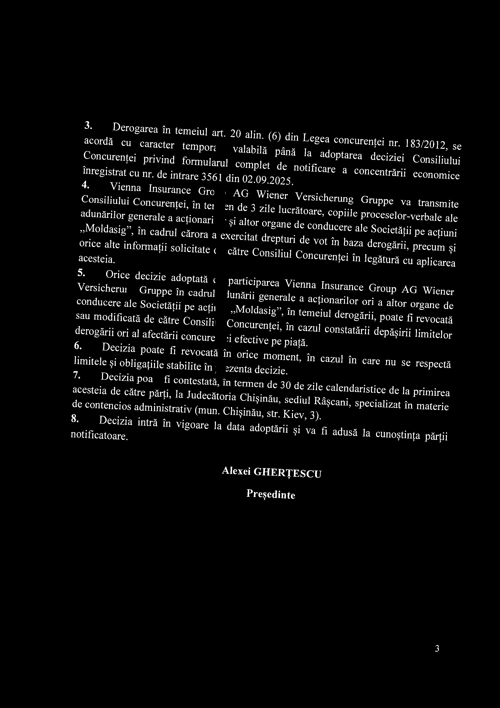

PLENUL 
CONSILIULUI CONCURENTEI 

MD - 2068, Republica Moldova, mw1. Chii iniiu, str. Alecu Russo, I 
e·mail: office@competition.md; www.competition.md 
DECIZIE 
privind acordarea derogarii in conformitate cu art. 20 alin. (6) 
din Legea concurentei nr. 183/2012 

(Dispozitiv) 
mun. Chi~inau 
din 29.09.2025 
Nr. DCE-30 
Plenul Consiliului Concurentei, 
actionand in temeiul art. 41 din Legea concurentei nr. 183 din 11.07.2012 
republicata, cu modificarile 
~i completarile ulterioare, Hotararii Parlamentului 
nr. 33/2022 privind nurnirea in functie a unui mernbru ~i pre~edinte al Plenului 
Consiliului Concurentei, Hotararii Parlamentului nr. 380/2023 privind numirea in 
functia 
de 
vicepre~edinte al 
Plenului 
Consiliului 
Concurentei, Hotararii 
Parlamentului nr. 210/2024 privind numirea in functia de vicepre~edinte al Plenului 
Consiliului Concurentei, Hotararii Parlamentului nr. 381/2023 privind numirea in 
functia de membru al Plenului Consiliului Concurentei si Hotararii Parlamentului 
, 
, 
, 
nr. 211/2024 privind nurnirea in functia de membru al Plenului Consiliului 
Concurentei, 
analizand formularul complet privind notificarea unei concentrari economice 
inregistrat cu nr. de intrare 3561 din 02.09.2025, cererea de derogare inregistrata cu 

nr. de intrare 3562 din 02.09.2025, informatiile suplimentare prezentate de partea 
notificatoare prin scrisorile inregistrate cu nr. de intrare 3671 din 08.09.2025 ~i 
nr. 3769 din 22.09.2025, precum ~ 1 materialele aferente acumulate in cadrul 

exarninarii cazului, 
1 

in conformitate cu art. 20, art. 22, art. 23, art. 24, art. 41, art. 45 si art. 46 din 
' 
Legea concurentei nr. 183 din 11.07.2012, Plenul Consiliului Concurentei 

DECIDE: 
1. 
Se aproba cererea de derogare de la suspendarea punern m aplicare a 
operatiunii de concentrare economicii privind preluarea de ciitre Vienna Insurance 
Group AG Wiener Versicherung Gruppe a pachetului de control asupra Societatii pe 
actiuni ,,Moldasig". 
2. 
Derogarea de la suspendarea exercitiirii drepturilor de vot aferente pachetului 
de control asupra ,,Moldasig" SA, se acorda in conditiile de mai jos: 
a) 
Vienna Insurance Group AG Wiener Versicherung Gruppe prin intermediul 
aduniirii generale a actionarilor Societatii pe aqiuni ,,Moldasig", poate exercita 
drepturile de vot exclusiv asupra aspectelor ce tin de: 

I. numirea Ji revocarea membrilor Consiliului de administrafie Ji ai 
Comitetului de audit; 
II. numirea Ji revocarea conducatorului subdiviziunii de audit intern; 
III. numirea $i revocarea membrilor organului executiv, in masura in care 
aceasta competenfa aparfine adunarii generale potrivit legii $i statutului; 
IV. adoptarea hotararilor expres impuse prin acte scrise emise de CNPF sau 

BNM, sau prin norme imperative de lege, care nu pot fl amanate fora a 
expune compania la sancfiuni sau la riscuri de destabilizare financiara. 
b) 
Organele de conducere a Societatii pe actiuni ,,Moldasig" nu pot exercita 
drepturile de vot asupra aspectelor privind: 

I. politica comerciala Ji 
strategica a ,,Moldasig" SA, 
cu excepfia 
deciziilorlhotararilor adoptate fn scopul asigurarii pct. 2, lit. a), sbp. IV al 
prezentei decizii; 
II. investifiile sau tranzacfiile semnificative ale societafii 
III. distribuirea profitului sau politica de dividende 
IV. alte aspecte economice sau opera/ionale curente ce pot influenfa 

comportamentul concurenfial pe piafa. 
2 

3. 
Derogarea in temeiul art. 20 alin. (6) din Legea concurentei nr. 183/2012, se 
acorda cu caracter temporar, valabila pana la adoptarea deciziei Consiliului 
Concurentei privind formularul complet de notificare a concentrarii economice 
inregistrat cu nr. de intrare 3561 din 02.09.2025. 
4. 
Vienna Insurance Group AG Wiener Versicherung Gruppe va transmite 
Consiliului Concurentei, in termen de 3 zile lucratoare, copiile proceselor-verbale ale 
adunarilor generale a actionarilor ~i altor organe de conducere ale Societatii pe actiuni 
,,Moldasig", in cadrul carora a exercitat drepturi de vot in baza derogarii, precum ~i 
orice alte informatH solicitate de catre Consiliul Concurentei in legatura cu aplicarea 
acesteia. 
5. 
Orice decizie adoptata cu participarea Vienna Insurance Group AG Wiener 
Versicherung Gruppe in cadrul adunarii generale a actionarilor ori a altor organe de 
conducere ale Societatii pe actiuni ,,Moldasig", in temeiul derogarii, poate fi revocata 
sau modificata de catre Consiliul Concurentei, in cazul constatarii depa~irii limitelor 
derogarii ori al afectarii concurentei efective pe piata. 
6. 
Decizia poate fi revocata in orice moment, in cazul in care nu se respecta 
limitele ~i obligatiile stabilite in prezenta decizie. 
7. 
Decizia poate fi contestata, in termen de 30 de zile calendaristice de la primirea 
acesteia de catre parti, la Judecatoria Chi~inau , sediul Ra~cani, specializat in materie 
de contencios administrativ (mun. Chi~inau , str. Kiev, 3). 
8. 
Decizia intra in vigoare la data adoptarii ~i va fi adusa la cuno~tinta partii 
notificatoare. 

Alexei GHERTESCU 
Presedinte 
' 
3 

