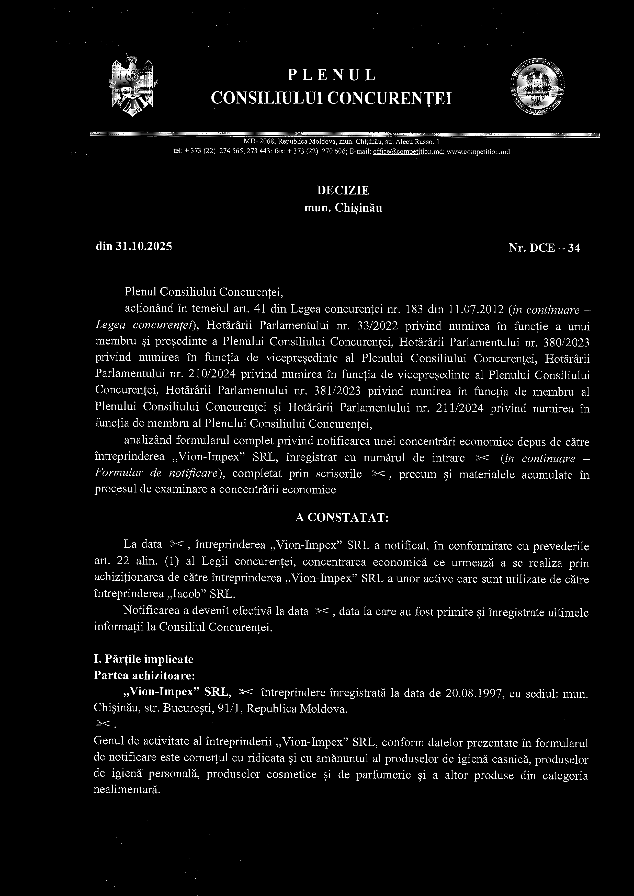
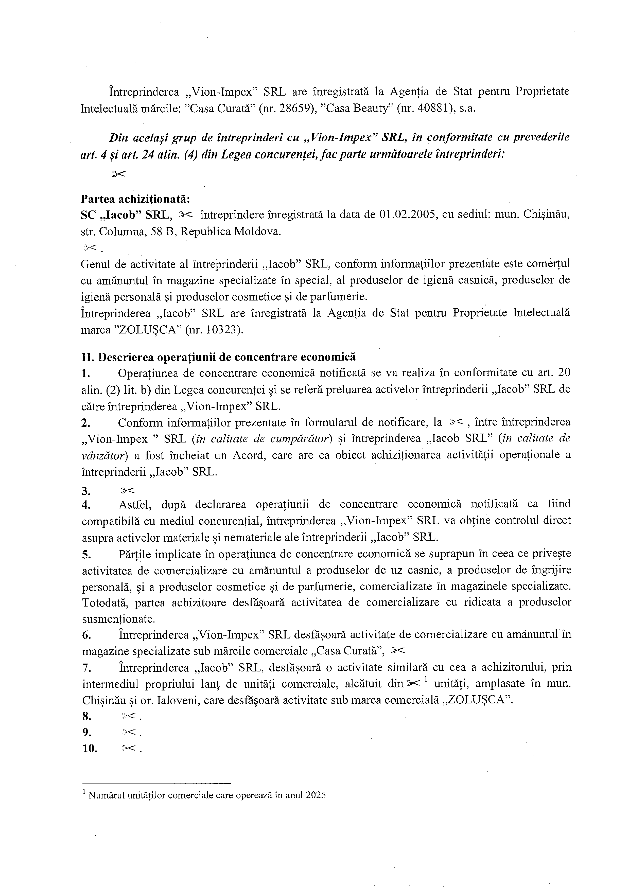
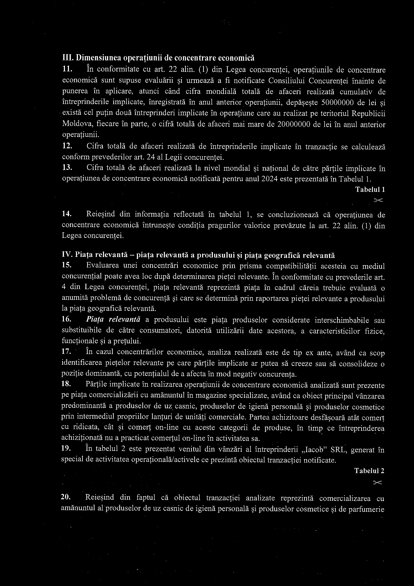
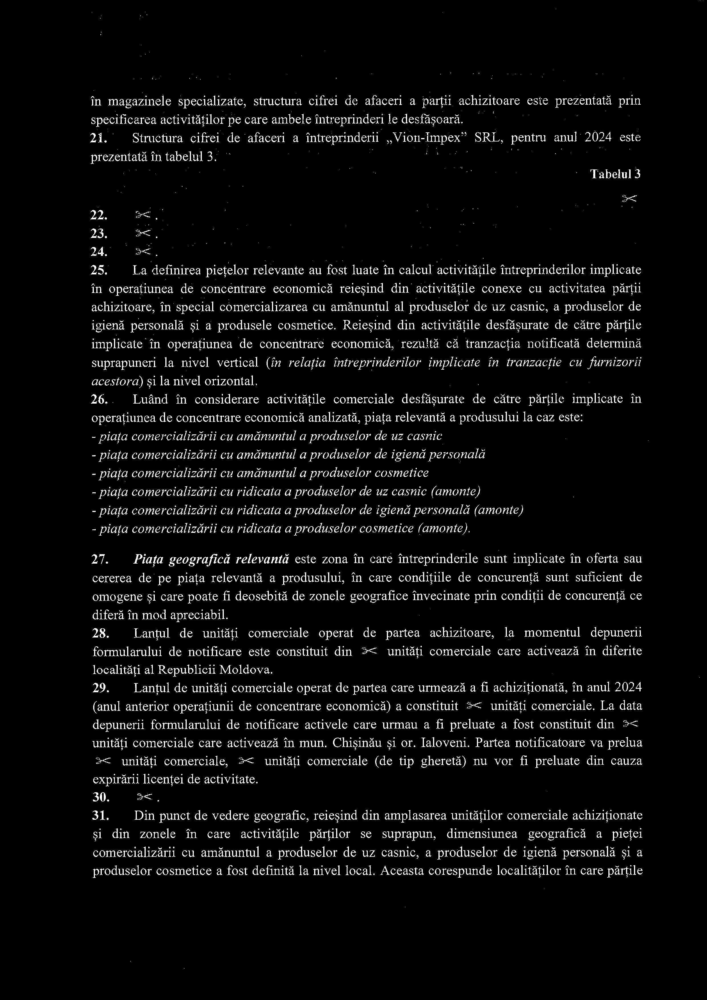
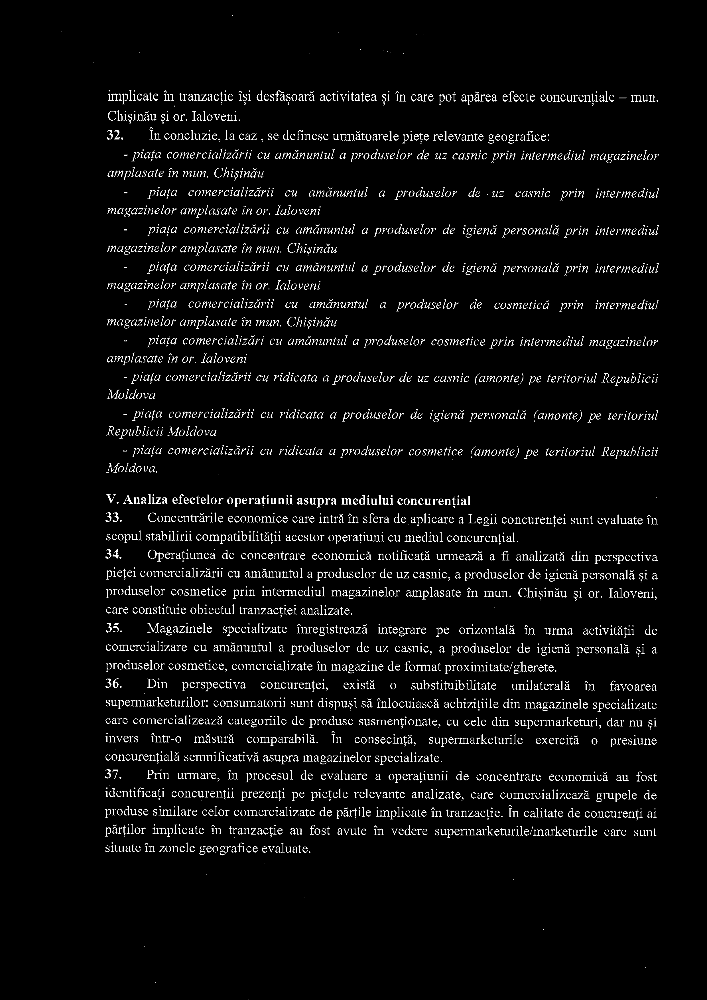
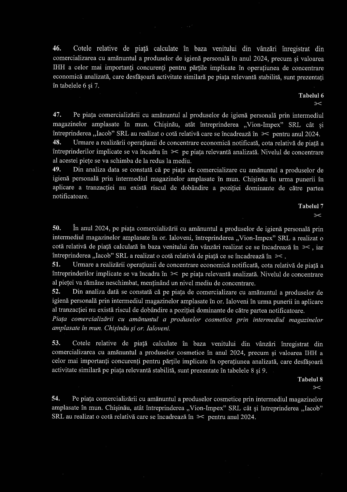
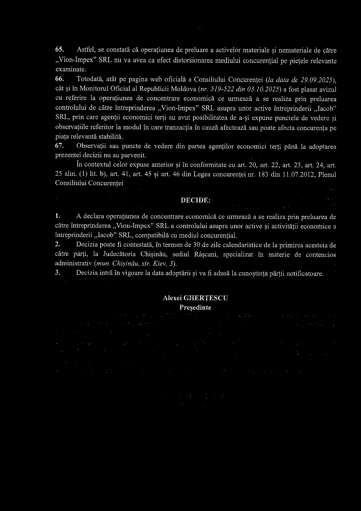

PLENUL 
CONSILIULUI CONCURENTEI 
MD- 2068, Republica Moldova, mun. Chiiiniiu, str. Alecu Russo, I 
tel: + 373 (22) 274 565, 273 443 ; fax: + 373 (22) 270 606; E-mail: office@competition.md: www.competition.md 
DECIZIE 
mun. Chi~inau 
din 31.10.2025 
Nr. DCE-34 
Plenul Consiliului Concurentei, 
actionand in temeiul art. 41 din Legea concurentei nr. 183 din 11.07.2012 (fn continuare -
Legea concurenfei), Hotararii Parlamentului ill. 33/2022 privind numirea in functie a unui 
membru ~i pre~edinte a Plenului Consiliului Concurentei, Hotararii Parlamentului ill. 380/2023 
privind numirea in functia de vicepre~edinte al Plenului Consiliului Concurentei, Hotararii 
Parlamentului ill. 210/2024 privind numirea in functia de vicepre~edinte al Plenului Consiliului 
Concurentei, Hotararii Parlamentului ill. 3 81/2023 privind numirea in functia de membru al 
Plenului Consiliului Concurentei ~i Hotararii Parlamentului nr. 211/2024 privind numirea in 
functia de membru al Plenului Consiliului Concurentei, 
analizand formularul complet privind notificarea unei concentrari economice depus de catre 
intreprinderea ,,Vion-Impex" SRL, inregistrat cu numarul de intrare ;;,.< (in continuare -
Formular de notificare), completat prin scrisorile ~, precum ~i materialele acumulate in 
procesul de examinare a concentrarii economice 
A CONSTATAT: 
La data 
~K 
, intreprinderea ,,Vion-Impex" SRL a notificat, in conformitate cu prevederile 
art. 22 alin. (1) al Legii concurentei, concentrarea economica ce urmeaza a se realiza prin 
achizitionarea de catre intreprinderea ,,Vion-Impex" SRL a unor active care sunt utilizate de catre 
intreprinderea ,,Iacob" SRL. 
Notificarea a devenit efectiva la data ~ , data la care au fost primite ~ i iillegistrate ultimele 
informatii la Consiliul Concurentei. 
I. Partile implicate 
Partea achizitoare: 
,,Vion-Impex" SRL, ~ intreprindere inregistrata la data de 20.08.1997, cu sediul: mun. 
Chi~inau, str. Bucure~ti, 91/1, Republica Moldova. 
~}< 
Genul de activitate al intreprinderii ,,Vion-Impex" SRL, conform datelor prezentate in formularul 
de notificare este comef!ul cu ridicata ~i cu amanuntul al produselor de igiena casnica, produselor 
de igiena personala, produselor cosmetice ~i de parfumerie ~ i a altor produse din categoria 
nealimentara. 

Intreprinderea ,, Vion-Impex" SRL are inregistrata la Agentia de Stat pentru Proprietate 
Intelectuala marcile: "Casa Curata" (nr. 28659), "Casa Beauty" (nr. 40881 ), s.a. 
Din acelafji grup de intreprinderi cu ,, Vion-Impex" SRL, in conformitate cu prevederile 
art. 4 ~i art. 24 alin. (4) din Legea concuren/ei,fac parte urmiitoarele intreprinderi: 
Partea achizitionata: 
SC ,,Iacob" SRL, :;>< intreprindere inregistrata la data de 01.02.2005, cu sediul: mun. Chi~inau, 
str. Columna, 58 B, Republica Moldova. 
Genul de activitate al intreprinderii ,,Iacob" SRL, conform info1matiilor prezentate este comertul 
cu amanuntul in magazine specializate in special, al produselor de igiena casnica, produselor de 
igiena personala ~i produselor cosmetice ~i de parfumerie. 
Intreprinderea ,,Iacob" SRL are inregistrata la Agentia de Stat pentru Proprietate Intelectuala 
marca "ZOLU~CA" (nr. 10323). 
II. Descrierea operatiunii de concentrare economica 
1. 
Operatiunea de concentrare economica notificata se va realiza in conformitate cu art. 20 
alin. (2) lit. b) din Legea concurentei ~i se refera preluarea activelor intreprinderii ,,Iacob" SRL de 
catre intreprinderea ,,Vion-Impex" SRL. 
2. 
Conform informatiilor prezentate in formularul de notificare, la 
~>< , intre intreprinderea 
,,Vion-Impex " SRL (fn calitate de cumparator) ~i intreprinderea ,,Iacob SRL" (fn calitate de 
vdnzator) a fost incheiat un Acord, care are ca obiect achizitionarea activitatii operationale a 
intreprinderii ,,Iacob" SRL. 
3. 
:x 
4. 
Astfel, dupa declararea operatiunii de concentrare economica notificata ca fiind 
compatibila cu mediul concurential, intreprinderea ,,Vion-Impex" SRL va obtine controlul direct 
asupra activelor materiale ~i nemateriale ale intreprinderii ,,Iacob" SRL. 
5. 
Paqile implicate in operatiunea de concentrare economica se suprapun in ceea ce prive~te 
activitatea de comercializare cu amanuntul a produselor de uz casnic, a produselor de ingrijire 
personala, ~i a produselor cosmetice ~i de parfumerie, comercializate in magazinele specializate. 
Totodata, partea achizitoare desra~oara activitatea de comercializare cu ridicata a produselor 
susmentionate. 
6. 
Intreprinderea ,,Vion-Impex" SRL desra~oara activitate de comercializare cu amanuntul in 
magazine specializate sub marcile comerciale ,,Casa Curata'', '.}< 
7. 
Intreprinderea ,,Jacob" SRL, desra~oara o activitate similara cu cea a achizitorului, prin 
intermediul propriului lant de unitati comerciale, alcatuit din '.}< 1 unitati, amplasate in mun. 
Chi~inau ~i or. Ialoveni, care desra~oara activitate sub marca comerciala ,,ZOLU~CA " . 
8. 
:?< 
9. 
;)-< 
10. 
;)-< 
1 Numarul unitatilor comerciale care opereaza In anul 2025 

III. Dimensiunea operafiunii de concentrare economica 
11. 
In conformitate cu art. 22 alin. (1) din Legea concurentei, operati:unile de concentrare 
economica sunt supuse evaluarii ~i unneaza a fi notificate Consiliului Concurentei inainte de 
punerea in aplicare, atunci cand cifra mondiala totala de afaceri realizata cumulativ de 
intreprinderile implicate, inregistrata in anul anterior . operatiunii, depa~e~te 50000000 de lei ~i 
· exista eel putin doua intreprinderi implicate in operatiune care au realizat pe teritoriul Republicii 
Moldova, fiecare in parte, o cifra totala de afaceri mai mare de 20000000 de lei in anul anterior 
operatiunii. 
12. 
Cifra totala de afaceri realizata de intreprinderile implicate in tranzactie se calculeaza 
conform prevederilor art. 24 al Legii concurentei. 
13. 
Cifra totala de afaceri realizata la nivel mondial ~i national de catre partile implicate in 
operatiunea de concentrare economica notificata pentrn anul 2024 este prezentata in Tabelul 1. 
Tabelul 1 
14. 
Reie~ind din infonnatia reflectata in tabelul 1, se concluzioneaza ca operatiunea de 
concentrare economica intrnne~te conditia pragurilor valorice prevazute la aii. 22 alin. (1) din 
Legea concurentei. 
IV. Piata relevanta - piata relevanta a produsului ~i piata geografica relevanta 
15. 
Evaluarea unei concentrari economice prin prisma compatibilitatii acesteia cu mediul 
concurential poate avea loc dupa detenninarea pietei relevante. In confo1mitate cu prevederile art. 
4 din Legea concurentei, piata relevanta reprezinta piata in cadrnl careia trebuie evaluata o 
anumita problema de concurenta ~i care se detennina prin raportarea pietei relevante a produsului 
la piata geografica relevanta. 
16. 
Pia{a relevantii. a produsului este piata produselor considerate interschimbabile sau 
substituibile de catre consumatori, datorita utilizarii date acestora, a caracteristicilor frzice, 
functionale ~i a pretului. 
17. 
in cazul concentrarilor economice, analiza realizata este de tip ex ante, avand ca scop 
identificarea pietelor relevante pe care partile implicate ar putea sa creeze sau sa consolideze o 
pozitie dominanta, cu potentialul de a afecta in mod negativ concurenta. 
18. 
Partile implicate in realizarea operatiunii de concentrare economica analizata sunt prezente 
pe piata comercializarii cu amanuntul in magazine specializate, avand ca obiect principal vanzarea 
predominanta a produselor de uz. casnic, produselor de igiena personala ~i produselor cosmetice 
prin intennediul propriilor lanturi de unitati comerciale. Partea achizitoare desfa~oara atat coniert 
cu ridicata, cat ~i comert on-line cu aceste categorii de produse, in tim~ ce intreprinderea 
achizitionata nu a practicat comertul on-line in activitatea sa. 
19. 
in tabelul 2 este prezentat venitul din vanzari al intreprinderii ,,Iacob" SRL, generat in 
special de activitatea operationala/activele ce prezinta obiectul tranzactiei notificate. 
Tabelul 2 
20. 
Reie~ind din faptul ca obiectul tranzactiei analizate reprezinta comercializarea cu 
amanuntul al produselor de uz casnic de igiena personala ~i produselor cosmetice ~i de parfumerie 

In magazinele specializate, structura cifrei de afaceri a paqii achizitoare este prezentata pnn 
specificarea activitatilor pe care ambele 1ntreprinderi le desra~oara. 
21. 
Strnctura cifrei de afaceri a intreprinderii ,,Vion-Impex" SRL, pentru anul 2024 este 
prezentata in tabelul 3. · 
Tabelul 3 
22. 
~3< 
23. 
~;}< 
24. 
~}< 
25. 
La definirea pietelor relevante au fost luate in calcul activitali}e intreprinderilor implicate 
in operatiunea de concentrare economica. reie~ind din activitatile conexe cu activitatea parj:ii 
achizitoare, in special comercializarea cu amanuntul al produselor de uz casnic, a produselor de 
igiena personala ~i a produsele cosmetice. Reie~ind din activitatile desra~urate de catre partile 
implicate , in operatiunea de conceiitrare economica, rezul.ta ca tranzaqia notificata dete1mina 
suprapuneri la nivel vertical (in relafia intreprinderilor implicate in tranzacfie cu furnizorii 
acestora) ~i la nivel orizontal. 
26. . 
Luand in considerare activita!ile comerciale desra~urate de catre partile implicate in 
operatiunea de concentrare economica analizata, piata relevanta a produsului la caz este: 
- piafa comercializarii cu amanuntul a produselor de uz casnic 
- piafa comercializarii cu amanuntul a produselor de igiena persona/a 
- piafa comercializarii cu amanuntul a produselor cosmetice 
- piafa comercializarii cu ridicata a produselor de uz casnic (amonte) 
- piafa comercializarii cu ridicata a produselor de igiena persona/a (amonte) 
- piafa comercializarii cu ridicata a produselor cosmetice (amonte). 
27. 
Pia/a geograficii relevantii este zona in care intreprinderile sunt implicate in oferta sau 
cererea de pe piata relevanta a produsului, in care condi!iile de concurenta sunt suficient de 
omogene ~i care poate fi deosebita de zonele geografice invecinate pr.in conditii de concurenta ce 
difera in mod apreciabil. 
28. 
Lantul de unita!i comerciale operat de partea achizitoare, la momentul depunerii 
formularului de notificare este constituit din :;}< unita!i comerciale care activeaza in diferite 
localitii!i al Republicii Moldova. 
29. 
Lantul de unitati comerciale operat de partea care urmeaza a fi achizitionata, i'n anul 2024 
(anul anterior operatiunii de concerttrare economica) a constituit ?< unita!i comerciale. La data 
depunerii formularului de notificare activele care urmau a fi preluate a fost constituit din 
~->< 
unita!i comerciale care activeaza in mun. Chi~inau ~i or. Ialoveni. Partea notificatoare va prelua 
:;}< unitati comerciale, 
~'>< unita!i comerciale (de tip ghereta) nu vor fi preluate din cauza 
expirarii licentei de activitate. 
30. 
~<. 
31. 
Din punct de vedere geografic, reie~ind din amplasarea unita!ilor comerciale achizitionate 
~i dirt zonele in care activitatile partilor se suprapun, dimensiunea geografica a pietei 
comercializarii cu amanuntul a produselor de uz casnic, a produselor de igiena personala ~i a 
produselor cosmetice a fost definita la nivel local. Aceasta corespunde localitatilor in care pi'ir!ile 

implicate in tranzactie 1~i desra~oara activitatea ~i 1n care pot aparea efecte concurentiale - mun. 
Chi~inau ~i or. Ialoveni. 
32. 
In concluzie, la caz , se definesc urmatoarele piete relevante geografice: 
- pia/a comercializarii cu amanuntul a produselor de uz casnic prin intermediul magazinelor 
amplasate fn mun. Chi$inau 
pia/a comercializarii cu amanuntul a produselor de . uz casnic prin intermediul 
magazine/or amplasate fn or. Ialoveni 
pia/a comercializarii cu amanuntul a produselor de igiena personala prin intermediul 
magazine/or amplasate fn mun. Chi$inau 
pia/a comercializarii cu amanuntul a produselor de igiena personala prin intermediul 
magazine/or amplasate fn or. Ialoveni 
pia/a comercializarii cu amanuntul a produselor de cosmetica prin intermediul 
magazine/or amplasate fn mun. Chi$inau 
pia/a comercializari cu amanuntul a produselor cosmetice prin intermediul magazine/or 
amplasate f n or. Ialoveni 
- pia/a comercializarii cu ridicata a produselor de uz casnic (amonte) pe teritoriul Republicii 
Moldova 
- pia/a comercializarii cu ridicata a produselor de igiena personala (amonte) pe teritoriul 
Republicii Moldova 
- pia/a comercializarii cu ridicata a produselor cosmetice (amonte) pe teritoriul Republicii 
Moldova. 
V. Analiza efectelor operatiunii asupra mediului concurential 
33. 
Concentrarile economice care intra in sfera de aplicare a Legii concurentei sunt evaluate in 
scopul stabilirii compatibilitatii acestor operatiuni cu mediul concurential. 
34. 
Operatiunea de concentrare economica notificata urmeaza a fi analizata din perspectiva 
pietei comercializarii cu amanuntul a produselor de uz casnic, a produselor de igiena personala ~i a 
produselor cosmetice prin intermediul magazinelor amplasate in mun. Chi~inau ~i or. Ialoveni, 
care constituie obiectul tranzactiei analizate. 
35. 
Magazinele specializate inregistreaza integrare pe orizontala in urma activitatii de 
comercializare cu amanuntul a produselor de uz casnic, a produselor de igiena personala ~i a 
produselor cosmetice, comercializate in magazine de format proximitate/gherete. 
36. 
Din 
perspectiva 
concurentei, 
exista 
o 
substituibilitate unilaterala in favoarea 
supermarketurilor: consumatorii sunt dispu~i sa inlocuiasca achizitiile din magazinele specializate 
care comercializeaza categoriile de produse susmentionate, cu cele din supe1marketuri, dar nu ~i 
invers intr-o masura comparabila. In consecinta, supermarketurile exercita o presiune 
concurentiala semnificativa asupra magazinelor specializate. 
37. 
Prin urmare, in procesul de evaluare a operatiunii de concentrare economica au fost 
identificati concurentii prezenti pe pietele relevante analizate, care comercializeaza grupele de 
produse similare celor comercializate de partile implicate in tranzactie. In calitate de concurenti ai 
partilor implicate in tranzactie au fost avute in vedere supermarketurile/marketurile care sunt 
situate in zonele geografice evaluate. 

Pia/a comercializarii cu amanuntul a produselor de uz casnic prin intermediul magazine/or 
amplasate fn mun. Chi$inau $i or. Jaloveni. 
38. 
Din informatiile acumulate de catre Consiliul Cohcurentei in contextul evaluarii prezentei 
operatiuni de concentrare economica, au fost calculate cotele relative de piata in baza venitului din 
vanzari inregistrat in anul 2024, precum ~i valoarea IHH2 a celormai importanti colicurenti pentru 
paqile implicate in operatiunea analizata, care des:fa~oara activitate pe piata cornercializari cu 
amanuntul a produselor de uz casnic. Informatiile sunt prezentate in tabelele 4 $i 5. 
Tabelul 4 
:x 
39. 
Confonn informatiilor din tabelul 4, se poate concluziona ca nivelul de presiune 
concurentiala exercitat de alti actori de pe piata este suficient pentru a asigura un mediu 
concurential eficient. 
40. 
In anul 2024, pe piata comercializarii cu amanuntul al produselor de uz casnic prin 
intermediul magazinelor amplasate in mun. Chi~inau, intreprinderea ,,Vion-Impex" SRL a realizat 
o cota relativa de piata calculata in baza venitului din vanzari realizat ce se incadreaza in s< , iar 
intreprinderea ,,Iacob" SRL a realizat o cota relativa de piata ce se incadreaza in ?< . 
41. 
Urmare a realizarii operatiunii de concentrare economica notificata, cota relativa de piata a 
intreprinderilor implicate se va incadra in x 
pe piata relevanta analizata. Nivelul de concentrare 
al acestei piete va ramane neschimbat, mentinand un nivel redus de concentrare. 
42. 
Din analiza data se constata ca pe piata de comercializare cu amanuntul a produselor de uz 
casnic prin intermediul magazinelor amplasate in mun. Chi$inau in urma punerii in aplicare a 
tranzactiei nu exista riscul de dobandire a pozitiei dominante de catre paiiea notificatoare. 
Tabelul 5 
>< 
43. 
In anul 2024, pe piata comercializarii cu amanuntul a produselor de uz casmc pnn 
intennediul magazinelor amplasate in or. Ialoveni, intreprinderea ,,Vion-Impex" SRL a realizat o 
cota relativa de piata calculata in baza venitului din vanzari realizat ce se incadreaza in :;,"'< , iar 
intreprinderea ,,Iacob" SRL a realizat o cota relativa de piata ce se incadreaza in :?< . 
44. 
Urmare a realizarii operatiunii de concentrare economica notificata, cota relativa de piata a 
intreprinderilor implicate se va incadra in ?< pe piata relevanta analizata. Nivelul de concentrare 
al pietei va ramane neschimbat, mentinand un nivel mediu de concentrare. 
45. 
Din analiza data se constata ca pe piata de comercializare cu amanuntul a produselor de 
igiena casnica prin intermediul magazinelor amplasate in or. Ialoveni in urma punerii in aplicare a 
tranzactiei nu exista riscul de dobandire a pozitiei dominante de catre partea notificatoare. 
Pia/a comercializarii cu amanuntul a produselor de igiena personala prin intermediul magazine/or 
amplasate fn mun. Chi$inau $i or. Jaloveni. 
2 in procesul de calculare a IHH se vor suma cotele lntreprinderilor la patrat pentru toate lntreprinderile active pe piafa. Valoarea sa 
variaza intre 0 ( concurenta perfecta) ~i 10000 (monopol). In func(ie de rezultatul obtinut se va considera ca nivelul de concentrare pe 
piata este unul redus daca rezultatul obtinut va fi inferior la 1500, se va considera nivel de concentrare mediu daca rezultatul va fi 
cuprins intre l 500 ~i 2500, se va stabili nivel ridicat de concentrare cand indicatorul e mai mare de 2500 

46. 
Cotele relative de piata calculate in baza venitului din vanzari inregistrat din 
comercializarea cu amanuntul a produselor de igiena personala in anul 2024, precum ~i valoarea 
IHH a celor mai importanti concurenti pentru partile implicate in operatiunea de concentrare 
economica analizata, care desra~oara activitate similara pe piata relevanta stabilita, sunt prezentati 
in tabelele 6 ~i 7. 
Tabelul 6 
~K 
47. 
Pe piata comercializarii cu amanuntul al produselor de igiena personala prin intermediul 
magazinelor amplasate in mun. 
Chi~inau, atat intreprinderea ,,Vion-Impex" SRL cat 
~i 
intreprinderea ,,Iacob" SRL au realizat o cota relativa care se incadreaza in ~ pentru anul 2024. 
48. 
Urmare a realizarii operatiunii de concentrare economica notificata, cota relativa de piata a 
intreprinderilor implicate se va incadra in ~ pe piata relevanta analizata. Nivelul de concentrare 
al acestei piete se va schimba de la redus la mediu. 
49. 
Din analiza data se constata ca pe piata de comercializare cu amanuntul a produselor de 
igiena personala prin intermediul magazinelor amplasate in mun. Chi~inau in urma punerii in 
aplicare a tranzactiei nu exista riscul de dobandire a pozitiei dominante de catre partea 
notificatoare. 
Tabelul 7 
~ 
50. 
In anul 2024, pe piata comercializarii cu amanuntul a produselor de igiena personala prin 
intermediul magazinelor amplasate in or. Ialoveni, intreprinderea ,,Vion-Impex" SRL a realizat o 
cota relativa de piata calculata in baza venitului din vanzari realizat ce se incadreaza in ~ , iar 
intreprinderea ,,Iacob" SRL a realizat o cota relativa de piata ce se incadreaza in ~'>< . 
51. 
Urmare a realizarii operatiunii de concentrare economica notificata, cota relativa de piata a 
intreprinderilor implicate se va incadra in ;}< pe piata relevanta analizata. Nivelul de concentrare 
al pietei va ramane neschimbat, mentinand un nivel mediu de concentrare. 
52. 
Din analiza data se constata ca pe piata de comercializare cu amanuntul a produselor de 
igiena personala prin intermediul magazinelor amplasate in or. Ialoveni in urma punerii in aplicare 
al tranzactiei nu exista riscul de dobandire a pozitiei dominante de catre partea notificatoare. 
Piafa comercializarii cu amanuntul a produselor cosmetice prin intermediul magazinelor 
amplasate in mun. Chi$inau $i or. Ialoveni. 
53. 
Cotele relative de piata calculate in baza venitului din vanzari imegistrat din 
comercializarea cu amanuntul a produselor cosmetice in anul 2024, precum ~i valoarea IHH a 
celor mai importanti concurenti pentru partile implicate in operatiunea analizata, care desra~oara 
activitate similara pe piata relevanta stabilita, sunt prezentate in tabelele 8 ~i 9. 
Tabelul 8 
54. 
Pe piata comercializarii cu amanuntul a produselor cosmetice prin intermediul magazinelor 
amplasate in mun. Chi~inau, atat intreprinderea ,,Vion-Impex" SRL cat ~i intreprinderea ,,Iacob" 
SRL au realizat o cota relativa care se incadreaza in :?< pentru anul 2024. 

55. 
Urmare a realizarii operatiunii de concentrare economica notificata, cota relativa de piata a 
intreprinderilor implicate se va incadra in :K pe piata relevanta analizata. Nivelul de concentrare 
al pietei va ramane neschimbat, mentinand un nivel redus de concentrare. 
56. 
Din analiza data se constata ca pe piata de comercializare cu amanuntul a produselor 
cosmetice prin intermediul magazinelor amplasate in mun. Chi~inau in urma punerii in aplicare a 
tranzactiei nu exista riscul de dobandire a pozitiei dominante de catre partea notificatoare. · 
Tabelul 9 
57. 
Pe piata comercializarii cu amanuntul al produselor cosmetice pentru anul 2024 in or. 
Ialoveni, intreprinderea ,,Vion-Impex" SRL a realizat o cota relativa de piata calculata in baza 
venitului din vanzari realizat ce se incadreaza in 
~;;.< , iar i:ntreprinderea ,,Iacob" SRL a realizat o 
cota relativa de piata ce se incadreaza in ~K . 
58. 
Urmare a realizarii operatiunii de concentrare economica notificata, cota relativa de piata a 
intreprinderilor implicate se va incadra in :C'K pe piata relevanta arializata. Nivelul de concentrare 
al acestei piete va ramane neschimbat, mentinand un nivel ridicat de concentrare. 
59. 
Din analiza data se const<1ta ca pe piata de comercializare cu amanuntul a produselor 
cosmetice prin intermediul magazinelor amplasate in or. Ialoveni in urma punerii in aplicare a 
tranzactiei nu exista riscul de dobandire a pozitiei dominante de catre partea notificatoare. 
60. 
intreprinderea ,,Vion-Impex" SRL activeaza pe piata de import ~i comercializare cu 
ridicata a produselor de uz casnic, a produselor de igiena personala, a produselor cosmetice, 
precum ~i pe piata de import ~i comercializare a altor produse nealimentare. 
61. 
in anul 2024, paitea achizitoare sa regasit in calitate de fumizor pentru intreprinderea 
,,Iacob" SRL ~i pentru alte intreprinderi dupa cum urmeaza: ::>< . Se retine ca, pentru anul 2024, 
intreprinderea a inregistrat o cota relativa pe pietele relevante ale comercializarii cu ridicata a 
produselor de igiena personala, a produselor de uz casnic ~i a produselor cosmetice, care se 
incadreaza in ~K 
VI. Concluzii 
62. 
Preluarea controlului de catre intreprinderea ,,Vion-Impex" SRL asupra activelor 
intreprinderii ,,Iacob" SRL reprezinta o operatiune de concentrare economica care cade sub 
incidenta Legii concurentei, incadrandu-se in prevederile art. 20 alin. (2) lit. b) referitoare la 
realizarea concentrarii economice ~i la art. 22 alin. ( 1) referitoare la pragul cifrei de afaceri. 
63. 
Operatiunea notificata are loc pe piata comercializarii cu amanuntul a produselor de uz 
casnic, a produselor de igiena personala ~i a produselor cosmetice pe teritoriul mun. Chi~inau ~i in 
or. Ialoveni ~i piata comercializarii cu ridicata a produselor de uz casnic, a produselor de igiena 
personala ~i a produselor cosmetice la nivel national. Activitatile partilor implicate implica 
integrare orizontala ~i verticala. 
64. 
in urma evaluarii impactului tranzactiei asupra mediului concurential se conchide ca 
operatiunea notificata nu ridica probleme de ordin concurential 
~i nu conduce la crearea 
obstacolelor negative in calea concurentei efective pe o piata sau pe o parte semnificativa a 
acesteia. 

65. 
Astfel, se constata ca operatiunea de preluare a activelor materiale ~i nemateriale de catre 
,,Vion-Impex" SRL nu va avea ca efect distorsionarea mediului concurential pe pietele relevante 
examinate. 
66. 
Totodata, atat pe pagina web oficiala a Consiliului Concurentei (la data de 29. 09.2025), 
cat ~i in Monitorul Oficial al Republicii Moldova (nr. 519-5 22 din 03.10. 2025) a fost plasat avizul 
cu referire la operatiunea de concentrare economica ce urmeaza a se realiza prin preluarea 
controlului de catre intreprinderea ,,Vion-Impex" SRL asupra unor active intreprinderii ,,Iacob" 
SRL, prin care agentii economici teqi au avut posibilitatea de a-~i expune punciele de vedere ~i 
observatiile referitor la rnodul in care tranzactia in cauza afecteaza sau poate afocta concurenta pe 
piata relevanta stabilita. 
67. 
Ob.servatii sau puncte de vedere din partea agentilor economici terti pana la adoptarea 
prezentei decizii mi au parvenit. 
. 
. 
In contextul celor expuse anterior ~i in conformitate cu art. 20, art. 22, art. 23, art. 24, art. 
25 alin. (1) lit. b), art. 41, art, 45 ~i art. 46 din Legea concurenteinr. 183 din 11.07.2012, Plenul 
Consiliului Concurentei 
DECIDE: 
L 
A declara operatiuriea de concentrare economica ce urmeaza a se realiza prin preluarea de 
catre intreprirtderea ,,Vion-Impex" SRL a conirnlului asupra unor active ~i activitatii economice a 
l'ntreprinderii ,,Jacob" SRL, compatibila cu mediul concurential. 
2. 
Decizia poate fi contestata, in termen de 30 de zile calendaristice de la: primirea acesteia de 
catre parti, la Judecatoria 
Chi~inau, sediul 
Ra~cani, specializat in materie de contencios 
administrativ (mun. Chi~inau, str. Kiev, 3). 
3. · 
Decizia intra in vigoare la data adoptarii ~i va fi adusa la cuno~tinta partii notificatoare. 
Alexei GHERTESCU 
Pre~edinte 
