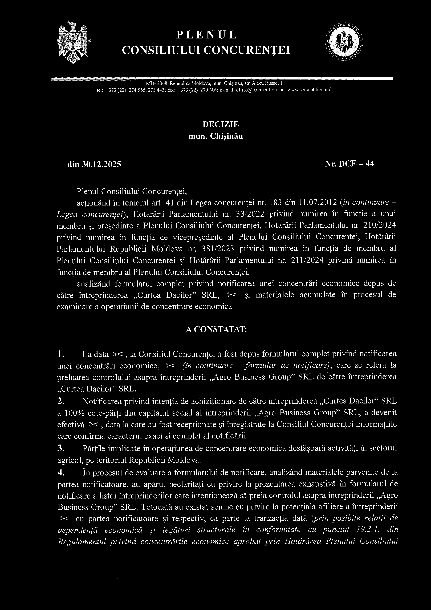
PLENUL 
CONSILIULUI CONCURENTEI 
MD- 2068, Republica Moldova, mun. 
str. Alecu Russo, I 
tel: + 373 (22) 274 565, 273 443; fax: + 373 (22) 270 606; E-mail: 
DECIZIE 
mun. 
Nr. DCE-44 
din 30.12.2025 
Plenul Consiliului Concurentei, 
actionand in temeiul art. 41 din Legea concurentei nr. 183 din 11. 07.2012 (fn continuare -
Legea concurenf ei), Hotararii Parlamentului nr. 33/2022 privind numirea in funqie a unui 
membru 
a Plenului Consiliului Concurentei, Hotararii Parlamentului nr. 210/2024 
privind numirea in functia de 
al Plenului Consiliului Concurentei , Hotararii 
Parlamentului Republic ii Moldova nr. 3 81 /2023 privind numirea in functia de membru al 
Plenului Consiliului Concurentei 
Hotararii Parlamentului nr. 211/2024 privind numirea in 
functia de membru al Plenului Consiliului Concurentei, 
analizand formularul complet privind notificarea unei concentrari economice depus de 
catre intreprinderea ,,Curtea Dacilor" SRL, :x 
materialele acumulate in procesul de 
examinare a operatiunii de concentrare economica 
A CONSTATAT: 
1. 
La data :x , la Consiliul Concurentei a fost depus formularul complet privind notificarea 
une1 concentrari economice, :x (fn continuare - for mular de notifzcare), care se refera la 
preluarea controlului asupra intreprinderii ,,Agro Business Group" SRL de ·catre intreprinderea 
,,Curtea Dacilor" SRL. 
2. 
Notificarea privind intentia de achizitionare de catre intreprinderea ,,Curtea Dacilor" SRL 
a 100% cote-parti din capitalul social al intreprinderii ,,Agro Business Group" SRL, a devenit 
efectiva :x , data la care au fost receptionate 
inregistrate la Consiliul Concurentei informatiile 
care confirma caracterul exact ;;i complet al notificarii. 
3. 
Partile implicate in operatiunea de concentrare economica 
activitati in sectorul 
agricol, pe teritoriul Republicii Moldova. 
4. 
In procesul de evaluare a formularului de notificare , analizand materialele parvenite de la 
partea notificatoare , au aparut neclaritati cu privire la prezentarea exhaustiva in formularul de 
notificare a listei intreprinderilor care intentioneaza sa preia controlul asupra intreprinderii ,,Agro 
Business Group" SRL. Totodata au existat semne cu privire la potentiala afiliere a intreprinderii 
:>< cu partea notific atoare 
respectiv , ca parte la tranzactia data (prin posibile relafii de 
dependenfa 
economica 
9i legaturi 
structurale 
fn conformitate 
cu punctul 
19. 3. r 
din 
Regulamentul privind concentrarile economic e aprobat prin Hotar area Plenului Consiliului 

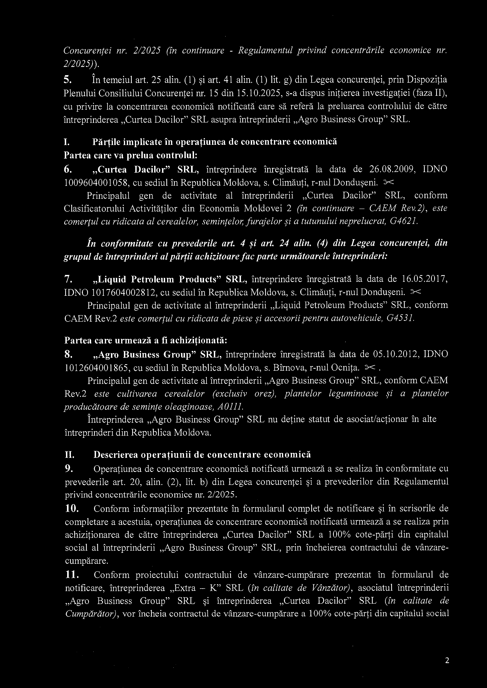
Concurenfei nr. 212025 (fn continuare - Regulamentul privind concentrarile economice nr. 
212025)). 
5. 
In temeiul art. 25 alin. (1) 
art. 41 alin. (1) lit. g) din Legea concurentei , prin Dispozitia 
Plenului Consiliului Concurentei nr. 15 din 15.10.2025 , s-a dispus initierea investigatiei (faza II), 
cu privire la concentrarea economica notificata · care sa refera la preluarea controlului de catre 
intreprinderea ,,Curtea Dacilor" SRL asupra intreprinderii ,,Agro Business Group " SRL. 
I. 
Partile implicate in operatiunea de concentrare economica 
Partea care va prelua controlul: 
6. 
,,Curtea 
Dacilor" 
SRL, intreprindere inregistrata 
la data de 26.08.2009, IDNO 
1009604001058 , cu sediul in Republica Moldova, s. Climauti, r-nul 
:>< 
Principalul 
gen 
de activitate 
al intreprinderii 
,,Curtea 
Dacilor" 
SRL, conform 
Clasificatorului Activitatilor din Economia Moldovei 2 (fn continuare - CAEM Rev. 2), este 
comerful cu ridicata al cerealelor, seminfelor, furajelor .;i a tutunului neprelucrat, G4621. 
in conformitate cu prevederile art. 4 
art. 24 alin. (4) din Legea concuren{ei, din 
grupul de intreprinderi al pii.r(ii achizitoare f ac parte urmiitoarele intreprinderi: 
7. 
,,Liquid Petroleum Products" SRL, intreprindere inregistrata la data de 16.05.2017 , 
IDNO 1017604002812, cu sediul in Republica Moldova, s. Climauti , r-nul 
:>< 
Principalul gen de activitate al intreprinderii ,,Liquid Petroleum Products " SRL, conform 
CAEM Rev.2 este comerful cu ridicata de piese .;i accesorii pentru autovehicule, G4531. 
Partea care urmeaza a fi achizitionata: 
' 
8. 
,,Agro Business Group" SRL, intreprindere inregistrata la data de 05.10.2012 , IDNO 
1012604001865 , cu sediul in Republica Moldova , s. Birnova , r-nul Ocnita . :>< . 
Principalul gen de activitate al intreprinderii ,,Agro Business Group " SRL, conform CAEM 
Rev.2 este cultivarea cerealelor (exclusiv orez), plantelor leguminoase .;i a plant elor 
producatoare de seminfe oleaginoase, AOJJJ. 
Intreprinderea ,,Agro Business Group " SRL nu detine statut de asociat/actionar in alte 
intreprinderi din Republica Moldova. 
II. 
Descrierea operatiunii de concentrare economica 
9. 
Operatiunea de concentrare economica notificata urmeaza a se realiza in conformitate cu 
prevederile art. 20, alin. (2), lit. b) din Legea concurentei 
a prevederilor din Regulamentul 
privind concentrarile economice nr. 2/2025. 
10. 
Conform informatiilor prezentate in formularul comp let de notificare 
in scrisorile de 
completare a acestuia, operatiunea de concentrare economica notificata urmeaza a se realiza prin 
achizitionarea de catre intreprinderea ,,Curtea Dacilor" SRL a 100% cote-parti din capitalul 
social al intreprinderii ,,Agro Business Group" SRL, prin incheierea contractului de vanzare-
cumparare. 
11. 
Conform proiectului contractului de vanzare-cumparare prezentat in formularul de 
notificare, intreprinderea ,,Extra - K" SRL (fn calitate de Vanzator), asociatul intreprinderii 
,,Agro Business Group" 
SRL 
intreprinderea 
,,Curtea Dacilor" SRL (fn calitate de 
Cumparator), vor incheia contractul de vanzare -curnparare a 100% cote-parti din capitalul social 
2 

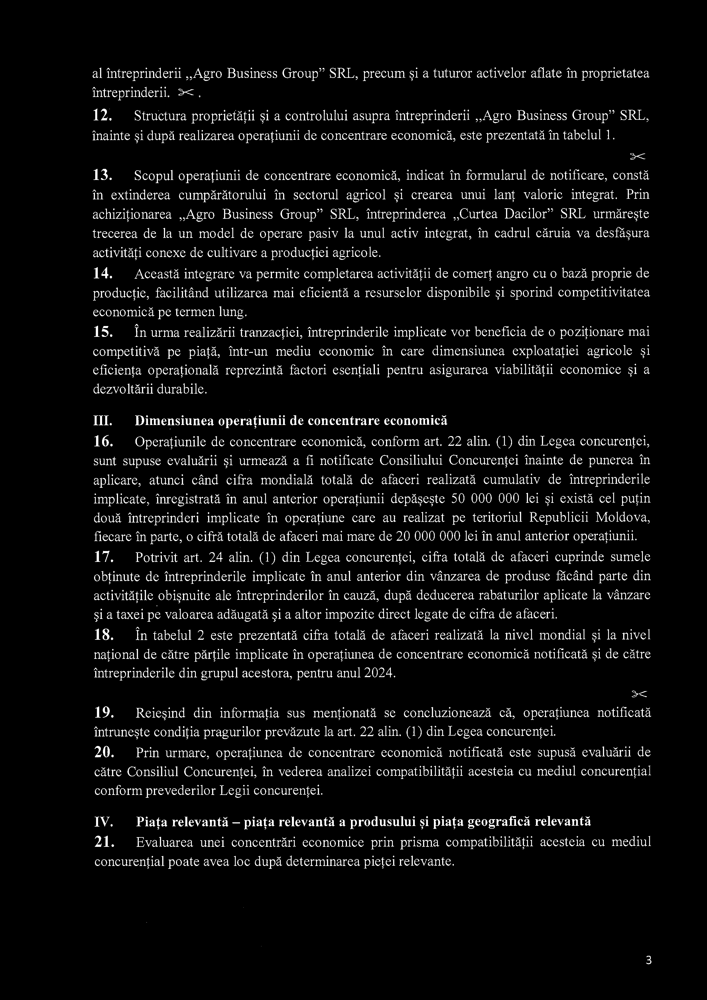
al intreprinderii ,,Agro Business Group " SRL, precum 
a tuturor activelor aflate in proprietatea 
intreprinderii . ;}< . 
12. 
Structura proprietatii 
a controlului asupra intreprinderii ,,Agro Business Group " SRL, 
inainte 
dupa realizarea operatiunii de concentrare economica , este prezentata in tabelul 1. 
;}< 
13. 
Scopul operatiunii de concentrare economica, indicat in formularul de notificare, consta 
in extinderea cumparatorului in sectorul agricol 
crearea unui lant valoric integrat. Prin 
achizitionarea ,,Agro Business Group" SRL, intreprinderea ,,Curtea Dacilor " SRL 
trecerea de la un model de operare pasiv la unul activ integrat, in cadrul caruia va 
activitati conexe de cultivare a productiei agricole. 
14. 
Aceasta integrare va permite completarea activitatii de comert angro cu o baza proprie de 
productie, facilitand utilizarea mai eficienta a resurselor disponibile 
sporind competitivitatea 
economica pe termen lung. 
15. 
In urma realizarii tranzactiei , intreprinderile implicate vor beneficia de o pozitionare mai 
competitiva pe piata , intr-un mediu economic in care dimensiunea exploatatiei agricole 
eficienta operationala reprezinta factori esentiali pentru asigurarea viabilitatii econornice 
a 
dezvoltarii durabile. 
III. 
Dimensiunea operafiunii de concentrare economica 
16. 
Operatiunile de concentrare economica, conform art. 22 alin. (1) din Legea concurentei , 
sunt supuse evaluarii 
urmeaza a fi notificate Consiliului Concurentei inainte de punerea in 
aplicare, atunci cand cifra mondiala totala de afaceri realizata cumulati v de intreprinderile 
implicate , inregistrata in anul anterior operatiunii 
50 000 000 lei 
exista eel putin 
doua intreprinderi implicate in operatiune care au realizat pe teritoriul Republicii Moldova , 
fiecare in parte, o cifra totala de afaceri mai mare de 20 000 000 lei in anul anterior operatiunii . 
17. 
Potrivit art. 24 alin. (1) din Legea concurentei , cifra totala de afaceri cuprinde sumele 
obtinute de intreprinderile implicate in anul anterior din vanzarea de produse racand parte din 
activitatile 
ale intreprinderilor in cauza, dupa deducerea rabaturilor aplicate la vanzare 
a taxei pe valoarea adaugata 
a altor impozite direct legate de cifra de afaceri. 
18. 
In tabelul 2 este prezerttata cifra totala de afaceri realizata la nivel mondial 
la nivel 
national de catre partile implicate in operatiunea de concentrare econornica notificata 
de catre 
intreprinderile din grupul acestora, pentru anul 2024. 
19. 
din informatia sus mentionata se concluzioneaza ca, operatiunea notificata 
conditia pragurilor prevazute la art. 22 alin. (1) din Legea concurentei. 
20. 
Prin urmare, operatiunea de concentrare economica notificata este supusa evaluarii de 
catre Consiliul Concurentei , in vederea analizei compatibilitatii acesteia cu mediul concurential 
conform prevederilor Legii concurentei. 
IV. 
Piata relevanta - piata relevanta a produsului 
piata geografica relevanta 
21. 
Evaluarea unei concentrari economice prin prisma compatibilitatii acesteia cu mediul 
concurential poate avea loc dupa determinarea pietei relevante. 
3 

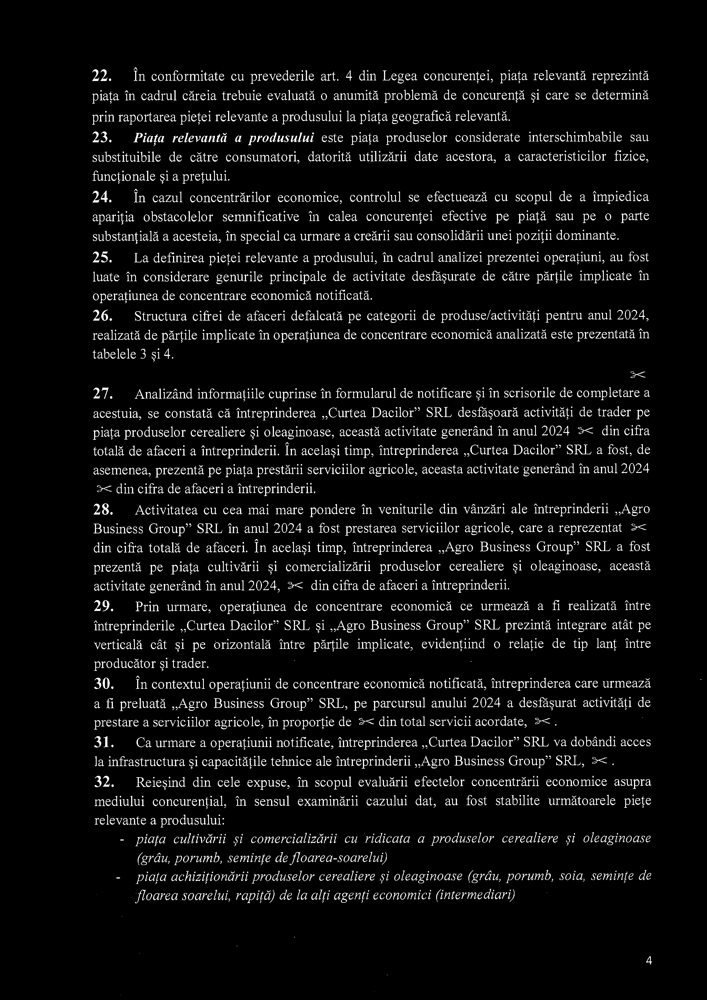
22. 
In conformitate cu prevederile art. 4 din Legea concurentei, piata relevanta reprezinta 
piata in cadrul careia trebuie evaluata o anumita problema de concurenta 
care se determina 
prin raportarea pietei relevante a produsului la piata geografica relevanta. 
23. 
Pia/a relevantii a produsului este piata produselor considerate interschimbabile sau 
substituibile de catre consumatori, datorita utilizarii date acestora, a caracteristicilor fizice, 
functionale 
a pretului. 
24. 
In cazul concentrarilor economice, controlul se efectueaza cu scopul de a impiedica 
aparitia obstacolelor semnificative in calea concurentei efective pe piata sau pe o parte 
substantiala a acesteia, in special ca urmare a crearii sau consolidarii unei pozitii dominante. 
25. 
La definirea pietei relevante a produsului, in cadrul analizei prezentei operatiuni, au fost 
luate in considerare genurile principale de activitate 
de catre partile implicate in 
operatiunea de concentrare economica notificata. 
26. 
Structura cifrei de afaceri defalcata pe categorii de produse/activitati pentru anul 2024, 
realizata de partile implicate in operatiunea de concentrare economica analizata este prezentata in 
tabelele 3 
4. 
:;..<. 
27. 
Analizand informatiile cuprinse in formularul de notificare 
in scrisorile de completare a 
acestuia, se constata ca intreprinderea ,,Curtea Daciloi"" SRL 
activitati de trader pe 
piata produselor cerealiere 
oleaginoase, aceasta activitate generand in anul 2024 :;..<. din cifra 
totala de afaceri a intreprinderii. in 
timp, intreprinderea ,,Curtea Dacilor" SRL a fost, de 
asemenea, prezenta pe piata prestarii serviciilor agricole, aceasta activitate generand in anul 2024 
:;..<. din cifra de afaceri a intreprinderii. 
28. 
Activitatea cu cea mai mare pondere in veniturile din vanzari ale intreprinderii ,,Agro 
Business Group" SRL in anul 2024 a fost prestarea serviciilor agricole, care a reprezentat 
:;..<. 
din cifra totala de afaceri. in 
timp, intreprinderea ,,Agro Business Group" SRL a fost 
prezenta pe piata cultivarii 
comercializarii produselor cerealiere 
oleaginoase, aceasta 
activitate generand in anul 2024, :;..<. din cifra de afaceri a intreprinderii. 
29. 
Prin urmare, operatiunea de concentrare economica ce urmeaza a fi realizata intre 
intreprinderile ,,Curtea Dacilor" SRL 
,,Agro Business Group" SRL prezinta integrare atat pe 
verticala cat 
pe orizontala intre partile implicate, evidentiind o relatie de tip lant intre 
producator 
trader. 
30. 
in contextul operatiunii de concentrare economica notificata , intreprinderea care urmeaza 
a fi preluata ,,Agro Business Group" SRL, pe parcursul anului 2024 a 
activitati de 
prestare a serviciilor agricole, in proportie de :;..<. din total servicii acordate, :}-< . 
31. 
Ca urmare a operatiunii notificate, intreprinderea ,,Curtea Dacilor" SRL va dobandi acces 
la infrastructura 
capacitatile tehnice ale intreprinderii ,,Agro Business Group" SRL, :;..<. . 
32. 
din cele expuse, in scopul evaluarii efectelor concentrarii economice asupra 
mediului concurential, in sensul examinarii cazului dat, au fost stabilite urmatoarele piete 
relevante a produsului: 
-
piafa cultivarii $i comercializarii cu ridicata a produselor cereali ere $i oleaginoase 
(grdu, porumb, seminfe de floarea-soarelui) 
piafa achizifionarii produselor cerealiere $i oleaginoase (grdu, porumb , sofa, seminfe de 
jloarea soarelui, rapifa) de la al{i agen{i economici (intermediari) 
4 

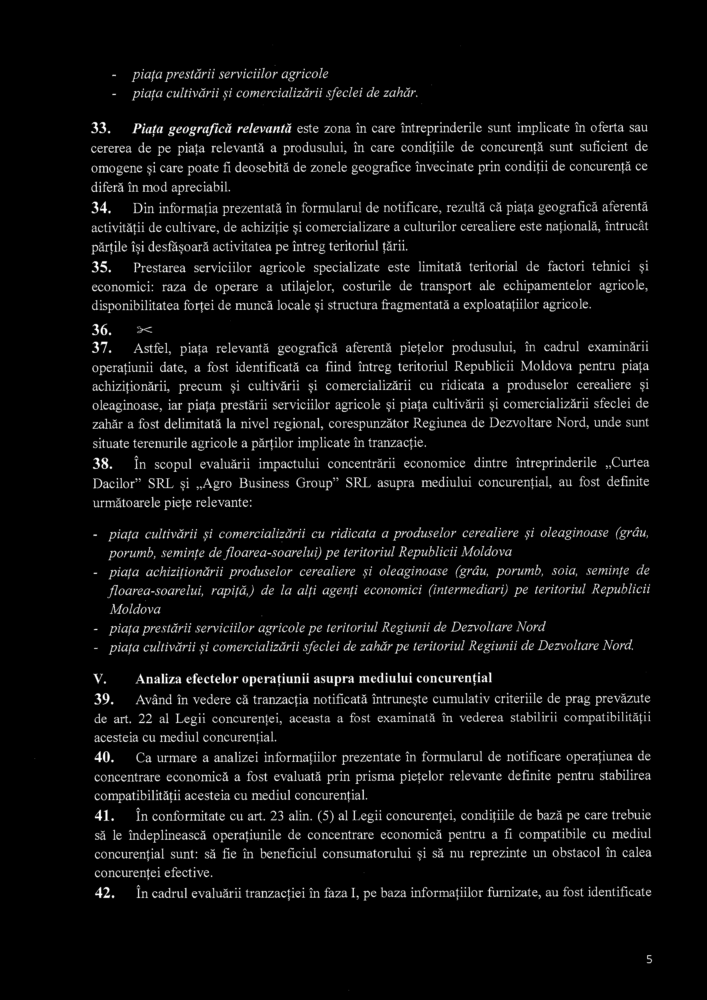
piafa prestarii serviciilor agricole 
piafa cultivarii 9i comercializarii sfeclei de zahar. 
33. 
Pia/a geograflcii relevantii este zona in care intreprinderile sunt implicate in oferta sau 
cererea de pe piata relevanta a produsului, in care conditiile de concurenta sunt suficient de 
omogene 
care poate fi deosebita de zonele geografice invecinate prin conditii de concurenta ce 
difera in mod apreciabil. 
34. 
Din informatia prezentata in formularul de notificare, rezulta ca piata geografica aferenta 
activitatii de cultivare , de achizitie 
comercializare a culturilor cerealiere este nationala, intrucat 
partile 
activitatea pe intreg teritoriul tarii. 
35. 
Prestarea serviciilor agricole specializate este limitata teritorial de factori tehnici 
economici: raza de operare a utilajelor, costurile de transport ale echipamentelor agricole, 
disponibilitatea fortei de munca locale 
structura fragmentata a exploatatiilor agricole. 
36. 
:?< 
37. 
Astfel, piata relevanta geografica aferenta pietelor produsului, in cadrul examinarii 
operatiunii date, a fost identificata ca fiind intreg teritoriul Republicii Moldova pentru piata 
achizifionarii, precum 
cultivarii 
comercializarii cu ridicata a produselor cerealiere 
oleaginoase, iar piata prestarii serviciilor agricole 
piata cultivarii 
comercializarii sfeclei de 
zahar a fost delimitata la nivel regional, corespunzator Regiunea de Dezvoltare Nord, unde sunt 
situate terenurile agricole a partilor implicate in tranzaqie. 
38. 
In scopul evaluarii impactului concentrarii economice dintre intreprinderile ,,Curtea 
Dacilor" SRL 
,,Agro Business Group" SRL asupra mediului concurential , au fost definite 
urmatoarele piete relevante: 
-
piafa cultivarii 9i comercializarii cu ridicata a produselor cerealiere 9i oleaginoase (grau, 
porumb, seminfe de jloarea-soarelui) pe teritoriul Republic ii Moldova 
piafa achizifionarii produselor cerealiere 9i oleaginoase (grau, porumb , soia, seminfe de 
jloarea-soarelui, rapifa,) de la alfi agenfi economici (intermediari) pe teritoriul Republicii 
Moldova 
- piafa prestarii serviciilor agricole pe teritoriul Regiunii de Dezvoltare Nord 
- piafa cultivarii 9i comercializarii sfeclei de zahar pe teritoriul Regiunii de Dezvoltare Nord. 
V. 
Analiza efectelor operatiunii asupra mediului concurential 
39. 
Avand in vedere ca tranzactia notificata 
cumulativ criteriile de prag prevazute 
de aii. 22 al Legii concurentei, aceasta a fost examinata in vederea stabilirii compatibilitatii 
acesteia cu mediul concurential. 
40. 
Ca urmare a analizei informatiilor prezentate in formularul de notificare operatiunea de 
concentrare economica a fost evaluata prin prisma pietelor relevante definite pentru stabilirea 
compatibilitatii acesteia cu mediul concurential. 
41. 
In conformitate cu art. 23 alin. (5) al Legii concurentei, conditiile de baza pe care trebuie 
sa le indeplineasca operatiunile de concentrare economica pentru a fi compatibile cu mediul 
concurential sunt: sa fie in beneficiul consumatorului 
sa nu reprezinte un obstacol in calea 
concurentei efective. 
42. 
In cadrul evaluarii tranzactiei in faza I, pe baza informatiilor furnizate, au fost identificate 
5 

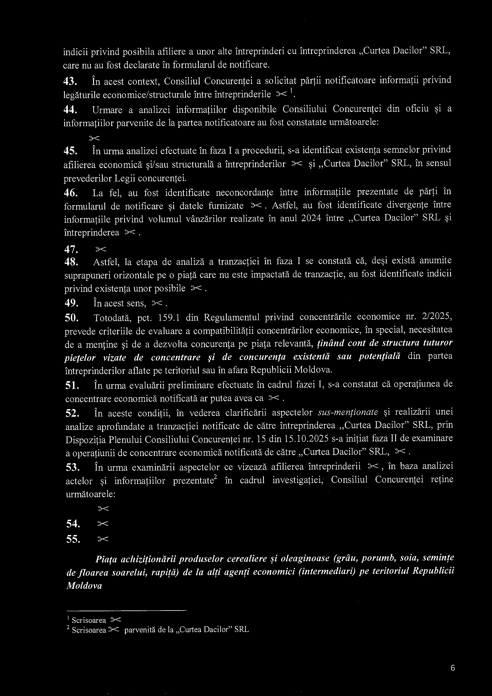
indicii privind posibila afiliere a unor alte intreprinderi cu intreprinderea ,,Curtea Dacilor " SRL, 
care nu au fost declarate in formularul de notificare. 
43. 
In acest context, Consiliul Concurentei a solicitat partii notificatoare informatii privind 
legaturile economice /structurale intre intreprinderile 
? < 1• 
44. 
Urmare a analizei informatiilor disponibile Consiliului Concurentei din oficiu 
a 
informatiilor parvenite de la partea notificatoare au fost constatate urmatoarele: 
>< 
45. 
in urma analizei efectuate in faza I a procedurii , s-a identificat existenta semnelor privind 
afilierea economica 
structurala a intreprinderilor >< 
,,Curtea Dacilor" SRL, in sensul 
prevederilor Legii concurentei. 
46. 
La fel, au fost identificat e neconcordante intre informatiile prezentate de parti in 
formularul de notificare 
datele furnizate >< . Astfel, au fost identificate divergente intre 
informatiile privind volumul vanzarilor realizate in anul 2024 intre ,,Curtea Dacilor" SRL 
intreprinderea >< 
47. 
>< 
48. 
Astfel , la etapa de analiza a tranzactiei in faza I se constata ca, 
exista anumite 
suprapuneri orizontale pe o piata care nu este impactata de tranzactie , au fost identificate indicii 
privind existenta unor posibile ? < . 
49. 
in acest sens, x
. 
50. 
Totodata, pct. 159.1 din Regulamentul privind concentrarile econom1ce nr. 2/2025 , 
prevede criteriile de evaluare a compatibilitatii concentrarilor economice, in special, necesitatea 
de a mentine 
de a dezvolta concurenta pe piata relevanta , finand cont de structura tuturor 
piejelor vizate de concentrare # de concurenfa existenta sau potenjiala din partea 
intreprinderilor aflate pe teritoriul sau in afara Republicii Moldova. 
51. 
in urma evaluarii preliminare efectuate in cadrul fazei I, s-a constatat ca operatiunea de 
concentrare economica notificata ar putea avea ca ? < . 
52. 
in aceste conditii, in vederea clarificarii aspectelor sus-menfionate 
realizarii unei 
analize aprofundate a tranzactiei notificate de catre intreprinderea ,,Curtea Dacilor " SRL, prin 
Dispozitia Plenului Consiliului Concurentei nr. 15 din 15 .10.2025 s-a initiat faza II de examinare 
a operatiunii de concentrare economica notificata de catre ,,Curtea Dacilor" SRL, >< . 
53. 
in urma examinarii aspectelor ce vizeaza afilierea intreprinderii 
>< , in baza analizei 
actelor 
informatiilor 
prezentate 2 in cadrul investigatiei, 
Consiliul Concurentei 
retine 
urmatoarele : 
d< 
54. 
? < 
55. 
>< 
Pia{a achizi{ioniirii produselor cerealiere 
oleaginoase (grau, porumb, soia, semin{e 
de floarea soarelui, rapi{a) de la al{i agen{i economici (intermediari) pe teritoriul Republicii 
Moldova 
1 Scrisoarea >< 
2 Scrisoarea ? < parvenita de la ,,Curtea Dacilor" SRL 
6 

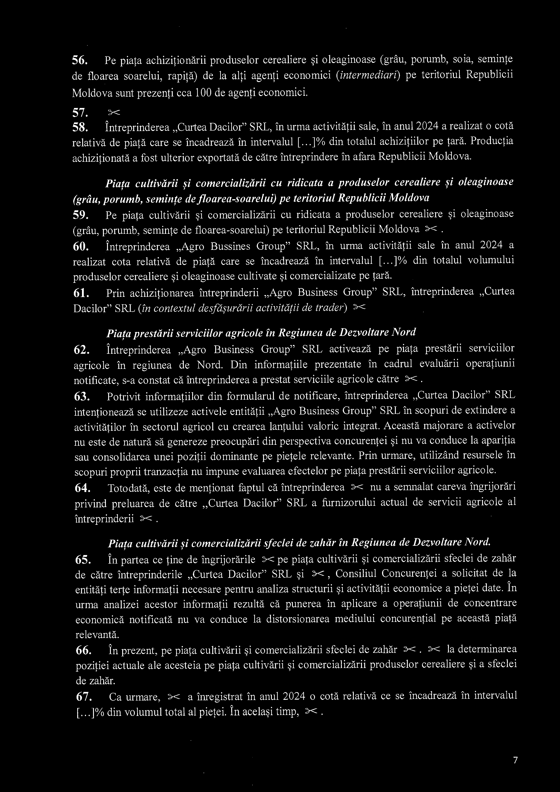
56. 
Pe piata achizitionarii produselor cerealiere 
oleaginoase (gnlu , porumb , soia, seminte 
de floarea soarelui , rapita) de la alti agenti economici (intermediari) pe teritoriul Republicii 
Moldova sunt prezenti cca 100 de agenti economici . 
57. 
:?;-< 
58. 
Intreprinderea ,,Curtea Dacilor" SRL, in urma activitatii sale, in anul 2024 a realizat o cota 
relativa de piata care se incadreaza in intervalul [ ... ]% din totalul achizitiilor pe tara. Produqi a 
achizitionata a fost ulterior exportata de catre intreprindere in afara Republicii Moldova. 
Pia/a cultivarii 
comercializarii cu ridicata a produselor cerealiere 
oleaginoase 
(grfm, porumb, seminfe de floarea-soarelui) pe teritoriul Republicii Moldova 
59. 
Pe piata cultivarii 
comercializarii cu ridicata a produselor cerealiere 
oleaginoa se 
(gnlu, porumb , seminte de floarea-soarelui) pe teritoriul Republicii Moldova :??< . 
60. 
intreprinderea ,,Agro Bussines Group " SRL, in urma activitatii sale in anul 2024 a 
realizat cota relativa de piata care se incadreaza in intervalul [ ... ]% din totalul volumului 
produselor cerealiere 
oleaginoase cultivate 
comercializate pe tara. 
61. 
Prin achizitionarea intreprinderii ,,Agro Busines s Group " SRL, intreprindere a ,,Curtea 
Dacilor" SRL (fn contextul 
activita{ii de trader) :;..< 
Pia/a prestarii serviciilor agricole in Regiunea de Dezvoltare Nord 
62. 
Intreprinderea 
,,Agro Business Group" SRL activeaza pe piata prestarii serviciilor 
agricole in regiunea de Nord. Din informatiile prezentate in cadrul evaluarii operatiunii 
notificate , s-a constat ca intreprinderea a prestat serviciile agricole catre :;..< . 
63. 
Potrivit informatiilor din formularul de notificare , intreprinderea ,,Curtea Dacilor " SRL 
intentioneaza se utilizeze activele entitatii ,,Agro Business Group " SRL in scopuri de extindere a 
activitatilor in sectorul agricol cu crearea lantului valoric integrat. Aceasta majorare a activelor 
nu este de natura sa genereze preocupari din perspecti va concurentei 
nu va conduce la aparitia 
sau consolidarea unei pozitii dominante pe pietele relevante. Prin urmare , utilizand resursele in 
scopuri proprii tranzaqia nu impune evaluarea efectelor pe piata prestarii serviciilor agricole. 
64. 
Totodata , este de mentionat faptul ca intreprinderea 
:;..< nu a sernnalat careva ingrijorari 
privind preluarea de catre ,,Curtea Dacilor" SRL a furnizorului actual de servicii agricole al 
intreprinderii 
:??< . 
Pia/a cultivarii 
comercializarii sfeclei de zahar in Regiunea de Dezvoltare Nord. 
65. 
in partea ce tine de ingrijorarile 
:??< pe piata cultivarii 
comercializarii sfeclei de zahar 
de catre intreprinderile ,,Curtea Dacilor " SRL 
:;..< , Consiliul Concurentei a solicitat de la 
entitati terte informatii necesare pentru analiza structurii 
activitatii economice a pietei date. in 
urma analizei acestor informatii rezulta ca punerea in aplicare a operatiunii de concentrare 
economica notificata nu va conduce la distorsionarea mediului concurential pe aceasta piata 
relevanta . 
66. 
in prezent, pe piata cultivarii 
comercializarii sfeclei de zahar :??< . :;..< la determinarea 
pozitiei actuale ale acesteia pe piata cultivarii 
comercializarii produselor cerealiere 
a sfeclei 
de zahar. 
67. 
Ca urmare, :;.< a imegistrat in anul 2024 o cota relativa ce se incadrea za in intervalul 
[ ... ]% din volumul total al pietei. In 
timp, :;..< 
7 

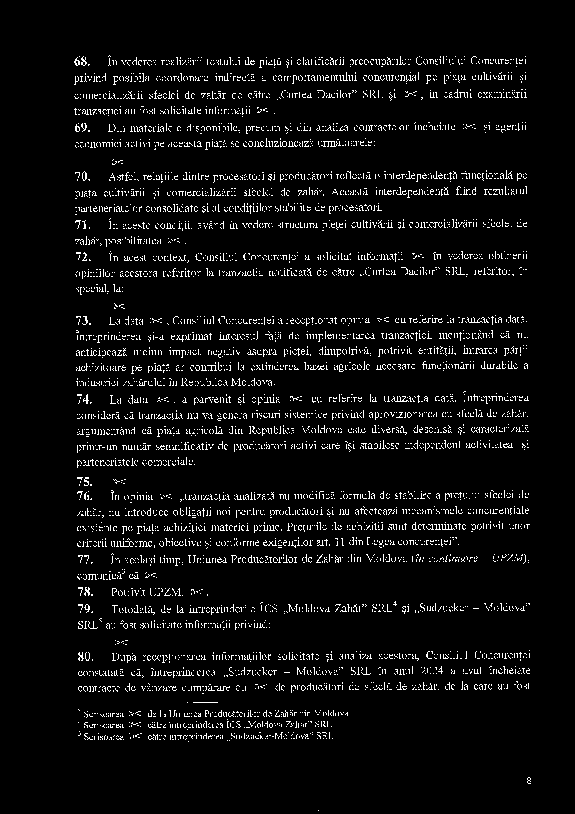
68. 
In vederea realizarii testului de piata 
clarificarii preocuparilor Consiliului Concurentei 
privind posibila coordonare indirecta a comportamentului concurential pe piata cultivarii 
comercializarii sfeclei de zahar de catre ,,Curtea Dacilor" SRL 
x , in cadrul examinarii 
tranzactiei au fost solicitate informatii x . 
69. 
Din materialele disponibile, precum 
din analiza contractelor incheiate x 
agentii 
economici activi pe aceasta piata se concluzioneaza urmatoarele: 
x 
70. 
Astfel, relatiile dintre procesatori 
producatori reflecta o interdependenta functionala pe 
piata cultivarii 
comercializarii sfeclei de zahar. Aceasta interdependenta fiind rezultatul 
parteneriatelor consolidate 
al conditiilor stabilite de procesatori. 
71. 
In aceste conditii, avand in vedere structura pietei cultivarii 
comercializarii sfeclei de 
zahar, posibilitatea x . 
72. 
In acest context, Consiliul Concurentei a solicitat informatii x 
in vederea obtiner ii 
opiniilor acestora referitor la tranzaqia notificata de catre ,,Curtea Dacilor" SRL, referitor, in 
special, la: 
x 
73. 
La data x , Consiliul Concurentei a receptionat opinia x 
cu referire la tranzactia data. 
Intreprinderea 
exprimat interesul fata de implementarea tranzactiei, mentionand ca nu 
anticipeaza niciun impact negativ asupra pietei, dimpotriva, potrivit entitatii, intrarea partii 
achizitoare pe piat§. ar contribui la extinderea bazei agricole necesare functionarii durabile a 
industriei zaharului in Republica Moldova. 
7 4. 
La data x , a parvenit 
opinia x 
cu referire la tranzacfia data. Intreprinderea 
considera ca tranzactia nu va genera riscuri sistemice privind aprovizionarea cu sfecla de zahar, 
argumentand ca piata agricola din Republica Moldova este diversa, deschisa 
caracterizata 
printr-un numar sernnificati v de producatori activi care 
stabilesc independent activitatea 
parteneriatele comerciale. 
75. 
:?< 
76. 
in opinia x 
,,tranzactia analizata nu modifica formula de stabilire a pretului sfeclei de 
zahar, nu introduce obligatii noi pentru producatori 
nu afecteaza mecanismele concurentiale 
existente pe piata achizitiei materiei prime. Preturile de achizitii sunt determinate potrivit unor 
criterii uniforme, obiective 
conforme exigentilor art. 11 din Legea concurentei ". 
77. 
In 
timp, Uniunea Producatorilor de Zahar din Moldova (fn continuare - UPZM), 
comunica 3 ca x 
78. 
Potrivit UPZM, x . 
79. 
Totodata , de la intreprinderile ICS ,,Moldova Zahar" SRL 4 
,,Sudzucker - Moldova" 
SRL5 au fost solicitate informatii privind: 
80. 
Dupa receptionarea informati ilor solicitate 
analiza acestora , Consiliul Concurentei 
constatata ca, intreprinderea ,,Sudzucker -
Moldova" SRL in anul 2024 a avut incheiate 
contracte de vanzare cumparare cu :?< de producatori de sfecla de zahar, de la care au fost 
3 Scrisoarea X 
de la Uniunea Producatorilor de Zahar din Moldova 
4 Scrisoarea :?< catre intreprinderea I CS ,,Moldova Zahar" SRL 
5 Scrisoarea X 
catre 'intreprinderea ,,Sudzucker-Moldova " SRL 
8 

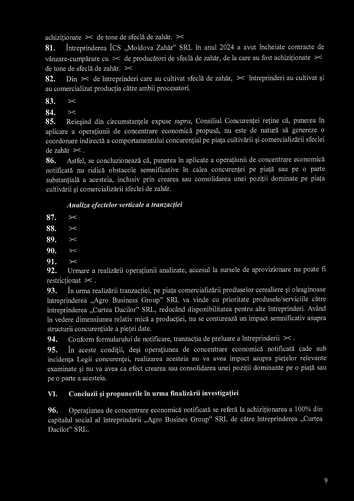
achizitionate x 
de tone de sfecla de zahar. x 
81. 
Intreprinderea res ,,Moldova Zahar" SRL in anul 2024 a avut incheiate contracte de 
vanzare-cumparare cu x 
de producatori de sfecla de zahar, de la care au fost achizitionate x 
de tone de sfecla de zahar. x 
82. 
Din x 
de intreprinderi care au cultivat sfecla de zahar, x 
intreprinderi au cultivat 
au comercializat productia catre ambii procesatori. 
83. 
x 
84. 
:;.< 
85. 
din circumstantele expuse supra, Consiliul Concurentei retine ca, punerea in 
aplicare a operatiunii de concentrare economica propusa, nu este de natura sa genereze o 
coordonare indirecta a comportamentului concurential pe piata cultivarii 
comercializarii sfeclei 
de zahar x
. 
86. 
Astfel, se concluzioneaza ca, punerea in aplicate a operatiunii de concentrare economica 
notificata nu ridica obstacole sernnificative in calea concurentei pe piata sau pe o parte 
substantiala a acesteia, incl us iv prin crearea sau conso lidarea unei pozitii dominate pe piata 
cultivarii 
comercializarii sfeclei de zahar. 
Analiza efectelor verticale a tranzacfiei 
87. 
x 
88. 
89. 
x 
90. 
x 
91. 
x 
92. 
Urmare a realizarii operatiunii analizate, accesul la sursele de aprovizionare nu poate fi 
restrictionat x . 
93. 
In urma realizarii tranzactiei, pe piata comercializarii produselor cerealiere 
oleaginoase 
intreprinderea ,,Agro Business Group" SRL va vinde cu prioritate produsele/serviciile catre 
intreprinderea ,,Curtea Dacilor" SRL, reducand disponibilitatea pentru alte intreprinderi . Avand 
in vedere dimensiunea relativ mica a produqiei, nu se contureaza un impact sernnificativ asupra 
structurii concurentiale a pietei date. 
94. 
Conform formularului de notificare, tranzactia de preluare a intreprinderii x . 
95. 
In aceste conditii, 
operatiunea de concentrare economica notificata cade sub 
incidenta Legii concurentei, realizarea acesteia nu va avea impact asupra pietelor relevante 
examinate 
nu va avea ca efect crearea sau consolidarea unei pozitii dominante pe o piata sau 
pe o parte a acesteia. 
VI. 
Concluzii 
propunerile in urma finalizarii investigatiei 
96. 
Operatiunea de concentrare economica notificata se refera la achizitionarea a 100% din 
capitalul social al intreprinderii ,,Agro Busines Group" SRL de catre intreprinderea ,,Curtea 
Dacilor" SRL. 
9 

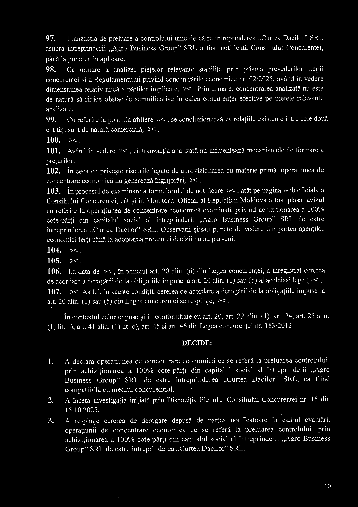
97. 
Tranzactia de preluare a controlului unic de catre intreprinderea ,,Curtea Dacilor" SRL 
asupra intreprinderii ,,Agro Business Group" SRL a fost notificata Consiliului Concurentei, 
pana la punerea in aplicare . 
98. 
Ca urmare a analizei pietelor relevante stabilite prin prisma prevederilor Legii 
concurentei 
a Regulamentului privind concentrarile economice nr. 02/2025, avand in vedere 
dimensiunea relativ mica a partilor implicate, :}< . Prin urmare, concentrarea analizata nu este 
de natura sa ridice obstacole semnificative in calea concurentei efective pe pietele relevante 
analizate. 
99. 
Cu referire la posibila afiliere :}< , se concluzioneaza ca relatiile existente intre cele doua 
entitati sunt de natura comerciala, :}< . 
100. 
;}< 
. 
101. Avand in vedere :}<, ca tranzactia analizata nu influenteaza mecanismele de formare a 
preturilor. 
102. In ceea ce 
riscurile legate de aprovizionarea cu materie prima, operatiunea de 
concentrare economica nu genereaza ingrijorari, x . 
103. In procesul de examinare a formularului de notificare x, atat pe pagina web oficiala a 
Consiliului Concurentei, cat 
in Monitorul Oficial al Republicii Moldova a fost plasat avizul 
cu referire la operatiunea de concentrare econornica examinata privind achizitionarea a 100% 
cote-parti din capitalul social al intreprinderii ,,Agro Business Group" SRL de catre 
intreprinderea ,,Curtea Dacilor" SRL. Observatii 
puncte de vedere din partea agentilor 
economici terti pana la adoptarea prezentei decizii nu au parvenit 
104. 
x
. 
105. 
x
. 
106. La data de x, in temeiul art. 20 alin. (6) din Legea concurentei , a inregistrat cererea 
de acordare a derogarii de la obligatiile impuse la art. 20 alin. (1) sau (5) al 
lege ( x ). 
107. 
x 
Astfel, in aceste conditii, cererea de acordare a derogarii de la obligatiile impuse la 
art. 20 alin. ( 1) sau ( 5) din Legea concurentei se respinge, :;.< . 
In contextul celor expuse 
in conformitate cu art. 20, art. 22 alin. (1), art. 24, art. 25 alin. 
(1) lit. b), art. 41 alin. (1) lit. o), mi. 45 
art. 46 din Legea concurentei nr. 183/2012 
DECIDE: 
1. 
A declara operatiunea de concentrare economica ce se refera la preluarea controlului , 
prin achizitionarea 
a 100% cote-parti din capitalul social al intreprinderii 
,,Agro 
Business 
Group " SRL de catre intreprinderea 
,,Curtea Dacilor " SRL, ca fiind 
compatibila cu mediul concurential. 
2. 
A inceta investigatia initiata prin Dispozitia Plenului Consiliului Concurentei nr. 15 din 
15.10.2025. 
3. 
A respinge cererea de derogare depusa de partea notificatoare in cadrul evaluarii 
operatiunii de concentrare 
economica 
ce se refera la preluarea 
controlului , prin 
achizitionarea a 100% cote-parti din capitalul social al intreprinderii ,,Agro Business 
Group" SRL de catre intreprinderea ,,Curtea Dacilor" SRL. 
10 

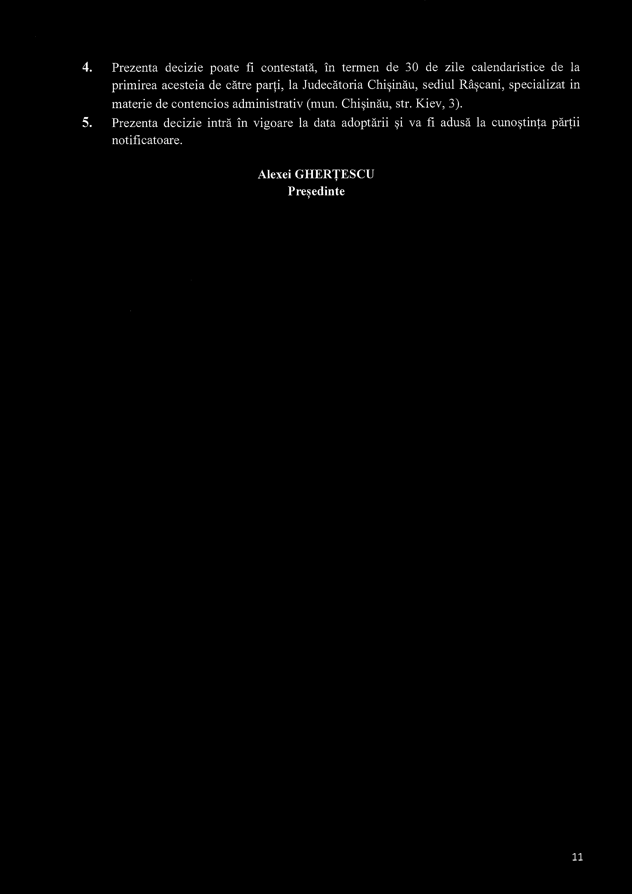
4. 
Prezenta decizie poate fi contestata, In termen de 30 de zile calendaristice de la 
primirea acesteia de catre parti, la Judecatoria 
sediul 
specializat in 
materie de contencios administrativ (mun. 
str. Kiev, 3). 
5. 
Prezenta decizie intra In vigoare la data adoptarii 
va fi adusa la 
partii 
notificatoare . 
Alexei GHERTESCU 
Presedinte 
' 
11 
