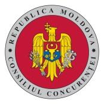
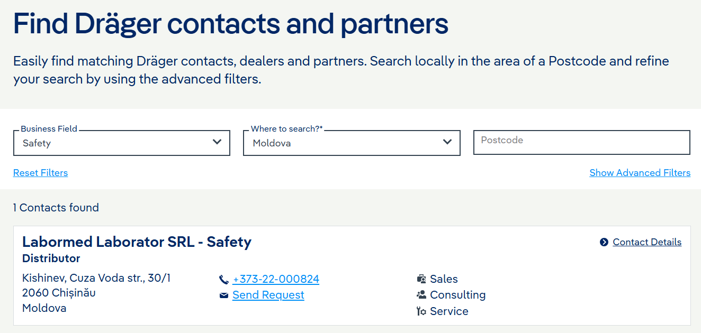

CONSILIULUI    CONCURENŢEI 
 
 
 
 
Republica Moldova, MD-2068, Сhişinău, str. Alecu Russo, 1 
E-mail: office@competition.md,  www.competition.md 
 
DECIZIA  
PLENULUI CONSILIULUI CONCURENȚEI  
nr. APD – 05/19-17 din 05.06.2026  
privind constatarea încălcării prevederilor art. 11 alin. (1) și (2) lit. 
e) din Legea concurenței nr. 183/2012 în cauza inițiată prin 
Dispoziția Plenului Consiliului Concurenței nr. 05 din 07.03.2019 
și sancționarea întreprinderii 
„Labromed Laborator” SRL 
 
 
 
 
 
 
 
 
 
 
 
1 
 

 
Cuprins 
 
1. 
INTRODUCERE ................................................................................................. 5 
2. 
PĂRȚILE IMPLICATE ...................................................................................... 7 
2.1. 
Reclamant: „Reţelele Electrice de Distribuţie Nord” SA ................................... 7 
2.2. 
Reclamat: „Labromed Laborator” SRL .............................................................. 7 
3. 
ASPECTE PROCEDURALE ............................................................................. 7 
4. 
PIAȚA RELEVANTĂ: PIAȚA PRODUSULUI ȘI PIAȚA GEOGRAFICĂ ... 9 
4.1. 
Piața relevantă a produsului ................................................................................ 9 
4.1.1. Piaţa comercializării etilometrelor incluse în Registrul de Stat al Mijloacelor de 
Măsurare Permise spre Utilizare în Rep. Moldova ........................................... 10 
4.1.2. Piaţa comercializării muștucurilor pentru etilometrele incluse în Registrul de stat 
al mijloacelor de măsurare sau compatibile cu acestea .................................... 15 
4.1.3. Piața prestării serviciilor de calibrare a etilometrelor incluse în Registrul de stat 
al mijloacelor de măsurare ................................................................................ 15 
Observațiile „Labromed Laborator” SRL cu privire la definirea pieței .......... 17 
Poziția Consiliului Concurenței la observațiile „Labromed Laborator” SRL . 17 
4.2. 
Piața geografică relevantă ................................................................................. 19 
Observațiile „Labromed Laborator” SRL cu privire la piața geografică ........ 20 
Poziția Consiliului Concurenței la observația „Labromed Laborator” SRL ... 20 
4.3. 
Poziția dominantă .............................................................................................. 21 
4.3.1.   Poziția dominantă pe piața comercializării etilometrelor incluse în Registrul de 
stat al mijloacelor de măsurare pe teritoriul Rep. Moldova .............................. 21 
4.3.2.  Poziția dominantă pe piața comercializării muștucurilor pentru etilometrele 
incluse în Registrul de stat al mijloacelor de măsurare pe teritoriul Republicii 
Moldova sau compatibile cu acestea ................................................................. 23 
4.3.3.   Poziția dominantă pe piața prestării serviciilor de calibrare a etilometrelor incluse 
în Registrul de stat al mijloacelor de măsurare pe teritoriul Rep. Moldova ..... 24 
Observațiile „Labromed Laborator” SRL cu privire la poziția dominantă ..... 26 
Poziția Consiliului Concurenței la observația „Labromed Laborator” SRL ... 26 
4.4. 
PERIOADA DE TIMP SUPUSĂ EXAMINĂRII .............................................. 2 
5. 
ACTE ȘI FAPTE CONSTATATE ................................................................... 29 
5.1. 
Circumstanțe contextuale cauzei investigate  ................................................... 29 
Observațiile „Labromed Laborator” SRL privind lipsa temeiului pentru 
invocarea de către „Rețele Electrice de Distribuție Nord” SA a încălcării art. 1 
din Legea nr. 183/2012 ...................................................................................... 30 
Poziția Consiliului Concurenței la observațiile „Labromed Laborator” SRL . 30 
5.2. 
Analiza acțiunii prin prisma art. 11 din Legea nr. 183/2012 ............................ 31 
2 
 

5.2.1.  Analiza acțiunii de practicare a unor prețuri excesive la comercializarea 
etilometrelor ...................................................................................................... 32 
5.2.2.  Analiza acțiunii de practicarea a unor prețuri excesive la comercializarea 
muștucurilor pentru etilometrele ....................................................................... 46 
5.2.3.    Analiza acțiunii de practicarea a unor prețuri excesive la furnizarea serviciilor de 
calibrare a etilometrelor  ................................................................................... 52 
5.3. 
Analiza diferențelor dintre prețul de achiziție și prețul de vânzare practicat de 
întreprindere în piețe concurențiale – element probator suplimentar al 
caracterului excesiv al prețurilor ....................................................................... 58 
5.4. 
Concluzii cu privire la analiza comportamentului supus investigației  ............ 59 
6. 
CALIFICAREA LEGALĂ A FAPTEI SUPUSE INVESTIGAȚIEI ............... 61 
6.1. 
Aplicabilitatea art. 11 alin. (1) și (2) din Legea nr. 183/2012  ................................ 61 
6.1.1.  Abuzul de poziție dominantă prin practicarea unor prețuri excesive la 
comercializarea etilometrelor incluse în Registrul de stat al mijloacelor de 
măsurare pe teritoriul Rep. Moldova de către „Labromed Laborator” SRL .... 65 
6.1.2.  Abuzul de poziție dominantă prin practicarea unor prețuri excesive la 
comercializarea muștucurilor aferente etilometrelor incluse în Registrul de stat 
al mijloacelor de măsurare sau compatibile cu acestea pe teritoriul Rep. Moldova 
de către „Labromed Laborator” SRL ................................................................ 66 
6.1.3.      Abuzul de poziție dominantă prin practicarea unor prețuri excesive la furnizarea 
serviciilor de calibrare aferente etilometrelor incluse în Registrul de stat al 
mijloacelor de măsurare pe teritoriul Rep. Moldova de către „Labromed 
Laborator” SRL ................................................................................................. 68 
6.2. 
Calificarea faptei investigate ca unică și continuă ........................................................ 72 
7. 
DREPTUL LA APĂRARE AL ÎNTREPRINDERII RECLAMATE .............. 74 
7.1. 
Remiterea raportului de investigație pentru transmiterea de observații, accesul la 
dosar și desfășurarea audierilor ............................................................................................ 74 
7.2. 
Observațiile „Labromed Laborator” SRL și poziția Consiliului Concurenței. 74 
7.2.1.     Competența legală de investigare și extindere a obiectului investigației...........74 
7.2.2.     Aplicabilitatea art. 11 alin. (1) și (2) lit. e) din Legea nr. 183/2012..................76 
7.2.3.   Aplicabilitatea prevederilor din Regulamentul privind stabilirea poziției 
dominante și evaluarea abuzului de poziție dominantă nr. 16/2013..................78 
7.2.4.     Cu privire la invocarea cauzei „United Brands” în analiza prețului excesiv.....80 
7.2.5.     Argumentele privind corectitudinea corelării cheltuielilor cu ponderea 
veniturilor din activitățile de comercializare și necesitatea aplicării unei 
metodologii proporționale și justificate.............................................................81 
7.2.6.   Referitor la concluzia Consiliului Concurenței că reclamatul a supraevaluat 
valoarea medie în vamă a unui aparat Drager Alcotest 6820, în set . ..............84 
7.2.7.      Invocarea libertății de stabilire a prețurilor și a pretinsei acceptări instituționale 
a nivelului acestora ........................................................................................... 85 
3 
 

7.2.8.   Invocarea negocierilor cu producătorul Dräger ca argument al discrepanței 
nivelurilor de preț în actele prezentate de reclamat ......................................... 88 
7.2.9.   Contestarea relevanței comparației geografice și a omogenității piețelor de 
referință (România și Ucraina)  ........................................................................ 89 
7.2.10.  Contestarea comparabilității produselor utilizate în analiza prețurilor pe piețe 
concurențiale (electrozi ECG și aparate de ras utilizate în medii medicale)  .. 90 
7.2.11.   Contestarea existenței efectelor economice negative ....................................... 92 
8.           CONSECINȚELE JURIDICE ȘI INDIVIDUALIZAREA SANCȚIUNII ...... 94 
8.1.        Gravitatea .......................................................................................................... 94 
Observația „Labromed Laborator” SRL referitor la gravitatea faptei ............ 96 
Poziția Consiliului Concurenței ........................................................................ 97 
8.2.        Durata ................................................................................................................ 98 
Observația „Labromed Laborator” SRL referitor la durata faptei.................. 99 
Poziția Consiliului Concurenței ........................................................................ 99 
8.3.        Nivelul de bază al amenzii stabilit corespunzător faptei investigate .............. 100 
 
 
 
 
 
 
 
 
 
 
 
 
 
 
 
 
4 
 

Decizia 
Plenului Consiliului Concurenței  
nr. APD-05/19-17 din 05.06.2026 
privind constatarea încălcării prevederilor art. 11 alin. (1) și (2) lit. e) din 
Legea concurenței nr. 183/2012 (în redacția în vigoare la momentul realizării 
faptei) în cauza inițiată prin Dispoziția Plenului Consiliului Concurenței nr. 
05 din 07.03.2019 (cu modificările ulterioare) 
și sancționarea întreprinderii 
„Labromed Laborator” SRL 
 
 
PLENUL CONSILIULUI CONCURENŢEI,  
 
acționând în temeiul art. 41 din Legea concurenței nr. 183/2012, Hotărârii 
Parlamentului nr. 56/2026 privind numirea în funcție a unui membru și președinte a 
Plenului Consiliului Concurenței, Hotărârii Parlamentului nr. 380/2023 privind 
numirea în funcția de vicepreședinte al Plenului Consiliului Concurenței, Hotărârii 
Parlamentului nr. 381/2023 privind numirea în funcția de membru al Plenului 
Consiliului Concurenței, Hotărârii Parlamentului nr. 211/2024 privind numirea în 
funcția de membru al Plenului Consiliului Concurenței,  
 
examinând raportul de investigație asupra cazului, materialele acumulate în cadrul 
investigației, observațiile prezentate de părți la raportul de investigație și luând în 
considerare argumentele invocate de „Labromed Laborator” SRL în cadrul 
audierilor, 
a emis următoarea decizie: 
                                                                                                                                                  
1. INTRODUCERE 
(1). 
Obiect al investigației realizate de Consiliul Concurenței a constituit 
comportamentul pe piață al întreprinderii „Labromed Laborator” SRL în perioada 
2017–2024, perioadă în care aceasta, potrivit analizei realizate, a deținut o poziție 
dominantă pe piețele relevante supuse examinării, poziție caracterizată prin cote de 
piață foarte ridicate, ajungând până la 100%, precum și prin existența unor bariere 
legale și tehnice semnificative la intrarea pe piață, care au generat o dependență 
economică față de furnizorul respectiv. 
5 
 

(2). 
Prezenta decizie vizează finalizarea investigației inițiate de Consiliul Concurenței 
referitor la încălcare de către „Labromed Laborator” SRL a prevederilor art. 11 alin. 
(1) și (2) lit. e) din Legea concurenței nr. 183/2012 (în continuare – Legea nr. 
183/2012), constând în practicarea unor prețuri excesive la comercializarea 
aparatelor de măsurare a concentrației etanolului în aerul expirat (în continuare - 
etilometre), a muștucurilor și la furnizarea serviciilor de calibrare aferente acestora 
pe teritoriul Republicii Moldova. 
(3). 
Investigația a fost inițiată prin Dispoziția Plenului Consiliului Concurenței nr. 05 din 
07.03.2019 (cu modificările ulterioare) ca urmare a plângerii depuse de către 
„Reţelele Electrice de Distribuţie Nord” SA nr. satru01/86 din 21.01.2019, care viza 
un posibil abuz de poziţie dominantă din partea „Labromed Laborator” SRL la 
vânzarea unui aparat de măsurare a concentrației etanolului în aerul expirat „Dräger 
Alcotest 6820”.  
(4). 
Analiza realizată a avut în vedere specificul piețelor relevante, caracterul 
reglementat 
al 
acestora, 
interdependența 
funcțională 
dintre 
etilometre, 
consumabilele aferente și serviciile de calibrare, precum și faptul că produsele și 
serviciile respective sunt indispensabile pentru desfășurarea activităților în domenii 
de interes public major, inclusiv siguranța rutieră, sănătatea publică și ordinea 
publică. 
(5). 
În cadrul examinării cauzei, Consiliul Concurenței a realizat o analiză economică 
detaliată, bazată pe aplicarea testelor preț–cost, pe analize comparative ale nivelului 
prețurilor practicate pe piețele învecinate, precum și pe evaluarea valorii economice 
a produselor și serviciilor furnizate. Rezultatele investigației au demonstrat existența 
unor diferențe semnificative și nejustificate între costurile efective suportate de 
întreprindere și prețurile aplicate clienților, respectiv diferențe de până la 490% 
pentru etilometre, de până la 733% pentru muștucuri, precum și marje de profit brut 
de până la 1039% pentru servicii de calibrare, diferențe care nu pot fi justificate prin 
costuri suplimentare relevante, investiții proprii semnificative sau prin existența unei 
valori adăugate obiective. 
(6). 
Consiliul Concurenței a constatat că, în perioada examinată, comportamentul 
întreprinderii „Labromed Laborator” SRL a generat efecte negative asupra 
concurenței și consumatorilor, în special asupra autorităților / instituțiilor publice și 
a întreprinderilor obligate legal să utilizeze produsele și serviciile respective, 
determinând utilizarea ineficientă a fondurilor publice și afectând funcționarea 
normală a mecanismului concurențial. 
(7). 
Consiliul Concurenței reține că aplicarea sistematică și neîntreruptă, pe parcursul 
perioadei investigate, a unor prețuri excesive pentru produse și servicii 
6 
 

interdependente, de către aceeași întreprindere aflată în poziție dominantă, constituie 
o faptă unică și continuă de abuz de poziție dominantă. 
 
2. PĂRȚILE IMPLICATE 
2.1. Reclamant: 
(8). 
„Reţelele Electrice de Distribuţie Nord” Societate pe acțiuni, IDNO 
1003602006563, cu sediul juridic: str. Ștefan cel Mare, 180 “A”, mun. Bălţi, MD-
3100, Republica Moldova, întreprindere cu capital majoritar de stat, activă pe piața 
distribuției energiei electrice în zona de nord a Republicii Moldova conform licenței 
nr. AMMI 000097 din 05.06.2023, valabilă până la 04.06.2048. Serviciul de 
distribuție a energiei electrice este o activitate reglementată, bazată pe tarifele de 
distribuție aprobate de ANRE – Agenția Națională pentru Reglementare în 
Energetică a Republicii Moldova. Întreprinderea realizează și alte activități, precum: 
proiectarea instalațiilor electrice de tensiune medie și joasă, prestarea serviciilor 
auxiliare legate de distribuția şi furnizarea energiei electrice, construcția rețelelor de 
distribuție a energiei electrice, comercializarea utilajului, aparatelor şi dispozitivelor 
electronice şi a pieselor de rezervă, activitatea de reparare, montare, etalonare, 
comercializare şi a mijloacelor de măsurare ș.a.1 
 
2.2. Reclamat: 
(9). 
„Labromed 
Laborator” 
Societate 
cu 
răspundere 
limitată, 
IDNO 
1012600001177, cu sediul juridic: str. Trandafirilor, 15, ap.132, mun. Chișinău, MD-
2038, Republica Moldova, întreprindere a cărei activitate constă în importul, 
comercializarea și deservirea tehnică (calibrare, reparație) a etilometrelor și a altor 
dispozitive și consumabile medicale. Întreprinderea este unul dintre distribuitorii 
producătorului german de produse medicale și de siguranță Dräger Safety AG & Co. 
KgaA în Republica Moldova. 
 
3. ASPECTE PROCEDURALE 
(10). Plenul Consiliului Concurenței, în baza notei informative cu privire la propunerea 
de inițiere a investigației nr. APD-07/54 din 21.02.2019, având în vedere aspectele 
sesizate în plângerea înregistrată cu nr. satru01/86 din 21.01.2019, depusă de 
„Reţelele Electrice de Distribuţie Nord” SA, precum și materialele acumulate pe 
parcursul examinării preliminare, prin Dispoziția nr. 05 din 07.03.2019, a dispus 
inițierea unei investigații cu privire la posibila încălcare a prevederilor art. 11 alin. 
 
1 https://rednord.md/prezentare-generala 
7 
 

(1) și (2) lit. a) din Legea nr. 183/2012 de către „Labromed Laborator” SRL, privind 
impunerea unor condiții inechitabile la vânzarea etilometrelor. 
(11). Pe parcursul investigației au fost determinate indicii temeinice care au permis 
deducerea faptului că aplicarea unor prețuri excesive de către „Labromed Laborator” 
SRL nu a fost îndreptată doar către autorul plângerii, ci și către alte întreprinderi, și 
nu doar la comercializarea etilometrelor, dar și a muștucurilor, inclusiv la prestarea 
serviciilor de calibrare aferente etilometrelor. Având în vedere aceste indicii atestate, 
s-a considerat oportun extinderea obiectului investigației pentru a include atât 
comercializarea muștucurilor, cât și prestarea serviciilor de calibrare aferente 
etilometrelor. În consecință, a fost modificată dispoziția de inițiere a investigației, în 
conformitate cu prevederile art. 11 alin. (2) lit. e) din Legea nr. 183/2012, care 
interzice distinct abuzul de poziție dominantă manifestat sub forma impunerii de 
prețuri excesive față de forma de încălcare privind aplicarea unor prețuri 
inechitabile. 
(12). Astfel, în temeiul art. 41 lit. v) din Legea nr. 183/2012, prin Dispoziția Plenului 
Consiliului Concurenței nr. 08 din 20.05.2025, a fost dispusă investigarea acțiunilor 
întreprinderii „Labromed Laborator” SRL care prezentau semne ale încălcării 
prevederilor art. 11 alin. (1) și (2) lit. e) din Legea nr. 183/2012 privind practicarea 
unor prețuri excesive la comercializarea etilometrelor, a muștucurilor și la prestarea 
serviciilor de calibrare aferente acestora pe teritoriul Republicii Moldova. 
(13). În cadrul investigației, Consiliul Concurenței a adresat mai multe solicitări de 
informații atât întreprinderilor implicate, cât și altor participanți relevanți de pe 
piețele comercializării etilometrelor incluse în Registrul de stat al mijloacelor de 
măsurare, al muștucurilor compatibile și al serviciilor de calibrare aferente, în 
vederea clarificării comportamentului pe piață al întreprinderii „Labromed 
Laborator” SRL și a evaluării impactului acestuia asupra concurenței. 
(14). În urma finalizării investigației prin raportul de investigație (comunicat și 
recepționat de către întreprinderile implicate la data de 04.11.2025), a fost propusă 
constatarea încălcării art. 11 alin. (1) și (2) lit. e) din Legea nr. 183/2012 și 
sancționarea întreprinderii „Labromed Laborator” SRL. 
(15). Urmare a cererii de acces la dosarul Consiliului Concurenței de investigație depuse 
de întreprinderea „Labromed Laborator” SRL, la data de 02.12.2025 a fost asigurat 
accesul la dosar prin punerea la dispoziție a copiilor documentelor în format 
electronic, fapt consemnat în declarația de acces. 
(16). Urmare a cererii din partea întreprinderii „Labromed Laborator” SRL din data de 
09.11.2025, 28.11.2025 și 03.12.2025, termenul de prezentare a observațiilor la 
raportul de investigație a fost prelungit până la data de 23.12.2025 inclusiv, fapt 
comunicat întreprinderii la data de 08.12.2025. 
8 
 

(17). Întreprinderea „Labromed Laborator” SRL a prezentat Consiliului Concurenței 
observațiile la raportul de investigație la data de 23.12.2025 (scrisoare nr. 14 din 
09.11.2025).  
(18). Consiliul Concurenței a organizat o ședință de audieri cu reprezentanții întreprinderii 
„Labromed Laborator” SRL la data de 24.12.2025 în cadrul căreia au fost expuse 
argumentele și poziția acesteia cu privire la constatările din raportul de investigație. 
(19). La data de 05.06.2026, având în vedere materialele acumulate la dosarul cauzei, 
inclusiv raportul de investigație, observațiile întreprinderii investigate și rezultatele 
audierilor, Plenul Consiliului Concurenței adoptă prezenta Decizie. 
 
4. PIAȚA RELEVANTĂ: PIAȚA PRODUSULUI ŞI PIAȚA GEOGRAFICĂ  
(20). Examinarea problemelor concurențiale şi evaluarea unei cauze de concurență se 
efectuează în cadrul pieței relevante.  
(21). Determinarea pieței relevante reprezintă un instrument de identificare şi de definire 
a cadrului în care se exercită concurența. În funcție de natura problemei 
concurențiale, dimensiunile pieței relevante pot fi diferite. 
(22). Piața relevantă se determină prin raportarea pieţei relevante a produsului la piaţa 
geografică relevantă. 
 
4.1. Piața relevantă a produsului 
(23). Potrivit prevederilor art. 4 din Legea nr. 183/2012, conceptul de piață relevantă a 
produsului este piață a produselor considerate de către consumatori ca 
interschimbabile sau substituibile datorită utilizării date acestora, datorită 
caracteristicilor fizice, funcționale şi a prețului.  
(24). Din punct de vedere economic, pentru definirea pieței relevante, substituibilitatea 
din punctul de vedere al cererii constituie cea mai directă și eficace forță care 
acționează asupra celor care furnizează un anumit produs, în special în ceea ce 
privește deciziile pe care le iau aceștia referitor la stabilirea prețurilor. O 
întreprindere nu poate avea un impact semnificativ asupra condițiilor de vânzare 
existente, cum ar fi prețurile, dacă clienții săi sunt în măsură să se orienteze fără 
dificultate spre produse substituibile sau spre furnizori situați în altă parte. Prin 
urmare, procesul de definire a pieței relevante constă, în principal, în identificarea 
surselor alternative reale de aprovizionare la care clienții întreprinderilor în cauză 
pot apela, atât sub aspectul produselor / serviciilor propuse de ceilalți furnizori, cât 
și sub aspectul localizării geografice a acestora.  
9 
 

(25). În cazul abuzului de poziție dominantă, analiza pieței relevante se realizează de la 
caz la caz, în funcție de circumstanțele specifice fiecărui caz. Analiza care se 
realizează este de tip ex post și are ca scop identificarea rolului și status-ului 
întreprinderilor pe piață. Nu este necesar să se identifice ex ante toate piețele 
posibile, ceea ce se urmărește fiind delimitarea pieței / piețelor asupra cărora 
comportamentul analizat a produs efecte anticoncurențiale. Analiza efectuată pentru 
definirea pieței relevante în cazurile de abuz de poziție dominantă se focalizează, 
deci, pe practica supusă analizei în cazul concret. 
(26). Astfel, la definirea pieței relevante, în cadrul prezentei investigații, Consiliul 
Concurenței a pornit de la îngrijorarea concurențială manifestată prin practicarea 
prețurilor exagerate la produsele și serviciile care fac obiectul acesteia. 
(27). Faptele ce constituie obiectul investigației date vizează comportamentul 
anticoncurențial adoptat pe piață de întreprinderea „Labromed Laborator” SRL în 
ceea ce privește comercializarea etilometrelor, comercializarea muștucurilor, 
precum și prestarea serviciilor de calibrare a acestora. 
(28). Prin urmare, în scopul prezentei investigații, se definesc următoarele piețe relevante 
ale produsului: 
- 
piața comercializării etilometrelor incluse în Registrul de stat al 
mijloacelor de măsurare; 
- 
piața comercializării muștucurilor pentru etilometrele incluse în Registrul 
de stat al mijloacelor de măsurare sau compatibile cu acestea; și 
- 
piața prestării serviciilor de calibrare a etilometrelor incluse în Registrul 
de stat al mijloacelor de măsurare. 
(29). Considerentele luate în calcul la definirea piețelor relevante a produsului sunt 
descrise și analizate, după cum urmează. 
 
4.1.1. Piaţa comercializării etilometrelor incluse în Registrul de Stat al 
Mijloacelor de Măsurare Permise spre Utilizare în Republica Moldova (în 
continuare - Registrul de stat al mijloacelor de măsurare) 
(30). Potrivit Normei de Metrologie Legală NML R126:2009 „Analizator al vaporilor de 
alcool”, etilometrul este un instrument care măsoară concentrația de etanol prin 
analiza aerului pulmonar profund, fiind un aparat portabil, automat, cu acțiune 
ciclică. Principiul de funcționare al analizatorului se bazează pe utilizarea 
traductorului electro-chimic destinat măsurării concentrației de etanol din aerul 
expirat.  
10 
 

(31). Fiind incluse în Lista oficială a mijloacelor de măsurare și a măsurărilor supuse 
controlului metrologic legal (pct. 2.1.1. din tabel), aprobată prin Hotărârea 
Guvernului Republicii Moldova nr. 1042/2016, etilometrele sunt supuse procedurii 
de control metrologic prin aprobare de model2 și verificării metrologice inițiale3 la 
introducerea pe piață și/sau la darea în folosință, potrivit art. 13 alin. (4) din Legea 
metrologiei nr. 19/2016, precum și prin verificarea metrologică periodică4 (intervalul 
maxim admis între două verificări metrologice succesive fiind de 12 luni) și după 
reparare, conform art. 13 alin. (15) lit. a) și b) din Legea metrologiei nr. 19/2016. 
Totodată, pe etilometrele constatate drept corespunzătoare în cadrul controlului 
metrologic legal se aplică marcajul aprobării de model, precum și marcajul de 
verificare metrologică, în conformitate cu prevederile art. 13 alin. (19) lit. a) și b) 
din Legea metrologiei nr. 19/2016.  
(32). Conform normelor naționale NML R126:2009 și celor internaționale OIML R 126, 
CSN EN 15964 „Breath alcohol test devices other than single use devices - 
Requirements and test methods”, etilometrele supuse verificării metrologice sunt 
instrumente certificate pentru a furniza măsurători precise și fiabile, esențiale pentru 
utilizarea lor în scopuri legale, inclusiv în contextul identificării încălcărilor 
legislației și asigurării siguranței în trafic și la locul de muncă. Prin urmare, 
etilometrele care corespund cerințelor NML R126:2009 „Analizator al vaporilor de 
alcool” și care sunt înregistrate ca modele în Republica Moldova și supuse verificării 
metrologice inițiale și periodice nu pot fi considerate substituibile cu alte tipuri de 
aparate de măsurare a concentrației de alcool/etanol în aerul expirat, aflate în vânzare 
în Republica Moldova.  
(33). Conform pct. 4 din Regulamentul privind modul de organizare şi efectuare a 
controlului treziei, aprobat prin Hotărârea Guvernului nr. 290/20165 (modificat prin 
Hotărârea Guvernului nr. 831/23 prin substituirea în denumire și pe tot parcursul 
textului hotărârii și a Regulamentului, a cuvintelor „controlul treziei” cu cuvintele 
„controlul medical”, la forma gramaticală corespunzătoare) în toate unităţile 
(persoane juridice), indiferent de forma juridică de organizare, care deţin mijloace 
de transport de călători şi/sau de mărfuri periculoase şi explozive obligatoriu se 
efectuează controlul treziei. 
 
2 Potrivit art. 3 din Legea metrologiei nr. 19/2016, aprobarea de model este o decizie cu relevanţă legală, bazată pe 
un raport de evaluare, care confirmă că un tip de mijloc de măsurare întruneşte cerinţele stipulate în documentele 
normative aplicabile din domeniul metrologiei legale şi care are ca rezultat emiterea certificatului de aprobare de 
model. 
3 Potrivit art. 3 din Legea metrologiei nr. 19/2016, verificarea metrologică iniţială este o verificare metrologică a unui 
mijloc de măsurare care nu a mai fost verificat anterior. 
4 Potrivit art. 3 din Legea metrologiei nr. 19/2016, verificarea metrologică periodică este verificarea metrologică a 
unui mijloc de măsurare efectuată periodic, la intervale de timp specificate, conform documentelor normative 
aplicabile din domeniul metrologiei legale 
5 https://www.legis.md/cautare/getResults?doc_id=91411&lang=ro# 
11 
 

(34). În aceeași ordine de idei, potrivit art. 11 alin. (1) și (2) din Legea metrologiei nr. 
19/2016, mijloacele de măsurare și măsurările din domeniile de interes public, 
precum sănătatea publică, ordinea și siguranța publică, protecţia mediului, protecţia 
consumatorilor, perceperea taxelor şi impozitelor, corectitudinea tranzacţiilor 
comerciale, se supun controlului metrologic legal. 
(35). De asemenea, potrivit art. 12 alin. (11) lit. b) din Legea metrologiei nr. 19/2016, se 
supun controlului metrologic legal măsurările efectuate asupra unor mărimi ce pot 
afecta interesele vitale ale oamenilor, cum sunt concentraţia de zahăr şi concentraţia 
de alcool în băuturi, concentraţia de grăsimi în produsele alimentare, masa 
hectolitrică şi umiditatea cerealelor, viteza autovehiculelor, concentraţia alcoolică 
în aerul expirat și în sânge etc.  
(36). Reiterăm faptul că, în acord cu art. 13 alin. (4) și (5) din Legea metrologiei nr. 
19/2016, la introducerea pe piaţă şi/sau darea în folosință a mijloacelor de măsurare 
(în speță a etilometrelor), controlul metrologic legal se exercită prin modalități, 
precum:  
- aprobare de model; 
- verificare metrologică inițială; 
- verificare inițială CE, care constă în examinare și stabilire a conformității unui 
mijloc de măsurare nou sau recondiționat cu modelul ce deține aprobare de 
model CE și/sau cu dispozițiile directivelor europene referitoare la mijlocul 
respectiv. Această conformitate este atestată prin marcajul de verificare 
inițială CE, un semn distinctiv care, aplicat pe un mijloc de măsurare în mod 
vizibil, confirmă că verificarea inițială CE a fost efectuată în conformitate cu 
directivele europene, cu rezultate satisfăcătoare; 
- supraveghere a pieței. 
După obținerea aprobării și efectuarea controlului metrologic legal, mijlocul de 
măsurare este înscris în Registrul de stat al mijloacelor de măsurare. 
(37). Astfel, unitățile care desfășoară activități în domeniul sănătății publice, ordinii și 
siguranței publice, protecției mediului, protecției consumatorilor, perceperii taxelor 
și impozitelor, asigurării corectitudinii tranzacțiilor comerciale, precum și în 
transportul de persoane și mărfuri periculoase, și care efectuează controlul treziei 
și/sau măsurări asupra concentraţiei alcoolice în aerul expirat au obligația legală să 
utilizeze exclusiv mijloace de măsurare (etilometre) supuse controlului metrologic 
legal, respectiv care sunt incluse în Registrul de stat al mijloacelor de măsurare. 
 
12 
 

(38). Astfel, în Registrul de stat al mijloacelor de măsurare6, gestionat de Institutul 
Național de Metrologie, sunt incluse următoarele modele de etilometre, care au 
trecut aprobarea de model:  
- Alcotest 7510, producător Dräger Safety AG & Co. KgaA, Republica Federală 
Germania, importator „Labromed Laborator” SRL, nr. de înregistrare în 
registrul de stat I-0990:2017 fiind valabil până la 01.12.2027. 
- Alcotest 3820, producător Dräger Safety AG & Co. KgaA, Republica Federală 
Germania, importator „Labromed Laborator” SRL, nr. de înregistrare în 
registrul de stat I-0992:2018, valabil până la 26.02.2028. 
- Alcotest 5820, producător Dräger Safety AG & Co. KgaA, Republica Federală 
Germania, importator „Labromed Laborator” SRL, nr. de înregistrare în 
registrul de stat I-0993:2018, valabil până la 26.02.2028. 
- Alcotest 6810, producător Dräger Safety AG & Co. KgaA, Republica Federală 
Germania, importator „Labormed” SRL, nr. de înregistrare în registrul de stat 
I-0678:2009, termenul de valabilitate a expirat la data de 14.05.2023. 
- Alcotest 6820, producător Dräger Safety AG & Co. KgaA, Republica Federală 
Germania, importator „Labromed Laborator” SRL, nr. de înregistrare în 
registrul de stat I-0969:2016, valabil până la 22.10.2031. 
- Alcotest 3000, producător Dräger Safety AG & Co. KgaA, Republica Federală 
Germania, importator „Labromed Laborator” SRL, nr. de înregistrare în 
registrul de stat I-0909:2014, valabil până la 16.07.2019 (termen expirat). Prin 
scrisoarea nr. 22/03-19 din 20.03.2019 „Labromed Laborator” SRL a informat 
Consiliul Concurenței că acest model de etilometru nu se mai produce 
începând cu anul 2017, iar începând cu anul 2018 nu a mai fost achiziționat. 
- AL 9000, producător Sentech Korea Corp, Republica Korea, importator 
„Diaron Grup” SRL, nr. de înregistrare în registrul de stat I-0910:2014, 
termenul de valabilitate a expirat la data de 16.07.2019. 
(39). În urma analizei Registrului de stat al mijloacelor de măsurare, se constată că toate 
etilometrele înregistrate ca model în Republica Moldova, cu termen de valabilitate 
activ și supuse controlului metrologic (aprobării de model, verificării metrologice 
inițiale și periodice, cu certificate valabile), sunt fabricate de Dräger Safety AG & 
Co. KgaA, un producător din Republica Federală Germania, al cărui distribuitor în 
Republica Moldova este întreprinderea „Labromed Laborator” SRL. 
(40). În baza Contractului de distribuție , încheiat între „Labromed Laborator” SRL și 
, „Labromed Laborator” SRL este autorizată de  să importe, comercializeze și 
deservească dispozitivele Dräger în Republica Moldova. . Respectiv, oferta 
produsului supus investigației date este asigurată  pe întreg teritoriul Republicii 
 
6 Consultat la data de 16.01.2025 
13 
 

Moldova de către „Labromed Laborator” SRL, a cărei comportament  constituie 
obiectul prezentei investigații.  
(41). Rezultă că, din perspectiva întreprinderilor care desfășoară activități în transportul 
de persoane și mărfuri periculoase și efectuează controlul treziei, conform 
Regulamentului privind modul de organizare şi efectuare a controlului treziei, 
aprobat prin Hotărârea Guvernului nr. 290/2016, precum și a celor care, potrivit art. 
11 alin. (1) din Legea metrologiei nr. 19/2016 activează în domeniul sănătății 
publice, ordinii și siguranței publice, protecției mediului, protecției consumatorilor, 
perceperii taxelor și impozitelor, corectitudinii tranzacțiilor comerciale și efectuează 
măsurări asupra concentraţiei alcoolice în aerul expirat, precum și din perspectiva 
altor întreprinderi, pentru utilizare în scopuri legale, etilometrele care nu sunt incluse 
în Registrul de stat al mijloacelor de măsurare nu pot fi considerate echivalente sau 
substituibile cu cele care se regăsesc în registrul respectiv. 
(42). Ținând cont de lipsa concurenței efective pe piață, de absența alternativelor 
autorizate și de unicitatea sursei de aprovizionare, nu se consideră relevantă 
delimitarea pieței produsului la nivelul fiecărui model individual de etilometru. De 
asemenea, chiar dacă acestea prezintă unele caracteristici diferite (temperatura de 
utilizare, numărul de teste memorate, capacitatea bateriei, posibilitatea introducerii 
datelor persoanei testate ș.a.), în fapt, orice diferențe tehnice și de preț între modele 
nu determină un grad real de substituibilitate pentru utilizatori atâta timp cât 
alternativele (alte mărci de etilometre) sunt practic inexistente. 
(43). Astfel, analiza substituibilității din punct de vedere a cererii indică faptul că, din 
perspectiva utilizatorilor nu există posibilitatea de a substitui un etilometru inclus în 
Registrul de stat al mijloacelor de măsurare cu un alt tip de produs care nu este 
înregistrat sau verificat metrologic. Alegerea între modelele existente ale aceleiași 
mărci nu reprezintă o decizie bazată pe substituibilitate economică, ci una constrânsă 
de lipsa alternativelor reale pe piață. 
(44). În ceea ce privește substituibilitatea din punct de vedere a ofertei, aceasta este, de 
asemenea, inexistentă, în condițiile în care doar întreprinderea „Labromed 
Laborator” SRL comercializează aceste produse în Republica Moldova. Nicio altă 
întreprindere nu este autorizată să furnizeze etilometre incluse în Registrul de stat al 
mijloacelor de măsurare, astfel încât nu se poate vorbi despre o posibilitate, pe 
termen scurt, ca alți ofertanți să intre pe această piață și să poată iniția activități de 
distribuție/comercializare. 
(45). Astfel, având în vedere faptul că etilometrele utilizate în scopuri legale trebuie să fie 
supuse controlului metrologic legal și să fie incluse în Registrul de stat al mijloacelor 
de măsurare, precum și absența unor alternative autorizate și substituibile pe piață, 
14 
 

în contextul prezentei investigații, piața relevantă a produsului se definește ca fiind 
piața comercializării etilometrelor incluse în Registrul de stat al mijloacelor de 
măsurare. 
 
4.1.2. Piaţa comercializării muștucurilor pentru etilometrele incluse în 
Registrul de stat al mijloacelor de măsurare sau compatibile cu acestea 
(46). Muștucurile sunt accesorii consumabile care se fixează pe etilometre și sunt utilizate 
pentru a asigura igiena și corectitudinea rezultatelor măsurărilor. În dependență de 
caz, muștucurile pot fi de unică folosință (de exemplu, în cazul testărilor efectuate 
de Inspectoratul Național de Patrulare) sau reutilizabile de către aceeași persoană, 
cu condiția unei igienizări corespunzătoare (de exemplu, în cazul testării zilnice a 
șoferilor unei întreprinderi).  
(47). Muștucurile sunt indispensabile pentru funcționarea corectă a etilometrelor și nu pot 
fi înlocuite cu alte componente, precum baterii, filtre sau huse. Din punct de vedere 
tehnic, utilizarea etilometrelor fără muștucuri nu este posibilă. 
(48). Ținând cont de caracterul obligatoriu al muștucurilor pentru utilizarea 
corespunzătoare a etilometrelor, precum și lipsa unor produse substituibile, în sensul 
cazului investigat, piața relevantă a produsului se definește ca fiind piaţa 
comercializării muștucurilor pentru etilometrele incluse în Registrul de stat al 
mijloacelor de măsurare sau compatibile cu acestea. 
 
4.1.3. Piața prestării serviciilor de calibrare a etilometrelor incluse în Registrul 
de stat al mijloacelor de măsurare 
(49). Calibrarea este o procedură de setare a senzorului electrochimic, având scop 
obținerea unei erori admisibile de măsurare a etilometrelor. Potrivit Standardului 
ICS 03.160 71.040.40 (SM EN 15964:2011) „Aparat alcooltest în aer expirat altul 
decât cel de unică folosință. Cerințe şi metode de încercare”, mijloacele prin care 
etilomerele pot fi calibrate trebuie să fie accesibile doar persoanelor autorizate în 
acest sens. 
(50). În acest context, serviciul de calibrare a etilometrelor nu poate fi înlocuit cu alt 
serviciu, deoarece calibrarea necesită echipamente și proceduri specifice, care pot fi 
utilizate doar de persoane autorizate. Acest serviciu garantează că etilometrele 
îndeplinesc cerințele de precizie impuse de reglementările legale și metrologice. 
Înlocuirea acestui serviciu cu unul neautorizat ar afecta fiabilitatea și validitatea 
rezultatelor măsurătorilor.  
15 
 

(51). Având în vedere că toate etilometrele înregistrate ca model în Republica Moldova și 
supuse verificării metrologice inițiale și periodice, cu certificate valabile, sunt de 
marca Dräger, al cărei importator oficial în Republica Moldova este „Labromed 
Laborator” SRL, s-a impus necesitatea analizării condițiilor contractuale privind 
cerințele de calibrare ale acestor dispozitive. Astfel, potrivit  serviciile de 
calibrare pot fi efectuate exclusiv de tehnicieni certificați  și numai utilizând 
produsele Dräger. 
(52). Potrivit art. 13 alin. (1) din Legea metrologiei nr. 19/2016, mijloacele de măsurare 
incluse în Lista oficială a mijloacelor de măsurare şi a măsurărilor supuse controlului 
metrologic legal7, destinate să realizeze măsurări în domeniile de interes public 
specificate la art. 11 alin. (1)8, se supun controlului metrologic legal. Etilometrele se 
regăsesc în Lista oficială respectivă, în tabelul din anexă la pct. 2.1.1. Tot aici, se 
reiterează faptul că etilometrele sunt incluse în Registrul de stat al mijloacelor de 
măsurare. 
(53). De asemenea, conform art. 13 alin. (2) din Legea metrologiei nr. 19/2016 
„mijloacele de măsurare supuse controlului metrologic legal conform alin. (1), 
inclusiv componentele mijloacelor de măsurare, dispozitivele auxiliare, instalaţiile 
de măsurare, precum şi cele care deţin verificarea iniţială CE trebuie să fie conforme 
cu cerinţele tehnice și de funcționare din documentele normative aplicabile. Aceste 
cerințe trebuie să asigure ca mijloacele de măsurare să furnizeze continuu 
măsurări suficient de exacte în conformitate cu scopul pentru care au fost 
realizate”.  
(54). Întrucât etilometrele nu pot funcționa corespunzător fără muștucuri de unică 
folosință (componentă a mijlocului de măsurare care poate influența precizia 
măsurătorilor), și că conform specificațiilor tehnice, acestea necesită o calibrare 
periodică pentru menținerea acurateței măsurătorilor, se determină existența unei 
interdependențe funcționale între piețele aferente etilometrelor, muștucurilor și 
serviciilor de calibrare. 
(55). Astfel, luând în considerare caracterul specific și indispensabil al procesului de 
calibrare a etilometrelor incluse în Registrul de stat al mijloacelor de măsurare, 
precum și utilizarea exclusivă a produselor și tehnicienilor certificați, în sensul 
cazului investigat piața relevantă se definește ca fiind piața prestării serviciilor de 
calibrare a etilometrelor incluse în Registrul de stat al mijloacelor de măsurare. 
 
7 Aprobată prin Hotărârea Guvernului Republicii Moldova nr. 1042/2016 
8 Domeniile de interes public conform art. 11 alin. (1) din Legea metrologiei nr. 19/2016 includ: sănătatea publică, 
ordinea și siguranța publică, protecția mediului, protecția consumatorilor, perceperea taxelor și impozitelor și 
corectitudinea tranzacțiilor comerciale 
16 
 

Observațiile „Labromed Laborator” SRL cu privire la definirea pieței 
relevante 
(56). „Labromed Laborator” SRL consideră că etilometrele incluse în Registrul de stat al 
mijloacelor de măsurare nu pot fi calificate drept produse fără substituibilitate, 
întrucât orice operator economic are posibilitatea reală de a importa și de a înregistra 
etilometre fabricate de la alți producători internaționali, respectând procedurile 
legale de includere în Registrul de stat al mijloacelor de măsurare. În opinia 
întreprinderii, includerea în Registru de stat al mijloacelor de măsurare reprezintă o 
obligație legală generală, aplicabilă tuturor operatorilor, și nu constituie un 
impediment creat de „Labromed Laborator” SRL. 
(57). Întreprinderea susține că diferențele tehnice între modelele de etilometre nu elimină 
substituibilitatea acestora, întrucât toate aparatele conforme cu normele metrologice 
pot fi utilizate în scopuri legale. Totodată, aceasta consideră că muștiucurile, deși 
indispensabile utilizării etilometrelor, nu sunt supuse includerii în Registrul de stat 
al mijloacelor de măsurare, iar orice operator poate produce, importa și comercializa 
astfel de accesorii pe teritoriul Republicii Moldova. 
(58). „Labromed Laborator” SRL recunoaște importanța serviciilor de calibrare a 
etilometrelor, care asigură precizia și conformitatea legală a măsurătorilor, însă 
contestă concluzia potrivit căreia piața relevantă ar trebui limitată exclusiv la 
serviciile de calibrare prestate pentru etilometrele incluse în Registrul de stat al 
mijloacelor de măsurare. Aceasta subliniază că a investit în echipamente și personal 
specializat și, în prezent, este singura entitate din Republica Moldova care oferă 
aceste servicii pentru etilometrele înregistrate, iar încetarea activității sale ar genera 
consecințe grave pentru siguranța rutieră și aplicarea legislației. 
(59). Întreprinderea susține că situația actuală a pieței nu se datorează practicilor sale, ci 
complexității procedurilor legale și lipsei de interes a altor operatori economici. În 
opinia sa, sancționarea întreprinderii ar putea conduce la faliment și retragerea de pe 
piață, cu efecte negative asupra securității traficului rutier și asupra disponibilității 
serviciilor de calibrare. 
 
Poziția Consiliului Concurenței la observațiile „Labromed Laborator” SRL 
(60). Consiliul Concurenței respinge observațiile formulate de  „Labromed Laborator” 
SRL potrivit cărora etilometrele incluse în Registrul de stat al mijloacelor de 
măsurare ar fi substituibile cu alte produse disponibile pe piață. Deși cadrul normativ 
permite, în principiu, importul și omologarea unor etilometre fabricate de alți 
17 
 

producători, până în anul 2025 nu au fost depuse cereri pentru includerea unor 
modele alternative în Registrul de stat al mijloacelor de măsurare. În consecință, 
piața relevantă continuă să fie caracterizată de lipsa substituibilității efective, 
întrucât numai etilometrele înregistrate și supuse controlului metrologic legal pot fi 
utilizate cu valoare juridică, conform cadrului legal obligatoriu privind metrologia 
legală. 
(61). Consiliul Concurenței constată că, în perioada analizată, toate etilometrele 
înregistrate în Registrul de stat al mijloacelor de măsurare, cu certificate valabile și 
supuse controlului metrologic legal, au fost fabricate de Dräger Safety AG & Co. 
KGaA, iar „Labromed Laborator” SRL a fost  pe teritoriul Republicii Moldova. 
Această situație confirmă inexistența substituibilității din perspectiva ofertei, 
întrucât intrarea altor operatori a fost limitată de bariere legale, tehnice și 
contractuale, iar piața are un caracter specific și dimensiuni reduse. 
(62). Consiliul Concurenței reține că eventualele diferențe tehnice între modelele de 
etilometre Dräger (precum capacitatea de memorie, condițiile de utilizare sau 
funcționalitățile suplimentare) nu sunt de natură să influențeze delimitarea pieței 
relevante, întrucât utilizatorii sunt obligați prin lege să utilizeze exclusiv etilometre 
înregistrate și verificate metrologic. În ceea ce privește muștiucurile, acestea, deși 
nu sunt supuse includerii în Registrul de stat al mijloacelor de măsurare, constituie 
componente indispensabile pentru funcționarea etilometrelor. Utilizarea unor 
muștucuri necompatibile sau necorespunzătoare ar afecta acuratețea măsurărilor și 
validitatea juridică a rezultatelor. În aceste condiții, delimitarea pieței relevante la 
muștucurile destinate etilometrelor incluse în Registrul de stat al mijloacelor de 
măsurare sau compatibile cu acestea reflectă corect realitățile tehnice și juridice ale 
pieței. 
(63). În ceea ce privește serviciile de calibrare, Consiliul Concurenței nu poate reține ca 
întemeiate observațiile întreprinderii referitoare la o delimitare prea restrictivă a 
pieței relevante. Având în vedere că toate etilometrele utilizabile legal în Republica 
Moldova sunt de marca Dräger și că, potrivit condițiilor contractuale stabilite de 
producător, calibrarea acestora poate fi efectuată exclusiv de tehnicieni certificați și 
cu utilizarea produselor Dräger, piața relevantă este, în mod obiectiv, limitată la 
prestarea serviciilor de calibrare pentru etilometrele incluse în Registrul de stat al 
mijloacelor de măsurare. Faptul că „Labromed Laborator” SRL  evidențiază 
dependența utilizatorilor și absența alternativelor reale, și determină poziția sa 
dominantă pe piață. 
(64). Consiliul Concurenței reține că situația existentă pe piață, inclusiv dimensiunea 
redusă a acesteia și lipsa interesului altor operatori economici de a intra pe piață, nu 
18 
 

poate justifica aplicarea unor practici comerciale abuzive. În cadrul audierilor din 
24.12.2025, reprezentanții „Labromed Laborator” SRL au confirmat caracterul 
specific al pieței și probabilitatea scăzută a apariției unor concurenți, aspecte care 
explică nivelul redus al concurenței, dar care nu exonerează întreprinderea de 
obligația de a respecta normele concurențiale. În conformitate cu art. 11 alin. (2) lit. 
e) din Legea nr. 183/2012, aplicarea unor prețuri excesive de către o întreprindere 
aflată în poziție dominantă constituie un abuz, iar măsurile dispuse prin prezenta 
decizie sunt proporționale și necesare pentru restabilirea echilibrului concurențial și 
protejarea intereselor utilizatorilor. 
 
4.2. Piața geografică relevantă 
(65). Piața geografică relevantă este definită, conform art. 4 din Legea nr. 183/2012, ca 
fiind zonă în care întreprinderile sunt implicate în oferta sau cererea de pe piața 
relevantă a produsului, în care condițiile de concurență sunt suficient de omogene şi 
care poate fi deosebită de zonele geografice învecinate prin condiții de concurență 
ce diferă în mod apreciabil. 
(66). În ceea ce privește comercializarea etilometrelor, a muștucurilor și prestarea 
serviciilor de calibrare, reglementările și standardele tehnice aplicabile sunt 
uniforme pe întreg teritoriul Republicii Moldova. Astfel, având în vedere că toate 
reglementările privind utilizarea, verificarea și întreținerea acestor dispozitive sunt 
aplicabile uniform la nivel național, rezultă că piața geografică relevantă trebuie 
determinată la nivelul întregului teritoriu al Republicii Moldova. 
(67). Determinarea pieței la nivel național este susținută de cadrul legislativ unitar în 
domeniul metrologiei și al siguranței publice, precum și de absența unor diferențe a 
condițiilor de concurență între diferitele regiuni ale țării. Astfel, toți operatorii 
economici care activează pe aceste piețe sunt supuși acelorași cerințe tehnice și 
reglementări legale, iar produsele și serviciile respective pot fi furnizate sau 
solicitate în orice zonă a Republicii Moldova fără bariere teritoriale. 
(68). În concluzie, ținând cont de reglementările uniforme, de caracterul centralizat al 
autorizării și verificării mijloacelor de măsurare, precum și de omogenitatea 
condițiilor de piață, se stabilește că piața geografică relevantă, în cazul celor trei 
piețe ale produsului, este piața națională, respectiv, întreg teritoriu al Republicii 
Moldova. 
(69). Luând în considerare cele expuse mai sus, în scopul prezentei investigații, se 
definesc următoarele piețe relevante: 
19 
 

- piața comercializării etilometrelor incluse în Registrul de stat al mijloacelor 
de măsurare pe teritoriul Republicii Moldova; 
- piața comercializării muștucurilor pentru etilometrele incluse în Registrul de 
stat al mijloacelor de măsurare sau compatibile cu acestea pe teritoriul 
Republicii Moldova; și 
- piața prestării serviciilor de calibrare a etilometrelor incluse în Registrul de 
stat al mijloacelor de măsurare pe teritoriul Republicii Moldova. 
 
Observațiile „Labromed Laborator” SRL cu privire la piața geografică 
relevantă 
(70). „Labromed Laborator” SRL contestă delimitarea pieței geografice relevante la nivel 
național, arătând că . Întreprinderea susține că aceste tranzacții, desfășurate pe 
teritoriul altei țări, ar trebui să fie luate în considerare în definirea pieței relevante, 
atât pentru comercializarea etilometrelor incluse în Registrul de stat al mijloacelor 
de măsurare, cât și pentru muștiucurile și serviciile de calibrare asociate. 
Poziția Consiliului Concurenței la observația „Labromed Laborator” SRL 
(71). Consiliul Concurenței nu reține argumentele prezentate de „Labromed Laborator” 
SRL privind extinderea pieței geografice relevante dincolo de teritoriul Republicii 
Moldova, pe motivul livrărilor efectuate către . Din analiza documentelor aflate 
la dosar rezultă că etilometrele respective au fost comercializate în baza unor facturi 
fiscale interne, în care beneficiarul este indicat ca , iar livrarea produselor s-a 
realizat exclusiv pe teritoriul Republicii Moldova. . 
(72). În aceste condiții, tranzacțiile invocate de întreprindere nu constituie operațiuni de 
export și nu au produs efecte pe alte piețe geografice externe, ci fac parte integrantă 
din piața internă a Republicii Moldova. Prin urmare, acestea sunt relevante pentru 
analiza concurențială realizată în cadrul prezentei investigații, din perspectiva cererii 
și ofertei existente la nivel național. 
(73). Mai mult, datele din Sistemul Informațional al Serviciului Vamal nu indică existența 
unor operațiuni de export aferente acestor tranzacții către . Prin urmare, vânzările 
respective se circumscriu pieței naționale analizate, iar obiecția „Labromed 
Laborator” SRL privind comercializarea  este nefondată și nu poate fi reținută 
pentru o altă evaluare a pieței geografice. 
(74). Consiliul Concurenței subliniază că, în determinarea pieței geografice relevante, 
criteriul esențial îl reprezintă aria în care produsele sunt efectiv comercializate și 
utilizate, precum și omogenitatea condițiilor de concurență, iar nu identitatea sau 
20 
 

statutul juridic al beneficiarului. În consecință, volumul sau ponderea vânzărilor 
către un anumit client nu poate modifica delimitarea pieței geografice relevante, 
atâta timp cât livrarea și utilizarea produselor au loc pe teritoriul Republicii 
Moldova. 
(75). Având în vedere considerentele expuse, Consiliul Concurenței confirmă concluzia 
conform căreia piața geografică relevantă pentru comercializarea etilometrelor, a 
muștucurilor aferente și pentru prestarea serviciilor de calibrare este piața națională, 
respectiv întreg teritoriul Republicii Moldova. 
 
4.3. Poziția dominantă 
(76). În conformitate cu art. 4 din Legea nr. 183/2012, poziția dominantă pe piață este 
poziția de putere economică de care beneficiază o întreprindere, care îi permite să 
împiedice menținerea unei concurențe efective pe o piață relevantă, acordându-i 
posibilitatea de a se comporta, în mare măsură, în mod independent față de 
concurenți, de clienții săi şi, în ultimă instanță, față de consumatori. 
(77). Potrivit art. 10 alin. (4) din Legea nr. 183/2012, „se prezumă, până la proba 
contrară, că una sau mai multe întreprinderi se află în poziție dominantă pe o piață 
relevantă dacă cota ori cotele cumulate pe piața relevantă în cauză, înregistrate în 
perioada supusă analizei, depășesc 50%”. 
4.3.1. Poziția dominantă pe piața comercializării etilometrelor incluse în 
Registrul de stat al mijloacelor de măsurare pe teritoriul Republicii Moldova 
(78). . 
(79). În altă ordine de idei, potrivit art. 13 alin. (4) și (15) din Legea metrologiei nr. 
19/2016, etilometrele sunt supuse verificării metrologice inițiale la introducerea pe 
piaţă și/sau la darea în folosință, verificării metrologice periodice (intervalul maxim 
admis între două verificări metrologice succesive fiind de 12 luni) și verificării 
metrologice după reparare în cazul în care se află în exploatare la persoane fizice sau 
juridice. 
(80). Subsecvent, potrivit informației din Registrul de stat al mijloacelor de măsurare, 
înregistrarea în calitate de model a etilometrelor în Republica Moldova a fost 
realizată de către 3 întreprinderi9: „Labromed Laborator” SRL, „Labormed” SRL și 
„Diaron Grup” SRL. 
 
9 Consultat repetat la data de 27.02.2025 
21 
 

(81). .  
(82). Având în vedere că ÎS „Centru de Metrologie Aplicată şi Certificare” este unicul 
laborator acreditat pentru a realiza verificări metrologice (inițiale și periodice) a 
etilometrelor, Consiliul Concurenței a solicitat de la aceasta să prezinte informații cu 
privire la buletinele de verificare metrologică a etilometrelor, eliberate în perioada 
2017-2024. 
(83). Din informațiile transmise de către ÎS „Centru de Metrologie Aplicată şi Certificare” 
se constată că în perioada 2017-2024 au fost eliberate în total de buletine 
metrologice, dintre care  au fost eliberate către inspectorate de poliție de diferite 
niveluri, autorități/instituții medico-sanitare publice, parcuri municipale de 
troleibuze și autobuze, gospodării locativ-comunale și Dispensarului de narcologie, 
pentru verificarea metrologică periodică (anuală) a aparatelor pe care le dețin. 
(84). Având în vedere că autoritățile menționate mai sus nu desfășoară activitate de 
comercializare a etilometrelor, buletinele metrologice obținute de acestea nu vor fi 
luate în considerare la determinarea poziției dominante pe piața comercializării 
etilometrelor incluse în Registrul de stat al mijloacelor de măsurare. 
(85). Astfel, în tabelul de mai jos este prezentată situația cu privire la repartizarea 
celorlalte  de buletine metrologice, repartizate pe fiecare an separat. 
Tabel 1 
Repartizarea buletinelor de verificare metrologice a etilometrelor 
incluse în Registrul de stat al mijloacelor de măsurare, în perioada 2017-2024 
 
 
 
Sursă: Scr. nr 16-01/96 din 14.02.2019,  nr 16-01/538 din 06.10.2020, nr 16-01/421 din 12.08.2021, nr 16-01/525 
din 02.12.2024 și nr 16-01/120 din 22.04.2025 de la ÎS „Centrul de Metrologie Aplicată și Certificare” 
 
(86). Consiliul Concurenței a solicitat de la întreprinderile menționate în tabelul de mai 
sus, altele decât „Labromed Laborator” SRL, să comunice dacă au obținut buletin 
de verificare metrologică periodică pentru etilometrele menționate, pentru folosință 
proprie sau în scop de comercializare.  
(87). Drept răspuns, , au comunicat că dețin și folosesc etilometrele în interesul 
întreprinderii, pentru controlul treziei angajaților, și nu realizează activitate de 
comercializare a acestora.  
(88). În afară de întreprinderea „Labromed Laborator” SRL, singura altă întreprindere 
identificată de Consiliul Concurenței care a comercializat etilometre incluse în 
22 
 

Registrul de stat al mijloacelor de măsurare și verificate metrologic pe teritoriul 
Republicii Moldova în perioada 2017-2024 a fost întreprinderea , care a 
menționat prin scrisoarea nr. 140420 din 14.04.2020, prin scrisoarea nr. 160821 din 
16.08.2021 și, ulterior, prin scrisoarea nr. 1 din 11.02.2025, că a comercializat . 
(89). Astfel, situația privind comercializarea etilometrelor incluse în Registrul de stat al 
mijloacelor de măsurare pe teritoriul Republicii Moldova, în perioada 2017-2024, s-
a axat pe două întreprinderi, iar rezultatul analizei este prezentat în tabelul de mai 
jos. 
Tabelul 2 
Numărul etilometrelor incluse în Registrul de Stat al mijloacelor de măsurare, 
comercializate pe teritoriul Republicii Moldova în perioada 2017-2024 
 
 
 
Sursă: În baza informațiilor prezentate de către „Labromed Laborator” SRL prin scrisorile transmise în perioada 2019 
– 2025 și de către prin scrisoarea nr. 140420 din 14.04.2020 
(90). Conform datelor prezentate în tabel, se constată că în perioada 2017-2024 
„Labromed Laborator” SRL  pe piața comercializării etilometrelor incluse în 
Registrul de stat al mijloacelor de măsurare pe teritoriul Republicii Moldova. 
Excepție a fost anul 2019, când  a comercializat , în timp ce „Labromed 
Laborator” SRL a comercializat , ceea ce i-a conferit acestuia o cotă de piață de 
%. În restul perioadei analizate, „Labromed Laborator” SRL a deținut o cotă de 
piață de %. 
(91). În consecință, se constată că întreprinderea „Labromed Laborator” SRL a deținut o 
poziție dominantă pe piața comercializării etilometrelor incluse în Registrul de stat 
al mijloacelor de măsurare pe teritoriul Republicii Moldova în perioada 2017-2024. 
4.3.2. Poziția dominantă pe piața comercializării muștucurilor pentru 
etilometrele incluse în Registrul de stat al mijloacelor de măsurare pe teritoriul 
Republicii Moldova sau compatibile cu acestea 
(92). Cu referire la piața comercializării muștucurilor pentru etilometrele incluse în 
Registrul de stat al mijloacelor de măsurare pe teritoriul Republicii Moldova, 
Consiliul Concurenței a solicitat întreprinderilor care au comercializat sau și-au 
exprimat disponibilitatea de a comercializa aceste dispozitive, informații cu privire 
la activitatea de comercializare a produselor consumabile pentru etilometre, inclusiv 
a muștucurilor. 
23 
 

(93). Situația cu privire la comercializarea muștucurilor de producție Dräger pentru 
etilometre Dräger (întrucât doar etilometrele de marcă Dräger sunt incluse în 
Registrul de stat al mijloacelor de măsurare și au certificate valabile) sau a 
muștucurilor de altă producție, dar compatibile cu acestea, conform veniturile 
înregistrate în perioada 2017-2024, este prezentată în tabelele de mai jos. 
Tabelul 3 
Venitul din vânzările de muștucuri de marca Dräger sau compatibile pentru 
etilometrele Dräger în perioada 2017-2020 
 
 
 
Sursă: Scr. nr 38 din 07.05.2020 și nr. de intrare 25/8 din 25.08.2021 de la „Labromed Laborator” SRL, scr. nr. de 
intrare 2090 din 12.05.2020 de la , scr. nr. 140420 din 14.04.2020 de la  
 
Tabelul 4 
Venitul din vânzările de muștucuri de marca Dräger sau compatibile pentru 
etilometrele Dräger în perioada 2021-2024 
 
 
 
Sursă: Scr. nr. de intrare 25/8 din 25.08.2021 și nr 19/2 din 20.02.2025 de la „Labromed Laborator” SRL, scr. nr. de 
intrare Ig-12/25 din 06.02.2025 de la , scr. nr. 34 din 06.02.2025 de la  
 
(94). Din analiza informațiilor prezentate în Tabelele 3 și 4, având în vedere cotele de 
piață de % înregistrate după venitul obținut, se constată că întreprinderea 
„Labromed Laborator” SRL a deținut poziție dominantă în perioada analizată, 
inclusiv pe piața comercializării muștucurilor pentru etilometrele incluse în 
Registrul de stat al mijloacelor de măsurare pe teritoriul Republicii Moldova. 
 
4.3.3. Poziția dominantă pe piața prestării serviciilor de calibrare a 
etilometrelor incluse în Registrul de stat al mijloacelor de măsurare pe 
teritoriul Republicii Moldova 
(95). Totodată, după cum este argumentat mai sus, piața prestării serviciilor de calibrare a 
etilometrelor este o piață indispensabilă a serviciilor post-vânzare. 
(96). Potrivit pct. 43 din Regulamentul privind stabilirea poziției dominante și evaluarea 
abuzului de poziție dominantă, aprobat prin Hotărârea Plenului Consiliului 
Concurenței nr. 16/2013 (în continuare – Regulamentul privind stabilirea poziției 
dominante și evaluarea abuzului de poziție dominantă nr. 16/2013), „o întreprindere 
care are poziţie dominantă pe o piaţă relevantă specifică poate fi considerată ca 
având poziţie dominantă pe o piaţă strâns legată cu prima, dacă legăturile între cele 
24 
 

două pieţe sunt astfel încât să permită ca puterea de piaţă deţinută pe o piaţă să fie 
exercitată pe cealaltă piaţă. O astfel de întreprindere se află, ca rezultat, într-o 
poziţie comparabilă cu cea de deţinere a unei poziţii dominante pe pieţele în cauză 
luate ca un tot întreg. Datorită poziţiei dominante pe prima piaţă şi prezenţei pe 
piaţa secundară asociată, întreprinderea dominantă îşi poate astfel exercita puterea 
de piaţă de care dispune pe prima piaţă pentru a se comporta, independent de 
clienţi, pe ultima piaţă.” 
(97). Calibrarea etilometrelor reprezintă un proces indispensabil pentru asigurarea 
funcționării corecte a acestora și pentru obținerea unor rezultate precise.  
(98). Serviciul de calibrare a etilometrelor trebuie să fie realizat de către o întreprindere 
autorizată sau un service autorizat, care dispune de echipamentele și know-how-ul 
necesar pentru efectuarea corectă a procedurii, în conformitate cu standardele 
stabilite.  
(99). Având în vedere că toate modelele de etilometre înregistrate oficial în Registrul de 
stat al mijloacelor de măsurare admise spre utilizare în Republica Moldova sunt de 
marca Dräger, iar „Labromed Laborator” SRL este  al acestora pe piața națională, 
analiza efectuată asupra serviciilor de calibrare s‑a concentrat în mod exclusiv 
asupra etilometrelor de marcă Dräger. Această abordare este justificată nu doar de 
lipsa unor mărci alternative substituibile, ci și de prevederile . 
(100). Astfel, conform informațiilor publicate pe pagina web oficială al Dräger Safety AG 
& Co. KgaA (www.draeger.com), „Labromed Laborator” SRL este singura 
companie autorizată să presteze servicii de calibrare a etilometrelor marca Dräger 
pe teritoriul Republicii Moldova.10 
Captură de ecran de pe site-ul oficial 
 al producătorului Dräger Safety AG & Co. KgaA 

 
 
10 https://www.draeger.com/en_me/Contact-
Finder?c=MD&p=eyJidXNpbmVzc0ZpZWxkIjoic2FmZXR5Iiwic2VydmljZXMiOltdLCJwcm9wZXJ0aWVzIjpbX
SwicHJvZHVjdENhdGVnb3JpZXMiOltdfQ%3D%3D 
25 
 

(101). Se reiterează faptul că pe piața primară, piața comercializării etilometrelor incluse 
în Registrul de stat al mijloacelor de măsurare pe teritoriul Republicii Moldova, 
„Labromed Laborator” SRL a deținut poziție dominantă în perioada 2017-2024. 
(102). Prin urmare, coroborând cele menționate mai sus, se constată că „Labromed 
Laborator” SRL a deținut poziție dominantă și pe piața prestării serviciilor de 
calibrare a etilometrelor incluse în Registrul de stat al mijloacelor de măsurare pe 
teritoriul Republicii Moldova, în perioada 2017-2024. 
Observațiile „Labromed Laborator” SRL cu privire la poziția dominantă 
determinată pe cele trei pieței relevante examinate 
(103). „Labromed Laborator” SRL contestă existența unei poziții dominante pe piața 
comercializării etilometrelor incluse în Registrul de stat al mijloacelor de măsurare, 
arătând că, deși formal a înregistrat cote de piață de peste % în perioada 2017–
2024, volumul efectiv al vânzărilor a fost extrem de redus, cu o medie de 
aproximativ  aparate pe lună, ceea ce limitează capacitatea întreprinderii de a 
influența efectiv piața. „Labromed Laborator” SRL susține că Consiliul Concurenței 
a analizat exclusiv producătorul Dräger Safety AG & Co. KGaA, ignorând existența 
altor producători internaționali, și că lipsa altor operatori pe piață este determinată 
de necesitatea unor investiții semnificative și de pregătirea tehnică specializată, și 
nu de acțiuni abuzive ale întreprinderii.  
(104). În ceea ce privește piața muștiucurilor pentru etilometrele incluse în Registrul de stat 
al mijloacelor de măsurare sau compatibile cu acestea, întreprinderea susține că 
analiza Consiliului Concurenței nu este completă, întrucât pe piață există și alte 
societăți care comercializează muștiucuri. „Labromed Laborator” SRL a importat și 
comercializat muștiucuri exclusiv clienților care au achiziționat etilometre Dräger, 
fără a împiedica accesul concurenței. 
(105). Întreprinderea contestă, de asemenea, concluzia privind poziția dominantă pe piața 
serviciilor de calibrare, argumentând că prestează aceste servicii exclusiv pentru 
etilometrele Dräger comercializate de „Labromed Laborator” SRL, doar către 
clienții care au achiziționat aparatele respective. În opinia sa, nu s-a demonstrat 
conform prevederilor art. 10 din Legea nr. 183/2012 că ar deține poziție dominantă, 
iar referința raportorului la Regulamentul privind piețele secundare nu este relevantă 
pentru situația investigată.  
Poziția Consiliului Concurenței la observațiile „Labromed Laborator” SRL 
(106). Consiliul Concurenței constată că argumentele invocate de „Labromed Laborator” 
SRL nu sunt apte să înlăture prezumția legală a deținerii unei poziții dominante. În 
conformitate cu art. 10 alin. (4) din Legea nr. 183/2012, deținerea unei cote de piață 
26 
 

ce depășește 50% instituie o prezumție relativă de poziție dominantă, prezumție care 
se fundamentează pe structura pieței și pe existența sau absența unei concurențe 
efective, și nu pe volumul absolut al vânzărilor. În acest context, faptul că vânzările 
de etilometre au fost reduse ca număr nu afectează capacitatea întreprinderii de a se 
comporta, într-o măsură apreciabilă, independent de concurenți și clienți, atât timp 
cât aceasta a fost, în fapt, singurul furnizor activ pe piața relevantă, iar utilizatorii nu 
au dispus de alternative legale de aprovizionare.  
(107). Consiliul Concurenței reține, totodată, că existența altor producători de etilometre la 
nivel internațional este lipsită de relevanță pentru analiza pieței naționale, atât timp 
cât, în perioada investigată, niciun alt model de etilometru, în afara celor de marca 
Dräger, nu a fost inclus în Registrul de stat al mijloacelor de măsurare și, respectiv, 
nu a putut fi utilizat cu valoare juridică în Republica Moldova. Prin urmare, analiza 
pieței relevante a fost în mod corect limitată la etilometrele Dräger, singurele care 
îndeplineau cerințele legale. Absența altor operatori pe piață nu constituie o 
justificare pentru înlăturarea caracterului dominant, ci confirmă gradul ridicat de 
dependență al utilizatorilor față de întreprinderea investigată.  
(108). În ceea ce privește piața comercializării muștucurilor, Consiliul Concurenței 
constată că afirmațiile referitoare la existența unei concurențe semnificative nu sunt 
susținute de probele administrate în cauză. Informațiile colectate de la toți operatorii 
relevanți și reflectate în tabelele analizate demonstrează că, deși au fost înregistrate 
livrări ocazionale sau marginale realizate de alte întreprinderi, „Labromed 
Laborator” SRL a deținut, în perioada 2017–2024, cote de piață cuprinse între %. 
Aceste niveluri ridicate ale cotelor de piață confirmă existența unei poziții dominante 
și exclud existența unei presiuni concurențiale efectiveasupra întreprinderii. 
(109). Consiliul Concurenței constată că faptul că „Labromed Laborator” SRL a 
comercializat muștucuri preponderent sau exclusiv către propria bază de clienți nu 
este apt să infirme existența unei poziții dominante pe piața relevantă. Dimpotrivă, 
această conduită relevă existența unei relații de dependență economică a 
utilizatorilor față de întreprinderea care deține controlul asupra accesului la produse 
indispensabile utilizării legale a etilometrelor. În lipsa unor alternative substituibile 
din punct de vedere juridic și tehnic, utilizarea unor muștucuri neconforme sau 
necompatibile ar fi susceptibilă să compromită validitatea legală a măsurărilor, 
consolidând astfel puterea de piață a întreprinderii. 
(110). În ceea ce privește piața prestării serviciilor de calibrare, Consiliul Concurenței 
reiterează că, în perioada analizată, doar etilometrele de marca Dräger erau admise 
spre utilizare legală în Republica Moldova. În consecință, numai serviciile de 
calibrare aferente acestor dispozitive sunt relevante din perspectiva analizei 
27 
 

concurențiale. Faptul că „Labromed Laborator” SRL a prestat servicii de calibrare 
exclusiv pentru etilometrele Dräger nu exclude, ci confirmă poziția sa dominantă, 
întrucât aceasta era  autorizată să efectueze astfel de servicii cu efect juridic, iar 
utilizatorii nu aveau posibilitatea de a apela la furnizori alternativi. În aceste condiții, 
Consiliul Concurenței concluzionează că „Labromed Laborator” SRL a deținut o 
poziție dominantă și pe piața serviciilor de calibrare a etilometrelor incluse în 
Registrul de stat al mijloacelor de măsurare, pe întreaga perioadă supusă 
investigației.  
 
4.4. PERIOADA DE TIMP SUPUSĂ EXAMINĂRII 
(111). În plângere, reclamantul „Reţelele Electrice de Distribuţie Nord” SA semnalează un 
posibil abuz de poziție dominantă din partea întreprinderii „Labromed Laborator” 
SRL, începând cu data de 20.10.2017, atunci când reclamantul a achiziționat un 
etilometru Dräger Alcotest 6820.  
(112). În cadrul investigației, au fost identificate indicii clare privind aplicarea de prețuri 
excesive de către „Labromed Laborator” SRL nu doar pentru modelul Dräger 
Alcotest 6820, ci și pentru celelalte modele comercializate de aceasta.  
(113). De asemenea, s-a constatat că aceste practici nu au vizat în mod exclusiv autorul 
plângerii, ci s-au extins și asupra altor întreprinderi de pe piață, care s-au văzut în 
imposibilitatea de a achiziționa produse alternative. Această situație a fost 
determinată de faptul că toate modelele eligibile, înregistrate în Registrul de stat al 
mijloacelor de măsurare, sunt importate exclusiv de „Labromed Laborator” SRL. 
Astfel, întreprinderile au fost de facto obligate să accepte condițiile impuse de 
furnizor, inclusiv în privința prețului, termenelor de livrare, garanțiilor și serviciilor 
post-vânzare. 
(114). Investigația a demonstrat, totodată, că etilometrele nu pot funcționa fără muștucuri, 
iar conform documentației tehnice, aceste dispozitive necesită o calibrare periodică, 
în scopul prevenirii fluctuațiilor de performanță ce pot afecta precizia măsurătorilor. 
În acest context, analiza a inclus și activității desfășurate de „Labromed Laborator” 
SRL în ceea ce privește atât comercializarea muștucurilor, cât și prestarea serviciilor 
de calibrare pe piața post-vânzare a acestor dispozitive. 
(115). Având în vedere necesitatea examinării comportamentului comercial al 
întreprinderii „Labromed Laborator” SRL în dinamica sa, atât pe piața 
comercializării etilometrelor , cât și pe piețele auxiliare relevante (muștucuri și 
28 
 

servicii de calibrare), perioada de timp supusă examinării se stabilește ca fiind anii 
2017–2024. 
 
5. 
ACTE ȘI FAPTE CONSTATATE 
5.1 Circumstanțe contextuale cauzei investigate 
(116). Conform informațiilor furnizate de reclamant, la data de 20.10.2017, între „Rețele 
Electrice de Distribuție Nord” SA și „Labromed Laborator” SRL a fost încheiat un 
contract de vânzare-cumpărare având ca obiect achiziționarea unui etilometru de tip 
Dräger Alcotest 6820, livrat în set cu imprimantă termică, cutie de păstrare şi 
transportare, 5 ruloane de hârtie termică, 6 baterii, 100 de muştucuri igienice, precum 
şi certificatul de verificare metrologică pentru 12 luni. Valoarea contractuală a 
bunului a fost stabilită la . Etilometrul a fost pus în utilizare pentru controlul stării 
șoferilor, în cadrul activității de transport desfășurate de „Rețelele Electrice de 
Distribuție Nord” SA, activitate ce implică un grad sporit de risc. 
(117). Potrivit prevederilor contractuale, plata bunului urma să fie efectuată în termen de 
30 de zile de la data emiterii facturii fiscale. În acest interval, „Rețelele Electrice de 
Distribuție Nord” SA a exprimat suspiciuni cu privire la caracterul excesiv al prețului 
achitat pentru etilometrul Dräger Alcotest 6820. 
(118). În vederea verificării nivelului de preț practicat, „Rețelele Electrice de Distribuție 
Nord” SA a solicitat, în numele unei alte întreprinderi, o ofertă de preț pentru același 
model de etilometru din partea „Labromed Laborator” SRL. În urma acestei 
solicitări, a fost transmisă o ofertă în valoare de , pentru un produs identic. 
(119). Diferența semnificativă dintre prețul stabilit prin contractul încheiat și prețul ofertat 
pentru același produs unei alte întreprinderi a fost apreciată de „Rețelele Electrice 
de Distribuție Nord” SA ca fiind nejustificată. Totodată, întreprinderea a indicat că, 
având statut de entitate cu capital integral de stat, tranzacția respectivă a generat un 
impact financiar negativ asupra sa. 
(120). De asemenea, „Rețelele Electrice de Distribuție Nord” SA a comunicat că, în pofida 
demersurilor întreprinse pentru renegocierea prețului sau restituirea diferenței 
achitate, „Labromed Laborator” SRL nu a dat curs solicitărilor formulate. 
(121). Astfel, „Rețelelor Electrice de Distribuție Nord” SA consideră că acțiunile 
„Labromed Laborator” SRL ar putea întruni elementele unui comportament abuziv, 
susceptibil de a fi încadrat în prevederile art. 11 din Legea nr. 183/2012, prin 
29 
 

aplicarea unor condiții comerciale diferite pentru tranzacții echivalente față de alți 
cumpărători. 
(122). Totodată, pe parcursul investigației au fost determinate indicii temeinice care au 
permis deducerea faptului că acțiunile „Labromed Laborator” SRL vizează o 
practică comercială mai amplă, și anume practicare unor prețuri excesive, acțiune  
îndreptată nu doar către autorul plângerii, ci și către alte întreprinderi, și nu doar la 
comercializarea etilometrelor, dar și a muștucurilor, inclusiv la prestarea serviciilor 
de calibrare aferente etilometrelor. 
 
 
Observațiile „Labromed Laborator” SRL privind lipsa temeiului pentru 
invocarea de către „Rețele Electrice de Distribuție Nord” SA a încălcării art. 11 
din Legea nr. 183/2012 
(123). Rețelele Electrice de Distribuție Nord” SA nu avea temei de a invoca semne ale 
încălcării prevederilor art. 11 din Legea Legea nr. 183/2012 de către „Labromed 
Laborator” SRL printr-un tratament diferențiat aplicat în raport cu alți cumpărători. 
„Rețelele Electrice de Distribuție Nord” SA nu poate fi considerată afectată financiar 
de tranzacție, întrucât a propus singură prețul de , a întocmit și semnat contractul 
de vânzare-cumpărare și l-a prezentat vânzătorului. 
(124). Analiza efectuată nu a demonstrat prezența indiciilor privind încălcarea normelor 
concurențiale de către „Labromed Laborator” SRL prin impunerea unui preț 
semnificativ mai ridicat întreprinderii „Rețelele Electrice de Distribuție Nord” SA 
ce a condus la creșterea cheltuielilor întreprinderii reclamante pe măsura utilizării.  
(125). „Rețelele Electrice de Distribuție Nord” SA și-au asumat aceste cheltuieli, la decizia 
lor, deci nu trebuia să considere că vor fi influențate tarifele aprobate de ANRE. În 
fapt, nu a existat riscul real ca majorarea cheltuielilor să se reflecte în tarifele 
suportate de consumatorii finali din zona de nord a Republicii Moldova 
 
Poziția Consiliului Concurenței la observațiile „Labromed Laborator” SRL 
(126). Consiliul Concurenței constată că argumentul „Labromed Laborator” SRL, potrivit 
căruia prețul pentru etilometrul  Dräger Alcotest 6820 ar fi fost propus de „Rețelele 
Electrice de Distribuție Nord” SA, nu înlătură existența unei practici de impunere a 
unor condiții comerciale inechitabile. Analiza preliminară a plângerii a evidențiat că, 
pentru același produs – respectiv etilometrul Dräger Alcotest 6820 – întreprinderea 
a aplicat altor cumpărători prețuri semnificativ mai reduse, ceea ce denotă un 
30 
 

tratament diferențiat nejustificat. Prin urmare, caracterul discriminatoriu al ofertei 
nu depinde de ordinea propunerii unui preț care urma a fi negociat și stabilit în 
contract. 
(127). Acceptarea inițială a prețului de către autorul plângerii nu înlătură caracterul 
inechitabil al acestuia. Lipsa accesului la informații privind nivelurile de preț 
practicate față de alți clienți a plasat autorul plângerii într-o poziție economică de 
inferioritate, specifică relațiilor cu o întreprindere aflată în poziție dominantă. 
Investigația a demonstrat că „Labromed Laborator” SRL a practicat un preț excesiv 
în sine, fără legătură cu costurile de achiziție sau valoarea economică a produsului. 
Mai mult, în cadrul audierilor, reprezentanții „Labromed Laborator” SRL au 
confirmat că ar fi fost dispuși să comercializeze etilometrul la un preț și mai ridicat 
în cazul în care autorul plângerii ar fi propus, fapt ce confirmă intenția de exploatare 
a clienților din poziția dominantă deținută pe piața comercializării etilometrelor 
înregistrate în Registrul de stat al mijloacelor de măsurare. 
(128).  În ceea ce privește susținerea că cheltuielile respective nu ar influența tarifele 
aprobate de ANRE, Consiliul Concurenței constată că argumentul este irelevant 
pentru analiza abuzului de poziție dominantă. Chiar dacă prețul ar fi fost propus de 
autorul plângerii, plata unui preț excesiv constituie un cost suplimentar, susceptibil 
de a afecta structura generală a cheltuielilor întreprinderii, fără a fi necesar a 
demonstra un impact direct asupra tarifelor reglementate, conform principiilor 
prevăzute de Legea nr. 183/2012 și jurisprudența relevantă. 
 
5.2. Analiza acțiunii prin prisma art. 11 din Legea nr. 183/2012 
(129). Având în vedere aspectele sesizate în plângerea „Rețelele Electrice de Distribuție 
Nord” SA și ținând cont de materialele acumulate în cadrul examinării preliminare, 
Plenul Consiliului Concurenței, a dispus, prin Dispoziția nr. 05 din 07.03.2019, 
ulterior modificată prin Dispoziția nr. 08 din 20.05.2025, inițierea investigației 
privind semnele încălcării prevederilor art. 11 alin. (1) şi (2) lit. e) din Legea nr. 
183/2012 de către „Labromed Laborator” SRL privind practicarea unor prețuri 
excesive la comercializarea aparatelor de măsurare a concentrației etanolului în aerul 
expirat (etilometrelor), a muștucurilor și la furnizarea serviciilor de calibrare 
aferente acestora pe teritoriul Republicii Moldova. 
(130). În vederea elucidării actelor și faptelor relevante investigației, Consiliul Concurenței 
a avut în vedere cadrul normativ aplicabil circumstanțelor de drept și de fapt ale 
cazului. 
31 
 

(131). Astfel, potrivit pct. 4 din Regulamentul privind stabilirea poziției dominante și 
evaluare abuzului de poziție dominantă nr. 16/2013, un preț excesiv este considerat 
acel preț care nu are legătură rezonabilă cu valoarea economică a produsului. 
(132). De asemenea, pentru a demonstra fapta, și anume abuzul de poziție dominantă prin 
practicarea unor prețuri excesive, Consiliul Concurenței, după caz, în conformitate 
cu pct. 52 din Regulamentul privind stabilirea poziției dominante și evaluare 
abuzului de poziție dominantă nr. 16/2013, compară costurile de producere sau de 
achiziție cu prețul presupus a fi excesiv, și/sau compară costurile de producere sau 
de achiziție cu prețul produsului ori al produselor similare pe o piață competitivă 
comparabilă, inclusiv din alte țări. 
(133). Totodată, în conformitate cu pct. 53 din același Regulament, pentru calificarea unui 
preț drept excesiv, trebuie să fie întrunite următoarele condiţii cumulative:  
   
1) diferența între costurile de producere suportate de facto şi preţul perceput 
de facto trebuie să fie excesivă; și 
   
2) dacă această diferenţă este excesivă, acest preţ trebuie să fie inechitabil în 
sine sau în comparație cu produsele concurente.  
 
5.2.1 Analiza acțiunii de practicare a unor prețuri excesive la comercializarea 
etilometrelor incluse în Registrul de stat al mijloacelor de măsurare 
(134). Etilometrul reprezintă un dispozitiv portabil automat, utilizat pentru măsurarea 
concentrației de alcool în aerul expirat, prin analizarea aerului pulmonar profund. În 
scopuri legale, pot fi utilizate doar etilometrele aprobate oficial, verificate metrologic 
și înregistrate în Registrul de stat al mijloacelor de măsurare. În Republica Moldova, 
toate etilometrele autorizate sunt produse de Dräger Safety AG & Co. KGaA și 
distribuite de către „Labromed Laborator” SRL. 
(135). Prezenta subsecțiune vizează analiza caracterului excesiv al prețurilor practicate de 
„Labromed Laborator” SRL la comercializarea etilometrelor incluse în Registrul de 
stat al mijloacelor de măsurare sunt excesive, prin raportare la costurile efective 
suportate la comercializarea acestora. Analiza a urmărit identificarea unei eventuale 
diferențe disproporționate între costurile efective suportate de întreprindere și 
prețurile finale percepute clienților, condiție stabilită de jurisprudența europeană 
privind abuzul de poziție dominantă, precum și de prevederile pct. 53, subpct. (1) din 
Regulamentul privind stabilirea poziției dominante și evaluarea abuzului de poziție 
dominantă nr. 16/2013. 
32 
 

Ce ține de existența unei „diferențe excesive între costurile de producere suportate 
de facto şi prețul perceput de facto” 
(136). Un prim aspect identificat inițial în cadrul investigației a fost faptul că „Labromed 
Laborator” SRL a practicat pentru etilometrul Dräger Alcotest 6820 un preț mediu 
de vânzare de , ceea ce este de aproximativ patru ori mai mare decât prețul de 
achiziție de la producător, care a variat . Potrivit clauzei , „Labromed 
Laborator” SRL, în calitate de Distribuitor, are obligația de a revinde produsele . 
În cadrul investigației, nu au fost prezentate documente care să ateste existența unui 
astfel de acord.  
(137). Având în vedere diferența semnificativă dintre prețul de achiziție și prețul de vânzare 
practicat de către „Labromed Laborator” SRL, Consiliul Concurenței a considerat 
necesară realizarea unei analize detaliate a structurii costurilor aferente activității de 
comercializare a etilometrelor, pentru a determina dacă aceste prețuri au legătură 
rezonabilă cu valoarea economică a produsului. 
(138). Această abordare este în concordanță cu jurisprudența Curții de Justiție a Uniunii 
Europene (în continuare – CJUE / Curtea). Astfel, conform practicii acceptate de 
Curte în cauza „United Brands” (Hotărârea Curții din 14 februarie 1978, în cauza C-
27/76), prima etapă a analizei constă în a stabili dacă există o diferență semnificativă 
între prețul practicat efectiv de întreprinderea dominantă pe piața relevantă și prețul 
pe care întreprinderea l‑ar fi practicat în mod ipotetic în cazul în care ar fi existat o 
concurență efectivă pe piața în cauză11. 
(139). Astfel, este necesar să se stabilească dacă diferența dintre costurile efectiv suportate 
și prețul efectiv practicat este excesivă. 
(140). Această comparație, este cunoscută ca testul „preț - cost”. Deși această metodă poate 
fi dificilă, din cauza complexității evaluării costurilor, ea este larg recunoscută și 
utilizată în jurisprudența privind abuzul de poziție dominantă. 
(141). În cadrul testului „preț–cost”, Consiliul Concurenței a utilizat metoda de analiză a 
structurii costurilor întreprinderii, așa cum a fost stabilită de CJUE. Această abordare 
implică o examinare amănunțită a componentelor costurilor, pentru a putea evalua 
corect dacă prețurile practicate de o întreprindere sunt justificate în raport cu 
costurile reale suportate. 
(142). În hotărârea sa pe cauza „United Brands”, CJUE a recunoscut că determinarea 
costurilor exacte de producție poate fi foarte dificilă și complicată. Acest lucru se 
datorează faptului că în calculul costurilor trebuie luate în considerare numeroase 
 
11 A se vedea în acest sens Hotărârea United Brands, pct. 252 
33 
 

elemente, inclusiv cheltuielile indirecte și cele generale, care pot fi alocate în mod 
subiectiv, iar valoarea acestora poate varia semnificativ în funcție de specificul 
întreprinderii: dimensiunea sa, obiectul activității, complexitatea organizațională, 
aria teritorială pe care operează, numărul și natura produselor fabricate, precum și 
relațiile dintre filialele sale. Totuși, Curtea a subliniat că aceste dificultăți nu sunt la 
fel de pregnante în cazul produselor simple, pentru care calculul costurilor este mai 
clar și mai direct12. 
(143). În acest context, Consiliul Concurenţei a solicitat  de la „Labromed Laborator” SRL 
transmiterea datelor privind costurile aferente comercializării etilometrelor model 
Dräger Alcotest 6820, pentru perioada 2017-2024, similar celui vândut întreprinderii 
„Reţelele Electrice de Distribuţie Nord” SA, precum și pentru modelul Dräger 
Alcotest 5820 (). Informațiile cu privire la structura costurilor pentru etilometrele 
Dräger Alcotest 6820 și Dräger Alcotest 5820, furnizate de către „Labromed 
Laborator” SRL, sunt prezentate în Tabelele 5 și 6 (se anexează). 
(144). În urma examinării informațiilor furnizate de „Labromed Laborator” SRL, Consiliul 
Concurenței a constatat că o parte dintre cheltuielile alocate de întreprindere 
activității de comercializare a etilometrelor Dräger Alcotest 6820 și 5820 nu prezintă 
o legătură directă și justificată cu valoarea economică a produselor respective. 
Totodată, nu a fost identificată o corelare proporțională între unele cheltuieli și 
ponderea veniturilor generate de activitatea de comercializare a etilometrelor în cifra 
de afaceri totală a întreprinderii. Modalitate de alocare a acestor cheltuieli nu a fost 
susținută de documente justificative sau explicații obiective relevante din partea 
reclamatului. 
(145). În mod special, Consiliul Concurenței a identificat o repartizare disproporționată a 
următoarelor categorii de cheltuieli: 
- „Valoarea medie în vamă a unui aparat Dräger Alcotest 6820, în set, lei/unit”  
(146). Potrivit informațiilor obținute din baza de date a Serviciului Vamal, referitoare la 
importurile efectuate de „Labromed Laborator” SRL, s-a stabilit că, până în anul 
2017, întreprinderea a realizat . Astfel, conform declarației vamale  și 
documentelor aferente importului respectiv prezentate de „Labromed Laborator” 
SRL, prin scrisoarea nr. 21/03 din 21.03.2025, întreprinderea a importat .  
(147). În anul 2017, . 
 
12A se vedea în acest sens Hotărârea United Brands, pct. 254-261 
34 
 

(148). Având în vedere că în anul 2017 „Labromed Laborator” SRL . Prin urmare, 
valoarea medie în vamă a unui etilometru Dräger Alcotest 6820, în set (incluzând 
accesoriile), este de . 
(149). Această concluzie este confirmată și de informația transmisă de „Labromed 
Laborator” SRL prin scrisoarea din 07.02.2019, potrivit căreia, la momentul 
parvenirii cererii de cumpărare din partea „Reţelele Electrice de Distribuţie Nord” 
SA (26.10.2017 - data emiterii facturii fiscale), întreprinderea dispunea în stoc de 
.  
(150). În aceste condiții, Consiliul Concurenței constată că suma de  prezentată de 
întreprindere și indicată în Tabelul 5 ca reprezentând „Valoarea medie în vamă a 
unui aparat Dräger Alcotest 6820, în set” pentru anul 2017, a fost supraevaluată în 
raport cu valoarea reală rezultată din documentele vamale. 
- „Salariul și defalcările bugetare pentru ingineri” 
(151). În urma analizei documentelor contabile și a informațiilor furnizate de către 
„Labromed Laborator” SRL, s-a determinat că veniturile obținute din activitatea de 
comercializare a etilometrelor Dräger Alcotest 6820 au reprezentat, în perioada 
2017–2023, o pondere redusă în cifra de afaceri totală a întreprinderii, variind între 
%. Cu excepția anului 2021, în care s-a înregistrat %, contribuția acestei 
activități la veniturile totale a fost % în anii 2017, 2022 și 2023, și % în restul 
perioadei. 
(152). Cu toate acestea, în informațiile transmise cu privire la alocarea cheltuielilor pentru 
activitatea de comercializare a Dräger Alcotest 6820, cheltuielile aferente 
„salariilor și defalcărilor bugetare pentru ingineri” au fost alocate de întreprindere 
într-un procent  către activitatea de vânzare a etilometrelor date, fără a exista o 
corelare proporțională justificabilă în raport cu veniturile generate de această 
activitate. În fapt, ponderea acestor cheltuieli depășește  ponderea veniturilor 
obținute din vânzarea produselor respective în cadrul cifrei de afaceri totale. Mai jos 
sunt prezentate câteva exemple relevante în acest sens. 
(153). Conform informațiilor prezentate de „Labromed Laborator” SRL prin scrisoarea nr. 
89/7 din 23.07.2019, suma de  indicată la componenta „salariul și defalcările 
bugetare pentru ingineri” în Tabelul 6 pentru anul 2017, reprezintă % din totalul 
salariilor și contribuțiilor aferente angajaților: .  
(154). Potrivit explicațiilor întreprinderii, această sumă ar reflecta salariile și contribuțiile 
inginerilor pentru două luni de activitate. Cu toate acestea, conform „Notei de 
informare privind salariul şi alte plăti efectuate de către patron în folosul 
35 
 

angajaților, precum şi plățile achitate rezidenţilor din alte surse de venit decât 
salariul şi impozitul pe venit reținut din aceste plăti (Forma IALS14)” raportată de 
„Labromed Laborator” SRL către Serviciul Fiscal de Stat pentru anul 2017 se 
constată că venitul a fost achitat doar pentru o lună în acel an.  
(155). Totodată, reclamatul nu a probat faptul că acești angajați ar fi fost implicați în 
proporție de % din timpul lor de muncă pe parcursul întregului an în activitățile 
legate de comercializarea unui singur etilometru, având în vedere că veniturile totale 
ale întreprinderii în anul 2017 au fost de , iar venitul obținut din vânzarea 
etilometrului a fost de doar , ceea ce reprezintă % din veniturile totale ale 
întreprinderii. Mai mult, este de reținut că în anul 2017 întreprinderea avea doar  
angajați.  
(156). O situație similară privind repartizarea cheltuielilor aferente salariilor și 
contribuțiilor bugetare se observă și în anul 2018. Suma de  indicată în Tabelul 6 
ca cheltuieli pentru „salariul și defalcările bugetare pentru ingineri” pentru 
inginerii și medicii menționați: , reprezintă % din totalul salariilor și 
contribuțiilor aferente pe parcursul anului 2018.  
(157). Totodată, reclamatul nu a reușit să probeze faptul că acești angajați ar fi fost 
implicați în proporție de % din timpul lor de muncă, pe parcursul unui an, în 
activitățile legate de comercializarea a doar  etilometre, având în vedere că venitul 
total al companiei în anul 2018 a fost de , iar venitul obținut din vânzarea 
etilometrelor a fost de . Astfel, activitatea de comercializare a etilometrelor 
Dräger Alcotest 6820 a reprezentat doar % din activitatea totală a întreprinderii 
în anul 2018. 
(158). În perioada 2019 – 2024, reclamantul a aplicat aceeași modalitate de calcul pentru 
alocarea cheltuielilor privind „salariul și defalcările bugetare pentru ingineri” ca și 
în anii 2017-2018.                                                                                                                     
(159). Potrivit . În schimb, comercializarea etilometrelor nu este condiționată de astfel 
de cerințe, ceea ce înseamnă că poate fi realizată de orice angajat al întreprinderii.  
(160). În consecință, Consiliul Concurenței a reținut ca având legătură cu valoarea 
economică a produsului doar acele cheltuielile aferente „salariilor și defalcărilor 
bugetare pentru ingineri” care corespund proporțional ponderii veniturilor generate 
din comercializarea etilometrelor în totalul veniturilor întreprinderii, pentru perioada 
2017–2023. 
- „cheltuielile de deplasare” în anii 2017, 2018 și 2023 
36 
 

(161). Potrivit informațiilor prezentate de „Labromed Laborator” SRL prin scrisoarea nr. 
38 din 07.05.2020 și scrisoarea nr. 479 din 21.02.2025, suma de  indicată pentru 
anul 2017, de  pentru anul 2018 și de  pentru anul 2023 reprezintă cheltuielile 
aferente deplasărilor angajaților întreprinderii , pentru participarea la instruiri 
tehnice și „alte aspecte legate de etilometrele Dräger”.  
(162). Conform prevederilor . 
(163). Totuși, din informațiile prezentate de „Labromed Laborator” SRL, nicidecum nu 
reiese că instruirile au vizat exclusiv modelul Dräger Alcotest 6820, ori din 
mențiunea „alte aspecte legate de etilometrele Dräger” rezultă că acestea au fost 
destinate tuturor tipurilor de etilometre Dräger importate de „Labromed Laborator” 
SRL în Republica Moldova. În acest context, cheltuielile aferente deplasărilor pentru 
instruiri ar fi trebuit alocate proporțional între toate modelele de etilometre 
comercializate. Cu toate acestea, în calculul de cost transmis de reclamat, întreaga 
sumă aferentă acestor cheltuieli a fost alocată exclusiv modelului Dräger Alcotest 
6820. 
 
(164). În consecință, Consiliul Concurenței a reținut ca având legătură cu valoarea 
economică a produsului doar partea din cheltuielile de deplasare aferente anilor 
2017, 2018 și 2023, care corespunde ponderii fiecărui model de etilometru în totalul 
vânzărilor realizate de întreprindere.  
- „cheltuieli pentru demonstrație” în anul 2018  
(165). Analizând vânzările de etilometre Dräger Alcotest 6820 și costul unitar al 
muștucurilor s-a observat că s-au utilizat  muștucuri pentru demonstrații, mult mai 
mare decât ar fi fost justificat de volumul efectiv de vânzări. Aceasta indică o 
utilizare disproporționată a muștucurilor în scopuri de promovare, ceea ce impune o 
analiză detaliată a modului de alocare a cheltuielilor raportate. 
(166). În acest context, conform informațiilor prezentate prin scrisoarea nr. 18/12 din 
27.12.2024, „Labromed Laborator” SRL a indicat ca „cheltuieli de demonstrație” 
în calculul costului etilometrelor Dräger Alcotest 6820 pentru anul 2018 suma de 
, aceasta reprezentând valoarea muștucurilor utilizate în cadrul demonstrațiilor 
efectuate pentru clienții care au achiziționat etilometre. 
(167).  Analizând informațiile obținute din baza de date a Serviciului Vamal privind 
importurile realizate de „Labromed Laborator” SRL în anul 2018, s-a constatat că 
întreprinderea a efectuat  import de muștucuri. Astfel, la data de 02.01.2018, 
„Labromed Laborator” SRL a importat . Pentru determinarea numărului de 
37 
 

muștucuri utilizate în cadrul demonstrațiilor, Consiliul Concurenței a calculat costul 
unitar pe baza acestui import, conform datelor prezentate în tabelul de mai jos. 
 
Tabelul 7 
Calculul costurilor muștucurilor utilizate în demonstrațiile realizate de 
„Labromed Laborator” SRL la comercializarea etilometrelor în anul 2018 
 
 
 
Sursa: Elaborat în baza declarației vamale , furnizată de către „Labromed Laborator” SRL prin scrisoarea nr. 
18/12 din 27.12.2024. *Notă: Valoarea serviciilor de broker vamal este conform facturii fiscale  
(168). Conform rezultatelor din tabel, se constată că costul unitar al unui muștuc utilizat 
„pentru demonstrație” a fost de . Prin urmare, pentru a ajunge la suma totală de 
 declarată drept cheltuială pentru demonstrațiile etilometrelor, ar fi fost necesară 
utilizarea a aproximativ . Având în vedere că, potrivit informațiilor prezentate de 
întreprindere în cadrul investigației, în anul 2018 au fost vândute doar  etilometre 
Dräger Alcotest 6820, rezultă că, în medie, pentru fiecare unitate comercializată ar 
fi fost utilizate circa , ceea ce reprezintă o cantitate disproporționată față de 
volumul redus de vânzări.  
(169). În aceste condiții, Consiliul Concurenței constată că suma de  raportată pentru 
cheltuielile de demonstrație nu corespunde principiului proporționalității între 
volumul vânzărilor efective și cheltuielile aferente promovării produselor. În 
consecință, Consiliul Concurenței a reținut ca având legătură cu valoarea economică 
a produsului Dräger Alcotest 6820 doar o parte din cheltuielile aferente componentei 
„pentru demonstrație”, acestea fiind repartizate între toate etilometrele vândute în 
perioada 2017-2024 și incluse în costul acestor etilometre. 
-  „cheltuieli cu broker-ul” pentru perioada 2017-2024 
(170). Analiza facturilor fiscale aferente importurilor de etilometre Dräger realizate de 
„Labromed Laborator” SRL, transmise prin scrisorile nr. 18/12 din 27.12.2024, nr. 
19/2 din 20.02.2025 și nr. 21/03 din 21.03.2025 relevă faptul că cheltuielile aferente 
serviciilor de broker vamal, pentru perioada 2018–2024, au fost reflectate incomplet 
în structura de cost prezentată Consiliului Concurenței.  
(171). Spre exemplu, în calculul costului aferent etilometrelor Dräger Alcotest 6820 pentru 
anul 2017, prezentat de întreprindere, nu a fost inclusă  pentru „cheltuieli de 
broker”. Cu toate acestea, conform facturii fiscale  și anexată declarației vamale 
, care corespunde importului de la care provin etilometrele aflate în stocul 
întreprinderii, serviciile de brokeraj vamal au avut o valoare de . Prin urmare, 
38 
 

Consiliul Concurenței reținut ca având legătură cu valoarea economică a produsului 
și cheltuielile aferente serviciilor de brokeraj vamal. 
(172). În concluzie, ținând cont de cele menționate mai sus, Consiliul Concurenței a reținut 
ca având legătură cu valoarea economică a produsului doar cheltuielile alocate 
proporțional, în funcție de ponderea veniturilor obținute din activitatea de 
comercializare a etilometrelor Dräger Alcotest 6820 în cifra de afaceri totală a 
întreprinderii. Scopul acestei abordări a fost alinierea cheltuielilor suportate cu 
nivelul efectiv al activității comerciale desfășurate pentru produsul vizat de 
investigație.  
(173). În continuare, a fost calculată marja profitului brut aferentă vânzărilor de etilometre 
Dräger Alcotest 6820 pentru perioada 2017–2023. Anul 2024 nu a fost inclus în 
analiză, întrucât nu au fost înregistrate vânzări pentru acest model. Rezultatele 
obținute sunt prezentate în Tabelul 8 (se anexează). 
(174). Potrivit datelor prezentate în Tabelul 8, în perioada 2017-2023, costul mediu 
suportat de „Labromed Laborator” SRL pentru un etilometru Dräger Alcotest 6820 
(în set cu imprimanta termică, cutia de transport, hârtia termică, bateriile, 
muştucurile igienice și certificatul de metrologie pentru 12 luni), care include atât 
costurile directe, cât și costurile indirecte și cheltuielile generale, a reprezentat % 
din prețul mediu de vânzare. Totodată, se constată că, „Labromed Laborator” SRL 
a aplicat o marjă de profit brut cuprinsă între % asupra prețului de vânzare al unui 
etilometru Alcotest Dräger 6820. 
(175). O abordare similară de alocare a componentelor de cost de către „Labromed 
Laborator” SRL, precum cea constatată în cazul etilometrelor Dräger Alcotest 6820, 
a fost identificată și în cazul modelului Dräger Alcotest 5820. Astfel, analiza 
detaliată a structurii de cost prezentată de întreprindere pentru acest model a arătat 
faptul că nu au fost alocate deloc cheltuieli aferente salariilor și contribuțiilor pentru 
personalul implicat în activitatea de comercializare a produsului dat. 
(176). Această omisiune evidențiază lipsa unei metodologii proporționale și justificate în 
repartizarea cheltuielilor indirecte, ceea ce a condus la o structură de cost care nu 
reflectă în mod corespunzător nivelul real al activității comerciale aferente 
produsului dat. În consecință, Consiliul Concurenței a aplicat aceeași abordare 
metodologică utilizată în cazul modelului Dräger Alcotest 6820, reținând ca având 
legătură cu valoarea economică a produsului doar acele cheltuielile distribuite 
proporțional cu ponderea veniturilor generate din comercializarea etilometrelor în 
totalul veniturilor întreprinderii, pentru perioada 2017–2024. Rezultatele obținute 
sunt prezentate în Tabelul 9 (se anexează). 
39 
 

(177). Astfel, analiza costurilor și a prețurilor practicate de „Labromed Laborator” SRL, 
conform datelor prezentate în Tabelul 9, indică faptul că marja profitului brut 
aplicată modelului Dräger Alcotest 5820 a variat în perioada 2017-2024 între %, 
cu excepția anului 2023 când marja profitului brut înregistrată a fost de circa %. 
Nivel semnificativ al marjei de profit brut confirmă faptul că prețul de vânzare a fost 
disproporționat în raport cu costurile reale suportate de întreprindere, implicit indică 
caracterul nejustificat și excesiv al prețului practicat. 
(178). Totodată, Consiliul Concurenței reține că etilometrele Dräger importate în 
Republica Moldova sunt deja configurate pentru specificul și cerințele țării, inclusiv 
cu setările și limba româna deja integrate, ne fiind necesare dezvoltări tehnice 
suplimentare. Prin urmare, pentru plasarea pe piață a acestor etilometre, 
întreprinderea nu a suportat cheltuieli semnificative de inovare sau îmbunătățiri ale 
produsului, iar această situație nu justifică economic diferența considerabilă între 
costurile suportate și prețul de vânzare.  
(179). În completarea analizei, Consiliul Concurenței a analizat diferența dintre prețul de 
vânzare și costul de achiziție al etilometrelor. În cadrul prezentei investigații, costul 
de achiziție este definit ca totalul cheltuielilor suportate, incluzând prețul de 
facturare (factură fiscală / invoice), taxele și procedurile vamale, serviciile de broker 
vamal, cheltuielile de transport, precum și, în cazul etilometrelor, costul buletinului 
metrologic. 
(180). În vederea realizării acestei analize, Consiliul Concurenței a solicitat de la reclamat 
prin scrisorile nr. APD-06/20-183 din 01.02.2019, nr. APD-05/16-75 din 27.01.2025 
și nr. APD-05/61-253 din 28.02.2025, copiile declarațiilor vamale de import, precum 
și copiile facturilor fiscale de vânzare aferente acestor etilometre. Aceste documente 
au permis determinarea exactă a costurilor de achiziție și a prețurilor de vânzare. 
(181). Întrucât toate etilometrele introduse în Registrul de stat al mijloacelor de măsurare 
fac parte din aceeași piață relevantă, Consiliul Concurenței a aplicat testul „preț – 
cost de achiziție” pentru toate tipurile de etilometre comercializate de către 
„Labromed Laborator” SRL în anul 2017, anul în care a avut loc tranzacția cu 
întreprinderea „Reţelele Electrice de Distribuţie Nord” SA. Rezultatele acestui test 
sunt prezentate în tabelul de mai jos: 
Tabelul 10 
Analiza comparativă a costurilor de achiziție și a prețurilor de vânzare a 
etilometrelor comercializate de „Labromed Laborator” SRL în anul 2017 
 
 
Sursa: Elaborat de Consiliul Concurenței în baza informațiilor prezentate de către „Labromed Laborator” SRL prin 
scrisorile din 11.02.2019  și nr. 21/03 din 21.03.2025 
40 
 

(182). Analiza datelor prezentate în tabel relevă faptul că „Labromed Laborator” SRL a 
aplicat o politică de stabilire a prețurilor lipsită de justificare economică. Spre 
exemplu, deși  unități de etilometre Dräger Alcotest 3000 au avut același cost de 
achiziție, prețul de vânzare aplicat întreprinderii  a fost cu % mai mic 
(echivalentul a ) față de cel practicat în cazul celorlalte  întreprinderi care au 
achiziționat același produs. Această diferență semnificativă nu este justificată prin 
condiții obiective privind livrarea, cantitatea sau alte elemente contractuale, ceea ce 
reflectă o abordare neuniformă în stabilirea prețurilor. 
(183). Totodată, Consiliul Concurenței reține că aceste produse sunt deja adaptate pentru 
piața din Republica Moldova, inclusiv cu integrarea limbii române și nu există 
motive obiective, precum inovații tehnologice suplimentare sau investiții 
substanțiale pentru adaptarea acestora, care să justifice diferențele mari de preț 
comparativ cu costurile de achiziție. 
(184). Un exemplu relevant îl constituie vânzarea etilometrului Dräger Alcotest 6820 către 
„Reţelele Electrice de Distribuţie Nord” SA, la un preț de , în condițiile în care 
costul de achiziție a fost de numai . Această diferență de aproape cinci ori între 
costul de achiziție și prețul final de vânzare, evidențiază o majorare considerabilă și 
nejustificată a prețului, demonstrând că întreprinderea „Labromed Laborator” SRL 
a practicat o politică de stabilire a unor prețuri excesive. În acest context, diferența 
dintre prețul de vânzare și costul de achiziție depășește considerabil cheltuielile 
efective aferente produsului. 
(185). În continuarea analizei, Consiliul Concurenței a aplicat testul „preț – cost de 
achiziție” și pentru celelalte tipuri de etilometre introduse în Registrul de stat al 
mijloacelor de măsurare care au fost comercializate de către „Labromed Laborator” 
SRL în perioada 2017-2024. Rezultatele acestei analize sunt prezentate în Tabelul 
11 (se anexează). 
(186). Rezultatele obținute pentru întreaga perioadă analizată indică existența unei 
diferențe consistente și semnificative între costurile de achiziție suportate de 
„Labromed Laborator” SRL și prețurile finale practicate. În majoritatea cazurilor, 
prețurile de vânzare au fost de peste trei ori mai mari decât costurile de achiziție, 
ceea ce indică fără echivoc spre existența unei practici constante de stabilire a unor 
prețuri excesive. Doar un număr limitat de etilometre au fost comercializate cu o 
diferență între cost și preț relativ mai redusă. 
(187). În concluzie, analiza detaliată a costurilor de achiziție și prețurilor de vânzare 
realizată de Consiliul Concurenței demonstrează că întreprinderea „Labromed 
Laborator” SRL a practicat, într-un mod constant și sistematic, prețuri excesive la 
comercializarea etilometrelor Dräger incluse în Registrul de stat al mijloacelor de 
41 
 

măsurare, în perioada 2017–2024. Diferențele semnificative dintre costurile efective 
de achiziție și prețurile de vânzare practicate, cu marje ale profitului brut în cele mai 
multe cazuri, între %, nu sunt justificate prin factori obiectivi, cum ar fi inovații 
tehnologice, cheltuieli suplimentare documentate sau condiții speciale de piață. De 
asemenea, alocarea disproporționată a unor cheltuieli indirecte de către 
întreprindere, precum salariile angajaților și contribuțiile bugetare, cheltuielile de 
deplasare sau cele aferente demonstrațiilor a condus în fapt la o supraestimare 
nefundamentată a valorii economice a produsului, cu scopul de a diminua caracterul 
excesiv al prețurilor.  
(188). Astfel, constatarea de mai sus confirmă îndeplinirea primei condiții prevăzute la pct. 
53 din Regulamentul privind stabilirea poziției dominante și evaluare abuzului de 
poziție dominantă nr. 16/2013, necesară pentru calificarea unui preț ca fiind excesiv, 
și anume existența unei „diferențe excesive între costurile de producere suportate 
de facto şi prețul perceput de facto”. 
(189). Totodată, Consiliul Concurenței reține ca circumstanță contextuală relevantă faptul 
că, pe parcursul investigației, „Labromed Laborator” SRL a furnizat informații 
diferite cu privire la prețul de achiziție al etilometrelor.  
(190). Prin scrisoarea din 20.03.2019, „Labromed Laborator” SRL a indicat că prețul 
producătorului pentru un etilometru Dräger Alcotest 6820 era de  (lei13) în 2017 
și de  (lei14) în 2018. Ulterior, în scrisoarea din 21.03.2023, întreprinderea a 
furnizat „Price-listul producătorului din 2018”, conform căruia prețul unui 
etilometru Dräger Alcotest 6820 era de  și prețul pentru o imprimantă mobilă era 
de . Conform prețului de listă respectiv, prețul unui set complet format din 
etilometre Dräger Alcotest 6820 și imprimantă mobilă era de .  
(191). Ulterior, prin scrisoarea nr. 18/12 din 27.12.2024 „Labromed Laborator” SRL a 
prezentat copia declarațiilor vamale împreună cu întreg pachetul de acte pentru anii 
2017 și 2018, conform cărora s-a realizat importul de etilometre Dräger Alcotest 
6820 în Republica Moldova. Astfel, în anul 2017 prețul de achiziție a unui set de 
etilometru Dräger Alcotest 6820 cu imprimanta mobilă, conform invoice , anexat 
la declarația vamală , era de . În 2018, conform invoice , anexat la declarația 
vamală , prețul de achiziție al unui etilometru Dräger Alcotest 6820 era de , iar 
al imprimantei mobile de , rezultând un total de pentru un etilometru Dräger 
Alcotest 6820 în set cu imprimanta mobilă. 
 
13 Potrivit datelor Băncii Naționale a Moldovei, în anul 2017 cursul mediu al BNM a fost de 20,8282 lei/€ 
(https://www.bnm.md/bdi/pages/reports/dovre/DOVRE7.xhtml?id=0&lang=ro) 
14 Potrivit datelor Băncii Naționale a Moldovei, în anul 2018 cursul mediu al BNM a fost de 19,8442 lei/€ 
(https://www.bnm.md/bdi/pages/reports/dovre/DOVRE7.xhtml?id=0&lang=ro) 
42 
 

(192). Conform pct. 1 al Ordinului Serviciului Vamal nr. 276/2002 cu privire la perfectarea 
actelor vamale la vămuirea mărfurilor provenite din tranzacțiile economice externe, 
la vămuirea mărfurilor provenite din tranzacțiile economice externe, organele 
vamale vor accepta spre perfectare declarațiile vamale cu condiția prezentării de 
către agenți economici a următoarelor acte în original (reieșind din particularitățile 
tranzacţiei şi regimului vamal solicitat): contractul în baza căruia au fost livrate 
mărfurile, documentele de transport, documentele comerciale (acte oficiale ce conţin 
informaţia despre costul mărfurilor deplasate. În calitate de acte comerciale pot fi 
folosite facturi comerciale, pro-formele acestora, precum și alte documente folosite 
în comerțul exterior) și altele15. 
(193). Astfel, având în vedere că facturile (invoice-urile) aferente importului etilometrelor 
Dräger au fost prezentate autorității vamale în cadrul procedurilor de vămuire, în 
conformitate cu prevederile Ordinului Serviciului Vamal nr. 276/2002, acestea 
prezintă un grad mai ridicat de credibilitate și acuratețe documentară decât 
informațiile ulterioare furnizate de „Labromed Laborator” SRL în cadrul 
investigației, care au fost diferite și neînsoțite de acte primare confirmate.   
(194). Prin urmare, se constată existența unei discrepanțe semnificative între prețurile de 
achiziție indicate în invoice-urile producătorului prezentate de către „Labromed 
Laborator” SRL în scrisoarea din 20.03.2019 și cea din 21.03.2023 și prețurile 
indicate în Declarațiile vamale, conform cărora a fost realizat importul etilometrelor 
Dräger Alcotest 6820 în Republica Moldova. Prețurile indicate inițial fiind aproape 
duble față de cele indicate în invoice-urile în baza cărora au fost efectuate importul.  
 
Ce ține de condiția „dacă această diferență este excesivă, acest preț trebuie să fie 
inechitabil în sine sau în comparație cu produsele concurente” 
(195). Cea de-a doua condiție presupune evaluarea dacă diferența dintre costul efectiv 
suportat și prețul practicat este nu doar excesivă, ci și inechitabilă, fie în mod absolut 
(raportat la valoarea economică a produsului), fie relativ (prin comparație cu prețuri 
ale produselor similare). În acest sens, analiza vizează stabilirea faptului dacă 
prețurile practicate de „Labromed Laborator” SRL pentru etilometre sunt 
disproporționate în raport cu valoarea oferită sau în comparație cu prețurile la 
produsele concurente. 
(196). Astfel, în perioada 2017-2024, pe teritoriul Republicii Moldova, Consiliul 
Concurenței a identificat , care a comercializat un etilometru Dräger Alcotest 
 
15 Ordinul Serviciului Vamal nr. 276/2002 a fost abrogat prin Ordinul Serviciului Vamal nr.123/2023, care prevede 
aceleași acte obligatorii 
43 
 

6820, similar celui vândut de către „Labromed Laborator” SRL. Întrucât structura 
costurilor asociate comercializării acestui produs de către nu este cunoscută, 
Consiliul Concurenței a realizat o comparație între nivelul prețurile de vânzare și 
costurile de achiziție suportate de cele  întreprinderi. Astfel, în tabelul de mai jos 
sunt prezentate informațiile referitoare la costurile de achiziție suportate de 
„Labromed Laborator” SRL și , precum și prețurile de vânzare aplicate pentru 
etilometrul Dräger Alcotest 6820 în anul 2019. 
Tabelul 12 
Compararea prețurilor etilometrelor Dräger Alcotest 6820 comercializate de 
„Labromed Laborator” SRL și SC „Poliserv-Grup” SRL în anul 2019 
 
 
 
Sursa: Elaborat în baza informațiilor prezentate prin scrisoarea „Labromed Laborator” SRL din 14.02.2023 și 
scrisoarea  nr. 140420 din 14.04.2020 
*Costul de achiziție și prețul de vânzare aplicat de „Labromed Laborator” SRL pentru etilometru Dräger Alcotest 
6820, include imprimanta termică, cutia de transport, hârtia termică, bateriile, muştucurile igienice și certificatul de 
metrologie pentru 12 luni. 
(197). Consiliul Concurenței admite că această comparație, bazată pe  produs 
comercializat într-un singur an, nu este suficientă pentru a oferi o imagine clară și 
completă asupra dinamicii pieței. În acest context, Consiliul Concurenței a 
considerat necesar să extindă analiza, incluzând și o analiză comparativă cu piețele 
din țările vecine, având în vedere că „Labromed Laborator” SRL nu are concurenți 
direcți pe piața internă. Această abordare permite o examinare mai amplă și detaliată 
a politicii de preț practicate, utilizând drept reper piețele externe unde condițiile 
concurențiale sunt mai dezvoltate, ceea ce permite o evaluare mai obiectivă a 
comportamentului comercial al „Labromed Laborator” SRL în lipsa unei concurențe 
interne eficiente. 
(198). Având în vedere că etilometrele Dräger sunt produse cu destinație specifică, incluse 
în Registrul de stat al mijloacelor de măsurare și utilizate în activități oficiale, 
Consiliul Concurenței a constatat că cererea de pe această piață este acoperită în 
totalitate de către „Labromed Laborator” SRL. Intrarea pe piață a altor întreprinderi 
este semnificativ îngreunată din mai multe considerente: . În acest context, pentru 
a realiza o evaluare obiectivă a caracterului echitabil/inechitabil al prețurilor 
practicate, Consiliul Concurenței a extins analiza comparativă pe piețele din 
România și Ucraina. 
(199). În vederea realizării acestei evaluări au fost analizate procedurile de achiziții publice 
desfășurate în România și Ucraina pentru modelele Dräger Alcotest 6820 și Dräger 
Alcotest 5820. Selectarea acestor modele a fost determinată de faptul că, pentru 
celelalte tipuri de etilometre comercializate de „Labromed Laborator” SRL, nu au 
44 
 

fost identificate oferte de vânzare sau tranzacții relevante pe piețele din România și 
Ucraina. Tabelele 13 și 14 de mai jos sintetizează prețurile aplicate de „Labromed 
Laborator” SRL în Republica Moldova, comparativ cu cele practicate de 
întreprinderi din România și Ucraina pentru aceleași modele. 
 
Tabelul 13 
Compararea prețurilor de vânzare ale etilometrelor Dräger Alcotest 6820 a 
„Labromed Laborator” SRL cu întreprinderi din România și Ucraina 
 
 
 
Sursă: e-licitatie.ro și prozorro.gov.ua/en, platforme oficiale de achiziții publice a României și Ucrainei 
 *Seturile Dräger Alcotest 6820 furnizate de întreprinderi includ etilometrul, imprimanta mobilă și geanta de 
transportare. Diferențele minore, precum numărul de role de hârtie sau baterii, nu influențează semnificativ prețul 
final 
 
 
Tabelul 14 
Compararea prețurilor de vânzare a etilometrelor Dräger Alcotest 5820 a 
„Labromed Laborator” SRL cu întreprinderi din Ucraina 
 
 
 
Sursă: prozorro.gov.ua/en, platformă oficială de achiziții publice a Ucrainei 
 
 
(200). Datele prezentate în Tabelele 13 și 14 evidențiază existența unor diferențe 
consistente și semnificative între prețurile practicate de „Labromed Laborator” SRL 
și cele aplicate de întreprinderile din România și Ucraina pentru același produs. În 
cazul modelului Dräger Alcotest 6820, în perioada 2017–2023 prețurile aplicate de 
„Labromed Laborator” SRL au fost constant mai mari, cu diferențe între % față 
de România (pentru anii în care sunt disponibile date) și între % față de Ucraina. 
O situație similară se constată și pentru modelul Dräger Alcotest 5820 unde, în 
perioada 2018–2024, prețurile din Republica Moldova au depășit constant cele din 
Ucraina, diferențele variind între %.  
(201). Aceste diferențe persistente și semnificative de preț demonstrează faptul că 
„Labromed Laborator” SRL a practicat prețuri excesive nu doar în comparație cu 
prețurile practicate de concurentul din Republica Moldova, ci și în comparație cu 
prețurile de referință practicate pe piețele învecinate din România și Ucraina. Deși 
diferențele de preț pot fi influențate de factori precum condițiile de livrare, taxele 
sau procedurile vamale, totuși în cazul dat, nivelul ridicat și constant al acestor 
diferențe de până la % față de România și % față de Ucraina, demonstrează 
45 
 

adoptarea unei politici comerciale dezechilibrate de către „Labromed Laborator” 
SRL, care nu reflectă în mod justificat costurile reale sau condițiile de piață. 
(202). Prin urmare, Consiliul Concurenței constată că este îndeplinită și cea de-a doua 
condiție prevăzută la pct. 53 din Regulamentul privind stabilirea poziției dominante 
și evaluare abuzului de poziție dominantă nr. 16/2013, necesară pentru calificarea 
unui preț ca fiind excesiv și anume, „dacă diferența între costurile de producere 
suportate de facto şi prețul perceput de facto este excesivă, acest preț trebuie să fie 
inechitabil în sine sau în comparație cu produsele concurente”. 
 
5.2.2. Analiza acțiunii de practicarea a unor prețuri excesive la comercializarea 
muștucurilor pentru etilometrele incluse în Registrul de stat al mijloacelor de 
măsurare sau compatibile cu acestea 
(203). Prezenta secțiune analizează comportamentul comercial al întreprinderii „Labromed 
Laborator” SRL, constând în practicarea unor prețuri excesive la comercializarea 
muștucurilor pentru etilometrele Dräger sau compatibile cu acestea, în perioada 
2017–2024. Muștucurile respective constituie accesorii esențiale, de unică folosință, 
fără de care etilometrele nu pot fi utilizate conform normelor legale. Acestea sunt 
importate în stare finală, ambalate individual și nu necesită niciun fel de prelucrare, 
adaptare tehnică sau reambalare suplimentară.  
(204). Având în vedere că utilizarea etilometrelor este condiționată în mod obligatoriu de 
utilizarea muștucurilor corespunzătoare, acestea capătă un caracter indispensabil 
pentru utilizatori. Importanța acestui produs crește în domenii cum ar fi siguranța 
rutieră și sănătatea publică, unde utilizarea etilometrelor este reglementată de norme 
legale ce impun și utilizarea muștucurilor conforme. 
Ce ține de existența unei „diferențe excesive între costurile de producere suportate 
de facto şi prețul perceput de facto” 
(205). În vederea verificării îndeplinirii primei condiții stabilite la pct. 53 subpct. 1) din 
Regulamentul privind stabilirea poziției dominante și evaluare abuzului de poziție 
dominant nr. 16/2013, potrivit căreia diferența dintre costurile efective de achiziție 
și prețurile de vânzare percepute trebuie să fie excesivă, Consiliul Concurenței a 
solicitat întreprinderii „Labromed Laborator” SRL informații privind costurile medii 
de achiziție ale muștucurilor, cantitățile comercializate și prețurile de vânzare 
practicate în perioada 2017-2024. Informațiile privind costul mediu de achiziție, 
prețul mediu de vânzare și diferența dintre acestea sunt prezentate în tabelul de mai 
jos. 
46 
 

Tabelul 15 
Costul mediu de achiziție, prețul mediu de vânzare și diferența procentuală 
dintre acestea pentru muștucuri în perioada 2017–2024 
 
 
 
Sursa: Elaborat în baza informațiilor prezentate de către „Labromed Laborator” SRL prin scrisorile: nr. 12/11/20 
din 12.11.2020, nr. 25/8 din 25.08.2021 și nr. 19/2 din 20.02.2025. 
* Diferența dintre prețul de vânzare și costul de achiziție, determinată de Consiliul Concurenței 
 
(206). Analiza datelor prezentate în Tabelul 15 evidențiază existența unor diferențe 
constante, semnificative și persistente între costurile medii de achiziție ale 
muștucurilor și prețurile medii de vânzare practicate. Astfel, în majoritatea cazurilor, 
prețurile de vânzare au fost de la  mai mari decât costurile de achiziție, cu variații 
procentuale cuprinse între %.  
(207). Consiliul Concurenței constată că aceste niveluri ridicate ale diferenței dintre cost și 
preț nu au fost justificate prin existența unor costuri suplimentare relevante. 
Întreprinderea nu a prezentat dovezi privind cheltuieli suplimentare semnificative 
care să explice sau să justifice majorările substanțiale ale prețurilor, în condițiile în 
care muștucurile sunt importate ca produse finite și nu implică procese de producere, 
adaptare tehnică sau alte operațiuni care ar putea genera costuri suplimentare 
relevante. 
(208). În acest context, Consiliul Concurenței reține că structura costurilor aferente 
muștucurilor este una simplă și predictibilă, iar diferențele mari dintre costurile de 
achiziție și prețurile de vânzare nu reflectă o valoare economică suplimentară 
justificabilă.  
(209). Pentru a evalua impactul economic al acestei politici de preț și a cuantifica veniturile 
generate din vânzarea muștucurilor, Consiliul Concurenței a analizat volumul anual 
al vânzărilor și veniturile generate din comercializarea muștucurilor. În tabelul de 
mai jos este prezentat volumul anual al vânzărilor, prețurile medii de vânzare și 
veniturile înregistrate. 
Tabelul 16 
Volumul și valoarea vânzărilor de muștucuri în perioada 2017–2024 
 
 
 
Sursa: Elaborat în baza informațiilor prezentate de către „Labromed Laborator” SRL prin scrisorile: nr. 12/11/20 
din 12.11.2020, nr. 25/8 din 25.08.2021 și nr. 19/2 din 20.02.2025 
47 
 

(210). Datele prezentate în Tabelul 16 evidențiază că, în perioada 2017–2024 „Labromed 
Laborator” SRL a comercializat , ceea ce reflectă o cerere constantă și ridicată 
pentru acest produs. Volumul semnificativ al vânzărilor confirmă nu doar caracterul 
indispensabil al muștucurilor în utilizarea etilometrelor, ci și importanța lor 
economică în structura veniturilor întreprinderii. De exemplu, în anul 2021, vânzarea 
a peste  de unități a generat venituri de peste , iar în anii următori, volumul 
vânzărilor s-a menținut la un nivel ridicat (), fapt ce atestă rolul economic 
important al acestui produs în cadrul activității comerciale a întreprinderii. 
(211). Aceste date relevă faptul că un număr mare de consumatori au fost afectați de 
politica de preț a întreprinderii, întrucât muștucurile reprezintă un accesoriu 
indispensabil în utilizarea etilometrelor și au fost achiziționate în mod recurent de 
clienți din întreaga țară. Astfel, impactul economic și social al prețurilor practicate 
este semnificativ, în special în contextul în care utilizarea produsului este obligatorie 
în activități de interes public, cum ar fi siguranța rutieră, sănătate publică, și alte 
domenii reglementate, unde etilometrele sunt utilizate conform normelor legale. 
(212). În urma analizei efectuate, Consiliul Concurenței constată că diferența dintre 
costurile efective de achiziție și prețurile de vânzare practicate de „Labromed 
Laborator” SRL pentru muștucuri are un caracter excesiv. Această diferență se 
manifestă într-un context de cerere constantă și ridicată, costuri reduse și stabile de 
achiziție, precum și în absența oricăror justificări economice obiective care să 
explice nivelul prețurilor practicate. În aceste condiții, Consiliul Concurenței 
confirmă că este îndeplinită condiția prevăzută la pct. 53 subpct. 1) din 
Regulamentul privind stabilirea poziției dominante și evaluare abuzului de poziție 
dominantă nr. 16/2013 referitoare la caracterul excesiv al prețului. 
Ce ține de condiția „dacă această diferență este excesivă, acest preț trebuie să fie 
inechitabil în sine sau în comparație cu produsele concurente” 
(213). În continuarea analizei, Consiliul Concurenței a examinat dacă prețurile excesive 
practicate de „Labromed Laborator” SRL sunt inechitabile în sine sau în comparație 
cu produsele concurente, în conformitate cu cea de-a doua condiție prevăzută la pct. 
53 subpct. 1) din Regulamentul menționat. 
(214). În acest scop, Consiliul Concurenței a realizat o analiză comparativă a prețurilor 
practicate de „Labromed Laborator” SRL cu cele aplicate de alte întreprinderi active 
pe piața relevantă din Republica Moldova, precum și cu prețurile practicate pe piețe 
din România și Ucraina. 
(215). Pentru efectuarea acestei analize, Consiliul Concurenței a solicitat întreprinderilor 
din Republica Moldova care au comercializat muștucuri destinate etilometrelor 
48 
 

Dräger sau compatibile cu acestea informații privind costurile medii de achiziție, 
cantitățile comercializate și prețurile de vânzare practicate în perioada 2017–2024. 
Datele colectate au fost sistematizate și prezentate în tabelul de mai jos. 
 
Tabelul 17 
Costul mediu de achiziție, prețul mediu de vânzare și diferența 
procentuală dintre acestea, pentru muștucurile destinate etilometrelor 
Dräger sau compatibile cu acestea în perioada 2017–2024 
 
 
 
Sursa: Elaborat în baza informațiilor prezentate de „Labromed Laborator” SRL prin scrisorile nr. 12/11/20 din 
12.11.2020, nr. 25/8 din 25.08.2021 și nr. 19/2 din 20.02.2025, de  prin scrisoarea nr. 140420 din 14.04.2020, 
de  prin scrisoarea din 12.05.2020, de prin scrisoarea nr. 147-1/12 din 28.05.2025 și scrisoarea nr. 160-
1/12 din 05.06.2025  și de prin scrisoarea din 05.06.2025 
 
(216). Analiza comparativă a costurilor de achiziție și a prețurilor de vânzare practicate 
pentru muștucurile destinate etilometrelor Dräger sau compatibile cu acestea, în 
perioada 2017–2024, evidențiază diferențe semnificative între politica de preț 
practicată de întreprinderea „Labromed Laborator” SRL, aflată în poziție dominantă 
pe piața relevantă, și politica de preț a altor întreprinderi concurente de pe piața 
națională, precum , care au deținut o putere de piață considerabil mai redusă în 
perioada analizată.  
(217). Datele prezentate în Tabelul 17 arată că, în cazul acestor întreprinderi concurente, 
diferențele procentuale dintre costurile de achiziție și prețurile de vânzare s-au situat, 
în mod constant, sub pragul de %. Chiar și în aceste condiții, nivelurile respective 
rămân semnificativ inferioare celor practicate de „Labromed Laborator” SRL, ceea 
ce reflectă o conduită comercială relativ mai echilibrată și mai favorabilă 
consumatorilor. 
(218). Consiliul Concurenței constată, de asemenea, că politica de prețuri practicată de 
„Labromed Laborator” SRL ar fi putut influența comportamentul altor întreprinderi, 
precum . Începând cu anul 2022, diferența procentuală dintre costul de achiziție 
a muștucurilor și prețul de vânzare practicat de  a crescut de la . Cu toate 
acestea, chiar și după această creștere semnificativă, nivelurile de prețuri practicate 
de  au rămas sub cele aplicate în mod constant de „Labromed Laborator” SRL, 
care în anii 2023–2024 a înregistrat diferențe procentuale de peste . 
(219). În mod constant, „Labromed Laborator” SRL a menținut diferențe extrem de ridicate 
între costurile de achiziție și prețurile de vânzare, cuprinse între %, fără a prezenta 
49 
 

justificări obiective privind existența unor costuri suplimentare relevante asociate 
procesului de distribuție sau comercializare. Având în vedere că muștucurile sunt 
importate ca produse finite, ambalate individual și nu implică cheltuieli adiționale 
semnificative, Consiliul Concurenței reține că nivelurile de preț practicate reflectă o 
politică de stabilire a unor prețuri excesive, nejustificate economic. 
(220). Caracteristicile restrictive ale pieței accentuează impactul acestei politici 
comerciale. Clienții / consumatorii, în special cei obligați să efectueze controlul 
stării de trezie în conformitate cu Regulamentul privind modul de organizare şi 
efectuare a controlului treziei, aprobat prin Hotărârea Guvernului nr. 290/2016, cum 
sunt unitățile care desfășoară activități de transport de persoane și mărfuri 
periculoase, și efectuează controlul treziei, precum și autoritățile / instituțiile publice 
sau întreprinderile responsabile de siguranța rutieră, și efectuează măsurări asupra 
concentrației alcoolice în aerul expirat, au obligația să utilizeze etilometre 
înregistrate în Registrul de stat al mijloacelor de măsurare. Este important de 
subliniat că aceste etilometre nu pot funcționa fără muștucuri, care sunt componente 
indispensabile și de unică folosință, fără de care procesul de testarea nu poate fi 
realizat. Drept urmare, clienții sunt constrânși să achiziționeze muștucuri strict 
compatibile cu etilometrele utilizate, ceea ce reduce semnificativ opțiunile de pe 
piață și generează o relație de dependență economică față de furnizorii acestor 
produse. 
(221). În vederea evaluării suplimentare a caracterului inechitabil și abuziv al prețurilor 
practicate de „Labromed Laborator” SRL pe piața națională, Consiliul Concurenței 
a analizat în comparație, ca piețe de referință, piețele din România și Ucraina, 
utilizând ca reper prețurile de vânzare ale muștucurilor destinate utilizării cu 
etilometrele Dräger sau compatibile cu acestea. Informațiile obținute au permis 
stabilirea unor prețuri de referință pe aceste piețe învecinate, care constituie 
indicatori obiectivi în aprecierea disproporționalității prețurilor aplicate de către 
„Labromed Laborator” SRL în Republica Moldova. Datele relevante sunt sintetizate 
în tabelul de mai jos. 
Tabelul 18 
Compararea prețurilor de vânzare pentru muștucurile destinate etilometrelor 
Dräger, între „Labromed Laborator” SRL și întreprinderi din România și 
Ucraina, în perioada 2017-2024 
 
 
 
Sursa: e-licitatie.ro și prozorro.gov.ua/en 
*Valorile sunt exprimate în lei moldovenești (lei), convertite conform cursului valutar oficial valabil la data ofertei  
 
50 
 

(222). Analiza comparativă a prețurilor evidențiază diferențe semnificative și constante 
între prețurile practicate de „Labromed Laborator” SRL și cele aplicate pe piețele de 
referință din România și Ucraina în perioada 2017–2024. Diferențele față de 
prețurile din România s-au situat între % în șase din cei opt ani analizați, sub acest 
prag situându-se doar în anul 2020 (%) și 2021 (%), iar față de Ucraina între 
% în perioada 2017-2021 și % în perioada 2022-2024.  
(223). În fiecare an din perioada analizată, prețul unitar practicat de „Labromed Laborator” 
SRL a fost semnificativ mai mare decât cel practicat pentru produse identice în 
România și Ucraina. Spre exemplu, în anul 2023 muștucurile au fost comercializate 
în Republica Moldova cu  lei/unitate, comparativ cu  lei în România și  lei 
în Ucraina, ceea ce reprezintă o diferență de % față de România și % față de 
Ucraina. În anul 2024, diferențele de preț s-au menținut la un nivel ridicat:  
lei/unitate în Republica Moldova comparativ cu  lei în România și  lei în 
Ucraina, corespunzând unor diferențe de %.   
(224). Aceste diferențe excesive nu pot fi explicate prin existența unor costuri suplimentare 
de import, distribuție sau adaptare la condițiile pieței locale. Muștucurile sunt 
produse standardizate, omogene și de unică folosință, importate în ambalaje 
individuale, fără a implica cheltuieli suplimentare semnificative în procesul de 
comercializare. 
(225). Diferențele excesive constatate față de două piețe geografice apropiate, în condiții 
comparabile de furnizare și pentru produse omogene, constituie un reper obiectiv 
relevant în aplicarea testului de comparație geografică și confirmă caracterul excesiv 
al prețurilor practicate de „Labromed Laborator” SRL, în calitate de întreprindere 
aflată în poziție dominantă. 
(226). În plus, datele colectate în cadrul investigației arată că „Labromed Laborator” SRL 
a aplicat o politică tarifară neuniformă, caracterizată prin variații semnificative ale 
prețurilor percepute pentru același produs în funcție de client, în lipsa unei strategii 
comerciale transparente și coerente. Această practică nu doar că sporește 
vulnerabilitatea consumatorilor, ci generează efecte negative și asupra altor piețe.  
(227). Având în vedere că o parte semnificativă a clienților sunt autorități / instituții publice 
obligate prin lege să utilizeze etilometre înregistrate și accesorii compatibile, 
diferențele de preț au fost acoperite direct din bugetul de stat. În același timp, 
întreprinderile private care au obligația legală de a utiliza aceste produse au fost 
nevoite să includă prețul excesiv în costul final al produselor sau serviciilor oferite 
consumatorilor, ceea ce a amplificat impactul economic negativ asupra 
competitivității pe piață și asupra consumatorilor finali.  
51 
 

(228). În contrast, analiza piețelor din România și Ucraina pentru perioada 2017–2024 
relevă existența unei politici de stabilire a prețurilor stabilă, uniformă, cu prețuri 
identice sau aproape identice practicate pentru toți clienții, ceea ce denotă o conduită 
comercială predictibilă și compatibilă cu funcționarea normală a unei piețe. În 
România prețurile s-au situat între  lei/unitate, iar în Ucraina între  lei/unitate, 
pe întreaga perioadă 2017–2024, cu variații anuale reduse.  
(229). Stabilitatea și convergența nivelurilor de preț practicate pe două piețe distincte, dar 
apropiate geografic și economic, indică o structură de cost relativ uniformă pentru 
acest produs și confirmă inexistența unor justificări economice obiective pentru 
nivelurile excesive ale prețurilor practicate de „Labromed Laborator” SRL în 
Republica Moldova.  
(230). Prin urmare, diferențele constante și nejustificate de preț față de două piețe 
învecinate, coroborate cu politica neuniformă de stabilire a prețurilor pe piața internă 
și cu caracterul indispensabil al produsului, demonstrează că întreprinderea 
„Labromed Laborator” SRL a aplicat o politică de stabilire a unor prețuri excesive 
la comercializarea muștucurilor, ceea ce constituie un comportament abuziv al unei 
întreprinderi aflate în poziție dominantă, în sensul art. 11 alin. (1) și (2) lit. e) din 
Legea nr. 183/2012. 
 
5.2.3. Analiza acțiunii de practicarea a unor prețuri excesive la furnizarea 
serviciilor de calibrare a etilometrelor incluse în Registrul de stat al mijloacelor 
de măsurare 
(231). Prezenta secțiune examinează conduita comercială a întreprinderii „Labromed 
Laborator” SRL constând în practicarea unor prețuri excesive la furnizarea 
serviciilor de calibrare a etilometrelor incluse în Registrul de stat al mijloacelor de 
măsurare (Dräger), în perioada 2017–2024. 
(232). Calibrarea etilometrelor constituie o operațiune tehnică fundamentală pentru 
asigurarea acurateței și fiabilității măsurărilor, fiind o condiție obligatorie pentru 
utilizarea legală a acestor dispozitive în domenii reglementate. În Republica 
Moldova, acest serviciu poate fi prestat  de „Labromed Laborator” SRL, în 
calitate de întreprindere autorizată de producătorul Dräger Safety AG & Co. KGaA. 
Procedura de calibrarea este realizată de tehnicieni certificați, cu echipamente și 
consumabile originale Dräger, în conformitate cu standardele internaționale și 
prevederile contractuale. Această procedură este indispensabilă pentru ca 
etilometrele să poată fi utilizate legal în domenii reglementate, fiind parte integrantă 
a controlului metrologic oficial. 
52 
 

Ce ține de existența unei „diferențe excesive între costurile de producere suportate 
de facto şi prețul perceput de facto” 
(233). În vederea verificării îndeplinirii condiției prevăzute la pct. 53 subpct. 1) din 
Regulamentul privind stabilirea poziției dominante și evaluarea abuzului de poziție 
dominantă nr. 16/2013, Consiliul Concurenței a solicitat întreprinderii „Labromed 
Laborator” SRL informații detaliate privind structura costurilor aferente prestării 
serviciilor de calibrare a etilometrelor Dräger pentru perioada 2017–2024. Datele 
furnizate de întreprindere sunt prezentate în tabelul de mai jos. 
 
Tabelul 19 
Informații privind calculul costurilor serviciilor de calibrare a etilometrelor 
Dräger, în perioada 2017–2024 
 
 
 
Sursa: Scrisoarea „Labromed Laborator” SRL nr. 16/04/19 din 16.04.2019, cu precizările din scrisoarea nr. 89/7 din 
23.07.2019, scrisoarea nr. 25/8 din 25.08.2021 și scrisoarea nr. 19/2 din 20.02.2025 
 
(234). Analiza informațiilor transmise relevă faptul că o parte semnificativă a cheltuielilor 
alocate activității de calibrare a fost atribuită fără o legătură directă și proporțională 
cu valoarea economică a acestui serviciu. În mod particular, nu a fost demonstrată o 
corelare rezonabilă între anumite categorii de cheltuieli și ponderea reală a 
veniturilor generate de activitatea de calibrare în cifra de afaceri totală a 
întreprinderii. Această modalitate de alocare nu a fost susținută de documente 
justificative sau de explicații economice obiective din partea întreprinderii 
investigate. 
(235). Ponderea veniturilor obținute din activitatea de calibrare a etilometrelor în totalul 
veniturilor „Labromed Laborator” SRL pentru perioada 2017–2024 prezentată în 
Tabelul 20 de mai jos, indică faptul că această activitate a avut o contribuție relativ 
redusă în cadrul activității totale a întreprinderii. 
 
Tabelul 20 
Ponderea activității de calibrare în cifra totală de afaceri a întreprinderii 
„Labromed Laborator” SRL, în perioada 2017–2024 
 
 
 
Sursa: Scrisoarea „Labromed Laborator” SRL nr. 16/04/19 din 16.04.2019, cu precizările din scrisoarea nr. 89/7 din 
23.07.2019, scrisoarea nr. 25/8 din 25.08.2021 și scrisoarea nr. 19/2 din 20.02.2025 
53 
 

(236). În mod special, Consiliul Concurenței a constatat o repartizare disproporționată a 
cheltuielilor salariale și contribuțiilor aferente personalului tehnic (medici și 
ingineri) către activitatea de calibrare. Astfel, în urma analizei documentelor 
contabile și a informațiilor furnizate de către „Labromed Laborator” SRL s-a 
determinat că veniturile obținute din activitatea de calibrare a etilometrelor Dräger 
au reprezentat, în perioada 2017–2024, o pondere redusă în cifra de afaceri totală a 
întreprinderii, variind între %.  
(237). Cu toate acestea, în informația transmisă cu privire la alocarea cheltuielilor pentru 
activitatea de calibrare a etilometrelor Dräger, cheltuielile aferente „salariilor și 
contribuțiilor bugetare pentru ingineri” au fost alocate de reclamat într-un procent 
semnificativ către activitatea de calibrare a etilometrelor, fără a exista o corelare 
proporțională justificabilă în raport cu veniturile generate de această activitate. În 
fapt, ponderea acestor cheltuieli depășește considerabil ponderea veniturilor obținute 
din prestarea serviciilor respective în cadrul cifrei de afaceri totale.  
(238). Cu titlu de exemplu, în anul 2017, activitatea de calibrare a generat doar % din 
veniturile totale ale întreprinderii, însă i-au fost alocate % din cheltuielile salariale 
totale și impozitele aferente angajaților implicați: . În anul 2018, activitatea de 
calibrare a însumat % din totalul activității, dar i-au fost asociate % din 
cheltuielile salariale totale, incluzând și angajarea inginerului-fizician . În anul 
2019, disproporția a devenit și mai evidentă, activității de calibrare, ce a înregistrat 
doar % din totalul activității după veniturile înregistrate, fiindu-i atribuită % 
din cheltuielile salariale totale, incluzând contribuțiile pentru inginerul . 
(239). Totodată, analiza detaliată a structurii cheltuielilor salariale prezentată de către 
„Labromed Laborator” SRL indică faptul că, în anul 2017, % din cheltuielile 
salariale aferente medicilor și inginerilor au fost atribuite doar pentru două activități: 
calibrarea etilometrelor și comercializarea etilometrelor Dräger Alcotest 6820, care 
cumulativ au reprezentat doar % din activitatea totală a întreprinderii după 
veniturile înregistrate. În anul 2018, % din aceste cheltuieli au fost atribuite 
activităților de calibrare a etilometrelor și comercializare a etilometrelor Dräger 
Alcotest 6820, care au însumat cumulativ % din activitatea întreprinderii după 
veniturile înregistrate. În anul 2019, ponderea alocată a fost de %, fiind raportată 
la doar % din activitatea totală.  
(240). Având în vedere structura personalului raportată de „Labromed Laborator” SRL 
către Serviciul Fiscal de Stat, care potrivit „Notei de Informare privind salariul şi 
alte plăti efectuate de către patron în folosul angajaților, precum şi plățile achitate 
rezidenţilor din alte surse de venit decât salariul şi impozitul pe venit reținut din 
aceste plăti (Forma IALS14)” dispunea în anul 2017 de  angajați, dintre care 
54 
 

aveau funcții de medic sau inginer, Consiliul Concurenței reține că din 
perspectiva principiilor economice și a unei repartizări proporționale a resurselor, nu 
este justificabil ca acești angajați să fi fost implicați exclusiv în activități care au 
generat sub % din veniturile totale ale întreprinderii. O astfel de alocare implică, 
în mod nerealist, că restul activităților, care au contribuit cu % la cifra de afaceri, 
ar fi fost realizate de doar  angajați, ceea ce denotă o discrepanță evidentă între 
structura declarată a cheltuielilor și realitatea operațională. 
(241). Aceeași concluzie se impune și pentru anul 2018, când  din cei  angajați aveau 
funcții tehnice, însă activității de calibrare a etilometrelor și comercializarea 
etilometrelor Dräger Alcotest 6820 care au generat doar % din veniturile totale 
ale întreprinderii, le-au fost alocate aproape integral cheltuielile salariale. 
(242). În aceste condiții, Consiliul Concurenței constată că metoda de alocare a cheltuielilor 
salariale utilizată de „Labromed Laborator” SRL indică o repartizare artificială a 
costurilor, cu scopul de a influența structura reală a costurilor serviciului de calibrare 
și de a susține niveluri de preț nejustificat de ridicate. 
(243). Totodată, potrivit informațiilor din baza de date a Serviciului Vamal se confirmă că 
„Labromed Laborator” SRL a desfășurat în perioada analizată o gamă largă de alte 
activități comerciale (importul și comercializarea inclusiv a altor tipuri de etilometre, 
decât modelul Dräger Alcotest 6820, modelul care a constituit obiectul plângerii, 
precum și o gamă largă de alte produse: aparate de scanare ultrasonică, electrozi, 
scalpeli, condensatoare, echipamente de măsurare a vitezei auto, acumulatoare, 
analizatoare de gaze, frigidere medicinale, stetoscoape, seringi, reactivi, 
defribilatoare, endoscoape etc.), care au reprezentat cumulativ până la % din 
activitatea întreprinderii în perioada 2017-2019. Cu toate acestea, cheltuielile 
salariale aferente personalului tehnic au fost alocate acestor activități într-o proporție 
nesemnificativă (în medie de sub %), mult sub nivelul care ar fi fost justificat din 
punct de vedere economic. 
(244). În perioada 2020–2024, „Labromed Laborator” SRL a continuat să aplice aceeași 
metodologie de alocare a cheltuielilor salariale și a contribuțiilor aferente, menținând 
o repartizare disproporționată a acestora și direcționându-le  către activitățile de 
calibrare și comercializare a etilometrelor Dräger Alcotest 6820, în absența unor 
justificări economice obiective, în pofida ponderii relativ reduse a acestor activități 
în cifra de afaceri totală a întreprinderii.  
(245). În aceste condiții, Consiliul Concurenței a reținut ca având legătură cu valoarea 
economică a produsului doar acele cheltuielile aferente „salariilor și defalcărilor 
bugetare pentru ingineri”, care corespund proporțional ponderii veniturilor obținute 
din activitatea de calibrare a etilometrelor Dräger în cifra de afaceri totală a 
55 
 

întreprinderii pentru perioada 2017–2024. Această abordare a fost aplicată în scopul 
alinierii cheltuielilor suportate cu nivelul efectiv al activității comerciale desfășurate 
pentru serviciul investigat.  
(246). În continuare, pe baza costurilor reținute ca având legătură cu valoarea economică a 
produsului, Consiliul Concurenței a calculat marja profitului brut aferentă serviciilor 
de calibrare a etilometrelor Dräger în perioada 2017–2024. Rezultatele obținute sunt 
prezentate în tabelul de mai jos. 
Tabelul 21 
Analiza valorii economice și profitabilității serviciilor de calibrare în perioada 
2017–2024  
 
 
 
(247). Analiza datelor prezentate în Tabelul 21 relevă că, în perioada 2017–2024, 
„Labromed Laborator” SRL a obținut din prestarea serviciilor de calibrare a 
etilometrelor o marjă medie a profitului brut de aproximativ %, iar în anul 2019 
această marjă a atins un nivel extrem de ridicat, de %. Nivelurile respective ale 
marjei de profit brut evidențiază în mod clar existența unei diferențe substanțiale 
între prețurile percepute pentru serviciile de calibrare și costurile efectiv suportate 
pentru prestarea acestora. Un asemenea dezechilibru confirmă aplicarea unor 
prețuri excesive în sensul dreptului concurenței, prețuri care nu sunt justificate de 
structura obiectivă a costurilor și care reflectă o politică tarifară orientată spre 
obținerea unor profituri disproporționate. 
(248). Mai mult, practicarea unor prețuri excesive pentru serviciile post-vânzare, în 
special de către întreprinderile cu o poziție dominantă pe piață, reprezintă o formă 
de exploatare comercială cu efecte negative semnificative asupra clienților / 
consumatorilor. Aceștia sunt, de fapt, blocați și dependenți de serviciile furnizate 
de întreprinderea dominantă, având puține sau nici o alternativă viabilă. Un 
exemplu elocvent în prezenta speță este obligativitatea ca deținătorii de etilometre 
Dräger să efectueze calibrarea aparatelor la fiecare  de zile, operațiune ce poate 
fi realizată doar de către „Labromed Laborator” SRL. Acest aspect este evidențiat 
și în pașapoartele etilometrelor unde, în secțiunea . 
(249). În context, Consiliul Concurenței constată că „Labromed Laborator” SRL a deținut, 
în perioada analizată, o poziție dominantă pe piața comercializării etilometrelor 
incluse în Registrul de stat al mijloacelor de măsurare în Republica Moldova, cu 
cote de piață cuprinse între %. Acest fapt confirmă că etilometrele Dräger sunt 
la modul practic singurele care respectă cerințele legale de verificare metrologică, 
56 
 

neexistând alternative viabile pe piață. Prin urmare, clienții care depind de 
utilizarea acestor dispozitive nu au opțiuni alternative de achiziție, fiind astfel 
supuși politicii comerciale impuse de „Labromed Laborator” SRL. Această 
dependență accentuează și mai mult poziția dominantă a întreprinderii și limitează 
posibilitățile de alegere ale consumatorilor a unor produse/servicii concurente 
substituibile la prețul determinat în urma cererii și ofertei. 
 
Ce ține de condiția „dacă această diferență este excesivă, acest preț trebuie să fie 
inechitabil în sine sau în comparație cu produsele concurente” 
(250). Având în vedere că „Labromed Laborator” SRL este singura întreprindere din 
Republica Moldova care prestează servicii de calibrare pentru etilometrele marca 
Dräger, Consiliul Concurenței a realizat o analiză comparativă a prețurilor 
practicate pentru serviciile similare pe două piețe învecinate geografic, și anume 
România și Ucraina. Informațiile sunt prezentate în tabelul de mai jos. 
Tabelul 22 
Compararea prețurilor de vânzare pentru serviciile de calibrare a 
etilometrelor incluse în Registrul de stat al mijloacelor de măsurare (marca 
Dräger), practicate de „Labromed Laborator” SRL în Republica Moldova cu 
cele practicate de alte întreprinderi în România și Ucraina, în perioada 2017-
2024 
 
 
 
Sursă: e-licitatie.ro și prozorro.gov.ua/en - platforme oficiale de achiziții publice din România și Ucraina 
* Valorile sunt exprimate în lei moldovenești (lei), convertite conform cursului valutar oficial valabil la data ofertei 
 
(251). Analiza comparativă a prețurilor evidențiază faptul că pe întreaga perioadă 2017–
2024 „Labromed Laborator” SRL a practicat, în mod constant, prețuri semnificativ 
mai ridicate decât cele aplicate pentru servicii similare în România și Ucraina. 
Diferențele față de România au variat între %, iar față de Ucraina între %. Chiar 
și în anii 2023–2024, când pe piața din România s-a înregistrat o creștere 
considerabilă a prețurilor serviciilor de calibrare, nivelul prețurilor practicate de 
„Labromed Laborator” SRL în Republica Moldova a rămas substanțial superior. 
(252). Diferențele constante și substanțiale constatate față de două piețe învecinate, 
demonstrează suplimentar și în mod evident, că prețurile practicate de „Labromed 
Laborator” SRL nu pot fi justificate prin diferențe obiective de cost sau condiții 
speciale ale pieței. Coroborând marjele extrem de ridicate ale profitului brut, 
57 
 

repartizarea disproporționată a cheltuielilor în raport cu veniturile generate de 
serviciile de calibrare și diferențele considerabile față de prețurile practicate în 
România și Ucraina, Consiliul Concurenței concluzionează că „Labromed 
Laborator” SRL a abuzat de poziția sa dominantă prin practicarea unor prețuri 
excesive. 
 
5.3. Analiza diferențelor dintre prețul de achiziție și prețul de vânzare practicat 
de întreprindere în piețe concurențiale – element probator suplimentar al 
caracterului excesiv al prețurilor 
(253). În cadrul prezentei investigații, Consiliul Concurenței a apreciat ca fiind relevantă 
examinarea comportamentului comercial al întreprinderii „Labromed Laborator” 
SRL nu doar prin raportare directă la structura costurilor și prețurilor practicate pe 
piețele relevante investigate, ci și printr-o analiză comparativă a politicii tarifare pe 
piețele unde se manifestă un grad mai ridicat de concurență. 
(254). În acest scop, pentru a susține concluziile privind caracterul excesiv al prețurilor 
practicate la comercializarea etilometrelor verificate metrologic, a muștucurilor 
aferente și a serviciilor de calibrare, Consiliul Concurenței a analizat diferențele 
dintre prețurile de achiziție și prețurile de vânzare practicate de aceeași 
întreprindere în cazul unor produse similare din punct de vedere al modelului 
comercial, al sistemului de livrare, al naturii clienților (în principal instituționali), 
dar care sunt vândute în piețe în care întreprinderea nu deține o poziție dominantă 
și se confruntă cu presiunea concurențială a altor ofertanți. 
(255). Analiza s-a concentrat asupra a două categorii de produse comercializate de 
„Labromed Laborator” SRL în condiții concurențiale, respectiv electrozi ECG și 
aparate de ras utilizate în domeniul medical, pentru care datele disponibile au 
acoperit perioada 2019–2024. Pe baza informațiilor privind importurile realizate de 
„Labromed Laborator” SRL și a facturilor fiscale emise în perioada analizată, 
Consiliul Concurenței a constatat că diferența medie dintre prețul de achiziție și 
prețul de vânzare a fost de aproximativ % în cazul electrozilor ECG și de 
aproximativ % în cazul aparatelor de ras. 
(256). Prin comparație, în aceeași perioadă, în cazul reclamatului au fost înregistrate 
diferențe semnificativ mai ridicate între prețul de achiziție și prețul de vânzare pe 
piețele investigate, unde concurența efectivă a fost absentă sau limitată, după cum 
urmează: 
• muștucuri pentru etilometre:  în perioada 2019-2024; 
• etilometre verificate metrologic: în perioada 2017-2024; 
58 
 

• servicii de calibrare:  în perioadă 2017–2024. 
(257). Necesitatea acestei comparații este deosebit de relevantă din punct de vedere 
concurențial, întrucât produsele comparate se adresează în mod similar unor 
autorități / instituții publice, presupun livrări contractuale pe bază de comenzi 
previzibile și au o logistică de distribuție comparabilă. În plus, toate sunt 
comercializate prin același canal comercial și supuse aceluiași regim de impozitare. 
(258). În aceste condiții, se conturează existența unei politici comerciale diferențiate, 
caracterizate prin aplicarea unor niveluri de preț semnificativ mai ridicate pe piețele 
unde concurența este absentă sau limitată, fără ca aceste diferențe să poată fi 
justificate prin costuri suplimentare, riscuri mai mari sau o complexitate sporită a 
produselor ori serviciilor furnizate. Comportamentul întreprinderii demonstrează 
că, în lipsa constrângerilor concurențiale, aceasta aplică prețuri semnificativ 
majorate, care nu mai reflectă o relație rezonabilă între costurile efective și prețurile 
percepute. 
(259). Prin urmare, în contextul în care aceleași produse și servicii sunt livrate de reclamat 
unor autorități / instituții publice, diferențele sistematice și constante dintre 
nivelurile de preț practicate pe piețele unde există concurență și piețele investigate 
confirmă existența unei politici deliberate de exploatare a clienților captivi, în 
special entități publice sau operatori economici obligați legal să achiziționeze 
etilometre și servicii asociate în condiții determinate de reglementările naționale în 
vigoare. 
(260). Diferența semnificativă dintre nivelurile prețurilor practicate de „Labromed 
Laborator” SRL pe piețele unde deține o poziție dominantă și cele aplicate pe 
piețele concurențiale constituie un indicator obiectiv al unui comportament orientat 
spre maximizarea disproporționată a profiturilor, în detrimentul clienților lipsiți de 
alternative comerciale reale. Această constatare consolidează concluziile rezultate 
din analiza „preț–cost” și din analiza comparativă geografică realizate asupra 
produselor și serviciului care fac obiectul prezentei investigați, și oferă un element 
probator suplimentar în susținerea caracterului nejustificat și excesiv al prețurilor 
practicate de întreprindere. 
 
5.4. Concluzii generale cu privire la analiza comportamenului supus 
investigației 
(261). Având în vedere constatările analizelor de preț efectuate în raport cu cele trei 
produse/servicii, respectiv etilometre, muștucurile aferente și serviciile de calibrare 
a etilometrelor, rezultă în mod clar că cele două condiții necesar de întrunit 
59 
 

cumulativ pentru a determina dacă un preț este excesiv conform pct. 53 din 
Regulamentul privind stabilirea poziției dominante și evaluarea abuzului de poziție 
dominantă nr. 16/2013, și care de fapt reprezintă și testul clasic pentru identificarea 
unui preț excesiv așa cum este consacrat în jurisprudența Curții de Justiție a Uniunii 
Europene (cauza „United Brands”16), sunt în mod clar îndeplinite.  
(262). Prima condiție - „diferența între costurile de producere (achiziție) suportate de 
facto şi preţul perceput de facto trebuie să fie excesivă” este demonstrată de 
diferența excesivă între costul de achiziție și prețul de vânzare, și de marjele de 
profit nejustificat de mari, care nu pot fi explicate prin cheltuieli reale sau riscuri 
asumate.  
(263). A doua condiție - „dacă această diferenţă este excesivă, acest preţ trebuie să fie 
inechitabil în sine sau în comparaţie cu produsele concurente”, este la rândul său 
îndeplinită, prin raportarea la prețurile considerabil mai reduse practicate de 
concurenții reclamatului, precum și pe piețe învecinate pentru aceleași tipuri de 
produse/servicii. 
(264). Totodată, din perspectiva testului economic „cost-beneficiu” pentru consumator 
(valoarea economică), relevă că nu există nici o valoare adăugată suplimentară a 
etilometrelor, muștucurilor și serviciilor de calibrare comercializate/prestate de 
„Labromed Laborator” SRL care să justifice diferențele mari de preț. În ipoteza în 
care s-ar argumenta că valoarea economică a acestor produse/servicii este 
superioară costului, această valoare ar trebui să fie atribuită în mod firesc de 
producător (Dräger), și nu de distribuitor. Pe parcursul investigației, „Labromed 
Laborator” SRL nu a prezentat dovezi care să ateste existența unei contribuții 
proprii în ceea ce privește valoarea economică, tehnologică sau funcțională a 
produselor și serviciilor în cauză. În aceste condiții, prețul semnificativ superior 
față de cel perceput de producător indică o suprataxare nejustificată a clienților / 
consumatorilor, fără o compensare în termeni de calitate, inovație sau beneficii 
suplimentare. 
(265). Prin urmare, comportamentul și faptele constatate demonstrează că „Labromed 
Laborator” SRL a aplicat prețuri excesive pe piața comercializării etilometrelor, pe 
piața comercializării muștucurilor aferente acestora și pe piața furnizării serviciilor 
de calibrare a etilometrelor, în perioada 2017-2024. Această practică reprezintă o 
formă de exploatare a partenerilor contractuali / consumatorilor de aceste produse 
și servicii, aflați într-o relație de dependență, în lipsa unor alternative viabile pe 
piața națională. 
 
16 A se vedea Hotărârea United Brands, pct. 251-252 
60 
 

(266). Pe baza tuturor elementelor prezentate se constată că „Labromed Laborator” SRL 
a abuzat de poziția sa dominantă în sensul art. 11 alin. (1) și (2) lit. e) din Legea nr. 
183/2012 în perioada 2017–2024 prin aplicarea unor prețuri excesive: 
• la comercializarea etilometrelor incluse în Registrul de stat al mijloacelor de 
măsurare, în perioada 2017–2024 pe teritoriul Republicii Moldova; 
• la comercializarea muștucurilor aferente, în perioada 2017-2024 pe teritoriul 
Republicii Moldova; precum și 
• la furnizarea serviciilor de calibrare aferente etilometrelor incluse în Registrul 
de stat al mijloacelor de măsurare, în perioada 2017–2024 pe teritoriul 
Republicii Moldova. 
 
6. 
CALIFICAREA LEGALĂ A FAPTEI SUPUSE INVESTIGAȚIEI 
6.1. Aplicabilitatea art. 11 alin. (1) și (2) din Legea nr. 183/2012 
(267). Calificarea acțiunilor întreprinderii „Labromed Laborator” SRL în cadrul prezentei 
investigații se face potrivit art. 11 din Legea nr. 183/2012, în redacția în vigoare la 
momentul realizării faptei - redacția legii de până la 18.09.2023. Este necesar de 
menționat că, deși s-au operat modificări în textul art. 11 din Legea nr. 183/2012 
aplicabil la caz, conținutul prevederilor ce interzice abuzul de poziție dominantă și 
practicarea unor prețuri excesive a rămas același. 
(268). Potrivit prevederilor art. 11 alin. (1) și (2) lit. e) din Legea nr. 183/2012, folosirea 
unei poziții dominante pe o piață relevantă este interzisă în măsura în care aceasta 
poate afecta concurența sau leza interesele colective ale consumatorilor finali, prin 
practicarea unor prețuri excesive.  
(269). Pentru a se putea constata incidența art. 11 alin. (1) din Legea nr. 183/2012 este 
necesară îndeplinirea cumulativă a următoarelor condiții: 
(a) întreprinderea să dețină o poziție dominantă pe o anumită piață relevantă; 
(b) să existe fapta de abuz de poziție dominantă; 
(c) prin acest abuz să fi fost sau să poată fi afectată concurența sau interesele 
colective ale consumatorilor finali. 
 
 
(a) întreprinderea să dețină o poziție dominantă pe o anumită piață relevantă 
(270). Subiect ce poate cădea sub incidența prevederilor art. 11 al Legii nr. 183/2012 este 
întreprinderea care deține o poziție dominantă pe o piață relevantă. 
61 
 

(271). În cadrul investigației s-a demonstrat că „Labromed Laborator” SRL a deținut o 
poziție dominantă pe toate cele trei piețe relevante vizate de investigație, deținând 
între % pe piețele comercializării etilometrelor incluse în Registrul de stat al 
mijloacelor de măsurare și a muștucurilor compatibile acestora, precum și % pe 
piața furnizării serviciilor de calibrare a etilometrelor incluse în Registrul de stat al 
mijloacelor de măsurare pe teritoriul Republicii Moldova.  
 
 
(b) să existe fapta de abuz de poziție dominantă 
(272). Conform pct. 52 din Regulamentul privind stabilirea poziției dominante și evaluare 
abuzului de poziție dominantă nr. 16/2013, pentru a demonstra fapta, și anume 
abuzul de poziție dominantă prin practicarea unor prețuri excesive, Consiliul 
Concurenței, după caz, compară costurile de producere sau de achiziție cu prețul 
presupus a fi excesiv și/sau compară costurile de producere sau de achiziție cu prețul 
produsului ori al produselor similare pe o piață competitivă comparabilă, inclusiv 
din alte țări. 
(273). Potrivit pct. 4 din Regulamentul privind stabilirea poziției dominante și evaluare 
abuzului de poziție dominantă nr. 16/2013, un preț excesiv este considerat acel preț 
care nu are legătură rezonabilă cu valoarea economică a produsului. 
(274). În conformitate cu pct. 53 din Regulamentul privind stabilirea poziției dominante și 
evaluare abuzului de poziție dominantă nr. 16/2013, pentru a determina dacă preţul 
este excesiv, trebuie să fie întrunite următoarele condiţii cumulative: 
   
1) diferența între costurile de producere suportate de facto şi preţul perceput 
de facto trebuie să fie excesivă; și 
   
2) dacă această diferenţă este excesivă, acest preţ trebuie să fie inechitabil în 
sine sau în comparație cu produsele concurente. 
(275). Potrivit pct. 54 din Regulamentul privind stabilirea poziției dominante și evaluare 
abuzului de poziție dominantă nr. 16/2013, profitabilitatea înaltă, la care indică 
diferenţa excesivă între costurile de producere suportate şi preţul perceput, nu este 
suficientă pentru constatarea faptului că preţul este excesiv. Valoarea economică 
trebuie să fie determinată ținând cont de circumstanţele specifice ale cazului şi luând 
în considerare, de asemenea, factorii care nu țin de costuri, cum ar fi cererea pentru 
produs sau serviciu. În unele cazuri, valoarea economică poate depăși costul 
furnizării, în special dacă există beneficii adiționale care nu sunt reflectate în 
costurile furnizării. 
62 
 

(276). În conformitate cu art. 3 alin. (7) din Legea nr. 183/2012, prevederile legii se aplică 
cu luarea în considerare a jurisprudenței aplicabile a CJUE și a altor instrumente de 
interpretare ale instituțiilor Uniunii Europene. 
(277). Având în vedere că art. 11 alin. (2) lit. e) al Legii nr. 183/2012 vizează o acțiune de 
abuz de poziție dominantă care în legislația Comisiei Europene, și anume în sensul 
art. 102 alin. (2) lit. a) din Tratatul de Funcționare a Uniunii Europene ( în continuare 
TFUE), ar consta în aplicarea unor prețuri inechitabile, prin urmare, este oportun să 
fie invocată jurisprudența Curții relevantă respectivului aspect. 
(278). În hotărârea în cauza „United Brands”17, precum și în mai multe decizii ulterioare18, 
Curtea a considerat ca fiind contrară art. 102 din TFUE aplicarea unui preț care era 
excesiv deoarece nu avea nicio legătură rezonabilă cu valoarea economică a 
produsului furnizat. În consecință, numai prețurile „disproporționate” și „exagerate” 
ar putea încălca respectiva dispoziție19. În acest sens, Curtea a stabilit o analiză în 
două etape. 
(279). Prima etapă a analizei este determinarea faptului dacă există un surplus excesiv, mai 
precis, o diferență semnificativă între prețul practicat efectiv de întreprinderea 
dominantă pe piața relevantă și prețul pe care întreprinderea l-ar fi practicat în mod 
ipotetic în cazul în care ar fi existat o concurență efectivă pe piață (denumit în 
continuare „prețul de referință”)20.  
(280). Curtea a recunoscut că pot exista metode diferite pentru a determina dacă prețul este 
excesiv21. De exemplu, atunci când este posibil și este adecvat, poate fi efectuată o 
comparație a prețului de vânzare și a costului de producție22. Această metodă se 
bazează pe ideea că există o limită a prețului care garantează o marjă satisfăcătoare23 
în ceea ce privește costurile și că, dincolo de respectivul prag, prețul practicat de o 
întreprindere dominantă este excesiv24. Prin urmare, analiza se axează pe marjele 
(sau pe profitabilitate) realizate de întreprinderea dominantă din vânzarea produselor 
sau a serviciilor în cauză.  
(281). În alte cauze, Curtea a realizat o comparație între, pe de o parte, prețul practicat 
pentru produsele în cauză de întreprinderea dominantă și, pe de altă parte, prețurile 
practicate pe aceeași piață de întreprinderi care nu sunt dominante (comparație între 
 
17 A se vedea în acest sens Hotărârea United Brands, (C-27/76, pct. 250) 
18 A se vedea de exemplu Hotărârea din 17 iulie 1997, GT-Link (C-242/95, pct. 39) 
19 A se vedea de exemplu Hotărârea din 5 octombrie 1994, Centre d’insémination de la Crespelle (C-323/93, pct. 19 
și 21) 
20 A se vedea în acest sens Hotărârea United Brands, pct. 249 
21 A se vedea în acest sens Hotărârea United Brands, pct. 253 
22 A se vedea în acest sens Hotărârea United Brands, pct. 251 
23 A se vedea în acest sens Hotărârea din 11 aprilie 1989, Saeed Flugreisen și Silver Line Reisebüro (66/86, pct. 43) 
24 A se vedea de exemplu Motta, M., de Streel, A., „Excessive Pricing in Competition Law: Never say Never?”, The 
Pros and Cons of High Prices, Konkurrensverket (Autoritatea de concurență din Suedia), Kalmar, 2007, pct. 33 
63 
 

concurenți)25 sau de aceeași întreprindere în diferite momente în timp (comparație 
în timp)26 sau prețurile aplicate pe alte piețe geografice de aceeași întreprindere 
dominantă27 sau de alte întreprinderi (comparație geografică)28. Ideea subiacentă 
este aceea că, în cazul în care produsele sau piețele geografice selectate sunt suficient 
de omogene, o comparație a prețurilor poate fi utilă.  
(282). Astfel, Curtea a lăsat autorităților de concurență ale Uniunii și autorităților naționale 
de concurență o anumită marjă de manevră în ceea ce privește metodologia care 
poate fi urmată pentru a determina dacă un preț este excesiv. 
(283). Odată ce s-a stabilit, pe baza uneia sau a mai multe dintre aceste metode, că există o 
diferență semnificativă între prețul real aplicat de întreprinderea dominantă și prețul 
de referință, trebuie să se determine măsura în care respectivul preț real este 
inechitabil, fie ca atare, fie în comparație cu produsele concurente29.  
(284). Această a doua etapă a analizei o reprezintă investigarea faptului dacă diferența de 
preț este exclusiv rezultatul unei utilizări abuzive a puterii de piață a întreprinderii 
dominante sau este o consecință a altor motive legitime.  
(285). Un preț poate fi considerat „inechitabil” în sensul art. 102 alin. (2) lit. (a) din TFUE 
numai în cazul în care nu există nicio justificare validă pentru diferența dintre prețul 
de referință și prețul real impus de întreprinderea dominantă clienților săi.  
(286). Prin urmare, nivelul prețului unui produs / serviciu constituie un indiciu fiabil al 
existenței unui abuz de poziție dominantă. Prețurile excesive pot fi constatate atunci 
când prețul este disproporționat în raport cu valoarea economică a produsului / 
serviciului și diferența dintre costurile de producție / achiziție și prețul final al 
produsului / serviciului este semnificativ mai mare decât o marjă de profit rezonabilă 
pentru întreprinderea dominantă. 
(287). La nivelul UE, chiar și o diferență de 25% între prețul final și valoarea economică a 
produsului / serviciului a fost considerată excesivă, în acord cu Decizia Comisiei 
Europene în cauza COMP/C-1/36.915 Deutsche Post, în care la pct. 166-167 din 
decizie Comisia a concluzionat că tariful perceput de DPAG pentru corespondența 
transfrontalieră sosită depășea valoarea economică medie a acelui serviciu cu cel 
puțin 25% și că tariful perceput nu ar fi avut o legătură suficientă sau rezonabilă cu 
 
25 A se vedea printre altele Hotărârea din 29 februarie 1968, Parke, Davis și Co. (C-24/67) și Hotărârea din 5 octombrie 
1988, CIRCA și Maxicar (53/87) 
26 A se vedea Hotărârea din 13 noiembrie 1975, General Motors Continental/Comisia, (C-26/75) și Hotărârea din 11 
noiembrie 1986, British Leyland/Comisia (C-226/84) 
27 Ibidem 
28 A se vedea Hotărârea din 8 iunie 1971, Deutsche Grammophon Gesellschaft (C-78/70), și Hotărârea din 4 mai 1988 
(Bodson, C-30/87) 
29 A se vedea Hotărârea United Brands, pct. 249-253 
64 
 

costurile reale sau cu valoarea reală a serviciului prestat. Valoarea economică a fost 
considerată de Comisie ca fiind costul mediu al serviciului incluzând o marjă 
rezonabilă de profit (care pentru sectorul în cauză era de circa 3%). Comisia a 
considerat că politica de prețuri a DPAG a exploatat în mod excesiv clienții și, prin 
urmare, a considerat tariful perceput ca un preț de vânzare inechitabil în sensul art. 
82 TFUE (actualul art. 102). 
(288). Cu referire la prezenta investigație, Consiliul Concurenței a utilizat atât metoda 
comparației prețului de vânzare și a costului de achiziție / producție a reclamatului, 
metoda comparației cu prețurilor practicate pe aceeași piață de întreprinderi care nu 
sunt dominante (comparație între concurenți), cât și metoda comparației geografice, 
și anume cu prețurile aplicate pe alte piețe geografice de alte întreprinderi. 
(289). Astfel, în ceea ce privește practica de abuz de poziție dominantă a întreprinderii 
„Labromed Laborator” SRL pe cele trei piețe relevante definite, se concluzionează 
că pe parcursul investigației, având în vedere testul prețului excesiv aplicat în două 
etape așa cum a fost acceptat de Curtea de Justiție a Uniunii Europene în practica sa, 
și cum este stabilit de Regulamentul privind stabilirea poziției dominante și evaluare 
abuzului de poziție dominantă nr. 16/2013 la pct. 53, au fost stabilite elementele 
constitutive suficiente și concludente care demonstrează practicarea unor prețuri 
excesive de către reclamat pe toate cele trei piețe relevante, contrar prevederilor art. 
11 alin. (1) și (2) lit. e) din Legea nr. 183/2012, după cum urmează. 
 
6.1.1. Abuzul de poziție dominantă prin practicarea unor prețuri excesive la 
comercializarea etilometrelor incluse în Registrul de stat al mijloacelor de 
măsurare pe teritoriul Republicii Moldova de către „Labromed Laborator” 
SRL 
(290). Analiza comparativă „preț-cost” realizată în cadrul investigației a evidențiat 
existența unei diferențe semnificative între costurile efectiv suportate de „Labromed 
Laborator” SRL pentru achiziția etilometrelor de la producător și prețurile de 
vânzare practicate în perioada 2017-2024. În majoritatea cazurilor, marja de profit 
brut înregistrată de reclamat la două cele mai vândute modele de etilometre pe tot 
parcursul perioadei analizate a înregistrat valori între 110% și 268%.  
(291). De asemenea, în majoritatea cazurilor, prețul de vânzare practicat a fost  decât 
costul de achiziție, iar în anumite situații diferența a depășit de  valoarea costului 
de achiziție. Această evoluție indică existența unei practici sistematice de aplicare a 
unor prețuri excesive. Doar un număr redus de etilometre au fost comercializate cu 
o diferență mai redusă față de costul de achiziție, însă chiar și în aceste cazuri aceasta 
nu a fost mai mică de %. 
65 
 

(292). Comparația cu prețurile practicate la aceleași tipuri de etilometre (produse omogene) 
pe piețele învecinate geografic, piața comercializării etilometrelor pe teritoriul 
României și a Ucrainei, a relevat că „Labromed Laborator” SRL a practicat prețuri 
de vânzare mai mari cu % față de prețurile practicate în România, și cu circa % 
mai mari față de prețurile practicate în Ucraina.  
(293). Din perspectiva testului economic „cost-beneficiu” pentru consumator (valoarea 
economică), nu s-a identificat nici o valoare adăugată suplimentară a etilometrelor 
comercializate de „Labromed Laborator” SRL care să justifice diferențele mari între 
costul de achiziție și prețul aplicat. Etilometrele comercializate de reclamat sunt deja 
adaptate pentru piața din Republica Moldova, inclusiv cu integrarea limbii române, 
astfel nu există motive obiective, precum inovații tehnologice suplimentare sau 
investiții substanțiale pentru adaptarea acestora, care să justifice diferențele mari de 
preț comparativ cu costurile de achiziție. 
(294). În ipoteza în care s-ar argumenta că valoarea economică a acestor produse este 
superioară costului, această valoare ar trebui să fie atribuită în mod firesc de 
producător (Dräger), și nu de distribuitor. Pe parcursul investigației, „Labromed 
Laborator” SRL nu a prezentat dovezi care să ateste existența unei contribuții proprii 
în ceea ce privește valoarea economică adăugată, tehnologică sau funcțională a 
produselor și serviciilor în cauză. În aceste condiții, prețul semnificativ superior față 
de cel perceput de producător reflectă o diferență excesivă nejustificată a prețului 
aplicat pe care l-au achitat clienții / consumatorii, fără o compensare din punct de 
vederii a calității mai înalte, a inovației sau a beneficiilor suplimentare.  
(295). Având în vedere toate elementele analizate, Consiliul Concurenței constată că 
„Labromed Laborator” SRL a adoptat în perioada 2017-2024 o practică de stabilire 
a unor prețuri excesive în procesul de comercializare a etilometrelor incluse în 
Registrul de stat al mijloacelor de măsurare pe teritoriul Republicii Moldova, 
practică ce constituie un abuz de poziție dominantă, interzisă de art. 11 alin. (1) și 
(2) lit. e) din Legea nr. 183/2012. 
 
6.1.2. Abuzul de poziție dominantă prin practicarea unor prețuri excesive la 
comercializarea muștucurilor aferente etilometrelor incluse în Registrul de stat 
al mijloacelor de măsurare sau compatibile cu acestea pe teritoriul Republicii 
Moldova de către „Labromed Laborator” SRL  
(296). Analiza comparativă „preț-cost de achiziție” realizată în cadrul investigației a 
evidențiat existența unor diferențe semnificative între costurile efectiv suportate de 
„Labromed Laborator” SRL la achiziția muștucurilor de la producător și prețul 
mediu de vânzare aplicat de întreprindere pe parcursul perioadei 2017–2024. Pe 
66 
 

întreaga perioadă analizată, prețul de vânzare practicat a fost în mod constant de 
peste  mai mare decât costul de achiziție, atingând un nivel maxim în 2018, când 
diferența a crescut de peste  față de costul inițial, respectiv cu %. 
(297). De asemenea, analiza comparativă realizată a relevat diferențe semnificative între 
strategia comercială a întreprinderii „Labromed Laborator” SRL, aflată în poziție 
dominantă pe piață, și politica altor întreprinderi concurente, precum , care au 
deținut o putere de piață considerabil redusă în perioada supusă examinării. Astfel, 
conform datelor obținute, în cazul acestor întreprinderi concurente, diferențele 
procentuale dintre costurile de achiziție și prețurile de vânzare s-au situat, în mod 
constant, sub pragul de %. Chiar și în aceste condiții, nivelurile respective rămân 
semnificativ inferioare celor practicate de „Labromed Laborator” SRL, ceea ce 
reflectă o conduită comercială relativ mai echilibrată și mai favorabilă 
consumatorilor. 
(298). În mod constant, „Labromed Laborator” SRL a menținut diferențe extrem de ridicate 
între costurile de achiziție și prețurile de vânzare, cuprinse între %, fără a prezenta 
justificări obiective privind existența unor costuri suplimentare relevante asociate 
procesului de distribuție sau comercializare. Având în vedere că muștucurile sunt 
importate ca produse finite, ambalate individual și nu implică cheltuieli adiționale 
semnificative, Consiliul Concurenței reține că nivelurile de preț practicate reflectă o 
politică de stabilire a unor prețuri excesive, nejustificate economic. 
(299). Analiza comparativă a prețurilor la comercializare muștucurilor practicate de către 
„Labromed Laborator” SRL în Republica Moldova cu prețurile practicate pe piețele 
învecinate (piața comercializării muștucurilor pentru etilometrele de marca Dräger, 
pe teritoriul României și Ucrainei), în perioada 2017–2024, a demonstrat că 
„Labromed Laborator” SRL a aplicat prețuri de vânzare mai mari cu circa % în 
raport cu prețurile practicate în România și cu circa % mai mari în raport cu 
prețurile practicate în Ucraina, diferențe care nu pot fi justificate prin costuri de 
import și distribuție mai ridicate sau prin condiții suplimentare de adaptare la 
specificul pieței locale. 
(300). Investigația a relevat, de asemenea, existența unei politici tarifare neuniforme, 
caracterizată prin variații semnificative ale prețurilor percepute pentru același produs 
în funcție de client, în lipsa unei strategii comerciale transparente și coerente. 
Această practică a sporit vulnerabilitatea consumatorilor și reflectă o orientare clară 
a întreprinderii „Labromed Laborator” SRL către maximizarea profiturilor prin 
exploatarea poziției sale dominante, în detrimentul unui comportament echitabil și 
nediscriminatoriu față de client/consumatori. 
67 
 

(301). În același timp, analiza ofertelor distribuitorilor produselor Dräger în România și în 
Ucraina în perioada 2017–2024 a demonstrat existența unei politici tarifare stabile, 
uniforme, cu prețuri identice sau aproape identice aplicate pentru toți clienții, ceea 
ce denotă o conduită comercială predictibilă și compatibilă cu funcționarea normală 
a unei piețe concurențiale. 
(302). Din perspectiva testului „cost-beneficiu” pentru consumator (valoarea economică), 
în condițiile în care produsele sunt standardizate, de unică folosință, importate în 
ambalaj individual și nu presupun costuri suplimentare relevante în procesul de 
comercializare, nu s-a identificat nicio valoare adăugată suplimentară care ar 
justifica diferența excesivă între costurile de achiziție și prețurile practicate.  
(303). În ipoteza în care s-ar argumenta că valoarea economică a muștucurilor este 
superioară costului, această valoare ar trebui să fie atribuită în mod firesc de 
producător (Dräger), și nu de distribuitor. Or, „Labromed Laborator” SRL nu a 
adăugat nicio valoare tehnologică sau funcțională suplimentară produselor în cauză. 
În aceste condiții, prețul semnificativ superior față de cel perceput de producător 
indică o suprataxare nejustificată a clienților/consumatorilor, fără o compensare în 
termeni de calitate, inovație sau beneficii suplimentare. 
(304). În consecință, Consiliul Concurenței constată că „Labromed Laborator” SRL a 
adoptat o practică de stabilire a unor prețuri excesive la comercializarea muștucurilor 
pe teritoriul Republicii Moldova în perioada analizată, 2017-2024, practică 
comercială incompatibilă cu obligațiile ce revin unei întreprinderi ce deține o poziție 
dominantă. 
 
6.1.3. Abuzul de poziție dominantă prin practicarea unor prețuri excesive la 
furnizarea serviciilor de calibrare aferente etilometrelor incluse în Registrul de 
stat al mijloacelor de măsurare pe teritoriul Republicii Moldova de către 
„Labromed Laborator” SRL 
(305). Analiza comparativă „preț-cost de achiziție” realizată în cadrul a evidențiat 
existența unor diferențe semnificative între costurile efective suportate de 
„Labromed Laborator” SRL pentru furnizarea serviciilor de calibrare a etilometrelor 
incluse în Registrul de stat al mijloacelor de măsurare pe teritoriul Republicii 
Moldova și prețurile practicate în perioada 2017–2024, marjele de profit brut 
situându-se între %, cu o medie de aproximativ % pe întreaga perioadă 
analizată.  
(306). Analiza comparativă a prețurilor pentru serviciile de calibrare a etilometrelor, 
practicate de „Labromed Laborator” SRL în Republica Moldova cu prețurile 
68 
 

practicate pe piețele învecinate geografic (piața furnizării serviciilor de calibrare a 
etilometrelor de marca Dräger, pe teritoriul României și Ucrainei), în perioada 2017–
2024, a evidențiat că reclamatul a practicat, în mod constant, prețuri semnificativ 
mai ridicate. Diferențele de preț per calibrare au variat între % față de prețurile 
practicate în România și % față de prețurile practicate în Ucraina în cea mai mare 
parte a perioadei examinate (în șase din opt ani analizați). 
(307). Această comparație evidențiază suplimentar, în mod concludent, că prețurile 
practicate de „Labromed Laborator” SRL nu pot fi justificate prin diferențe obiective 
a costurilor sau condițiilor de piață, ci reflectă o politică de stabilire a unor prețuri 
excesive.  
(308). Toți indicatorii analizați, inclusiv nivelurile foarte ridicate ale marjelor de profit 
(care au atins în medie %, iar în anul 2019 au depășit %), distribuția 
disproporționată a cheltuielilor salariale în raport cu veniturile obținute din serviciile 
de calibrare, precum și diferențele semnificative față de prețurile practicate pe piețele 
din România și Ucraina, demonstrează că întreprinderea „Labromed Laborator” 
SRL a abuzat de poziția dominantă prin practicarea unor prețuri excesive, mult peste 
nivelul justificat economic. 
(309). Mai mult, practicarea unor prețuri excesive pentru serviciile post-vânzare, în special 
de către o întreprindere aflată în poziție dominantă pe piață, reprezintă o formă de 
exploatare comercială cu efecte negative semnificative asupra clienților și implicit a 
consumatorilor. Aceștia sunt, de fapt, blocați și dependenți de serviciile furnizate de 
întreprinderea dominantă, având puține sau nici o alternativă viabilă. 
 
(c) prin acest abuz să fi fost sau să poată fi afectată concurența sau interesele 
colective ale consumatorilor finali  
(310). Comportamentul de tip exploatativ practicat de o întreprindere aflată în poziție 
dominantă, precum aplicarea unor prețuri excesive, este calificat drept abuziv dacă 
este de natură să producă efecte negative semnificative asupra consumatorilor finali, 
chiar și în lipsa unui efect direct asupra structurii concurențiale a pieței. 
(311). Astfel, în cazul Hoffmann-La Roche&Co.AG vs Comisia nr. 85/76 din 13 februarie 
1979, CJUE a considerat că comportamentul unei întreprinderi cu poziție dominantă, 
deși nu exclude existența unei anumite forme de concurență pe piața relevantă, oferă 
întreprinderii posibilitatea să decidă sau cel puțin să influențeze, într-o manieră 
69 
 

decisivă, condițiile concurențiale de pe piață, ceilalți participanți pe piață, clienții și 
consumatorii.30 
(312). Respectiv, stabilirea existenței unui abuz de poziție dominantă în conformitate cu 
art. 11 din Legea nr.183/2012 nu presupune demonstrarea unui efect concret și 
imediat asupra pieței. Este suficient ca Consiliul Concurenței să stabilească faptul 
că comportamentul întreprinderii este de natură să producă un asemenea efect sau 
are potențialul de a împiedica menținerea ori dezvoltarea unui mediu concurențial 
efectiv, fie prin excluderea concurenților, fie prin exploatarea clienților captivi. 
(313). În cauza „United Brands” jurisprudenţa CJUE a stabilit că un preţ este excesiv 
atunci când întreprinderea dominantă şi-a „exploatat” poziţia dominantă în vederea 
fixării unor preţuri semnificativ mai ridicate decât cele care ar fi rezultat în urma 
unei concurenţe efective. Deci, dând curs acestei logici, un preţ este excesiv atunci 
când este în mod semnificativ mai ridicat decât nivelul concurenţei efective sau 
decât valoarea economică a produsului respectiv. 
(314). În cazul de față, comportamentul întreprinderii „Labromed Laborator” SRL, 
constând în practicarea continuă, în perioada 2017–2024, a unor prețuri excesive 
pentru produse și servicii esențiale pentru realizarea controlului treziei și a 
măsurării concentrației de alcool în aerul expirat - cu relevanță directă în domenii 
precum sănătatea publică, ordinea și siguranța publică, protecția mediului, protecția 
consumatorilor, perceperea taxelor şi impozitelor, corectitudinea tranzacțiilor 
comerciale, transportul de persoane și mărfuri periculoase a generat efecte directe 
de exploatare a clienților și a interferat cu funcționarea normală a mecanismului de 
piață, în următoarele moduri: exploatarea clienților captivi, alocare ineficientă a 
resurselor bugetului public, absorbția valorii economice create de producător. 
(315). Astfel, clienții țintă, în special autoritățile / instituțiile publice și alte întreprinderi 
obligate legal sau care au necesitatea să utilizeze etilometre înregistrate în Registrul 
de stat al mijloacelor de măsurare, nu au avut alternative viabile pentru 
achiziționarea acestor produse și servicii la prețuri stabilite în procesul liberei 
concurențe, fiind constrânși să accepte condițiile comerciale și prețurile excesive 
impuse unilateral de întreprinderea dominantă. 
(316). Analiza realizată în cadrul investigației a demonstrat că politica de prețuri aplicată 
de „Labromed Laborator” SRL a generat un impact economic negativ considerabil 
asupra clienților / consumatorilor finali, în special asupra autorităților / instituțiilor 
publice și a întreprinderilor cu atribuții în domeniul siguranței rutiere și sănătății 
 
30 A se vedea Hotărârea Curții în cauza Hoffmann-La Roche&Co.AG vs Comisia nr. 85/76 din 13 februarie 1979, pct. 
39 
70 
 

publice. Aceste entități sunt obligate prin lege să utilizeze etilometre care sunt 
înregistrate în Registrul de stat al mijloacelor de măsurare. 
(317).  În acest context, diferențele excesive de preț practicate de reclamat au fost suportate, 
în cazul autorităților / instituțiilor publice, direct din bugetul de stat, generând o 
presiune suplimentară și nejustificată asupra resurselor publice. În același timp, 
operatorii economici privați obligați legal să utilizeze aceste produse au fost nevoiți 
să transfere costurile majorate către consumatorii finali, ceea ce a amplificat 
distorsiunile economice la nivelul pieței și a afectat negativ consumatorii finali. 
(318). Prin urmare, prețurile practicate de „Labromed Laborator” SRL au afectat inclusiv 
utilizarea eficientă a fondurilor bugetului public, întrucât aceste produse și servicii 
sunt achiziționate în mare parte de autorități / instituții finanțate din bugetul de stat. 
(319). Având în vedere că etilometrele nu pot funcționa fără utilizarea muștucurilor 
aferente și că, potrivit specificațiilor tehnice, acestea necesită calibrare periodică 
pentru a asigura precizia măsurătorilor, rezultă existența unei interdependențe 
tehnico-funcțională esențiale între dispozitive, componentele consumabile și 
serviciile aferente indispensabile. Orice abatere de la cerințele de calibrare afectează 
performanța 
dispozitivului, 
crescând 
incertitudinea 
rezultatelor. 
Această 
interdependență limitează semnificativ posibilitățile de aprovizionare ale 
consumatorilor și generează o dependență economică față de furnizorul unic.  
(320). În lipsa unor alternative reale pe piață, această dependență a fost exploatată de 
„Labromed Laborator” SRL prin impunerea unor prețuri excesive și nejustificat de 
ridicate, fără o fundamentare economică obiectivă, generând astfel o presiune 
financiară considerabilă asupra autorităților / instituțiilor publice și întreprinderilor 
obligate să achiziționeze aceste produse și servicii. În aceste condiții, mecanismul 
concurențial a fost înlocuit cu o practică abuzivă unilaterală de impunere a prețurilor, 
lipsită de orice presiune concurențială, ceea ce este contrar funcționării normale a 
unei economii de piață. 
(321). Dacă s-ar admite totuși că produsele vizate de investigație au o valoare economică 
ridicată, aceasta rezultă din caracteristicile tehnice ale produsului stabilite de 
producător, nu din intervenția distribuitorului. În consecință, diferențele excesive 
dintre costul de achiziție și prețul de vânzare practicat de „Labromed Laborator” 
SRL nu reflectă o valoare adăugată reală, ci reprezintă o captarea artificială a unei 
valori create de un terț, în detrimentul consumatorului final care a fost obligat să 
achite un preț mult mai ridicat la produsele finale achiziționate. 
(322). Deși comportamentul analizat nu are un caracter excludent direct, politica tarifară 
abuzivă întărește poziția dominantă și descurajează eventuali concurenți care ar 
71 
 

putea încerca să intre pe piață cu oferte alternative, știind că cererea este deja 
capturată prin reglementări legale și dependență tehnologică. 
(323). Astfel, chiar în lipsa unui efect de exploatare clasic, acest tip de comportament ilegal 
afectează în mod fundamental bunăstarea consumatorilor, împiedică mecanismele 
naturale de formare a prețurilor și conduce la o alocare ineficientă a resurselor 
economice. 
(324). Prețurile excesive practicate de o întreprindere dominantă constituie o faptă 
anticoncurențială gravă, întrucât efectul asupra clienților captivi este direct și 
durabil, în special în sectoare unde concurența este deja fragilă sau inexistentă. 
(325). Analiza economică realizată a demonstrat că prețurile stabilite de „Labromed 
Laborator” SRL pe cele trei piețe relevante au fost considerabil mai ridicate decât 
costurile reale de producție și furnizare, cât și față de nivelurile de preț practicate de 
alte întreprinderi, atât pe piețele naționale comparabile, cât și pe piețe geografice 
învecinate. 
(326). În concluzie, Consiliul Concurenței constată că „Labromed Laborator” SRL a abuzat 
de poziția sa dominantă pe cele trei piețe relevante definite în cadrul investigației prin 
aplicarea unor prețuri excesive: la comercializarea aparatelor de măsurare a 
concentrației etanolului în aerul expirat (etilometre) incluse în Registrul de stat al 
mijloacelor de măsurare permise spre utilizare, la comercializarea muștucurilor 
pentru etilometrele respective sau compatibile cu acesta și la furnizarea serviciilor de 
calibrare aferente, în perioada 2017–2024 pe teritoriul Republicii Moldova. Acest 
comportament contravine principiilor liberei concurențe și a avut un impact negativ 
direct asupra clienților / consumatorilor, constituind o încălcare a art. 11 alin. (1) și 
(2) lit. e) din Legea nr. 183/2012. 
 
6.2. Calificarea faptei investigate ca unică și continuă 
(327). Consiliul Concurenței reține că, în conformitate cu jurisprudența relevantă a 
Comisiei Europene, inclusiv jurisprudența derivată din aplicarea art. 102 din TFUE, 
un comportament abuziv al unei întreprinderi dominante poate îmbrăca forma unei 
fapte unice și continue, atunci când se demonstrează că o serie de acțiuni sau practici 
aparent distincte sunt legate printr-un scop economic unic, urmăresc același obiect 
anticoncurențial și sunt puse în aplicare de aceeași întreprindere. 
(328). În astfel de cazuri, caracterul unitar al încălcării rezultă din faptul că acțiunile în 
cauză contribuie cumulativ la atingerea unui scop comun, în speță, exploatarea 
economică a clienților dependenți de produsele și serviciile furnizate de 
72 
 

întreprinderea dominantă, prin prețuri excesive practicate sistematic pe piețe 
relevante distincte, dar strâns interdependente. 
(329). În cazul de față, comportamentul comercial al întreprinderii „Labromed Laborator” 
SRL, constând în: 
1. aplicarea unor prețuri excesive pentru comercializarea etilometrelor incluse în 
Registrul de stat al mijloacelor de măsurare; 
2. aplicarea unor prețuri excesive pentru comercializarea muștucurilor 
compatibile cu etilometrele respective; 
3. aplicarea unor prețuri excesive pentru serviciile de calibrare aferente acelorași 
etilometre, 
nu constituie trei fapte abuzive distincte, ci elemente componente ale aceleiași fapte 
unitare și continue, având în vedere că: 
• toate cele trei piețe relevante sunt complementare și interdependente tehnic și 
economic; 
• același produs - etilometrele marca Dräger – reprezintă elementul comun al 
celor trei forme de comportament; 
• aceiași clienți (autorități / instituții publice și alte întreprinderi obligate legal 
să utilizeze etilometrele) sunt afectați simultan de toate cele trei tipuri de abuz; 
• toate acțiunile abuzive sunt planificate, implementate și controlate de aceeași 
întreprindere dominantă, în cadrul unei politici comerciale unitare care 
urmărește maximizarea profitului prin exploatarea dependenței clienților. 
(330). În acord cu jurisprudența Comisiei Europene, inclusiv în decizia AB InBev31, în care 
s-a reținut că „o încălcare a regulilor de concurență poate rezulta nu doar dintr-un 
act izolat, ci și dintr-o serie de acte sau dintr-un comportament continuu. Ar fi 
artificial să se fragmenteze un astfel de comportament continuu, caracterizat printr-
un scop unic, tratându-l ca și cum ar consta în mai multe încălcări separate, când, 
de fapt, a fost vorba de o singură încălcare, care s-a manifestat progresiv printr-un 
comportament abuziv.” 
(331). Prin urmare, cu luarea în considerare a jurisprudenței, fragmentarea 
comportamentului investigat în trei încălcări distincte ar fi artificială și nejustificată, 
întrucât toate acțiunile converg către un scop economic unic, respectiv, valorificarea 
poziției dominante pe piețele tehnic legate între ele, în detrimentul consumatorilor 
finali. 
(332). Aplicând aceste principii la speța de față, Consiliul Concurenței constată că toate 
componentele comportamentului investigat contribuie în mod direct și 
 
31 Cauza AT.40134 — AB InBev Beer Trade Restrictions, paragraf 203 
73 
 

complementar la realizarea unei fapte unice, de natură anticoncurențială, iar 
calificarea acestuia ca faptă unică și continuă este pe deplin justificată. 
 
7. DREPTUL LA APĂRARE AL ÎNTREPRINDERII RECLAMATE  
7.1 Remiterea raportului de investigație pentru transmiterea de observații, 
accesul la dosar și desfășurarea audierilor 
(333). La data de 04.11.2025, în conformitate cu art. 59 din Legea concurenței nr. 
183/2012, în vederea exercitării dreptului la apărare a fost transmis raportul de 
investigație către întreprinderile implicate. 
(334). Urmare a cererii de acces la dosarul Consiliului Concurenței de investigație depuse 
de întreprinderea „Labromed Laborator” SRL, la data de 02.12.2025 a fost asigurat 
accesul la dosar prin punerea la dispoziție a copiilor documentelor în format 
electronic, fapt consemnat în declarația de acces. 
(335). Urmare a cererii din partea întreprinderii „Labromed Laborator” SRL din data de 
09.11.2025, 28.11.2025 și 03.12.2025, termenul de prezentare a observațiilor la 
raportul de investigație a fost prelungit până la data de 23.12.2025 inclusiv, fapt 
comunicat întreprinderii la data de 08.12.2025. 
(336). Întreprinderea „Labromed Laborator” SRL a prezentat Consiliului Concurenței 
observațiile la raportul de investigație la data de 23.12.2025 (scrisoare nr. 14 din 
09.11.2025).  
(337). La data de 24.12.2025 Consiliul Concurenței a organizat o ședință de audieri cu 
reprezentanții întreprinderii „Labromed Laborator” SRL în cadrul căreia au fost 
expuse argumentele și poziția acesteia cu privire la constatările din raportul de 
investigație. 
 
7.2. Observațiile „Labromed Laborator” SRL și poziția Consiliului 
Concurenței 
7.2.1. Competența legală de investigare și extindere a obiectului investigației 
Observația „Labromed Laborator” SRL 
(338). Întreprinderea „Labromed Laborator” SRL susține că, pe parcursul investigației 
inițiate prin Dispoziția nr. 05 din 07.03.2019, Consiliul Concurenței ar fi examinat, 
fără competență legală fapte ce țin de practicarea unor prețuri excesive la 
74 
 

comercializarea muștucurilor și la furnizarea serviciilor de calibrare a etilometrelor, 
fără a exista o dispoziție expresă a Plenului Consiliului Concurenței în acest sens.  
(339). În opinia întreprinderii, inițierea investigației prin Dispoziția nr. 08 din 20.05.2025 
ar reprezenta o tentativă de „legalizare” retroactivă a unor acțiuni efectuate fără 
competență legală. 
Poziția Consiliului Concurenței la observația „Labromed Laborator” SRL 
(340). Consiliul Concurenței constată că susținerile „Labromed Laborator” SRL privind 
pretinsa lipsă de competență legală și extinderea nejustificată a obiectului 
investigației sunt neîntemeiate. Investigația inițiată prin Dispoziția Plenului 
Consiliului Concurenței nr. 05 din 07.03.2019 a avut ca obiect examinarea unei 
posibile fapte de abuz de poziție dominantă, manifestată prin practicarea unor prețuri 
inechitabile la comercializarea etilometrului „Dräger Alcotest 6820”.  
(341). Consiliul Concurenței reține că analiza acestei conduite nu putea fi limitată exclusiv 
la produsul principal, ci presupunea examinarea întregului ansamblu de elemente 
economice relevante care caracterizează comportamentul comercial al întreprinderii 
investigate, inclusiv produsele și serviciile strict necesare și indispensabile utilizării 
etilometrelor în condiții legale și funcționale. 
(342). Muștucurile aferente etilometrelor și serviciile de calibrare constituie produse și 
servicii indispensabile utilizării legale și funcționale a acestora, fiind comercializate 
și prestate de aceeași întreprindere aflată în poziție dominantă. În aceste condiții, 
examinarea practicilor de stabilire a prețurilor pentru aceste produse și servicii a 
reprezentat o parte integrantă a analizei conduitei investigate în întregimea sa. 
(343). Dispoziția Plenului Consiliului Concurenței nr. 08 din 20.05.2025 nu are caracter 
retroactiv și nu urmărește legalizarea unor acțiuni de investigare, ci a fost emisă în 
scopul clarificării și delimitării exprese a obiectului investigației, prin includerea 
tuturor produselor și serviciilor care fac parte din aceeași conduită anticoncurențială 
unitară, identificate în mod justificat pe parcursul procedurii. Totodată, Legea nr. 
183/2012 nu interzice completarea sau clarificarea obiectului investigației în 
asemenea situații, cu condiția respectării dreptului la apărare, condiție care, în 
prezenta cauză, a fost pe deplin respectată. 
(344). Potrivit pct. 39 din Regulamentul privind organizarea și funcționarea Consiliului 
Concurenței nr. 8/2012, în cazul în care, pe parcursul investigației, sunt identificate 
și alte acțiuni anticoncurențiale săvârșite de aceiași subiecți, examinarea acestora 
poate fi realizată în cadrul aceleiași investigații, fără a fi necesară inițierea unei 
proceduri separate. 
75 
 

(345). În acest context, constatările din raportul de investigație nu vizează trei fapte 
distincte, ci o faptă unică de abuz de poziție dominantă, manifestată printr-o conduită 
unitară și continuă de practicare a unor prețuri excesive pentru etilometre, precum și 
pentru produsele și serviciile strict necesare și indispensabile utilizării acestuia, care 
a constituit obiect unic al investigației date. 
 
7.2.2. Aplicabilitatea art. 11 alin. (1) și (2) lit. e) din Legea nr. 183/2012 
Observația „Labromed Laborator” SRL 
(346). „Labromed Laborator” SRL susține că prețul excesiv se consideră abuziv, numai 
dacă urmărește scopul de înlăturare a concurenților, așa cum este prevăzut la art. 11 
alin. (1) lit. e) practicarea unui preț excesiv sau a unui preț de ruinare în scopul 
înlăturării concurenților. Întreprinderea arată că raportorul nu a demonstrat că, 
„Labromed Laborator” SRL a practicat un preț excesiv în scopul înlăturării 
concurenților. Mai mult ca atât, nu este nimeni de înlăturat. Nu este nici o societate 
comercială care ar fi dorit de a comercializa pe piața Republicii Moldova etilometre, 
muștucuri, servicii de calibrare la etilometre. 
(347). Reclamatul consideră că este imposibil de a constata încălcarea prevederilor art. 11 
alin. (l) și (2) lit. e) din Legea nr. 183/2012, întrucât nu este expusă redacția actului 
material la momentul comiterii presupusei încălcări de către întreprinderea 
„Labromed Laborator” SRL. Raportul propune Plenului a constata o încălcare a unei 
norme materiale care în fapt nu există, lit. e) este la alin. (1) la art. 11 și nu la alin. 
(2). 
Poziția Consiliului Concurenței la observația „Labromed Laborator” SRL 
(348). Consiliul Concurenței constată că observațiile formulate de „Labromed Laborator” 
SRL se întemeiază pe o interpretare eronată a dispozițiilor art. 11 alin. (1) și (2) lit. 
e) din Legea nr. 183/2012, în redacția aplicabilă la momentul realizării faptei. 
(349). În mod neîntemeiat, „Labromed Laborator” SRL condiționează calificarea juridică 
a unui preț excesiv de existența și demonstrarea unui scop de înlăturare a 
concurenților. Potrivit art. 11 alin. (1) și (2) lit. e) din Legea nr. 183/2012 (redacția 
în vigoare la momentul realizării faptei), este interzisă practicarea unui preț excesiv 
sau a unui preț de ruinare, acestea reprezentând forme distincte de abuz de poziție 
dominantă. Scopul de înlăturare a concurenților este specific practicii de preț de 
ruinare, care are caracter de excludere, în timp ce prețul excesiv are caracter 
76 
 

exploatativ și nu presupune demonstrarea intenției de eliminare a altor operatori 
concurenți. 
(350). Această distincție este consacrată în mod constant în jurisprudența CJUE, unde 
practicarea unui preț excesiv este analizată ca o formă de exploatare a dependenței 
economice a clienților sau consumatorilor față de întreprinderea aflată în poziție 
dominantă, nefiind relevantă demonstrarea unui scop de excludere a concurenților. 
Mai mult, inexistența altor întreprinderi care să comercializeze etilometre, muștucuri 
sau să presteze servicii de calibrare, accentuează poziția dominantă a „Labromed 
Laborator” SRL și relevă caracterul exploatativ al practicii investigate. 
(351). Consiliul Concurenței respinge ca neîntemeiată, de asemenea, observația 
„Labromed Laborator” SRL potrivit căreia nu ar putea fi constatată încălcarea art. 
11 din Legea nr. 183/2012 din motivul pretinsei inexistențe sau aplicări 
necorespunzătoare a normei materiale. Consiliul Concurenței subliniază că analiza 
comportamentului imputat întreprinderii se realizează prin raportare la Legea 
concurenței nr. 183/2012 în redacția în vigoare la momentul realizării faptei, în 
conformitate cu principiul legalității și al neretroactivității legii. 
(352). Potrivit principiilor fundamentale de drept, consacrate atât de legislația națională, 
cât și de practica constantă în materie concurențială, legalitatea unui comportament 
economic se apreciază în funcție de normele materiale aplicabile la data săvârșirii 
acestuia. Prin urmare, Consiliul Concurenței este obligat să aplice dispozițiile art. 11 
din Legea nr. 183/2012 în redacția în vigoare la momentul săvârșii faptei supuse 
investigației, iar nu în redacția ulterioară sau anterioară faptei. 
(353). În acest context, calificarea juridică a faptelor imputate „Labromed Laborator” SRL 
se întemeiază pe conținutul material al normei în vigoare la momentul săvârșirii 
faptei, respectiv pe interdicția generală prevăzută la art. 11 alin. (1) din Legea nr. 
183/2012, coroborată cu dispozițiile art. 11 alin. (2) lit. e) din Legea nr. 183/2012, 
astfel cum acestea erau în vigoare și aplicabile pe perioada analizată. 
(354). Eventualele modificări ulterioare ale structurii sau numerotării dispozițiilor art. 11 
din Legea nr. 183/2012 nu afectează legalitatea încadrării juridice a faptelor 
analizate și nu pot conduce la concluzia inexistenței normei materiale, întrucât 
Consiliul Concurenței nu aplică retroactiv legea, ci face trimitere exclusiv la 
dispozițiile legale în vigoare la data realizării comportamentului investigat. 
(355). Totodată, Consiliul Concurenței reține că întreprinderea a beneficiat de o informare 
completă și previzibilă cu privire la faptele imputate, perioada de referință și 
temeiurile legale incidente, fiind astfel respectate dreptul la apărare și principiul 
securității juridice. 
77 
 

(356). În consecință, Consiliul Concurenței constată că trimiterea la Legea concurenței nr. 
183/2012 în redacția în vigoare la momentul realizării faptei este nu doar justificată, 
ci obligatorie din punct de vedere legal, iar observația formulată de „Labromed 
Laborator” SRL este neîntemeiată și urmează a fi respinsă. 
 
7.2.3. Aplicabilitatea prevederilor din Regulamentul privind stabilirea poziției 
dominante și evaluarea abuzului de poziție dominantă nr. 16/2013 
Observația „Labromed Laborator” SRL 
(357). „Labromed Laborator” SRL susține că în contextul în care conform pct. 53 din 
Regulamentul privind stabilirea poziției dominante și evaluarea abuzului de poziție 
dominantă nr. 16/2013 diferența între costurile de producere suportate de facto și 
prețul perceput de facto trebuie să fie excesivă, dar și această diferență este excesivă, 
acest preț trebuie să fie inechitabil în sine sau în comparație cu produsele concurente, 
și în contextul în care alte produse concurente nu sunt pe piață, tot „Labromed 
Laborator" SRL este vinovat? 
(358). Consiliul Concurenței nu a luat în calcul circumstanțele de la pct. 54 din 
Regulamentul 16/2013 pentru a verifica existența celei de a doua condiție de la pct. 
53, precum și nu a ținut cont prevederile art. 3 alin. (3) din Legea nr. 183/2012, 
precum că prețurile la produse se determină în procesul liberei concurențe, pe baza 
cererii și ofertei, dacă legea specială nu prevede altfel.  
Poziția Consiliului Concurenței  
(359). Consiliul Concurenței precizează, că în cadrul prezentei investigații nu a reținut și 
nici nu a susținut că lipsa concurenței pe piețele investigate ar fi fost cauzată de 
comportamentul 
„Labromed 
Laborator” 
SRL. 
Existența 
sau 
inexistența 
concurenților și a produselor/serviciilor acestora nu reprezintă, prin ea însăși, o 
condiție necesară pentru constatarea practicării unui preț excesiv, atâta timp cât 
întreprinderea deține o poziție dominantă și exploatează această poziție în raport cu 
clienții săi. 
(360). Analiza efectuată de Consiliului Concurenței este conformă cu cadrul normativ 
stabilit la pct. 52 și 53 din Regulamentul privind stabilirea poziției dominante și 
evaluarea abuzului de poziție dominantă nr. 16/2013. În acest sens, pentru a verifica 
prima condiție a testului prevăzut de regulament, Consiliul a comparat costurile de 
achiziție și de producere suportate de facto de „Labromed Laborator” SRL cu 
78 
 

prețurile percepute de facto și a constatat existența unor diferențe semnificative și 
nejustificate între acestea, care depășesc nivelul unei diferențe rezonabile. 
(361). În ceea ce privește cea de-a doua condiție prevăzută la pct. 53 din Regulamentul nr. 
16/2013, respectiv caracterul inechitabil al prețului, Consiliul Concurenței a evaluat 
prețurile atât în sine, cât și prin raportare la repere obiective disponibile în cadrul 
investigației. În lipsa unor produse concurente pe piața națională, analiza a avut în 
vedere comparații cu prețurile practicate pe alte piețe apropiate geografic, precum și 
cu politica comercială a întreprinderii pentru produse comercializate pe piețe 
caracterizate printr-un grad mai ridicat de concurență. 
(362). În ceea ce privește invocarea pct. 54 din Regulamentul privind stabilirea poziției 
dominante și evaluarea abuzului de poziție dominantă nr. 16/2013, Consiliul 
Concurenței a ținut cont de necesitatea evaluării valorii economice a produselor în 
raport cu circumstanțele specifice ale cazului și cu eventuali factori care nu țin direct 
de costuri. În urma aplicării testului economic „cost–beneficiu” pentru consumatori, 
nu a fost identificată nicio valoare adăugată economică suplimentară a etilometrelor 
comercializate de „Labromed Laborator” SRL care să justifice diferențele 
semnificative dintre costurile de achiziție și prețurile percepute. Produsele analizate 
erau deja adaptate pentru piața din Republica Moldova, inclusiv din punct de vedere 
funcțional și lingvistic, fără a implica investiții suplimentare relevante, inovații 
tehnologice sau beneficii adiționale care să nu fie reflectate în costuri. 
(363). Chiar și în ipoteza în care s-ar admite existența unei valori economice superioare 
costului de achiziție, o asemenea valoare ar fi atribuibilă, în mod firesc, 
producătorului (Dräger), și nu distribuitorului. Pe parcursul investigației, „Labromed 
Laborator” SRL nu a prezentat dovezi privind existența unei contribuții proprii 
substanțiale – de natură tehnologică, funcțională sau economică – capabile să 
genereze o valoare economică suplimentară pentru clienți și să justifice nivelul 
ridicat al prețurilor practicate. 
(364). Referitor la invocarea art. 3 alin. (3) din Legea nr. 183/2012, potrivit căruia prețurile 
se determină în procesul liberei concurențe, Consiliul Concurenței ține să invoce că 
în scopul asigurării regulii stabilite de art. 3 alin. (3) din Legea nr. 183/2012, a inițiat 
investigația dată având indicii rezonabile că la caz nu s-a respectat acest principiu al 
liberei concurenței, ci s-a limitat concurența prin comportamentul unilateral al 
întreprinderii „Labromed Laborator” SRL. Prin urmare, principiul liberei formări a 
prețurilor nu poate fi invocat pentru a justifica un comportament care contravine 
normelor de concurență aplicabile întreprinderilor dominante care au o 
responsabilitate specială. 
79 
 

(365). În consecință, Consiliul Concurenței constată că, în speță, sunt întrunite cumulativ 
condițiile prevăzute la pct. 53 din Regulamentul privind stabilirea poziției dominante 
și evaluarea abuzului de poziție dominantă nr. 16/2013, iar argumentele invocate de 
„Labromed Laborator” SRL nu sunt de natură să infirme concluziile investigației 
privind caracterul excesiv și inechitabil al prețurilor practicate. 
 
7.2.4. Cu privire la invocarea cauzei „United Brands” în analiza prețului 
excesiv 
Observația „Labromed Laborator” SRL 
(366). Referitor la invocarea cauzei „United Brands” ca argument pentru abordarea privind 
realizarea analizelor Consiliului Concurenței, „Labromed Laborator” SRL susține 
că Hotărârea CJUE a fost luat în cadrul interior al UE, astfel se pune în discuție dacă 
cauza respectivă și cazul de față tratează aceleași condiții economice de piață pentru 
a constata dacă piețele sunt omogene. În cazul în care piețe nu sunt omogene, 
referința la cazul „United Brands” nu este relevantă și nici obiectivă.  
Poziția Consiliului Concurenței  
(367). Consiliul Concurenței precizează că invocarea cauzei „United Brands” nu a avut ca 
scop transpunerea automată a condițiilor economice, a structurii pieței sau a 
rezultatelor de fond din acea speță asupra piețelor investigate în prezenta cauză. 
Referirea la jurisprudența CJUE a avut drept scop exclusiv utilizarea abordării 
metodologice și a soluțiilor consacrate de Curte pentru analiza practicilor de preț 
excesiv, și nu compararea circumstanțelor economice concrete ale piețelor 
respective. 
(368). Astfel cum rezultă explicit din considerentele expuse în raportul de investigație, 
Consiliul Concurenței a preluat din cauza „United Brands” logica analitică în două 
etape aplicabilă evaluării caracterului excesiv al prețurilor, respectiv: (i) verificarea 
existenței unei diferențe semnificative între costurile efectiv suportate și prețul 
efectiv practicat și (ii) evaluarea caracterului inechitabil al prețului, inclusiv prin 
raportare la valoarea economică a produsului. Această abordare are un caracter 
general și este aplicabilă oricărei piețe, indiferent de particularitățile sale geografice, 
instituționale sau de gradul de maturitate concurențială a pieței. 
(369). Consiliul Concurenței subliniază că metodologia consacrată de CJUE pentru analiza 
prețurilor excesive nu este condiționată de omogenitatea piețelor sau de apartenența 
acestora la Uniunea Europeană, ci reflectă principii economice generale aplicabile 
în evaluarea comportamentelor exploatative ale întreprinderilor aflate în poziție 
80 
 

dominantă. În consecință, susținerea potrivit căreia referirea la cauza „United 
Brands” ar fi lipsită de relevanță din motivul diferențelor dintre piețe este 
neîntemeiată. 
(370). Totodată, Consiliul Concurenței reține că analiza realizată în prezenta cauză se 
bazează exclusiv pe datele, circumstanțele și particularitățile specifice piețelor 
investigate din Republica Moldova, fără a presupune o comparație directă sau o 
echivalare a acestora cu piețele analizate în cauza „United Brands” 
(371). Prin urmare, Consiliul Concurenței constată că invocarea cauzei „United Brands” 
este pertinentă și justificată din perspectiva cadrului analitic aplicat în prezenta 
investigație, iar argumentele formulate de „Labromed Laborator” SRL nu sunt de 
natură să pună sub semnul întrebării legalitatea sau obiectivitatea abordării utilizate 
în cadrul prezentei investigații. 
 
7.2.5. Argumentele privind corectitudinea corelării cheltuielilor cu ponderea 
veniturilor din activitățile de comercializare și necesitatea aplicării unei 
metodologii proporționale și justificate 
Observația „Labromed Laborator” SRL 
(372).  „Labromed Laborator” SRL susține că nu există nici un act normativ care să oblige 
întreprinderea de a crea și respecta o corelare proporțională între unele cheltuieli și 
ponderea veniturilor generate de activitatea de comercializare a etilometrelor în cifra 
de afaceri totală a întreprinderii. Repartizarea cheltuielilor indirecte se reflect în 
evidența contabilă la momentul când sunt suportate. Dacă este necesară elaborarea 
la o așa metodologie, urmează ca Consiliul Concurenței să inițieze procedura legală 
de modificare a legislației. 
(373). Reclamatul susține că nu este obiectivă concluzia formulată de Consiliul 
Concurenței precum că „modalitatea de alocare nu a fost susținută de documente 
justificative sau explicații obiective relevante din partea reclamatului.” 
(374). „Labromed Laborator” SRL a prezentat numai actele solicitate de Consiliul 
Concurenței. Explicații a furnizat în dependență de solicitare. Nu au fost solicitate 
explicații referitor la prețuri, ori alte acte de confirmare a unor cheltuieli. 
(375). Mai mult, întreprinderea nu este obligată să facă careva justificări, de exemplu, 
precum că  angajați ar fi fost implicați exclusiv în desfășurarea a două activități 
— calibrarea etilometrelor și comercializarea etilometrelor Drager Alcotest 6820, 
care cumulativ au generat doar % din veniturile totale ale întreprinderii. 
81 
 

Poziția Consiliului Concurenței  
(376). Consiliul Concurenței constată că observațiile formulate de „Labromed Laborator” 
SRL se întemeiază pe o interpretare eronată a demersului Consiliului Concurenței și 
pe o confuzie între obligațiile de natură contabilă ale întreprinderilor și standardele 
economice aplicabile analizei unui posibil abuz de poziție dominantă în domeniul 
concurenței. 
(377). În primul rând, Consiliul Concurenței subliniază că nu a susținut și nu a reținut în 
raport existența unei obligații legale generale pentru întreprinderi de a adopta, în 
activitatea curentă, o anumită „metodologie de proporționalitate” în sens contabil. 
Analiza realizată de Consiliul Concurenței nu vizează conformitatea evidenței 
contabile cu legislația contabilă, ci are ca obiect exclusiv determinarea legăturii 
economice reale dintre cheltuielile invocate și valoarea economică a produsului, în 
scopul aplicării testului „preț–cost” în contextul investigării unui posibil preț 
excesiv. 
(378). În acest sens, afirmațiile „Labromed Laborator” SRL potrivit cărora „nu există un 
act normativ care să oblige la o corelare proporțională” sunt nerelevante pentru 
obiectul analizei. Consiliul Concurenței nu impută întreprinderii nerespectarea unor 
norme contabile, ci constată că modul în care anumite cheltuieli indirecte au fost 
alocate activităților investigate într-o manieră care nu reflectă nivelul real al acestora 
și nu este susținut de explicații economice obiective sau de elemente factuale 
verificabile. 
(379). Contrar celor susținute de „Labromed Laborator” SRL, raportul de investigație nu 
se bazează pe simple presupuneri sau pe o „poziție de acuzare”, ci pe analiza 
comparativă a ponderii cheltuielilor alocate și a ponderii veniturilor generate de 
activitățile respective, precum și pe incongruențe evidente între structura declarată a 
costurilor și realitatea operațională a întreprinderii. Aceste constatări sunt detaliate 
în raport prin exemple concrete (salarii, cheltuieli de deplasare, cheltuieli de 
demonstrație, brokeraj vamal), iar concluziile nu derivă din lipsa unor documente 
contabile, ci din lipsa unei justificări economice plauzibile a modului de alocare. 
(380). Faptul că „Labromed Laborator” SRL invocă în mod greșit că ar fi prezentat „toate 
actele solicitate” de Consiliul Concurenței nu este de natură să infirme constatările 
raportului. Sarcina de a demonstra că o anumită cheltuială este relevantă pentru 
justificarea nivelului prețurilor practicate revine întreprinderii, în special în situația 
în care aceasta invocă respectivele cheltuieli pentru a susține caracterul neexcesiv al 
prețurilor. Lipsa unor explicații economice coerente și verificabile nu poate fi 
suplinită prin simpla existență a documentelor contabile. 
82 
 

(381). În ceea ce privește afirmațiile referitoare la activitatea de calibrare a etilometrelor, 
observațiile „Labromed Laborator” SRL ignoră constatările esențiale din raport, 
potrivit cărora alocarea aproape integrală a cheltuielilor salariale ale personalului 
tehnic către activități ce generau sub % (în anumite perioade) din veniturile totale 
este incompatibilă cu orice logică economică rezonabilă. Consiliul Concurenței nu 
a pretins că personalul ar fi trebuit să fie implicat „exclusiv” în alte activități, ci a 
evidențiat caracterul nerealist al ipotezei implicite rezultate din structura de cost 
declarată de întreprindere. 
(382). Consiliul Concurenței reține că argumentația „Labromed Laborator” SRL este 
contradictorie față de propriile declarații și date furnizate în cadrul investigației, 
inclusiv în cadrul audierilor. 
(383). Astfel, deși „Labromed Laborator” SRL a susținut la audieri că este dreptul său să 
aloce integral salariul unui angajat unei singure activități (spre exemplu, serviciului 
de calibrare, care ar fi realizat de  fizician), această afirmație nu este confirmată 
de informațiile oficiale transmise Consiliului Concurenței. Dimpotrivă, din 
documentele contabile și explicațiile furnizate de întreprindere rezultă că activitatea 
de calibrare a fost atribuită mai multor angajați cu funcții de medic și inginer, iar nu 
 persoane, ceea ce face inaplicabilă teza unei alocări integrale și exclusive a 
cheltuielilor salariale. 
(384). În mod similar, în cazul activității de comercializare a etilometrelor Dräger Alcotest 
5820, „Labromed Laborator” SRL nu a prezentat nicio alocare a cheltuielilor 
salariale pentru personalul implicat în vânzare, deși, potrivit propriilor explicații 
această activitate putea fi realizată de orice angajat. Această omisiune este relevantă 
nu din perspectivă contabilă, ci din perspectiva consistenței și credibilității structurii 
de cost invocate pentru justificarea prețurilor practicate. 
(385). Prin urmare, constatarea Consiliului Concurenței privind lipsa unei metodologii 
proporționale și justificate în repartizarea cheltuielilor indirecte nu vizează absența 
unei proceduri formale impuse de lege, ci incoerența evidentă a modului de alocare: 
în unele cazuri, cheltuielile salariale sunt concentrate aproape integral asupra unor 
activități cu pondere redusă în cifra de afaceri, iar în altele, aceleași categorii de 
cheltuieli lipsesc complet din structura de cost, fără explicații economice obiective. 
(386). Această abordare selectivă și inconsecventă confirmă concluzia Consiliului 
Concurenței potrivit căreia structura de cost prezentată de „Labromed Laborator” 
SRL nu reflectă fidel realitatea activităților desfășurate, fiind astfel improprie pentru 
a justifica nivelul prețurilor practicate. În acest context, utilizarea criteriului 
proporționalității de către Consiliul Concurenței reprezintă un instrument analitic 
83 
 

necesar pentru corectarea distorsiunilor generate de alocări arbitrare și pentru 
determinarea costurilor relevante în sensul jurisprudenței privind prețurile excesive. 
(387). În concluzie, Consiliul Concurenței reține că observațiile „Labromed Laborator” 
SRL pornesc de la o premisă greșită, respectiv aceea că analiza Consiliului 
Concurenței ar institui obligații contabile sau ar impune o anumită metodologie 
internă de evidență a cheltuielilor. În realitate, aplicarea criteriului proporționalității 
are un caracter strict analitic și economic, fiind utilizată exclusiv pentru a determina 
ce cheltuieli pot fi considerate relevante în evaluarea caracterului excesiv al 
prețurilor practicate. Prin urmare, argumentele invocate nu sunt de natură să infirme 
constatările și concluziile raportului de investigație. 
 
7.2.6. Referitor la concluzia Consiliului Concurenței că reclamatul a 
supraevaluat valoarea medie în vamă a unui aparat Drager Alcotest 6820, în 
set 
Observația „Labromed Laborator” SRL 
(388). „Labromed Laborator” SRL susține că indiferent dacă se vând sau nu produsele, în 
cazul dat - etilometre Drager Alcotest 6820, întreprinderea suportă cheltuieli 
generale, de exemplu cu chiria, cheltuieli salariale, inclusive taxe și impozite și alte 
cheltuieli. 
(389). „Labromed Laborator” SRL avea în stoc în anul 2017 doar  etilometre importate 
pentru un cumpărător cu care întreținea relații comerciale de mult timp, respectiv 
informația data urma să fie luată în considerație în favoarea „Labromed Laborator” 
SRL fără a se face concluzia că suma de lei prezentată de întreprindere și indicată 
în Tabelul 5 ca reprezentând „Valoarea medie în vamă a unui aparat Drâger Alcotest 
6820, în set” pentru anul 2017, a fost supraevaluată de întreprindere în raport cu 
valoarea reală. 
Poziția Consiliului Concurenței  
(390). Consiliul Concurenței constată că observațiile formulate de „Labromed Laborator” 
SRL se întemeiază pe o confuzie conceptuală între noțiunea de „valoare medie în 
vamă” a produsului și structura totală a costurilor suportate de întreprindere în 
procesul de comercializare. 
(391). Analiza Consiliului Concurenței se bazează exclusiv pe datele prezentate de însăși 
„Labromed Laborator” SRL și pe documentele vamale aferente importului 
etilometrelor Dräger Alcotest 6820 realizat în anul 2016, ajustate doar cu valoarea 
84 
 

accesoriilor incluse în setul comercializat în anul 2017. În acest context, „valoarea 
medie în vamă” reprezintă un indicator distinct, determinat obiectiv pe baza prețului 
de import declarat la autoritatea vamală, care, prin natura sa, nu include cheltuieli 
generale, administrative, salariale sau alte costuri ulterioare importului. 
(392). Prin urmare, susținerea „Labromed Laborator” SRL potrivit căreia valoarea medie 
în vamă ar putea fi majorată sau justificată prin existența unor cheltuieli generale 
(precum chiria, salariile, taxele și impozitele) este eronată. Astfel de cheltuieli au 
fost raportate separat de „Labromed Laborator” SRL, fiind incluse de întreprindere 
la alte categorii de costuri (costuri fixe și alte cheltuieli aferente comercializării 
etilometrelor) și nu pot fi transferate artificial asupra valorii de import fără a denatura 
semnificația economică a acestui indicator. 
(393). În ceea ce privește argumentul „Labromed Laborator” SRL referitor la existența în 
stoc a doar  etilometre în anul 2017, Consiliul Concurenței constată că această 
informație nu infirmă concluziile raportului, ci dimpotrivă, le confirmă. Faptul că, 
la data comercializării din anul 2017, întreprinderea dispunea de aparate importate 
anterior, la un cost determinabil și documentat, demonstrează că valoarea de 
referință pentru anul 2017 nu putea fi alta decât cea aferentă importului din 2016, 
ajustată cu valoarea accesoriilor incluse în set. 
(394). În acest context, suma de  lei indicată de „Labromed Laborator” SRL în Tabelul 
5 drept „valoare medie în vamă” pentru anul 2017 nu este susținută de documente 
vamale, de importuri efective sau de o justificare economică distinctă, reprezentând 
o supraevaluare a valorii reale a aparatului la momentul importului. Eventualele 
cheltuieli generale invocate de întreprindere nu pot fi utilizate pentru a valida această 
majorare, întrucât ele țin de o etapă ulterioară importului și sunt deja reflectate în 
alte componente ale structurii de cost analizate de Consiliu. 
(395). În consecință, Consiliul Concurenței menține concluzia potrivit căreia valoarea 
medie în vamă a unui etilometru Dräger Alcotest 6820, în set, pentru anul 2017, este 
cea determinată la nivelul de  lei/unitate, iar valoarea indicată de întreprindere a 
fost supraevaluată în raport cu datele obiective disponibile. 
 
7.2.7. Invocarea libertății de stabilire a prețurilor și a pretinsei acceptări 
instituționale a nivelului acestora 
Observația „Labromed Laborator” SRL 
(396). „Labromed Laborator” SRL invocă că: 
85 
 

- prețurile aplicate de „Labromed Laborator” SRL indică la o politică de 
stabilire a prețurilor justificată economic, pentru situația financiară a 
vânzătorului; 
- la produsele și serviciile vizate de investigație nu sunt careva restricții în 
politica de stabilire a prețurilor; 
- Consiliul Concurenței nu a formulat obiecții sau prescripții privind prețurile 
excesive de la inițierea investigației; 
-  nu a ridicat obiecții cu privire la prețurile practicate de „Labromed 
Laborator” SRL; 
- Guvernul a avut posibilitatea de a interveni în conformitate cu prevederile art. 
3 alin. (4), din Legea nr. 183/2012, având competența de a intervine în 
sectoarele cu concurență restrânsă pentru a împiedica sau chiar pentru a bloca 
creșterea excesivă a prețurilor, însă acesta nu a dispus măsuri de limitare a 
prețurilor, ceea ce confirmă acceptarea acestora; 
- etilometrele, muștucurile și serviciile de calibrare nu sunt produse de primă 
necesitate, iar costurile sunt suportate de persoanele sancționate pentru 
conducerea în stare de ebrietate sau sub influența substanțelor interzise. 
Intervenția Consiliului Concurenței prin o eventuală reducere a prețurilor 
presupus excesive ar urmări diminuarea cheltuielilor generate de 
comportamentul ilegal al acestor persoane, fără legătură cu realitatea 
comercială a „Labromed Laborator” SRL. 
Poziția Consiliului Concurenței  
(397). Cu privire la afirmația că prețurile practicate reflectă o politică de stabilire 
justificată economic, Consiliul Concurenței reiterează că existența unei politici de 
stabilire a prețurilor adoptate unilateral de întreprindere nu echivalează, în sine, cu 
caracterul justificat economic al prețurilor practicate, în sensul dreptului 
concurenței. 
(398). În cazul întreprinderilor aflate în poziție dominantă, libertatea de stabilire a 
prețurilor este limitata de obligația specială de a nu afecta structura concurențială a 
pieței, inclusiv prin practicarea unor prețuri care nu au o legătură rezonabilă cu 
valoarea economică a produsului sau serviciului, conform jurisprudenței CJUE 
(cauza United Brands). 
86 
 

(399). Prin urmare, analiza Consiliului Concurenței nu vizează oportunitatea comercială a 
politicii de prețuri, ci conformitatea acesteia cu art. 11 din Legea nr. 183/2012, prin 
raportare la structura costurilor și la valoarea economică a produsului. 
(400). Cu privire la susținerea că nu există restricții legale în stabilirea prețurilor, 
Consiliul Concurenței constată că această teză ignoră distincția fundamentală dintre: 
reglementarea administrativă a prețurilor, și controlul ex post al practicilor 
anticoncurențiale, specific dreptului concurenței. 
(401). Lipsa unor plafoane sau tarife reglementate nu exonerează o întreprindere dominantă 
de răspunderea pentru practicarea unor prețuri excesive, această conduită fiind 
expres sancționată de legislația concurențială, indiferent de existența sau lipsa unor 
norme de reglementare sectorială a prețurilor. 
(402). Cu privire la argumentul că, în lipsa reacției anterioare a Consiliului, prețurile 
ar fi legitime, Consiliul Concurenței subliniază că neintervenția anterioară nu 
constituie o validare implicită a comportamentului investigat. 
(403). Competența Consiliul Concurenței este exercitată ca urmare a sesizării, identificării 
indiciilor și acumulării unui material probator suficient, iar momentul inițierii 
investigației nu poate fi interpretat ca o recunoaștere a legalității practicii pentru 
perioadele anterioare. 
(404). În dreptul concurenței, caracterul ilicit al unei practici este determinat exclusiv în 
urma unei analize de fond a circumstanțelor de fapt și de drept a concurenței și nu 
prin absența intervenției autorității. 
(405). Cu privire la lipsa obiecțiilor din partea , Consiliul Concurenței reține că 
acceptarea prețurilor de către un cumpărător, inclusiv o autoritate publică, nu este 
relevantă pentru aprecierea caracterului excesiv al acestora din perspectiva dreptului 
concurenței.  
(406). Clienții nu au competența și nici obligația de a evalua dacă un preț practicat de un 
furnizor dominant este excesiv în sens concurențial. 
(407). Mai mult, în condițiile unei piețe caracterizate prin dependență de furnizor și lipsa 
alternativelor efective, acceptarea prețului nu reflectă existența unei concurențe 
reale, ci poziția de negociere asimetrică. 
(408). Cu privire la pretinsa obligație a Guvernului de a interveni potrivit art. 3 alin. 
(4) din Legea nr, 183/2012, Consiliul Concurenței subliniază că mecanismul 
prevăzut la art. 3 alin. (4) din Legea nr. 183/2012 are un caracter excepțional, fiind 
aplicabil doar: în sectoare unde concurența este restrânsă sau inexistentă la nivel 
87 
 

macroeconomic, și în situații extraordinare (crize, dezechilibre majore între cerere 
și ofertă). Această intervenție nu substituie și nu limitează competența Consiliului 
Concurenței de a sancționa abuzurile de poziție dominantă la nivel microeconomic. 
Absența unei hotărâri de Guvern nu poate fi interpretată ca o aprobare tacită a 
prețurilor practicate de o întreprindere dominantă. 
(409). Cu privire la caracterul produselor și la categoria persoanelor care suportă 
costurile, Consiliul Concurenței respinge argumentul potrivit căruia caracterul 
neesențial al produselor sau statutul persoanelor sancționate ar fi relevant pentru 
analiza concurențială. 
(410). Dreptul concurenței nu condiționează existența unui abuz de natura morală sau 
juridică a beneficiarului final, ci de impactul asupra pieței și de relația dintre preț și 
valoarea economică. În plus, este eronată afirmația că prețurile sunt suportate de 
facto de persoanele sancționate contravențional sau penal.  
(411). În realitate, costul cu achizițiile de etilometre, muștucuri și servicii de calibrare sunt 
suportate din bugetele autorităților publice sau ale întreprinderilor, iar eventualele 
recuperări de costuri prin amenzi nu modifică natura cheltuielii inițiale și nu justifică 
nivelul prețului practicat de furnizor. 
7.2.8. Invocarea negocierilor cu producătorul Drager ca argument al 
discrepanței nivelurilor de preț în actele prezentate de reclamat 
Observația „Labromed Laborator” SRL 
(412). Pe parcursul activității comerciale, ca regulă au loc negocieri de la prețurile indicate 
pe price-fila producătorului la alte prețuri mai mici. Pe invoice inițial poate indica 
un preț, ca la final să ofere micșorări de prețuri de achiziție. 
(413). „Labromed Laborator” SRL susține că a făcut referire inclusiv și la greșeli umane, 
omisiuni pe tot parcursul comunicării cu Consiliul Concurenței, din care cauză poate 
exista o discrepanță semnificativă între prețurile de achiziție indicate în invoice-urile 
producătorului prezentate de către „Labromed Laborator” SRL în scrisoarea din 
20.03.2019 și cea din 21.03.2023 și preturile indicate în declarațiile vamale, conform 
cărora a fost realizat importul etilometrelor Drager Alcotest 6820 în Republica 
Moldova. Prețul prezentat inițial este aproape de două ori mai mare decât cel indicat 
în invoice-urile în baza cărora a fost efectuat importul. 
Poziția Consiliului Concurenței  
(414). Consiliul Concurenței reiterează că analiza sa s-a bazat exclusiv pe date obiective și 
verificabile, inclusiv invoice-urile pentru importuri și declarațiile vamale. 
88 
 

(415). Consiliul Concurenței reține că greșelile umane sau omisiunile în prezentarea 
documentelor nu schimbă esența evaluării: pentru a aprecia dacă prețul practicat de 
„Labromed Laborator” SRL este excesiv, analiza trebuie să se bazeze pe date reale 
de import și costuri suportate efectiv, ceea ce a fost realizat prin corelarea 
informațiilor din invoice-urile producătorului cu declarațiile vamale. 
(416). Scopul Consiliului Concurenței nu este contestarea unor prețuri comunicate sau 
negociate în cadrul relațiilor comerciale dintre „Labromed Laborator” SRL și 
producător, ci determinarea valorii economice reale a produsului importat și 
identificarea eventualelor prețuri excesive practicate pe piața națională. 
 
7.2.9. Contestarea relevanței comparației geografice și a omogenității piețelor 
de referință (România și Ucraina) 
Observația „Labromed Laborator” SRL 
(417). Comparația cu piețele învecinate, piețele din Ucraina și România nu sunt omogene, 
iar comparațiile nu sunt obiective, întrucât diferă numărul populației, numărul 
întreprinderilor de tip SRL și SA. Piețele nu sunt omogene, iar prețurile se formează 
în baza liberei concurențe. Consiliul Concurenței nu a demonstrat că „Labromed 
Laborator” SRL a urmărit scopul de a înlătura concurenții. Prețurile practicate de 
„Labromed Laborator” SRL permit lejer altor societăți comerciale să activeze pe 
piața din R. Moldova. 
(418). În România, procedura de includere a etilometrelor pe piață poate fi mai simplă decât 
în Republica Moldova, ceea ce atrage mai mulți concurenți, iar comercianții pot 
reduce prețurile pentru a-și menține poziția pe piață. 
Poziția Consiliului Concurenței  
(419). Consiliul Concurenței reține că observațiile „Labromed Laborator” SRL privind 
lipsa de omogenitate a piețelor din România și Ucraina nu infirmă relevanța 
comparațiilor efectuate. Scopul analizei nu a fost de a demonstra identitatea 
structurală absolută a acestor piețe cu cea din Republica Moldova, ci de a utiliza 
repere obiective pentru verificarea caracterului excesiv al prețurilor practicate de 
întreprindere pe piața națională. 
(420). Comparația geografică efectuată de Consiliul Concurenței a vizat produse și servicii 
omogene, respectiv etilometrele de marca Dräger, muștucurile aferente și serviciile 
de calibrare corespunzătoare, furnizate în condiții tehnice și funcționale identice. 
Omogenitatea piețelor, conform jurisprudenței în materie de prețuri excesive, nu 
89 
 

presupune identitate structurală absolută, ci comparabilitate rezonabilă a produselor, 
criteriu care este îndeplinit în prezenta cauză. 
(421). Diferențele de populație, număr de întreprinderi sau structură economică între 
piețele analizate nu împiedică utilizarea datelor comparative, întrucât metodologia 
consacrată de jurisprudența CJUE permite raportarea la piețe învecinate pentru a 
evalua proporționalitatea dintre costuri și prețuri. Elementul esențial este 
identificarea unor repere de preț relevante pentru produse similare și compararea 
comportamentului comercial al întreprinderii în diferite condiții de piață. 
(422). Analiza comparativă a demonstrat că, deși România este stat membru al Uniunii 
Europene (unde importurile nu presupun taxe vamale), iar Ucraina, asemenea 
Republicii Moldova, nu este membră UE și aplică taxe de import, prețurile practicate 
pentru etilometre și serviciile aferente sunt aproape identice în cele două țări. 
Această constatare confirmă că diferențele semnificative dintre costurile de achiziție 
și prețurile percepute de „Labromed Laborator” SRL nu pot fi justificate prin 
particularitățile pieței naționale. 
(423). Compararea cu piețele învecinate a fost utilizată ca instrument complementar al 
analizei „preț–cost”. Deși piețele pot diferi ca dimensiune sau structură, diferențele 
de preț constatate — de ordinul zecilor sau sutelor de procente — depășesc variațiile 
determinate de caracteristicile pieței și nu pot fi explicate prin costuri de import mai 
ridicate, costuri de distribuție superioare sau cerințe suplimentare de adaptare la 
specificul pieței din Republica Moldova. 
(424). În consecință, Consiliul Concurenței apreciază că datele prezentate în tabelele 
comparative pot fi avute în vedere în analiza de ansamblu și că acestea susțin 
îndeplinirea celei de-a doua condiții prevăzute la pct. 53 din Regulamentul privind 
stabilirea poziției dominante și evaluarea abuzului de poziție dominantă nr. 16/2013, 
respectiv evaluarea caracterului excesiv al prețurilor prin comparație cu produse 
concurente. 
 
7.2.10. Contestarea comparabilității produselor utilizate în analiza prețurilor 
pe piețe concurențiale (electrozi ECG și aparate de ras utilizate în medii 
medicale) 
Observația „Labromed Laborator” SRL 
(425). Referitor la comparația practicii de stabilire a prețurilor la produsele similare din 
punct de vedere al modelului comercial, al sistemului de livrare, al naturii clienților 
(în principal instituționali), dar care sunt vândute în piețe în care întreprinderea nu 
90 
 

deține o poziție dominantă și se confruntă cu presiunea concurențială a altor 
ofertanți, Consiliul Concurenței a comparat prețurile la două produse incomparabile. 
Investigația nu a demonstrat prin ce sunt comparabile produsele date, necesită 
înregistrare în Registrul de stat, este necesar personal tehnic calificat, ca ingineri, 
medici?  
Poziția Consiliului Concurenței  
(426). Consiliul Concurenței constată că observațiile „Labromed Laborator” SRL se 
bazează pe o interpretare eronată a scopului analizei comparative. Analiza nu 
urmărește compararea identității tehnice a produselor sau a regimului de autorizare, 
ci comportamentul comercial al întreprinderii în contexte concurențiale diferite. 
(427). Comparabilitatea relevantă este economică și comercială, reflectând modul în care 
aceeași întreprindere stabilește prețurile în piețele unde deține o poziție dominantă, 
cu cerere captivă, comparativ cu piețele în care este supusă presiunii concurențiale 
efective a altor concurenți. 
(428). În cadrul audierilor, reprezentanții „Labromed Laborator” SRL au confirmat că, pe 
piețele unde există concurență efectivă și unde vânzările se realizează prin proceduri 
de achiziții publice, întreprinderea aplică adaosuri comerciale limitate, de 
aproximativ %, determinate de presiunea concurențială și de criteriul câștigării 
contractelor la cel mai mic preț. Această declarație susține concluzia raportului 
potrivit căreia nivelul prețurilor depinde de intensitatea concurenței. 
(429). Analiza comparativă a avut în vedere produse cu model comercial similar (import și 
revânzare de produse specializate), sistem de livrare comparabil (contracte, comenzi 
previzibile) și natură similară a clienților (în principal instituții publice). Cerințele 
privind înregistrarea în Registrul de stat sau necesitatea personalului calificat nu sunt 
relevante pentru diferențele de preț constatate. 
(430). Datele obiective confirmă diferențele semnificative între piețe: pe piețele 
concurențiale, diferențele dintre prețul de achiziție și prețul de vânzare practicat de 
„Labromed Laborator” SRL a fost, în medie de % pentru produsele medicale 
comparabile, în timp ce pe piețele fără concurență reală, diferențele au fost 
semnificativ mai ridicate (%). Aceste diferențe nu pot fi explicate prin costuri 
suplimentare, riscuri sau complexitate a produselor, ci reflectă un comportament de 
exploatare a poziției dominante. 
(431). În concluzie, compararea diferențelor de preț între piețele concurențiale și cele 
dominate de aceeași întreprindere reprezintă un element probator suplimentar 
relevant, complementar testului „preț–cost” și comparației geografice. Aceasta 
91 
 

confirmă că, în lipsa presiunii concurențiale, „Labromed Laborator” SRL aplică 
prețuri care nu reflectă relația rezonabilă dintre costuri și valoarea economică a 
produselor. 
(427). Consiliul Concurenței reține că această abordare este obiectivă, metodologic corectă 
și în concordanță cu Regulamentul privind stabilirea poziției dominante și evaluarea 
abuzului de poziție dominantă nr. 16/2013 și jurisprudența privind abuzul de poziție 
dominantă. Observațiile „Labromed Laborator” SRL nu afectează validitatea 
concluziilor raportului de investigație. 
 
7.2.11. Contestarea existenței efectelor economice negative  
Observația „Labromed Laborator” SRL 
(432). Prețurile „Labromed Laborator” SRL nu au produs efecte economice negative 
asupra consumatorilor, întrucât etilometrele sunt utilizate în special de autorități 
pentru siguranța rutieră, iar persoanele implicate în trafic răspund pentru alcoolul 
consumat. Operatorii economici privați pot achiziționa produse alternative sau de la 
alți producători, iar costurile sunt parte din cheltuielile operaționale acceptate de ei. 
Consiliul Concurenței nu a dispus competențe sau informații pentru a demonstra că 
prețurile sunt excesive. Distorsiunile economice sunt cauzate de alți factori, iar 
„Labromed Laborator” SRL nu are puterea de a le genera prin prețurile practicate. 
Poziția Consiliului Concurenței  
(433). Consiliul Concurenței precizează că existența unui prejudiciu concurențial nu este 
condiționată de demonstrarea unui prejudiciu individual direct sau de caracterul 
„esențial” al produsului, ci de existența unei disproporții nejustificate între costurile 
efective și prețurile practicate, în contextul unei piețe lipsită de presiune 
concurențială. În speță, Consiliul Concurenței a demonstrat această disproporție prin 
analiza „preț–cost”, comparația geografică și comparația cu piețe concurențiale, 
utilizând metodologii recunoscute în dreptul concurenței. 
(434). În al doilea rând, faptul că etilometrele, muștucurile și serviciile de calibrare sunt 
utilizate preponderent de autorități publice sau de operatori economici în scopuri 
reglementate accentuează, și nu diminuează, efectul anticoncurențial al practicii. 
Clienții respectivi nu acționează ca participanți obișnuiți pe o piață liberă, ci se află 
într-o situație de dependență juridică și tehnică, fiind obligați să utilizeze 
echipamente incluse în Registrul de stat al mijloacelor de măsurare și servicii 
aferente, fără a dispune de alternative reale pe piață. Această lipsă de opțiuni 
92 
 

transformă prețul excesiv într-o formă de exploatare a clienților captivi, specifică 
abuzului de poziție dominantă. 
(435). Argumentul potrivit căruia costurile sunt suportate, în final, de persoanele 
sancționate sau integrate în cheltuielile operaționale ale operatorilor economici este 
nerelevant din perspectiva dreptului concurenței. Abuzul de poziție dominantă este 
sancționat independent de mecanismul de transfer al costului, întrucât efectul 
anticoncurențial constă în denaturarea structurii prețurilor pe piață, eliminarea  
concurenței și obținerea unor profituri nejustificate prin exploatarea unei poziții 
dominante. 
(436). Afirmația potrivit căreia operatorii economici privați ar putea achiziționa produse 
alternative nu este susținută de probe. Din contră, investigația a arătat că, în perioada 
analizată, „Labromed Laborator” SRL a deținut cote de piață cuprinse între % pe 
toate cele trei piețe investigate, iar intrarea altor operatori a fost împiedicată de 
bariere legale, tehnice și economice. În aceste condiții, posibilitatea teoretică de 
substituire nu poate fi echivalată cu existența unei presiuni concurențiale efective. 
(437). Consiliul Concurenței respinge afirmația potrivit căreia nu ar avea competența sau 
informațiile necesare pentru a constata caracterul excesiv al prețurilor. Analiza a fost 
realizată în baza datelor furnizate chiar de „Labromed Laborator” SRL (facturi de 
import, facturi de vânzare, evidențe contabile), coroborate cu informații obținute de 
la terți și din surse oficiale, fiind aplicate instrumente analitice consacrate în practica 
autorităților de concurență. 
(438). Susținerea că eventualele distorsiuni economice ar fi generate de alți factori externi 
nu este de natură să exonereze întreprinderea de răspundere. Într-o piață lipsită de 
concurență efectivă, întreprinderea dominantă are o responsabilitate specială de a nu 
exploata condițiile de piață în detrimentul clienților. În speță, nivelul și structura 
prețurilor practicate de „Labromed Laborator” SRL demonstrează capacitatea 
acesteia de a influența în mod determinant condițiile economice ale pieței, 
independent de factori externi invocați generic. 
(439). În concluzie, Consiliul Concurenței constată că practica de aplicare a unor prețuri 
excesive pentru etilometre, muștucurile aferente și serviciile de calibrare a produs 
efecte anticoncurențiale reale, constând în exploatarea clienților captivi, utilizarea 
ineficientă a resurselor (inclusiv publice), efecte incompatibile cu funcționarea 
normală a concurenței, în sensul art. 11 alin. (1) și alin. (2) lit. e) din Legea nr. 
183/2012. 
 
93 
 

8. CONSECINȚELE JURIDICE ȘI INDIVIDUALIZAREA SANCȚIUNII 
(440). În conformitate cu art. 71 din Legea nr. 183/2012, Plenul Consiliului Concurenței are 
dreptul să aplice, prin decizie, întreprinderilor amenzi în cazul în care, în mod 
intenționat sau din neglijență, întreprinderile încalcă prevederile art. 11 din Legea nr. 
183/2012. 
(441). Pentru determinarea nivelului de bază al amenzii, în conformitate cu art. 67 alin. (3) 
din Legea nr. 183/2012, ca bază de calcul se ia în considerare cifra de afaceri totală 
realizată de întreprindere sau asocierea de întreprinderi în anul anterior sancționării. 
(442). În acord cu prevederile art. 72 al Legii nr. 183/2012, nivelul de bază al amenzii pentru 
încălcarea normelor materiale ale legislației concurențiale se determină în funcție de 
gravitatea și durata faptei. Nivelul de bază se obține prin înmulțirea procentului 
determinat în funcție de gradul de gravitate cu factorul aferent duratei încălcării. 
(443). Individualizarea sancțiunilor prevăzute la art. 72 din Legea nr. 183/2012, se face 
ținând cont de gravitatea și durata faptei, luând în considerare criteriile prevăzute de 
art. 72 alin. (2), alin. (3) și alin. (5) din Legea nr. 183/2012. Totodată, cuantumul 
amenzii se bazează pe determinarea unui nivel de bază care se poate majora în cazul 
existenței circumstanțelor agravante sau se poate reduce în cazul existenței 
circumstanțelor atenuante. 
(444). Potrivit datelor înregistrate în sistemul informațional al Serviciului Fiscal de Stat, 
cifra de afaceri totală realizată de „Labromed Laborator” SRL în anul 2025 este de 
 lei. 
8.1. Gravitatea 
(445). Potrivit art. 72 alin. (3) lit. c) din Legea nr. 183/2012, pentru faptele de gravitate 
mare, respectiv pentru încălcările prevăzute la art. 11 din aceeași lege care au avut 
consecințe deosebit de grave pentru piață, producând efecte pe zone întinse ale 
acesteia, nivelul de bază al amenzii se stabilește între 2% și 4% din cifra totală de 
afaceri realizată de întreprindere în anul financiar anterior sancționării. 
(446). În sensul prezentei investigații, practica întreprinderii de aplicare a unor prețuri 
excesive pentru etilometre, muștucurile aferente și serviciile de calibrare a produs 
efecte anticoncurențiale reale pe întreg teritoriul Republicii Moldova. Aceste efecte  
s-au manifestat prin exploatarea clienților captivi și utilizarea ineficientă a 
resurselor, inclusiv a fondurilor publice, motiv pentru care fapta se încadrează în 
categoria încălcărilor de gravitate mare, în conformitate cu art. 72 alin. (3) lit. c) din 
Legea nr. 183/2012. Astfel, nivelul de bază calculat pentru gravitatea faptei 
constituie % din cifra totală de afaceri realizată de către întreprindere în anul 
94 
 

financiar anterior sancționării pentru încălcarea art. 11 alin. (1) și alin. (2) lit. e) din 
Legea nr. 183/2012.  
(447). Evaluarea gravității unei încălcări a legislației concurențiale se realizează de la caz la 
caz, pentru fiecare tip de încălcare, luându-se în considerare împrejurările relevante 
ale cazului. Astfel, se vor avea în vedere, natura faptei săvârșite, dimensiunea și 
importanța pieței relevante, precum și dimensiunea geografică a pieței relevante. 
(448). Conform art. 72 alin. (2) din Legea nr. 183/2012, la evaluarea gravității încălcării 
normelor materiale ale legislației concurențiale se iau în considerare, în special, natura 
faptei săvârșite, ponderea în cifra totală de afaceri a vânzărilor de produse realizate 
de întreprindere pe piața geografică relevantă de pe teritoriul Republicii Moldova care 
au legătură directă sau indirectă cu încălcarea (atunci când este posibilă o astfel de 
estimare), cotele de piață cumulate ale tuturor întreprinderilor participante, impactul 
încălcării pe piață (atunci când acesta poate fi măsurat). 
(449). În vederea stabilirii gradului de gravitate al faptei anticoncurențiale săvârșite de 
„Labromed Laborator” SRL pe piața comercializării etilometrelor incluse în Registrul 
de stat al mijloacelor de măsurare, pe piața comercializării muștucurilor pentru 
etilometrele respective sau compatibile cu acestea, și pe piața furnizării serviciilor de 
calibrare aferente, în perioada 2017–2024, pe teritoriul Republicii Moldova, Consiliul 
Concurenței a luat în considerare următoarele împrejurări relevante ale cazului care 
ar putea conduce la aprecierea factorului de gravitate prevăzută de art. 72 alin. (3) lit. 
c) din Legea nr. 183/2012, și anume: 
• Natura încălcării – practica prețurilor excesive constituie o formă clasică de 
abuz de exploatare, considerată de jurisprudență drept una dintre cele mai 
grave încălcări ale art. 102 din TFUE, în special atunci când este aplicată pe 
o piață fără opțiuni alternative; este o formă directă de prejudiciere a 
consumatorilor și a interesului public, în special în sectoare cu importanță 
socială și strategică ridicată (ex. sănătate publică, siguranță rutieră).  
• Extinderea geografică - comportamentul anticoncurențial a fost manifestat la 
nivel național, afectând întreg teritoriul Republicii Moldova. 
• Impactul asupra clienților și utilizarea de fonduri publice –clienți vizați sunt, 
sunt în principal autorități / instituții publice, majoritatea finanțate din bugetul 
de stat, respectiv, inspectorate de poliție, spitale, precum și întreprinderi de 
stat, cum ar fi întreprinderile de transport; abuzul a implicat utilizarea 
ineficientă a resurselor publice, în detrimentul interesului general, fapt ce 
accentuează gravitatea. 
• Cota de piață - pe toate cele trei piețe relevante analizate, întreprinderea a 
deținut cote de piață extrem de ridicate, cuprinse între %, neavând niciun 
95 
 

concurent efectiv în perioada analizată; poziția dominantă este una structural 
consolidată, bazată pe exclusivități comerciale, lipsa concurenței și 
imposibilitatea substituirii produselor / serviciilor. 
• Ponderea veniturilor din activitățile abuzive - veniturile realizate din 
comercializarea produselor și serviciilor vizate de investigație au reprezentat, 
în perioada 2017–2024, o proporție relativ redusă din cifra de afaceri anuală 
a întreprinderii, între %, cu un vârf de aproximativ % în anul 2021. Acest 
fapt indică că aceste activități nu au constituit activitatea principală a 
„Labromed Laborator” SRL; cu toate acestea, acest aspect nu diminuează 
natura abuzivă a practicilor și impactul anticoncurențial asupra clienților 
captivi. 
(450). În raport cu toate elementele analizate – natura faptei, extinderea geografică, cota de 
piață și ponderea veniturilor din activitățile abuzive, și întru asigurarea respectării 
principiului proporționalității, Consiliul Concurenței ține cont de ponderea vânzărilor 
pe piața relevantă în cifra totală de afaceri a întreprinderii și stabilește, ca nivel de 
bază aferent gravității, procentul minim prevăzut de normele de individualizare pentru 
fapta de această natură în proporție de % din cifra de afaceri a întreprinderii 
„Labromed Laborator” SRL înregistrată în anul anterior sancționării. 
(451). Prin urmare, nivelul de bază stabilit pentru gravitatea mare a faptei constatate 
constituie % din cifra de afaceri a întreprinderii „Labromed Laborator” SRL 
înregistrată în anul anterior sancționării. 
Observația „Labromed Laborator” SRL referitor la gravitatea faptei 
(452). În total, în perioada analizată, au fost comercializate  de etilometre, din ele  au 
fost comercializate la . Circumstanțele respective nu au fost reflectate în raport. 
(453). Cu privire la „impactul asupra clienților și utilizarea de fonduri publice”, orice 
instituții publice, majoritatea finanțate din bugetul de stat, respectiv, inspectorate de 
poliție, spitale, precum și întreprinderi de stat, cum ar fi întreprinderile de transport, 
sunt persoane juridice, care din poziție juridică, au aceleași drepturi și obligații ca 
orice persoană juridică privată. Dacă sunt atât de multe instituții publice ce le-a 
interzis ca ele să organizează operațiuni de import, servicii de calibrare, vânzări 
muștucuri pe piață?   
(454). Referitor la concluzia precum că, poziția dominantă este una structural consolidată, 
bazată pe exclusivități comerciale, nu este adusă în sensul dat nici o probă. La nivel 
internațional sunt mulți producători de etilometre. Consiliul Concurenței s-a axat 
numai pe un producător de etilometrele - marca Drager. 
96 
 

(455). Referitor la „ponderea veniturilor din activitățile abuzive” și a faptului că veniturile 
din comercializarea produselor și serviciilor în speță au reprezentat  % din cifra de 
afaceri totală anuală a întreprinderii în perioada 2017-2024, indicând relevanța  
economică substanțială a comportamentului abuziv în modelul său de afaceri, pentru 
aplicarea la sancțiuni financiare, în mărime de %, urmează de demonstrat totuși cât 
au reprezentat veniturile din comercializarea produselor și serviciilor în speță. 
Sancțiunile, mai ales financiare, se aplică pentru fapte concrete, dar nu se bazează pe 
presupuneri. 
(456). „Labromed Laborator” SRL contestă calificarea faptei ca abuz de poziție dominantă 
de gravitate mare, susținând că raportul nu indică în mod concret dispozițiile art. 11 
din Legea nr. 183/2012 pretins încălcate și nu demonstrează existența unor consecințe 
deosebit de grave, cu efecte pe zone întinse ale pieței, astfel încât concluzia 
Consiliului Concurenței ar avea un caracter general și insuficient fundamentat pentru 
aplicarea unei sancțiuni financiare în marja prevăzută de art. 72 alin. (3) lit. c) din 
Legea nr. 183/2012. 
(457). De asemenea, o posibilă sancțiune și intervenție a Consiliului Concurenței ar ridica 
probleme de aprovizionare a pieței cu etilometre, muștucuri și servicii de calibrare 
aferente, ceea ce, implicit, ar crea impedimente în activitatea poliției de patrulare la 
nivelul Republicii. 
Poziția Consiliului Concurenței  
(458). Cu referire la livrările către , din informațiile deținute de Consiliul Concurenței 
rezultă că achiziția a avut loc pe teritoriul Republicii Moldova. Datele din Sistemul 
Informațional Vamal nu indică existența unor operațiuni de export aferente acestor 
etilometre. Prin urmare, vânzările respective se circumscriu pieței naționale analizate, 
iar obiecția „Labromed Laborator” SRL privind comercializarea  este nefondată și 
nu poate fi reținută la evaluarea extinderii geografice sau a gravității faptei. 
(459). Referitor la impactul asupra instituțiilor publice, calificarea juridică a clienților ca 
persoane juridice nu exclude relevanța concurențială a faptului că aceștia sunt 
finanțați din fonduri publice. Exploatarea economică a autorităților publice amplifică 
gravitatea faptei, întrucât afectează interesul general și utilizarea eficientă a resurselor 
bugetare. 
(460). Afirmația că nimic nu împiedică alte întreprinderi să importe sau să presteze servicii 
este infirmată de cotele de piață de % și de lipsa concurenței efective pe durata 
îndelungată analizată.  
97 
 

(461). Existența altor producători la nivel internațional este irelevantă atâta timp cât, pe 
piețele naționale investigate, „Labromed Laborator” SRL a deținut o poziție 
dominantă structural consolidată, determinată de exclusivități comerciale, cerințe de 
reglementare și lipsa substituibilității efective. 
(462). Intervalul veniturilor din comercializarea produselor și serviciilor în speță au 
reprezentat % din cifra de afaceri totală anuală a întreprinderii în perioada 2017-
2024, date ce reflectă în concret evoluția anuală a ponderii acestor venituri, și nu se 
bazează pe presupuneri, așa cum invocă „Labromed Laborator” SRL. 
(463). Ce ține de obiecțiile „Labromed Laborator” SRL cu referire la încadrarea juridică a 
faptei și nivelul gravității, încălcarea este clar încadrată la art. 11 alin. (1) și alin. (2) 
lit. e) din Legea nr. 183/2012, practicarea de prețuri excesive, formă clasică de abuz 
de exploatare. Consecințele grave rezultă din durata îndelungată, lipsa alternativelor, 
impactul asupra întregului teritoriu național și asupra unor sectoare de interes public 
major (siguranță rutieră, sănătate). 
(464). Ce ține de argumentul privind rolul „Labromed Laborator” SRL în funcționarea 
statului și aprovizionarea pieței, Consiliul Concurenței precizează că acest fapt nu 
exonerează întreprinderea de respectarea regulilor de concurență. Deținerea unei 
poziții dominante implică o responsabilitate specială, iar utilitatea socială a 
produselor nu justifică practicarea unor prețuri excesive de către întreprinderea 
dominantă. 
8.2. Durata 
(465). Conform prevederilor art. 72 alin. (5) din Legea nr. 183/2012, în funcție de durată, 
faptele se împart în 3 categorii: fapte de scurtă durată (mai puțin de un an) sau cu 
consumare instantanee: factor 1; fapte de durată medie (de la un an la cinci ani): 
factor 1,2; și fapte de lungă durată (peste cinci ani): factor 1,4.  
(466). În cazul de față, abuzul de poziție dominantă comis de „Labromed Laborator” SRL 
s-a desfășurat continuu pe o perioadă de opt ani, respectiv între 2017 și 2024. 
Această durată depășește termenul de cinci ani, respectiv se încadrează ca faptă de 
lungă durată conform prevederilor art. 72 alin. (5) din Legea nr. 183/2012. 
(467). Durata prelungită a încălcării reflectă caracterul intenționat și continuu al 
comportamentului anticoncurențial, precum și lipsa oricărei tendințe de conformare 
a întreprinderii cu normele legale aplicabile în materie de concurență, pe durată 
întregii perioade analizate. 
(468). În concluzie, fapta săvârșită de „Labromed Laborator” SRL constituie o încălcare de 
lungă durată a prevederilor art. 11 alin. (1) și (2) lit. e) din Legea nr. 183/2012, 
98 
 

desfășurată în mod continuu pe parcursul anilor 2017–2024, ceea ce determină 
aplicarea factorului de multiplicare 1,4 pentru determinarea nivelului de bază al 
amenzii, conform art. 72 alin. (5) din Legea nr. 183/2012. 
 
Observația „Labromed Laborator” SRL referitor la durata faptei 
(469). Referitor la durata încălcării, acțiunea nu a fost săvârșită de „Labromed Laborator" 
SRL pe o perioada invocată de opt ani, în perioada 2017-2024. Pe parcursul la 8 ani 
s-a comercializat câte  aparate pe lună, iar pe piața internă câte  aparate, nefiind 
cazul comercializării a mii și zeci de mii de unități:  
(470). Respectiv nu poate fi invocată precum o perioadă prelungită a încălcării și care 
precum, reflectă caracterul intenționat și continuu al comportamentului 
anticoncurențial, precum și lipsa oricărei tendințe de conformare a întreprinderii cu 
normele legale aplicabile în materie de concurență, pe întreaga durată a perioadei 
analizate. 
Poziția Consiliului Concurenței  
(471). Faptul că „Labromed Laborator” SRL a comercializat un număr relativ redus de 
etilometre anual este irelevant pentru aprecierea duratei încălcării. În dreptul 
concurenței, durata nu se raportează la volumul vânzărilor, ci la perioada în care a 
fost aplicată o practică anticoncurențială constantă și repetitivă. 
(472). Consiliul Concurenței nu a calificat fiecare vânzare drept o încălcare distinctă, ci a 
constatat o încălcare unică, continuă, desfășurată în perioada 2017–2024, având 
caracterul unei fapte unitare, întrucât: 
- cele trei piețe relevante (etilometre, muștucuri, servicii de calibrare) sunt 
complementare și interdependente; 
- același produs – etilometrele marca Dräger – constituie elementul comun al 
comportamentului; 
- aceiași clienți captivi, obligați legal să utilizeze etilometre verificate 
metrologic, sunt afectați concomitent; 
- comportamentul a fost conceput și aplicat unitar de aceeași întreprindere 
dominantă, în cadrul unei politici comerciale coerente, orientate spre 
maximizarea profiturilor în lipsa concurenței. 
 
(473). Prin urmare, regularitatea aplicării prețurilor excesive pe întreaga perioadă analizată, 
și nu volumul absolut al vânzărilor, confirmă caracterul continuu și prelungit al 
încălcării, iar obiecția „Labromed Laborator” SRL nu poate fi reținută. 
99 
 

8.3. Nivelul de bază al amenzii stabilit corespunzător faptei supuse 
investigației 
(474). În urma evaluării în funcție de gravitatea și durata faptei, nivelul de bază al amenzii 
aplicabile întreprinderii „Labromed Laborator” SRL a fost stabilit la nivelul de % 
constituit din % pentru gravitate și factorul 1,4 pentru durata faptei, ceea ce 
reprezintă sumă de 683 083,78 lei. 
 
Ținând cont de circumstanțele de drept și de fapt constatate, în temeiul art. 11 alin. 
(1) și (2) lit. e), art. 41 alin. (1) lit. h) și l), art. 65 alin. (1) lit. b), art. 71, art. 72 și 
art. 76 din Legea concurenței nr. 183/2012, Plenul Consiliului Concurenței 
DECIDE: 
1. A constata încălcarea prevederilor art. 11 alin. (1) și (2) lit. e) din Legea 
concurenței nr. 183/2012 (în redacția în vigoare la momentul realizării faptei) de 
către întreprinderea „Labromed Laborator” SRL, prin aplicarea unor prețuri 
excesive la comercializarea aparatelor de măsurare a concentrației etanolului în 
aerul expirat (etilometre), la comercializarea muștucurilor aferente și la 
furnizarea serviciilor de calibrare a etilometrelor respective, în perioada anilor 
2017 - 2024 pe teritoriul Republicii Moldova.  
2. A aplica o amendă întreprinderii „Labromed Laborator” SRL, în conformitate 
cu prevederile art. 71-73 din Legea concurenței nr. 183/2012, în proporție de 
% din cifra de afaceri înregistrată în anul anterior sancționării (% pentru 
gravitatea și 1,4 factor pentru durata faptei), ceea ce constituie 683 083,78 lei 
(șase sute optzeci și trei mii optzeci și trei lei, 78 bani). 
3. A obliga întreprinderea „Labromed Laborator” SRL să înceteze practicarea 
prețurilor excesive la comercializarea produselor și serviciilor care fac obiectul 
prezentei investigații: aparatele de măsurare a concentrației etanolului în aerul 
expirat (etilometre), muștucurile aferente, precum și serviciile de calibrare a 
etilometrelor respective, pe teritoriul Republicii Moldova.  
4. „Labromed Laborator” SRL va înceta comiterea încălcărilor constatate la pct. 1 
din prezenta Decizie și va informa Consiliul Concurenței despre acțiunile 
întreprinse, în vederea executării obligației impuse prin pct. 3 din prezenta 
Decizie, până la data de 31.07.2026. 
5. În caz de neîncetare a încălcării constatate, a aplica din 01.08.2026, întreprinderii 
„Labromed Laborator” SRL penalități cu titlu cominatoriu în sumă de 5% din 
100 
 

cifra de afaceri zilnică medie realizată în anul anterior sancționării, pentru fiecare 
zi de întârziere a executării obligației impuse prin pct. 3 din prezenta Decizie. 
6. Pentru asigurarea respectării obligației de încetare a practicii anticoncurențiale 
constatate și pentru monitorizarea conformării, întreprinderea „Labromed 
Laborator” SRL va transmite Consiliului Concurenței, anual, timp de 3 ani 
consecutivi de la data adoptării prezentei decizii, un raport detaliat privind 
prețurile practicate și costurile aferente pentru fiecare dintre cele trei 
produse/servicii vizate, însoțit de documentele contabile justificative relevante.  
7. Suma amenzii urmează a fi achitată la bugetul de stat (cod IBAN 
MD83TRGAAA14311701000000, prestator beneficiar: Ministerul Finanțelor – 
Trezoreria de Stat), în termen de 60 de zile lucrătoare de la data comunicării 
prezentei decizii, cu mențiunea „Amendă aplicată de către Consiliul 
Concurenței în conformitate cu prevederile Legii concurenței nr. 183/2012. 
Decizia nr. APD-05/19-17 din 05.06.2026”. O copie a actului care confirmă 
plata va fi transmisă către Consiliul Concurenței. 
8. Decizia poate fi contestată, în termen de 30 de zile calendaristice de la primirea 
acesteia, la Judecătoria Chișinău, sediul Rîșcani, specializat în materie de 
contencios administrativ (mun. Chișinău, str. Kiev, 3), fără respectarea 
procedurii prealabile. 
9. Decizia intră în vigoare la data adoptării și va fi adusă la cunoștința părților. 
 
Alina CEBOTARIOV  
Președintă 
101 
 

Anexa 1 
 Tabel 5  
Informații cu privire la structura costurilor etilometrelor Dräger Alcotest 
6820, prezentate de „Labromed Laborator” SRL 
 
 Sursa: Elaborat în baza informațiilor prezentate prin scrisoarea „Labromed Laborator” SRL nr. 38 din 07.05.2020, 
din 21.02.2022, nr. 19/2 din 20.02.2025 și din 21.02.2025 
 
 
Anexa 2 
Tabel 6  
Informații cu privire la structura costurilor etilometrelor Dräger Alcotest 
5820, prezentate de „Labromed Laborator” SRL 
 
Sursa: Elaborat în baza informațiilor prezentate prin scrisoarea „Labromed Laborator” SRL nr. 38 din 07.05.2020, 
din 21.02.202, nr. 19/2 din 20.02.2025 și din 21.02.2025 
 
 
Anexa 3 
Tabelul 8  
Analiza valorii economice și profitabilității etilometrelor 
Dräger Alcotest 6820 în perioada 2017–2024 
 
 
 
Anexa 4 
 Tabelul 9  
Analiza valorii economice și profitabilității etilometrelor 
Dräger Alcotest 5820 în perioada 2017–2024 
 
 
Anexa 5 
 Tabel 11  
Informații privind comercializarea etilometrelor de către „Labromed 
Laborator” SRL și diferența dintre costul de achiziție și prețul de vânzare, în 
perioada 2017-2024 
 
