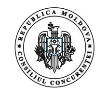

 

P L E N U L 
CONSILIULUI    CONCURENŢEI 
 
 
 
DECIZIE 
mun. Chișinău 
 
din 05.02.2026                                                                                                      Nr. CNP - 06 
 
 
 
Plenul Consiliului Concurenţei, 
 
acționând în temeiul art. 41 alin. (1) lit. f) din Legea concurenței nr. 183/2012 (în 
continuare - Legea nr. 183/2012), Hotărârii Parlamentului privind numirea în funcție a unui 
membru și președinte al Plenului Consiliului Concurenței nr. 33/2022,  Hotărârii 
Parlamentului nr. 381/2023 privind numirea în funcția de membru al Plenului Consiliului 
Concurenței, Hotărârii Parlamentului nr. 211/2024 privind numirea în funcția de membru al 
Plenului Consiliului Concurenței, 
analizând plângerea cu nr. 4469 din 26.11.2025 depusă de către „ECO MOBILITY” 
S.R.L. IDNO 1021600015815, referitor la presupusele acțiuni de concurență neloială 
realizate de către întreprinderea „FAST FOX LLC” S.R.L. IDNO 1024600006650, 
materialele acumulate în cadrul examinării preliminare, precum și observațiile parvenite din 
partea autorului plângerii 
 
A CONSTATAT: 
 
1. La 26.11.2025, în cadrul Consiliul Concurenței a fost înregistrată plângerea „ECO 
MOBILITY” S.R.L. cu nr. 4469, referitor la presupusele acțiuni de concurență neloială 
realizate de către întreprinderile „FAST FOX LLC” S.R.L., manifestate prin răspândirea unor 
informații false despre produsele reclamantului, afirmații ce dăunează activității 
concurentului, instigarea la rezilierea contractului  cu concurentul și crearea confuziei cu 
activitatea economică a „ECO MOBILITY” S.R.L., fapte care indică asupra semnelor 
încălcării art. 15 lit. a) și b), art. 16 și art. 19 alin. (1) lit. a) și b) din Legea concurenței nr. 
183/2012 (în continuare – Legea nr. 183/2012). 
2. Conform celor invocate în plângere, în perioada octombrie – noiembrie 2025, 
întreprinderea „FAST FOX LLC” S.R.L. a desfășurat în spațiul public din municipiul 
Chișinău o campanie de promovare a serviciilor de închiriere a trotinetelor electrice.  
3.  Campania a constat în acțiuni de influențare directă a consumatorilor, având ca scop 
determinarea acestora să renunțe la serviciile oferite de concurentul „ECO MOBILITY” 
S.R.L., prin dezinstalarea aplicației „BOLT” și de a adera la serviciile furnizate de „FAST 

 
FOX LLC” S.R.L., prin instalarea aplicației „FOX”. În schimb, promotorii ofereau un cod 
promoțional în valoare de 100 lei. Toate aceste interacțiuni fiind filmate la comanda 
întreprinderii „FAST FOX LLC” S.R.L. și publicate pe contul oficial de TikTok 
„@fastfox_md”. 
4. Potrivit susținerilor reclamantei, campania derulată de reclamat cauzează pierderi 
economice directe prin deturnarea artificială a clientelei și condiționarea avantajelor 
financiare de abandonarea serviciilor „BOLT”. Această practică distorsionează piața și aduce 
un grav prejudiciu reputațional mărcii, prin denigrarea serviciilor oferite de „ECO 
MOBILITY” S.R.L. 
5. În scopul fundamentării acuzațiilor formulate împotriva întreprinderii „FAST FOX 
LLC” S.R.L., reclamanta a prezentat cinci fișiere video descărcate de pe contul oficial de 
TikTok @fastfox_md al reclamatei, apreciind că acțiunile descrise întrunesc elementele 
constitutive ale unei fapte de concurență neloială, săvârșite cu intenția de a prejudicia poziția 
pe piață a concurentului, prin inducerea unei percepții negative, nefondate și promovate într-
o manieră agresivă. 
6. Urmare a examinării actelor normative în vigoare, a plângerii, precum și a 
materialelor acumulate, s-au constatat următoarele: 
 
Pentru constatarea existenței semnelor încălcării art. 15 din Legea nr. 183/2012, 
există necesitatea întrunirii condițiilor stabilite de dispoziția normei respective, care prevede 
că: „Este interzisă discreditarea concurenților, adică defăimarea sau punerea în pericol a 
reputației sau credibilității acestora prin: a) răspândirea de către o întreprindere a 
informațiilor false despre activitatea sa, despre produsele sale, menite să îi creeze o situație 
favorabilă în raport cu unii concurenți și b) răspândirea de către o întreprindere a unor 
afirmații false despre activitatea unui concurent sau despre produsele acestuia, afirmații ce 
dăunează activității concurentului”. 
 
 Astfel, este imperioasă realizarea următoarelor condiții: a) în cazul răspândirii de 
informații false despre activitatea proprie sau produsele proprii ale întreprinderii care le 
răspândește: (i) defăimarea sau punerea în pericol a reputației/credibilității unui concurent; 
(ii) acțiunea specificată să fie realizată prin răspândirea unor informații ce poartă caracter fals 
despre activitatea sa și produsul propriu al întreprinderii care răspândește informațiile date; 
(iii) informațiile cu caracter fals să fie de natură a crea întreprinderii ce le răspândește o 
situație favorabilă în raport cu unul sau mai mulți concurenți; b) în cazul răspândirii de 
informații false despre activitatea sau produsele unui concurent: (i) acțiunea specificată 
să fie realizată prin răspândirea unor informații ce poartă caracter fals despre 
activitatea unui concurent sau despre produsele acestuia; (ii) informațiile cu caracter fals 
să fie de natură a dăuna activității concurentului discreditat. 
 
 Respectiv, în ceea ce privește susținerea reclamantului potrivit căreia în materialul 
video (fișierul video 5) publicat pe platforma TikTok @fastfox_md apare afirmația falsă 
formulată de reprezentantul „FAST FOX LLC” S.R.L. adresată către consumator, și anume: 
„Voi ați văzut vreodată un BOLT stricat pe undeva pe drum? Dar FOX?”, Consiliul 
Concurenței constată că această afirmație nu poate fi calificată drept informație falsă în 
sensul art. 15 din Legea nr. 183/2012. 

 
 
 În acest context, formularea respectivă nu conține o afirmație clară și concretă 
despre activitatea sau produsele concurentului, care să poată fi verificată în mod obiectiv ca 
fiind adevărată sau falsă. În lipsa unei afirmații precise, care să poată fi supusă unei verificări 
obiective și dovedită ca fiind falsă, nu poate fi reținut elementul esențial al faptei de 
răspândire a informațiilor false. 
În consecință, nefiind demonstrat caracterul fals al unei informații concrete și imputabile 
întreprinderii, fapta analizată nu se încadrează în ipoteza normei prevăzute de art. 15 din 
Legea nr. 183/2012. 
7. Referitor la pretențiile invocate de către reclamant, potrivit cărora „FAST FOX LLC” 
S.R.L. ar fi întreprins acțiuni de instigare la rezilierea contractelor încheiate de consumatori 
cu întreprinderea „ECO MOBILITY” S.R.L., prin oferirea unui cod promoțional în valoare 
de 100 lei, în sensul art. 16 din Legea nr. 183/2012, se menționează că angajarea răspunderii 
în temeiul normei invocate este condiționată de întrunirea cumulativă a următoarelor 
elemente: a) existența unei fapte de instigare săvârșite de un concurent al întreprinderii-
victimă sau de un terț care acționează în interesul acestuia; b) realizarea acțiunii de instigare 
în scopul determinării clientelei întreprinderii-victimă la: (i) rezilierea neîntemeiată a unui 
contract încheiat cu aceasta sau (ii) neexecutarea ori executarea necorespunzătoare a 
obligațiilor contractuale asumate; c) acordarea sau oferirea oricăror avantaje întreprinderii 
parte a contractului. 
 
În speță, din materialele dosarului rezultă că întreprinderea „FAST FOX LLC” 
S.R.L. a oferit coduri promoționale în valoare de 100 lei exclusiv consumatorilor finali, 
persoane fizice, în scopul promovării propriilor servicii de închiriere a trotinetelor electrice. 
Recompensele materiale nu au fost acordate unei întreprinderi aflate într-un raport 
contractual cu „ECO MOBILITY” S.R.L., ci unor utilizatori finali, care nu au calitatea de 
operator economic. 
 
Or, beneficiarul recompensei materiale reprezintă un element esențial pentru 
aplicarea art. 16 din Legea nr. 183/2012, norma fiind incidentă exclusiv în cadrul 
raporturilor juridice contractuale dintre întreprinderi, în care o întreprindere este 
determinată, prin avantaje materiale, să rezilieze sau să nu își execute ori să își execute 
necorespunzător obligațiile contractuale față de un concurent. În lipsa unui astfel de 
beneficiar având calitatea de întreprindere, ipoteza normei legale nu este întrunită. 
 
Totodată, simpla determinare a consumatorilor de a dezinstala o aplicație mobilă sau 
de a utiliza serviciile unui alt operator, prin oferirea unui beneficiu promoțional, nu poate fi 
calificată drept instigare la rezilierea unui contract în sensul art. 16 din Legea nr. 183/2012. 
8. Referitor la încadrarea legală a faptelor întreprinderii „FAST FOX LLC” S.R.L., prin 
prisma prevederilor art. 19 alin. (1) lit. a) și lit. b) din Legea nr. 183/2012, se reține 
următoarele. 
Norma juridică incidentă presupune, pentru calificarea unor fapte drept acte de concurență 
neloială, întrunirea cumulativă a unor condiții esențiale, și anume: a) folosirea ilegală, 
integrală sau parţială a unei mărci, embleme de deservire, denumiri de firmă, a unui desen 
sau model industrial sau a altor obiecte ale proprietății industriale de natură să creeze o 
confuzie cu cele folosite în mod legal de către o altă întreprindere; b) copierea ilegală a 
formei, a ambalajului şi/sau a aspectului exterior al produsului unei întreprinderi şi plasarea 

 
produsului respectiv pe piaţă, copierea ilegală a publicității unei întreprinderi, dacă aceasta a 
adus sau poate aduce atingere intereselor legitime ale concurentului. 
Contextual, în absența utilizării ilegale a unor semne distinctive protejate sau a copierii a 
elementelor de identificare ale „ECO MOBILITY” S.R.L., se concluzionează că nu sunt 
întrunite condițiile cumulative pentru calificarea acțiunilor „FAST FOX LLC” S.R.L. ca fiind 
de natură să creeze ilegal o confuzie cu întreprinderea, produsele sau activitatea economică a 
concurentului. 
 
În speță, reclamantul nu a făcut dovada existenței unui risc real de creare a confuziei 
în percepția publicului relevant, limitându-se la invocarea similitudinii obiectului de 
activitate al celor două întreprinderi.. 
9. Prin urmare, în rezultatul examinării celor invocate de reclamantă în plângere în 
raport cu materialele prezentate de întreprinderea reclamată, Consiliul Concurenței a 
informat întreprinderea „ECO MOBILITY” S.R.L. că nu există temeiuri rezonabile pentru a 
suspecta încălcarea prevederilor 15 lit. a) și b), art. 16 și art. 19 alin. (1) lit. a) și b) din Legea 
nr. 183/2012 de către „FAST FOX LLC” S.R.L. Despre aceasta, precum și despre dreptul de 
a prezenta observații asupra concluziilor autorității de concurență, în termen de 10 zile 
lucrătoare, întreprinderea „ECO MOBILITY” S.R.L. a fost informată prin scrisoarea nr. 
CNP-05/16 - 107 din 26.01.2026. 
10. Întreprinderea „ECO MOBILITY” S.R.L., respectând termenul prevăzut de art. 53 
alin. (3) din Legea nr. 183/2012, la data de 28.01.2026 a depus observațiile sale formulate pe 
marginea concluziilor autorității de concurență. 
11. Având în vedere că reclamanta nu a prezentat probe sau argumente suplimentare, se 
constată că obiecțiile formulate de către „ECO MOBILITY” S.R.L. nu au determinat 
necesitatea reevaluării actelor și faptelor expuse în plângere și constatate anterior de 
autoritatea de concurență.  
12. În acest context, urmare a examinării plângerii, a probelor administrate, precum și a 
observațiilor înaintate de către reclamant, considerăm că nu există temeiuri rezonabile pentru 
a suspecta încălcarea prevederilor art. 15 lit. a) și b), art. 16 și art. 19 alin. (1) lit. a) și b) din 
Legea nr. 183/2012. 
13. Totodată, plasarea materialelor video în spațiul internet, în care se compară 
produsele celor două întreprinderi, succedată de recomandarea apelării la serviciile proprii, 
constituie  o  încălcare a prevederilor Legii nr. 62/2022 cu privire la publicitate. În acest sens, 
art. 21 prevede că publicitatea comparativă este permisă în cazul în care sunt întrunite 
cumulativ anumite condiții, precum:  
a) nu este o publicitate înșelătoare în sensul noțiunii „publicitate înşelătoare”, definită 
la art. 3, și al prevederilor art. 20; 
b) nu constituie o practică comercială înșelătoare în conformitate cu art.13 din Legea 
nr.105/2003 privind protecția consumatorilor; 
c) compară bunuri ori servicii care răspund acelorași necesități sau care sunt destinate 
acelorași scopuri; 
d) compară în mod obiectiv una sau mai multe caracteristici esențiale, relevante, 
verificabile și reprezentative ale bunurilor sau serviciilor, care pot include și prețul; 
e) nu discreditează sau nu denigrează mărci, denumiri comerciale, alte semne 
distinctive, bunurile, serviciile, activitățile sau situația unui concurent; 

 
f) în cazul produselor cu denumire de origine sau cu indicație geografică, se referă în 
fiecare caz la produse cu aceeași denumire; 
g) nu profită în mod neloial de reputația unei mărci, unei denumiri comerciale sau a 
altor semne distinctive ale unui concurent ori a denumirii de origine a produselor concurente; 
h) nu prezintă bunurile sau serviciile ca imitații ori reproduceri ale bunurilor sau 
serviciilor purtând o marcă ori o denumire comercială protejată; 
i) nu creează confuzie între comercianți, între un comerciant și un concurent al 
acestuia sau între mărci, denumiri comerciale, alte semne distinctive, între bunurile sau 
serviciile comerciantului și cele ale unui concurent. 
 
În cazul dat au fost constatate acțiuni ce reflectă o comparare neobiectivă, însoțită de 
discreditarea produselor concurente. Prin urmare, nu au fost respectate condițiile prevăzute la 
art. 21 din Legea privind publicitatea. Astfel, urmează a fi întreprinse măsuri ce se impun 
potrivit Codului contravențional.  
14. În acest context, reieșind din circumstanțele de fapt și de drept expuse supra, în 
conformitate cu prevederile art. 53 alin. (5) lit. a), alin. (6), alin. (7) și în temeiul art. 41 alin. 
(1) lit. f) din Legea nr. 183/2012, Plenul Consiliului Concurenței 
 
DECIDE: 
 
1. A respinge plângerea cu nr. 4469 din 26.11.2025 depusă de către „ECO MOBILITY” 
S.R.L.  
2. Prezenta decizie poate fi contestată, în termen de 30 de zile calendaristice de la 
primirea acesteia de către părți, la Judecătoria Chișinău, sediul Râșcani, specializată în 
materie de contencios administrativ (mun. Chișinău, str. Kiev, 3). 
3. Decizia intră în vigoare la data adoptării și va fi adusă la cunoștința reclamantei. 
 
 
Alexei GHERȚESCU 
Președinte 
 
 
 
 
 
 
 
 
 
 
 
 
 
 
 
