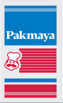
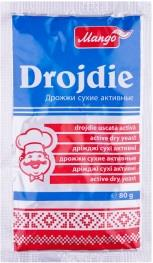
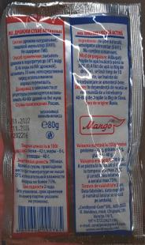

 
                                                                                                                                                                   

P L E N U L 
CONSILIULUI    CONCURENŢEI 
 
 
 
 
 
 
Republica Moldova, MD- 2068, Сhişinău, str. A.Russo, nr. 1 
E-mail: office@competition.md; www.competition.md 
 
DECIZIE 
mun. Chișinău 
 
22 octombrie 2026                                                                       Nr. CNP-08/23-32  
 
Plenul Consiliului Concurenței, 
acționând în temeiul art. 41 alin. (1) lit. m) din Legea concurenței nr. 
183/2012 (în continuare - Legea nr. 183/2012), Hotărârii Parlamentului nr. 
56/2026 privind numirea în funcție a unui membru și președinte al Plenului 
Consiliului Concurenței, Hotărârii Parlamentului nr. 380/2023 privind numirea în 
funcție de vicepreședinte al Plenului Consiliului Concurenței, Hotărârii 
Parlamentului nr. 210/2024 privind numirea în funcția de vicepreședinte al 
Plenului Consiliului Concurenței, Hotărârii Parlamentului nr. 381/2023 privind 
numirea în funcția de membru al Plenului Consiliului Concurenței și Hotărârii 
Parlamentului nr. 211/2024 privind numirea în funcția de membru al Plenului 
Consiliului Concurenței, 
analizând cererea „RODALS” S.R.L. de soluționare pe cale amiabilă a 
presupusului caz de concurență neloială1 și materialele acumulate în cadrul 
investigației inițiate prin Dispoziția Plenului Consiliului Concurenței nr. 08 din 
30.03.2023 privind presupusele încălcări ale prevederilor art. 19 alin. (1) lit. a) și 
b) din Legea nr. 183/2012 de către întreprinderea „CONDIPROD-COM” S.R.L. 
manifestate prin crearea confuziei în rândurile consumatorilor cu întreprinderea 
„RODALS” S.R.L. și produsul acesteia, precum și inducerea în eroare a 
consumatorilor cu privire la natura produsului comercializat de către aceasta,  
 
                                                     
1 Înregistrată cu nr. de intrare 495 din 11.02.2026 

 
A CONSTATAT: 
1. La 16.02.2023, cu nr. 448, în cadrul Consiliului Concurenței a fost 
înregistrată plângerea Societății cu răspundere limitată „RODALS” (în continuare 
– „RODALS” S.R.L.) privind presupusele acțiuni de concurență neloială realizate 
de către Societatea cu răspundere limitată „CONDIPROD-COM” (în continuare – 
„CONDIPROD-COM” S.R.L.). 
2. Autorul plângerii a invocat că „CONDIPROD-COM” S.R.L. a copiat 
parțial ambalajul produsului - drojdie cu marca comercială „PAKMAYA”, 
comercializat de către „RODALS” S.R.L. utilizând, totodată, marca 

comercială nr. R 28211, titularul căreia este societatea turcească „Pak 
Gida Uretim ve Pazarlama Anonim Șirketim” TR, astfel determinând 
crearea confuziei și inducerea în eroare a consumatorilor cu privire la 
caracteristicile principale, natura, modul și locul de fabricare al 
produsului - drojdie cu marca comercială „PAKMAYA”, comercializat de către 
„RODALS” S.R.L., fapte ce prezintă semnele acțiunilor de concurență neloială 
interzise de prevederile art. 18 și 19 alin. (1) lit. a) și b) din Legea nr. 183/2012. 
3. Urmare a examinării preliminare a plângerii, în conformitate cu prevederile 
art. 41 alin. (1) lit. f) și art. 55 alin. (1) din Legea nr. 183/2012 (redacție în vigoare 
la data emiterii dispoziției), prin Dispoziția nr. 08 din 30.03.2023, Plenul 
Consiliului Concurenței a dispus inițierea investigației cu privire la presupusele 
încălcări ale prevederilor art. 19 alin. (1) lit. a) și b) din Legea nr. 183/2012 de 
către întreprinderea „CONDIPROD-COM” S.R.L. manifestate prin crearea 
confuziei în rândurile consumatorilor cu întreprinderea „RODALS” S.R.L. și 
produsul acesteia, precum și inducerea în eroare a consumatorilor cu privire la 
natura produsului comercializat de către aceasta.  
 
I. Părțile implicate  
Reclamantul:  
4. „RODALS” S.R.L., data înregistrării de stat – 11.03.1998; adresa juridică: 
mun. Chişinău, str. Vadul lui Vodă, 62/2; IDNO 1002600050370.   
2 
 

 
Principalul gen de activitate al întreprinderii „RODALS” S.R.L. este importul 
și comercializarea de utilaje, ingrediente și materii prime pentru industria 
alimentară.  
Reclamatul: 
5. „CONDIPROD-COM” S.R.L., data înregistrării de stat – 16.10.2002; 
adresa juridică: mun. Chişinău, str. Varniţa, 14/1; IDNO 1002600001475. 
Principalul gen de activitate al întreprinderii „CONDIPROD-COM” S.R.L. 
este fabricarea și comercializarea condimentelor, mirodeniilor și a aditivilor 
alimentari. 
În sensul prezentei investigații, întreprinderile „CONDIPROD-COM” S.R.L. și 
„RODALS” S.R.L. desfășoară aceeași activitate de comercializare a ingredientelor 
pentru industria alimentară. 
II. Piața relevantă: piața relevantă a produsului și piața geografică 
relevantă 
6. Piața relevantă este piaţa în cadrul căreia se evaluează o anumită 
problemă de concurenţă şi care se determină prin raportarea pieţei relevante a 
produsului la piaţa geografică relevantă. 
7. Piaţa relevantă a produsului. Conform art. 4 din Legea nr. 183/2012, 
piaţa relevantă a produsului cuprinde toate produsele considerate de consumatori 
ca 
interschimbabile 
sau 
substituibile 
datorită 
utilizării 
date 
acestora, 
caracteristicilor fizice, funcţionale şi a preţului. 
Luând în considerare faptul că problema concurențială reclamată de către 
„RODALS” S.R.L. constă în comercializarea prin intermediul unităților comerciale 
a produsului ambalat - drojdie, furnizat de către „CONDIPROD-COM” S.R.L., 
ambalajul căruia imită parțial ambalajul în care este comercializat produsul - 
drojdie cu marca comercială „PAKMAYA”, importat de întreprinderea 
„RODALS” S.R.L. și pe care este aplicată parțial marca comercială, titularul căreia 
este compania „Pak Gida Uretim ve Pazarlama Anonim Șirketim” TR, piața 
relevantă a produsului se definește ca piața comercializării cu ridicata a drojdiei.  
3 
 

 
8. Piaţa relevantă geografică. Conform art. 4 din Legea nr. 183/2012, piaţa 
geografică relevantă se referă la zona în care întreprinderile sunt implicate în oferta 
sau cererea de pe piaţa relevantă a produsului, în care condiţiile de 

concurenţă sunt suficient de omogene şi care poate fi deosebită de 
zonele geografice învecinate prin condiţii de concurenţă ce diferă în 
mod apreciabil. 
9. Așadar, reieșind din faptul că produsul drojdie sub marca 

„PAKMAYA”, fabricat de „Pak Gida Uretim ve Pazarlama Anonim 
Șirketim” și comercializat în Republica Moldova de „RODALS” 
S.R.L., precum și produsul drojdie „Mango”, comercializat de 
„CONDIPROD-COM” S.R.L., au fost distribuite pe teritoriul 
Republicii Moldova prin intermediul unităților comerciale, inclusiv 
către întreprinderi care desfășoară activități de comerț cu ridicata și/sau cu 
amănuntul, se constată că piața relevantă geografică, în sensul prezentei 
investigații, este teritoriul Republicii Moldova. 
10. Astfel, ținând cont de cele expuse supra, concluzionăm că piaţa relevantă 
vizată de investigația în cauză este piaţa comercializării cu ridicata a drojdiei pe 
teritoriul Republicii Moldova. 
 
III. Perioada supusă examinării 
11. Perioada de timp supusă examinării: septembrie 2022 – 11.02.2026.  
12. Perioada de timp supusă examinării a fost stabilită din septembrie 2022 - 
momentul inițierii comercializării cu ridicata de către „CONDIPROD-COM” 
S.R.L. a produsului (drojdie, în ambalajul care face obiectul examinării) - până la 
data de 11.02.2026, când a fost depusă cererea de către „RODALS” S.R.L., prin 
care s-a solicitat încetarea examinării plângerii privind acțiunile neloiale ale 
„CONDIPROD-COM” S.R.L. 
 
 
4 
 

 
IV. Acte și fapte constatate 
13. Potrivit celor menționate în plângere, Agenția de Stat pentru Proprietatea 
Intelectuală a înregistrat după societatea turcească „Pak Gida Uretim ve Pazarlama 
Anonim Șirketim” TR, la data de 15.04.2016, marca comercială – „PAKMAYA”.            
14. Totodată, autorul plângerii a afirmat că între „Rodals” S.R.L. și 
societatea turcă PAK IHRACAT A.S. este încheiat contractul de distribuție № 
01/01-2021 ПАК, în temeiul căruia „RODALS” S.R.L. a devenit distribuitorul 
oficial în Republica Moldova al produsului - drojdie cu marca „PAKMAYA”. 
15. Suplimentar, administratorul întreprinderii reclamante a evidențiat că s-a 
depistat că „CONDIPROD-COM” S.R.L. produce și comercializează drojdie 
uscată cu un ambalaj asemănător ambalajului produsului – drojdie cu marca 
comercială „PAKMAYA”, ca rezultat al examinării multitudinii plângerilor 
parvenite 
în 
adresa 
societății 
„RODALS” 
S.R.L. 
privind 
calitatea 
necorespunzătoare a presupusei drojdii „PAKMAYA”, care de facto s-a dovedit a 
fi un alt produs a cărui producător este „CONDIPROD-COM” S.R.L2.  
Figura I. Ambalajul produsului - drojdie comercializat de către „CONDIPROD-
COM” S.R.L. 
 
 

 
 
 
 
 
 
 
Sursa:Plângerea cu nr. 448 din 16.02.2023, depusă de către “RODALS” S.R.L. 
16. Prin urmare, bazându-se pe cele expuse supra, reprezentantul 
întreprinderii reclamante a invocat că prin acțiunile sale, manifestate prin copierea 
ilegală a ambalajului produsului – drojdie cu marca comercială „PAKMAYA”, 
comercializat de către „RODALS” S.R.L., „CONDIPROD-COM” S.R.L. a generat 
confuzie și a indus în eroare consumatorii cu privire la originea, modul de 
                                                     
2 Volumul I, f.d. 2-19. 
5 
 

 
fabricație, utilizarea, calitatea și alte aspecte ale produsului pe care îl comercializa, 
fapte care, în opinia acestuia, întrunesc semnele constitutive ale acțiunilor de 
concurență neloială prevăzută de art. 18 și art. 19 alin. (1) lit. a) și b) din Legea nr. 
183/2012. 
17. În rezultatul examinării preliminare a plângerii cu nr. de intrare 448 din 
16.02.2023, de către Plenul Consiliului Concurenței a fost adoptată Dispoziția nr. 
08 din 30.03.2023, prin care s-a dispus inițierea investigației cu privire la 
presupusele încălcări ale prevederilor art. 19 alin. (1) lit. a) și b) din Legea nr. 
183/2012 de către întreprinderea „CONDIPROD-COM” S.R.L3. 
18. În cadrul investigației au fost examinate circumstanțele privind 
presupusele acțiuni de concurență neloială ale întreprinderii „CONDIPROD-
COM” S.R.L., manifestate prin copierea parțială a elementelor mărcii și 
ambalajului produsului – drojdie „PAKMAYA”, comercializat de „RODALS” 
S.R.L., și plasarea pe piață a produsului cu ambalaj similar în perioada septembrie 
2022 – 11.02.2026. Ulterior, părțile au convenit asupra soluționării amiabile a 
cazului, prin încheierea Tranzacției de împăcare din 10.02.2026. 
19. La data de 11.02.2026, cu nr. de intrare 495, în cadrul Consiliului 
Concurenței a fost înregistrată cererea „RODALS” S.R.L., prin care s-a solicitat 
încetarea examinării plângerii în raport cu acțiunile neloiale ale „CONDIPROD-
COM” S.R.L. din considerentul soluționării amiabile de către părți a cazului de 
concurență neloială4. 
20.Potrivit Tranzacției de împăcare din 10.02.2026, părțile au declarat că 
doresc să soluționeze amiabil și benevol situația de conflict privind acțiunile 
concurenței neloiale și au convenit în scopul soluționării amiabile a situației 
litigioase aflate pe rol la Consiliul Concurenței apărute în urma plângerii depuse de 
„RODALS” S.R.L. cu privire la următoarele: 
20.1. „CONDIPROD-COM” S.R.L. să se oblige să retragă toate produsele 
alimentare sub marca comercială „MANGO” și alte produse cu design similar, care 
                                                     
3 Volumul I, f.d. 139. 
4 Volumul II f.d. 120-122.  
6 
 

 
imită (plagiază) designul ambalajelor produselor „PAKMAYA”, de pe piața de 
desfacere a Republicii Moldova, în termen de până la 28.02.2026, anunțând, în 
scris, despre acest fapt întreprinderea „RODALS” S.R.L. 
20.2. În condițiile executării integrale și oportune a obligației stipulate, 
întreprinderea „RODALS” S.R.L., se obligă să retragă plângerea înaintată de 
Consiliul Concurenței, în privința acțiunilor de concurență neloială ale 
întreprinderii 
„CONDIPROD-COM” 
S.R.L. 
în 
raport 
cu 
întreprinderea 
„RODALS” S.R.L. 
21. Totodată, în temeiul pct. 4 din Tranzacția de împăcare din 10.02.2026, 
întreprinderea „CONDIPROD-COM” S.R.L. s-a obligat să nu denote, în 
continuare, acțiuni care contrazic prevederile Legii nr. 183/2012, respectând 
uzanțele oneste în activitatea economică în raport cu „RODALS” S.R.L. 
22. Depunerea cererii din 11.02.2026 de către „RODALS” S.R.L. confirmă 
acordul părților privind soluționarea amiabilă a cazului, precum și asumarea de 
către „CONDIPROD-COM” S.R.L. a obligației de a retrage de pe piață produsele 
litigioase și de a înceta acțiunile reclamate, în condițiile stabilite prin Tranzacția de 
împăcare din 10.02.2026. 
 
V. Calificarea legală a acțiunilor constatate conform prevederilor Legii 
nr. 183/2012 
23. Potrivit art. 14 alin. (2) al Legii nr. 183/2012, acțiunile de concurență 
neloială interzise prin prevederile art. 15–19 se examinează de către Consiliul 
Concurenței, la plângerea privind presupusele acțiuni de concurență neloială 
depusă de către întreprinderea ale cărei interese legitime au fost lezate, în condițiile 
stipulate la art. 49 alin. (2)–(4).  
24. În conformitate cu art. 41 alin. (1) lit. m) din Legea nr. 183/2012, Plenul 
Consiliului Concurenței are atribuția de a dispune acceptarea propunerilor părților 
de soluționare pe cale amiabilă a cazurilor de concurență neloială și încetarea 
investigației. 
25. Luând în considerare cererea „RODALS” S.R.L. din data de 11.02.2026, 
7 
 

 
prin care s-a solicitat încetarea examinării plângerii în raport cu acțiunile reclamate 
ale „CONDIPROD-COM” S.R.L., ca urmare a încheierii între părți a Tranzacției de 
împăcare din 10.02.2026 și a asumării de către „CONDIPROD-COM” S.R.L. a 
obligației de încetare a acțiunilor ce au constituit obiectul plângerii, sunt întrunite 
condițiile pentru încetarea procedurii în temeiul art. 41 alin. (1) lit. m) din Legea 
concurenței nr. 183/2012. 
Ținând cont de cele constatate, în temeiul art. 41 alin. (1) lit. m) din Legea 
concurenței nr. 183/2012, Plenul Consiliului Concurenței  
 
D E C I D E: 
1. 
A 
accepta 
propunerile 
întreprinderilor 
„RODALS” 
S.R.L. 
și 
„CONDIPROD-COM” de soluționare pe cale amiabilă a presupuselor încălcări de 
concurență neloială, în baza Tranzacției de împăcare din 10.02.2026. 
2. A înceta investigația inițiată prin Dispoziția Plenului Consiliului 
Concurenței nr. 08 din 30.03.2023 privind presupusele încălcări ale prevederilor 
art. 19 alin. (1) lit. a) și b) din Legea concurenței nr. 183/2012 de către 
întreprinderea „CONDIPROD-COM” S.R.L. manifestate prin crearea confuziei în 
rândurile consumatorilor cu întreprinderea „RODALS” S.R.L. și produsul acesteia, 
precum și inducerea în eroare a consumatorilor cu privire la natura produsului 
comercializat de către aceasta.  
3. Decizia poate fi contestată, în termen de 30 de zile calendaristice de la 
primirea acesteia, la Judecătoria Chișinău (sediul Rîșcani), specializată în materie 
de contencios administrativ (mun. Chișinău, str. Kiev, nr. 3). 
4. Prezenta decizie intră în vigoare la data adoptării și va fi adusă la 
cunoștința părților. 
 
 
Alina Cebotariov 
Președintă 
 
 
 
 
8 
 
