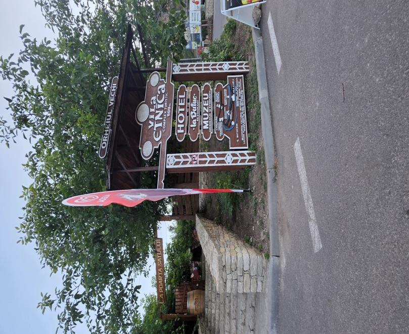
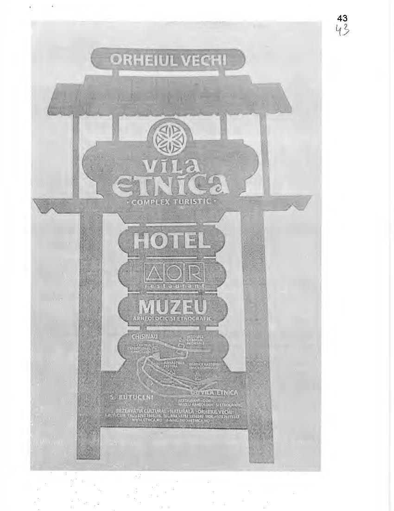

 

P L E N U L 
CONSILIULUI CONCURENŢEI 
 
 
 
 
 
 
Republica Moldova, MD- 2068, Сhişinău, str. A.Russo, nr. 1 
E-mail: office@competition.md; www.competition.md 
 
 
DECIZIE 
mun. Chișinău 
 
 
22 octombrie 2026                                                                                  Nr. CNP-33 
 
Plenul Consiliului Concurenței,  
acționând în temeiul art. 41 alin. (1) lit. f) din Legea concurenței nr. 183/2012, 
Hotărârii Parlamentului nr. 56/2026 privind numirea în funcție a unui membru și 
președinte al Plenului Consiliului Concurenței, Hotărârii Parlamentului nr. 
380/2023 privind numirea în funcția de vicepreședinte al Plenului Consiliului 
Concurenței, Hotărârii Parlamentului nr. 210/2024 privind numirea în funcția de 
vicepreședinte al Plenului Consiliului Concurenței, Hotărârii Parlamentului nr. 
381/2023 privind numirea în funcția de membru al Plenului Consiliului 
Concurenței și Hotărârii Parlamentului nr. 211/2024 privind numirea în funcția de 
membru al Plenului Consiliului Concurenței, 
analizând plângerea cu nr. de intrare 4408 din 24.08.2026 depusă de către 
întreprinderea „MAD GASTROLAB S.R.L., IDNO 1026605001307 referitor la 
presupusele acțiuni de concurență neloială realizate de către „ETNICA PLUS” 
S.R.L. (în continuare – plângere), materialele acumulate în procesul examinării 
preliminare, precum și punctul de vedere a autorului plângerii prezentat la data de 
12.10.2026, 
 
A CONSTATAT: 
 
1. La data de 24.08.2026, la Consiliul Concurenței a fost înregistrată 
plângerea „MAD GASTROLAB S.R.L. cu nr. de intrare 4408, referitor la 
presupusele acțiuni de concurență neloială realizate de către „ETNICA PLUS” 
S.R.L., manifestate prin utilizarea și/sau beneficierea de un indicator/panou de 
orientare sau promovare (Figura 1), amplasat într-o poziție susceptibilă să 
direcționeze consumatorii către complexul turistic „Vila Etnica”, gestionat de 
„ETNICA PLUS” S.R.L. Potrivit autorului plângerii, amplasarea și utilizarea 
 
 
1 
 

acestui indicator/panou sunt susceptibile să creeze confuzie în rândul 
consumatorilor, acțiunile reclamate prezentând semne ale încălcării art. 18 și art. 
19 din Legea concurenței nr. 183/2012. (f.d.a. 2–12) 
Figura 1. Indicatorul/panoul informativ „VILA ETNICA” (imagine prezentată de autorul 
plângerii)    

  
 
2. Autorul plângerii invocă că poziționarea indicatorului/panoului informativ, 
raportată la accesul către unitatea reclamantului cu denumirea „LA POARTA 
SATULUI”, precum și la fluxul de turiști din zonă, este de natură să creeze un risc 
de confuzie, în sensul art. 19 din Legea concurenței nr. 183/2012 și să determine 
deturnarea clientelei, în sensul art. 18 din aceeași lege. 
3. În susținerea existenței presupusei încălcări a prevederilor art. 18 din Legea 
concurenței nr. 183/2012, s-a invocat faptul că amplasarea și utilizarea 
indicatorului/panoului în imediata apropiere a accesului către „LA POARTA 
SATULUI” este de natură să inducă în eroare vizitatorii cu privire la direcția, 
localizarea ori identificarea unității sale comerciale. În acest sens, consideră că 
clienții pot fi redirecționați către un alt agent economic, înainte de a identifica 
accesul către unitatea comercială cu denumirea „LA POARTA SATULUI”, ceea 
ce afectează fluxul de clienți, vizibilitatea, imaginea și interesele comerciale ale 
„MAD GASTROLAB” S.R.L.  
4. Totodată, 
reclamantul 
consideră 
că, 
prin 
amplasare 
și 
mesaj, 
indicatorul/panoul poate crea o asociere greșită ori o impresie greșită privind 
 
 
2 
 

traseul comercial relevant, influențând alegerea consumatorului într-un punct în 
care decizia este luată imediat. 
5. Prin urmare, autorul plângerii susține că acțiunile reclamate sunt de natură 
să afecteze activitatea sa de prestare a serviciilor de alimentație publică, inclusiv a 
serviciilor de cafenea, bar și patiserie, precum și a serviciilor conexe oferite 
turiștilor și vizitatorilor din s. Butuceni, zona Orheiul Vechi. 
6. În scopul fundamentării plângerii formulate împotriva întreprinderii 
„ETNICA PLUS” S.R.L., reclamantul a prezentat mai multe imagini cu 
indicatorul/dispozitivul publicitar reclamat și două sesizări adresate Primăriei 
satului Trebujeni și S.A. „Administrația Națională a Drumurilor” din 14.09.2026. 
7. Reieșind din cele invocate, reclamantul afirmă că „ETNICA PLUS” S.R.L. 
a încălcat prevederile art. 18 și 19 din Legea concurenței nr. 183/2012, solicitând 
autorității de concurență stabilirea dacă situația descrisă constituie o practică de 
concurență neloială sau o altă încălcare a legislației concurențiale, cu dispunerea 
încetării practicii constatate și a măsurilor necesare pentru eliminarea riscului de 
confuzie și restabilirea condițiilor de concurență loială. 
8. În cadrul examinării preliminare, ca răspuns la solicitarea Consiliului 
Concurenței1 de a prezenta poziția sa asupra plângerii depuse de „MAD 
GASTROLAB” S.R.L., „ETNICA PLUS” S.R.L. a comunicat că complexul 
turistic „VILA ETNICA” din s. Butuceni activează din anul 2012, fiind gestionat 
inițial de „ETNICA” S.R.L. Ulterior, în baza contractelor de locațiune nr. 1 și nr. 2 
din 07.11.2024, complexul turistic a fost transmis în folosință către „ETNICA 
PLUS” S.R.L. Totodată, a susținut că „VILA ETNICA” are o experiență de 14 ani 
în prestarea serviciilor hoteliere, de restaurant și de muzeu în satul Butuceni. 
9. Reclamata susține că panoul informativ a fost montat în anul 2013 cu 
aprobarea Ministerului Culturii. În sprijinul celor afirmate, reclamata a prezentat 
Fișa de avizare, aprobată de Ministerul Culturii în baza Procesului-verbal al 
ședinței nr. 6 din 15.03.2013 al Consiliului Național al Monumentelor Istorice, 
având ca obiect acceptarea schiței de proiect de amplasare a trei panouri-
informative, printre care și panoul reclamat: 
                                                          
1 nr. CNP-05/252-1904 din 07.09.2026 (f.d. 33-39) 
 
 
3 
 

 
10. Întreprinderea reclamată indică că, în perioada respectivă, pe terenul 
adiacent indicatorului se afla o grădină și nu pensiunea „LA POARTA 
SATULUI”. De asemenea, a precizat că taxa pentru dispozitivele de publicitate 
este achitată2. În acest sens, aceasta invocă faptul că pensiunea „LA POARTA 
SATULUI” și-a început activitatea ulterior amplasării panoului informativ. De 
asemenea, a precizat că panoul este amplasat la o distanță de aproximativ 1 km de 
complexul turistic al „VILA ETNICA”, având o importanță strategică pentru 
activitatea întreprinderii, iar demontarea acestuia ar afecta în mod direct activitatea 
complexului turistic. 
                                                          
2 Nota de plată Nr.2600001464 din 16.01.2026, Nota de plată Nr. 2500002614 din 24.01.2025, Nota de plată Nr. 2500036202 din 17.07.2025, 
Nota de plată Nr. 2600044862 din 21.07.2026, Ordin de plată Nr.2600044862 din 21.07.2026, Ordin de plată Nr.2600001464 din 16.01.2026, 
Ordin de plată Nr. 2500036202 din 17.07.2025, Ordin de plată Nr.2500002614 din 24.01.2025.(f.d. 47-54); 
 
 
4 
 

11. În vederea verificării acestei afirmații, a fost efectuată o căutare în 
motorul Google, utilizând expresia „panou Vila Etnica”. În urma căutării, a fost 
identificată o fotografie publicată pe pagina web https://photos.casata.md3 (figura 
2), însoțită de descrierea „Orheiul Vechi, Complexul Turistic Vila Etnica, 
Restaurant La Butuc, Muzeu Arheologic si Etnografic”. 
Figura 2. Indicatorul/panoul informativ „VILA ETNICA”, fotografiat la 25.10.2015 

 
 
12. Potrivit informațiilor publicate pe pagina web menționată, fotografia a 
fost realizată la data de 25.10.2015. Din examinarea acesteia (figura 2) se constată 
că indicatorul/panoul informativ „VILA ETNICA” era deja amplasat la acea dată, 
iar în spatele acestuia se observa un teren acoperit cu vegetație. Aceste constatări 
susțin afirmațiile întreprinderii reclamate privind existența anterioară a 
indicatorului și aspectul terenului la data amplasării panoului. 
13. E de menționat faptul că, în vederea constatării existenței semnelor 
încălcării art. 18 din Legea concurenței nr. 183/2012, există necesitatea întrunirii 
condițiilor stabilite de dispoziția normei respective, care prevede interzicerea 
deturnării clientelei concurentului realizată de întreprinderi prin inducerea în eroare 
a consumatorului cu privire la natura, modul şi locul de fabricare, la caracteristicile 
principale, inclusiv utilizarea, cantitatea produselor, preţul sau modul de calculare 
a preţului produsului. Astfel, este imperioasă realizarea următoarei condiții - 
inducerea în eroare a consumatorului cu privire la natura, modul şi locul de 
                                                          
3 https://photos.casata.md/index.php?l=ro&action=viewfullimage&id=7218  
 
 
5 
 

fabricare, la caracteristicile principale, inclusiv utilizarea, cantitatea produselor, 
preţul sau modul de calculare a preţului produsului.  
14. În această ordine de idei, Consiliul Concurenței a solicitat de la autorul 
plângerii4 prezentarea informațiilor cu probe care să confirme inducerea în eroare a 
consumatorilor de către S.R.L. ,,ETNICA PLUS” în raport cu întreprinderea 
reclamantă. Ca rezultat, „MAD GASTROLAB” S.R.L. a informat5 că: „În 
practică, această situație este susceptibilă să determine vizitatorii să schimbe 
direcția, să creadă că localul căutat se află în direcția indicată pe panou sau să 
confunde destinația comercială. La acest moment nu este posibilă cuantificarea 
exacta a numărului de turiști redirecționați sau a veniturilor pierdute, deoarece 
asemenea situații nu sunt întotdeauna raportate de vizitatori și nu pot fi urmărite 
individual.” 
15. De asemenea, autorul plângerii a comunicat că situația descrisă este 
susținută de materialele fotografice privind amplasarea indicatorului, iar faptele 
invocate pot fi confirmate de administratorul societății, de angajați, de clienți și de 
alte persoane din zonă. Cu toate acestea, deși prin scrisoarea din 07.09.2026 
Consiliul Concurenței a solicitat expres prezentarea probelor care să confirme 
inducerea în eroare a consumatorilor, în răspunsul din 15.09.2026 autorul plângerii 
s-a limitat la formularea unor afirmații, fără a prezenta probe în susținerea acestora. 
Totodată, nici în punctul de vedere prezentat ca urmare a scrisorii Consiliului 
Concurenței nr. CNP-05/297-2154 din 12.10.2026 privind lipsa temeiurilor 
rezonabile pentru a suspecta încălcarea legislației concurențiale nu au fost 
prezentate probe suplimentare de natură să conducă la o altă evaluare a plângerii. 
16. În acest context, Consiliul Concurenței reține că indicatorul informativ a 
fost amplasat cu aproximativ 13 ani în urmă, anterior începerii activității pensiunii 
„LA POARTA SATULUI”. Prin urmare, la momentul amplasării indicatorului, 
întreprinderea reclamată nu se afla într-un raport de concurență cu autorul 
plângerii, astfel încât această acțiune nu poate fi apreciată ca fiind îndreptată 
împotriva intereselor concurențiale ale unei întreprinderi care nu activa la acel 
moment. 
17. Totodată, din examinarea materialelor fotografice prezentate rezultă că 
indicatorul conține denumirea distinctă a complexului turistic „VILA ETNICA”, 
precum și o săgeată care indică direcția de deplasare și distanța de 900 m până la 
acesta. Astfel, informația afișată permite identificarea destinației către care este 
orientat indicatorul, fără a indica în mod eronat direcția sau a conține referiri la 
                                                          
4 Nr. CNP-05/250-1892 din 07.09.2026 
5 Prin scrisoarea înregistrată cu nr. 4656 din 15.09.2026 
 
 
6 
 

pensiunea „LA POARTA SATULUI”, precum și elemente care să sugereze 
existența unei legături între cele două întreprinderi.  
18. În aceste condiții, simpla amplasare a indicatorului în apropierea pensiunii 
reclamante nu demonstrează că acesta este de natură să inducă în eroare 
consumatorii cu privire la natura, locul prestării sau caracteristicile principale ale 
serviciilor oferite de cele două întreprinderi și, pe această cale, să determine 
deturnarea clientelei concurentului. 
19. Mai mult, indicatorul a fost instalat anterior începerii activității autorului 
plângerii, iar din probele administrate nu rezultă că întreprinderea reclamată ar fi 
modificat ulterior conținutul sau modul de utilizare a acestuia în scopul atragerii 
clientelei concurentului prin mijloace contrare uzanțelor oneste. 
20. În aceste circumstanțe, simpla existență a unui indicator informativ, 
amplasat anterior apariției raportului de concurență dintre întreprinderi, nu 
constituie, în lipsa altor elemente probatorii, un temei suficient pentru a suspecta 
săvârșirea unei acțiuni de concurență neloială în sensul art. 18 al Legii concurenței 
nr. 183/2012. 
21. Cu referire la pretinsa încălcare a art. 19 din Legea concurenței nr. 
183/2012, autorul plângerii a invocat existența unui risc de confuzie determinat de 
amplasarea indicatorului în raport cu accesul către unitatea sa și de circulația 
turiștilor în zona respectivă. 
22. Potrivit art. 6 din Legea nr. 38/2008 privind protecția mărcilor, titular al 
mărcii este persoana fizică sau juridică ori grupul de persoane fizice și/sau 
juridice în numele căreia/căruia marca este protejată în conformitate cu prezenta 
lege. Drepturile dobândite prin înregistrarea mărcii în Registrul național al 
mărcilor se confirmă prin titlul de protecție – certificatul de înregistrare a mărcii. 
De asemenea, art. 9 alin. (1) din legea prenotată stipulează că înregistrarea mărcii 
conferă titularului dreptul exclusiv asupra acesteia.  
23. În vederea verificării dacă „MAD GASTROLAB” S.R.L. deține o marcă 
înregistrată, relevantă pentru aplicarea art. 19 din Legea concurenței nr. 183/2012, 
Consiliul Concurenței a consultat baza de date a mărcilor gestionată de Agenția de 
Stat pentru Proprietatea Intelectuală. În urma verificării, s-a stabilit că, la data de 
03.04.2026, aceasta a depus cererea de înregistrare a mărcii combinate „La Poarta 

Satului”, 
 cu nr. de depozit 057391, care ulterior a 
fost considerată retrasă prin Decizia din 09.06.2026. 
 
 
7 
 

24. 
Potrivit art. 19 alin. (1) din Legea concurenței nr. 183/2012, sunt 
interzise orice acţiuni sau fapte care sunt de natură să creeze, prin orice mijloc, o 
confuzie cu întreprinderea, produsele sau activitatea economică a unui concurent, 
realizate prin: 
a) folosirea ilegală, integrală sau parţială a unei mărci, embleme de 
deservire, denumiri de firmă, a unui desen sau model industrial sau a altor obiecte 
ale proprietăţii industriale de natură să creeze o confuzie cu cele folosite în mod 
legal de către o altă întreprindere; 
b) copierea ilegală a formei, a ambalajului şi/sau a aspectului exterior al 
produsului unei întreprinderi şi plasarea produsului respectiv pe piaţă, copierea 
ilegală a publicităţii unei întreprinderi, dacă aceasta a adus sau poate aduce 
atingere intereselor legitime ale concurentului. 
25. 
În vederea verificării întrunirii elementelor prevăzute la art. 19 alin. 
(1) lit. a) și b) din Legea concurenței nr. 183/2012, prin scrisoarea din 07.09.2026, 
Consiliul Concurenței a solicitat autorului plângerii să identifice obiectele 
proprietății industriale care i-ar aparține și care ar fi fost utilizate ilegal de către 
„ETNICA PLUS” S.R.L., precum și elementele produselor sau ale publicității sale 
care ar fi fost copiate ilegal. 
26. 
În răspunsul prezentat, autorul plângerii nu a identificat asemenea 
obiecte sau elemente și nici acțiuni concrete de utilizare ori copiere ilegală a 
acestora. Susținerile sale au vizat amplasarea indicatorului „VILA ETNICA” în 
apropierea accesului către pensiunea „LA POARTA SATULUI” și posibilitatea 
apariției unei confuzii în rândul turiștilor. 
27. 
În acest context, Consiliul Concurenței reține că indicatorul examinat 
conține denumirea distinctă „VILA ETNICA”, fără a reproduce denumirea „LA 
POARTA SATULUI” sau alte elemente de identificare ale întreprinderii 
reclamante.  
28. 
Din analiza plângerii și a informațiilor acumulate în cadrul examinării 
preliminare, Consiliul Concurenței constată că nu au fost identificate elemente care 
să indice că indicatorul „VILA ETNICA” este de natură să creeze confuzie cu 
întreprinderea, produsele sau activitatea economică a „MAD GASTROLAB” 
S.R.L., în sensul art. 19 din Legea concurenței nr. 183/2012. 
29. 
În acest sens, nu au fost identificate acțiuni de folosire ilegală, 
integrală sau parțială, a unei mărci, embleme de deservire, denumiri de firmă ori a 
altor obiecte ale proprietății industriale utilizate legal de către „MAD 
GASTROLAB” S.R.L. De asemenea, nu au fost identificate acțiuni de copiere 
 
 
8 
 

ilegală a formei, ambalajului sau aspectului exterior al produselor ori a publicității 
acestei întreprinderi. 
30. 
Prin urmare, circumstanțele invocate de autorul plângerii nu oferă 
temeiuri rezonabile pentru a suspecta săvârșirea acțiunilor de concurență neloială 
prevăzute la art. 19 alin. (1) lit. a) și b) din Legea concurenței nr. 183/2012. 
31. 
La 
data 
de 
12.10.2026, 
Consiliul 
Concurenței 
a 
informat 
întreprinderea reclamantă6 că nu există temeiuri rezonabile pentru a suspecta 
încălcarea prevederilor art. 18 și 19 din Legea concurenței nr. 183/2012 de către 
„ETNICA PLUS” S.R.L. și despre dreptul de a prezenta punctul de vedere asupra 
concluziilor autorității de concurență, în termen de 10 zile lucrătoare.  
32. 
În punctul de vedere prezentat7 în aceiași zi, „MAD GASTROLAB” 
S.R.L. a solicitat reexaminarea situației, susținând că evaluarea acesteia nu trebuie 
limitată la momentul amplasării indicatorului, ci trebuie să țină cont și de efectele 
actuale ale menținerii acestuia asupra identificării întreprinderilor și percepției 
consumatorilor.  
33. 
Totodată, autorul plângerii a solicitat reevaluarea circumstanțelor de 
fapt prin prisma prevederilor art. 19 din Legea concurenței nr. 183/2012 și 
examinarea posibilității relocării indicatorului într-un loc care să nu îi afecteze 
interesele comerciale. 
34. 
Examinând punctul de vedere prezentat de „MAD GASTROLAB” 
S.R.L., Consiliul Concurenței reține că circumstanțele invocate au fost deja 
analizate în cadrul examinării preliminare a plângerii, inclusiv prin prisma 
amplasării, conținutului și modului de utilizare a indicatorului, în raport cu 
prevederile art. 18 și art. 19 din Legea concurenței nr. 183/2012. 
35. 
De asemenea, autorul plângerii nu a prezentat informații sau probe 
suplimentare care să indice existența elementelor constitutive ale pretinselor 
încălcări invocate. Obiecțiile formulate se limitează la reiterarea presupusului risc 
de confuzie și a eventualelor efecte asupra activității sale, fără a identifica acțiuni 
concrete ale întreprinderii reclamate care să întrunească condițiile prevăzute de art. 
18 și 19 din Legea concurenței nr. 183/2012. 
36. 
Prin urmare, Consiliul Concurenței constată că obiecțiile prezentate de 
„MAD GASTROLAB” S.R.L. nu conduc la o altă evaluare a plângerii și nu 
modifică concluzia privind lipsa temeiurilor rezonabile pentru a suspecta 
                                                          
6 scrisoarea nr. CNP-05.297-2154 (f.d. 70-74) 
7 Răspunsul pe email înregistrat cu nr. 5012 din 12.10.2026(76-78) 
 
 
9 
 

încălcarea prevederilor art. 18 și 19 din Legea concurenței nr. 183/2012 de către 
„ETNICA PLUS” S.R.L. 
37. 
Consiliul Concurenței a examinat circumstanțele invocate de autorul 
plângerii și informațiile acumulate în cadrul examinării preliminare, fără a 
identifica elemente care să constituie temeiuri rezonabile pentru a suspecta 
încălcarea art. 18 și art. 19 din Legea concurenței nr. 183/2012. Prin urmare, 
solicitarea autorului plângerii privind examinarea suplimentară a presupuselor 
efecte ale menținerii indicatorului nu justifică, în lipsa unor asemenea temeiuri, 
inițierea unei investigații. 
38. 
În conformitate cu art. 53 alin. (5) lit. a) din Legea concurenței nr. 
183/2012, în cazul în care obiecțiile primite nu conduc la o altă evaluare a 
plângerii, Consiliul Concurenței respinge plângerea prin decizie. Având în vedere 
că obiecțiile prezentate de „MAD GASTROLAB” S.R.L. nu conduc la o altă 
evaluare a plângerii, aceasta urmează a fi respinsă.  
39. 
Reieșind din circumstanțele de fapt și de drept expuse, în temeiul art. 
53 alin. (5) lit. a) și art. 41 alin. (1) lit. f) din Legea concurenței nr. 183/2012, 
Plenul Consiliului Concurenței  
DECIDE: 
 
1. A respinge plângerea cu nr. de intrare 4408 din 24.08.2026 depusă de către 
„MAD GASTROLAB S.R.L. în legătura cu lipsa temeiurilor rezonabile pentru a 
suspecta încălcarea prevederilor art. 18 și 19 din Legea concurenței nr. 183/2012 
de către „ETNICA PLUS” S.R.L. 
2. Prezenta decizie poate fi contestată, în termen de 30 de zile calendaristice 
de la primirea acesteia de către părți, la Judecătoria Chișinău, sediul Rîșcani, 
specializat în materie de contencios administrativ (mun. Chișinău, str. Kiev, 3). 
3.Decizia intră în vigoare la data adoptării și va fi adusă la cunoștința 
reclamantului. 
 
Alina CEBOTARIOV 
Președintă 
 
 
 
 
 
 
 
 
10 
 
