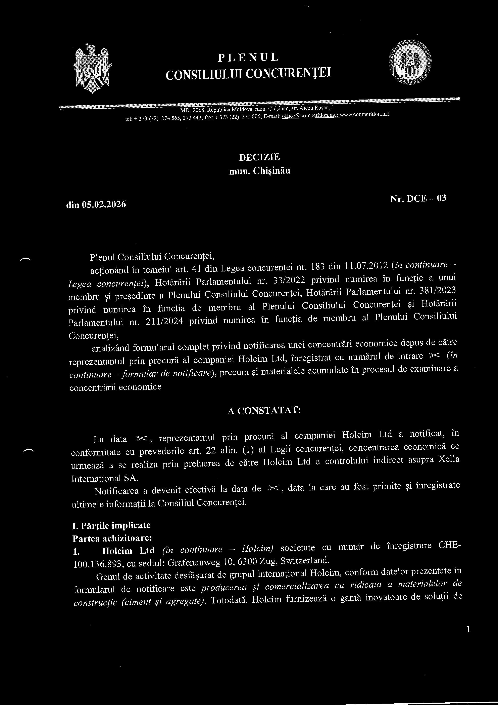
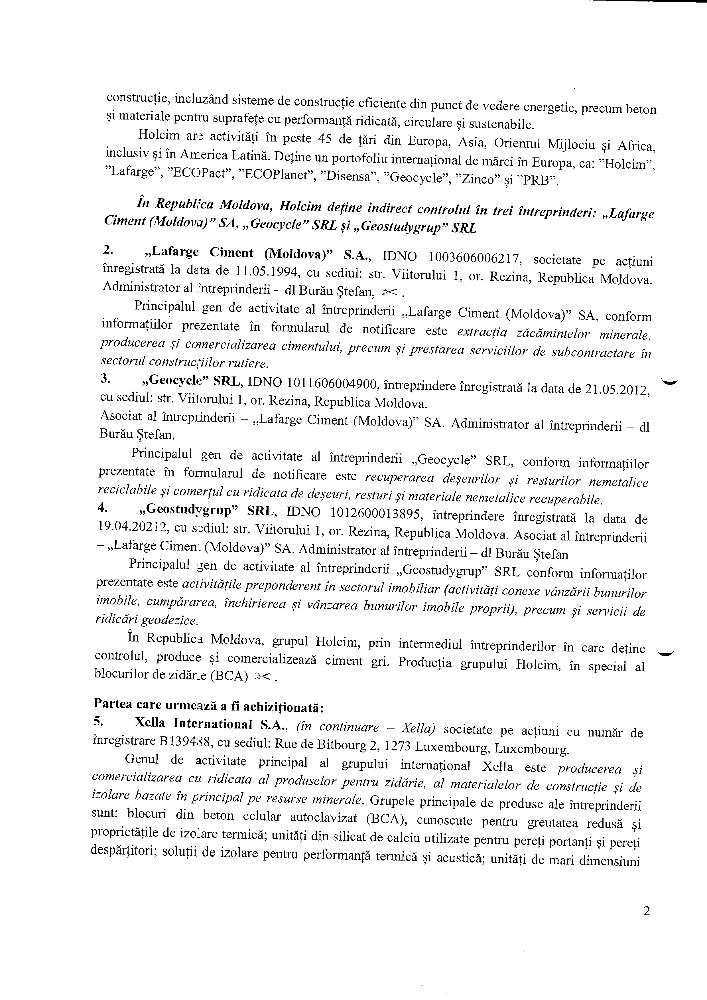
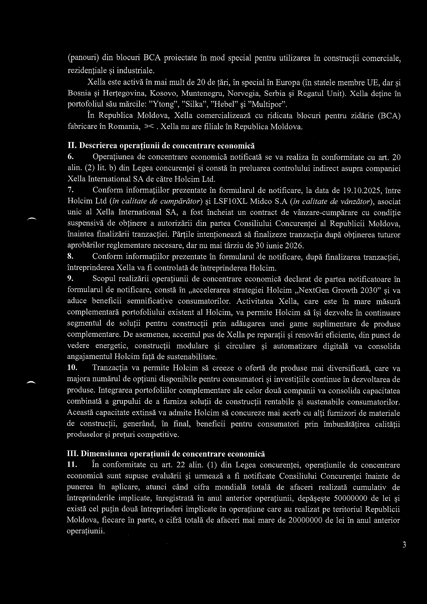
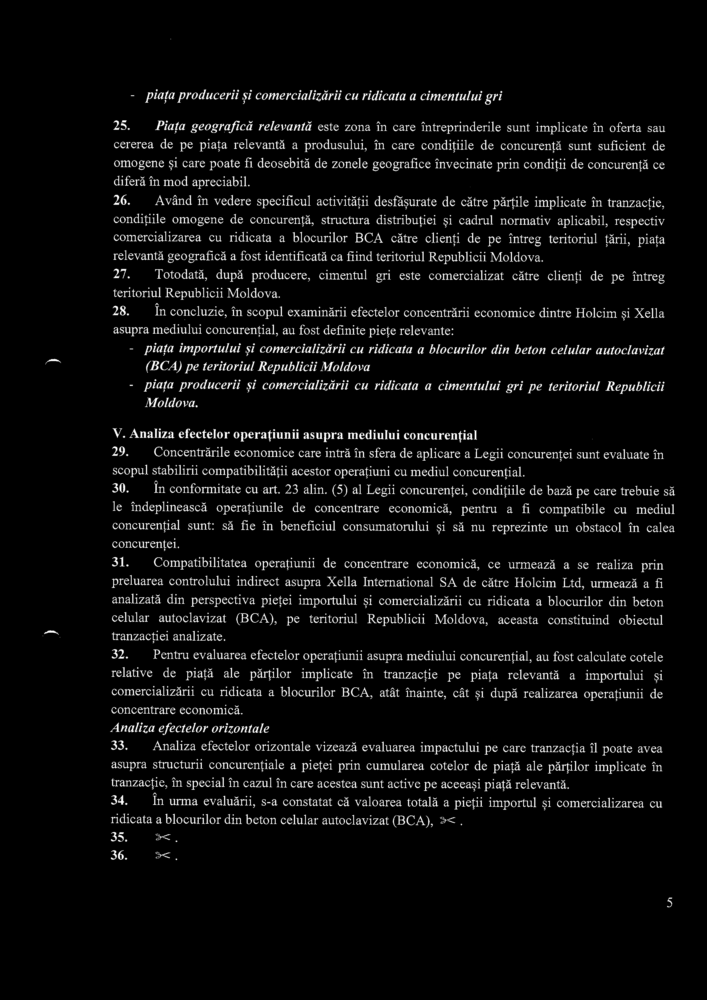
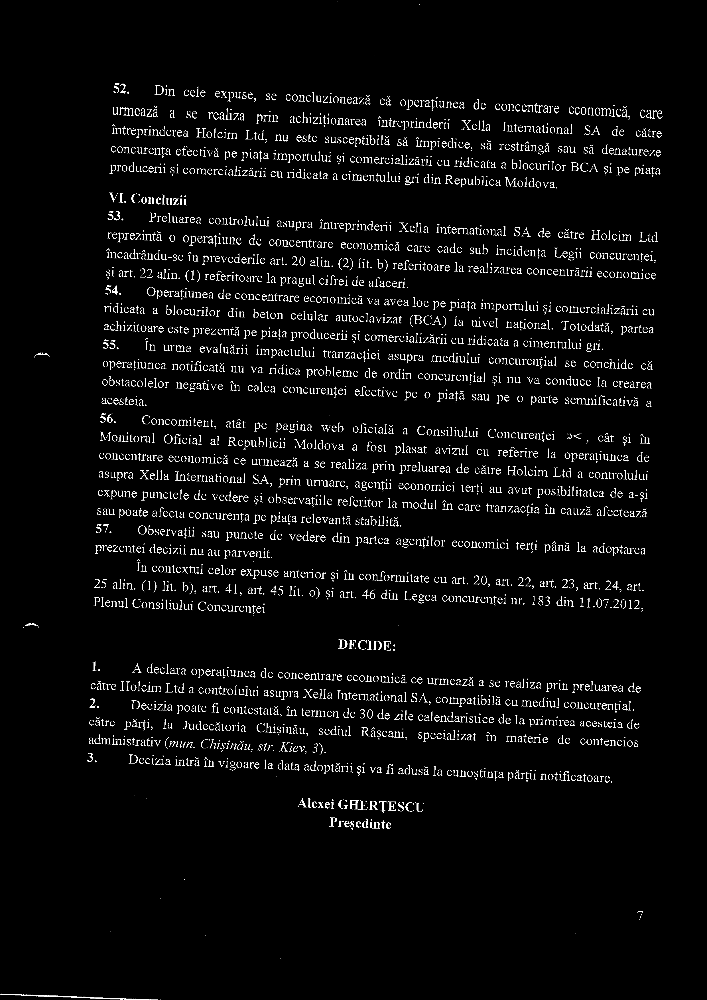

PLENUL 
CONSILIULUI CONCURENTEI 
MD- 2068, Republica Moldova, mun. Chi~ inau , str. Alecu Russo, I 
tel: + 373 (22) 274 565, 273 443 ; fax: + 373 (22) 270 606; E-mail: office@competition.md: W\vw.competition.md 
DECIZIE 
mun. Chi~inau 
din 05.02.2026 
Nr. DCE-03 
Plenul Consiliului Concurentei, 
actionand in temeiul art. 41 din Legea concurentei nr. 183 din 11.07.2012 (fn continuare -
Legea concuren/ei), Hotararii Parlamentului nr. 33/2022 privind numirea in functie a unui 
membru ~i pre~edinte a Plenului Consiliului Concurentei, Hotararii Parlamentului nr. 381/2023 
privind numirea in functia de membru al Plenului Consiliului Concurentei 
~i Hotararii 
Parlamentului nr. 211/2024 privind numirea in functia de membru al Plenului Consiliului 
Concurentei, 
analizand formularul complet privind notificarea unei concentrari economice depus de catre 
reprezentantul prin procura al companiei Holcim Ltd, inregistrat cu numarul de intrare ~ (fn 
continuare - formular de notificare), precum ~i materialele acumulate in procesul de examinare a 
concentrarii economice 
A CONSTATAT: 
La data 
;}< , reprezentantul prin procura al companiei Holcim Ltd a notificat, in 
conformitate cu prevederile art. 22 alin. (1) al Legii concurentei, concentrarea economica ce 
urmeaza a se realiza prin preluarea de catre Holcim Ltd a controlului indirect asupra Xella 
International SA. 
Notificarea a devenit efectiva la data de :-tr< , data la care au fost primite ~i inregistrate 
ultimele informatii la Consiliul Concurentei. 
I. Partile implicate 
Partea achizitoare: 
1. 
Holcim Ltd (fn continuare -
Holcim) societate cu numar de inregistrare CHE-
100.136.893, cu sediul: Grafenauweg 10, 6300 Zug, Switzerland. 
Genul de activitate des:fa~urat de grupul international Holcim, conform datelor prezentate in 
formularul de notificare este producerea $i comercializarea cu ridicata a materialelor de 
construc/ie (ciment $i agregate). Totodata, Holcim furnizeaza o gama inovatoare de solutii de 

constructie, incluzand sisteme de constructie eficiente din punct de vedere energetic, precum beton 
~i materiale pentru suprafete cu performanta ridicata, circulare ~i sustenabile. 
Holcim arc activitati in peste 45 de tari din Europa, Asia, Orientul Mijlociu ~i Africa, 
inclusiv ~i in An:.erica Latina. Detine un portofoliu international de marci in Europa, ca: "Holcim", 
"Lafarge" "ECOPact" "ECOPlanet" "Disensa" "Geocycle" "Zinco" si "PRB" 
' 
' 
' 
' 
' 
' 
. 
in Republica Moldova, Holcim define indirect controlul In trei lntreprinderi: ,,Lafarge 
Ciment (Moldova)" SA, ,,Geocycle" SRL ~i ,,Geostudygrup" SRL 
2. 
,,Lafarge Ciment (Moldova)" S.A., IDNO 1003606006217, societate pe actiuni 
inregistrata la data de 11.05.1994, cu sediul: str. Viitorului 1, or. Rezina, Republica Moldova. 
Administrator al cntreprinderii - dl Burau $tefan, :}< . 
Principalul gen de activitate al intreprinderii ,,Lafarge Ciment (Moldova)" SA, conform 
informatiilor prezentate in formularul de notificare este extracfia ziiciimintelor minerale, 
producerea $i comercializarea cimentului, precum $i prestarea serviciilor de subcontractare fn 
sectorul construc;iilor rutiere. 
3. 
,,Geocycle" SRL, IDNO 1011606004900, intreprindere inregistrata la data de 21.05.2012, 
cu sediul: str. Vii~orului 1, or. Rezina, Republica Moldova. 
Asociat al intreprinderii - ,,Lafarge Ciment (Moldova)" SA. Administrator al intreprinderii - dl 
Burau $tefan. 
Principalul gen de activitate al intreprinderii ,,Geocycle" SRL, conform informatiilor 
prezentate in forrnularul de notificare este recuperarea de$eurilor $i resturilor nemetalice 
reciclabile $i comerful cu ridicata de de$euri, resturi $i materiale nemetalice recuperabile. 
4. 
,,Geostud~grup" SRL, IDNO 1012600013895, intreprindere inregistrata la data de 
19.04.20212, cu s~diul: str. Viitorului 1, or. Rezina, Republica Moldova. Asociat al intreprinderii 
- ,,Lafarge Cimen:: (Moldova)" SA. Administrator al intreprinderii - dl Burau $tefan 
Principalul gen de activitate al intreprinderii ,,Geostudygrup" SRL conform informatilor 
prezentate este acrivitiifile preponderent fn sectorul imobiliar (activitiifi conexe vdnziirii bunurilor 
imobile, cumpiirarea, fnchirierea $i vdnzarea bunurilor imobile proprii), precum $i servicii de 
ridiciiri geodezice. 
In Republica Moldova, grupul Holcim, prin intermediul intreprinderilor in care detine 
controlul, produce 
~i comercializeaza ciment gri. Productia grupului Holcim, in special al 
blocurilor de zidar:.e (BCA) ;}< . 
Partea care urmeaza a fi achizitionata: 
5. 
Xella International S.A., (fn continuare - Xella) societate pe actiuni cu numar de 
inregistrare B 139488, cu sediul: Rue de Bitbourg 2, 1273 Luxembourg, Luxembourg. 
Genul de activitate principal al grupului international Xella este producerea $i 
comercializarea cu ridicata al produselor pentru zidiirie, al materialelor de construcfie $i de 
izolare bazate fn principal pe resurse minerale. Grupele principale de produse ale intreprinderii 
sunt: blocuri din beton celular autoclavizat (BCA), cunoscute pentru greutatea redusa 
~i 
proprietatile de izo:are termica; unitati din silicat de calciu utilizate pentru pereti portanti ~i pereti 
despartitori; solutii de izolare pentru performanta termica ~i acustica; unitati de mari dimensiuni 
2 

(panouri) din blocuri BCA proiectate in mod special pentru utilizarea in construqii comerciale, 
rezidentiale ~i industriale. 
Xella este activa in mai mult de 20 de tari, in special in Europa (in statele membre UE, dar ~i 
Bosnia ~i Herj:egovina, Kosovo, Muntenegru, Norvegia, Serbia ~i Regatul Unit). Xella detine in 
portofoliul sau marcile: "Ytong", "Silka", "Hebel" ~i "Multipor". 
In Republica Moldova, Xella comercializeaza cu ridicata blocuri pentru zidarie (BCA) 
fabricare in Romania, ~>< . Xella nu are filiale in Republica Moldova. 
II. Descrierea operafiunii de concentrare economica 
6. 
Operatiunea de concentrare economica notificata se va realiza in conformitate cu art. 20 
alin. (2) lit. b) din Legea concurentei ~i consta in preluarea controlului indirect asupra companiei 
Xella International SA de catre Holcim Ltd. 
7. 
Conform informatiilor prezentate in formularul de notificare, la data de 19 .10 .2025, intre 
Holcim Ltd (fn calitate de cumparator) ~i LSFlOXL Midco S.A (fn calitate de vdnzator), asociat 
unic al Xella International SA, a fost incheiat un contract de vanzare-cumparare cu conditie 
suspensiva de obtinere a autorizarii din partea Consiliului Concurentei al Republicii Moldova, 
inaintea finalizarii tranzactiei. Parj:ile intentioneaza sa finalizeze tranzactia dupa obtinerea tuturor 
aprobarilor reglementare necesare, dar nu mai tarziu de 30 iunie 2026. 
8. 
Conform informatiilor prezentate in formularul de notificare, dupa finalizarea tranzactiei, 
intreprinderea Xella va fi controlata de intreprinderea Holcim. 
9. 
Scopul realizarii operatiunii de concentrare economica declarat de partea notificatoare in 
formularul de notificare, consta in ,,accelerarea strategiei Holcim ,,NextGen Growth 2030" ~i va 
aduce beneficii semnificative consumatorilor. Activitatea Xella, care este in mare masura 
complementara portofoliului existent al Holcim, va permite Holcim sa i~i dezvolte in continuare 
segmentul de solutii pentru constructii prin adaugarea unei game suplimentare de produse 
complementare. De asemenea, accentul pus de Xella pe reparatii ~i renovari eficiente, din punct de 
vedere energetic, constructii modulare 
~i circulare 
~i automatizare digitala va consolida 
angajamentul Holcim fata de sustenabilitate. 
10. 
Tranzactia va permite Holcim sa creeze o ofe1ia de produse mai diversificata, care va 
majora numarul de optiuni disponibile pentru consumatori ~i investitiile continue in dezvoltarea de 
produse. Integrarea portofoliilor complementare ale celor doua companii va consolida capacitatea 
combinata a grupului de a fumiza solutii de constructii rentabile ~i sustenabile consumatorilor. 
Aceasta capacitate extinsa va admite Holcim sa concureze mai acerb cu al!i furnizori de materiale 
de constructii, generand, in final, beneficii pentru consumatori prin imbunatatirea calitatii 
produselor ~i preturi competitive. 
III. Dimensiunea operatiunii de concentrare economica 
11. 
In conformitate cu art. 22 alin. (1) din Legea concurentei, operatiunile de concentrare 
economica sunt supuse evaluarii ~i urmeaza a fi notificate Consiliului Concurentei inainte de 
punerea in aplicare, atunci cand cifra mondiala totala de afaceri realizata cumulativ de 
intreprinderile implicate, inregistrata in anul anterior operatiunii, depa~e~te 50000000 de lei ~i 
exista eel putin doua intreprinderi implicate in operatiune care au realizat pe teritoriul Republicii 
Moldova, fiecare in parte, o cifra totala de afaceri mai mare de 20000000 de lei in anul anterior 
operatiunii. 
3 

12. 
Cifra totala de afaceri realizata de intreprinderile implicate in tranzactie se calculeaza 
conform prevederilorr art. 24, alin. (2) al Legea concurentei. 
13. 
~}< 
14. 
'.?< 
15. 
Cifra totala cde afaceri realizata la nivel mondial ~i national de catre partile implicate in 
operatiunea de concentrare economica notificata pentru anul 2024 este prezentata in tabelul 1. 
16. 
Reie~ind dir informatia reflectata in tabelul 1, se concluzioneaza ca operatiunea de 
concentrare economrica intrune~te conditia pragurilor valorice prevazute la art. 22 alin. (1) din 
Legea concurentei. 
IV. Piata relevanta - piata relevanta a produsului ~i piata geografica relevanta 
17. 
Evaluarea uID.ei concentrari economice prin prisma compatibilitatii acesteia cu mediul 
concurential poate avea loc dupa determinarea pietei relevante. In confo1mitate cu prevederile 
aii. 4 din Legea concurentei, piata relevanta reprezinta piata in cadrul careia trebuie evaluata o 
anumita problema de concurenta ~i care se detem1ina prin raportarea pietei relevante a produsului 
la piata geografica relevanta. 
18. 
Pia/a relevanta a produsului este piata produselor considerate interschimbabile sau 
substituibile de catre consumatori, datorita utilizarii date acestora, a caracteristicilor fizice, 
functionale ~i a preµlllui. 
19. 
In procesul ~valuarii operatiunii de concentrare economica notificata, a fost identificat 
faptul ca tranzactia ::10tificata inregistreaza suprapunere orizontala in ceea ce prive~te importul ~i 
comercializarea cu ridicata a blocurilor din beton celular autoclavizat (BCA) in Republica 
Moldova, ~< . 
20. 
Intreprinderea ,,Lafarge Ciment (Moldova)" SA desfa~oara activitatea de producere ~i 
comercializare cu ridlicata a cimentului gri, ~· . 
21. 
Intreprinderile ,,Geocycle" SRL ~i ,,Geostudygrup" SRL :C->< • 
22. 
La definirea pietelor relevante au fost luate in calcul activitatile intreprinderilor implicate 
in operatiunea de concentrare economica reie~ind din activitatile conexe cu activitatea partii 
achizitoare. Operatiunea de concentrare economica notificata se refera la importul 
~i 
comercializarea cu ridicata a blocurilor din beton celular autoclavizat. Blocurile BCA constituie, 
din perspectiva cererii: un produs distinct fata de alte materiale de zidarie ( caramida ceramica, 
blocuri silico-calcarnase etc.), datorita caracteristicilor tehnice specifice (greutate redusa, izolare 
termica, u~urinta in montaj). 
Din perspectiva ofertei: producatorii/importatorii de blocuri BCA nu pot substitui rapid productia 
cu alte materiale. 
23. 
A vand in vedlere ca in Republica Moldova intreprinderea ,,Lafarge Ciment (Moldova)" SA, 
parte a grupului Holcim, produce ~i comercializeaza cu ridicata ciment gri, relatia dintre parti pe 
acest segment va fi calificata drept una de natura verticala, intrucat cimentul este utilizat in 
procesul de fabricare a blocurilor BCA. 
24. 
Astfel, luand in considerare activitatile comerciale desfli~urate de catre partile implicate in 
operatiunea de concentrare economica analizata, piata relevanta a produsului la caz este: 
- pia/a importului ~i comercia/izarii cu ridicata a blocuri/or din beton celular autoclavizat 
(BCA) 
4 

- piafa producerii ~i comercializarii cu ridicata a cimentului gri 
25. 
Pia/a geograficii relevanta este zona in care intreprinderile sunt implicate in oferta sau 
cererea de pe piata relevanta a produsului, in care conditiile de concurenta sunt suficient de 
omogene ~i care poate fi deosebita de zonele geografice invecinate prin conditii de concurenta ce 
difera in mod apreciabil. 
26. 
A vand in vedere specificul activitatii desra~urate de catre paqile implicate in tranzactie, 
conditiile omogene de concurenta, structura distributiei ~i cadrul normativ aplicabil, respectiv 
comercializarea cu ridicata a blocurilor BCA catre clienti de pe intreg teritoriul tarii, piata 
relevanta geografica a fost identificata ca fiind teritoriul Republicii Moldova. 
27. 
Totodata, dupa producere, cimentul gri este comercializat catre clienti de pe intreg 
teritoriul Republicii Moldova. 
28. 
in concluzie, in scopul examinarii efectelor concentrarii economice dintre Holcim ~i Xella 
asupra mediului concurential, au fost definite piete relevante: 
- piafa importului !ji comercializifrii cu ridicata a blocurilor din beton celular autoclavizat 
(BCA) pe teritoriul Republicii Moldova 
- piafa producerii !ji comercializiirii cu ridicata a cimentului gri pe teritoriul Republicii 
Moldova. 
V. Analiza efectelor operatiunii asupra mediului concurential 
29. 
Concentrarile economice care intra in sfera de aplicare a Legii concurentei sunt evaluate in 
scopul stabilirii compatibilitatii acestor operatiuni cu mediul concurential. 
30. 
in conformitate cu art. 23 alin. (5) al Legii concurentei, conditiile de baza pe care trebuie sa 
le indeplineasca operatiunile de concentrare economica, pentru a fi compatibile cu mediul 
concurential sunt: sa fie in beneficiul consumatorului ~i sa nu reprezinte un obstacol in calea 
concurentei. 
31. 
Compatibilitatea operatiunii de concentrare economica, ce urmeaza a se realiza prin 
preluarea controlului indirect asupra Xella International SA de catre Holcim Ltd, urmeaza a fi 
analizata din perspectiva pietei importului ~i comercializarii cu ridicata a blocurilor din beton 
celular autoclavizat (BCA), pe teritoriul Republicii Moldova, aceasta constituind obiectul 
tranzactiei analizate. 
32. 
Pentru evaluarea efectelor operatiunii asupra mediului concurential, au fost calculate cotele 
relative de piata ale paqilor implicate in tranzactie pe piata relevanta a importului 
~i 
comercializarii cu ridicata a blocurilor BCA, atat inainte, cat ~i dupa realizarea operatiunii de 
concentrare economica. 
Analiza efectelor orizontale 
33. 
Analiza efectelor orizontale vizeaza evaluarea impactului pe care tranzactia il poate avea 
asupra structurii concurentiale a pietei prin cumularea cotelor de piata ale partilor implicate in 
tranzactie, in special in cazul in care acestea sunt active pe aceea~i piata relevanta. 
34. 
in urma evaluarii, s-a constatat ca valoarea totala a pietii importul ~i comercializarea cu 
ridicata a blocurilor din beton celular autoclavizat (BCA), :C'>< 
35. 
;x-
36. 
~ 
5 

37. 
In Republica Moldova exista o intreprindere care desra~oara activitatea de producere a 
blocurilor din beton celular autoclavizat (BCA) - ,,Meteor" SRL. 
38. 
~}< 
39. 
Prin urmare, in unna realizarii concentrarii economice notificate, cota de piata cumulativa 
a partilor implicate pe piata comercializarii a blocurilor BCA :?< . 
40. 
Dupa realizarea concentrarii economice analizate, structura pietei va ramane concurentiala: 
exista un producator local cu o cota semnificativa de piata $i sunt prezenti distribuitori care 
exercita presiune concurentiala. Cota de piata care va rezulta in urma concentrarii economice a 
paf!ilor implicate in tranzactie, nu este de natura sa confere intreprinderii rezultate o pozitie 
dominanta $i nici nu conduce la eliminarea unui concurent important de pe piata. 
41. 
In consecinta, in urma analizei efectelor de natura orizontala, se concluzioneaza ca 
operatiunea de concentrare economica notificata, nu va duce la crearea sau consolidarea unei 
pozitii dominante $: nu va crea un obstacol in calea concurentei efective pe piata relevanta 
analizata sau pe o parte semnificativa a acesteia. 
Analiza efectelor veriticale 
42. 
In procesul de evaluare a operatiunii de concentrare economica notificata, a fost analizata 
distinct $i activitatea intreprinderii din grupul Holcim - ,,Lafarge Ciment (Moldova)" SA, care 
activeaza pe piata producerii $i comercializarii cimentului gri. Din informatia prezentata de partea 
achizitoare, se concluzioneaza ca intreprinderea ,,Lafarge Ciment (Moldova)" SA, 
~K 
. 
43. 
~ 
44. 
In acest context, partea notificatoare cu referire la masurile care vor fi luate pentru a 
preveni orice discriminare sau cre$tere nejustificata a preturilor la ciment pentru concurentii 
independenti de pe piata producerii ~i comercializarii produselor de zidarie (inclusiv blocuri 
BCA), pe teritoriul Republicii Moldova, comunica in formularul de notificare ca, tranzactia nu va 
afecta relatiile de fumizare dintre ,,Lafarge Ciment (Moldova)" SA ~i societatile care activeaza pe 
piata producerii $i comercializarii produselor de zidarie din Republica Moldova. 
45. 
'.}< 
46. 
Potrivit informatiei prezentate de catre paitea notificatoare, intreprinderea ,,Lafarge Ciment 
(Moldova)" SA, echipamentele de productie pentru beton prefabricat sunt potrivite $i pot fi 
folosite pentru toate tipurile de produse prefabricate, ceea ce le ofera producatorilor respectivi un 
nivel inalt de flexibilitate in luarea deciziei privind tipul specific de produs prefabricat, in care se 
specializeaza sau pe care se concentreaza. 
47. 
~?< 
48. 
Grupul Holcim este un grup integrat pe verticala, iar modelul sau de afaceri se bazeaza pe 
marirea volumelor de vanzari la nivel individual de intreprindere. 
49. 
~}< ' intrepri:iderea va urmari sa vanda cat mai mult ciment posibil, catre clienti, pentru a 
asigura recuperarea costurilor fixe. Totodata, partea notificatoare comunica ca producatorii 
produselor de zidarie din Republica Moldova dispun de furnizori altemativi, pentru un produs 
standardizat precum este cimentul. 
50. 
:;K 
51. 
Analizand cumulativ efectele orizontale $i verticale, se constata ca operatiunea de 
concentrare economica notificata nu creeaza $i nu consolideaza o pozitie dominanta $i nu 
afecteaza negativ structura concurentiala a pietelor relevante evaluate. 
6 

52. 
Din cele expuse, se concluzioneazii ca operatiunea de concentrare econormca care 
' 
' 
unneaza a se realiza prin achizitionarea intreprinderii Xella International SA de catre 
intreprinderea Holcim Ltd, nu este susceptibilii sa impiedice, sa restranga sau sa denatureze 
concurenta efectivii pe piata importului 9i comercializarii cu ridicata a blocurilor BCA 9i pe piata 
producerii ~i comercializarii cu ridicata a cimentului gri din Republica Moldova. 
VI. Concluzii 
53. 
Preluarea controlului asupra intreprinderii Xella International SA de catre Holcim Ltd 
reprezintii o operatiune de concentrare economicii care cade sub incidenta Legii concurentei, 
incadrandu-se in prevederile art. 20 alin. (2) lit. b) referitoare la realizarea concentrarii economice 
9i art. 22 alin. (1) referitoare la pragul cifrei de afaceri. 
54. 
Operatiunea de concentrare economica va avea loc pe piata importului ~i comercializarii cu 
ridicata a blocurilor din beton celular autoclavizat (BCA) la nivel national. Totodata, partea 
achizitoare este prezenta pe piata producerii 9i comercializarii cu ridicata a cimentului gri. 
55. 
In urma evaluarii impactului tranzactiei asupra mediului concurential se conchide ca 
operatiunea notificatii nu va ridica probleme de ordin concurential 9i nu va conduce la crearea 
obstacolelor negative in calea concurentei efective pe o piata sau pe o parte semnificativa a 
acesteia. 
56. 
Concomitent, atilt pe pagina web oficiala a Consiliului Concurentei 
~'re , cat 
~i in 
Monitorul Oficial al Republicii Moldova a fost plasat avizul cu referire la operatiunea de 
concentrare economica ce urmeaza a se realiza prin preluarea de catre Holcim Ltd a controlului 
asupra Xella International SA, prin urmare, agentii economici terti au avut posibilitatea de a-9i 
expune punctele de vedere 9i observatiile referitor la modul in care tranzactia in cauza afecteaza 
sau poate afecta concurenta pe piata relevanta stabilita. 
57. 
Observatii sau puncte de vedere din partea agentilor economici terti pana la adoptarea 
prezentei decizii nu au parvenit. 
In contextul celor expuse anterior 9i in conformitate cu art. 20, art. 22, aii. 23, art. 24, art. 
25 alin. (1) lit. b), art. 41 , art. 45 lit. o) 9i mt. 46 din Legea concurentei nr. 183 din 11.07.2012, 
Plenul Consiliului Concurentei 
DECIDE: 
1. 
A declara operatiunea de concentrare economica ce urmeaza a se realiza prin preluarea de 
catre Holcim Ltd a controlului asupra Xella International SA, compatibila cu mediul concurential. 
2. 
Decizia poate fi contestata, in termen de 3 0 de zile calendaristice de la primirea acesteia de 
catre parti, la Judecatoria Chi9inau, sediul Ra9cani, specializat in materie de contencios 
administrativ (mun. Chivinau, str. Kiev, 3). 
3. 
Decizia intra in vigoare la data adoptarii 9i va fi adusa la cuno9tinta partii notificatoare. 
Alexei GHERTESCU 
Pre~edinte 
7 
