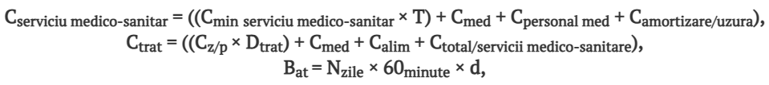

PLENUL 
CONSILIULUI CONCURENŢEI 
 
 
Republica Moldova, MD- 2032, Сhişinău, str.Aleco Russo 1 
E-mail: office@competition.md; www.competition.md 
                                                                            
DECIZIE 
mun. Chișinău 
 
din 05.08.2026 
 
 
 
 
 
Nr. EMAS-02/25-22 
 
Plenul Consiliului Concurenței,  
acționând în temeiul art. 41 al Legii concurenței nr. 183/2012, art. 11 alin. (2) 
lit. b) al Legii cu privire la ajutorul de stat nr. 139/2012, Hotărârii Parlamentului 
privind numirea în funcție a unui membru și președinte al Plenului Consiliului 
Concurenței nr. 56/2026, Hotărârii Parlamentului privind numirea în funcția de 
vicepreședinte al Plenului Consiliului Concurenței nr. 210/2024, Hotărârii 
Parlamentului privind numirea în funcția de membru al Plenului Consiliului 
Concurenței nr. 381/2023 și Hotărârii Parlamentului privind numirea în funcția de 
membru al Plenului Consiliului Concurenței nr. 211/2024, 
analizând raportul de investigație asupra cazului inițiat prin Dispoziția 
Plenului Consiliului Concurenți nr.02 din 05.02.2025, inclusiv materialele 
acumulate în cadrul investigației 
A CONSTATAT: 
I. CONTEXTUL MĂSURILOR 
1. 
Prin notificarea cu nr. 00912 parvenită prin Sistemul informațional 
automatizat ,,Registrul ajutoarelor de stat” la data de 22.04.2024, în baza art.8 
din Legea nr. 139/2012 cu privire la ajutorul de stat (în continuare - Legea cu 
privire la ajutorul de stat), Direcția Generală Economie, Comerț și Turism a 
Consiliului municipal Chișinău (în continuare – DGECT) a notificat acordarea 
unor măsuri de sprijin Î.M. „Centrul Stomatologic Municipal Chișinău” (în 
1 
 
 

continuare – Î.M.CSMC), fiind anexat formularul general de notificare a 
ajutorului de stat și formularul special de notificare a ajutorului de stat pentru 
serviciile de interes economic general.  
2. 
Notificarea a devenit efectivă la data de 28.11.2024.  
3. 
Comunicatul privind examinarea notificării a fost plasat pe site-ul web oficial 
al Consiliului Concurenței la data de 04.12.20241, în conformitate cu 
prevederile art.18 alin.(1) din Legea nr.139/2012 cu privire la ajutorul de stat, 
pentru asigurarea transparenței în procesul decizional. Careva observații și 
puncte de vedere de la terți în legătură cu notificarea examinată nu au 
parvenit. 
4. 
La data de 05.02.2025, notificarea cu nr. 00912 a fost examinată în cadrul 
ședinței Plenului Consiliului Concurenței. În urma analizei notificării 
menționate, materialelor anexate și notei examinatorului, Plenul Consiliului 
Concurenţei, prin Dispoziția nr.02 din 05.02.2025, a dispus inițierea 
procedurii de investigație cu privire la măsura de sprijin acordată Î.M. CSMC 
sub formă de scutire de plata pentru locațiunea bunurilor imobile, proprietate 
municipală, utilizate de către întreprindere în activitatea sa, care prezintă 
îndoieli privind compatibilitatea acesteia cu mediul concurențial normal. 
5. 
Comunicatul cu privire la inițierea investigației a fost publicat pe site-ul web 
oficial al Consiliului Concurenței2 în vederea asigurării transparenței în 
procesul decizional și obținerii observațiilor și punctelor de vedere de la terți. 
Observații și puncte de vedere nu au parvenit.  
 
II. 
CADRUL 
JURIDIC 
APLICABIL 
MĂSURII 
DE 
SPRIJIN 
EXAMINATE 
 
• Legea nr. 845 din 03.01.1992 cu privire la antreprenoriat și întreprinderi 
• Legea nr. 411 din 28.03.1995 ocrotirii sănătății 
                                                          
1https://www.competition.md/anunturi/transparenaa-decizionala/consiliul-concurentei-examineaza-notificarea-privind-masurile-
de-sprijin-acordate-im-centrul-stomatologic-municipal-chisinau/  
2 https://www.competition.md/decizii/examinarea-notificarii-parvenita-de-la-directia-generala-economie-comert-si-turism-a-
consiliului-municipal-chisinau/  
2 
 
 

• Legea nr. 436 din 28.12.2006 privind administrarea publică locală 
• Legea nr. 246 din 22.11.2017 cu privire la întreprinderea de stat și 
întreprinderea municipală 
• Legea nr. 139/2012 cu privire la ajutorul de stat 
• Hotărârea Guvernului nr. 901/2015 pentru aprobarea Regulamentului cu 
privire la modul de transmiterea a bunurilor proprietate publică 
• Hotărârea Guvernului nr. 1020/2011 cu privire la tarifele pentru serviciile 
medico-sanitare 
• Decizia CMC nr. 1/25 din 19.03.2015 „Cu privire la fondarea 
Întreprinderii Municipale Centrul Stomatologic Municipal Chișinău” 
• Decizia CMC nr. 3/15 din 19.05.2015 „Despre operarea de modificări în 
decizia Consiliului Municipal Chișinău nr.1/25 din 19.03.2015 „Cu  
privire la fondarea Întreprinderii Municipale „Centrul Stomatologic 
Municipal Chișinău” 
• Decizia CMC nr. 4/6 din 18.12.2015 „Despre operarea de modificări în 
decizia nr. 1/25 din 19.03.2015 „Cu privire la fondarea Întreprinderii 
Municipale Centrul Stomatologic Municipal Chișinău” 
• Decizia CMC nr.7/35 din 23.10.2018 (modificat prin Decizia CMC 
nr.16/10 din 20.10.2022) 
• Decizia CMC nr. 16/4-2 din 24.09.2020 „Cu privire la aprobarea, în 
redacție 
nouă, 
a 
Statutului 
întreprinderii 
Municipale 
„Centrul 
stomatologic municipal Chișinău” 
• Decizia CMC nr. 15/8 din 12.10.2022 „Cu privire la prelungirea 
relațiilor contractuale de comodat a unor încăperi, Întreprinderii 
Municipale „Centrul Stomatologic Municipal Chișinău” 
• Contractul nr. 8/2021 din 04.01.2021 de prestare a serviciilor medicale 
stomatologice semnat cu Direcția Generală Asistență Medicală și Socială a 
CMC 
• Contractul nr. 8/2022 din 03.01.2022 de prestare a serviciilor medicale 
3 
 
 

stomatologice semnat cu Direcția Generală Asistență Medicală și Socială a 
CMC 
• Contractul nr. 4/2023 din 03.01.2023 de prestare a serviciilor medicale 
stomatologice semnat cu Direcția Generală Asistență Medicală și Socială a 
CMC 
• Contractul nr. 31/2024 din 18.03.2024 de prestare a serviciilor medicale 
stomatologice semnat cu Direcția Generală Asistență Medicală și Socială a 
CMC 
• Regulamentul privind forma de notificare, procedura de examinare şi 
adoptare a deciziilor cu privire la ajutorul de stat, aprobat prin Hotărârea 
Plenului Consiliului Concurenței nr. 1 din 30.08.2013 
• Regulamentul privind ajutorul de stat acordat beneficiarilor ce prestează 
servicii de interes economic general, aprobat prin Hotărârea Plenului 
Consiliului Concurenţei nr. 11/2013 
• Contractul de comodat nr.1/15/036 din 29.06.2015 
• Contractul de comodat nr.2/15/016 din 29.06.2015 
• Contractul de comodat nr.3/15/039 din 29.06.2015 
• Contractul de comodat nr.4/15/008 din 29.06.2015 
• Contractul de comodat nr.5/15/021 din 29.06.2015 
• Contractul de comodat nr.1/22/010 din 28.12.2022 
• Contractul de comodat nr.2/22/017 din 28.12.2022 
• Contractul de comodat nr.3/22/011 din 28.12.2022 
• Contractul de comodat nr.4/22/013 din 28.12.2022 
• Contractul de comodat nr.5/22/014 din 28.12.2022 
• Scrisorile Ministerului Sănătății, Direcției Generale Economie, Comerț și 
Turism a Consiliului municipal Chișinău și Î.M. „Centrul Stomatologic 
Municipal Chișinău” 
 
 
4 
 
 

III. PĂRȚILE IMPLICATE 
6. 
Consiliul municipal Chișinău (în continuare – CMC), cu sediul: bd. Ştefan 
cel Mare şi Sfânt, 83, MD-2012, mun. Chişinău, în calitate de 
inițiator/furnizor al ajutorului de stat  în cazul transmiterii în comodat a 
bunurilor imobile, proprietate municipală. Potrivit Regulamentului privind 
constituirea și funcționarea Consiliului municipal Chișinău, aprobat prin 
Decizia CMC nr. 2/1 din 14.06.2016, Consiliul municipal este autoritatea 
reprezentativă și deliberativă a populației municipiului Chișinău, care 
beneficiază de autonomie decizională, organizațională, gestionară și 
financiară, cu drept de inițiativă în tot ceea ce privește administrarea treburilor 
publice pe teritoriul municipiului Chișinău, exercitându-și, în condițiile legii, 
autoritatea în limitele teritoriului administrat. 
7. 
În conformitate cu art. 2 alin. (2) al Legii privind statutul municipiului 
Chişinău nr. 136/2016, municipiul Chişinău este o unitate administrativ-
teritorială de nivelul al doilea, care include în componența sa unități 
administrativ-teritoriale de nivelul întâi, stabilite în Legea nr.764/2001 privind 
organizarea administrativ-teritorială a Republicii Moldova. Administrarea 
publică a municipiului Chişinău se realizează de către CMC, consiliile 
orășenești şi sătești (comunale), ca autorități reprezentative și deliberative ale 
populației municipiului Chișinău, şi de către Primarul general al municipiului 
Chişinău, primarii orașelor, satelor (comunelor), ca autorități reprezentative și 
executive. Consiliul municipal și primarul general al municipiului Chişinău 
exercită competențe și atribuții specifice autorităților publice locale de nivelul 
întâi în teritoriul orașului Chișinău și de nivelul al doilea – în raporturile cu 
orașele, satele (comunele) din componența municipiului. 
8. 
Potrivit prevederilor art. 25 al Legii privind statutul municipiului Chişinău nr. 
136/2016, Consiliul municipal are dreptul, la propunerea primarului general, 
să organizeze servicii publice în teritoriul municipiului în domeniile de 
activitate descentralizate stabilite pentru unitățile administrativ-teritoriale de 
5 
 
 

nivelurile întâi și al doilea, potrivit specificului și necesităților, în condițiile 
legii și în limita mijloacelor financiare disponibile. Conducătorii serviciilor 
publice de interes municipal sunt responsabili în fața primarului general şi a 
consiliului municipal de executarea atribuțiilor ce le revin. 
9. 
Î.M. CSMC (IDNO 1015600036316), cu sediul: bd. C. Negruzzi 3/2, MD-
2001, mun. Chișinău,  în calitate de beneficiar al ajutorului de stat. 
10. Întreprinderea în forma sa actuală a fost fondată în baza Deciziei Consiliului 
municipal Chișinău nr. 1/25 din 19.03.2015 „Cu privirea la fondarea 
Întreprinderii Municipale Centrul Stomatologic Municipal Chișinău”, care își 
desfășoară activitatea în conformitate cu Legea nr. 845 din 03.01.1992 cu 
privire la antreprenoriat și întreprinderi și Legea nr. 246 din 23.11.2017 cu 
privire la întreprinderea de stat și întreprinderea municipală. 
11. Conform informațiilor prezentate în formularul general de notificare a 
ajutorului de stat (ținând cont de pct. 29 din Regulamentul de activitate ÎM 
CSMC, inclusiv și de structura pacienților cărora li se oferă servicii 
stomatologice), Î.M. CSMC își desfășoară activitatea conform principiului de 
autogestiune, acordând servicii de asistență medicală stomatologică 
populației. 
 
IV. PIAȚA RELEVANTĂ: PIAȚA RELEVANTĂ A PRODUSULUI ȘI 
PIAȚA GEOGRAFICĂ RELEVANTĂ  
 
12. În conformitate cu art. 11, alin. (1) din Legea cu privire la ajutorul de stat, 
procedura de examinare a cazurilor de încălcare a legislaţiei din domeniul 
ajutorului de stat se derulează în conformitate cu Legea concurenţei. Pentru a 
stabili dacă o măsură de sprijin denaturează sau riscă să denatureze 
concurenţa urmează a fi stabilită piața relevantă și întreprinderile care 
activează pe această piață. 
13. Astfel, potrivit art. 4 din Legea concurenţei, piaţa relevantă este piață în 
cadrul căreia trebuie evaluată o anumită problemă de concurență și care se 
determină prin raportarea pieței relevante a produsului la piața geografică 
6 
 
 

relevantă. Totodată, piața relevantă a produsului este piaţa a produselor 
considerate de consumatori ca interschimbabile sau substituibile datorită 
utilizării date acestora, datorită caracteristicilor fizice, funcţionale şi preţului. 
14. Ca urmare, ținând cont de cele expuse mai sus, precum și de statutul Î.M. 
CSMC, se constată că piața relevantă a produsului în sensul examinării 
cazului dat (cu excepția  activităților desfășurate în cadrul asigurării 
obligatorii de asistență medicală) este piața activităților de asistență 
stomatologică. 
15. Întrucât întreprinderea este un centru stomatologic municipal care deservește, 
conform Programului municipal de acordare a asistenței medicale 
stomatologice persoanelor din grupurile social-dezavantajate din municipiul 
Chișinău (în continuare – Program), persoane cu viză de reședință în 
municipiul Chișinău, piața geografică relevantă va constitui teritoriul 
municipiului Chișinău.  
16. Potrivit datelor din Clasificatorul activităţilor din economia Republicii 
Moldova (anii 2022-2024) au fost identificate întreprinderile concurente 
înregistrate în municipiul Chișinău ce își desfășoară activitatea pe segmentele 
de piață vizate și expuse în tabelul 1.  
Tabelul 1  
Segmentele de piață vizate 
 
Cod 
CAEM 
Denumire activitate 
Număr întreprinderi 
2022 
2023 
2024 
Q 86.23 
Activități de asistență 
stomatologică 
458 
482 
562 
 
Perioada de timp supusă examinării 
17. Conform notificării nr. 00912, măsura de sprijin sub forma de scutire de la 
plata pentru locațiunea bunurilor imobile, proprietate municipală, utilizată de 
către Î.M. CSMC în activitatea sa, a fost notificată ca fiind acordată în 
7 
 
 

perioada 2021-2024 și estimată de a fi acordată ulterior în perioada 2025-
2028. 
18. Ca urmare, perioada de timp supusă examinării a constituit 2021 – 2026, sem. 
I. 
 
V. ACTE ȘI FAPTE CONSTATATE 
19. Inițial au fost notificate două măsuri de sprijin (alocații bugetare și scutirea de 
plata pentru locațiunea bunurilor imobile, proprietate municipală, utilizate de 
către Î.M. CSMC în activitatea sa), ce au fost acordate Î.M. CSMC pe 
parcursul perioadei 2021-2024 și estimate de a fi acordate în continuare în 
perioada 2025-2028. Ulterior, în cadrul examinării notificării depuse, au mai 
fost identificate și alte măsuri de sprijin acordate Î.M. CSMC. Ca urmare a 
examinării notificării cu nr. 00912 din 22.04.2024 și materialelor acumulate 
pe parcursul examinării, Plenul Consiliului Concurenței a adoptat Decizia nr. 
EMAS-05 din 05.02.2025 și Dispoziția nr. 02 din 05.02.2025.  
20. Cu referire la scutirea de plata pentru locațiunea bunurilor imobile, proprietate 
municipală, prin Decizia Plenului Consiliului Concurenței nr. EMAS-05 din 
05.02.2025 a fost identificată o posibilă neconformitate a măsurii de sprijin 
menționate cu legislația în domeniul ajutorului de stat, și anume semne de 
existență a unei supracompensări (dublare a compensării unor și aceleași 
costuri ale întreprinderii) care nu este necesară pentru îndeplinirea obligaţiei 
de servicii de interes economic general (în continuare – SIEG) și care nu 
poate fi compatibilă cu mediul concurențial normal.  
21. Astfel, Plenul Consiliului Concurenței, prin Dispoziția nr. 02 din 05.02.2025, 
a dispus iniţierea procedurii de investigație cu privire la măsura de sprijin 
acordată Î.M. „Centrul Stomatologic Municipal Chișinău” sub formă de 
scutire de plata pentru locațiunea bunurilor imobile, proprietate municipală, 
utilizate de către întreprindere în activitatea sa, care prezintă îndoieli privind 
compatibilitatea acesteia cu mediul concurențial normal. 
8 
 
 

22. Măsura de sprijin examinată a fost acordată prin Decizia CMC nr. 3/15 din 
19.05.2015 și nr.15/8 din 12.10.2022 pentru următoarele încăperi nelocative: 
1. IMSP AMT Botanica, bd. Dacia, 5/2B - 457 ,5 m2 - Contract de comodat 
nr.1/15/036 din 29.06.2015 și nr. 1122/010 din 28.12.2022. 
2. IMSP AMT Buiucani,  str. I.L. Caragiale,  2 - 505,0 m2 - Contract de 
comodat nr. 2/15/016 din 29.06.2015 și nr.2/22/017 din 28.12.2022 (acord 
adițional din 06.02.2023 de modificare a spatiilor - 346,3 m2). 
3. Sediul Central IM CSMC, bd. C. Negruzzi, 3/2 -2613,8 m2 - Contract de 
comodat nr.3/15/039 din 29.06.2015 și nr.3/22/011 din 28.12.2022. 
4. IMSP AMT Ciocana, str. Vadul lui Vodă, 80 - 365,4 m2 - Contract de 
comodat nr. 4/15/008 din 29.06.2015 și nr.4/22/013 din 28.12.2022. 
5. IMSP AMT Rîșcani str. A. Russo, 11 - 707,6 m2 - Contract de comodat nr . 
5/15/021 din 29.06.2015 și nr. 5/22/014 din 28.12.2022. 
23. Conform informațiilor parvenite de la DGECT, valoarea scutirii de plata 
pentru locațiunea bunurilor imobile menționate anterior este după cum 
urmează: 
Tabelul 2  
Valoarea măsurii de sprijin, mii lei 
Anul 
2021 
2022 
2023 
2024 
2025 
2026, sem. I 
Total 
Bd. Dacia, 5/2 
94,7 
101,3 
116,5 
116,5 
123,6 
67,2 
619,8 
Str. Ion Luca 
Caragiale, 2 
104,7 
111,9 
91,6 
88,1 
93,5 
50,9 
540,7 
Adresa 
imobilului 
Bd. Constantin 
Negruzzi, 3/2 
541,2 
578,6 
665,4 
665,4 
744,1 
404,2 
3598,9 
Str. Vadul lui 
Vodă, 80 
75,7 
80,8 
93,1 
93,1 
98,7 
53,7 
495,1 
Str. Alecu 
Russo, 11/1 
146,5 
156,6 
180,1 
180,1 
191,1 
104 
958,4 
Total 
962,8 
1029,2 
1146,7 
1143,2 
1251 
680 
6212,9 
Mențiune: Valoarea scutirii de plata pentru locațiunea bunurilor imobile a fast calculata din momentul 
încheierii contractelor de comodat. 
24. Astfel, conform datelor prezentate de către DGECT, valoarea totală a măsurii 
de sprijin examinate, în perioada 2021-2026, sem. I, a constituit 6219,9 mii 
lei. 
9 
 
 

Existența ajutorului de stat 
25. Potrivit art. 3 din Legea cu privire la ajutorul de stat, ajutorul de stat este orice 
măsură de sprijin care întrunește cumulativ următoarele condiții: 
a) este acordată de furnizor din resurse de stat sau din resursele unităților 
administrativ – teritoriale sub orice formă; 
b) conferă beneficiarului un avantaj economic, care nu putea fi obținut în 
condiții normale de piață; 
c) este acordată în mod selectiv; 
d) denaturează sau riscă să denatureze concurența. 
a) este acordată de furnizor din resurse de stat sau din resursele unităților 
administrativ – teritoriale sub orice formă 
 
26. Acordarea unui avantaj direct sau indirect prin intermediul resurselor de stat 
și imputabilitatea unei astfel de măsuri în sarcina statului sunt două condiții 
cumulative pentru existența ajutorului.3 
 Imputabilitatea statului  
27. În cazul în care o autoritate publică acordă un avantaj unui beneficiar, măsura 
este prin definiție imputabilă statului, chiar dacă autoritatea în cauză 
beneficiază de autonomie juridică față de alte autorități publice. Același lucru 
este valabil și în cazul în care o autoritate publică desemnează un organism 
privat sau public pentru administrarea unei măsuri care conferă un avantaj.4 În 
ceea ce privește, în primul rând, condiția potrivit căreia măsura trebuie să fie 
imputabilă statului, este necesar să se examineze dacă trebuie să se considere 
că autoritățile publice au fost implicate în adoptarea acestei măsuri5.  
28. Măsura de sprijin examinată a fost acordată de autoritatea publică locală în 
temeiul actelor sale și anume, deciziilor CMC. 
                                                          
3 Comunicarea Comisiei privind noțiunea de ajutor de stat astfel cum este menționată la articolul 107 alineatul (1) din Tratatul 
privind funcționarea Uniunii Europene, pct. 38. 
4  Comunicarea Comisiei privind noțiunea de ajutor de stat astfel cum este menționată la articolul 107 alineatul (1) din Tratatul 
privind funcționarea Uniunii Europene, pct. 39. 
5 Hotărârea Curții de Justiție din 20 septembrie 2019, FVE Holýšov I s. r. o., T-217/17, ECLI:EU:T:2019:633, pct. 99; Hotărârea 
Curții de Justiție din 19 decembrie 2013, Association Vent De Colère ! și alții, C 262/12, EU:C:2013:851, pct. 17. 
10 
 
 

29. Ținând cont de cele menționate, se constată îndeplinirea condiției ce ține de 
imputabilitatea statului. 
 Transferul de resurse de stat sau ale unității administrativ-teritoriale 
30. Conform art. 3 al Legii cu privire la ajutorul de stat, resurse de stat sau resurse 
ale unităţilor administrativ-teritoriale reprezintă totalitatea patrimoniului, 
inclusiv sub formă de mijloace financiare, ce aparţine statului, unităţilor 
administrativ-teritoriale, inclusiv unităţii teritoriale autonome Găgăuzia. 
Numai avantajele acordate direct sau indirect din resurse de stat pot constitui 
ajutor de stat.6 Nu trebuie să aibă loc un transfer pozitiv de fonduri, este 
suficientă renunțarea la veniturile de stat. Renunțarea la venituri care altfel ar 
fi fost plătite statului constituie un transfer de resurse de stat.7 Transferul 
resurselor de stat poate lua multe forme, acestea fiind prevăzute în art. 6 al 
Legii cu privire la ajutorul de stat. 
31. În cazul scutirii de plata pentru locațiunea bunurilor imobile, aceasta 
reprezintă o renunțare la veniturile de stat. 
32. Ca urmare, se constată că acordarea măsurilor de sprijin menționate anterior, 
reprezintă un transfer de resurse de stat. 
 
b) conferă beneficiarului un avantaj economic care nu putea fi obținut în 
condiții normale de piață 
 
33. Un avantaj este orice beneficiu economic pe care întreprinderea nu l-ar fi 
putut obține în condiții normale de piață, și anume în absența intervenției 
statului.8 Noțiunea de avantaj economic include toate situațiile în care 
întreprinderile sunt scutite de costurile inerente activității lor economice. Ori 
de câte ori situația financiară a unei întreprinderi este îmbunătățită ca rezultat 
al intervenției statului în condiții care diferă de condițiile normale de piață, 
există un avantaj. Doar efectul măsurii asupra întreprinderii este relevant, iar 
                                                          
6 Comunicarea Comisiei privind noțiunea de ajutor de stat astfel cum este menționată la articolul 107 alineatul (1) din Tratatul 
privind funcționarea Uniunii Europene, pct. 47. 
7 Comunicarea Comisiei privind noțiunea de ajutor de stat astfel cum este menționată la articolul 107 alineatul (1) din Tratatul 
privind funcționarea Uniunii Europene, pct. 51. 
8 Comunicarea Comisiei privind noțiunea de ajutor de stat astfel cum este menționată la articolul 107 alineatul (1) din Tratatul 
privind funcționarea Uniunii Europene (2016/C 262/01), pct. 66. 
11 
 
 

nu cauza sau obiectivul intervenției statului. Nici forma exactă a măsurii nu 
este relevantă pentru a determina dacă aceasta conferă sau nu un avantaj 
economic întreprinderii. 9 
34. Aici urmează a fi menționat că în conformitate cu pct. 7 al Regulamentului 
privind ajutorul de stat acordat beneficiarilor ce prestează servicii de interes 
economic general, aprobat prin Hotărârea Plenului Consiliului Concurenţei 
nr.11 din 30 august 2013, compensaţiile acordate beneficiarilor pentru 
prestarea serviciilor de interes economic general, nu constituie ajutor de stat, 
dacă sunt îndeplinite cumulativ următoarele condiţii: 
1) întreprinderea beneficiară trebuie să fie efectiv însărcinată cu executarea 
unor obligaţii de SIEG, iar aceste obligaţii trebuie să fie clar definite; 
2) parametrii pe baza cărora se calculează compensaţia trebuie să fie stabiliţi 
în prealabil, în mod obiectiv şi transparent, pentru a evita conferirea unui 
avantaj economic care poate favoriza întreprinderea beneficiară faţă de 
întreprinderile concurente. Plata unei compensaţii de către stat pentru 
pierderile suferite de o întreprindere fără ca parametrii acestei compensaţii 
să fie stabiliţi în prealabil, atunci când se constată ulterior că prestarea 
SIEG-ului nu a fost viabilă din punct de vedere economic, reprezintă 
ajutor de stat;  
3) compensaţia nu poate depăşi ceea ce este necesar pentru acoperirea totală 
sau parţială a costurilor ocazionate de executarea obligaţiei de SIEG, 
ţinând cont de veniturile rezultate din această activitate, precum şi un 
profit rezonabil;  
4) atunci când alegerea întreprinderii, care urmează să fie investită cu 
obligaţia de prestare a SIEG-ului, nu se face în cadrul unei proceduri de 
achiziţie publică, care permite selectarea ofertantului capabil să furnizeze 
serviciile respective la cele mai mici preţuri, nivelul compensaţiei trebuie 
determinat pe baza unei analize a costurilor pe care o întreprindere bine 
                                                          
9 Comunicarea Comisiei privind noțiunea de ajutor de stat astfel cum este menționată la articolul 107 alineatul (1) din Tratatul 
privind funcționarea Uniunii Europene (2016/C 262/01), pct. 68. 
12 
 
 

administrată şi dotată corespunzător, le-ar fi suportat pentru a presta acea 
obligaţie de SIEG, ţinând cont de veniturile rezultate din această 
activitate, precum şi un profit rezonabil.   
35. DGECT nu a prezentat nici o informație sau dovadă care să demonstreze că 
compensaţiile acordate Î.M. CSMC pentru prestarea SIEG-ului examinat 
îndeplinesc condițiile cumulative prevăzute de pct. 7 al Regulamentului 
privind ajutorul de stat acordat beneficiarilor ce prestează SIEG. 
36. Ținând cont de cele menționate,  precum și de faptul că măsura de sprijin 
acordată reprezintă o scutire a întreprinderii de costuri pe care aceasta ar fi 
trebuit să le suporte, se consideră întrunită și condiția de conferire 
beneficiarilor a unui avantaj economic care nu putea fi obținut în condiții 
normale de piață. 
c) este acordată în mod selectiv 
37. Nu toate măsurile care favorizează operatorii economici se încadrează în 
noțiunea de ajutor, ci numai cele care acordă un avantaj în mod selectiv 
anumitor întreprinderi sau categorii de întreprinderi sau anumitor sectoare 
economice.10 Selectivitatea materială a unei măsuri implică faptul că măsura 
se aplică numai anumitor (grupuri de) întreprinderi sau anumitor sectoare ale 
economiei într-un anumit stat membru. Selectivitatea materială poate fi 
stabilită de jure sau de facto.11 
38. Selectivitatea de jure rezultă direct din criteriile legale pentru acordarea unei 
măsuri care este rezervată în mod oficial doar anumitor întreprinderi. 
Selectivitatea de facto poate fi rezultatul unor condiții sau obstacole impuse 
de statele membre pentru a împiedica anumite întreprinderi să beneficieze de 
pe urma măsurii.12 
                                                          
10 Comunicarea Comisiei privind noțiunea de ajutor de stat astfel cum este menționată la articolul 107 alineatul (1) din Tratatul 
privind funcționarea Uniunii Europene (2016/C 262/01), pct. 117. 
11 Comunicarea Comisiei privind noțiunea de ajutor de stat astfel cum este menționată la articolul 107 alineatul (1) din Tratatul 
privind funcționarea Uniunii Europene (2016/C 262/01), pct. 120. 
12 Comunicarea Comisiei privind noțiunea de ajutor de stat astfel cum este menționată la articolul 107 alineatul (1) din Tratatul 
privind funcționarea Uniunii Europene (2016/C 262/01), pct. 121-122. 
13 
 
 

39. Luând în considerare că de măsura de sprijin examinată a beneficiat doar Î.M. 
CSMC, se constată întrunirea condiției de selectivitate în acest caz. 
d) denaturează sau riscă să denatureze concurența 
40. Pentru a se considera că ajutorul denaturează concurența, în mod normal, este 
suficient ca ajutorul să ofere beneficiarului un avantaj prin scutirea de 
cheltuieli pe care, în caz contrar, acesta ar fi trebuit să le suporte în cursul 
operațiunilor comerciale curente. În practică, se consideră în general că există 
o denaturare a concurenței în sensul articolului 107 alineatul (1) din TFUE 
atunci când statul acordă un avantaj financiar unei întreprinderi într-un sector 
liberalizat în care există sau ar putea exista concurență.13 Definiția ajutorului 
de stat nu presupune ca denaturarea concurenței să fie semnificativă sau 
materială.14  
41. Având în vedere că anterior a fost constatată întrunirea condiției cu privire la 
existența avantajului economic selectiv pentru Î.M. CSMC, se constată 
întrunirea și ultimei condiții.  
42. Cu referire la cele menționate, se constată că măsura de sprijin sub forma de 
scutirea de plata pentru locațiunea bunurilor imobile, proprietate municipală, 
utilizată de către  Î.M. CSMC în activitatea sa întrunește condiția prevăzută la 
art. 3 din Legea cu privire la ajutorul de stat și prin urmare constituie ajutor de 
stat. 
43. Totodată, se atestă că ajutorul de stat a fost notificat de către DGECT după 
acordarea acestuia Î.M. CSMC, contrar obligației de notificare a intenției de 
acordare a unui ajutor de stat, prevăzute de art. 8 alin. (1) al Legii cu privire la 
ajutorul de stat. Conform art. 3 alin. (1) al Legii cu privire la ajutorul de stat, 
orice ajutor de stat, altul decât ajutorul existent sau cel exceptat de la obligaţia 
notificării conform prezentei legi, care a fost acordat fără a fi autorizat de 
Consiliul Concurenţei reprezintă un ajutor ilegal. Astfel, ajutorul de stat 
                                                          
13 Comunicarea Comisiei privind noțiunea de ajutor de stat astfel cum este menționată la articolul 107 alineatul (1) din Tratatul 
privind funcționarea Uniunii Europene (2016/C 262/01), pct. 187. 
14 Comunicarea Comisiei privind noțiunea de ajutor de stat astfel cum este menționată la articolul 107 alineatul (1) din Tratatul 
privind funcționarea Uniunii Europene (2016/C 262/01), pct. 189. 
14 
 
 

acordat Î.M. CSMC sub forma de scutire de plata pentru locațiunea bunurilor 
imobile, proprietate municipală constituie un ajutor ilegal (nefiind nici ajutor 
existent și nici exceptat de la obligația notificării). 
44. Conform jurisprudenței Uniunii Europene15, nu poate fi impusă recuperarea 
unui ajutor numai pentru motivul nelegalității sale, dar trebuie să fie efectuată 
o evaluare completă a compatibilității acestuia cu piața internă. 
Evaluarea compatibilității ajutorului de stat cu mediul concurențial 
normal 
45. Astfel, cu referire la compatibilitatea acestui ajutor de stat cu mediul 
concurențial normal, urmează a fi menționat următoarele. 
46. Potrivit art. 107 din Tratatul privind funcționarea Uniunii Europene (în 
continuare – TFUE), ajutoarele acordate de state sau prin intermediul 
resurselor de stat, sub orice formă, care denaturează sau amenință să 
denatureze concurența prin favorizarea anumitor întreprinderi sau a producerii 
anumitor bunuri, în măsura în care acestea afectează schimburile comerciale 
dintre statele membre sunt incompatibile cu piața internă, cu excepția 
derogărilor  prevăzute. 
47. Potrivit art. 340 alin. (1) al Acordului de Asociere între Republica Moldova și 
Uniunea Europeană, ajutoarele de stat se evaluează pe baza criteriilor care 
decurg din aplicarea normelor în materie de concurență aplicabile în UE, în 
special a articolului 107 din TFUE și a instrumentelor de interpretare adoptate 
de instituțiile UE, inclusiv jurisprudența relevantă a Curții de Justiție a 
Uniunii Europene. 
48. Potrivit art. 339 alin. (1) al Acordului de Asociere între Republica Moldova și 
Uniunea Europeană, ajutoarele de stat acordate de Uniune sau de Republica 
Moldova ori prin resursele uneia dintre părți, sub orice formă, care 
denaturează sau amenință să denatureze concurența prin favorizarea anumitor 
                                                          
15 Hotărârea Curții de Justiție din 07.04.2022, KW and SG v Autonome Provinz Bozen, Joined Cases C-102/21 and C-103/21, 
ECLI:EU:C:2022:272, pct. 51. 
 
15 
 
 

întreprinderi sau a producției de anumite mărfuri și servicii și care afectează 
schimburile comerciale între părți sunt incompatibile. Concomitent, art. 5, 
alin. (1) al Legii cu privire la ajutorul de stat stabilește categoriile de ajutoare 
de stat care pot fi considerate compatibile. 
49. Ținând cont de obiectivul declarat al măsurii de sprijin notificate de către 
DGECT, evaluarea compatibilității ajutorului de stat cu mediul concurențial 
normal va fi efectuată în baza prevederilor Regulamentului privind ajutorul de 
stat acordat beneficiarilor ce prestează servicii de interes economic general, 
aprobat prin Hotărârea Plenului Consiliului Concurenţei nr.11 din 30 august 
2013 (în continuare - Regulament privind ajutorul de stat acordat 
beneficiarilor ce prestează SIEG). 
50. Potrivit prevederilor pct. 9 din Regulamentul privind ajutorul de stat acordat 
beneficiarilor ce prestează SIEG, compensaţiile acordate beneficiarilor pentru 
prestarea SIEG-ului pot constitui ajutor de stat compatibil cu mediul 
concurenţial normal, dacă se respectă următoarele condiţii:  
a) ajutorul de stat este necesar în vederea operării SIEG;  
b) ajutorul de stat nu denaturează în mod nejustificat concurenţa. 
51. În cadrul examinării notificării nr.00912, Consiliul Concurenței a identificat 
semne de o posibilă neconformitate la acordarea Î.M. CSMC a scutirii de 
plata pentru locațiunea bunurilor imobile, proprietate municipală, ținând cont 
de faptul că întreprinderea în activitatea sa utilizează tarifele din Catalog (care 
reprezintă limita maximă pentru serviciile medico-sanitare prestate contra 
plată de către instituțiile medico-sanitare publice) și care deja includ în sine 
toate cheltuielile ce ar putea suporta o instituție medico-sanitară publică în 
activitatea sa, fapt ce ar putea duce la o dublare a compensării unor și aceleași 
costuri ale întreprinderii.  
52. Programul municipal de acordare a asistenței medicale stomatologice 
persoanelor din grupurile social-dezavantajate din municipiul Chișinău (în 
continuare – Program) a fost transmis în gestiunea Î.M. CSMC de la fondarea 
16 
 
 

instituției, prin Decizia CMC nr.4/6 din 18.12.2015 „Despre operarea de 
modificări în decizia nr.1/25 din 19.03.2015 „Cu privire la fondarea 
Întreprinderii Municipale Centrul Stomatologic Municipal Chișinău”. 
53. Prin Decizia CMC nr.7/35 din 23.10.2018 „Cu privire la aprobarea, într-o 
nouă redacție, a regulamentului cu privire la acordarea asistenței medicale 
stomatologice persoanelor din grupurile social-dezavantajate din municipiul 
Chișinău” 
a 
fost 
păstrată 
delegarea 
prestării 
serviciilor 
medicale 
stomatologice de către  Î.M. CSMC categoriilor de beneficiari incluși în 
Program.  
54. Serviciul protezare dentară gratuită, finanțat din bugetul municipal, este 
prestat conform Regulamentului cu privire la acordarea asistenței medicale 
stomatologice persoanelor din grupurile social-dezavantajate din municipiul 
Chișinău, aprobat prin Decizia CMC nr.7/35 din 23.10.2018 (modificat prin 
Decizia CMC nr.16/10 din 20.10.2022), în care sunt prevăzute categoriile de 
populație care pot beneficia de volumul de asistență medicală stomatologică, 
cu viză de reședință în municipiul Chișinău: persoane în vârstă; persoane cu 
dizabilități; veterani de război; veterani al muncii; persoane reabilitate; 
persoane distinse cu mențiuni și ordine de stat, cazuri neprevăzute și de 
urgență. 
55. Î.M. CSMC, în vederea prestării acestor servicii medicale, a încheiat cu 
Direcția Generală Asistență Medicală și Socială a CMC contracte de prestare 
a serviciilor medicale stomatologice persoanelor incluse în Program. 
56. Contractele menționate prevedeau următoarele obligațiuni pentru Î.M. CSMC: 
- să presteze servicii medicale stomatologice pacienților conform invitației: 
consultația medicului stomatolog, tratamentul maladiilor dentare, extracții 
dentare și intervenții chirurgicale operative în cavitatea bucală în scopul 
asanării și pregătirii preprotetice, confecționarea protezelor dentare din 
aliaje inobile, cu acoperire decorativă, examinarea radiologică și alte 
tratamente paraclinice; 
17 
 
 

- să prezinte raportul serviciilor prestate în conformitate cu clauzele 
contractului a volumului, termenilor, calității și costului serviciilor 
medicale stomatologice acordate persoanelor în limita serviciilor 
stomatologice contractate nedepășind pragul valoric per pacient stabilit în 
contractul încheiat; 
- să stabilească costul serviciilor medicale stomatologice prestate, în baza 
Hotărârii Guvernului nr. 1020/2011 cu privire la tarifele pentru serviciile 
medico-sanitare. 
57. Ca urmare, în activitatea sa, Î.M. CSMC aplică tarifele stabilite în Anexa nr.3 
la Hotarârea Guvernului nr. 1020/2011, și anume conform catalogului 
tarifelor unice pentru serviciile medico-sanitare prestate contra plată de către 
instituțiile medico-sanitare publice, precum și pentru serviciile acoperite din 
fondurile asigurării obligatorii de asistență medicală prestate de instituțiile 
medico-sanitare publice și cele private (în continuare – Catalog). Tarifele din 
Catalog reprezintă limita maximă pentru serviciile medico-sanitare prestate 
contra plată de către instituțiile medico-sanitare publice și pentru contractarea 
de către CNAM, prin metoda per serviciu, a instituţiilor medico-sanitare 
publice, private şi parteneriatele publice-private. 
58. Mecanismul de reglementare a tarifelor pentru serviciile medico-sanitare are 
la bază următoarele principii: 
• tarifele pentru serviciile medico-sanitare, prestate de instituţiile medico-
sanitare, să se bazeze pe costurile lor; 
• tarifele să fie stabilite conform principiului nediscriminării prestatorilor de 
servicii şi consumatorilor; 
• tariful nu include cota rentabilităţii, cu excepţia parteneriatelor publice-
private; 
• pentru sistemul sănătăţii serviciile medico-sanitare sînt servicii nonprofit, 
cu excepţia parteneriatelor publice-private. 
18 
 
 

59. Aplicarea tarifelor stabilite în Hotărârea Guvernului nr.1020/2011 este 
prevăzută și în pct. 29 din Regulamentul de activitate al Î.M. Centrul 
Stomatologic Municipal Chişinău, aprobat de către Ministerul Sănătății și 
coordonat cu Consiliul municipal Chișinău (anexa nr.2 la Decizia CMC 
nr.1/25 din 19.03.2015). 
60. Pentru prestarea servicii medicale stomatologice în cadrul Programului, din 
bugetul municipal se transferă anual întreprinderii alocații bugetare pentru 
acoperirea cheltuielilor suportate. Bugetul anual al programului se formează 
conform următoarei formule economice standard: 
Buget planificat Program = cost plafonat per pacient x număr estimat de beneficiari 
61. Deoarece Î.M. CSMC nu deține și nu aplică tarife stabilite pe intern, evidența 
financiară strictă a programului se realizează nu prin separarea fizică a 
contabilității, ci prin mecanismul de decontare post-factum pe volum real. 
Pentru fiecare pacient deservit în cadrul programului municipal, prețul final 
din factura nominală se formează prin însumarea strictă a codurilor de tarife 
din Anexa nr.3 la Hotărârea nr.1020 din 29.12.2011 cu privire la tarifele 
pentru serviciile medico-sanitare, aferente manoperelor executate real. 
62. Conform prevederilor Hotărârii Guvernului nr. 1020/2011, instituţiile medico-
sanitare 
calculă 
tarifele 
la 
serviciile 
medico-sanitare 
în 
baza 
costurilor/cheltuielilor, conform Metodologiei stabilirii tarifelor pentru 
prestarea serviciilor medico-sanitare (în continuare – Metodologie), 
asumându-şi responsabilitatea pentru corectitudinea calculelor şi calitatea 
serviciilor. 
63. Metodologia, utilizează principiul primatului costurilor/cheltuielilor efective 
care prevede includerea în fiecare cost a tuturor cheltuielilor legate de 
acordarea serviciului medical în cauză. Astfel, costul serviciilor medico-
sanitare este constituit din următoarele elemente: 
1. costuri/cheltuieli cu personalul;  
2. costuri/cheltuieli materiale;  
19 
 
 

3. costuri/cheltuieli privind amortizarea/uzura imobilizărilor necorporale şi 
mijloacelor fixe;  
4. alte costuri/cheltuieli. 
64. Totodată, nu se includ în costul tarifelor costurile/cheltuielile ce ţin de: 
executarea lucrărilor de cercetări ştiinţifice; reparaţia şi întreţinerea obiectelor 
de menire social-culturală şi altor obiecte ce nu se referă la activitatea de bază 
a instituţiei; acordarea ajutorului material sau financiar altor instituţii; 
pierderi, furturi, sancţiuni, amenzi. 
65. Aici urmează a fi menționat că potrivit prevederilor metodologiei menționate, 
în cazul Î.M. CSMC tariful nu include cota rentabilităţii iar serviciile prestate 
sunt nonprofit. 
66. Regulamentul privind ajutorul de stat acordat beneficiarilor ce prestează 
SIEG, la pct. 15 și 18, prevede următoarele: 
- Valoarea compensaţiei nu poate depăşi ceea ce este necesar pentru a se 
acoperi costurile nete suportate pentru îndeplinirea obligaţiilor de SIEG; 
- Valoarea compensaţiei poate fi stabilită pe baza costurilor şi veniturilor 
estimate, pe baza costurilor şi veniturilor efective sau pe baza celor două. 
67. Ținând cont de faptul că în conformitate cu art.7, alin. (5) al Legii ocrotirii 
sănătății nr. 411/1995, elaborarea Metodologiei ține de competența 
Ministerului Sănătății, Consiliul Concurenței, prin scrisorile nr.EMAS-
08/328-1360 din 18.08.2025 și nr. EMAS-08/413-1721 din 09.10.2025, a 
solicitat clarificări cu privire la care element de cost prevăzut de pct. 4 a 
Metodologiei sunt incluse cheltuielile ce țin de locațiunea de către o instituţie 
medico-sanitare ce prestează servicii stomatologice a unui imobil în care 
această își desfășoară activitatea, iar Ministerul Sănătății prin scrisoarea sa cu 
nr.21/ 3970 din 21.10.2024 a menționat că cheltuielile ce țin de serviciile de 
locațiune (chirie) pot fi incluse în costul tarifelor serviciilor medico-sanitare și 
pot fi atribuite la elementul de cost de la pct.4 subpct.4 (alte costuri/cheltuieli) 
din Metodologie. 
20 
 
 

68. De asemenea, Ministerul Sănătății prin scrisoarea cu nr. 21/3166 din 
08.10.2025 a mai precizat că conform Metodologiei, serviciile medico-
sanitare prestate de instituțiile medico-sanitare publice sunt servicii nonprofit, 
iar mecanismul aplicat la stabilirea și reglementarea tarifelor se bazează pe 
principiul corespunderii tarifelor următoarelor criterii: 
- asigurarea stabilității și eficienței funcționării instituțiilor medico-
sanitare; 
- acoperirea costurilor/cheltuielilor necesare pentru desfășurarea normală a 
activității instituțiilor pentru prestarea serviciilor medico-sanitare;  
- calcularea tarifelor in baza costurilor/cheltuielilor efectiv suportate de 
către instituția medico-sanitară. 
69. Totodată, DGECT prin scrisoarea cu nr.1-05/1-2044 din 30.04.2025 a precizat 
după cum urmează:  
- temeiul legal pentru acordarea scutirii de la plata pentru locațiune sunt 
deciziile CMC cu nr. 1/15 din 19.03.2015, 3/15 din 19.05.2015 și nr. 15/8 
din 12.10.2022 și contractele de comodat încheiate în baza acestor decizii 
ale CMC. 
- conform prevederilor art. 253 alin.(2) al Codului civil, dacă bunul a fost 
transmis cu titlu de folosință, între asociat și societate se aplică în mod 
corespunzător dispozițiile legale cu privire la locațiune, cu excepția că 
societatea nu datorează chirie în schimbul folosinței.  
- acordarea scutirii de plata chiriei pentru bunurile imobile aflate în 
proprietatea municipalității are drept scop final reducerea pierderilor 
suportate și crearea condițiilor necesare pentru renovarea echipamentelor, 
achiziționarea de dispozitive de ultima generație și oferirea unor servicii 
medicale de calitate superioară. 
70. Î.M. CSMC în scrisoarea sa către DGECT, cu nr. 01-9/41 din 16.04.2025, a 
menționat următoarele aspecte: 
21 
 
 

- fondatorul întreprinderii este CMC și se dotează cu bunuri de organul de 
autoadministrare locală; 
- conform prevederilor art. 253 alin.(2) al Codului civil, dacă bunul a fost 
transmis cu titlu de folosință, între asociat și societate se aplică în mod 
corespunzător dispozițiile legale cu privire la locațiune, cu excepția că 
societatea nu datorează chirie în schimbul folosinței; 
- cheltuielile ce țin de serviciile de locațiune (chirie) nu pot și nu au fost 
incluse în tariful serviciilor medico-sanitare calculate conform 
Metodologiei. 
71. Cu referire la cele menționate, atât de DGECT, cât și de Î.M. CSMC trebuie 
de precizat că într-adevăr autoritățile publice pot acționa atât ca autoritate 
publică, cât și ca un operator economic – reieșind din calitatea sa de fondator 
al întreprinderii. Cu referire la aceste aspecte, Instrucțiunea privind noțiunea 
de ajutor de stat, aprobată prin Hotărârea Plenului Consiliului Concurenței nr. 
02 /2026, prevede: 
- ordinea juridică este neutră în ceea ce privește regimul juridic al 
proprietății și nu aduce atingere dreptului statului de a acționa ca 
întreprindere. Atunci când autoritățile publice, în mod direct sau indirect, 
efectuează tranzacții economice sub orice formă, acestea sunt supuse 
normelor privind ajutoarele de stat.16 
- tranzacțiile economice efectuate de autoritățile publice, inclusiv 
întreprinderile publice, nu conferă un avantaj economic pentru 
contrapartidă și, prin urmare, nu constituie ajutor de stat, în cazul în care 
sunt efectuate în condiții normale de piață. 17 
- examinarea conformității intervenției statului cu condițiile pieței are loc 
pe o bază ex-ante, reieșind din informațiile disponibile la momentul în 
care a fost decisă intervenția respectivă. 18 
                                                          
16 Instrucțiunea privind noțiunea de ajutor de stat, pct. 69. 
17 Instrucțiunea privind noțiunea de ajutor de stat, pct. 70. 
18 Instrucțiunea privind noțiunea de ajutor de stat, pct. 79. 
22 
 
 

- în cazul în care există dubii, că, furnizorul ajutorului de stat a acționat în 
calitate de întreprindere privată în economia de piață, acesta trebuie să 
furnizeze dovezi care arată că decizia de a efectua tranzacția a fost luată 
pe baza unor evaluări economice comparabile cu cele pe care, în 
circumstanțe similare, le-ar fi efectuat o întreprindere privată în economia 
de piață rațional (având caracteristici similare cu cele ale entității publice 
în cauză) pentru a determina rentabilitatea sau avantajele economice ale 
tranzacției.19 
- testul „operatorului economic privat în economia de piață” (în continuare-
OEP) este o metodă relevantă pentru evaluarea tranzacțiilor economice 
efectuate de către entitățile publice în condiții normale de piață și, dacă 
acestea implică acordarea unui avantaj care nu ar fi fost posibil în condiții 
normale de piață pentru contrapartide.20 
- scopul testului OEP este de a evalua dacă statul acordă un avantaj unei 
întreprinderi prin faptul că nu a acționat ca o întreprindere privată în 
economia de piață într-o anumită tranzacție. Nu este relevant dacă 
intervenția constituie un mijloc rațional pentru entitățile publice de a 
urmări considerentele de politică publică (de exemplu, ocuparea forței de 
muncă). Rentabilitatea sau lipsa rentabilității beneficiarului nu reprezintă, 
în sine, un indicator decisiv pentru a stabili dacă tranzacția economică în 
cauză este sau nu conformă cu condițiile de piață. Elementul decisiv este 
dacă entitatea publică a acționat sau nu la fel ca o întreprindere din piață 
aflat într-o situație similară. În caz contrar, beneficiarului i s-a acordat un 
avantaj economic pe care aceasta nu l-ar fi obținut în condiții normale de 
piață, ceea ce îi conferă un statut mai favorabil în raport cu concurenții 
săi. 21 
                                                          
19 Instrucțiunea privind noțiunea de ajutor de stat, pct. 80. 
20 Instrucțiunea privind noțiunea de ajutor de stat, pct.72. 
21 Instrucțiunea privind noțiunea de ajutor de stat, pct. 74-75. 
23 
 
 

- în scopul testului OEP, doar beneficiile și obligațiile statului în calitate de 
întreprindere, cu excepția celor legate de calitatea sa de autoritate publică 
vor fi luate în considerare. Testul OEP nu se aplică dacă statul acționează 
în calitate de autoritate publică și nu ca întreprindere. În cazul în care o 
intervenție a statului este determinată de motive de politică publică (de 
exemplu, din motive de ordin social sau de dezvoltare regională), 
comportamentul statului, deși rațional din perspectiva politicii publice, 
poate, în același timp, să includă considerente pe care o întreprindere 
privată în economia de piață nu le-ar avea în vedere în mod normal. Testul 
OEP se aplică cu abstracție de toate considerentele care se referă exclusiv 
la rolul unui furnizor de ajutor de stat în calitate de autoritate publică (de 
exemplu considerente de ordin social, regional sau de politică sectorială). 22  
72. Trebuie de precizat că atât pe parcursul examinării notificării cu nr. 00912, cât 
și derulării investigației, nu au fost prezentate careva dovezi că CMC s-a 
comportat ca un operator economic privat în economia de piață în ceea ce 
privește transmiterea în comodat către Î.M. CSMC a bunurilor imobile 
proprietate municipală. 
73. De fapt, din formularele de notificare a ajutorului de stat rezultă că măsurile 
de sprijin au urmărit compensarea cheltuielilor suportate de Î.M. CSMC 
pentru acordarea serviciilor de protezare dentară gratuită persoanelor din 
grupurile social-dezavantajate din municipiul Chișinău, în conformitate cu 
Programul aprobat de CMC. Astfel, în cazul examinat, CMC a acționat în 
exercitarea atribuțiilor sale de autoritate publică, prin finanțarea unei măsuri 
cu caracter social, și nu ca un operator economic în economia de piață.  
74. În urma examinării informațiilor acumulate în cadrul investigației, s-a 
constatat lipsa unor dovezi clare și argumentate cu privirea la includerea de 
facto în tarifele din Catalog a unor costuri legate de o eventuală plată pentru 
locațiunea bunurilor imobile utilizate de către instituţiile medico-sanitare în 
                                                          
22 Instrucțiunea privind noțiunea de ajutor de stat, pct. 76-78. 
24 
 
 

activitatea lor, declarațiile Ministerului Sănătății având un aspect mai mult 
teoretic decât practic. Constatările menționate sunt bazate și pe analiza 
formulei de calcul a costului unui serviciu medico-sanitar şi a costului 
cursului de tratament al unui bolnav, prevăzută de pct. 16 a Metodologiei: 

 
75. În conformitate cu prevederile pct. 15 din Regulamentul privind ajutorul de 
stat acordat beneficiarilor ce prestează SIEG, valoarea compensaţiei nu poate 
depăşi ceea ce este necesar pentru a se acoperi costurile nete suportate pentru 
îndeplinirea obligaţiilor de SIEG, inclusiv un profit rezonabil. 
76. Concomitent, urmează a fi menționat că în conformitate cu Decizia Plenului 
Consiliului Concurenței nr. EMAS-05 din 05.02.2025, măsurile de sprijin 
acordate pentru prestarea serviciului de asistență medicală stomatologică 
pentru persoanele asigurate, în cadrul asigurării obligatorii de asistență 
medicală, nu constituie ajutor de stat. Ca urmare, din valoarea măsurii de 
sprijin examinate va fi dedusă cota-parte de 25% a serviciilor medicale 
stomatologice prestate în  cadrul asigurării obligatorii de asistență medicală. 
77. În continuare se va evalua compensația acordată sub forma de scutirea de 
plata pentru locațiunea bunurilor imobile, proprietate municipală, utilizată de 
către întreprindere în activitatea sa legată de prestarea serviciilor medicale 
stomatologice în cadrul Programului. 
Tabelul 3  
Valoarea ajutorului de stat acordat și care va fi acordat 
în comparație cu compensația maxim admisibilă, pentru anii 2021-2028, mii lei  
 
Valoarea 
TOTAL 
2021 
2022 
2023 
2024 
2025 
2026* 
2027* 
2028* 
Nr. 
Indicatori 
1. 
Costuri 
suportate 
pentru 
prestarea 
SIEG-ului 
4007,6 4490,7 
4511,7 
2100,0 
9600,0 
9600,0 
9600,0 
9600,0 
53510,0 
25 
 
 

(protezare 
dentară 
gratuită) 
2. 
Venituri 
obținute 
din 
prestarea 
SIEG- 
ului 
(protezare 
dentară 
gratuită) 
0,0 
0,0 
0,0 
0,0 
0,0 
0,0 
0,0 
0,0 
0,0 
3. 
Rezultatul 
financiar net 
(costul net 
SIEG, r.1-r.2) 
(4007,6) (4490,7) (4511,7) (2100,0) (9600,0) (9600,0) (9600,0) (9600,0) 
(53510,0) 
4. 
Profit rezonabil 
(SIEG) 
0,0 
0,0 
0,0 
0,0 
0,0 
0,0 
0,0 
0,0 
0,0 
5. 
Compensația 
maxim-
admisibilă 
(r.3+r.4) 
4007,6 4490,7 4511,7 
2100,0 
9600,0 
9600,0 
9600,0 
9600,0 
53510,0 
6. 
Scutirea de 
plata pentru 
locațiunea 
bunurilor 
imobile, 
proprietate 
municipală 
722,1 
771,9 
860,0 
857,4 
938,3 
1020,0 
1020,0 
1020,0 
7209,7 
7. 
Ajutor de stat 
autorizat prin 
Decizia 
Plenului 
Consiliului 
Concurenței nr. 
EMAS-05 din 
05.02.2025  
5266,6 6240,1 5542,6 
3372,9 
12250,8 12250,8 12250,8 12250,8 
69425,4 
TOTAL  
ajutor de stat acordat 
(r.6+r.7) 
5988,7 
7012 
6402,6 
4230,3 
13189,1 13270,8 13270,8 13270,8 
76635,1 
Sursa: Calculele Consiliului Concurenței în baza informației prezentate în formularul special de notificare a ajutorului de 
stat pentru serviciile de interes economic general  
 
78. În urma examinării datelor din tabelul de mai sus, se constată existența unei 
supracompensări anuale a costurilor suportate de către Î.M. CSMC, în 
perioada anilor 2021-2028, în urma prestării serviciilor medicale 
stomatologice în cadrul Programului. 
79. Potrivit pct. 2 din Hotărârea Plenului Consiliului Concurenței nr.1/2025 din 
02.01.2025 cu privire la aprobarea Regulamentului privind forma de 
notificare, procedura de examinare și adoptare a deciziilor cu privire la 
ajutorul de stat, procedurile administrative, care la data intrării în vigoare a 
26 
 
 

hotărârii menționate se aflau în proces de examinare, urmau să fie desfășurate 
în conformitate cu normele materiale ale actului normativ în vigoare la data 
primirii notificării sau inițierii investigației. Ținând cont că investigația a fost 
inițiată la data de 05.02.2025, examinarea va fi efectuată în conformitate cu 
prevederile Hotărârii Plenului Consiliului Concurenței nr. 1 din 30.08.2013, 
care era în vigoare la data inițierii investigației. 
80. Astfel, luând în considerare prevederile pct. 55 din Regulamentul privind 
forma de notificare, procedura de examinare și adoptare a deciziilor cu privire 
la ajutorul de stat, aprobat prin Hotărârea Plenului Consiliului Concurenței nr. 
1 din 30.08.2013, în cazul în care furnizorul şi/sau iniţiatorul ajutorului de stat 
intenţionează să acorde un ajutor de stat ce nu corespunde sau depăşeşte 
criteriile de evaluare prevăzute (intensitate mai mare, valoarea mai mare decât 
limitele stabilite etc.) în actele normative pe categorii de ajutor de stat, 
evaluarea compatibilităţii cu mediul concurenţial normal se face prin analiza 
comparativă. 
81. Evaluarea compatibilităţii ajutorului de stat prin analiza comparativă a 
efectelor negative asupra concurenţei şi a efectelor pozitive ale ajutorului de 
stat, porneşte de la contribuţia acestuia la îndeplinirea unor obiective bine 
stabilite de interes public. La compararea acestor efecte se ţine seama de 
impactul ajutorului asupra bunăstării sociale. În acest scop, este necesar de 
răspuns la următoarele întrebări: 
1) Prin măsura de ajutor se urmăreşte un obiectiv de interes public bine 
definit? 
2) Ajutorul este bine structurat, în aşa fel încât să contribuie la îndeplinirea 
obiectivului de interes public, prin urmare, ajutorul propus vizează 
disfuncţionalitatea pieţei sau alte obiective? 
a) Ajutorul este un instrument de politică adecvat pentru îndeplinirea 
obiectivului de politică avut în vedere? 
27 
 
 

b) Există un efect de stimulare, şi anume, ca urmare a ajutorului de stat 
primit, beneficiarul îşi schimbă comportamentul? 
c) Măsura de ajutor este proporţională cu problema vizată, şi anume, nu 
se poate obţine aceeaşi modificare de comportament cu un ajutor mai 
mic? 
3) Denaturările concurenţei sunt limitate, astfel încât bilanţul general să fie 
pozitiv? 
1) Prin măsura de ajutor se urmăreşte un obiectiv de interes public bine 
definit? 
82. Grupul de persoane social–dezavantajate și necesitățile cu care se confruntă 
aceștia, reprezintă o problemă medico–socială complexă, care este în agenda 
priorităților instituțiilor medicale publice din majoritatea țărilor. În municipiul 
Chișinău, la inițiativa autorităților publice locale, se implementează 
Programul municipal de acordare a asistenței medicale stomatologice 
persoanelor din grupurile social-dezavantajate din cadrul mun. Chișinău, prin 
acordarea asistenței medicale stomatologice gratuite. Categoriile de populație 
care pot beneficia de servicii de protezare dentară gratuită sunt: persoane în 
vârstă; persoane cu dizabilități; veterani de război; veterani al muncii; 
persoane reabilitate; persoane distinse cu mențiuni și ordine de stat, cazuri 
neprevăzute și de urgență. 
83. Î.M. CSMC este unica instituție care acordă serviciul medical stomatologic 
(protezare dentară gratuită) persoanelor din grupurile social-dezavantajate din 
municipiul Chișinău. 
84. Totodată, urmează a fi menționat că toate serviciile medicale stomatologice 
sunt prestate populației de către întreprindere sunt non-profit. 
2) Ajutorul este bine structurat, în aşa fel încât să contribuie la 
îndeplinirea obiectivului de interes public, prin urmare, ajutorul 
propus vizează disfuncţionalitatea pieţei sau alte obiective? 
28 
 
 

85. Cum a și fost menționat anterior, Î.M. CSMC pentru serviciile medico-
sanitare aplică tarifele pentru serviciile medico-sanitare aprobate prin 
Hotărârea Guvernului nr. 1020/2011. Conform prevederilor acestei hotărâri de 
Guvern, instituţiile medico-sanitare calculă tarifele la serviciile medico-
sanitare în baza costurilor/cheltuielilor, conform Metodologiei stabilirii 
tarifelor 
pentru 
prestarea 
serviciilor 
medico-sanitare, 
asumându-şi 
responsabilitatea pentru corectitudinea calculelor şi calitatea serviciilor. 
86. Metodologia utilizează principiul primatului costurilor/cheltuielilor efective 
care prevede includerea în fiecare cost a tuturor cheltuielilor legate de 
acordarea serviciului medical în cauză. De asemenea, nu se includ în costul 
tarifelor costurile/cheltuielile ce ţin de: executarea lucrărilor de cercetări 
ştiinţifice; reparaţia şi întreţinerea obiectelor de menire social-culturală şi 
altor obiecte ce nu se referă la activitatea de bază a instituţiei; acordarea 
ajutorului material sau financiar altor instituţii; pierderi, furturi, sancţiuni, 
amenzi. Aici urmează a fi menționat că potrivit prevederilor Metodologiei, în 
cazul Î.M. CSMC tariful nu include cota rentabilităţii. 
87. Ținând cont că în urma examinării informațiilor acumulate în cadrul 
investigației, s-a constatat lipsa unor dovezi clare și argumentate cu privirea la 
includerea de facto în tarifele din Catalog a unor costuri legate de o eventuală 
plată pentru locațiunea bunurilor imobile utilizate de către instituţiile medico-
sanitare în activitatea lor, acordarea ajutorului de stat examinat se consideră a 
fi proporțional cu necesitatea întreprinderii de-ași acoperi costurile ce ar fi 
trebuit suportate, contribuie la îndeplinirea corespunzătoare de către Î.M. 
CSMC a obiectivului de interes public și stimulează acordarea populației a 
unor servicii medicale stomatologice calitative la un preț rezonabil. 
3) Denaturările concurenţei sunt limitate, astfel încât bilanţul general să 
fie pozitiv? 
88. Potrivit informațiilor prezentate în formularul general de notificare a 
ajutorului de stat,  la capitolul serviciul protezare dentară gratuită, unicul 
29 
 
 

concurent este IMSP „Policlinica Stomatologică Republicană”, care acordă 
acest serviciu locuitorilor din afara razei municipiului Chișinău. Concurenți ai 
întreprinderii la serviciile stomatologice contra plată sunt clinicile 
stomatologice private. 
89. Totodată, alte servicii medicale prestate de întreprindere populației sunt 
oferite la un preț non-profit ceea ce îi diferențiază de alte clinici private care 
urmăresc obținerea unor profituri și concurează pentru o cotă mai mare în 
piață. 
90. Datorită acestei diferențieri în modul de a activa, Î.M. CSMC datorită 
ajutorului de stat examinat are posibilitatea de a acorda populației servicii 
medicale stomatologice calitative la prețuri rezonabile, ceea ce înclină balanța 
în favoarea unor efecte pozitive clare în favoarea cetăţenilor, iar efectele 
negative sunt limitate şi nu denaturează în mod semnificativ concurenţa. 
91. Ca rezultat al evaluării compatibilității ajutorului de stat prin analiza 
comparativă, în conformitate cu prevederile Regulamentului privind forma de 
notificare, procedura de examinare și adoptare a deciziilor cu privire la 
ajutorul de stat, aprobat prin Hotărârea Plenului Consiliului Concurenței nr. 1 
din 30 august 2013, se constată că ajutorul de stat, sub forma de scutiri de 
plata pentru locațiunea bunurilor imobile, proprietate municipală, acordat Î.M. 
CSMC pentru prestarea serviciilor medicale stomatologice în cadrul 
Programului municipal de acordare a asistenței medicale stomatologice 
persoanelor din grupurile social-dezavantajate din cadrul mun. Chișinău este 
compatibil cu mediul concurențial normal. 
92. Comisia Europeană, în cadrul examinării cazului SA.5631023 (2020/NN) a 
analizat acordarea unui ajutor de exploatare centralei de cogenerare, deținută 
de societatea de stat Latvenergo, în cadrul schemei letone de sprijin pentru 
producerea energiei electrice și termice în cogenerare. Deși Letonia a notificat 
măsura Comisiei la 27 ianuarie 2020, ajutorul fusese deja acordat începând 
                                                          
23 https://ec.europa.eu/competition/state_aid/cases1/202022/284844_2160187_99_2.pdf  
30 
 
 

din anul 2010, iar plățile au început în 2013. Din acest motiv, Comisia 
Europeană a calificat măsura drept ajutor ilegal. După constatarea caracterului 
ilegal, Comisia nu a dispus automat recuperarea ajutorului, ci a procedat la 
evaluarea compatibilității sale cu piața internă. Analiza a fost realizată în 
temeiul art. 107 alin. (3) lit. (c) TFUE, care permite autorizarea ajutoarelor 
destinate dezvoltării anumitor activități economice în baza unei evaluări care 
constă în verificarea dacă un ajutor de stat, deși constituie o derogare de la 
interdicția prevăzută la art. 107 alin. (1) TFUE, poate fi autorizat deoarece 
contribuie la realizarea unui obiectiv de interes comun al Uniunii și nu 
afectează concurența într-o măsură contrară interesului comun. Pe fond, 
Comisia Europeană a apreciat că sprijinul acordat contribuie la obiective de 
interes comun ale Uniunii, respectiv creșterea eficienței energetice și 
reducerea emisiilor poluante. De asemenea, a concluzionat că ajutorul este 
necesar, proporțional și limitat la minimul indispensabil pentru realizarea 
investiției, fără a produce denaturări ale concurenței contrare interesului 
comun. În final, Comisia Europeană a declarat ajutorul compatibil cu piața 
internă, deși a reținut că acesta fusese acordat în mod ilegal din punct de 
vedere procedural. 
VI. CALIFICAREA LEGALĂ A ACȚIUNILOR CONSTATATE 
93. În urma finalizării procedurii de examinare a cazului inițiat prin Dispoziția 
Plenului Consiliului Concurenței nr.02 din 05.02.2025, s-a constatat 
următoarele:  
93.1. Măsura de sprijin notificată de către DGECT sub forma de scutire de 
plata pentru locațiunea bunurilor imobile, proprietate municipală, 
utilizată de către Î.M. CSMC în activitatea sa în cadrul Programului 
municipal de acordare a asistenței medicale stomatologice persoanelor 
din grupurile social-dezavantajate din municipiul Chișinău, constituie 
ajutor de stat în sensul art. 3 din Legea cu privire la ajutorul de stat nr. 
139/2012. 
31 
 
 

93.2. Ajutorul de stat prevăzut la pct. 93.1 este un ajutor acordat fără a fi 
autorizat de către Consiliul Concurenţei conform procedurilor 
prevăzute la art. 8 din Legea cu privire la ajutorul de stat, fiind ca 
urmare un ajutor ilegal în sensul prevederilor art. 3 alin. (1) din Legea 
cu privire la ajutorul de stat. 
93.3. În urma evaluării compatibilității, s-a constatat că ajutorul de stat 
menționat la pct. 93.1 este compatibil cu mediul concurențial normal. 
94. În temeiul art. 59 al Legii concurenței nr. 183/2012, la data de 30.07.2026, 
Consiliul Concurenței a remis raportul de investigație DGECT și Î.M. CSMC, 
în vederea exercitării dreptului de apărare și pentru prezentarea observațiilor. 
95. În vederea exercitării dreptului la apărare, DGECT (scrisoarea nr. 1-05/1-
5674 din 04.08.2026) și Î.M. CSMC (scrisoarea din 03.08.2026) au comunicat 
lipsa de observații asupra conținutului raportului de investigație. 
 
Reieşind din constatările de fapt și de drept expuse mai sus, în temeiul art. 41 
și art. 11 alin. (2) lit. b) din Legea cu privire la ajutorul de stat, Plenul Consiliului 
Concurenţei 
DECIDE: 
1. A constata că măsura de sprijin notificată de către Direcția Generală 
Economie, Comerț și Turism a Consiliului municipal Chișinău sub forma 
de scutire de plata pentru locațiunea bunurilor imobile, proprietate 
municipală, utilizată de către  Î.M. „Centrul Stomatologic Municipal 
Chișinău” în activitatea sa în cadrul Programului municipal de acordare a 
asistenței medicale stomatologice persoanelor din grupurile social-
dezavantajate din municipiul Chișinău, constituie ajutor de stat în sensul 
art. 3 din Legea cu privire la ajutorul de stat nr. 139/2012. 
2. A constata că ajutorul de stat menționat la pct. 1 constituie ajutor de stat 
ilegal în sensul art. 3 alin. (1) din Legea cu privire la ajutorul de stat nr. 
139/2012. 
32 
 
 

3. A constata că ajutorul de stat menționat la pct. 1, utilizat de către Î.M. 
„Centrul Stomatologic Municipal Chișinău” la acordarea asistenței 
medicale stomatologice în cadrul Programului municipal de acordare a 
asistenței medicale stomatologice persoanelor din grupurile social-
dezavantajate din municipiul Chișinău, este compatibil cu mediul 
concurențial normal. 
4. A autoriza ajutorul de stat menționat la pct.1 pentru perioada 2021-2028. 
5. Consiliul municipal Chișinău va prezenta anual Consiliului Concurenței 
informații privind ajutorul de stat acordat în temeiul prezentei decizii, în 
vederea actualizării Registrului ajutoarelor de stat, conform art. 19 din 
Legea cu privire la ajutorul de stat nr. 139/2012. 
6. A solicita Consiliului municipal Chișinău să modifice, până la data de 
31.12.2026, actul de atribuire privind delegarea prestării serviciilor de 
interes economic general către Î.M. „Centrul Stomatologic Municipal 
Chișinău”, astfel încât acesta să cuprindă cel puțin: 
6.1. conţinutul şi durata obligaţiilor serviciilor de interes economic 
general;  
6.2. denumirea întreprinderii şi teritoriul pe care urmează a fi prestate 
serviciile de interes economic general;  
6.3. natura drepturilor exclusive acordate beneficiarilor;  
6.4. descrierea mecanismului de compensare şi a parametrilor aplicaţi 
pentru calculul, controlul şi reexaminarea compensaţiei;  
6.5. obligaţia beneficiarului desemnat de a ţine evidenţa contabilă separată 
a costurilor şi veniturilor aferente serviciilor de interes economic general 
şi altor activităţi;  
6.6. modalităţile de evitare a supracompensării şi metodele de recuperare 
a eventualelor supracompensaţii. 
7. Prezenta decizie poate fi contestată, în termen de 30 de zile calendaristice 
de la primirea acesteia de către părți, la Judecătoria Chișinău, sediul 
33 
 
 

Râșcani, specializat în materie de contencios administrativ (mun. 
Chișinău, str. Kiev, 3). 
8. Prezenta decizie intră în vigoare la data adoptării și va fi adusă la 
cunoștința Consiliului municipal Chișinău. 
9. Partea dispozitivă a deciziei va fi publicată în Monitorul Oficial al 
Republicii Moldova. 
 
 
 
 
Alina CEBOTARIOV 
Preşedintă 
34 
 
 
