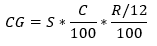
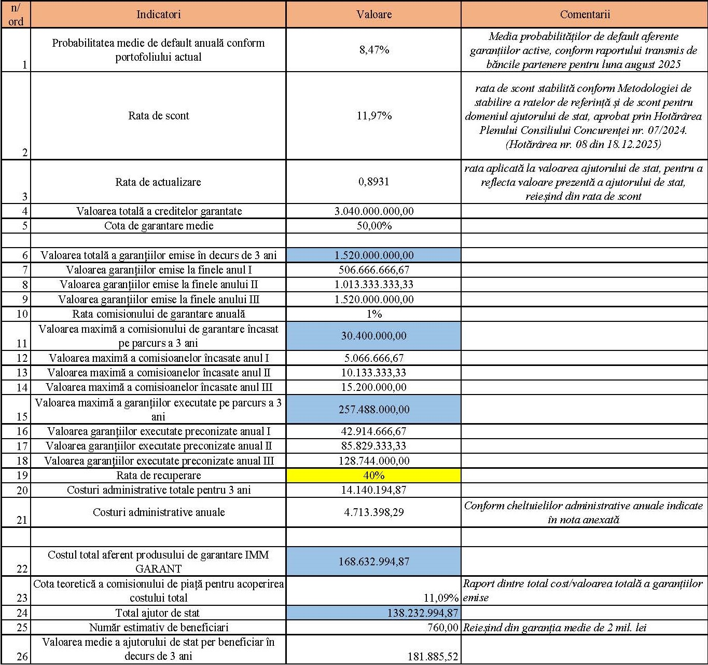
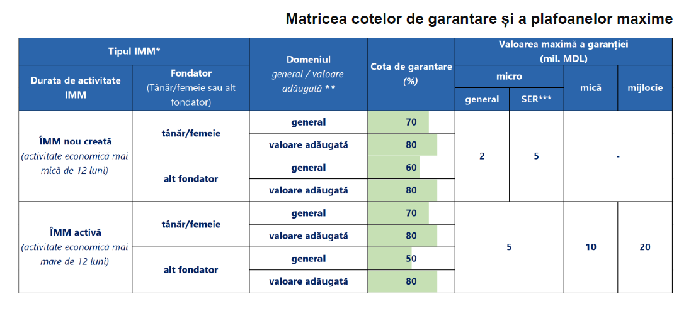

 

PLENUL 
CONSILIULUI CONCURENŢEI 
 
 
Republica Moldova, MD- 2032, Сhişinău, str.Aleco Russo 1 
E-mail: office@competition.md; www.competition.md 
 
                                                                                
DECIZIE 
mun. Chișinău 
 
din 19.02.2026 
 
 
 
 
 
 
Nr. EMAS-07 
 
Plenul Consiliului Concurenței,  
acționând în temeiul art. 41 al Legii concurenței nr. 183/2012, art. 10 alin. (2) 
lit. a) al Legii cu privire la ajutorul de stat nr. 139/2012, Hotărârii Parlamentului 
privind numirea în funcție a unui membru și președinte al Plenului Consiliului 
Concurenței nr. 33/2022, Hotărârii Parlamentului privind numirea în funcția de 
vicepreședinte al Plenului Consiliului Concurenței nr. 380/2023, Hotărârii 
Parlamentului privind numirea în funcția de vicepreședinte al Plenului Consiliului 
Concurenței nr. 210/2024, Hotărârii Parlamentului privind numirea în funcția de 
membru al Plenului Consiliului Concurenței nr. 381/2023 și Hotărârii 
Parlamentului privind numirea în funcția de membru al Plenului Consiliului 
Concurenței nr. 211/2024, 
analizând notificarea Instituției Publice ”Organizația pentru Dezvoltarea 
Antreprenoriatului” cu privire la intenția de acordare a măsurii de sprijin în cadrul 
Produsului de garantare individuală „IMM GARANT”, depusă prin intermediul 
Sistemului informațional automatizat "Registrul ajutoarelor de stat din Moldova" 
cu nr. 01024 din 14.11.2025, materialele anexate și nota examinatorului 
 
 
A CONSTATAT: 
1 
 
 

I. CONTEXTUL MĂSURILOR 
1. 
Prin notificarea cu nr. 01024 parvenită prin Sistemul informațional 
automatizat ,,Registrul ajutoarelor de stat” la data de 14.11.2025 în baza art.8 
din Legea nr. 139/2012 cu privire la ajutorul de stat (în continuare - Legea cu 
privire la ajutorul de stat) și a Regulamentului privind forma de notificare, 
procedura de examinare și adoptare a deciziilor cu privire la ajutorul de stat 
aprobat prin Hotărârea Plenului Consiliului Concurenței nr. HCC1/2025, 
Instituția Publică ”Organizația pentru Dezvoltarea Antreprenoriatului” (în 
continuare – ODA) a notificat intenția de acordare a măsurii de sprijin în 
cadrul Produsului de garantare individuală „IMM GARANT” (în continuare – 
Produs).  
2. 
Prin scrisorile nr. EMAS-07/500-2035 din 28.11.2025 și EMAS-07/08-29 din 
13.01.2026, Consiliul Concurenței a comunicat ODA că informația este 
incompletă și urmează a fi completată corespunzător.  
3. 
Notificarea a devenit efectivă la data de 29.01.2026 fapt despre care a fost 
informată ODA prin scrisoarea nr. EMAS-07/45-167 din 30.01.2026. 
4. 
În vederea asigurării transparenței în procesul decizional, în conformitate cu 
art. 18 alin. (1) din Legea cu privire la ajutorul de stat, comunicatul cu privire 
la notificarea care a devenit efectivă a fost plasat pe site-ul web oficial al 
Consiliului Concurenței la data de 30.01.2026, pentru obținerea observațiilor 
și punctelor de vedere. Observații și puncte de vedere, la momentul finalizării 
notei examinatorului, nu au parvenit.  
II. BAZA LEGALĂ PENTRU ACORDAREA MĂSURILOR DE 
SPRIJIN 
• Legea nr. 139/2012 cu privire la ajutorul de stat 
• Legea nr. 179/2016 cu privire la întreprinderile mici și mijlocii 
• Hotărârea Guvernului nr. 487/2022 cu privire la organizarea și 
funcționarea Instituției Publice ”Organizația pentru Dezvoltarea 
Antreprenoriatului” 
2 
 
 

• Hotărârea de Guvern nr. 709/2022 pentru aprobarea Regulamentului 
cu privire la organizarea, funcționarea și utilizarea Fondului de 
garantare a creditelor pentru întreprinderile mici și mijlocii 
• Manualul operațional privind garanțiile financiare individuale 
(document ODA)  
• Politica de produs FGC și FACEM (document ODA) 
• Metodologia de formare a provizioanelor pentru garanțiile financiare 
emise (document ODA) 
• Metodologia de formare a prețului pentru garanțiile financiare 
(document ODA) 
III. BENEFICIARII MĂSURILOR DE SPRIJIN 
5. 
Conform art. 3 alin. (1) al Legii cu privire la ajutorul de stat, beneficiar al 
ajutorului de stat este orice persoană fizică sau juridică independentă, angajată 
în activitate economică ce constă în oferirea de bunuri sau servicii pe o piaţă. 
6. 
Potrivit informațiilor prezentate de către ODA, în cadrul Produsului pot 
beneficia de ajutor de stat întreprinderile mici și mijlocii (în continuare – 
IMM), definite conform art. 4 din Legea nr. 179/2016, care au obținut de la 
bancă sau organizație de creditare nebancară (ce are încheiat un contract de 
colaborare cu ODA în scopul acordării creditelor garantate conform 
Produsului) un credit garantat cu garanție financiară. 
7. 
Pentru a fi eligibil, solicitantul garanției trebuie să corespundă următoarelor 
criterii generale de eligibilitate: 
- este înregistrat în Registrul de stat al persoanelor juridice din Republica 
Moldova și nu se află în proces de insolvență, reorganizare sau lichidare;  
- este o întreprindere micro, mică sau mijlocie, înregistrată în Republica 
Moldova, care se încadrează în definiția prevăzută la art. 4 din Legea nr. 
179/2016, respectiv în funcție de numărul mediu anual de salariați, cifra de 
afaceri anuală și/sau valoarea activelor totale;  
3 
 
 

- nu se regăsește în lista întreprinderilor menționate la art. 12, alin. (3) din 
Legea nr. 179/2016;  
- nu are beneficiari efectivi înregistrați și/sau rezidenți ai jurisdicțiilor care 
nu implementează standardele internaționale de transparență stabilite 
conform actelor normative ale autorității de supraveghere, precum și ale 
Serviciului Prevenirea și Combaterea Spălării Banilor;  
- nu are datorii restante la bugetul public național la momentul solicitării 
creditului în conformitate cu prevederile art. 129 pct. 13 din Codul Fiscal.  
- în ultimele 24 de luni nu au fost consemnate încălcări repetate, respectiv cel 
puțin două constatări scrise ale aceleiași abateri de către autoritățile 
competente (solicitantul respectă legislația națională de mediu, socială, 
sănătate și securitate în muncă). Îndeplinirea acestui criteriu este declarată 
pe propria răspundere de solicitant, prin semnarea cererii de garantare;  
- nu este întreprindere de stat sau municipală;  
- nu desfășoară activități și nu utilizează mijloacele creditare, care se 
încadrează în cele neeligibile enumerate în cadrul Produsului și listei de 
excludere prevăzută în anexa la Produs. 
8. 
Reieșind din cele expuse mai sus, se constată că beneficiari a măsurii de 
sprijin notificate, în sensul art. 3 alin. (1) din Legea cu privire la ajutorul de 
stat, sunt IMM-urile eligibile conform criteriilor stabilite de Produs. 
IV. DESCRIEREA MĂSURILOR DE SPRIJIN 
9. 
Măsura de sprijin notificată constă în acordarea prin intermediul Fondului de 
Garantare a Creditelor (în continuare – FGC) a unor garanții financiare 
individuale, cu un comision de garantare sub nivelul de piață, pentru creditele 
contractate de beneficiarii eligibili de la entitățile financiare partenere (în 
continuare – EFP) care au încheiat un contract de colaborare cu ODA. 
Urmează a fi menționat că FGC este creat în cadrul structurii 
organizaționale ODA cu statut de subdiviziune internă autonomă, fără 
personalitate juridică. 
4 
 
 

10. Mijloacele financiare ale FGC se acumulează din alocările de la bugetul de 
stat, mijloacele financiare alocate de către partenerii de dezvoltare și/sau 
donatori (credite/împrumuturi, asistență financiară și tehnică, granturi), 
veniturile obținute din investirea resurselor financiare disponibile și din alte 
surse legale. 
11. Acordarea garanției individuale de către ODA se efectuează în corespundere 
cu condițiile Produsului, respectând principiul partajării riscului de credit, în 
limitele aprobate de ODA.  
12. Anual, Consiliul ODA stabilește limite maxime de expunere pentru garanțiile 
financiare acordate, expuse pe tipuri de beneficiari, grupuri de beneficiari 
afiliați, creditori, precum și pe activități/ramuri economice.  
13. Dacă limitele pe activități/ramuri economice nu au fost stabilite, garanțiile se 
acordă după principiul primul venit, primul servit, reieșind din capacitatea 
maximă de garantare. Garanțiile financiare individuale se emit în monedă 
națională, inclusiv și pentru creditele oferite de creditor în valută, la un curs 
fix pe întreaga perioadă de garantare conform ratei oficiale de schimb a 
Băncii Naționale a Moldovei (în continuare – BNM) la data depunerii cererii 
de garantare sau până la o următoare modificare a condițiilor de creditare 
solicitată de către creditor. 
14. Elementul de ajutor de stat va constitui diferența dintre comisionul de 
garantare de piață și cel aplicat în cadrul Produsului. Valoarea comisionului 
de garantare va fi calculat în conformitate cu prevederile Hotărârii Guvernului 
nr.709/2022 reieșind din cota stabilită de ODA de 1% anual, aplicat la soldul 
garanției la sfârșitul fiecărei luni de calcul, conform formulei: 

 (1) 
5 
 
 

unde:  
CG – comisionul de garantare pentru garanțiile individuale, exprimat în lei  
S – soldul creditului înregistrat la sfârșitul lunii de calcul, garantat cu garanția individuală, 
exprimat în lei (pentru liniile de credit, comisionul de garantare se va calcula din valoarea maximă 
a plafonului disponibil/pentru creditele acordate în valută străină, se va indica valoarea în lei 
conform ratei oficiale a BNM la sfârșitul lunii de calcul)  
C – cota de garantare stabilită în conformitate cu produsul (exprimată în %)  
R – rata anuală a comisionului de garantare stabilită în produs (1%)  
 
15. În cazul nerespectării graficului de plată a comisionului, beneficiarul urmează 
să achite o penalitate în mărime de 0,5% din suma restantă pentru fiecare zi 
de întârziere.  
16. Garanția financiară este valabilă din momentul emiterii scrisorii de garanție 
financiară, până la survenirea unuia din următoarele cazuri:  
1. Expirarea termenului scadent indicat în scrisoare de garanție financiară;  
2. EFP garantat a fost rambursat integral;  
3. EFP  a renunțat în scris la garanția financiară printr-o notificare către ODA; 
4. ODA a executat garanția financiară la solicitarea EFP.  
17. Produsul este preconizat de a fi aplicat până la data de 31 decembrie 2028, cu 
posibilitatea extinderii duratei, în funcție de necesitățile strategice și resursele 
disponibile. 
18. Cuantumul total al ajutorului preconizat de a fi acordat în cadrul Produsului 
va constitui estimativ 138.2 mil. lei, calculul detaliat fiind prezentat în Tabelul 
1. 
Tabelul 1 
Calculul ajutorului de stat în cadrul Produsului 
6 
 
 

 
Sursa: calculele ODA anexate la formularul general de notificare 
 
19. Obiectivul principal al Produsului este facilitarea accesului la finanțare pentru 
IMM prin emiterea de garanții financiare individuale care completează gajul 
solicitat de EFP de la antreprenori și reduc riscul de credit.  
20. Se anticipează că Produsul va permite susținerea a circa 760 de beneficiari. 
21. Produsul înlocuiește produsele standard de garantare gestionate până la 
moment de către FGC, asigurând un cadru unificat, detaliat și transparent 
pentru toate categoriile de IMM-uri. Totodată, cele șase produse de garantare 
anterioare (pentru IMM debutante, nou create, fondate de tineri, fondate sau 
gestionate de femei, active și exportatoare) sunt consolidate într-un singur 
7 
 
 

produs integrat, facilitând gestionarea unitară a garanțiilor de către EFP și 
ODA.  
22. Garanțiile financiare individuale acordate în cadrul Produsului, nu prevăd 
expres cumularea cu alte ajutoare de stat. Totuși, garanțiile pot fi solicitate de 
antreprenori pentru creditele investiționale în cadrul Programului de stimulare 
a investițiilor „373”, valoarea cărora nu poate depăși 80% din valoarea 
creditului solicitat. Urmare a calculelor efectuate de ODA cu privire la 
scenariile de cumulare a ajutorului de stat acordat în cadrul Produsului, se 
estimează că intensitatea ajutorului de stat nu va depăși 28,79%. 
23. Prin Produs, IMM-urile vor putea accesa credite investiționale și destinate 
completării capital circulant în condiții mai avantajoase, reducând riscurile 
percepute de instituțiile financiare și eliminând barierele cauzate de lipsa de 
gaj. 
24. Produsul are patru obiective specifice:  
1. Facilitarea accesului la finanțare pentru IMM-urile din Republica Moldova 
prin emiterea de garanții financiare individuale, în conformitate cu 
Hotărârea Guvernului nr. 709/2022, în special pentru acele întreprinderi 
care nu dispun de suficient gaj; 
2. Stimularea investițiilor în domenii cu valoare adăugată, inclusiv export, 
producție industrială, eficiență energetică, energie din surse regenerabile și 
digitalizare, în vederea creșterii competitivității și sustenabilității IMM-
urilor, în concordanță cu obiectivele definite în Strategia Moldova 2030 și 
programele sectoriale aprobate de Guvern;  
3. Promovarea ocupării forței de muncă și dezvoltării regionale prin 
sprijinirea IMM-urilor nou-create și a celor care implementează proiecte 
investiționale cu impact economic local sau regional;  
4. Susținerea incluziunii economice și a antreprenoriatului feminin, prin 
oferirea de stimulente preferențiale IMM-urilor fondate de femei, precum și 
tinerilor antreprenori.  
8 
 
 

25. Pentru a asigura atingerea obiectivelor, precum și pentru a asigura 
cuantificarea impactului implementării Produsului, sunt stabiliți următorii 
indicatori specifici de rezultat: 
 Emiterea garanțiilor financiare în valoare de cel puțin 1,5 miliarde MDL 
până la 31.12.2027; 
 Facilitarea accesului la credite în valoare de cel puțin 3 miliarde MDL până 
la 31.12.2027; 
 Asigurarea unui efect de multiplicare de cel puțin 2:1 (1 leu emis ca 
garanție generează 2 lei ca credite accesate); 
 Mobilizarea în economie a cel puțin 2,5 lei pentru fiecare leu acordat sub 
formă de garanție (credit + aport propriu al IMM). 
26. Toate etapele aferente procesului de garantare, inclusiv analiza solicitării, 
aprobarea și emiterea garanției, monitorizarea derulării contractului de credit 
garantat, executarea garanției în caz de neplată, precum și procedurile de 
recuperare a sumelor achitate sunt efectuate în baza prevederilor Manualului 
Operațional privind garanțiile financiare individuale, aprobat de Consiliul 
ODA. 
27. Sunt eligibile spre garantare următoarele tipuri de facilități: credite, linie de 
credit, inclusiv revolving, cu excepția overdrafturilor și leasing-ului financiar. 
Creditele garantate vor fi destinate finanțării proiectelor investiționale ale 
IMM-urilor, finanțării activității curente/completării capitalului circulant, 
refinanțării creditelor investiționale sau circulante, ținând cont de domeniile și 
cheltuielile eligibile conform Produsului. Sunt eligibile spre garantare doar 
creditele noi acordate, ce respectă următoarele criterii: 
- este destinat unei utilizări eligibile, în conformitate cu categoriile definite 
în cadrul prezentului Produs.  
- este clasificat în categoria de risc „Standard” sau „Supravegheat” conform 
Regulamentului Băncii Naționale a Moldovei cu privire la clasificarea 
activelor şi angajamentelor condiționale nr. 231/2011;  
9 
 
 

- pentru creditele destinate completării capitalului circulant perioada de 
grație la achitarea creditului sau dobânzii nu va depăși 24 luni, iar pentru 
creditele investiționale, perioada de grație pentru achitarea creditului 
solicitat va fi stabilită de către EFP, în funcție de specificul proiectului, 
profilul clientului și nivelul de risc aferent;  
- în cazul în care structura de finanțare oferită de EFP beneficiarului include 
credite destinate refinanțării unor expuneri existente, garanția se acordă 
doar în măsura în care refinanțarea este realizată concomitent cu acordarea 
unuia sau mai multor credite noi, destinate finanțării cheltuielilor eligibile 
conform prezentului Produs. În acest caz, garanțiile pot fi emise separat 
pentru fiecare credit, inclusiv pentru creditele destinate refinanțării, cu 
condiția ca refinanțarea să fie parte integrantă a structurii de finanțare și să 
contribuie la facilitarea accesului la finanțare nouă eligibilă. Refinanțarea 
pură, fără acordarea concomitentă a unui credit nou eligibil, nu este 
eligibilă pentru garantare. Sunt eligibile spre refinanțare doar creditele 
aferente cărora nu au fost înregistrate întârzieri la plată mai mari de 30 de 
zile consecutive în ultimele 12 luni; 
- pot fi garantate facilitățile de tip revolving sau liniile de credit reînnoite, cu 
condiția ca EFP a efectuat o reanaliză completă a riscului și să confirme că 
beneficiarul nu a înregistrat restanțe mai mari de 30 de zile consecutive în 
ultimele 12 luni. 
28. Pentru a putea beneficia de un credit garantat, solicitantul trebuie să 
demonstreze EFP capacitatea sa de a rambursa creditul solicitat. 
29. Demonstrarea capacității de rambursare se consideră îndeplinită odată cu 
aprobarea creditului de către EFP. Pentru IMM-urile nou create, capacitatea 
de plată este evaluată de EFP în baza procedurilor interne proprii.  
30. ODA își rezervă dreptul de a solicita documente, înscrisuri și alte informații 
relevante care să confirme capacitatea de plată a solicitantului. Pentru IMM-
10 
 
 

urile active, pe lângă demonstrarea capacității de plată, se aplică Indicatorul 
𝐼= 𝐷
de îndatorare maximă admisibilă (I), calculat conform formulei: 
𝐶𝑃 
 
(2) 
 
 
unde: 
D – totalul datoriilor pe termen scurt și lung conform situațiilor financiare aprobate 
CP – capitalul propriu al solicitantului 
 
31. Indicatorul se calculează pe baza datelor din ultima situație financiară anuală 
aprobată sau situațiile financiare interimare (trimestriale/semianuale) aprobate 
și validate de EFP, dacă acestea sunt disponibile. Limitele admise pentru 
indicator sunt: 
 pentru IMM-urile active care desfășoară activități economice în sectoare 
intensive în capital și expuse la riscuri ciclice – CAEM A0000 
(Agricultură, silvicultură și pescuit), B0000 (Industria extractivă), C0000 
(Industria prelucrătoare) și D0000 (Producția și furnizarea de energie 
electrică și termică, gaze, apă caldă și aer condiționat) – indicatorul nu 
poate depăși coeficientul 8 (opt). 
 pentru IMM-urile active din alte clase CAEM, caracterizate printr-un grad 
mai redus de intensitate a capitalului și o volatilitate mai scăzută a 
riscurilor, indicatorul nu poate depăși coeficientul 15 (cincisprezece). 
32. Sunt eligibile spre garantare creditele destinate finanțări următoarelor tipuri 
de cheltuieli a IMM-uri: 
 Pentru proiecte investiționale: 
- Achiziția de echipamente, utilaje, instalații, tehnologii moderne; 
- Investiții în infrastructura întreprinderii (reparația construcțiilor și a 
spațiilor, rețelelor, amenajările interne și externe, inclusiv a terenurilor); 
- Achiziția sau construcția imobilizărilor corporale; 
- Achiziția de imobilizări necorporale (licențe, certificări, know-how); 
11 
 
 

- Investiții verzi sau digitale (automatizare, eficiență energetică, 
digitalizare); 
- Modernizarea sau extinderea capacităților de producție pentru export. 
 Pentru finanțarea activității curente: 
- Achiziționarea de produse, mărfuri și materii prime; 
- Acoperirea cheltuielilor aferente salariilor, taxelor și impozitelor, 
serviciilor auxiliare; 
- Cheltuieli de promovare, marketing și internaționalizare (inclusiv 
participarea la târguri și expoziții); 
- Asigurarea resurselor pentru producție și livrare (ambalare, logistică 
etc.). 
 Finanțarea investițiilor în derulare:  
- sunt eligibile pentru garantare creditele investiționale destinate finanțării 
proiectelor aflate în derulare, dacă investiția a fost inițiată cu cel mult 6 
luni înainte de data depunerii cererii de credit, iar lucrările, livrările sau 
achizițiile aferente proiectului nu sunt finalizate integral la momentul 
solicitării creditului; sunt eligibile inclusiv cheltuielile aferente investiției 
inițiate, doar în cazul existenței unei datorii neachitate, cu excepția 
datoriilor față de fondatori și/sau persoane afiliate beneficiarului; 
- prin „data inițierii investiției” se înțelege cea mai veche dată 
documentată aferentă angajării contractuale, efectuării unei plăți sau 
livrării aferente proiectului investițional (de exemplu: contract de 
achiziție, factură fiscală, ordin de plată, proces-verbal de începere a 
lucrărilor); 
- EFP are obligația de a evalua și confirma documentar data inițierii 
investiției și de a proba, în scris, că aceasta nu depășește termenul de 6 
luni stabilit, pe baza documentelor justificative prezentate de solicitant. 
 Refinanțarea creditelor active sau a altor datorii: 
12 
 
 

- sunt eligibile spre garantare creditele care includ refinanțarea altor 
credite sau forme de finanțare contractate anterior, cu condiția ca 
refinanțarea să fie însoțită de un credit nou acordat în baza prezentului 
Produs, destinat finanțării cheltuielilor eligibile prevăzute anterior, iar 
refinanțarea să fie parte integrantă a structurii de finanțare.  
- nu sunt eligibile spre garantare creditele destinate refinanțării 
împrumuturilor față de fondatori și/sau persoane afiliate beneficiarului.  
 În cazul utilizării creditului în conformitate cu prevederile ce țin de 
refinanțarea creditelor active sau a altor datorii, EFP va demonstra:  
- utilizarea conformă a resurselor obținute anterior în activitatea 
economică a întreprinderii și în scopuri compatibile cu categoriile de 
cheltuieli eligibile prevăzute de prezentul Produs;  
- avantajul economico-financiar al structurii de finanțare propuse, 
exprimat prin îmbunătățirea fluxurilor de numerar, reducerea costului 
total al finanțării, extinderea termenului de rambursare sau consolidarea 
structurii financiare a beneficiarului. 
33. Totodată, sunt considerate neeligibile creditele utilizate în următoarele 
scopuri.  
• Finanțarea directă sau indirectă a tranzacțiilor de achiziții a altor companii 
sau a acțiunilor/cotelor-părți ale acestora; 
• Procurarea sau construcția bunurilor imobile/spațiilor comerciale, cu 
destinația exclusivă oferirii acestora în locațiune (sunt permise cazurile în 
care suprafața destinată locațiunii nu depășește 20% din suprafața totală a 
imobilului, iar restul este utilizat direct de IMM în desfășurarea activității 
economice); 
• Finanțarea proiectelor de construcții a imobilelor locative din orașul 
Chișinău; 
• Achiziționarea vehiculelor încadrate la poziția tarifară 8703 din 
Nomenclatorul Combinat al mărfurilor (conform Legii nr. 172/2014 de 
13 
 
 

aprobare a NC) și/sau din categoria M1 (vehicule pentru transportul 
persoanelor cu cel mult 8 locuri pe scaune, în afara șoferului – conform 
Regulamentului (UE) 2018/858); 
• Procurarea bunurilor imobile cu destinație locativă este eligibilă doar în 
cazul în care IMM își asumă, prin declarație pe propria răspundere, 
schimbarea destinației în una comercială și utilizarea imobilului în 
activitatea economică a IMM. Beneficiarul sau creditorul are obligația de a 
prezenta autorizațiile și actele justificative privind schimbarea destinației 
într-un termen fix indicat în scrisoarea de garanție financiară, dar care nu 
va depăși 12 luni din data emiterii scrisorii de garanție financiară. 
Nerespectarea acestui termen atrage încetarea de drept a garanției, fără 
notificare suplimentară din partea ODA; 
• Finanțarea retroactivă a cheltuielilor aferente activității curente sau a 
proiectelor investiționale finalizate. 
34. ODA poate respinge proiectele care, deși nu se încadrează expres în lista de 
excludere, prezintă riscuri de conformitate, reputaționale sau legale, în 
conformitate cu prevederile reglementărilor interne, cu menționarea expresă a 
riscurilor identificate și informarea în termeni legali a EFP.  
35. Pentru determinarea cotei de garantare și a valorii maxime a garanției 
financiare este utilizată Matricea cotelor de garantare și a plafoanelor 
maxime. 
Figura 1 
14 
 
 

 
Sursa: Anexa 1 la formularul general de notificare 
 
36. Matricea are la bază următoarele prevederi: 
1. Valoarea minimă a garanției financiare care poate fi solicitată este de 100 
000 lei.  
2. Valoarea maximă a garanției care poate fi acordată este de 20000000 lei, 
dar în toate cazurile aplicarea acestui plafon este limitată la reglementările 
din Matrice.  
3. Cotele maxime de garantare sunt cuprinse între 50% și 80% și sunt 
determinate în baza Matricei, care se bazează pe următoarele reguli:  
a) IMM-uri nou create (activitate economică mai mică de 12 luni):  
- Dacă fondatorul este tânăr sau femeie, pentru domeniile generale se 
aplică o cotă de garantare de 70%;  
- Dacă fondatorul este altul decât tânăr sau femeie, pentru domeniile 
generale se aplică o cotă de garantare de 60%.  
b) IMM-uri active (activitate economică mai mare de 12 luni):  
- Dacă fondatorul este tânăr sau femeie, pentru domeniile generale se 
aplică o cotă de garantare de 70%.  
- Dacă fondatorul este altul decât tânăr sau femeie, pentru domeniile 
generale se aplică o cotă de garantare de 50%.  
15 
 
 

c) IMM-uri care solicită credite investiționale a căror destinație se 
încadrează în domeniile cu valoare adăugată definite expres în Anexa nr. 
3 la Produs, atât pentru IMM-urile nou create, cât și pentru IMM-urile 
active, indiferent de tipul fondatorului, pot beneficia de o cotă maximă de 
garantare de 80%.  
4. În cazul în care o întreprindere beneficiază de cote de garantare majorate în 
baza încadrării în categoria „IMM fondat de tineri” sau „IMM fondat de 
femei”, iar pe parcursul perioadei de valabilitate a garanției intervin 
modificări în structura fondatorilor care determină pierderea acestei calități, 
tratamentul preferențial se anulează. În asemenea situații, garanția 
financiară își păstrează valabilitatea, însă se aplică cota standard de 
garantare corespunzătoare tipului de beneficiar conform Matricei, cu 
excepția cazului în care proiectul investițional se încadrează în unul dintre 
domeniile cu valoare adăugată definite în Anexa nr. 3 la Produs, pentru 
care se menține cota maximă de 80%.  
5. Moneda garanției se emite exclusiv în lei moldovenești. În cazul când 
creditul este acordat în valută străină, valoarea garanției va fi determinată 
reieșind din cursul oficial al leului moldovenesc față de valutele străine, 
afișat de BNM, din data cererii de garantare. 
6. Un solicitant poate beneficia de mai multe credite garantate, cu condiția că 
valoarea soldului garanțiilor emise pentru beneficiar sau pentru grupul de 
beneficiari afiliați, nu este depășită. Limita maximă a expunerii pentru un 
beneficiar sau grup de beneficiari afiliați se publică pe pagina web oficială 
a ODA – https://www.oda.md.  
37. Produsul nu impune restricții sau praguri minime exprese privind contribuția 
proprie. Cu toate acestea, EFP are responsabilitatea de a analiza individual 
fiecare proiect investițional și de a stabili necesitatea și mărimea contribuției 
proprii, în funcție de specificul proiectului, profilul clientului și nivelul de risc 
aferent, aplicând criteriile și metodologia proprie. Contribuția proprie poate 
16 
 
 

varia în funcție de tipul investiției și capacitatea financiară a beneficiarului, 
fără intervenția directă a ODA în stabilirea acestor condiții. 
38. Termenul de garantare aferent fiecărui credit solicitat se stabilește exclusiv în 
funcție de destinația creditului și valoarea garanției, cu respectarea 
plafoanelor maxime prevăzute în Matricea Produsului: 
• Pentru creditele destinate completării capitalului circulant sau refinanțării 
acestora, termenul maxim al garanției este de 36 luni, calculat din data 
scrisorii de garanție financiară. 
• Pentru creditele investiționale sau refinanțarea acestora, termenul garanției 
nu va depăși termenul scadent al creditului. 
39. Garanțiile reale propuse de beneficiar în vederea asigurării creditului solicitat, 
vor fi analizate și clasificate de către EFP în conformitate cu politica sa 
internă și reglementările BNM. 
40. Forma de asigurare a creditului garantat, va depinde de destinația creditului 
solicitat, astfel:  
- pentru creditele investiționale, în structura garanțiilor reale oferite de 
solicitant, minim 50% vor constitui imobile sau alte mijloace fixe, din 
valoarea de gaj propusă.  
- pentru creditele destinate completării capitalului circulant, în structura 
garanțiilor reale oferite de solicitant, nu se va include gajul roadei viitoare 
sau universalitatea creanțelor.  
41. Fidejusiunea administratorului sau fondatorului, cu excepția întreprinderilor 
individuale sau gospodăriilor țărănești, va fi perfectată obligatoriu pentru 
toate creditele solicitate. Bunurile ce urmează a fi procurate din contul 
creditului, inclusiv gajul bunurilor viitoare, sunt acceptate la calcularea valorii 
de gaj propuse de beneficiar.  
42. Nivelul de asigurare al creditului cu garanții reale, inclusiv garanția FGC, la 
data solicitării garanției, va constitui minim 100% din valoare creditului. În 
cazul în care Solicitantul oferă garanții reale, cu excepția celor viitoare, care 
17 
 
 

vor asigura creditul solicitat în cota de cel puțin 100%, cota maximă de 
asigurare, inclusiv garanția FGC, nu va depăși 150%. În cazul în care în 
structura de asigurare sunt incluse bunuri deja gajate pentru alte credite, banca 
indică în cererea de garantare cota de extindere aferentă creditului garantat, 
utilizată exclusiv pentru verificarea încadrării în plafonul de 150%. 
43. În cazul creditelor destinate finanțării capitalului circulant a căror valoare nu 
depășește 2 milioane lei, garanția financiară poate fi acordată fără existența 
garanțiilor 
reale 
colaterale, 
cu 
condiția 
prezentării 
fidejusiunii 
administratorului sau fondatorului, precum și a respectării celorlalte criterii de 
eligibilitate stabilite în cadrul Produsului.  
44. În cazul modificării structurii gajului aferent creditului garantat, EFP va 
transmite în prealabil o solicitare către ODA. Modificările se consideră 
acceptate implicit, fără necesitatea unei confirmări scrise, în măsura în care 
rata de acoperire cu gaj rămâne cel puțin la nivelul stabilit în cererea de 
garantare. În alte situații, este necesară confirmarea în scris al ODA. EFP este 
în drept să extindă utilizarea bunurilor deja incluse în structura de asigurare a 
creditului garantat și în favoarea altor credite ale beneficiarului, fără 
necesitatea unei aprobări suplimentare din partea ODA. Această extindere nu 
constituie modificare a structurii de asigurare menționate în cererea de 
garantare. 
45. Pentru solicitarea garanției se vor prezenta următoarele acte: 
- cererea de garantare unică semnată de către beneficiar și EFP; 
- pentru IMM-urile active, se vor prezenta situațiile financiare pentru ultimul 
an de gestiune înregistrat la Biroul Național de Statistică, precum și pentru 
ultimul trimestru de gestiune, inclusiv datele din evidența contabilă 
relevante pentru determinarea raportului dintre total datorii și capitalul 
propriu; 
- concluzia și decizia EFP privind acordarea creditului sau extrase/rapoarte 
generate din sistemele informatice interne de aprobare a creditelor, semnate 
18 
 
 

electronic de persoana responsabilă, care confirmă verificarea conformității 
solicitantului și a proiectului investițional cu criteriile de eligibilitate 
stabilite în Produs; 
- graficul preventiv de achitare a creditului; 
- copia documentelor care confirmă destinația creditului solicitat (după caz); 
- copia contractelor de credit ce urmează a fi refinanțate (după caz); 
- alte acte relevante în determinarea eligibilității solicitantului sau scopului 
creditului (după caz). 
46. EFP va monitoriza beneficiarul până la stingerea creditului, precum și va 
monitoriza încasarea lunară a comisionului de garantare. Până la data de 15 a 
lunii de gestiune, EFP prezintă un raport lunar cu indicarea soldului creditului 
garantat la situația din ultima zi a lunii precedente, în conformitate cu 
contractul de colaborare. 
47. În cazul în care beneficiarul nu achită ratele lunare la credit o perioadă mai 
mare de 90 de zile consecutiv în conformitate cu graficul de plăți, iar EFP-ul 
și beneficiarul nu ajung la un acord privind măsurile de remediere, EFP este 
în drept să înainteze către ODA cererea de executare a garanției financiare. 
48. Se consideră că nu s-a ajuns la un acord de remediere în situația în care cel 
puțin una dintre părți a propus în scris măsuri de remediere (ex. restructurare, 
reeșalonare, suspendare temporară a plăților, etc.), iar cealaltă parte nu le-a 
acceptat sau nu a răspuns în termenul solicitat. 
49. Procedura de solicitare a plății este specificată în contractul de colaborare 
semnat cu EFP. Suma solicitată în baza cererii de plată se vor referi doar la 
soldul creditului restant (principalului) și nu vor include dobânzile, taxele, 
comisioanele sau majorările de întârziere aplicate conform contractului de 
credit garantat, cheltuieli de judecată, precum şi alte cheltuieli ce țin de 
recuperarea creditului. Calculul sumei garanției spre executare va fi efectuat 
în conformitate cu următoarea formulă: 
 
19 
 
 

𝐺𝐼= 𝑆∗𝐶
100 
 
(3) 
 
unde:  
GI – valoarea garanției individuale spre plată către EFP, exprimată în lei 
S – soldul restant al creditului (principalul), exprimat în lei  
C – cota de garantare (exprimată în %) 
50. Executarea cererii de plată se efectuează exclusiv în lei. Pentru creditele 
acordate în valută, valoarea de plată a garanției se calculează luând ca bază 
cursul oficial al BNM din ziua depunerii cererii de executare, fără a depăși 
echivalentul în lei al valorii inițiale a creditului, determinat la cursul de 
schimb indicat în scrisoarea de garanție financiară. Plata garanției se 
efectuează în limita cotei de garantare și nu poate depăși suma maximă 
garantată indicată în scrisoarea de garanție financiară individuală. 
51. În orice moment până sau după executarea garanției financiare, EFP 
întreprinde toate măsurile privind recuperarea datoriilor restante aferente 
contractului de credit, inclusiv prin vânzarea completă a gajului într-un 
termen rezonabil, conform documentelor sale interne și actelor normative. 
52. În termen de 15 zile de la data încasării de către EFP a sumelor recuperate din 
vânzarea gajului, precum și a oricăror alte sume încasate în contul achitării 
datoriilor restante aferente contractului de credit (costul creditului), după 
deducerea cheltuielilor de încasare/executare silită, EFP rambursează FGC 
valoarea sumelor recuperate calculate proporțional cotei de garantare, dar nu 
mai mult decât suma mijloacelor bănești achitate de ODA, conform 
următoarei formule: 
𝑅= (𝑃−𝐸) ∗𝐶
 
100 
 
(4) 
 
unde:  
R – suma spre rambursare către garant, exprimată în lei 
20 
 
 

P – sumele recuperate din vânzarea gajului și oricare alte sume încasate în contul achitării datoriilor 
restante aferente contractului de credit, exprimate în lei  
E – cheltuielile de încasare/executare silită, exprimate în lei  
C – cota de garantare 
53. După executarea garanției financiare, ODA este în drept să exercite, în mod 
separat și/sau împreună cu creditorul, dreptul de regres asupra beneficiarului 
în vederea recuperării garanției financiare executate, achitată în favoarea 
creditorului. 
54. EFP este eligibil pentru aplicarea la Produs, dacă întrunește următoarele 
criterii: 
a) deține licență valabilă pentru activitatea de acordare de credite, eliberată de 
BNM, în cazul băncilor, sau este înregistrat în Registrul organizațiilor de 
creditare nebancară autorizate, ținut de BNM, în cazul organizațiilor de 
creditară nebancară; 
b) nu este în proces de lichidare sau nu este supus procedurii de rezoluție, în 
cazul băncilor, ori nu este în proces de reorganizare, insolvabilitate, 
lichidare sau suspendare a activității, în cazul organizațiilor de creditare 
nebancară, precum și nu este supus de către autoritatea de supraveghere 
unor măsuri care se referă la interzicerea acordării creditelor; 
c) în cazul organizației de creditare nebancară – dispune de o structură 
organizațională potrivită (consiliu în calitate de organ de supraveghere, 
comitete specializate de credite și administrare a riscurilor), personal 
calificat (o funcție care asigură creditarea întreprinderilor mici și mijlocii, o 
funcție distinctă și independentă de administrare a riscurilor și o funcție 
distinctă și independentă de audit intern), produse de creditare, reguli și 
proceduri de evaluare și oferire a creditelor și a altor produse financiare 
către întreprinderile mici și mijlocii, realizează anual auditul extern al 
situațiilor financiare; 
d) respectă regulile produselor de garantare, prevederile Hotărârii Guvernului 
nr.709/2022, manualele operaționale, instrucțiunile, precum și alte 
documente aprobate de ODA privind garanțiile financiare. 
21 
 
 

55. La apariția unui eveniment declanșator de neîndeplinire a condițiilor 
garantării de către EFP, ODA va transmite o notificare scrisă, prin care EFP-
ului i se oferă 15 zile pentru a remedia situația.  
56. În cazul în care evenimentul de neîndeplinire a condițiilor garantării de către 
EFP va continua și după perioada stabilită, ODA are dreptul unilateral să 
suspende emiterea de garanții în favoarea EFP, sau să amâne termenul limită 
de executare a cererii de plată pentru un credit neperformant, până la 
remedierea evenimentului declanșator. Evenimentele declanșatoare, aferente 
neîndeplinirii condițiilor garantării pot fi: 
- neplata comisionului de garantare încasat de la beneficiar; 
- nerespectarea obligațiilor de rambursare a sumelor recuperate;  
- nerespectarea obligațiilor de prezentare a informației conform cerințelor; 
- suspendarea licenței EFP, insolvența sau lichidarea; 
- intentarea de către autoritatea de supraveghere a unor măsuri care se referă 
la interzicerea acordării creditelor; 
- angajarea în activități ilegale precum finanțarea terorismului sau spălarea 
banilor. 
57. Evidența contabilă a FGC este ținută de către ODA în conformitate cu 
prevederile cadrului normativ în domeniul contabilității. ODA asigură ținerea 
separată a evidenței contabile privind operațiile FGC, cu întocmirea 
rapoartelor financiare distincte, luând în considerare solicitările partenerilor 
de dezvoltare și/sau donatorilor.  
58. Raportul anual privind activitatea de garantare a creditelor pentru 
întreprinderile mici şi mijlocii se publică pe pagina web oficială a ODA până 
la data de 31 mai a anului următor celui de gestiune.  
59. Controlul asupra activității financiare a FGC îl exercită organele abilitate ale 
ODA și ale altor entități abilitate cu acest drept. Activitatea financiară a FGC 
se auditează anual în cadrul misiunilor de audit realizate de către entitatea de 
audit responsabilă de auditarea situațiilor financiare ale ODA. Entitatea de 
22 
 
 

audit este selectată prin concurs, cu respectarea principiilor concurenței, 
eficienței și transparenței, tratamentului egal și nediscriminatoriu. 
V. EVALUAREA MĂSURII DE SPRIJIN PRIN PRIMA EXISTENȚEI 
AJUTORULUI DE STAT  
60. Potrivit art. 340 alin. (1) al Acordului de Asociere între Republica Moldova și 
Uniunea Europeană, ajutoarele de stat se evaluează pe baza criteriilor care 
decurg din aplicarea normelor în materie de concurență aplicabile în UE, în 
special a articolului 107 din Tratatul privind funcționarea Uniunii Europene și 
a instrumentelor de interpretare adoptate de instituțiile UE, inclusiv 
jurisprudența relevantă a Curții de Justiție a Uniunii Europene. 
61. Potrivit art. 3 din Legea cu privire la ajutorul de stat, ajutorul de stat este orice 
măsură de sprijin care întrunește cumulativ următoarele condiții: 
a) este acordată de furnizor din resurse de stat sau din resursele unităților 
administrativ – teritoriale sub orice formă; 
b) conferă beneficiarului un avantaj economic, care nu putea fi obținut în 
condiții normale de piață; 
c) este acordată în mod selectiv; 
d) denaturează sau riscă să denatureze concurența. 
 
a) este acordată de furnizor din resurse de stat sau din resursele unităților 
administrativ – teritoriale sub orice formă 
 
62. Acordarea unui avantaj direct sau indirect prin intermediul resurselor de stat 
și imputabilitatea unei astfel de măsuri în sarcina statului sunt două condiții 
cumulative pentru existența ajutorului.1 
 Imputabilitatea statului  
63. În cazul în care o autoritate publică acordă un avantaj unui beneficiar, măsura 
este prin definiție imputabilă statului, chiar dacă autoritatea în cauză 
beneficiază de autonomie juridică față de alte autorități publice. Același lucru 
                                                          
1 Comunicarea Comisiei privind noțiunea de ajutor de stat astfel cum este menționată la articolul 107 alineatul (1) din TFUE, pct. 38 
23 
 
 

este valabil și în cazul în care o autoritate publică desemnează un organism 
privat sau public pentru administrarea unei măsuri care conferă un avantaj.2 
64. Măsurile de sprijin examinate vor fi acordate prin intermediul FCG care este 
creat în cadrul structurii organizaționale ODA cu statut de subdiviziune 
internă autonomă, fără personalitate juridică.  
65. ODA la rândul său este o o instituție publică fondată de Ministerul Dezvoltării 
Economice și Digitalizării, care activează conform Hotărârii Guvernului 
nr.487 din 2022.  
66. ODA are misiunea de a implementa politica statului privind susținerea 
dezvoltării 
antreprenoriatului, 
inclusiv 
a 
microîntreprinderilor 
și 
a 
întreprinderilor mici și mijlocii, conform strategiilor și programelor naționale 
aprobate de către Guvern, a priorităților stabilite în cadrul bugetar pe termen 
mediu. 
67. Ținând cont de cele menționate, se constată îndeplinirea condiției ce ține de 
imputabilitatea statului. 
 Transferul de resurse de stat sau ale unității administrativ-teritoriale 
68. Conform art. 3 al Legii cu privire la ajutorul de stat, resurse de stat sau resurse 
ale unităţilor administrativ-teritoriale reprezintă totalitatea patrimoniului, 
inclusiv sub formă de mijloace financiare, ce aparţine statului, unităţilor 
administrativ-teritoriale, inclusiv unităţii teritoriale autonome Găgăuzia. 
69. Numai avantajele acordate direct sau indirect din resurse de stat pot constitui 
ajutor de stat.3 Resursele de stat includ toate resursele din sectorul public, 
inclusiv resursele entităților intrastatale (descentralizate, federale, regionale 
sau de altă natură) și, în anumite circumstanțe, resursele organismelor private. 
Este irelevant dacă o instituție din sectorul public este autonomă sau nu.4 
                                                          
2 Comunicarea Comisiei privind noțiunea de ajutor de stat astfel cum este menționată la articolul 107 alineatul (1) din Tratatul privind 
funcționarea Uniunii Europene, pct. 39 
3 Comunicarea Comisiei privind noțiunea de ajutor de stat astfel cum este menționată la articolul 107 alineatul (1) din Tratatul privind 
funcționarea Uniunii Europene, pct. 47 
4 Comunicarea Comisiei privind noțiunea de ajutor de stat astfel cum este menționată la articolul 107 alineatul (1) din Tratatul privind 
funcționarea Uniunii Europene, pct. 48 
24 
 
 

70. Nu trebuie să aibă loc un transfer pozitiv de fonduri, este suficientă renunțarea 
la veniturile de stat. Renunțarea la venituri care altfel ar fi fost plătite statului 
constituie un transfer de resurse de stat. Un angajamentul ferm și concret de a 
asigura disponibilitatea ulterioară a resurselor de stat este, de asemenea, 
considerat un transfer de resurse de stat. Crearea unui risc concret de a impune 
o sarcină suplimentară pentru stat în viitor, printr-o garanție sau o ofertă 
contractuală, este suficientă în sensul articolului 107 alineatul (1).5 
71. Transferul resurselor de stat poate lua multe forme, acestea fiind prevăzute în 
art. 6 al Legii cu privire la ajutorul de stat. 
72. Măsura de sprijin notificată de către ODA constă în acordarea prin 
intermediul FGC a unor garanții financiare individuale, cu un comision de 
garantare sub nivelul de piață, pentru creditele contractate de beneficiarii 
eligibili de la EFP care au încheiat un contract de colaborare cu ODA. În mod 
normal, suportarea unui astfel de risc de către stat ar trebui să fie compensată 
printr-un comision corespunzător. Atunci când statul renunță în totalitate sau 
parțial la acest comision, rezultatul reprezintă o renunțare la veniturile de stat. 
73. Astfel, diferența între comisionul de garantare perceput de FGC și cel de piață 
reprezintă o renunțare la veniturile de stat și ca urmare, are loc un transfer de 
resurse de stat. 
74. Luând în considerare că cele două condiții sus menționate sunt îndeplinite 
cumulativ, se constată că măsura de sprijin examinată este acordată din 
resurse de stat. 
 
b) conferă beneficiarului un avantaj economic care nu putea fi obținut în 
condiții normale de piață 
 
75. Un avantaj este orice beneficiu economic pe care întreprinderea nu l-ar fi 
putut obține în condiții normale de piață, și anume în absența intervenției 
                                                          
5 Comunicarea Comisiei privind noțiunea de ajutor de stat astfel cum este menționată la articolul 107 alineatul (1) din Tratatul privind 
funcționarea Uniunii Europene, pct. 51 
25 
 
 

statului.6 Noțiunea de avantaj economic include toate situațiile în care 
întreprinderile sunt scutite de costurile inerente activității lor economice. Ori 
de câte ori situația financiară a unei întreprinderi este îmbunătățită ca rezultat 
al intervenției statului în condiții care diferă de condițiile normale de piață, 
există un avantaj. Doar efectul măsurii asupra întreprinderii este relevant, iar 
nu cauza sau obiectivul intervenției statului. Nici forma exactă a măsurii nu 
este relevantă pentru a determina dacă aceasta conferă sau nu un avantaj 
economic întreprinderii. 7 
76. Precum în cazul oricăror alte tranzacții, împrumuturile și garanțiile acordate 
de organisme publice (inclusiv întreprinderi publice) pot reprezenta ajutor de 
stat în cazul în care acestea nu sunt în conformitate cu condițiile pieței. În 
ceea ce privește garanțiile, în mod normal, trebuie analizat un scenariu cu trei 
părți implicate: o entitate publică în calitate de garant, un debitor și un 
creditor. În cele mai multe cazuri, ajutorul poate fi prezent numai la nivelul 
debitorului deoarece garanția de stat poate să îi acorde un avantaj prin faptul 
că îi permite să împrumute la o rată care nu ar fi fost posibil de obținut pe 
piață fără garanție (sau să împrumute într-o situație în care, în mod 
excepțional, nu s-ar fi obținut niciun împrumut pe piață, indiferent de rată). 
Cu toate acestea, în anumite situații specifice, acordarea unei garanții publice 
ar putea presupune, de asemenea, un ajutor pentru creditor, în special în cazul 
în care garanția este acordată ex post pentru o obligație existentă între creditor 
și debitor, în cazul în care nu se asigură un transfer complet al avantajului 
către debitor sau în cazul în care un împrumut garantat este utilizat pentru a 
rambursa unul negarantat. Orice garanție acordată în condiții mai favorabile 
decât condițiile pieței, ținând seama de situația economică a debitorului, 
                                                          
6 Comunicarea Comisiei privind noțiunea de ajutor de stat astfel cum este menționată la articolul 107 alineatul (1) din Tratatul privind 
funcționarea Uniunii Europene (2016/C 262/01), pct. 66 
7 Comunicarea Comisiei privind noțiunea de ajutor de stat astfel cum este menționată la articolul 107 alineatul (1) din Tratatul privind 
funcționarea Uniunii Europene (2016/C 262/01), pct. 68 
26 
 
 

conferă un avantaj acestuia din urmă (care plătește o taxă care nu reflectă în 
mod adecvat riscul pe care și-l asumă garantul).8 
77. Ca urmare a acordării măsurilor de sprijin notificate, beneficiarii nu achită un 
comision de garantare la nivel de piață, astfel fiind scutiți de costurile inerente 
activității lor economice, iar situația financiară a acestor întreprinderi este 
îmbunătățită ca rezultat al intervenției statului ce implică o garanție acordată 
în condiții mai favorabile decât condițiile pieței. 
78. În ceea ce privește existența unui posibil avantaj pentru EFP, conform 
informațiilor prezentate ajutorul de stat nu are ca scop acoperirea sau 
înlocuirea riscului aferent unor expuneri deja existente și nici substituirea 
unor garanții reale (gaj/colateral) mai puțin fiabile cu o garanție financiară 
pentru credite deja acordate. Prin urmare, EFP-urile nu beneficiază de un 
avantaj prin transferarea către FGC a riscurilor aferente portofoliului existent. 
Garanția FGC se acordă exclusiv pentru credite noi inclusiv, în situația în care 
structura de finanțare include componente de refinanțare, principiul rămâne 
neschimbat: garanția se aplică unui credit nou acordat, nu unei datorii 
existente. Astfel, chiar și în cazul creditelor destinate refinanțării unor 
împrumuturi anterior contractate, EFP care beneficiază de garanție nu își 
acoperă o expunere existentă veche, ci acordă beneficiarului un credit nou, iar 
resursele financiare rezultate sunt utilizate pentru rambursarea și închiderea 
expunerilor existente față de un alt EFP. În acest mod, garanția nu intervine 
asupra riscului istoric, deja materializat în relația inițială de creditare. Prin 
urmare, garanția FGC nu urmărește diminuarea unor riscuri deja asumate de 
creditor 
și 
beneficiar 
pentru 
expuneri 
existente, 
ci 
modificarea 
comportamentului economic al beneficiarului prin facilitarea accesului la 
finanțare nouă. 
                                                          
8 Comunicarea Comisiei privind noțiunea de ajutor de stat astfel cum este menționată la articolul 107 alineatul (1) din Tratatul privind 
funcționarea Uniunii Europene (2016/C 262/01), pct. 108-110 
27 
 
 

79. Ținând cont de cele menționate,  se consideră întrunită și condiția de conferire 
beneficiarilor a unui avantaj economic care nu putea fi obținut în condiții 
normale de piață doar în cazul IMM-urilor solicitante de garanții. 
 
c) este acordată în mod selectiv 
 
80. Nu toate măsurile care favorizează operatorii economici se încadrează în 
noțiunea de ajutor, ci numai cele care acordă un avantaj în mod selectiv 
anumitor întreprinderi sau categorii de întreprinderi sau anumitor sectoare 
economice.9 Numărul mare de întreprinderi eligibile (care pot include toate 
întreprinderile dintr-un anumit sector) și diversitatea și dimensiunea 
sectoarelor de care aparțin nu oferă temeiuri pentru a concluziona că o măsură 
de stat constituie o măsură generală de politică economică, dacă de pe urma 
acesteia nu pot beneficia toate sectoarele economice. Faptul că ajutorul nu se 
adresează unuia sau mai multor beneficiari specifici, definiți în prealabil, ci 
face obiectul unei serii de criterii obiective în conformitate cu care acesta 
poate fi acordat, în contextul unui buget a cărui alocare globală este 
prestabilită, unui număr nedefinit de beneficiari care, inițial, nu sunt 
identificați în mod individual, este suficient pentru a aduce în discuție 
caracterul selectiv al măsurii. 10 Selectivitatea materială a unei măsuri implică 
faptul că măsura se aplică numai anumitor (grupuri de) întreprinderi sau 
anumitor sectoare ale economiei într-un anumit stat membru. Selectivitatea 
materială poate fi stabilită de jure sau de facto.11 
81. Selectivitatea de jure rezultă direct din criteriile legale pentru acordarea unei 
măsuri care este rezervată în mod oficial doar anumitor întreprinderi. 
Selectivitatea de facto poate fi rezultatul unor condiții sau obstacole impuse 
                                                          
9 Comunicarea Comisiei privind noțiunea de ajutor de stat astfel cum este menționată la articolul 107 alineatul (1) din Tratatul privind 
funcționarea Uniunii Europene (2016/C 262/01), pct. 117 
10Comunicarea Comisiei privind noțiunea de ajutor de stat astfel cum este menționată la articolul 107 alineatul (1) din Tratatul privind 
funcționarea Uniunii Europene (2016/C 262/01), pct. 118 
11Comunicarea Comisiei privind noțiunea de ajutor de stat astfel cum este menționată la articolul 107 alineatul (1) din Tratatul privind 
funcționarea Uniunii Europene (2016/C 262/01), pct. 120 
28 
 
 

de statele membre pentru a împiedica anumite întreprinderi să beneficieze de 
pe urma măsurii.12 
82. Luând în considerare, că de măsura de sprijin notificată pot beneficia doar 
IMM-urile care îndeplinesc condițiile de eligibilitate a Produsului, se constată 
întrunirea condiției de selectivitate în acest caz. 
 
d) denaturează sau riscă să denatureze concurența 
 
83. Pentru a se considera că ajutorul denaturează concurența, în mod normal, este 
suficient ca ajutorul să ofere beneficiarului un avantaj prin scutirea de 
cheltuieli pe care, în caz contrar, acesta ar fi trebuit să le suporte în cursul 
operațiunilor comerciale curente. În practică, se consideră în general că există 
o denaturare a concurenței în sensul articolului 107 alineatul (1) din Tratat 
atunci când statul acordă un avantaj financiar unei întreprinderi într-un sector 
liberalizat în care există sau ar putea exista concurență.13 Definiția ajutorului 
de stat nu presupune ca denaturarea concurenței să fie semnificativă sau 
materială.14 
84. Având în vedere că anterior a fost constatată întrunirea condiției cu privire la 
existența avantajului economic selectiv pentru beneficiarii măsurii de sprijin 
notificate, se constată întrunirea și ultimei condiții. 
85. Cu referire la cele menționate, se constată că măsurile de sprijin notificate 
întrunesc condițiile prevăzute la art. 3 din Legea cu privire la ajutorul de stat 
și prin urmare constituie ajutor de stat. 
VI. EVALUAREA COMPATIBILITĂȚII AJUTORULUI DE STAT  
86. Potrivit art. 107 din Tratatul privind funcționarea Uniunii Europene, 
ajutoarele acordate de state sau prin intermediul resurselor de stat, sub orice 
formă, care denaturează sau amenință să denatureze concurența prin 
favorizarea anumitor întreprinderi sau a producerii anumitor bunuri, în măsura 
                                                          
12  Comunicarea Comisiei privind noțiunea de ajutor de stat astfel cum este menționată la articolul 107 alineatul (1) din Tratatul privind 
funcționarea Uniunii Europene (2016/C 262/01), pct. 121-122 
13 Comunicarea Comisiei privind noțiunea de ajutor de stat astfel cum este menționată la articolul 107 alineatul (1) din Tratatul privind 
funcționarea Uniunii Europene (2016/C 262/01), pct. 187 
14 Comunicarea Comisiei privind noțiunea de ajutor de stat astfel cum este menționată la articolul 107 alineatul (1) din Tratatul privind 
funcționarea Uniunii Europene (2016/C 262/01), pct. 189 
29 
 
 

în care acestea afectează schimburile comerciale dintre statele membre sunt 
incompatibile cu piața internă, cu excepția derogărilor prevăzute. Totodată, 
pot fi considerate compatibile cu piața internă ajutoarele destinate să faciliteze 
dezvoltarea anumitor activități sau a anumitor regiuni economice, în cazul în 
care acestea nu modifică în mod nefavorabil condițiile schimburilor 
comerciale într-o măsură care contravine interesului comun. 
87. Potrivit art. 339 alin. (1) al Acordului de Asociere între Republica Moldova și 
Uniunea Europeană, ajutoarele de stat acordate de Uniune sau de Republica 
Moldova ori prin resursele uneia dintre părți, sub orice formă, care 
denaturează sau amenință să denatureze concurența prin favorizarea anumitor 
întreprinderi sau a producției de anumite mărfuri și servicii și care afectează 
schimburile comerciale între părți sunt incompatibile. Subsecvent, art. 5, alin. 
(1) al Legii cu privire la ajutorul de stat stabilește categoriile de ajutoare de 
stat care pot fi considerate compatibile. 
88. Potrivit art. 340 alin. (1) al Acordului de Asociere între Republica Moldova și 
Uniunea Europeană, ajutoarele de stat se evaluează pe baza criteriilor care 
decurg din aplicarea normelor în materie de concurență aplicabile în UE, în 
special a articolului 107 din Tratatul privind funcționarea Uniunii Europene și 
a instrumentelor de interpretare adoptate de instituțiile UE, inclusiv 
jurisprudența relevantă a Curții de Justiție a Uniunii Europene.  
89. Subsecvent, evaluarea compatibilităţii ajutorului de stat cu mediul 
concurenţial normal, se face în baza actelor normative adoptate de către 
Consiliul Concurenţei pentru fiecare categorie de ajutor de stat prevăzut la 
art.5 alin. (1) din Legea nr.139/2012 și care transpun normelor în materie de 
ajutor de stat aplicabile în UE.  
90. Entității care acordă ajutorul de stat îi revine sarcina de a demonstra că 
ajutorul de stat este compatibil cu mediul concurențial normal. 
91. Ținând cont de obiectivul principal al Produsului care este facilitarea 
accesului la finanțare pentru IMM prin emiterea de garanții financiare 
30 
 
 

individuale care completează gajul solicitat de EFP de la antreprenori și reduc 
riscul de credit, urmează a fi menționat că la momentul examinării notificării 
în cauză, nu exista un act normativ adoptat de către Consiliul Concurenţei 
care ar transpune normele în materie de ajutor de stat aplicabile în UE în cazul 
unor astfel de ajutoare de stat. 
92. Ca urmare, în temeiul pct. 140 al Regulamentului privind forma de notificare, 
procedura de examinare și adoptare a deciziilor cu privire la ajutorul de stat 
nr.HCC1/2025 în cazul în care nu există un act normativ adoptat de către 
Consiliul Concurenţei, pe categorii de ajutor de stat ce ar putea fi aplicabil 
ajutorului de stat examinat, evaluarea compatibilităţii cu mediul concurenţial 
normal se efectuează prin analiza comparativă. 
93. Evaluarea compatibilităţii ajutorului de stat prin analiza comparativă a 
efectelor negative asupra concurenţei şi a efectelor pozitive ale ajutorului de 
stat, porneşte de la contribuţia acestuia la îndeplinirea unor obiective stabilite 
de interes public. La compararea acestor efecte se ia în considerare impactul 
ajutorului asupra bunăstării sociale. În acest scop, este necesar de răspuns la 
următoarele întrebări: 
 prin măsura de ajutor se urmăreşte un obiectiv de interes public bine 
definit; 
 ajutorul este structurat în aşa fel încât să contribuie la îndeplinirea 
obiectivului de interes public, prin urmare, ajutorul propus vizează 
disfuncţionalitatea pieţei sau alte obiective: 
- ajutorul este un instrument de politică adecvat pentru îndeplinirea 
obiectivului de politică avut în vedere; 
- există un efect de stimulare, şi anume, ca urmare a ajutorului de stat 
primit, beneficiarul îşi schimbă comportamentul; 
- măsura de ajutor este proporţională cu problema vizată, şi anume, nu se 
poate obţine aceeaşi modificare de comportament cu un ajutor mai mic; 
31 
 
 

 denaturările concurenţei sunt limitate, astfel încât bilanţul general să fie 
pozitiv. 
 
• Contribuția la un obiectiv de interes public bine definit - ajutorul de stat 
poate fi autorizat de către Consiliul Concurenţei în cazul în care acesta 
contribuie la îndeplinirea unui obiectiv sau a mai multor obiective de interes 
public. Contribuţia unui ajutor de stat la realizarea unui obiectiv de interes 
public poate fi apreciată fie din punct de vedere al contribuţiei acestuia la 
creşterea eficienţei, fie din punct de vedere al echităţii. 
 
94. Conform Agendei de reforme aferente Planului de creștere al Republicii 
Moldova pentru anii 2025-2027, aprobate prin Hotărârea Guvernului nr. 
260/2025, accesul la finanțare rămâne una dintre cele mai semnificative 
constrângeri pentru IMM-urile din Moldova. Ineficiențele legate de garanții, 
la fel, împiedică accesul la finanțare. Multe IMM-uri se confruntă cu 
dificultăți în mobilizarea activelor mobile - precum utilaje, creanțe și stocuri - 
precum garanția, restricționând semnificativ capacitatea de împrumut a 
acestora. Fără un cadru eficient de garanție, furnizorii de credite sunt reticenți 
să acorde împrumuturi, în special mediului de afaceri cu active fixe limitate. 
95. Accesul limitat la finanțarea IMM-urilor este determinat de mai multe cauze: 
- Numărul limitat de companii cu acces la credite - Eficiența economică 
redusă a IMM-urilor (ROA, ROE), rata mare a întreprinderilor cu pierderi 
financiare, volatilitatea mare a pierderilor financiare înregistrate, abilități 
limitate de management financiar și planificare a business-ului, determină 
înregistrarea unei rate mari a refuzurilor pentru creditare în Republica 
Moldova.  
- Solicitările mari de acoperire cu gaj - Solicitarea de gaj real sau alte 
garanții (colateral), rămâne a fi un impediment major în calea accesului la 
creditare. Conform sondajului Băncii Mondiale, solicitările de colateral 
din partea instituțiilor financiare variază între 135%-160%, unele depășind 
32 
 
 

și 200% din valoarea creditului (reieșind din valoarea de gaj acceptată de 
creditor).  
- Ratele dobânzilor solicitate de către mediul bancar și nebancar sunt încă 
prea mari. Capacitatea de plată redusă ca efect a deficiențelor economice 
ale întreprinderilor, rata creditelor neperformante mare, determină 
stabilirea unei marje bancare mai mari, în vederea acoperirii riscurilor 
asociate creditării.  
- Creșterea costurilor creditelor pe termen mediu și lung ca efect al lipsei 
resurselor de finanțare a creditelor (depozite) pe aceleași termene ținând 
cont că principala sursă de finanțare a creditelor sunt depozitele bancare. 
Conform informațiilor BNM, majoritatea depozitelor sunt atrase pe o 
perioadă de până la 12 luni. Pe de altă parte, pentru finanțarea proiectelor 
de dezvoltare/investiționale sunt necesare resurse pe termen mediu și 
lung. Astfel, majoritatea resurselor atrase pe termen scurt (depozite) sunt 
utilizate pentru finanțarea creditelor de la 1 la 5 ani. Aceste 
disproporționalități sunt mai puțin riscante în perioadele cu stabilitate 
economică și politică, deoarece depozitele bancare se mențin în sistemul 
bancar și pot finanța continuu resursele. Pentru acoperirea acestor 
disproporționalități, pentru a genera resurse financiare suficiente pentru 
onorarea datoriilor pe depozitele pe termen scurt, băncile majorează costul 
resurselor creditare. 
96. Produsul este aliniat la prioritățile de politici publice promovate de Guvernul 
Republicii Moldova, în concordanță cu Strategia Națională de Dezvoltare 
Durabilă „Moldova 2030”, care urmărește tranziția către o economie 
competitivă, incluzivă și sustenabilă.  
97. Domeniile de intervenție și categoriile de credite considerate cu valoare 
adăugată sunt stabilite în baza următoarelor documente de politici publice 
aprobate la nivel național: 
- Planul de creștere economică a Republicii Moldova 2025–2027; 
33 
 
 

- Programul național de atragere a investițiilor și de promovare a 
exporturilor 2024–2028;  
- Programul național de dezvoltare industrială 2024–2028;  
- Programul național pentru promovarea antreprenoriatului și creșterea 
competitivității 2023–2027;  
- Programul de promovare a economiei verzi și circulare 2024–2028;  
- Strategia Națională de Dezvoltare Regională 2022–2028;  
- Strategia de transformare digitală a Republicii Moldova 2023–2030;  
- Programul de promovare și asigurare a egalității între femei și bărbați 
2023–2027.  
98. Produsul oferă mai multe oportunități atât mediului de afaceri cât și 
instituțiilor financiare:  
1. Diversificarea riscului: Oportunitatea majoră oferită de garanțiile 
financiare constituie diminuarea riscului asociat creditelor acordate de 
EFP. În loc să se expună în totalitate pe riscul de credit asociat debitorilor 
individuali, banca poate transfera o parte din acest risc către ODA. 
2. Acces sporit la finanțare: Prin utilizarea garanțiilor financiare individuale, 
băncile pot deveni mai dispuse să ofere credite către companiile nou-
create, sau gestionate de tineri antreprenori, întrucât riscul asociat acestor 
credite se reduce. 
3. Partajarea riscului: Prin preluarea unei părți din risc de către ODA, 
creditorul își poate gestiona mai bine expunerile aferente creditelor 
acordate, în special în situațiile în care lipsa gajului ar limita accesul 
IMM-urilor la finanțare. 
99. Prin urmare, Produsul este orientat nu doar spre atenuarea constrângerilor de 
creditare ale IMM-urilor, ci și spre susținerea strategică a domeniilor 
prioritare de dezvoltare economică, promovând investițiile sustenabile, 
inovarea, 
digitalizarea, 
exporturile, 
tranziția 
energetică, 
creșterea 
competitivității și incluziunea economică. 
34 
 
 

 
• Necesitatea intervenției statului - ajutorul de stat contribuie la creşterea 
eficienţei pieţei atunci când este orientat spre depăşirea unui eşec al pieţei 
cum ar fi informarea deficitară şi asimetrică, probleme de coordonare, 
efectele externe, bunurile publice etc. 
 
100. Accesul la finanțare a fost permanent considerat ca una dintre provocările 
majore pentru impulsionarea activității economice și fortificarea creșterii 
economice. Cerințele înalte din partea instituțiilor financiare cu privire la 
acoperirea cu bunuri materiale a creditelor solicitate, reprezintă o 
constrângere majoră pentru IMM-uri. 
101. Fără o intervenție adecvată și un mecanism eficient de partajare a riscurilor, 
această problemă ar putea continua să se agraveze. Produsul are potențialul de 
a contribui semnificativ la abordarea acestei probleme, reieșind din condițiile 
de garantare adecvate mediului de afaceri și necesităților instituțiilor 
financiare de partajare a riscurilor creditare. 
102. Măsura de sprijin notificată are drept scop de a sprijini accesul IMM-urilor la 
finanțare, prin emiterea garanțiilor financiare pentru creditele contractate de 
acestea de la EFP din Republica Moldova.  
 
• Adecvarea măsurii de ajutor - decizia de a recurge la ajutorul de stat este 
justificată exclusiv prin gradul de adecvare a acelui instrument specific de 
intervenţie a statului la obiectivul ce trebuie îndeplinit, şi de regulă, se 
aplică când obiectivele urmărite nu se pot atinge prin utilizarea altui 
instrument de politică (de exemplu, instrumente de reglementare, furnizarea 
directă de bunuri şi servicii de către stat ori instrumente fiscale care vizează 
redistribuirea plusvalorii). 
 
103. Produsul a fost conceput ca instrument de politică publică adecvat pentru 
atingerea obiectivului de facilitare al accesului IMM-urilor la finanțare, în 
35 
 
 

contextul unui deficit structural de gaj și al unei percepții ridicate de risc din 
partea instituțiilor financiare.  
104. Măsura de sprijin examinată constituie o intervenție concentrată direct pe 
corectarea eșecului de piață identificat și pe sprijinirea dezvoltării economice 
a IMM-urilor.  
105. Garanțiile emise de FGC acoperă maximum 80% din valoarea împrumutului, 
ceea ce presupune asumarea unor obligații și a unei părți din risc de către 
IMM-uri. 
106. Astfel, acordarea măsurii de sprijin sub formă de garanții implică asumarea 
unor obligații și riscuri atât din partea IMM, cât și din partea EFP, ceea ce 
permite partajarea riscurilor și crește disponibilitatea instituțiilor financiare de 
a acorda credite IMM-urilor care nu dispun de active suficiente pentru gaj. 
 
• Efectul stimulativ - ajutorul de stat trebuie să schimbe comportamentul unei 
întreprinderi beneficiare în aşa fel încât să desfăşoare o activitate care 
contribuie la realizarea unui obiectiv de interes public şi pe care nu ar fi 
desfăşurat-o în absenţa ajutorului, sau pe care ar fi fost realizat-o într-o 
manieră limitată sau diferită.  
 
107. Prin Produsul examinat, IMM-ul poate accesa credite investiționale pe care nu 
ar fi obținut-o în absența garanției sau pe care ar fi obținut-o în condiții 
semnificativ mai restrictive (valoare mai mică a creditului, costuri mai 
ridicate, termen mai scurt sau cerințe excesive de gaj).  
108. Astfel, sprijinul acordat schimbă în mod direct comportamentul IMM-ului 
beneficiar, determinându-l să desfășoare activități economice care contribuie 
la obiective de interes public și care nu ar fi fost realizate, sau ar fi fost 
realizate într-o manieră limitată sau diferită, în lipsa ajutorului de stat.  
109. Prin reducerea constrângerilor de gaj, ajutorul din partea FGC îi permite 
beneficiarului accesarea creditului dorit, astfel stimulând desfășurarea unui 
36 
 
 

proiect investițional care este fezabil în mod limitat, într-un proiect realizabil 
în parametrii necesari pentru atingerea rezultatelor preconizate. 
110. În cazul în care structura de finanțare oferită de EFP beneficiarului include 
credite destinate refinanțării unor expuneri existente, garanția se acordă doar 
în măsura în care refinanțarea este realizată concomitent cu acordarea unuia 
sau mai multor credite noi, destinate finanțării cheltuielilor eligibile conform 
prezentului Produs. În acest caz, garanțiile pot fi emise separat pentru fiecare 
credit, inclusiv pentru creditele destinate refinanțării, cu condiția ca 
refinanțarea să fie parte integrantă a structurii de finanțare și să contribuie la 
facilitarea accesului la finanțare nouă eligibilă. Refinanțarea pură, fără 
acordarea concomitentă a unui credit nou eligibil, nu este eligibilă pentru 
garantare. 
111. Astfel, în absența măsurii de sprijin notificate întreprinderea nu ar putea 
accesa finanțarea necesară în condiții viabile sau într-un cuantum suficient 
pentru susținerea proiectelor sale, ceea ce ar conduce la o eficiență financiară 
redusă, la limitarea capacității de dezvoltare și la diminuarea competitivității 
pe piață. În aceste condiții, obiectivele economice urmărite nu ar putea fi 
atinse în mod corespunzător, iar proiectele planificate ar fi amânate, restrânse 
sau realizate parțial.  
112. Prin acceptarea garantării refinanțării creditelor deținute, împreună cu un 
credit nou pentru necesitățile curente a companiei, se urmărește îmbunătățirea 
efectului de stimulare al garanției, în sensul că intervenția nu urmărește 
diminuarea unor riscuri deja asumate de creditor și beneficiar, ci modificarea 
comportamentului economic al beneficiarului prin facilitarea accesului la o 
finanțare nouă, care, în lipsa ajutorului, nu ar fi fost obținută sau ar fi fost 
obținută în condiții semnificativ mai puțin favorabile. 
 
• Proporționalitatea ajutorului - ajutorul este considerat proporţional numai în 
cazul în care acelaşi rezultat nu putea fi obţinut cu mai puţin ajutor şi mai 
37 
 
 

puţine denaturări. Suma şi intensitatea ajutorului trebuie să se limiteze la 
minimul necesar pentru ca activitatea care primeşte ajutorul să aibă loc. 
 
113. Ajutorul de stat examinat este proporțional și strict limitat la necesarul real de 
finanțare pentru finalizarea proiectului investițional nefinalizat, creditul 
garantat fiind alocat doar pentru cheltuielile eligibile aferente investiției care 
urmează a fi dusă la bun sfârșit, inclusiv acoperirea cheltuielilor aferente 
investiției inițiate, pentru care există o datorie neachitată, care urmează a fi 
onorată, cu excepția datoriilor față de fondatori și/sau persoane afiliate 
beneficiarului. 
114. În acest sens, EFP-urile nu vor oferi credite a căror valoare depășește valoarea 
proiectului investițional, iar finanțarea proiectelor investiționale deja complet 
finalizate, nu este eligibilă pentru garantare, ceea ce asigură că intervenția nu 
depășește strictul necesar.  
115. Sprijinul oferit prin garanție urmărește acoperirea unui deficit real de 
finanțare asociat etapelor rămase de executat și nu înlocuiește sursele de 
finanțare în situațiile în care investiția este deja finalizată sau poate fi 
susținută integral fără intervenție. 
116. Totodată, proporționalitatea este asigurată și prin cota garanției, care nu poate 
depăși 80% din valoarea creditului solicitat și se diminuează în timp 
proporțional soldului efectiv a creditului, reflectând un sprijin etapizat și 
proporțional, corelat cu expunerea reală și cu progresul rambursării. Această 
structură limitează ajutorul la strictul necesar pe durata finanțării, previne 
acordarea unui avantaj excesiv și menține un echilibru adecvat între ajutorul 
oferit și responsabilitatea financiară a părților implicate. 
117. Urmează a fi menționat că FGC impune limitări cu privire la cota de acoperire 
totală a creditului, inclusiv cu garanția solicitată. Astfel, cazul în care 
solicitantul oferă garanții reale, cu excepția celor viitoare, care vor asigura 
creditul solicitat în cota de cel puțin 100%, cota maximă de asigurare, inclusiv 
garanția FGC, nu va depăși 150%. Limitarea dată evită situațiile în care 
38 
 
 

creditul este asigurat prin gaj într-o proporție nejustificată, ceea ce ar reduce 
disproporționat riscul creditorului, necorelate cu riscul și ajutorul minim 
necesar pentru a facilita creditarea și ar distorsiona concurența prin acordarea 
unui sprijin peste nivelul necesar. 
118. Prin urmare, în cadrul Produsului se planifică a fi acordat un ajutor de stat 
proporțional (raportat la necesarul investiției nefinalizate și la cheltuielile 
aferente finalizării), direcționat (exclusiv pentru proiecte în derulare, nu 
pentru proiecte deja finalizate), și condiționat de efectul de stimulare (în 
absența garanției, investiția nu poate fi demarată sau finalizată conform 
planului), asigurându-se astfel că intervenția nu depășește nivelul minim 
necesar pentru realizarea proiectului investițional. 
 
• Evitarea efectelor negative nejustificate asupra concurenței - denaturările 
concurenţei sunt limitate, astfel încât bilanţul general să fie pozitiv. 
 
119. Produsul este conceput astfel încât să limiteze efectele nejustificate asupra 
concurenței, prin: 
- acces deschis și nediscriminatoriu pentru toate IMM-urile eligibile, 
indiferent de sectorul de activitate (cu excepțiile expres prevăzute);  
- participarea voluntară și deschisă a entităților financiare partenere 
eligibile; 
- aplicarea principiului „primul venit – primul servit”; 
- menținerea deciziei de creditare exclusiv la nivelul instituțiilor financiare, 
fără substituirea mecanismelor de piață.  
120. Produsul este axat în mod prioritar pe IMM, care reprezintă peste 99% din 
totalul companiilor înregistrate în Republica Moldova. Această orientare 
asigură că aproape toate IMM-urile active pe piață pot beneficia de măsură, 
fără a fi excluse sau limitate anumite categorii de beneficiari, ceea ce 
contribuie la menținerea unui tratament echitabil și la evitarea distorsiunilor 
selective ale concurenței. 
39 
 
 

121. Ținând cont de obiectivele specifice ale Produsului precum: facilitarea 
accesului la finanțare pentru IMM-urile din Republica Moldova, în special 
pentru acele întreprinderi care nu dispun de suficient gaj; stimularea 
investițiilor în domenii cu valoare adăugată, inclusiv export, producție 
industrială, eficiență energetică, energie din surse regenerabile și digitalizare, 
în vederea creșterii competitivității și sustenabilității IMM-urilor, în 
concordanță cu obiectivele definite în Strategia Moldova 2030 și programele 
sectoriale aprobate de Guvern; promovarea ocupării forței de muncă și 
dezvoltării regionale prin sprijinirea IMM-urilor nou-create și a celor care 
implementează proiecte investiționale cu impact economic local sau regional; 
susținerea incluziunii economice și a antreprenoriatului feminin, prin oferirea 
de stimulente preferențiale IMM-urilor fondate de femei, precum și tinerilor 
antreprenori, se poate afirma că bilanțul general al măsurii este pozitiv, iar 
eventualele denaturări ale concurenței sunt limitate și justificate de obiectivul 
de interes public urmărit. 
122. Ca rezultat, în urma evaluării ajutorului de stat notificat prin analiza 
comparativă, se constată că acesta poate fi considerat compatibil cu un mediu 
concurențial normal. 
VI. EXPERIENȚA EUROPEANĂ 
123. Ca urmare a examinării informației disponibile cu referire la cazurile 
SA.40575, SA.59732 și SA.59732, s-a constatat că ajutoarele sub forma de 
garanții acordate IMM-urilor din toate sectoarele a economiei pot fi 
considerate compatibile și exceptate de la notificare Comisiei Europene sub 
rezerva îndeplinirii condițiilor specifice prevăzute de Regulamentul (UE) nr. 
651/2014 al Comisiei din 17 iunie 2014 de declarare a anumitor categorii de 
ajutoare compatibile cu piața internă în aplicarea articolelor 107 și 108 din 
tratat. 
 
Reieșind din constatările expuse, ca urmare a examinării efectuate, în temeiul 
40 
 
 

art. 41 lit. p) din Legea concurenței nr.183/2012 și art. 10 alin. (2) lit. b) din Legea 
cu privire la ajutorul de stat nr.139/2012, Plenul Consiliului Concurenței 
 
DECIDE: 
 
1. A constata că măsura de sprijin notificată de către Instituția Publică 
”Organizația pentru Dezvoltarea Antreprenoriatului” și care urmează a fi 
acordată în cadrul Produsului de garantare individuală „IMM GARANT” 
constituie ajutor de stat în sensul art. 3 din Legea cu privire la ajutorul de 
stat nr. 139/2012. 
2. De a autoriza schema de ajutor de stat până la data de 31.12.2028. 
3. Instituția Publică ”Organizația pentru Dezvoltarea Antreprenoriatului” va 
transmite, anual, Consiliului Concurenței informații privind ajutorul de 
stat acordat care face obiectul prezentei decizii, în vederea actualizării 
Registrului ajutorului de stat, conform art. 19 din Legea cu privire la 
ajutorul de stat nr.139/2012. 
4. Decizia intră în vigoare la data adoptării și va fi adusă la cunoștința 
Instituției Publice ”Organizația pentru Dezvoltarea Antreprenoriatului”. 
5. Prezenta decizie poate fi contestată, în termen de 30 de zile calendaristice 
de la primirea acesteia de către părți, la Judecătoria Chișinău, sediul 
Râșcani, specializat în materie de contencios administrativ (mun. 
Chișinău, str. Kiev, nr. 3). 
6. Partea dispozitivă a deciziei va fi publicată în Monitorul Oficial al 
Republicii Moldova. 
 
 
 
Alexei GHERȚESCU 
Preşedinte 
41 
 
 
