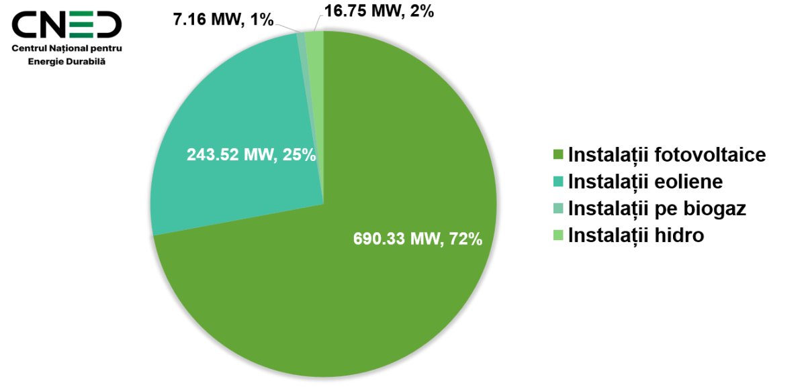
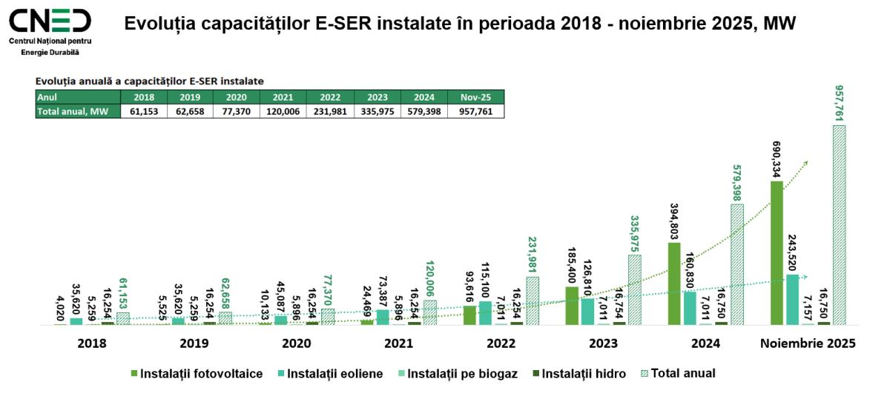
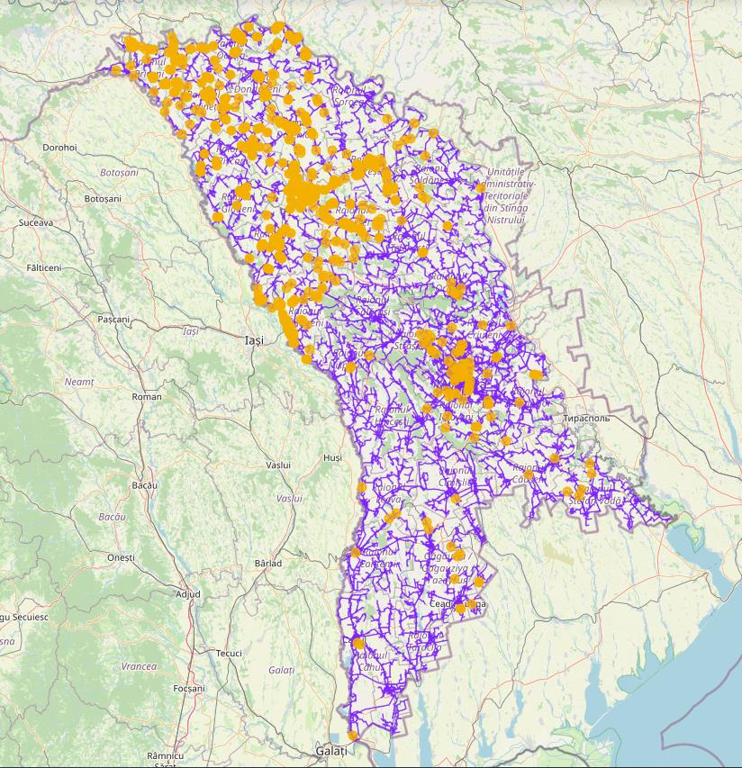

PLENUL 
CONSILIULUI CONCURENŢEI 
 
 
                                                                                
 
DECIZIE 
mun. Chișinău 
 
din 05.02.2026 
 
 
 
 
 
 
 
Nr. EMAS-11/24-05 
 
acționând în temeiul art. 41 al Legii concurenței nr. 183/2012, art. 11 alin. (2) 
al Legii cu privire la ajutorul de stat nr. 139/2012, Hotărârii Parlamentului privind 
numirea în funcție a unui membru și președinte al Plenului Consiliului Concurenței 
nr. 33/2022, Hotărârii Parlamentului privind numirea în funcția de membru al 
Plenului Consiliului Concurenței nr. 381/2023 și Hotărârii Parlamentului privind 
numirea în funcția de membru al Plenului Consiliului Concurenței nr. 211/2024, 
analizând raportul de investigație asupra cazului inițiat prin Dispoziția nr.11 
din 07.08.2024, inclusiv materialele acumulate în cadrul investigației 
 
A CONSTATAT: 
1. 
La data 09.10.2023, prin Sistemul informațional automatizat „Registrul 
ajutoarelor de stat”, a parvenit notificarea nr. 00867 de la Consiliul raional 
Criuleni cu privire la măsurile de sprijin acordate Întreprinderii Municipale 
,,Edilitate Criuleni” (în continuare - Î.M. ,,Edilitate Criuleni), fiind anexat 
formularul general de notificare a ajutorului de stat, formularul special de 
notificare privind ajutorul pentru dezvoltare regională, formularul pentru 
furnizarea informațiilor de sinteză privind ajutoarele pentru proiecte mari de 
investiții. 
2. 
Notificarea a devenit efectivă la data de 06.06.2024. 
3. 
Comunicatul privind examinarea notificării a fost plasat pe pagina web oficială 
a Consiliului Concurenței la data de 14.06.20241, în conformitate cu prevederile 
art.18 alin.(1) din Legea nr.139/2012 cu privire la ajutorul de stat, în vederea 
 
1 https://www.competition.md/anunturi/transparenaa-decizionala/consiliul-concurene-ei-examineaza-notificarea-parvenita-de-la-consiliul-raional-
criuleni/ 
 
1 
 

asigurării transparenței în procesul decizional. Careva observații și puncte de 
vedere de la terți în legătură cu notificarea examinată nu au parvenit. 
4. 
La data de 07.08.2024 notificarea cu nr. 00867 a fost examinată în cadrul 
ședinței Plenului Consiliului Concurenței. 
5. 
În urma analizării notificării menționate, materialelor anexate și notei 
examinatorului, Plenul Consiliului Concurenţei a dispus inițierea procedurii de 
investigație a cazului privind presupusele încălcări ale legislației din domeniul 
ajutorului de stat la acordarea măsurilor de sprijin Î.M. ,,Edilitate Criuleni”, 
prin Dispoziția nr. 11 din 07.08.2024. 
 
II. CADRUL LEGAL ȘI INFORMAȚIILE ÎN BAZA CĂRORA AU 
FOST EFECTUATE CONSTATĂRILE ȘI CONCLUZIILE DIN RAPORT 
• Legea nr. 139/2012 cu privire la ajutorul de stat 
• Legea nr. 523/1999 cu privire la proprietatea publică a unităţilor 
administrativ-teritoriale 
• Legea nr. 436/2006 privind administrația publică locală 
• Legea nr. 10/2016 privind promovarea utilizării energiei din surse 
regenerabile 
• Legea nr. 107/2016 cu privire la energie electrică 
• Legea nr. 139/2018 cu privire la eficiența energetică 
• Hotărârea Guvernului nr. 901/2015 pentru aprobarea Regulamentului cu 
privire la modul de transmiterea a bunurilor proprietate publică 
• Decizia Consiliului raional Criuleni nr. 2/11 din 07.03.2017 cu privire la 
transmiterea în folosință cu titlu gratuit a unui lot de teren 
• Decizia Consiliului raional Criuleni nr. 21.31 din 10.04.2015 cu privire la 
crearea Întreprinderii Municipale ,,Hrușova-Boșcana-Coșernița-Salubritate” 
• Decizia Consiliului raional Criuleni nr. 12.17 din 06.05.2017 cu privire la 
primirea în folosință cu titlu gratuit a unui lot de teren 
• Decizia Consiliului raional Criuleni nr. 04.02 din 29.09.2015 cu privire la 
modificarea deciziei Consiliului raional Criuleni nr.21.31 din 10.04.2015 
,,Cu privire la crearea Întreprinderii Municipale ,,Hrușova-Boșcana-
Coșernița-Salubritate” 
• Decizia Consiliului raional Criuleni nr. 23.07 din 21.03.2019 cu privire la  
aplicarea la proiectul ,,Energie solară în Republica Moldova (Parcul 
Fotovoltaic Criuleni)” 
• Decizia Consiliului raional Criuleni nr. 6.10 din 20.09.2021 cu privire la 
completarea Statutului ÎM ,,Edilitate Criuleni” 
• Decizia Consiliului raional Criuleni nr. 9.11 din 23.12.2021 cu privire la 
2 
 

primirea obiectului ,,Parc Fotovoltaic” or. Criuleni 
• Decizia Consiliului raional Criuleni nr. 2.19 din 25.06.2022 cu privire la 
aprobarea componenței Consiliului de administrație și Comisiei de cenzori a 
ÎM ,,Edilitate Criuleni” 
• Decizia Consiliului raional Criuleni nr. 3.15 din 16.06.2023 cu privire la 
raportul de activitate al ÎM ,,Edilitate Criuleni” 
• Decizia Consiliului raional Criuleni nr. 3.18 din 16.06.2023 cu privire la 
modificarea bugetului raional pentru anul 2023 și alocarea unor mijloace 
financiare 
• Dispoziția Președintelui raionului Criuleni nr. 30-AB din 10.06.2022 cu 
privire la instituirea Comisiei de transmitere a obiectului ,,Parc fotovoltaic 
cu capacitatea de 2,8 MW și rețele electrice de 10/04 kV” 
• Anexa nr. 1 la Decizia Consiliului raional Criuleni nr. 18.22 din 18.05.2018, 
Regulamentul Consiliului de administrație al Întreprinderii Municipale 
,,Edilitate Criuleni” 
• Actul de corespundere a rețelei electrice de transport, de distribuție sau a 
centralei electrice, emis de către ANRE cu nr. 383 din 08.11.2021 
• Regulamentul privind forma de notificare, procedura de examinare și 
adoptare a deciziilor cu privire la ajutorul de stat, aprobat prin Hotărârea 
Plenului Consiliului Concurenţei nr. 1/2013 
III. PĂRȚILE IMPLICATE 
6. 
Consiliul raional Criuleni (în continuare – Consiliul raional), adresa juridică: 
str. 31 August 108,  MD-4801, or. Criuleni, în calitate de inițiator/furnizor al 
ajutorului de stat în cazul transmiterii cu titlu gratuit în gestiune economică a 
obiectului ,,Parc Fotovoltaic” din or. Criuleni, str. Orhei - potrivit 
Regulamentului privind constituirea și funcționarea Consiliului raional 
Criuleni, aprobat prin Decizia Consiliului raional nr. 1/1 din 15.03.2024, 
Consiliul raional este autoritatea reprezentativă și deliberativă a populației 
raionului Criuleni, iar conform art. 43 lit. c) din Legea nr. 436/2008 decide 
privind administrarea bunurilor domeniilor public şi privat ale raionului, în 
vederea promovării intereselor şi soluţionării problemelor populaţiei în limitele 
teritoriului administrat. 
7. 
Î.M. ,,Edilitate Criuleni” (IDNO 1015600036316), sediul întreprinderii: str. 
31 August 1989, 108, or. Criuleni, MD-4801, în calitate de beneficiar al 
ajutorului de stat. 
8. 
Î.M. ,,Edilitate Criuleni” a fost creată în temeiul Deciziei Consiliului raional 
Criuleni nr. 04.02 din 29.09.2015 „Cu privire la modificarea deciziei 
Consiliului raional Criuleni nr. 21.31 din 10 aprilie 2015 ,,Cu privire la crearea  
3 
 

Întreprinderii Municipale ,,Hrușova-Boșcana-Coșernița-Salubritate”. Conform 
statutului întreprinderea municipală este agentul economic cu personalitate 
juridică, constituită de Consiliul raional Criuleni (în continuare-fondator), dotat 
cu bunuri proprietate a unității administrativ-teritoriale fondatoare, care prin 
utilizarea lor judicioasă, prestează servicii necesare pentru satisfacerea 
cerințelor unității administrativ-teritoriale.  
9. 
Conform prevederilor statutului, principalele genuri de activitate ale 
întreprinderii sunt următoarele: 
• Colectarea şi epurarea apelor uzate 
• Colectarea deşeurilor nepericuloase 
• Colectarea deşeurilor periculoase 
• Tratarea şi eliminarea deşeurilor nepericuloase 
• Tratarea şi eliminarea deşeurilor periculoase 
• Activităţi şi servicii de decontaminare 
• Transporturi rutiere de mărfuri 
• Recuperarea materialelor reciclabile sortate 
• Alte activităţi de curăţenie n.c.a. 
• Lucrări de instalaţii electrice 
• Captarea, tratarea şi distribuţia apei 
• Producţia de energie electrică 
• Construcţiile de clădiri şi (sau) construcţii inginereşti, instalaţii şi reţele 
tehnico-edilitare, reconstrucţiile, consolidările, restaurările 
10. Urmează a fi menționat că, la momentul acordării măsurilor de sprijin 
examinate, întreprinderea nu desfășura vreo activitate din cele remarcate mai 
sus. 
11. În conformitate cu art. 11, alin. (1) din Legea cu privire la ajutorul de stat, 
procedura de examinare a cazurilor de încălcare a legislaţiei din domeniul 
ajutorului de stat se derulează în conformitate cu Legea concurenţei. Pentru a 
stabili dacă o măsură de sprijin denaturează sau riscă să denatureze concurenţa, 
urmează a fi stabilită piața relevantă și întreprinderile care activează pe această 
piață.  
12. Astfel, potrivit art. 4 din Legea concurenţei, piaţa relevantă este piaţa în cadrul 
căreia trebuie evaluată o anumită problemă de concurență și care se determină 
4 
 

prin raportarea pieței relevante a produsului la piața geografică relevantă. 
Totodată, piața relevantă a produsului este piaţa produselor considerate de 
consumatori ca interschimbabile sau substituibile datorită utilizării date 
acestora, datorită caracteristicilor fizice, funcţionale şi a preţului. 
13. Energia electrică produsă de Î.M. „Edilitate Criuleni” este injectată în rețeaua 
electrică națională și comercializată în conformitate cu cadrul de reglementare 
aplicabil la nivel național, aceasta nu este destinată unei piețe locale sau 
regionale limitate. Odată conectată la rețeaua națională, energia electrică 
produsă circulă liber în Sistemul Energetic Național și este tranzacționată în 
condiții unitare, în baza acelorași reguli și mecanisme aplicabile tuturor 
producătorilor de energie electrică din Republica Moldova. 
14. Întrucât energia electrică produsă de către Parcul Fotovoltaic este 
comercializată către cei mai mari furnizori de energie electrică din Republica 
Moldova: ÎCS „Premier Energy” SRL și „Navitas Energy” SRL, în baza 
contractelor (nr. 1b18322 din 01.04.2022 privind vânzarea energiei electrice 
produse din surse regenerabile și nr. 40R062022 din 24.06.2022 privind 
vânzarea energiei electrice produse din surse regenerabile), piața geografică 
relevantă va constitui teritoriul național al Republicii Moldova. 
15. Potrivit datelor din Clasificatorul activităţilor din economia Republicii 
Moldova (anii 2022-2024) au fost identificate întreprinderile concurente ce își 
desfășoară activitatea pe segmentele de piață vizate și expuse în tabelul 1. 
 
Tabelul 1 
Segmentele de piață vizate 
 
Cod 
CAEM 
Denumire activitate 
Număr întreprinderi 
2022 
2023 
2024 
35.11 
Producția de energie electrică 
 
189 
251 
407 
 
16. Ca urmare, luând în considerare cele expuse mai sus, precum și de statutul Î.M. 
,,Edilitate Criuleni”, se constată că piața relevantă a produsului în sensul 
examinării cazului dat este piața prestării serviciilor de producere a energiei 
electrice. 
 
Perioada de timp supusă examinării 
17. Perioada de timp supusă examinării a constituit perioada anilor 2022-2024, 
ținând cont de dreptul Consiliului Concurenței de a lua măsuri privind 
5 
 

recuperarea ajutorului ilegal sau a celui utilizat abuziv în limita termenului de 
prescripție de 10 ani, în conformitate cu art. 16 alin. (1) din Legea cu privire la 
ajutorul de stat. 
 
V. ACTE ȘI FAPTE CONSTATATE 
V.1. 
CIRCUMSTANȚE 
DE 
FAPT 
ALE 
PROCEDURII 
DE 
EXAMINARE 
18. La data de 09.10.2023, Consiliul raional Criuleni, prin completarea și 
transmiterea formularului general și special de notificare a ajutorului de stat, a 
notificat Consiliului Concurenței, utilizând Sistemul informațional automatizat 
,,Registrul ajutoarelor de stat”, ajutorul de stat acordat Î.M. ,,Edilitate Criuleni”. 
19. Măsura de sprijin notificată a constat în transmiterea cu titlu gratuit în anul 
2022 de către Consiliul raional Criuleni în gestiunea economică Î.M. ,,Edilitate 
Criuleni” a obiectului ,,Parc Fotovoltaic” (pe care sunt instalate 7.400 de 
panouri fotovoltaice și 16 invertoare), construit și transmis anterior Consiliului 
raional Criuleni la cheie, ca urmare a implementării proiectului ”Energie solară 
în Republica Moldova (Parcul Fotovoltaic Criuleni)”, finanțat de către 
Republica Populară Chineză. 
20. La data de 15 decembrie 2011 între Guvernul Republicii Moldova și Guvernul 
Republicii Populare Chineze a fost semnat un acord bilateral referitor la un 
ajutor nerambursabil care constituia 60 mil. CNY, echivalent cu aproximativ 
7,8 mil. USD. Ajutorul a fost destinat pentru realizarea proiectelor de cooperare 
economico-tehnică, inclusiv și construcția ,,Parcului Fotovoltaic cu capacitatea 
de 2,8 MW”, valoarea căruia a fost estimată la 4,3 mil. USD. Protocolul 
referitor la ,,Parcul Fotovoltaic” a fost semnat la 30 decembrie 2016 de către 
Ministerul Comerțului a Republicii Populare China, Ministerul Economiei a 
Republicii Moldova și Consiliul raional Criuleni, schimbul de note semnat de 
Guvernele ambelor țări la 4 decembrie 2017 și respectiv la 6 iunie 2018. 
21. Pe 2 ianuarie 2019, de către Ministerul Comerțului a Republicii Populare 
Chineze, Ministerul Economiei și Infrastructurii din Republica Moldova și 
Consiliul raional Criuleni a fost semnat Acordul suplimentar de implementare 
pentru proiectul de energie solară din Moldova acordat de China. 
22. Potrivit pct. 8.6 din acordul susmenționat, Partea Moldovenească urma să ofere 
gratuit excavarea, solul și pământul necesar pentru realizarea proiectului, în 
limita a 10 km de terenul propus, a cărui locație concretă a fost aleasă în comun 
de către Partea Moldovenească și Contractorul General al Proiectului (Partea 
Chineză). 
23. Astfel, pentru amenajarea proiectului dat Primăria orașului Criuleni, prin 
Decizia Consiliului local nr. 2/11 din 07 martie 2017 a transmis cu titlu gratuit, 
6 
 

pe o perioadă de 25 de ani, terenul de 8,0 ha cu nr. cadastral 3101215312, iar 
Consiliul raional a acceptat primirea în folosință prin Decizia nr. 12.17 din 06 
mai 2017. 
24. Pe data de 13 octombrie 2021, întreprinderea chineză a informat Consiliul 
raional Criuleni despre finalizarea lucrărilor, în rezultatul căruia au fost 
anunțate toate organele responsabile pentru eliberarea avizelor și semnarea 
procesului - verbal de recepție a lucrărilor care a avut loc pe data de 25 
noiembrie 2021. 
25. Prin Decizia Consiliului raional Criuleni nr. 9.11 din 23 decembrie 2021, 
Consiliul raional Criuleni a primit cu titlu gratuit obiectul  ,,Parc Fotovoltaic cu 
capacitatea 2,8 MW și rețelele electrice de 10/04 KW” din or. Criuleni, str. 
Orhei, iar potrivit pct. 3 din decizie, după înregistrarea dreptului de proprietate 
a Consiliului raional Criuleni asupra obiectului menționat acesta se transmite 
în gestiune către Î.M. ,,Edilitate Criuleni”.  
26. La data de 10 martie 2022 a fost semnat actul de transmitere a mijloacelor fixe 
și a altor active ale Parcului Fotovoltaic, prin care s-a efectuat transmiterea în 
gestiune economică cu titlu gratuit Î.M. ,,Edilitate Criuleni” a obiectului ,,Parc 
Fotovoltaic cu capacitate 2,8 MW și rețele electrice de 10/04 KW” or. Criuleni, 
construcție administrativă și a bunurilor parte componentă a obiectului dat 
(inclusiv a lotului de teren din domeniul public cu suprafața de 8,0 ha, nr. 
cadastral 3101215.312), pe care este amplasat Parcul Fotovoltaic. Valoarea 
contabilă a mijloacelor fixe și a altor active care s-au transmis în gestiune 
economică, conform situației de la 10 martie 2022, a fost de 73 940 896,67 lei. 
 
V.2. 
EVALUAREA 
MĂSURII 
DE 
SPRIJIN 
PRIN 
PRISMA 
EXISTENȚEI AJUTORULUI DE STAT 
27. Potrivit art. 340 alin. (1) al Acordului de Asociere între Republica Moldova și 
Uniunea Europeană, ajutoarele de stat se evaluează pe baza criteriilor care 
decurg din aplicarea normelor în materie de concurență aplicabile în UE, în 
special a articolului 107 din Tratatul privind funcționarea Uniunii Europene (în 
continuare – TFUE) și a instrumentelor de interpretare adoptate de instituțiile 
UE, inclusiv jurisprudența relevantă a Curții de Justiție a Uniunii Europene. 
28. Potrivit art. 3 din Legea cu privire la ajutorul de stat, ajutorul de stat este orice 
măsură de sprijin care întrunește cumulativ următoarele condiții: 
a) este acordată de furnizor din resurse de stat sau din resursele unităților 
administrativ – teritoriale sub orice formă; 
b) conferă beneficiarului un avantaj economic, care nu putea fi obținut în 
condiții normale de piață; 
7 
 

c) este acordată în mod selectiv; 
d) denaturează sau riscă să denatureze concurența. 
 
a) este acordată de furnizor din resurse de stat sau din resursele unităților 
administrativ – teritoriale sub orice formă  
29. Acordarea unui avantaj direct sau indirect prin intermediul resurselor de stat și 
imputabilitatea unei astfel de măsuri în sarcina statului sunt două condiții 
cumulative pentru existența ajutorului.2 
Imputabilitatea statului  
30. În cazul în care o autoritate publică acordă un avantaj unui beneficiar, măsura 
este prin definiție imputabilă statului, chiar dacă autoritatea în cauză 
beneficiază de autonomie juridică față de alte autorități publice.3 
31. Având în vedere că, Consiliul raional Criuleni este autoritatea publică care 
acordă măsura de sprijin examinată Î.M. ,,Edilitate Criuleni”, se constată 
îndeplinirea condiției ce ține de imputabilitatea statului. 
 
Transferul de resurse de stat sau ale unității administrativ-teritoriale 
32. Conform art. 3 al Legii cu privire la ajutorul de stat, resurse de stat sau resurse 
ale unităţilor administrativ-teritoriale reprezintă totalitatea patrimoniului, 
inclusiv sub formă de mijloace financiare ce aparţine statului, unităţilor 
administrativ-teritoriale, inclusiv unităţii teritoriale autonome Găgăuzia. 
Numai avantajele acordate direct sau indirect din resurse de stat pot constitui 
ajutor de stat. Transferul resurselor de stat poate lua multe forme, acestea fiind 
prevăzute în art. 6 al Legii cu privire la ajutorul de stat. 
33. Ținând cont că măsura de sprijin este acordată Î.M. ,,Edilitate Criuleni’’ din 
resursele autorităților publice menționate anterior, aceasta reprezintă un 
transfer de resurse de stat. 
34. Luând în considerare că cele două condiții sus menționate sunt îndeplinite 
cumulativ, se constată că măsura de sprijin examinată este acordată din resurse 
de stat. 
b) conferă beneficiarului un avantaj economic care nu putea fi obținut în 
condiții normale de piață 
35. Un avantaj este orice beneficiu economic pe care întreprinderea nu l-ar fi putut 
obține în condiții normale de piață, și anume în absența intervenției statului.4 
 
2 Comunicare a Comisiei privind noțiunea de ajutor de stat astfel cum este menționată la articolul 107 alin.(1) din TFUE, pag. 9, pct. 38 
3 Comunicare a Comisiei privind noțiunea de ajutor de stat astfel cum este menționată la articolul 107 alin.(1) din TFUE, pag. 9, pct. 39 
4 Comunicarea Comisiei privind noțiunea de ajutor de stat astfel cum este menționată la articolul 107 alineatul (1) din Tratatul privind funcționarea 
Uniunii Europene (2016/C 262/01), pct. 66 
8 
 

Nu doar acordarea avantajelor economice pozitive este relevantă pentru 
noțiunea de ajutor de stat, ci și scutirea de sarcinile economice poate să 
constituie un avantaj. Aceasta se referă la toate situațiile în care operatorii 
economici sunt scutiți de costurile inerente activităților economice pe care le 
desfășoară. Ea se referă, de asemenea, la situațiile în care anumiți operatori nu 
trebuie să suporte costuri pe care alți operatori comparabili le suportă de regulă 
în temeiul unei anumite ordini juridice.5 
36. Ori de câte ori situația financiară a unei întreprinderi este îmbunătățită ca 
rezultat al intervenției statului în condiții care diferă de condițiile normale de 
piață, există un avantaj. Doar efectul măsurii asupra întreprinderii este relevant, 
iar nu cauza sau obiectivul intervenției statului.6 
37. Deoarece Consiliul raional Criuleni a transmis cu titlu gratuit în gestiunea 
economică Î.M. ,,Edilitate Criuleni” obiectul ,,Parc Fotovoltaic”, prin acest fapt 
întreprinderea a fost scutită de costurile inerente activității sale economice care, 
în mod normal, urmau a fi acoperite din sursele proprii ale întreprinderii, iar 
situația financiară a întreprinderii fiind îmbunătățită în urma intervenției 
statului. 
38. Ordinea juridică a Uniunii este neutră în ceea ce privește regimul proprietății și 
nu aduce în niciun fel atingere dreptului statelor membre de a acționa ca 
operatori economici. Tranzacțiile economice efectuate de organisme publice 
(inclusiv întreprinderi publice) nu conferă un avantaj pentru contrapartidă și, 
prin urmare, nu constituie ajutor de stat în cazul în care acestea sunt efectuate 
conform condițiilor normale de piață. Acest principiu a fost dezvoltat cu privire 
la diferite tranzacții economice. Instanțele Uniunii au dezvoltat „principiul 
investitorului în economia de piață” pentru a identifica prezența ajutoarelor de 
stat în cazuri de investiții publice (în special, infuziile de capital): pentru a 
determina dacă investiția unui organism public constituie ajutor de stat, este 
necesar să se evalueze dacă, în împrejurări similare, un investitor privat de 
dimensiune comparabilă, care își desfășoară activitatea în condițiile normale 
ale unei economii de piață, ar fi putut fi determinat să facă investiția în cauză.7 
39. Comportamentul organismelor publice ar trebui să fie comparat cu cel al 
operatorilor economici similari din sectorul privat în condiții normale de piață 
pentru a stabili dacă tranzacțiile economice efectuate de organismele respective 
constituie un avantaj pentru contrapartide. Elementul decisiv este dacă 
 
5 Comunicarea Comisiei privind noțiunea de ajutor de stat astfel cum este menționată la articolul 107 alineatul (1) din Tratatul privind 
funcționarea Uniunii Europene (2016/C 262/01), pct. 68 
6 Comunicarea Comisiei privind noțiunea de ajutor de stat astfel cum este menționată la articolul 107 alineatul (1) din Tratatul privind funcționarea 
Uniunii Europene (2016/C 262/01), pct. 67 
7 Comunicarea Comisiei privind noțiunea de ajutor de stat astfel cum este menționată la articolul 107 alineatul (1) din Tratatul privind funcționarea 
Uniunii Europene (2016/C 262/01), pct. 73-74 
9 
 

organismele publice au acționat sau nu la fel ca un operator în economia de 
piață aflat într-o situație similară.8 
40. Pentru a stabili dacă o tranzacție este în conformitate cu condițiile pieței, 
tranzacția respectivă poate fi evaluată din perspectiva termenilor în care 
operatorii privați comparabili au efectuat tranzacții comparabile, în situații 
comparabile (analiză comparativă).9 
41. Investițiile în energia regenerabilă sunt profitabile din punct de vedere 
economic, deoarece costurile de producție scad constant, iar tehnologiile devin 
tot mai eficiente. Pe termen lung, energia regenerabilă oferă stabilitate 
financiară și randamente sigure, fiind susținută de cerere în creștere. 
42. Conform raportului ”Perspectiva globală asupra tranzițiilor energetice 2023” 
elaborat de Agenția Internațională pentru Energie Regenerabilă (IRENA)10, 
care este o agenție interguvernamentală globală de referință pentru 
transformarea sectorului energetic, investițiile în energia regenerabilă (inclusiv 
producerea de energie electrică și utilizările finale) au atins 0,5 trilioane USD 
în 2022. Deși există numeroase opțiuni tehnologice, cele mai multe investiții 
au fost direcționate către energia solară fotovoltaică și energia eoliană, 95% din 
fonduri fiind canalizate către aceste tehnologii. Aproximativ 75% din 
investițiile globale în energie regenerabilă din perioada 2013–2020 au provenit 
din sectorul privat.  
43. Conform Centrului Național pentru Energie Durabilă11, se atestă că în 
Republica Moldova, instalațiile fotovoltaice cu o putere instalată sumară de 
690,33 MW, sunt cea mai răspândită tehnologie și reprezintă 72% din totalul 
capacităților E-SER instalate. Acestea sunt urmate de instalațiile eoliene, a 
căror putere sumară a atins 243,52 MW, reprezentând 25% din total. 
Capacitățile instalațiilor hidro și biogaz înregistrează valori de 16,75 MW (2%) 
și respectiv 7,16 MW (1%), repartizarea ponderată a capacităților instalate pe 
tipuri de tehnologii de producere a energiei electrice din surse regenerabile fiind 
reprezentată în figura nr.1. 
 
 
 
 
 
 
8 Comunicarea Comisiei privind noțiunea de ajutor de stat astfel cum este menționată la articolul 107 alineatul (1) din Tratatul privind funcționarea 
Uniunii Europene (2016/C 262/01), pct. 75-76 
9 Comunicarea Comisiei Comunicarea Comisiei privind noțiunea de ajutor de stat astfel cum este menționată la articolul 107 alineatul (1) din 
Tratatul privind funcționarea Uniunii Europene (2016/C 262/01), pct. 75-76privind noțiunea de ajutor de stat astfel cum este menționată la 
articolul 107 alineatul (1) din Tratatul privind funcționarea Uniunii Europene (2016/C 262/01), pct. 98 
10  https://www.irena.org/-/media/Files/IRENA/Agency/Publication/2023/Jun/IRENA_World_energy_transitions_outlook_2023.pdf  
11  https://cned.gov.md/ro/content/capacitati-instalate 
 
10 
 

Figura nr.1 
 
Repartizarea ponderată pe tipuri de tehnologii a capacităților E-SER 
instalate la sfârșitul lunii noiembrie, 2025 
 

 
 
  
44. Evoluția anuală a capacităților instalate de surse de energie regenerabilă este 
prezentată mai jos în figura nr. 2. 
 Figura nr.2 
 
Evoluția capacităților E-SER instalate în perioada 2018 - noiembrie 2025, MW 
 

 
45. O parte considerabilă din capacitățile generatoare de energie electrică 
regenerabilă comercializează energia produsă pe piață liberă, ceea ce 
evidențiază faptul că producerea energiei regenerabile este o activitate 
economic fezabilă și este de interes pentru investitori. Actualmente, capacitatea 
totală a producătorilor ce participă pe piața liberă constituie 522,46 MW (55%), 
dintre care 289,67 MW sunt instalații fotovoltaice, 216,29 MW – eoliene și 
16,50 MW – hidro. 
11 
 

46. Potrivit informațiilor prezentate pe platforma digitală din Republica Moldova 
dedicată exclusiv sectorului energiei regenerabile și tehnologiilor verzi - 
Renergy.md, la nivelul întregii țări sunt înregistrate 1035 de centrale 
fotovoltaice a căror distribuție geografică fiind reprezentată în figura nr. 3. 
 
Figura nr. 3 
 
Harta digitală dedicată tuturor unităților de producere 
din surse regenerabile (solare) racordate la rețelele naționale 
 

 
Sursa: https://renergy.md/greenmap/ 
 
47. Sectorul energetic național este atractiv pentru investitori12, fapt care a fost 
demonstrat prin numărul remarcabil de oferte depuse în cadrul licitației 
desfășurate pentru oferirea statutului de producător eligibil mare şi calificarea 
investitorilor pentru construcția parcurilor fotovoltaice și eoliene mari. În total, 
până la termenul limită, 31.03.2025, au fost depuse 34 de oferte pentru centrale 
electrice fotovoltaice, cu o putere totală ofertată de 236,61 MW. Toți ofertanții 
sunt companii locale, două dintre acestea având fondatori străini. 
 
12 https://energie.gov.md/ro/node/45559 
 
12 
 

48. În concluzie, datele prezentate confirmă faptul că investițiile în energia 
fotovoltaică sunt profitabile și atractive din punct de vedere economic, atât la 
nivel global, cât și național. Dominanța investițiilor în tehnologiile fotovoltaice, 
ponderea majoritară a capitalului privat și participarea activă pe piața liberă 
demonstrează maturitatea acestui sector și capacitatea sa de a genera 
randamente sustenabile. În Republica Moldova, numărul mare de centrale 
fotovoltaice, interesul crescut al investitorilor locali și succesul licitațiilor 
recente reflectă în mod clar rolul esențial al sectorului privat în dezvoltarea și 
consolidarea acestui business energetic viabil. 
49. Consiliul raional Criuleni, în cadrul notificării, a menționat că operarea parcului 
fotovoltaic urmează să permită generarea unei cantități de energie electrică de 
peste trei milioane kWh pe an, iar în funcție de tariful care va fi negociat cu 
operatorii sistemului de distribuție a energiei electrice, bugetul raional urma a 
fi suplinit cu circa 3-5 milioane de lei pe an. 
50. Prin scrisoarea nr. 117 din 28.03.2025, Consiliul raional Criuleni a informat 
Consiliul Concurenței că cantitatea de energie electrică produsă de parcul 
fotovoltaic în anul 2022 a fost de 3 032 256,00 kwh iar în anul 2024 aceasta a 
ajuns la 3 668 458,00 kwh. 
51. Potrivit informației prezentate de către Consiliul raional Criuleni, cuantumul 
profitului net al Î.M. ,,Edilitate Criuleni”, pentru anii 2022 - 2023, în valoare 
de 3631 mii de lei a fost preponderent repartizat prin defalcarea în bugetul 
raional. Pentru anul 2024, conform Deciziei Consiliului raional Criuleni nr. 3.5 
din 23.05.2025, cuantumul profitului net al Î.M. ,,Edilitate Criuleni” repartizat 
prin defalcarea în bugetul raional a constituit 2467 mii de lei. 
52. Ținând cont că Î.M. ,,Edilitate Criuleni” nu desfășura nici o activitate 
economică până la obținerea în gestiunea economică a obiectului ,,Parc 
Fotovoltaic”, decizia autorității publice locale de a transmite acest obiect a fost 
luată prin prisma calității acesteia de fondator al întreprinderii în vederea ca 
ultima să rămână funcțională și să desfășoare o activitate profitabilă în interesul 
fondatorului. 
53. Ca urmare, condiția de conferire beneficiarului a unui avantaj economic care 
nu putea fi obținut în condiții normale de piață nu este îndeplinită deoarece 
decizia Consiliului raional Criuleni de a transmite în gestiunea economică a 
Î.M. ,,Edilitate Criuleni” a obiectului ,,Parc Fotovoltaic” a fost efectuată din 
perspectiva unui operator în economia de piață.  
54. Având în vedere cele menționate, se constată neîndeplinirea celor patru condiții 
cumulative necesare constatării existenței ajutorului de stat și faptul că, măsura 
dată de sprijin nu constituie ajutor de stat în sensul art. 3 al Legii nr. 139/2012 
cu privire la ajutorul de stat.  
13 
 

55. În urma finalizării procedurii de examinare a cazului inițiat prin Dispoziția 
Plenului Consiliului Concurenței nr. 11 din 07.08.2024 referitor la semnele 
încălcării legislației din domeniul ajutorului de stat de către Consiliul raional 
Criuleni la acordarea măsurilor de sprijin Î.M. ,,Edilitate Criuleni”, a fost 
întocmit raportul de investigație din 19.01.2026. 
56. Respectiv, prin raportul de investigație s-a propus a fi constatat că măsura de 
sprijin supusă investigației nu constituie ajutor de stat în sensul reglementat de 
art. 3 al Legii nr. 139/2012 cu privire la ajutorul de stat, întrucât condiția de 
conferire beneficiarului a unui avantaj economic care nu putea fi obținut în 
condiții normale de piață nu este îndeplinită deoarece decizia Consiliului 
raional Criuleni de a transmite în gestiunea economică a Î.M. ,,Edilitate 
Criuleni” a obiectului ,,Parc Fotovoltaic” a fost efectuată din perspectiva unui 
operator în economia de piață aflat într-o situație similară, iar tranzacția este în 
conformitate cu condițiile pieței 
 
Exercitarea dreptului la apărare 
57. În temeiul art. 59 al Legii concurenței nr. 183/2012, la data de 19.01.2026 și 
20.01.2026, Consiliul Concurenței a remis raportul de investigație Consiliului 
raional Criuleni și Î.M. ,,Edilitate Criuleni”, în vederea exercitării dreptului de 
apărare și pentru prezentarea observațiilor.  
58. În vederea exercitării dreptului la apărare, Consiliului raional Criuleni (scr. nr. 
167 din 21.01.2026) și Î.M. ,,Edilitate Criuleni” (scr. nr.180 din 22.01.2026), 
au comunicat lipsa de observații asupra raportului de investigație. 
 
Reieşind din constatările de fapt și de drept expuse mai sus, în temeiul art. 
41 alin. (1) lit. p) din Legea concurenţei și art. 11 alin. (2) lit. a) din Legea cu 
privire la ajutorul de stat, Plenul Consiliului Concurenţei 
 
 
DECIDE: 
 
1. A constata că măsurile de sprijin ce constau în transmiterea cu titlu gratuit 
de către Consiliul raional Criuleni în gestiunea economică Î.M. ,,Edilitate 
Criuleni” a obiectului ,,Parc Fotovoltaic” cu capacitate de 2,8 MW și a 
rețelelor electrice de 10/04KW din or. Criuleni, str. Orhei, construcție 
administrativă cu suprafața de 210,9 m.p. (nr. cadastral 3101215312.01) și 
a bunurilor parte componentă a obiectului dat (inclusiv a lotului de teren 
din domeniul public cu suprafața de 8,0 ha, nr. cadastral 3101215.312), pe 
care este amplasat Parcul Fotovoltaic, nu constituie ajutor de stat în sensul 
art. 3 al Legii cu privire la ajutorul de stat. 
14 
 

2. Decizia intră în vigoare la data adoptării şi va fi adusă la cunoştinţa părților 
implicate. 
3. Decizia poate fi contestată, în termen de 30 de zile calendaristice de la data 
primirii acesteia de către părți, la Judecătoria Chișinău, sediul Râșcani, 
specializat în materie de contencios administrativ (mun. Chișinău, str. 
Kiev, 3). 
4. Partea dispozitivă a prezentei decizii va fi publicată în Monitorul Oficial al 
Republicii Moldova. 
 
 
 
Alexei GHERȚESCU 
Preşedinte 
 
 
 
 
 
 
 
 
 
15 
 
