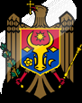
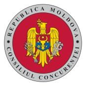

PLENUL 
CONSILIULUI CONCURENŢEI 
 
 
Republica Moldova, MD- 2032, Сhişinău, str.Aleco Russo 1 
 
 
DECIZIE 
E-mail: office@competition.md ; www.competition.md 
 
Nr. EMAS - 20                                                                
din 02.07.2026                                                                               mun. Chişinău 
                                
Plenul Consiliului Concurenței,  
acționând în temeiul art. 41 al Legii concurenței nr. 183/2012, art. 10 alin. 
(2) lit. b) al Legii cu privire la ajutorul de stat nr. 139/2012, Hotărârii 
Parlamentului privind numirea în funcție a unui membru și președinte al 
Plenului Consiliului Concurenței nr. 56/2026, Hotărârii Parlamentului privind 
numirea în funcția de vicepreședinte al Plenului Consiliului Concurenței nr. 
380/2023, Hotărârii Parlamentului privind numirea în funcția de vicepreședinte 
al Plenului Consiliului Concurenței nr. 210/2024, Hotărârii Parlamentului 
privind numirea în funcția de membru al Plenului Consiliului Concurenței nr. 
381/2023 și Hotărârii Parlamentului privind numirea în funcția de membru al 
Plenului Consiliului Concurenței nr. 211/2024, 
analizând notificarea Ministerului Educației și Cercetării al Republicii 
Moldova (în continuare - MEC) cu privire la intenția de acordare a unei măsuri 
de sprijin în cadrul Schemei de ajutor de stat pentru realizarea învățământului 
dual, depusă prin intermediul Sistemului informațional automatizat „Registrul 
ajutoarelor de stat” cu nr. 01083 din 31.03.2026, materialele anexate și nota 
examinatorului 
A CONSTATAT: 
I. 
CONTEXTUL MĂSURII DE SPRIJIN 
1. 
La data de 24.03.2026, Consiliul Concurenței a recepționat scrisoarea de la 
Ministerul Educației și Cercetării al Republicii Moldova (în continuare - 
MEC) nr. 08/144/26 din 24.03.2026, la care au fost anexate formularul 
general de notificare a ajutoarelor de stat și materialele aferente. 
2. 
Ulterior, la data de 31.03.2026, MEC a transmis, prin intermediul 
Sistemului informațional automatizat „Registrul ajutoarelor de stat” 
notificarea nr. 01083 privind intenția de acordare a unei măsuri de sprijin în 
cadrul schemei de ajutor de stat pentru realizarea învățământului dual. 
1 
 
 

3. 
Obiectul notificării îl constituie proiectul de modificare a Anexei nr. 2 la 
Hotărârea Guvernului nr. 97/2023 privind aprobarea mecanismului de 
compensare a cheltuielilor unităților implicate în învățământul dual, prin 
care se instituie Schema de ajutor de stat pentru realizarea învățământului 
dual (în continuare - Schemă). Examinarea notificării a fost efectuată în 
baza versiunii proiectului transmis de către MEC și a informațiilor 
suplimentare prezentate pe parcursul procedurii de notificare. 
4. 
Prin scrisorile nr. EMAS-07/190-626 din 17.04.2026; EMAS-07/231-774 
din 14.05.2026, EMAS-07/248-890 din 25.05.2026 și EMAS-07/283-1018 
din 08.06.2026 Consiliul Concurenței a comunicat MEC că informația este 
incompletă și urmează a fi completată corespunzător.  
5. 
Notificarea a devenit completă la data de 10.06.2026, fapt despre care a 
fost informat MEC prin scrisoarea nr. EMAS-07/289-1081 din 11.06.2026.  
6. 
În vederea asigurării transparenței în procesul decizional, în conformitate 
cu art. 18 alin. (1) din Legea nr. 139/2012 cu privire la ajutorul de stat, 
comunicatul cu privire la notificarea completă a fost plasat pe site-ul web 
oficial al Consiliului Concurenței la data de 12.06.2026, pentru obținerea 
observațiilor și punctelor de vedere. Observații și puncte de vedere nu au 
parvenit. 
II. CADRUL JURIDIC APLICABIL MĂSURII DE SPRIJIN 
2.1 BAZA LEGALĂ PRIVIND ACORDAREA MĂSURII DE 
SPRIJIN 
➢ 
Legea nr. 110/2022 cu privire la învățământul dual. 
➢ 
Hotărârea Guvernului nr. 97/2023 pentru punerea în aplicare a prevederilor 
Legii nr. 110/2022 cu privire la învățământul dual. 
➢ 
Proiectul Hotărârii Guvernului cu privire la modificarea Anexei nr.2 la 
Hotărârea Guvernului nr. 97/2023 pentru punerea în aplicare a prevederilor 
Legii nr. 110/2022 cu privire la învățământul dual. 
➢ 
Manualul operațional privind procesarea cererilor de compensare a 
cheltuielilor din învățământul dual – aprobat prin Procesul-Verbal nr. 5 din 
29.05.2025. 
2.2 BAZA LEGALĂ PRIVIND EVALUAREA MĂSURII DE SPRIJIN 
➢ 
Legea nr. 139/2012 cu privire la ajutorul de stat. 
➢ 
Hotărârea Plenului Consiliului Concurenței nr. 5/2013 cu privire la 
aprobarea Regulamentului privind ajutorul de stat pentru instruirea 
angajaților și pentru crearea de noi locuri de muncă. 
 
 
 
2 
 
 

III. BENEFICIARII MĂSURII DE SPRIJIN 
7. 
Conform art. 3 din Legea nr.139/2012 cu privire la ajutorul de stat, 
beneficiar al ajutorului de stat este orice persoană fizică sau juridică 
independentă, angajată într-o activitate economică ce constă în oferirea de 
bunuri sau servicii pe o piață. 
8. 
Potrivit art. 2 din Legea nr.110/2022 cu privire la învățământul dual (în 
continuare – Legea nr. 110/2022), unitatea în învățământul dual reprezintă 
orice persoană juridică de drept public și/sau de drept privat, indiferent de 
tipul de proprietate și forma juridică de organizare, și/sau persoana fizică 
care îndeplinește condițiile prescrise pentru formarea profesională a 
elevilor, prevăzute de programul corespunzător de formare profesională 
prin învățământ dual. 
9. 
Totodată, pct. 2 subpct. 2) din Schemă definește beneficiarul ajutorului de 
stat ca fiind orice unitate economică care realizează învățământul dual în 
condițiile prevăzute de Legea nr.110/2022. 
10. Calitatea de beneficiar al măsurii de sprijin nu este automată, ci este 
condiționată de îndeplinirea criteriilor privind conformitatea unității pentru 
participarea la procesul de formare profesională prin învățământ dual. 
11. Conform Anexei nr.1 la Hotărârea Guvernului nr. 97/2023 pentru punerea 
în aplicare a prevederilor Legii nr. 110/2022 cu privire la învățământul dual 
(în continuare – Hotărârea Guvernului nr. 97/2023), constatarea 
conformității unității se realizează de către Comisia de verificare a 
conformității. Comisia de verificare a conformității se instituie de către 
Camera de Comerț și Industrie (în continuare – CCI) și își desfășoară 
activitatea în baza unei metodologii aprobate de către CCI.  
12. Pentru a participa la procesul de formare profesională prin învățământ dual, 
unitățile trebuie să întrunească următoarele criterii: 
1) deținerea de spații și asigurarea condițiilor corespunzătoare pentru 
instruirea practică a elevilor; 
2) asigurarea cu personalul necesar pentru realizarea învățământului dual; 
3) exercitarea atribuțiilor prevăzute în legislație în procesul de realizare a 
învățământului dual. 
13. Unitățile participante care întrunesc criteriile de conformitate sunt  
înregistrate în Registrul unităților în învățământul dual din cadrul 
Sistemului informațional de management în educație (în continuare – 
SIME). 
14. Reieșind din informațiile prezentate de MEC, numărul total estimat al 
beneficiarilor care ar putea să beneficieze de ajutor de stat în baza Schemei 
este de aproximativ 350 unități economice.  
3 
 
 

IV. DESCRIEREA MĂSURII DE SPRIJIN 
Caracteristicile măsurii de sprijin 
15. În sensul art. 3 alin. (1) din Legea nr. 110/2022, învățământul dual este o 
formă de organizare a învățământului profesional tehnic, în cadrul căreia 
instruirea teoretică se realizează în instituția de învățământ profesional 
tehnic, iar instruirea practică - la unitate. 
16. Potrivit art. 4  din Legea nr.110/2022, învățământul dual este organizat într-
un cadru unitar, la inițiativa unității interesate în calitate de potențial 
angajator, a CCI sau a instituției de învățământ profesional tehnic și asigură 
o formă alternativă de formare profesională, organizată în baza acordului 
de cooperare în învățământul dual și a contractului de formare profesională 
în învățământul dual. Totodată, învățământul dual asigură plătirea 
remunerației lunare a elevilor de către unitate, participarea unității la 
procesul de evaluare și certificare a competențelor profesionale ale elevilor 
și se bazează pe colaborarea dintre instituțiile de învățământ profesional 
tehnic, autoritățile publice, mediul economic și cel asociativ. 
17. În conformitate cu art. 21 alin. (3) din Legea nr.110/2022, cheltuielile 
unității economice implicate în realizarea învățământului dual sunt pasibile 
de compensare din bugetul de stat. În vederea implementării acestor 
prevederi, prin modificarea Anexei nr. 2 la Hotărârea Guvernului nr. 
97/2023 se instituie Schema de ajutor de stat pentru realizarea 
învățământului dual. 
18. Obiectivul Schemei constă în formarea profesională a elevilor în vederea 
reducerii deficitului de forță de muncă calificată și a corelării 
competențelor formate cu necesitățile reale ale pieței muncii prin 
stimularea implicării unităților economice în formarea elevilor prin 
învățământ dual. Schema contribuie la dezvoltarea unui mecanism 
sustenabil de parteneriat între sistemul educațional și mediul de afaceri, 
generând beneficii transferabile pentru elevi, angajatori și economia 
națională în ansamblu.  
Modalitatea de acordare 
19. Ajutorul de stat se va acorda de către Organizația pentru Dezvoltarea 
Antreprenoriatului (în continuare - ODA), în calitate de furnizor al 
Schemei, la solicitarea unității economice, în conformitate cu pct. 12 din 
Schemă.  
20. Cererea de acordare a ajutorului de stat se depune, prin intermediul 
formularului electronic, pe pagina web oficială a ODA. Aceasta va fi 
însoțită de documente confirmative prevăzute în subpct. 14 din Schemă. 
4 
 
 

21. ODA, în termen de 30 de zile de la data depunerii cererii, va comunica 
unității, prin intermediul poștei electronice, acceptarea sau respingerea 
cererii, cu indicarea motivului refuzului în cazul în care aceasta nu a 
îndeplinit cumulativ condițiile prevăzute în pct.14 din Schemă sau în cazul 
în care datele prezentate sunt eronate ori incomplete. 
22. Numărul elevilor implicați în învățământul dual pentru care se solicită 
compensarea, se confirmă, în baza datelor din SIME, de către MEC  și CCI. 
23. ODA, în termen de 10 zile din data estimării costurilor eligibile pentru 
compensarea cheltuielilor unităților economice, informează MEC și MDED 
despre volumul acestora. 
24. Repartizarea mijloacelor financiare se realizează de către ODA pentru 
unitățile economice care au depus cererea de acordare a ajutorului de stat, 
în proporție de 50% din cheltuielile admise. 
25. Transferul ajutorului de stat se efectuează de către ODA direct la contul 
unității economice indicat în cererea de  acordare a ajutorului de stat. 
Bugetul și perioada de valabilitate a schemei 
26. Schema de ajutor de stat se instituie pentru perioada 20 iulie 2026 - 31 
decembrie 2030. 
27. Bugetul total estimativ al Schemei pentru întreaga perioadă de valabilitate 
constituie 232 504 000 lei, incluzând valoarea estimativă a ajutoarelor de 
stat acordate pentru cheltuielile prevăzute la pct. 7 din Schemă, cât și 
costurile administrative aferente implementării mecanismului. 
28. Conform formularului special de notificare a ajutorului de stat pentru 
instruirea angajaților, estimarea bugetului Schemei pentru perioada de 
implementare 2026–2030 a fost realizată în baza evoluției numărului de 
elevi implicați în învățământul dual, a ponderii elevilor pentru care se 
solicită compensarea cheltuielilor, precum și a cheltuielilor prevăzute de 
Schemă. Prognoza bugetară este prezentată în tabelul de mai jos: 
 
Tabelul 1 
Nr. 
elevilor 
Costuri eligibile 
totale estimative,  
Buget total al 
Anul 
Elevi compensați 
schemei 
estimate,  (lei) 
în dual 
(lei) 
2025-2026 
3.340 
2.000 
80.399.000 
40.199.500 
2026-2027 
4.500 
2.250 
88.785.000 
44.392.500 
2027-2028 
5.000 
2.500 
98.608.000 
49.304.000 
2028-2029 
5.000 
2.500 
98.608.000 
49.304.000 
5 
 
 

2029-2030 
5.000 
2.500 
98.608.000 
49.304.000 
Sursă: Formularul special de notificare a ajutorului de stat pentru instruirea angajaților 
 
29. Bugetul prognozat, prezentat în tabelul de mai sus, include nu doar 
compensațiile acordate pentru elevi, ci și cheltuielile aferente remunerării 
maiștrilor instructori implicați în formarea practică a elevilor, calculați în 
raport de un maistru instructor la 15 elevi. Totodată, în estimările bugetare 
sunt incluse costurile aferente CCI și ODA.1 
Cheltuieli eligibile  
30. În conformitate cu pct. 7 din Schemă, sunt admise pentru compensare 
următoarele categorii de cheltuieli: 
1. remunerația de formare profesională brută (fără adaosuri și sporuri), dar 
nu mai mult de cuantumul salariului minim pe țară înregistrat la data 
suportării cheltuielilor de către unitate per elev instruit prin învățământ 
dual;  
2. salariul de bază lunar brut al maistrului-instructor care a instruit elevii în 
învățământul dual (un maistru instructor poate instrui concomitent de la 
1 până la 15 elevi), dar nu mai mult de cuantumul salariului minim pe 
țară înregistrat la data suportării cheltuielilor de către unitate; nu se va 
admite compensarea salariului de bază lunar al maistrului-instructor care 
nu se încadrează în prevederile art.16 alin.(2) și alin.(5) din Legea 
nr.110/2022; 
3. cheltuielile suportate de către unitate pentru instruirea psihopedagogică 
de cel puțin 20 de credite a maistrului-instructor. 
Calculul intensității 
31. Valoarea intensității ajutorului de stat constituie 50% din cheltuielile 
eligibile prevăzute la pct.7 din Schemă, și se acordă unităților economice 
care au depus cerere de acordare a ajutorului de stat către ODA în condițiile 
pct.12-16 din Schemă. 
Cumulul ajutoarelor de stat 
32. Potrivit pct.23 din Schemă, ajutorul de stat acordat poate fi cumulat cu 
orice alt ajutor de stat sau de minimis, în legătură cu aceleași costuri 
eligibile, care se suprapun parțial sau integral, numai în cazul în care 
cumulul respectiv nu duce la depășirea valorii maxime a intensității. 
Monitorizarea ajutoarelor de stat 
33. Furnizorul   ajutorului  de  stat  asigură  monitorizarea  ajutoarelor  de  stat 
acordate în baza Schemei. Monitorizarea se realizează, după caz, în baza 
 
1 Formular special de notificare a ajutorului de stat pentru instruirea angajaților, pct.5 
6 
 
 

datelor și informațiilor  transmise de către beneficiari și/sau obținute de 
către furnizor, prin efectuarea controalelor la fața locului. 
34. Furnizorul verifică respectarea condițiilor de acordare a ajutoarelor de stat 
și dispune măsurile necesare în situația în care aceste condiții nu au fost 
respectate. 
35. Furnizorul monitorizează constant intensitatea maximă admisă a ajutorului 
de stat și informează în cazul atingerii pragului maxim sau în cazul în care 
beneficiarul nu mai îndeplinește condițiile de eligibilitate. 
V. EVALUAREA 
MĂSURII 
DE 
SPRIJIN 
PRIN 
PRISMA 
EXISTENȚEI AJUTORULUI DE STAT 
36. Potrivit art. 340 alin. (1) din Acordul de Asociere între Republica Moldova, 
pe de o parte, şi Uniunea Europeană şi Comunitatea Europeană a Energiei 
Atomice şi statele membre ale acestora, pe de altă parte ajutoarele de stat se 
evaluează pe baza criteriilor care decurg din aplicarea normelor în materie 
de concurență aplicabile în UE, în special a articolului 107 din Tratatul 
privind funcționarea Uniunii Europene și a instrumentelor de interpretare 
adoptate de instituțiile UE, inclusiv jurisprudența relevantă a Curții de 
Justiție a Uniunii Europene. 
37. Pentru a constitui ajutor de stat conform art. 3 din Legea nr.139/2012 cu 
privire la ajutorul de stat, măsura de sprijin trebuie să întrunească 
cumulativ următoarele condiţii:  
a) este acordată de furnizor din resurse de stat sau din resursele unităţilor 
administrativ-teritoriale sub orice formă;  
b) conferă beneficiarului un avantaj economic care nu ar fi fost obţinut în 
condiţii normale de piaţă; 
c) este acordată în mod selectiv;  
d) denaturează sau riscă să denatureze concurenţa. 
În continuare măsura de sprijin va fi examinată prin prisma celor 4 condiții 
stipulate mai sus. 
a) este acordată de furnizor din resurse de stat sau din resursele 
unităţilor administrativ-teritoriale sub orice formă 
38. Acordarea unui avantaj direct sau indirect prin intermediul resurselor de 
stat și imputabilitatea unei astfel de măsuri în sarcina statului sunt două 
condiții separate și cumulative pentru existența ajutorului de stat.2 
➢ Imputabilitatea statului 
39. În cazul în care o autoritate publică acordă un avantaj unui beneficiar, 
măsura este prin definiție imputabilă statului, chiar dacă autoritatea în 
 
2 Comunicarea Comisiei privind noțiunea de ajutor de stat astfel cum este menționată la articolul 107 alineatul (1) din Tratatul privind 
funcționarea Uniunii Europene (2016/C 262/01), pct. 38 
7 
 
 

cauză beneficiază de autonomie juridică față de alte autorități publice. 
Același lucru este valabil și în cazul în care o autoritate publică 
desemnează un organism privat sau public pentru administrarea unei 
măsuri care conferă un avantaj.3 
40. Măsura de sprijin examinată va fi acordată în temeiul Legii nr. 110/2022 și 
Hotărârii Guvernului nr. 97/2023. 
41. Ținând cont de cele menționate, se constată îndeplinirea condiției ce ține de 
imputabilitatea statului. 
➢ Transferul resurselor de stat 
42. Conform art. 3 al Legii nr. 139/2012, resurse de stat sau resurse ale 
unităţilor administrativ-teritoriale reprezintă totalitatea patrimoniului, 
inclusiv sub formă de mijloace financiare, ce aparţine statului, unităţilor 
administrativ- teritoriale, inclusiv unităţii teritoriale autonome Găgăuzia. 
Numai avantajele acordate direct sau indirect din resurse de stat pot 
constitui ajutor de stat.4 Transferul resurselor de stat poate lua multe forme, 
acestea fiind prevăzute la art. 6 din Legea nr. 139/2012.  
43. Faptul că o măsură prin care se acordă un avantaj nu este finanțată direct de 
către stat, ci de către un organism public sau privat înființat sau desemnat 
de stat pentru administrarea ajutorului, nu înseamnă în mod necesar că 
măsura nu este finanțată din resurse de stat. 
44. În cadrul Schemei notificate, ajutorul de stat se acordă sub forma 
compensării parțiale a cheltuielilor suportate de unitățile economice pentru 
organizarea și realizarea programelor de formare profesională prin 
învățământ dual. Compensația constituie 50% din cheltuielile eligibile 
suportate de beneficiari. 
45. Mijloacele financiare necesare compensării parțiale a cheltuielilor suportate 
de unitățile economice implicate în învățământul dual sunt finanțate din 
resursele alocate anual din bugetul de stat, în conformitate cu prevederile 
Schemei și cu legea bugetului de stat pentru anul de gestiune respectiv. 
46. Prin urmare, compensarea acordată beneficiarilor Schemei reprezintă un 
transfer pozitiv de resurse de stat în sensul Legii nr. 139/2012. 
47. Luând în considerare că cele două condiții sus menționate sunt îndeplinite 
cumulativ, se constată că măsura de sprijin examinată este imputabilă 
statului și implică transferul resurselor de stat. 
 
 
3 Comunicarea Comisiei privind noțiunea de ajutor de stat astfel cum este menționată la articolul 107 alineatul (1) din Tratatul privind 
funcționarea Uniunii Europene (2016/C 262/01), pct. 39 
4 Comunicarea Comisiei privind noțiunea de ajutor de stat astfel cum este menționată la articolul 107 alineatul (1) din Tratatul privind 
funcționarea Uniunii Europene (2016/C 262/01), pct. 47 
8 
 
 

b) conferă beneficiarului un avantaj economic care nu ar fi fost obţinut 
în condiţii normale de piaţă 
48. Un avantaj este orice beneficiu economic pe care întreprinderea nu l-ar fi 
putut obține în condiții normale de piață, și anume în absența intervenției 
statului.5 Ori de câte ori situația financiară a unei întreprinderi este 
îmbunătățită ca rezultat al intervenției statului în condiții care diferă de 
condițiile normale de piață, există un avantaj. Doar efectul măsurii asupra 
întreprinderii este relevant, iar nu cauza sau obiectivul intervenției statului.6 
49. Prin compensarea unei părți din costurile suportate pentru formarea 
profesională, beneficiarii sunt exonerați de cheltuieli pe care în condiții 
normale de piață, ar fi trebuit să le suporte integral din resurse proprii. Prin 
urmare, situația financiară a acestora este îmbunătățită prin intervenția 
statului, ceea ce constituie un avantaj economic în sensul art. 3 din Legea 
nr. 139/2012. 
50. Luând în considerare cele menționate, se constată întrunirea și celei de-a 
doua condiție - conferă beneficiarului un avantaj economic care nu putea fi 
obținut în condiții normale de piață. 
c) este acordată în mod selectiv  
51. Pentru a se încadra în domeniul de aplicare a normelor cu privire la ajutorul 
de stat, o măsură de sprijin trebuie să favorizeze anumite întreprinderi sau 
producția anumitor bunuri. Nu toate măsurile care favorizează operatorii 
economici se încadrează în noțiunea de ajutor, ci numai cele care acordă un 
avantaj în mod selectiv anumitor întreprinderi sau categorii de întreprinderi 
sau anumitor sectoare economice 7. 
52. Luând în considerare, că de măsura de sprijin notificată pot beneficia 
exclusiv unitățile economice participante la procesul de formare 
profesională prin învățământ dual, care îndeplinesc condițiile stabilite de 
Schemă, se constată întrunirea condiției de selectivitate în acest caz. 
d) denaturează sau riscă să denatureze concurența 
53. Pentru a se considera că ajutorul denaturează concurența, în mod normal, 
este suficient ca ajutorul să ofere beneficiarului un avantaj prin scutirea de 
cheltuieli pe care, în caz contrar, acesta ar fi trebuit să le suporte în cursul 
operațiunilor comerciale curente8.  
 
5 Comunicarea Comisiei privind noțiunea de ajutor de stat astfel cum este menționată la articolul 107 alineatul (1) din Tratatul privind 
funcționarea Uniunii Europene (2016/C 262/01), pct. 66 
6 Comunicarea Comisiei privind noțiunea de ajutor de stat astfel cum este menționată la articolul 107 alineatul (1) din Tratatul privind 
funcționarea Uniunii Europene (2016/C 262/01), pct. 68. 
7 Comunicarea Comisiei privind noțiunea de ajutor de stat astfel cum este menționată la articolul 107 alineatul (1) din Tratatul privind 
funcționarea Uniunii Europene (2016/C 262/01), pct. 117. 
8 Comunicarea Comisiei Europene privind noțiunea de ajutor de stat astfel cum este menționată la articolul 7 alineatul (1) din Tratatul privind 
funcționarea Uniunii Europene (2016/C262/01, pct. 189). 
9 
 
 

54. Astfel, având în vedere că anterior a fost constatat conferirea beneficiarilor 
măsurii de sprijin, în mod selectiv, a unui avantaj economic care nu ar fi 
fost obținut în condiții normale de piață, se prezumă întrunirea și ultimei 
condiții privind denaturarea sau riscul de denaturare a concurenței. 
55. Cu referire la cele menționate, se constată că măsura de sprijin notificată 
întrunește condițiile prevăzute la art. 3 din Legea nr. 139/2012 și prin 
urmare constituie ajutor de stat. 
VI. EVALUAREA COMPATIBILITĂȚII AJUTORULUI DE STAT 
56. Având în vedere că obiectivul Schemei constă în susținerea formării 
profesionale prin învățământ dual, evaluarea compatibilității ajutorului de 
stat cu mediul concurențial normal va fi efectuată în baza prevederilor 
Regulamentului privind ajutorul pentru instruirea angajaților și pentru 
crearea de noi locuri de muncă, aprobat prin Hotărârea Plenului Consiliului 
Concurenței nr. 5/2013 (în continuare - Regulament). 
57. Potrivit pct. 17 din Regulament, se consideră că măsura de sprijin este 
compatibilă cu mediul concurențial dacă respectă criteriile de evaluare 
prevăzute de acesta: intensitatea ajutorului, criteriile de eligibilitate, 
valoarea ajutorului. 
1)Eligibilitatea costurilor 
58. Reieșind din informațiile prezentate de MEC, cheltuielile menționate în pct. 
7 din Schemă se încadrează în categoriile de costuri eligibile prevăzute de 
pct. 13 din Regulament.  
59. Corelarea dintre categoriile de costuri eligibile prevăzute de Regulament și 
cele stabilite prin Schemă este prezentată în tabelul 2. 
Tabelul 2 
Costurile eligibile prevăzute pct. 13 
Costurile eligibile prevăzute în pct. 7 
din Schemă 
1. costurile de personal ale formatorilor; 
 
 
 
 
 
 
 
 
 
 
 
 
din Regulamentul nr. 5/2013 
7.2 salariul de bază lunar brut al 
maistrului-instructor care a instruit elevii 
în 
învăţământul 
dual 
(un 
maistru 
instructor poate instrui concomitent de la 
unu până la 15 elevi), dar nu mai mult de 
cuantumul salariului minim pe ţară 
înregistrat la data suportării cheltuielilor 
de către unitate; nu se va admite 
compensarea salariului de bază lunar al 
maistrului-instructor 
care 
nu 
se 
încadrează în prevederile art.16 alin.(2) și 
alin.(5) din Legea nr.110/2022 cu privire 
la învățământul dual; 
 
  
10 
 
 

7.3 cheltuielile suportate de către unitate 
pentru instruirea psihopedagogică de cel 
puţin 20 de credite a maistrului-
instructor. 
 
7.1 remuneraţia de formare profesională 
brută (fără adaosuri şi sporuri), dar nu 
mai mult de cuantumul salariului minim 
pe ţară înregistrat la data suportării 
cheltuielilor de către unitate per elev 
instruit prin învăţământ dual; 
5. costul serviciilor de îndrumare şi 
consiliere privind proiectul de instruire; 
 
 
 
6. costurile 
de 
personal 
ale 
participanţilor la instruire şi alte costuri 
legate de implementarea proiectului 
(costuri administrative, chirie, cheltuieli 
generale) pînă la valoarea totalului altor 
costuri 
eligibile 
menţionate 
la 
subpunctele 1)-5). În privinţa costurilor 
de 
personal 
ale 
participanţilor 
la 
instruire, se iau în considerare numai 
orele în care participanţii participă 
efectiv la instruire, după deducerea 
eventualelor ore lucrătoare. 
 
 
 
 
 
 
  
2) Intensitatea ajutorului de stat 
60. În cadrul Schemei, intensitatea ajutorului este stabilită de 50% din 
cheltuielile eligibile suportate de unitățile economice implicate în formarea 
profesională. 
61. Formarea profesională realizată în cadrul învățământului dual are caracter 
de instruire generală, deoarece competențele dobândite sunt transferabile și 
pot fi valorificate de elev la mai mulți angajatori, nefiind limitate exclusiv 
la procesele sau tehnologiile utilizate de unitatea care asigură instruirea 
practică. 
62. În conformitate cu prevederile pct.9 din Regulament, intensitatea maximă a 
ajutorului de stat pentru instruirea generală este de până la 60% din 
costurile eligibile. 
63. În acest context, nivelul de 50% prevăzut de Schemă, se situează sub 
plafonul maxim admisibil de 60% aplicabil instruirii generale, ceea ce 
confirmă respectarea criteriului privind intensitatea ajutorului prevăzut la 
pct. 17 din Regulament.  
3)Regula de cumul 
64. Potrivit pct. 18 din Regulament, ajutoarele de stat pentru pregătirea 
profesională nu se cumulează cu nici un alt ajutor care face obiectul altor 
acte normative adoptate de către Consiliul Concurenței sau cu ajutorul de 
minimis sau cu orice alte fonduri externe legate de aceleaşi costuri eligibile 
– care se suprapun parţial sau integral – în cazul în care un astfel de cumul 
11 
 
 

ar conduce la depăşirea intensităţii maxime a ajutorului sau a valorii 
maxime aplicabile acestui ajutor în temeiul prezentului Regulament. 
65. În conformitate cu pct. 23 din Schemă, ajutorul de stat acordat poate fi 
cumulat cu orice alt ajutor de stat sau ajutor de minimis, în legătură cu 
aceleași costuri eligibile, care se suprapun parțial sau integral, numai în 
cazul în care cumulul respectiv nu duce la depășirea valorii maxime a 
intensității. 
66. Din analiza prevederilor Schemei, rezultă că mecanismul de acordare a 
ajutorului este structurat astfel încât să permită verificarea respectării 
regulii de cumul înaintea acordării sprijinului financiar. În acest sens, 
ajutorul de stat se acordă exclusiv la cererea beneficiarului și în baza 
documentelor justificative aferente costurilor eligibile efectiv suportate. 
4)  Efect stimulativ 
67. Potrivit pct. 20 din Regulament, Consiliul Concurenţei va evalua efectul 
stimulativ al facilităţilor pe care furnizorul doreşte să le acorde 
beneficiarului de ajutor de stat în funcţie de criteriile prezentate la pct. 23-
26 din Regulament. 
68. Conform pct. 10 din Schemă și pct. 20-21 din Regulament, ajutorul de stat 
produce 
efect 
stimulativ 
atunci 
când 
determină 
modificarea 
comportamentului beneficiarului prin realizarea unor activități de formare 
profesională care, în lipsa ajutorului, nu ar fi fost realizate sau ar fi fost 
realizate într-o măsură mai redusă. În cazul IMM-urilor, efectul stimulativ 
se consideră îndeplinit atunci când cererea de acordare a ajutorului este 
depusă înainte de demararea activității respective. 
69. În cadrul Schemei analizate, ajutorul de stat se acordă exclusiv la 
solicitarea unităților economice, în baza unei cereri depuse către ODA, în 
condițiile pct. 12–16 din Schemă. Astfel, mecanismul instituit permite 
identificarea ex-ante a beneficiarilor și a activităților pentru care se solicită 
sprijinul public. 
70. Participarea unităților economice la realizarea învățământului dual 
presupune suportarea unor costuri aferente organizării procesului de 
instruire practică. În lipsa unui mecanism de compensare parțială a acestor 
costuri, întreprinderile ar avea un interes redus de a investi în formarea 
profesională inițială și s-ar orienta preponderent către recrutarea forței de 
muncă deja calificate.  
71. Totodată, instruirea realizată în cadrul învățământului dual generează 
externalități pozitive care depășesc beneficiul individual al întreprinderii 
beneficiare. Competențele dobândite de elevi sunt transferabile și pot fi 
valorificate în cadrul altor întreprinderi din sectorul economic relevant, 
12 
 
 

fiind formate în baza standardelor ocupaționale și a standardelor de 
calificare recunoscute la nivel național. Prin urmare, beneficiile formării 
profesionale se răsfrâng asupra întregii economii prin creșterea nivelului de 
calificare a forței de muncă și reducerea deficitului de personal calificat. În 
aceste condiții, intervenția statului este justificată pentru stimularea 
investițiilor în formarea profesională. 
72. Aplicarea mecanismului existent sub forma ajutorului de minimis a generat 
limitări pentru întreprinderile care instruiesc un număr mare de elevi, 
întrucât plafonul aplicabil ajutoarelor de minimis era atins într-o perioadă 
relativ scurtă. Potrivit studiului prezentat de furnizor, această situație a 
redus capacitatea unor întreprinderi de a continua sau extinde participarea 
în sistemul dual. 
73. Instituirea Schemei de ajutor de stat urmărește crearea unui mecanism 
predictibil și stabil de compensare parțială a costurilor eligibile suportate de 
întreprinderi, prin acordarea sprijinului de 50% din valoarea cheltuielilor 
eligibile aferente activităților de instruire practică. 
74. În aceste condiții, ajutorul de stat acordat în cadrul Schemei contribuie la 
reducerea costului net suportat de întreprinderi pentru fiecare elev instruit 
și creează premise pentru menținerea și extinderea participării unităților 
economice în sistemul de învățământ dual. Potrivit estimărilor, 
implementarea 
Schemei 
ar 
putea 
determina 
creșterea 
numărului 
companiilor implicate de la 230 în anul de studii 2025–2026 la aproximativ 
350 până în anul de studii 2029–2030.9 
75. În cazul întreprinderilor mari, din informațiile prezentate de MEC, 
mecanismul propus urmărește menținerea și extinderea participării 
întreprinderilor cu implicare semnificativă în sistemul dual, inclusiv a celor 
care instruiesc un număr mare de elevi și care, în lipsa unui mecanism 
predictibil de compensare, ar reduce sau limita participarea lor în procesul 
de formare profesională. 
76. Prin urmare, se constată că Schema produce un efect stimulativ, întrucât 
contribuie la modificarea comportamentului întreprinderilor beneficiare 
prin menținerea, extinderea sau inițierea activităților de formare 
profesională în cadrul învățământului dual, activități care, în lipsa 
ajutorului de stat, ar fi realizate într-o măsură mai redusă sau în condiții 
mai restrictive. 
77. Potrivit pct.29 din Regulament, Consiliul Concurenţei va autoriza orice 
ajutor de stat individual sau orice schemă de ajutor de stat pentru pregătire 
 
9 Formularul special de notificare a ajutorului de stat privind instruirea angajaților, pct.5. 
13 
 
 

profesională sau pentru încadrarea în cîmpul muncii a lucrătorilor 
defavorizaţi şi a celor cu dizabilităţi, care conferă întreprinderilor dreptul 
de a beneficia de ajutoare de stat cu un cuantum inferior pragurilor stabilite 
la pct. 28 din prezentul Regulament. 
78. În conformitate cu pct. 28 din Regulament, pragul de 3 milioane lei se 
aplică ajutoarelor de stat pentru instruire generală și specifică la nivel de 
proiect de instruire al unei întreprinderi beneficiare.  
79. Pe baza estimărilor prezentate de MEC, a structurii actuale a implementării 
Schemei și numărul mediu de elevi instruiți per întreprindere, rezultă că 
ajutorul acordat unei întreprinderi beneficiare se situează sub pragurile 
prevăzute la pct. 28 din Regulament și nu generează un efect distorsionant 
pronunțat în sensul acestuia. 
80. Având în vedere că măsura notificată respectă condițiile prevăzute de 
Regulamentul privind ajutorul pentru instruirea angajaților și pentru crearea 
de noi locuri de muncă aprobat prin Hotărârea Plenului Consiliului 
Concurenței nr. 5/2013, inclusiv, în ceea ce privește costurile eligibile, 
intensitatea maximă a ajutorului și regulile de cumul, se constată că aceasta 
poate fi considerată compatibilă cu mediul concurențial normal. 
VII. EXPERIENȚA UNIUNII EUROPENE 
81. În cadrul dreptului Uniunii Europene, promovarea educației și a formării 
profesionale este consacrată ca obiectiv fundamental prin dispozițiile 
TFUE. Astfel, art. 165-166 din TFUE stabilesc competența Uniunii de a 
sprijini, coordona și completa acțiunile statelor membre în domeniul 
educației și formării profesionale, cu respectarea deplină a responsabilității 
naționale pentru organizarea sistemelor de învățământ. În acest cadru, 
Uniunea promovează cooperarea între statele membre și adaptarea 
sistemelor educaționale și de formare la exigențele pieței muncii și ale 
dezvoltării economice. 
82. La nivelul Uniunii Europene, importanța sprijinirii financiare a 
întreprinderilor implicate în învățământul dual este recunoscută expres prin 
Recomandarea Consiliului din 15 martie 2018 privind un Cadru european 
pentru ucenicii de calitate și eficace (2018/C 153/01). Astfel, potrivit pct. 
10 din secțiunea „Criterii referitoare la condițiile-cadru”, statele sunt 
încurajate să prevadă sprijin financiar și/sau nefinanciar pentru 
întreprinderi, în special pentru IMM-uri, astfel încât uceniciile să fie 
rentabile pentru angajatori, inclusiv prin mecanisme de partajare a 
costurilor între angajatori și autoritățile publice. Totodată, pct. 5 și pct. 3 
secțiunea ”Criterii referitoare la condițiile de învățare și de muncă” ale 
Recomandării prevăd remunerarea ucenicilor și asigurarea sprijinului 
14 
 
 

pedagogic prin formatori desemnați în întreprinderi, elemente care 
generează costuri directe pentru operatorii economici și justifică intervenția 
publică pentru susținerea participării acestora în sistemul de învățământ 
dual. 
83. De asemenea, Recomandarea Consiliului din 24 noiembrie 2020 privind 
educația și formarea profesională pentru competitivitate durabilă, echitate 
socială și reziliență (2020/C 417/01) încurajează statele membre să 
consolideze formele de învățare bazate pe muncă și parteneriatele cu 
angajatorii, 
inclusiv, 
prin 
măsuri 
care 
să 
faciliteze 
implicarea 
întreprinderilor în formarea profesională și să asigure sustenabilitatea 
participării acestora la sistemele de învățământ dual. 
84. Ajutorul de stat nr. N 799/0010 (Piemonte – „Formazione finalizzata 
all'assunzione di persone disoccupate”) autorizat de către Comisia 
Europeană la data de 11 aprilie 2001 constă într-un program italian în 
valoare de aproximativ 52 mil EUR și a fost finanțat prin Programul 
Operațional Regional (POR) Obiectivul 3, pentru perioada 01 ianuarie 
2001 – 31 decembrie 2006. Prin această Decizie, Comisia a autorizat o 
schemă prin care întreprinderile primeau compensații pentru costurile 
activităților de formare profesională desfășurate în vederea angajării 
persoanelor aflate în căutarea unui loc de muncă. Comisia a reținut că 
ajutorul este justificat prin cheltuielile suportate de întreprinderi pentru 
organizarea și desfășurarea activităților de formare și că asocierea creării 
locurilor de muncă cu activități de formare reprezintă un element deosebit 
de pozitiv în evaluarea compatibilității ajutorului. Totodată, Comisia a 
constatat că sprijinul este proporțional, limitat la costurile eligibile ale 
formării și contribuie la stimularea participării întreprinderilor la pregătirea 
profesională a viitorilor angajați.  
85. Decizia Comisiei Europene privind ajutorul de stat nr. N 279/20011 Irlanda 
(obiectivul - formarea profesională). Autoritățile irlandeze au notificat 
Comisiei, schema de ajutor de stat ce constă în acordarea de granturi pentru 
acoperirea costurilor legate de proiectele de formare specifică și generală 
din cadrul companiilor. Bugetul total a schemei a constituit 38 mil. EUR, 
pentru o perioadă de 7 ani (2000-2006), urmând a fi finanțate din bugetul 
de stat în temeiul Legii serviciilor de ocupare a forței de muncă. Comisia 
menționează că intensitatea ajutorului variază între 30% și 80% din costul 
total al proiectelor de formare profesională aprobate, în funcție de tipul de 
formare și dimensiunea întreprinderii. În urma evaluării, Comisia a 
 
10 https://ec.europa.eu/competition/state_aid/cases/134379/134379_1153778_7_2.pdf  
11 https://ec.europa.eu/competition/state_aid/cases/261806/261806_1733500_99_2.pdf 
15 
 
 

constatat că schema de ajutor notificată menționate supra, este compatibilă 
cu piața internă în conformitate cu art. 87 alin. (3) lit. (c) din Tratatul de 
instituire a Comunității Europene. 
 
Reieșind din constatările expuse, în temeiul art. 41 alin. (1) lit. p) din Legea 
concurenței nr.183/2012 și art. 10 alin. (2) lit. b) din Legea cu privire la ajutorul 
de stat nr.139/2012, Plenul Consiliului Concurenței 
 
DECIDE: 
1. 
A constata că măsura de sprijin notificată de către Ministerul Educației și 
Cercetării privind compensarea în proporție de 50% a cheltuielilor 
unităților din învățământ dual, în temeiul Legii nr. 110/2022 cu privire la 
învățământul dual și a Hotărârii Guvernului nr. 97/2023 pentru punerea în 
aplicare a prevederilor Legii nr. 110/2022, constituie ajutor de stat în sensul 
art. 3 din Legea cu privire la ajutorul de stat nr.139/2012. 
2. 
A autoriza schema de ajutor de stat ce ține de compensarea din bugetul de 
stat în proporție de 50% a cheltuielilor unităților din învățământ dual, 
pentru perioada 20 iulie 2026 – 31 decembrie 2030. 
3. 
Organizația pentru Dezvoltarea Antreprenoriatului va transmite anual 
Consiliului Concurenței informații privind ajutorul de stat acordat care face 
obiectul prezentei decizii, în vederea actualizării Registrului ajutoarelor de 
stat, conform art. 19 din Legea cu privire la ajutorul de stat nr. 139/2012. 
4. 
Decizia intră în vigoare la data adoptării și va fi adusă la cunoștință 
Organizației pentru Dezvoltarea Antreprenoriatului. 
5. 
Prezenta decizie poate fi contestată, în termen de 30 de zile calendaristice 
de la primirea acesteia de către părți, la Judecătoria Chișinău, sediul 
Râșcani, specializat în materie de contencios administrativ (mun. Chișinău, 
str. Kiev, nr. 3). 
6. 
Partea dispozitivă a deciziei va fi publicată în Monitorul Oficial al 
Republicii Moldova. 
 
Alina CEBOTARIOV 
Preşedinte 
 
 
 
16 
 
 
