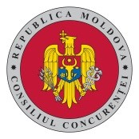

PLENUL 
CONSILIULUI CONCURENŢEI 
 
 
 
Republica Moldova, MD- 2032, Сhişinău, str.Aleco Russo 1 
E-mail: office@competition.md ; www.competition.md 
 
DECIZIE 
mun. Chişinău 
 
din 13.10.2026          
 
 
 
 
 
 
  nr. EMAS - 30              
                                                                     
              
Plenul Consiliului Concurenței,  
acționând în temeiul art. 41 din Legea concurenței nr. 183/2012, art. 10 
alin. (2) lit. b) din Legea cu privire la ajutorul de stat nr. 139/2012, Hotărârii 
Parlamentului privind numirea în funcția de vicepreședinte al Plenului 
Consiliului Concurenței nr. 380/2023, Hotărârii Parlamentului privind numirea 
în funcția de vicepreședinte al Plenului Consiliului Concurenței nr. 210/2024, 
Hotărârii Parlamentului privind numirea în funcția de membru al Plenului 
Consiliului Concurenței nr. 381/2023 și Hotărârii Parlamentului privind numirea 
în funcția de membru al Plenului Consiliului Concurenței nr. 211/2024, 
analizând notificarea simplificată depusă de către Organizația pentru 
Dezvoltarea Antreprenoriatului (în continuare - ODA) cu privire la intenția de 
modificare a schemei de ajutor de stat autorizate prin Decizia Plenului 
Consiliului Concurenței nr. EMAS-07 din 19.02.2026, depusă prin intermediul 
Sistemului informațional automatizat „Registrul ajutoarelor de stat” cu nr. 00026 
din 09.09.2026, materialele anexate și nota examinatorului 
A CONSTATAT: 
I. 
CONTEXTUL MĂSURII DE SPRIJIN 
1. La data de 09.09.2026, în baza art. 8¹ din Legea cu privire la ajutorul de stat 
nr. 139/2012 și a Regulamentului privind forma de notificare, procedura de 
1 
 
 

examinare și adoptare a deciziilor cu privire la ajutorul de stat, aprobat prin 
Hotărârea Plenului Consiliului Concurenței nr. 1/2025, prin Sistemul 
informațional automatizat „Registrul ajutoarelor de stat”, a parvenit 
notificarea simplificată cu nr. 00026, depusă de către ODA privind 
modificarea schemei de ajutor de stat autorizate prin Decizia Plenului 
Consiliului Concurenței nr. EMAS-07 din 19.02.2026, aferent Produsului 
de garantare „IMM GARANT”. 
2. Notificarea are ca obiect solicitarea de autorizare a modificărilor operate în 
cadrul schemei de ajutor de stat autorizate anterior prin Decizia Plenului 
Consiliului Concurenței nr. EMAS-07 din 19.02.2026, ca urmare a 
modificării Produsului de garantare „IMM GARANT”, prin integrarea unei 
priorități destinate finanțării proiectelor de sisteme de stocare a energiei 
electrice în baterii (în continuare - BESS), reglementată prin Anexa nr. 4 
„Condiții specifice aplicabile proiectelor BESS”.  
3. Modificările propuse rezultă din necesitatea adaptării mecanismului existent 
de garantare în vederea facilitării accesului întreprinderilor mici și mijlocii 
la finanțare pentru realizarea proiectelor BESS, în sensul măsurilor stabilite 
la nivel național în domeniul securității energetice. În particular, pct. 5.3 din 
Decizia Consiliului Național de Securitate nr. 01-02-02 din 26.05.2026 
privind securitatea energetică în contextul volatilității globale a piețelor 
energetice prevede elaborarea unui plan de măsuri pentru facilitarea 
instalării capacităților de stocare a energiei electrice, inclusiv prin sisteme 
de tip BESS, cu identificarea instrumentelor de finanțare necesare în 
vederea reducerii vulnerabilității sistemului electroenergetic în orele de vârf 
și a valorificării producției interne din surse regenerabile. 
4. Prin scrisoarea nr. EMAS-07/471-1942 din 15.09.2026, Consiliul 
Concurenței a comunicat ODA că informația este incompletă și urmează a fi 
completată corespunzător. Prin scrisoarea nr. 2146-03/26 din 22.09.2026, 
ODA a transmis informațiile revizuite. 
2 
 
 

5. Notificarea a devenit efectivă la data de 23.09.2026, fapt despre care a fost 
informată ODA prin scrisoarea nr. EMAS-07/499-2015 din 24.09.2026. 
Ulterior, prin scrisoarea nr. 2147-03/26 din 06.10.2026, ODA a transmis 
informații suplimentare, revizuite cu privire la notificarea depusă. 
6. În vederea asigurării transparenței în procesul decizional, în conformitate cu 
art. 18 alin. (1) din Legea cu privire la ajutorul de stat nr. 139/2012, 
comunicatul cu privire la notificarea efectivă a fost plasat pe site-ul web 
oficial al Consiliului Concurenței la data de 24.09.2026, pentru obținerea 
observațiilor și punctelor de vedere. Observații și puncte de vedere nu au 
parvenit. 
II. CADRUL JURIDIC APLICABIL MĂSURII DE SPRIJIN 
2.1   BAZA LEGALĂ PRIVIND ACORDAREA MĂSURII DE SPRIJIN  
➢ Legea nr. 179/2016 cu privire la întreprinderile mici și mijlocii. 
➢ Decizia Consiliului Național de Securitate nr. 01-02-02 din 26.05.2026 
privind securitatea energetică. 
➢ Manualul operațional privind garanțiile financiare individuale (act 
elaborat de ODA). 
➢ Proiectul Produsul de garantare „IMM GARANT” – Produs de 
garantare individuală prin intermediul Fondului de Garantare a 
Creditelor, instituit ca schemă de ajutor de stat în sensul art. 3 din 
Legea nr. 139/2012 privind ajutorul de stat. 
2.2    BAZA LEGALĂ PRIVIND EVALUAREA MĂSURII DE SPRIJIN 
➢ Legea nr. 139/2012 cu privire la ajutorul de stat. 
➢ Hotărârea Plenului Consiliului Concurenței nr. 1/2025 cu privire la 
aprobarea Regulamentului privind forma de notificare, procedura de 
examinare și adoptare a deciziilor cu privire la ajutorul de stat. 
III. BENEFICIARII MĂSURII DE SPRIJIN 
7. Conform Deciziei Plenului Consiliului Concurenței nr. EMAS-07 din 
19.02.2026, beneficiarii măsurii de sprijin sunt întreprinderile mici și 
3 
 
 

mijlocii, care sunt selectați în conformitate cu criteriile de eligibilitate 
stabilite în cadrul Produsului de garantare „IMM GARANT”. 
8. În contextul modificărilor propuse prin proiectul de modificare a Produsului 
de garantare „IMM GARANT”, versiunea 2 din 01.09.2026, pct. 11 
menține criteriile generale de eligibilitate aplicabile beneficiarilor care 
accesează garanțiile acordate în cadrul produsului. 
9. Pentru proiectele care includ componenta BESS, beneficiarii trebuie să 
îndeplinească cumulativ criteriile generale de eligibilitate prevăzute de 
Produsul de garantare „IMM GARANT”, iar proiectele investiționale 
trebuie să corespundă grupei 35.1 „Producția, transportul și distribuția 
energiei electrice” din (CAEM-2), cu respectarea condițiilor specifice 
stabilite în Anexa nr. 4 „Condiții specifice aplicabile proiectelor BESS”.  
IV. DESCRIEREA MĂSURII DE SPRIJIN 
10. Obiectul prezentei notificări simplificate îl constituie modificarea schemei 
de ajutor de stat existente, autorizată anterior prin Decizia Plenului 
Consiliului Concurenței nr. EMAS-07 din 19.02.2026, aferentă Produsului 
de garantare „IMM GARANT”. Modificările propuse vizează: 
✓ majorarea bugetului total al schemei de ajutor de stat autorizate; 
✓ ajustarea criteriilor de aplicare a schemei de ajutor autorizate pentru 
proiectele BESS. 
11. Bugetul total al schemei de ajutor de stat, autorizat prin Decizia nr. EMAS-
07 din 19.02.2026, a constituit 138.2 mil. de lei. 
12. Procedura de modificare a unei scheme de ajutor de stat existente este 
reglementată de art. 81 din Legea cu privire la ajutorul de stat nr. 139/2012, 
care stabilește aplicarea notificării simplificate în cazul anumitor tipuri de 
modificări, precum: 
a) creșterile valorii maxime totale a schemei de ajutor de stat autorizate 
care depășesc 20%; 
4 
 
 

b) prelungirea, cu până la 6 ani, a unei scheme de ajutor existente 
autorizate, cu sau fără o creștere a valorii maxime totale a schemei de 
ajutor de stat; 
c) adoptarea unor criterii mai stricte de aplicare a unei scheme de ajutor 
autorizate, reducerea intensității ajutorului sau reducerea costurilor 
eligibile. 
13. Potrivit prevederilor pct. 20 din Regulamentul privind forma de notificare, 
procedura de examinare și adoptare a deciziilor cu privire la ajutorul de 
stat, aprobat prin Hotărârea Plenului Consiliului Concurenței nr. 
HCC1/2025, procedura de notificare simplificată se aplică dacă 
modificările nu afectează ajutorul de stat, astfel încât acesta să nu prezinte 
semnele unui nou ajutor diferit de cel notificat inițial. 
14. Cu referire la informațiile prezentate de ODA, modificările propuse asupra 
schemei de ajutor de stat, autorizate anterior prin Decizia nr. EMAS-07 din 
19.02.2026, sunt sistematizate în tabelul de mai jos. 
Tabelul 1 
Ajustarea propusă a schemei de ajutor de stat autorizate 
Modificări propuse1 
Elementul analizat 
Prevederile schemei de 
ajutor de stat autorizate 
prin Decizia Plenului 
Consiliului Concurenței nr. 
EMAS-07 din 19.02.2026  
Bugetul total al schemei 
138.2 mil. lei 
Majorarea bugetului cu 128,0 
mil. lei, până la 266,2 mil. lei  
Durata schemei  
până la 31.12.2028 
Se menține durata autorizată. 
Cota maximă de 
Cote de garantare de până la 
Stabilirea unei cote maxime de 
garantare pentru 
80% pentru proiectele cu 
garantare 
de 
50% 
pentru 
valoare adăugată. 
componenta BESS  
componenta BESS. 
 
 
1 Scrisoarea ODA nr.2120-03/26 din 18.09.2026.  
5 
 
 

Refinanțarea creditelor 
Refinanțarea este permisă 
Excluderea 
posibilității 
de 
anterior acordate 
cu alocarea cumulativă a 
garantare 
a 
refinanțării 
unui acces nou la finanțare. 
creditelor anterior acordate. 
Contractul de credit 
- 
Finanțarea componentei BESS 
pentru componenta BESS 
în baza unui contract de credit 
distinct. 
Eligibilitatea 
- 
Limitarea 
eligibilității 
la 
echipamentelor BESS și a 
echipamente 
BESS 
și 
componentelor aferente 
componente 
aferente 
noi, 
neutilizate anterior. 
Cerințe suplimentare 
- 
Introducerea cerințelor tehnice, 
pentru componenta BESS 
documentare, de siguranță, de 
asigurare și de protecție a 
mediului, prevăzute în anexa 
nr. 4 la Produs. 
 
15. Potrivit informațiilor din tabelul 1, noul buget total al schemei de ajutor de 
stat este estimat la 266.2 mil. lei, în urma majorării cu 128 mil. lei față de 
bugetul inițial de 138.2 mil. lei, ceea ce reprezintă o creștere de cca 
92,61%. 
16. Majorarea în cuantumul respectiv, analizată prin prisma condiției art. 8¹ 
alin. (1) lit. a) din Legea nr. 139/2012, depășește pragul de 20% prevăzut 
de norma legală. Prin urmare, condiția de la lit. a) alin. (1) a art. 8¹ din 
Legea nr. 139/2012 privind aplicarea procedurii simplificate de notificare 
este întrunită.  
17. Cu privire la criteriile de aplicare aferente schemei de ajutor de stat, 
conform informațiilor furnizate de ODA prin scrisoarea nr. 2120-03/26 din 
18.09.2026, modificarea Produsului de garantare „IMM GARANT” prin 
integrarea condițiilor specifice pentru proiectele BESS determină instituirea 
unor condiții mai stricte de aplicare a schemei pentru această categorie de 
proiecte. 
6 
 
 

18. În particular, pentru proiectele BESS, cota maximă de garantare este 
stabilită de până la 50%, față de până la 80% în cazul anumitor proiecte cu 
valoare adăugată. Totodată, se exclude posibilitatea garantării prin 
refinanțare a creditelor anterior acordate, iar finanțarea componentei BESS 
urmează a fi realizată în baza unui contract de credit distinct de cele 
aferente celorlalte componente ale proiectului investițional. 
19. De asemenea, pentru proiectele BESS sunt stabilite condiții suplimentare 
privind eligibilitatea investițiilor și modul de realizare a acestora. Astfel, 
sunt eligibile pentru finanțare numai echipamentele BESS și componentele 
aferente acestora care sunt noi și neutilizate anterior, iar accesarea 
mecanismului de garantare este condiționată de respectarea cerințelor 
tehnice, documentare, de siguranță, asigurare și protecție a mediului 
prevăzute în Anexa nr. 4 la Produsul de garantare „IMM GARANT”. 
20. Modificările menționate reprezintă criterii mai stricte de aplicare a schemei 
de ajutor de stat, întrucât reduc nivelul maxim al garanției ce poate fi 
acordată și restrâng condițiile de acces la mecanismul de garantare pentru 
proiectele BESS. Prin urmare, acestea întrunesc condiția prevăzută la art.81 
alin. (1) lit. c) din Legea nr. 139/2012 cu privire la ajutorul de stat. 
21. Având în vedere constatările de mai sus și informațiile prezentate de ODA, 
Consiliul Concurenței constată că modificările notificate se încadrează în 
prevederile art. 8¹ alin. (1) lit. a) și c) din Legea nr. 139/2012 cu privire la 
ajutorul de stat, fiind întrunite condițiile pentru aplicarea procedurii 
simplificate de notificare, conform pct. 20 din Regulamentul privind forma 
de notificare, procedura de examinare și adoptare a deciziilor cu privire la 
ajutorul de stat, aprobat prin Hotărârea Plenului Consiliului Concurenței nr. 
1/2025.  
22. Întrucât ajutorul de stat existent a fost evaluat din perspectiva întrunirii 
cumulative a condițiilor prevăzute la art. 3 din Legea cu privire la ajutorul 
de stat nr. 139/2012, iar compatibilitatea acestuia cu mediul concurențial 
7 
 
 

normal a fost constatată prin Decizia Plenului Consiliului Concurenței nr. 
EMAS-07 din 19.02.2026, prezenta evaluare se limitează la modificările 
notificate ale schemei de ajutor de stat. 
23. În urma examinării modificărilor notificate, s-a constatat că acestea nu 
afectează caracteristicile schemei de ajutor de stat autorizate prin Decizia 
Plenului Consiliului Concurenței nr. EMAS-07 din 19.02.2026 într-o 
măsură care să determine calificarea măsurii drept un ajutor nou. 
 
Reieșind din constatările expuse, în temeiul art. 41 alin. (1) lit. p) din Legea 
concurenței nr.183/2012, art.81 alin. (2) și art. 10 alin. (2) lit. b) din Legea cu 
privire la ajutorul de stat nr.139/2012, Plenul Consiliului Concurenței 
 
DECIDE: 
1. 
A autoriza modificările schemei de ajutor de stat, autorizate prin Decizia 
Plenului Consiliului Concurenței nr. EMAS-07 din 19.02.2026, notificate 
de către Organizația pentru Dezvoltarea Antreprenoriatului în cadrul 
procedurii simplificate, care vizează majorarea bugetului total cu 128 de 
milioane de lei, stabilirea unor condiții mai stricte de refinanțare și de 
eligibilitate pentru proiectele de sisteme de stocare a energiei electrice în 
baterii (BESS), precum și instituirea cerințelor suplimentare conform 
Anexei nr. 4 la Produsul „IMM GARANT”. 
2. 
Organizația pentru Dezvoltarea Antreprenoriatului va transmite anual 
Consiliului Concurenței informații privind ajutorul de stat acordat care face 
obiectul prezentei decizii, în vederea actualizării Registrului ajutoarelor de 
stat, conform art. 19 din Legea cu privire la ajutorul de stat nr. 139/2012. 
3. 
Decizia intră în vigoare la data adoptării și va fi adusă la cunoștința 
Organizației pentru Dezvoltarea Antreprenoriatului. 
4. 
Prezenta decizie poate fi contestată, în termen de 30 de zile calendaristice 
de la primirea acesteia de către părți, la Judecătoria Chișinău, sediul 
8 
 
 

Râșcani, specializat în materie de contencios administrativ (mun. Chișinău, 
str. Kiev, nr. 3). 
5. 
Partea dispozitivă a deciziei va fi publicată în Monitorul Oficial al 
Republicii Moldova. 
 
 
 
Diana LAPTEACRU 
Vicepreşedintă 
 
 
 
 
 
 
 
 
 
 
 
9 
 
 
