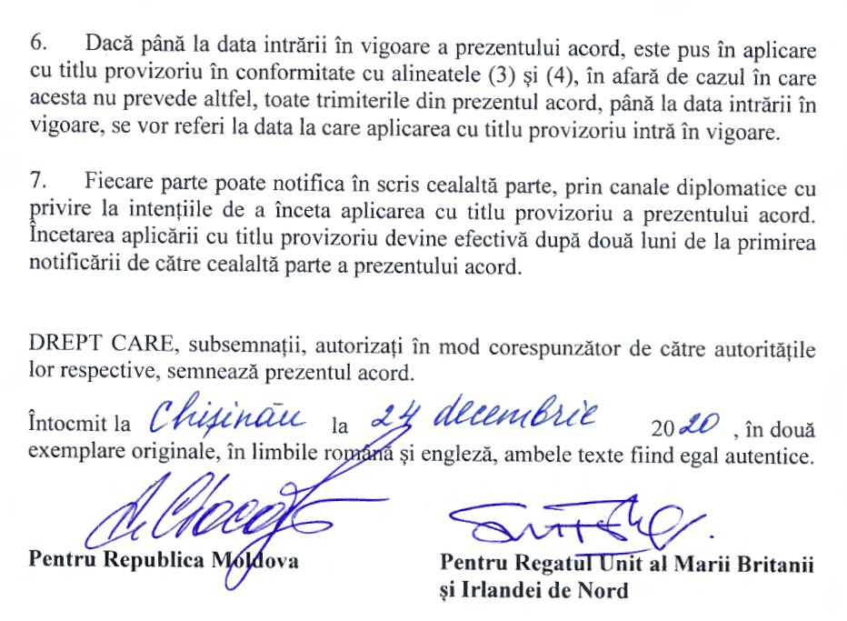

  ACORD DE PARTENERIAT STRATEGIC, COMERȚ ȘI COOPERARE
      ÎNTRE REPUBLICA MOLDOVA ȘI REGATUL UNIT AL MARII
                          BRITANII ȘI IRLANDEI DE NORD

PREAMBUL

REPUBLICA MOLDOVA pe de o parte, și REGATUL UNIT AL MARII
BRITANII ȘI IRLANDEI DE NORD, denumit în continuare „Regatul Unit” sau
„UK” pe de altă parte, în continuare denumite colectiv „Părțile”,

AVÂND ÎN VEDERE valorile comune și legăturile strânse dintre părți, și
recunoscând dorința comună a părților de a-și dezvolta, consolida și de a-și extinde
în continuare relațiile;

RECUNOSCÂND aspirațiile europene și alegerea europeană a Republicii
Moldova;

RECUNOSCÂND valorile comune ale democrației, respectarea drepturilor omului
și a libertăților fundamentale, precum și statul de drept;

ȚINÂND SEAMA de faptul că prezentul acord nu va aduce atingere și va lăsa cale
liberă viitoarelor evoluții progresive în relațiile Republicii Moldova cu Regatul
Unit;

RECUNOSCÂND că Republica Moldova, fiind o țară europeană, împărtășește
valori comune cu Regatul Unit și se angajează să pună în aplicare și să promoveze
aceste valori;

HOTĂRÂTE să consolideze respectarea libertăților fundamentale, a drepturilor
omului, inclusiv a drepturilor persoanelor care aparțin minorităților, principiile
democratice, statul de drept, precum și buna guvernanță,

REAMINTIND în special voința părților de a promova drepturile omului,
democrația și statul de drept, inclusiv prin cooperarea în acest sens în cadrul
Consiliului Europei;

DORIND să contribuie la dezvoltarea politică și socio-economică a Republicii
Moldova, printr-o cooperare extinsă într-o gamă largă de domenii de interes
comun, inclusiv în ceea ce privește buna guvernare, libertatea, securitatea și
justiția, comerţul şi cooperarea economică consolidată, ocuparea forței de muncă și
politici sociale, buna gestiune financiară, reforma administrației publice şi a
serviciului public, participarea societății civile, dezvoltare instituțională, reducerea
sărăciei și dezvoltarea durabilă;

HOTĂRÂTE să respecte toate principiile și dispozițiile prevăzute în Carta
Organizației Națiunilor Unite, în cadrul Organizației pentru Securitate și Cooperare
în Europa (OSCE), în special în Actul final de la Helsinki din 1975 al Conferinței
pentru Securitate și Cooperare în Europa, în concluziile Conferințelor de la Madrid
și de la Viena din 1991 și, respectiv, din 1992, în Carta de la Paris pentru o nouă
Europă din 1990, în Declarația Universală a Drepturilor Omului a Organizației
Națiunilor Unite din 1948 și în Convenția europeană pentru apărarea drepturilor
omului și a libertăților fundamentale din 1950;

REAMINTIND voința părților de a promova pacea și securitatea în lume, precum
și de a se implica într-un multilateralism eficace și în soluționarea pașnică a
conflictelor, în special prin cooperarea în acest sens în cadrul Organizației
Națiunilor Unite (ONU) și al OSCE;

RECUNOSCÂND importanța participării active a Republicii Moldova în diferite
forme de cooperare regională;

DORIND să dezvolte în continuare un dialog politic periodic pe marginea unor
chestiuni bilaterale și internaționale de interes reciproc;

ȚINÂND SEAMA de disponibilitatea Regatului Unit de a sprijini eforturile
internaționale menite să consolideze suveranitatea și integritatea teritorială a
Republicii Moldova și de a contribui la reintegrarea țării;

RECUNOSCÂND importanța angajamentului Republicii Moldova față de o
soluționare viabilă a conflictului transnistrean și a angajamentului Regatului Unit
de a sprijini reabilitarea postconflict a țării;

HOTĂRÂTE să prevină și să combată toate formele de criminalitate organizată,
traficul de ființe umane și corupția, precum și să își intensifice cooperarea în lupta
împotriva terorismului;

HOTĂRÂTE să aprofundeze dialogul și cooperarea părților cu privire la
mobilitate, migrație, azil și gestionarea frontierelor, în scopul cooperării în materie
de migrație legală, inclusiv migrația circulară și combaterea migrației ilegale,
precum și cu privire la readmisia persoanelor aflate în situație de ședere ilegală;

RECUNOSCÂND faptul că Acordul de Asociere între Uniunea Europeană și
Comunitatea Europeană a Energiei Atomice și statele membre ale acestora, pe de o
parte, și Republica Moldova, pe de altă parte, încheiat la Bruxelles pe 27 iunie
2014 („Acordul UE - Moldova”) va înceta să se aplice în ceea ce privește Regatul
Unit la finalul oricărui acord provizoriu în cursul căruia drepturile și obligațiile
prevăzute de aceste Acorduri continuă să se aplice pentru Regatul Unit;

HOTĂRÂTE să respecte principiile economiei de piață și confirmând
disponibilitatea Regatului Unit de a contribui la reformele economice din
Republica Moldova;

HOTĂRÂTE să respecte cerințele în materie de mediu, inclusiv cooperarea
transfrontalieră cu privire la acordurile internaționale multilaterale și punerea în
aplicare a acestora, precum și principiile dezvoltării durabile;

DORIND să realizeze o mai bună cooperare economică, printre altele, prin crearea
unei zone de liber schimb cuprinzător, ca parte integrantă a prezentului acord, ceea
ce va permite liberalizarea accesului la piață cu implicații majore, în conformitate
cu drepturile și obligațiile care decurg din statutul de membre ale Organizației
Mondiale a Comerțului (OMC) al părților și cu aplicarea transparentă a acestor
drepturi și obligații;

CONSIDERÂND că prezentul acord va crea un nou climat favorabil relațiilor
economice între părți și, mai presus de toate, dezvoltării comerțului și a investițiilor
și va stimula concurența, care reprezintă factori esențiali pentru restructurarea și
modernizarea economică;

HOTĂRÂTE să îmbunătățească securitatea aprovizionării cu energie, să faciliteze
dezvoltarea unei infrastructuri adecvate și să promoveze eficiența energetică și
utilizarea surselor regenerabile de energie;

RECUNOSCÂND necesitatea de a îmbunătăți cooperarea în domeniul energiei;

DORIND să îmbunătățească nivelul de siguranță a sănătății publice și de protecție a
sănătății umane ca o condiție prealabilă pentru dezvoltarea durabilă și pentru
creșterea economică;

HOTĂRÂTE să intensifice contactele interpersonale, inclusiv prin cooperare și
schimburi în domeniul cercetării și dezvoltării, al educației și al culturii;

RECUNOSCÂND angajamentul pentru ambele părți de a dezvolta infrastructura
administrativă și instituțională în măsura necesară pentru punerea în aplicare a
prezentului acord,

CONVIN DUPĂ CUM URMEAZĂ:

                                         ARTICOLUL 1

                                            Obiective

1. Se instituie prin prezentul acord parteneriatul strategic între Republica
Moldova, pe de o parte, și Regatul Unit, pe de altă parte.

2. Obiectivele acestui parteneriat sunt:

       (a) să promoveze parteneriatul politic și cooperarea economică între părți,
       pe baza unor valori comune și a unor legături strânse;

(b) să consolideze cadrul pentru un dialog politic consolidat în toate
domeniile de interes reciproc, care să permită dezvoltarea unor relații politice
strânse între părți;

(c) să contribuie la consolidarea democrației și la stabilitatea politică,
economică și instituțională pe baza valorilor noastre comune;

(d) să promoveze, să mențină și să consolideze pacea și stabilitatea în
regiune și în lume, inclusiv prin unirea eforturilor în vederea eliminării
surselor de tensiune, prin îmbunătățirea securității frontierelor, prin
promovarea cooperării transfrontaliere și a bunelor relații de vecinătate;

(e) să sprijine și să intensifice cooperarea în spațiul de libertate, securitate
și justiție, cu scopul de a consolida statul de drept și respectarea drepturilor
omului și a libertăților fundamentale, precum și în ceea ce privește
mobilitatea și contactele interpersonale;

(f) să susțină eforturile Republicii Moldova care vizează dezvoltarea
potențialului său economic prin intermediul unei cooperări internaționale;

(g) să creeze condiții prielnice pentru îmbunătățirea relațiilor economice și
comerciale, inclusiv prin instituirea unei zone de liber schimb cuprinzătoare,
ceea ce va permite liberalizarea accesului la piață cu implicații majore, în
conformitate cu drepturile și obligațiile care decurg din statutul de membre
ale OMC al părților și cu aplicarea transparentă a acestor drepturi și obligații,
precum și

(h) să creeze condiții prielnice pentru o cooperare tot mai strânsă în alte
domenii de interes reciproc.

                                            TITLUL I

                                  PRINCIPII GENERALE

                                         ARTICOLUL 2

1. Respectarea principiilor democratice, a drepturilor omului și a libertăților
fundamentale, astfel cum sunt proclamate în Declarația Universală a Drepturilor
Omului și definite în Convenția europeană pentru apărarea drepturilor omului și a
libertăților fundamentale, în Actul final de la Helsinki din 1975 al Conferinței
pentru Securitate și Cooperare în Europa, precum și în Carta de la Paris pentru o
nouă Europă din 1990, reprezintă baza politicilor interne și externe ale părților și
constituie un element esențial al prezentului acord. Combaterea proliferării armelor
de distrugere în masă, a materialelor conexe și a vectorilor acestora constituie, de
asemenea, un element crucial al prezentului acord.

2. Părțile își reiterează angajamentul față de principiile economiei de piață,
dezvoltarea durabilă și un multilateralism eficace.

3. Părțile își reafirmă respectul față de principiile statului de drept și ale bunei
guvernanțe, precum și obligațiile lor internaționale, în special în cadrul ONU, al
Consiliului Europei și al OSCE.

4. Părțile se angajează să încurajeze cooperarea și bunele relații de vecinătate,
inclusiv cooperarea în domeniul dezvoltării de proiecte de interes comun, îndeosebi
cele legate de prevenirea și combaterea corupției, a activităților criminale,
organizate sau de alt tip, inclusiv cele cu caracter transnațional, și a terorismului.
Acest angajament constituie un factor-cheie în dezvoltarea relațiilor și a cooperării
între părți și contribuie la menținerea păcii și a stabilității în regiune.

                                           TITLUL II

 DIALOGUL POLITIC ȘI REFORMELE, COOPERAREA ÎN DOMENIUL
                     POLITICII EXTERNE ȘI DE SECURITATE

                                         ARTICOLUL 3

                                Obiectivele dialogului politic

1. Dialogul politic în toate domeniile de interes reciproc, inclusiv în ceea ce
privește aspectele externe și de securitate, precum și reformele interne, este
dezvoltat și consolidat în continuare între părți. Acest lucru va antrena creșterea
eficacității cooperării politice și va promova colaborarea în ceea ce privește
aspectele de politică externă și de securitate.

2. Obiectivele dialogului politic sunt:

       (a) aprofundarea parteneriatului politic și sporirea colaborării și a
       eficacității în materie de politică și politică de securitate;

       (b) promovarea stabilității și a securității în lume prin intermediul unui
       multilateralism eficace;

       (c) consolidarea cooperării și a dialogului între părți cu privire la
       securitatea internațională și la gestionarea crizelor îndeosebi pentru a aborda
       problemele și principalele amenințări la nivel mondial și regional;

       (d) stimularea cooperării practice și orientate către rezultate între părți în
       vederea asigurării păcii, a securității și a stabilității pe continentul european;

       (e) consolidarea respectării principiilor democratice, a statului de drept și a
       bunei guvernanțe, a drepturilor omului și a libertăților fundamentale, inclusiv
       a drepturilor persoanelor care aparțin minorităților, precum și contribuirea la
       consolidarea reformelor politice naționale;

       (f) intensificarea dialogului și aprofundarea colaborării între părți în
       domeniul securității și al apărării, precum și

       (g) respectarea și promovarea principiilor suveranității și integrității
       teritoriale, a inviolabilității frontierelor și a independenței.

                                         ARTICOLUL 4

                                        Reforma internă

Părțile cooperează în următoarele domenii:

       (a) dezvoltarea, consolidarea și creșterea stabilității și a eficacității
       instituțiilor democratice și a statului de drept;

       (b) asigurarea respectării drepturilor omului și a libertăților fundamentale;

       (c) realizarea de noi progrese în ceea ce privește reforma sistemului
       judiciar și a legislației, astfel încât să se asigure independența sistemului
       judiciar, să se consolideze capacitatea administrativă a acestuia și să se
       garanteze imparțialitatea și eficacitatea organismelor de asigurare a
       respectării legii;

       (d) continuarea reformei administrației publice și crearea unui corp al
       funcționarilor publici responsabil, eficient, transparent și profesionist, precum
       și

       (e) asigurarea eficacității în lupta împotriva corupției, îndeosebi în vederea
       îmbunătățirii cooperării internaționale privind prevenirea și combaterea
       corupției, precum și a asigurării unei puneri în aplicare eficace a
       instrumentelor juridice internaționale relevante, cum ar fi Convenția
       Organizației Națiunilor Unite împotriva corupției din 2003.

                                         ARTICOLUL 5

1. Republica Moldova poate beneficia de asistență financiară pentru a contribui
la atingerea obiectivelor prezentului acord, dacă este convenit de ambele părți.

2. Asistența financiară vizează diferite forme de asistență și mijloace prin care
aceasta se poate manifesta, inclusiv asistență oferită prin intermediul organizațiilor
multilaterale și regionale.

3. Pentru a utiliza cât mai bine resursele disponibile, părțile vor depune eforturi
pentru a implementa orice asistență în strânsă colaborare și coordonare cu alte țări
donatoare, organizații donatoare și instituții financiare internaționale, în
conformitate cu principiile internaționale privind eficacitatea ajutorului.

4. Părțile vor implementa orice măsură de asistență în conformitate cu
principiile bunei gestiuni financiare și vor colabora pentru protejarea intereselor
financiare ale Republicii Moldova și ale Regatului Unit. Părțile vor lua măsuri
eficiente pentru a preveni și combate frauda, corupția și orice alte activități ilegale,
inclusiv prin asistență administrativă reciprocă și asistență juridică reciprocă în
domeniile vizate de prezentul acord.

5. În situațiile în care autoritățile din Regatul Unit acordă asistență entităților
din sectorul public din Republica Moldova, detaliile privind contribuția Regatului
Unit vor fi stabilite prin acorduri speciale încheiate între părți. Pentru asistența
acordată de Regatul Unit în Republica Moldova, în afara sectorului public al țării
beneficiare, Regatul Unit va informa constant autoritățile din Republica Moldova
cu privire la volumul și obiectivele respectivei cooperări.

                                         ARTICOLUL 6

Guvernul Republicii Moldova va scuti orice asistență financiară nerambursabilă,
asistență tehnică și ajutor umanitar acordat și finanțat de Guvernul Regatului Unit
în temeiul prezentului acord de la plata tuturor taxelor, plăților, impozitelor sau a
oricăror alte costuri, inclusiv TVA.

                                         ARTICOLUL 7

                              Politica externă și de securitate

1. Părțile își intensifică dialogul și colaborarea în domeniul politicii externe și
de securitate și abordează, în special, aspecte privind prevenirea conflictelor și
gestionarea crizelor, stabilitatea regională, dezarmarea, neproliferarea, controlul
armamentului și controlul exporturilor de armament. Colaborarea se bazează pe
valori comune și pe interese reciproce și urmărește creșterea eficacității politicilor,
făcând apel la forurile bilaterale, internaționale și regionale.

2. Părțile își reafirmă angajamentul față de principiile de respectare a
suveranității, a integrității teritoriale, a inviolabilității frontierelor și a
independenței, stabilite în Carta Organizației Națiunilor Unite și în Actul final de la
Helsinki din 1975 al Conferinței pentru Securitate și Cooperare în Europa, precum
și față de promovarea acestor principii în relațiile lor bilaterale și multilaterale.

                                         ARTICOLUL 8

                               Curtea Penală Internațională

1. Părțile reafirmă că cele mai grave infracțiuni care preocupă întreaga
comunitate internațională nu trebuie să rămână nepedepsite și că trebuie să se
asigure urmărirea penală eficace a acestora, prin adoptarea de măsuri la nivel
național și internațional, inclusiv la nivelul Curții Penale Internaționale (CPI).

2. Părțile consideră că înființarea și funcționarea eficace a CPI constituie o
evoluție importantă pentru pacea și justiția internațională. Părțile convin să sprijine
CPI prin punerea în aplicare a Statutului de la Roma al Curții Penale Internaționale
și a instrumentelor sale conexe, ținând seama în mod corespunzător de menținerea
integrității acestuia.

                                         ARTICOLUL 9

                     Prevenirea conflictelor și gestionarea crizelor

Părțile îmbunătățesc cooperarea practică în ceea ce privește prevenirea conflictelor
și gestionarea crizelor.

                                        ARTICOLUL 10

                                    Stabilitatea regională

1. Părțile își intensifică eforturile comune de promovare a stabilității, securității
și dezvoltării democratice în regiune și, în special, colaborează în vederea
soluționării pașnice a conflictelor regionale.

2. Părțile își reiterează angajamentul de a găsi o soluție durabilă a conflictului
transnistrean, respectând pe deplin suveranitatea și integritatea teritorială a
Republicii Moldova în cadrul granițelor sale recunoscute internațional, precum și
de a facilita în comun reabilitarea postconflict. În așteptarea unei soluționări și fără
a aduce atingere formatului de negociere stabilit, conflictul transnistrean va
constitui unul dintre principalele subiecte de pe agenda dialogului politic și a
colaborării dintre părți, precum și în dialogul și colaborarea cu alți actori
internaționali interesați.

3. Aceste eforturi urmăresc principii comune privind menținerea păcii și
securității în lume, stabilite de Carta Organizației Națiunilor Unite, de Actul final
de la Helsinki din 1975 al Conferinței pentru Securitate și Cooperare în Europa și
de alte documente multilaterale relevante.

                                        ARTICOLUL 11

                               Armele de distrugere în masă

1. Părțile consideră că proliferarea armelor de distrugere în masă (ADM) și a
vectorilor acestora, atât către actori statali, cât și către actori nestatali, reprezintă
una dintre cele mai grave amenințări la adresa păcii și stabilității internaționale.
Prin urmare, părțile convin să coopereze și să contribuie la combaterea proliferării
ADM și a vectorilor acestora prin respectarea în totalitate și prin punerea în
aplicare la nivel național a obligațiilor care le revin în temeiul tratatelor și
acordurilor internaționale privind dezarmarea și neproliferarea și a altor obligații
internaționale relevante. Părțile convin că această dispoziție reprezintă un element
esențial al prezentului acord.

2. În plus, părțile convin să coopereze și să contribuie la combaterea proliferării
ADM și a vectorilor acestora prin:

       (a) luarea de măsuri în vederea ratificării tuturor celorlalte instrumente
       internaționale relevante ori a aderării la acestea, după caz, și în vederea
       punerii în aplicare integrale a acestora, precum și

       (b) instituirea unui sistem eficace de control al exporturilor naționale, care
       să controleze atât exporturile, cât și tranzitul bunurilor legate de ADM,
       inclusiv un control al utilizării finale a tehnologiilor cu dublă utilizare legată
       de ADM, și care să prevadă sancțiuni eficace în cazul încălcării controalelor
       exporturilor.

3. Părțile convin ca acest subiect să fie abordat în cadrul dialogului politic
prevăzut de acest Acord.

                                           Articolul 12

 Armele de calibru mic și armamentul ușor și controlul exporturilor de arme
                                         convenționale

1. Părțile recunosc că fabricarea, transferul și circulația ilicită de arme de
calibru mic și armament ușor (SALW), inclusiv muniția aferentă, precum și
acumularea în exces a acestora, gestionarea lor ineficientă, stocurile securizate în
mod necorespunzător și răspândirea necontrolată a acestor arme reprezintă în
continuare o amenințare gravă la adresa păcii și securității internaționale.

2. Părțile convin să respecte și să execute pe deplin obligațiile care le revin în
ceea ce privește combaterea comerțului ilicit cu SALW, inclusiv cu muniția
aferentă, în temeiul acordurilor internaționale în vigoare și al rezoluțiilor
Consiliului de Securitate al ONU, precum și angajamentele care le revin în cadrul
altor instrumente internaționale aplicabile în acest domeniu, cum ar fi Programul de
acțiune al ONU pentru prevenirea, combaterea și eradicarea comerțului ilicit cu

SALW sub toate aspectele sale.

3. Părțile se angajează să coopereze și să asigure coordonarea,
complementaritatea și sinergia eforturilor pe care le depun pentru a combate
comerțul ilicit cu SALW, inclusiv cu muniția aferentă, și distrugerea stocurilor
excesive, la nivel global, regional, subregional și național.

4. Mai mult, părțile convin să își continue colaborarea în domeniul controlului
exporturilor de arme convenționale.

5. Părțile convin ca acest subiect să fie pe agenda dialogului politic prevăzut de
acest acord.

                                        ARTICOLUL 13

      Cooperarea internațională în domeniul luptei împotriva terorismului

1. Părțile convin să colaboreze la nivel bilateral, regional și internațional pentru
a preveni și a combate terorismul în conformitate cu dreptul internațional, cu
rezoluțiile ONU în domeniu, cu standardele internaționale în domeniul drepturilor
omului, cu dreptul refugiaților și cu dreptul umanitar.

2. În acest sens, părțile colaborează în special în vederea aprofundării
consensului internațional privind lupta împotriva terorismului, inclusiv prin
definirea juridică a actelor teroriste și prin inițierea de demersuri în vederea
ajungerii la un acord referitor la Convenția generală privind terorismul
internațional.

3. În cadrul punerii în aplicare integrale a Rezoluției 1373 (2001) a Consiliului
de Securitate al ONU și a altor instrumente ale ONU relevante, precum și a
convențiilor și instrumentelor internaționale aplicabile, părțile fac schimb de
informații cu privire la organizațiile și grupurile teroriste, la activitățile acestora și
la rețelele de sprijin, în conformitate cu dreptul internațional și cu legislația părților.

                                          TITLUL III

                      LIBERTATE, SECURITATE ȘI JUSTIȚIE

                                        ARTICOLUL 14

                                         Statul de drept

1. În cadrul colaborării în spațiul de libertate, securitate și justiție, părțile acordă
o importanță deosebită promovării statului de drept, inclusiv independenței
sistemului judiciar, accesului la justiție și dreptului la un proces echitabil.

2. Părțile colaborează pe deplin cu privire la funcționarea eficace a instituțiilor
în domeniul asigurării respectării legii și al administrării justiției.

3. Respectarea drepturilor omului și a libertăților fundamentale va ghida toate
activitățile de cooperare în domeniul libertății, al securității și al justiției.

                                        ARTICOLUL 15

                          Protecția datelor cu caracter personal

1. Părțile își afirmă angajamentul privind asigurarea unui nivel înalt de protecție
a datelor cu caracter personal și vor depune eforturi în comun pentru a promova
înaltele standarde internaționale.

2. Orice prelucrare a datelor cu caracter personal intră sub incidența
dispozițiilor legale menționate în anexa I la prezentul acord. Transferul de date cu
caracter personal între părți are loc numai dacă acesta este necesar pentru punerea
în aplicare, de către autoritățile competente ale părților, a prezentului acord.

                                        ARTICOLUL 16

      Cooperarea în domeniul migrației, azilului și gestionării frontierelor

1. Părțile reafirmă importanța unei gestionări comune a fluxurilor de migrație
între teritoriile lor, inclusiv migrația legală, protecția internațională, migrația
ilegală, traficul de migranți și traficul de persoane.

2. Cooperarea se bazează pe evaluarea cerințelor specifice, efectuată prin
consultare reciprocă între părți, și este pusă în aplicare în conformitate cu legislația
relevantă a acestora aflată în vigoare. Aceasta se axează, în special, pe:

       (a) cauzele de la baza migrației și consecințele acesteia;

       (b) elaborarea și punerea în aplicare a legislației și a practicilor naționale
       privind protecția internațională, în vederea respectării dispozițiilor Convenției
       de la Geneva privind statutul refugiaților din 1951, a Protocolului privind
       statutul refugiaților din 1967 și a altor instrumente internaționale relevante și
       în vederea asigurării respectării principiului „nereturnării”;

       (c) normele în materie de admisie, drepturile și statutul persoanelor
       admise, tratamentul echitabil și integrarea persoanelor care nu au cetățenia
       statului-gazdă, aflate în situație de ședere legală, precum și educația,
       formarea și măsurile de combatere a rasismului și a xenofobiei;

       (d) instituirea unei politici preventive eficace împotriva migrației ilegale, a
       traficului de migranți și de persoane, inclusiv a unor mijloace de combatere a
       rețelelor de traficanți de migranți și de persoane și de asigurare a protecției
       victimelor acestui tip de trafic;

       (e) promovarea și facilitarea returnării migranților ilegali, precum și

       (f) în domeniul gestionării frontierelor și al securității documentelor,
       cooperarea se axează pe chestiuni privind organizarea, formarea, cele mai
       bune practici și alte măsuri operaționale.

                                        ARTICOLUL 17

                                    Circulația persoanelor

Părțile sunt de acord să inițieze un dialog cu privire la circulația persoanelor în
cadrele naționale care reglementează aceste probleme, prezente sau viitoare, în mod
deosebit cu privire la persoanele cu compentențe deosebite.

                                        ARTICOLUL 18

    Prevenirea și combaterea criminalității organizate, a corupției și a altor
                                        activități ilegale

1. Părțile colaborează în ceea ce privește prevenirea și combaterea tuturor
formelor de activități infracționale și ilegale, organizate sau nu, inclusiv cele cu
caracter transnațional, cum ar fi:

       (a) traficul de migranți și traficul de persoane;

       (b) contrabanda și traficul de bunuri, inclusiv în domeniul armelor de
       calibru mic și al drogurilor ilicite;

       (c) activitățile economice și financiare ilegale, cum ar fi contrafacerea,
       frauda fiscală și fraudele legate de achizițiile publice;

       (d) frauda, precum aceasta este definită în protocolul III din prezentul
       acord, referitoare la proiecte finanțate de către donatori internaționali;

       (e) acte de corupție şi alte acte conexe, atât în sectorul privat, cât și în cel
       public, inclusiv abuz de serviciu sau abuz de putere și traficul de influență;

       (f) frauda şi falsificarea de documente și prezentarea de declarații false,
       precum și

       (g) criminalitatea informatică.

2. Părțile intensifică cooperarea bilaterală, regională și internațională între
organele responsabile cu aplicarea legii, inclusiv consolidarea cooperării cu
autoritățile competente ale Republicii Moldova. Părțile se angajează să pună în
aplicare în mod eficace standardele internaționale relevante și, în special, cele
consacrate în Convenția Organizației Națiunilor Unite împotriva criminalității
transnaționale organizate (UNTOC) din 2000 și cele trei protocoale la aceasta, în
Convenția Organizației Națiunilor Unite împotriva corupției din 2003 și în
instrumentele relevante ale Consiliului Europei privind prevenirea și combaterea
corupției.

                                        ARTICOLUL 19

                            Lupta împotriva drogurilor ilicite

1. În limitele competențelor fiecăreia, părțile cooperează în vederea adoptării
unei abordări echilibrate și integrate cu privire la lupta împotriva drogurilor.
Politicile și acțiunile în acest domeniu au drept obiectiv să consolideze structurile
de combatere a drogurilor ilicite, să reducă oferta, traficul și cererea de droguri
ilicite și să gestioneze consecințele abuzului de droguri asupra sănătății și a
societății, precum și să prevină în mod mai eficace deturnarea precursorilor chimici
utilizați pentru fabricarea ilicită a drogurilor și a substanțelor psihotrope.

2. Părțile convin asupra metodelor de cooperare necesare pentru atingerea
acestor obiective. Acțiunile se întemeiază pe principii stabilite de comun acord, în
conformitate cu convențiile internaționale în domeniu, ținând cont de Declarația
politică din 2009 și planul de acțiune de cooperare internațională privind Strategia
care prezintă o abordare echilibrată și integrată pentru combaterea problemei
mondiale a drogurilor și de documentul final adoptat în cadrul celei de-a 30-a
sesiuni speciale a Adunării Generale din 2016 cu privire la problema mondială a
drogurilor, intitulat „Angajamentul nostru comun în abordarea și combaterea în
mod eficient a problemei globale a drogurilor”.

                                        ARTICOLUL 20

       Prevenirea şi combaterea spălării banilor și finanțării terorismului

1. Părțile colaborează pentru a preveni utilizarea sistemelor lor financiare și a
celor nefinanciare relevante în scopul spălării veniturilor provenite din activități
infracționale, precum și în scopul finanțării terorismului. Această colaborare
cuprinde și recuperarea activelor sau a fondurilor provenite din veniturile obținute
din infracțiuni.

2. Cooperarea în acest domeniu permite realizarea unor schimburi de informații
utile în cadrul legislațiilor respective ale părților și adoptarea de standarde adecvate
pentru combaterea spălării de bani și a finanțării terorismului, echivalente cu cele
adoptate de organismele internaționale relevante care acționează în acest domeniu,
cum ar fi Grupul de Acțiune Financiară Internațională în domeniul spălării de bani
și a Finanțării Terorismului (FATF).

                                        ARTICOLUL 21

                                  Combaterea terorismului

Părțile convin să coopereze în domeniul prevenirii și al suprimării actelor de
terorism, în deplină conformitate cu principiile statului de drept, cu dreptul
internațional în domeniul drepturilor omului, cu dreptul refugiaților și dreptul
umanitar, precum și în conformitate cu Strategia globală a ONU de combatere a
terorismului din 2006 și cu actele cu putere de lege și actele administrative
respective ale părților. Acestea trebuie să procedeze astfel, în special în cadrul
punerii în aplicare depline a Rezoluțiilor 1267 (1999), 1373 (2001), 1540 (2004) și
1904 (2009) ale Consiliului de Securitate al ONU și a altor instrumente ale ONU în
domeniu, precum și a convențiilor și a instrumentelor internaționale aplicabile:

       (a) prin schimbul de informații privind grupările teroriste și rețelele lor de
       sprijin, în conformitate cu reglementările internaționale și naționale;

       (b) prin schimbul de opinii cu privire la tendințele terorismului și la
       mijloacele și metodele de combatere a acestui fenomen, inclusiv în domenii
       tehnice și în domeniul formării, precum și prin schimbul de experiență în
       ceea ce privește prevenirea terorismului, și

       (c) prin schimbul de cele mai bune practici în domeniul protecției
       drepturilor omului în lupta împotriva terorismului.

                                        ARTICOLUL 22

                                     Cooperare judiciară

1. Părțile convin să dezvolte o cooperare judiciară în materie civilă și
comercială în ceea ce privește negocierea, ratificarea și punerea în aplicare a
convențiilor multilaterale privind cooperarea judiciară în materie civilă și, în
special, a convențiilor Conferinței de la Haga de drept internațional privat în
domeniul cooperării judiciare și al litigiilor internaționale, precum și în domeniul
protecției copilului.

2. În ceea ce privește cooperarea judiciară în materie penală, părțile depun
eforturi în vederea intensificării cooperării privind asistența juridică reciprocă.
Aceasta ar include, după caz, aderarea la instrumentele internaționale relevante ale
ONU și ale Consiliului Europei și punerea în aplicare a acestora, precum și o mai
strânsă cooperare cu Eurojust, în cazul în care este posibilă.

                                           TITLUL IV

     COOPERAREA ECONOMICĂ ȘI ALTE TIPURI DE COOPERARE
                                        SECTORIALĂ

                                        CAPITOLUL 1

                      REFORMA ADMINISTRAȚIEI PUBLICE

                                        ARTICOLUL 23

Cooperarea se axează pe dezvoltarea unei administrații publice eficiente și
responsabile în Republica Moldova, cu scopul de a sprijini instituirea statului de
drept, de a garanta faptul că instituțiile de stat funcționează în folosul întregii
populații din Republica Moldova și de a promova dezvoltarea armonioasă a
relațiilor dintre Republica Moldova și partenerii săi. Se acordă o atenție deosebită
modernizării și dezvoltării funcțiilor executive, cu scopul de a oferi servicii de
calitate pentru cetățenii Republicii Moldova.

                                        ARTICOLUL 24

Cooperarea include următoarele domenii:

       (a) dezvoltarea instituțională și funcțională a autorităților publice pentru a
       spori eficiența activității acestora și pentru a asigura un proces de luare a
       deciziilor și de planificare strategică eficient, participativ și transparent;

       (b) modernizarea serviciilor publice, inclusiv introducerea și punerea în
       aplicare a e-guvernanței, în vederea creșterii eficienței furnizării de servicii
       pentru cetățeni și a reducerii costurilor aferente desfășurării de activități
       economice;

       (c) crearea unui corp al funcționarilor publici profesionist, bazat pe
       principiul responsabilității manageriale și pe delegarea eficace a autorității,
       precum și pe recrutarea, formarea, evaluarea și remunerarea efectuate în
       condiții echitabile și transparente;

       (d) gestionarea eficace și profesionistă a resurselor umane și dezvoltarea
       carierei, precum și

       (e) promovarea valorilor etice în rândul funcționarilor publici.

                                     ARTICOLUL 25

Cooperarea vizează toate nivelurile administrației publice, inclusiv administrația
locală.

                                        CAPITOLUL 2

                                      Dialogul economic

                                        ARTICOLUL 26

1. Republica Moldova și Regatul Unit facilitează procesul de reformă
economică, îmbunătățind înțelegerea mecanismelor fundamentale ale economiei
fiecăreia dintre ele. Cooperarea dintre părți are drept scop promovarea unor politici
economice pertinente pentru economiile de piață funcționale, precum și elaborarea
și punerea în aplicare a acestor politici economice.

2. Părțile rămân angajate în vederea menținerii unei economii de piață
funcționale, în conformitate cu principiile directoare ale unor politici fiscale și
macroeconomice solide.

                                        ARTICOLUL 27

În acest scop, părțile convin să coopereze în următoarele domenii:

       (a) schimbul de informații privind politicile macroeconomice și reformele
       structurale, precum și cele privind rezultatele și perspectivele
       macroeconomice și strategiile de dezvoltare economică;

       (b) analiza în comun a aspectelor economice de interes reciproc, inclusiv
       elaborarea unor măsuri de politică economică și a instrumentelor necesare
       pentru punerea în aplicare a acestora, cum ar fi metode de previziuni
       economice și elaborarea de documente strategice privind politicile, în vederea
       consolidării procesului de elaborare a politicilor Republicii Moldova.

       (c) schimbul de expertiză în sfera macroeconomică și macrofinanciară,
       inclusiv în ceea ce privește finanțele publice, evoluția și reglementările
       aferente sectorului financiar, politicile și cadrele monetare și cele privind
       cursul de schimb, asistența financiară externă și statisticile economice.

                                        ARTICOLUL 28

Părțile pot menține un dialog regulat cu privire la aspectele reglementate de
prezentul capitol.

                                        CAPITOLUL 3

     DREPTUL SOCIETĂȚILOR COMERCIALE, CONTABILITATE ȘI
                     AUDIT ȘI GUVERNANȚĂ CORPORATIVĂ

                                        ARTICOLUL 29

1. Recunoscând importanța unui set eficace de norme și practici în domeniul
dreptului societăților comerciale și al guvernanței corporative, precum și în
domeniul contabilității și al auditului, în sensul instituirii unei economii de piață pe
deplin funcționale și al promovării schimburilor comerciale între părți, acestea
convin să coopereze în ceea ce privește:

       (a) protecția acționarilor, a creditorilor și a altor părți interesate;

       (b) introducerea unor standarde internaționale relevante la nivel național și
       dezvoltarea unor sisteme interne necesare în domeniul contabilității și al
       auditului;

       (c) dezvoltarea în continuare a politicii în materie de guvernanță
       corporativă în conformitate cu standardele internaționale, mai ales cu
       Principiile OCDE privind guvernanța corporativă.

                                        ARTICOLUL 30

Părțile urmăresc să facă schimb de informații și de expertiză în ceea ce privește atât
sistemele existente, cât și noile evoluții relevante în aceste domenii. În plus, părțile
pot depune eforturi pentru a îmbunătăți schimbul de informații dintre registrele
comerciale ale Regatului Unit și registrul național al societăților comerciale din
Republica Moldova.

                                        ARTICOLUL 31

Părțile pot menține un dialog regulatcu privire la aspectele reglementate de
prezentul capitol.

                                        CAPITOLUL 4

          OCUPAREA FORȚEI DE MUNCĂ, POLITICA SOCIALĂ ȘI
                                EGALITATEA DE ȘANSE

                                        ARTICOLUL 32

Părțile vor consolida dialogul și cooperarea pentru promovarea Agendei de lucru a
Organizației Internaționale a Muncii (OIM) privind munca decentă, politica
ocupării forței de muncă, sănătății și securității la locul de muncă, dialogul social,
protecția socială, incluziunea socială, egalitatea de gen, antidiscriminarea și
drepturile sociale, contribuind astfel la promovarea unui număr mai mare de locuri
de muncă mai bune, la reducerea sărăciei, la sporirea coeziunii sociale, precum și la
dezvoltarea durabilă și îmbunătățirea calității vieții.

Părțile convin să coopereze în domeniul politicilor sociale.

                                        ARTICOLUL 33

Cooperarea, bazată pe schimbul de informații și de cele mai bune practici, poate
acoperi o serie de aspecte care urmează să fie identificate printre următoarele
domenii:

       (a) reducerea sărăciei și îmbunătățirea coeziunii sociale;

       (b) politica privind ocuparea forței de muncă, al cărei obiectiv este sporirea
       numărului și a calității locurilor de muncă, prin asigurarea unor condiții de
       muncă decente, inclusiv în vederea reducerii economiei informale și a muncii
       nedeclarate;

       (c) promovarea unor măsuri active pe piața forței de muncă și a unor
       servicii de ocupare a forței de muncă eficiente în vederea modernizării
       piețelor forței de muncă și a adaptării la necesitățile acestei pieței;

       (d) încurajarea unor piețe ale forței de muncă și a unor sisteme de
       securitate socială care să integreze persoanele dezavantajate, inclusiv
       persoanele cu handicap și cele care aparțin minorităților;

       (e) gestionarea eficientă a migrației forței de muncă, al cărei obiectiv este
       consolidarea impactului pozitiv al acesteia asupra dezvoltării;

       (f) egalitatea de șanse, care vizează îmbunătățirea egalității de gen și
       asigurarea egalității de șanse între bărbați și femei, precum și prevenirea și
       combaterea discriminărilor de orice tip;

       (g) politica socială, care vizează sporirea nivelului de protecție socială,

       inclusiv în domeniul asistenței sociale și al asigurărilor sociale, precum și
       modernizarea sistemelor de protecție socială în ceea ce privește calitatea,
       accesibilitatea și viabilitatea financiară;

       (h) consolidarea participării partenerilor sociali și promovarea dialogului
       social, inclusiv prin consolidarea capacității tuturor părților interesate,
       precum și

       (i) promovarea sănătății și a siguranței la locul de muncă.

                                        ARTICOLUL 34

Părțile încurajează implicarea tuturor părților interesate relevante, inclusiv a
organizațiilor societății civile și îndeosebi a partenerilor sociali, în ceea ce privește
elaborarea politicilor și reformele din Republica Moldova, precum și cooperarea
dintre părți în temeiul prezentului acord.

                                        ARTICOLUL 35

Părțile vizează îmbunătățirea colaborării privind ocuparea forței de muncă și
politicile sociale în toate forurile și organizațiile relevante de la nivel regional,
multilateral și internațional.

                                        ARTICOLUL 36

Părțile promovează răspunderea și responsabilitatea socială a întreprinderilor și
încurajează practicile comerciale responsabile, cum ar fi cele promovate de
inițiativa Global Compact a ONU și de Declarația tripartită de principii a OIM
privind întreprinderile multinaționale și politica socială.

                                        ARTICOLUL 37

Părțile pot menține un dialog regulat cu privire la aspectele reglementate de
prezentul capitol.

                                        CAPITOLUL 5

                          PROTECȚIA CONSUMATORULUI

                                        ARTICOLUL 38

Părțile cooperează pentru a asigura un nivel înalt de protecție a consumatorului.

                                        ARTICOLUL 39

Pentru a atinge acest obiectiv, cooperarea poate include, după caz:

       (a) promovarea schimbului de informații privind sistemele de protecție a
       consumatorilor, inclusiv legislația în materie de protecție a consumatorilor și
       asigurarea respectării acesteia, siguranța produselor de consum, inclusiv
       supravegherea pieței, sisteme și instrumente de informare a consumatorilor,
       instruirea consumatorilor, abilitarea și despăgubirea acestora, precum și
       contracte de vânzare și de prestări de servicii încheiate între comercianți și
       consumatori;

       (b) promovarea activităților de formare a funcționarilor din administrație și
       a altor reprezentanți ai intereselor consumatorilor, precum și

       (c) încurajarea dezvoltării asociațiilor independente de consumatori,
       inclusiv a organizațiilor neguvernamentale de consumatori (ONG), și a
       contactelor între reprezentanții grupurilor de consumatori, precum și
       colaborarea dintre autorități și ONG-urile care își desfășoară activitatea în
       domeniul protecției consumatorilor.

                                        CAPITOLUL 6

                                          STATISTICI

                                        ARTICOLUL 40

Părțile își dezvoltă și își consolidează cooperarea în materie de statistică,
contribuind prin aceasta la obiectivul pe termen lung de furnizare promptă a unor
date statistice, comparabile la nivel internațional și fiabile. Se estimează că un
sistem statistic național durabil, eficient și independent din punct de vedere
profesional va produce informații relevante pentru cetățenii, întreprinderile și
factorii de decizie din Republica Moldova și din Regatul Unit, permițându-le astfel
să ia decizii în cunoștință de cauză. Sistemul statistic național ar trebui să respecte
principiile fundamentale ale statisticilor oficiale adoptate de ONU, ținând cont de
standarde internaționale și de bune practici, pentru a alinia sistemul statistic
național la normele și standardele internaționale.

                                        ARTICOLUL 41

Cooperarea are drept scop:

       (a) consolidarea în continuare a capacității sistemului statistic național, cu
       accent pe un temei juridic solid, pe producerea de date și de metadate
       adecvate, pe politica în materie de diseminare și pe ușurința în utilizare,
       ținând cont de diversele grupuri de utilizatori, inclusiv de sectorul public și
       de cel privat, de comunitatea academică și de alți utilizatori;

       (b) ajustarea furnizării de date, luând în considerare aplicarea
       metodologiilor internaționale relevante, inclusiv clasificările;

       (c) îmbunătățirea capacității profesionale și de gestionare a personalului
       statistic național pentru a facilita aplicarea standardelor statistice și de a
       contribui la dezvoltarea sistemului statistic al Republicii Moldova;

       (d) schimbul de experiență între părți cu privire la dezvoltarea know-how-
       ului în domeniul statistic, precum și

       (e) promovarea managementului calității totale a ansamblului proceselor
       de producere și de diseminare a statisticilor.

                                        ARTICOLUL 42

Părțile colaborează pe viitor, printre altele, în domenii precum:

       (a) statistici demografice, inclusiv recensăminte, și statistici sociale;

       (b) statistici agricole, inclusiv recensăminte agricole și statistici în materie
       de mediu;

       (c) statistici comerciale, inclusiv registrele întreprinderilor și utilizarea
       surselor administrative în scopuri statistice;

       (d) statistici macroeconomice, inclusiv conturi naționale, statistici de
       comerț exterior și statistici în materie de investiții străine directe;

       (e) statistici în materie de energie, inclusiv bilanțuri;

       (f) statistici regionale, precum și

       (g) activități orizontale, inclusiv clasificări statistice, managementul
       calității, activități de formare, diseminare și utilizarea tehnologiilor moderne
       ale informației.

                                        ARTICOLUL 43

Părțile fac, printre altele, schimb de informații și de experiență și își dezvoltă
cooperarea, ținând seama de experiența deja acumulată în ceea ce privește reforma
sistemului statistic. În procesul de producere a datelor statistice se pune accentul pe
dezvoltarea în continuare a anchetelor prin sondaj și pe utilizarea registrelor
administrative, ținând totodată seama de nevoia de a reduce sarcina de răspuns.
Datele sunt relevante pentru elaborarea și monitorizarea politicilor în domeniile-
cheie ale vieții sociale și economice.

                                        ARTICOLUL 44

Părțile pot menține un dialog regulat cu privire la aspectele reglementate de
prezentul capitol.

                                        CAPITOLUL 7

    GESTIONAREA FINANȚELOR PUBLICE: POLITICA BUGETARĂ,
      CONTROLUL INTERN, INSPECȚIA FINANCIARĂ ȘI AUDITUL
                                            EXTERN

                                        ARTICOLUL 45

Cooperarea în domeniul reglementat de prezentul capitol se concentrează pe
punerea în aplicare a standardelor internaționale, precum și a bunelor practici în
acest domeniu, care vor contribui la dezvoltarea unui sistem modern de gestionare
a finanțelor publice în Republica Moldova, care să fie compatibil cu principiile
internaționale în materie de transparență, responsabilitate, economie, eficiență și
eficacitate.

                                        ARTICOLUL 46

                            Sisteme bugetare și de contabilitate

Părțile cooperează în ceea ce privește:

       (a) îmbunătățirea și sistematizarea documentelor în materie de
       reglementare referitoare la sistemele bugetare, contabile, de trezorerie și de
       raportare, precum și armonizarea acestora pe baza unor standarde
       internaționale;

       (b) dezvoltarea continuă a planificării bugetare multianuale;

       (c) schimbul de informații, de experiență și de bune practici, inclusiv prin
       schimbul de personal și prin acțiuni comune de formare în acest domeniu.

                                        ARTICOLUL 47

               Controlul intern, inspecția financiară și auditul extern

Părțile cooperează, de asemenea, în ceea ce privește:

       (a) îmbunătățirea în continuare a sistemului de control intern (inclusiv
       funcția de audit intern independentă din punct de vedere funcțional) în ceea
       ce privește autoritățile de stat și cele locale prin intermediul armonizării cu
       standardele și metodologiile internaționale general acceptate;

       (b) dezvoltarea unui sistem corespunzător de inspecție financiară, care va
       completa funcția de audit intern, fără a se suprapune însă acesteia, și va
       asigura controlul adecvat al veniturilor și al cheltuielilor publice pe parcursul
       unei perioade de tranziție și ulterior;

       (c) colaborarea eficace între actorii implicați în gestiunea și controlul
       financiar, auditul și inspecția cu actorii responsabili de buget, trezorerie și
       contabilitate pentru a stimula dezvoltarea guvernanței;

       (d) consolidarea competențelor Unității centrale de armonizare pentru
       controlul financiar intern public (CFIP);

       (e) punerea în aplicare a standardelor de audit extern acceptate la nivel
       internațional ale Organizației Internaționale a Instituțiilor Supreme de Audit
       (INTOSAI); precum și

       (f) schimbul de informații, de experiență și de bune practici, printre altele
       și prin schimbul de personal și acțiuni comune de formare în acest domeniu.

                                        ARTICOLUL 48

                          Lupta împotriva fraudei și a corupției

Părțile colaborează, de asemenea, în ceea ce privește:

       (a) schimbul de informații, de experiență și de bune practici;

       (b) îmbunătățirea metodelor de combatere și de prevenire a fraudei și a
       corupției în domeniile reglementate de prezentul capitol, inclusiv cooperarea
       între organismele administrative relevante.

                                        ARTICOLUL 49

Părțile pot menține un dialog regulat cu privire la aspectele reglementate de
prezentul capitol.

                                        CAPITOLUL 8

                                        FISCALITATE

                                        ARTICOLUL 50

Părțile cooperează pentru a consolida buna guvernanță în domeniul fiscal, în
vederea îmbunătățirii în continuare a relațiilor economice, a comerțului, a
investițiilor și a concurenței loiale.

                                        ARTICOLUL 51

1. În ceea ce privește articolul 50 din prezentul acord, părțile recunosc și se
angajează să pună în aplicare principiile bunei guvernanțe în domeniul fiscal, și
anume, principiul transparenței, al schimbului de informații și al concurenței loiale
în domeniul fiscal.

2. Nimic din prezentul acord nu afectează drepturile și obligațiile, în baza
niciunei convenții fiscale a Republicii Moldova și a Regatului Unit. În cazul unei
neconcordanțe între prezentul acord și o astfel de convenție fiscală, convenția
fiscală prevalează în măsura neconcordanței respective.

3. În sensul prezentului articol, „convenție fiscală” înseamnă o convenție pentru
evitarea dublei impuneri sau orice alt acord internațional de impozitare sau
aranjament (inclusiv, pentru evitarea dubiilor, o astfel de convenție, acord sau
aranjament care este încheiat după ce este ratificat prezentul acord sau orice
modificare a unei astfel de convenții, acord sau aranjament).

                                        ARTICOLUL 52

Părțile își dezvoltă și își consolidează colaborarea care urmărește colectarea
eficientă a impozitelor și consolidarea luptei împotriva fraudei fiscale și a evaziunii
fiscale.

                                        ARTICOLUL 53

Părțile își dezvoltă colaborarea în ceea ce privește contracararea și combaterea
fraudei și a contrabandei cu produse supuse accizelor. În acest scop, părțile depun
eforturi să își consolideze colaborarea în context regional.

                                        ARTICOLUL 54

Părțile pot menține un dialog regulat cu privire la aspectele reglementate de
prezentul capitol.

                                        CAPITOLUL 9

                                 SERVICII FINANCIARE

                                        ARTICOLUL 55

Recunoscând importanța unui set eficace de reguli și practici în domeniile
serviciilor financiare pentru a institui o economie de piață pe deplin funcțională și
pentru a promova schimburile comerciale între părți, acestea convin să coopereze
în domeniul serviciilor financiare în conformitate cu următoarele obiective:

       (a) sprijinirea procesului de adaptare a reglementărilor în sectorul
              serviciilor financiare la nevoile unei economii de piață deschise;

       (b) asigurarea unei protecții eficace și adecvate a investitorilor și a altor
              consumatori de servicii financiare;

       (c) asigurarea stabilității și integrității sistemului financiar din Republica
              Moldova în toate elementele sale;

       (d) promovarea cooperării dintre diferiții actori ai sistemului financiar,
              inclusiv autoritățile de reglementare și de control, precum și

       (e) asigurarea supravegherii independente și eficace.

                                        ARTICOLUL 56

1. Părțile încurajează cooperarea dintre autoritățile de reglementare și de control
competente, inclusiv schimbul de informații, împărtășirea experienței privind
piețele financiare și alte măsuri de acest fel.

2. O atenție deosebită se acordă dezvoltării capacității administrative a acestor
autorități, inclusiv prin schimbul de personal și prin acțiuni comune de formare.

                                        ARTICOLUL 57

Părțile pot menține un dialog regulat cu privire la aspectele reglementate de
prezentul capitol.

                                       CAPITOLUL 10

              POLITICA INDUSTRIALĂ ȘI ANTREPRENORIALĂ

                                        ARTICOLUL 58

Părțile își dezvoltă și își consolidează cooperarea privind politica industrială și
antreprenorială, îmbunătățind astfel mediul de afaceri pentru toți operatorii
economici, dar cu un accent deosebit pe întreprinderile mici și mijlocii (IMM-uri).
Cooperarea sporită ar trebui să îmbunătățească cadrul administrativ și de
reglementare atât pentru întreprinderile din Regatul Unit, cât și pentru cele din
Republica Moldova care funcționează în Regatul Unit și în Republica Moldova,
ținând seama de principiile și de practicile recunoscute la nivel internațional în
acest domeniu.

                                        ARTICOLUL 59

În acest scop, părțile cooperează pentru:

       (a) a pune în aplicare strategii destinate dezvoltării IMM-urilor. Această
       cooperare se axează, de asemenea, pe microîntreprinderi, care sunt extrem de
       importante, atât pentru economia Republicii Moldova, cât și pentru cea a
       Regatului Unit;

       (b) a crea condiții-cadru mai bune, prin schimbul de informații și de bune
       practici, contribuind astfel la îmbunătățirea competitivității. Această
       cooperare include gestionarea schimbărilor structurale (restructurarea),
       dezvoltarea parteneriatelor public-privat, aspecte legate de mediu și energie,
       cum ar fi eficiența energetică și o producție mai ecologică;

       (c) a simplifica și a raționaliza reglementările și practicile în materie de
       reglementare, cu un accent specific pe schimbul de bune practici privind
       tehnicile de reglementare;

       (d) a încuraja dezvoltarea politicii în domeniul inovării, prin schimbul de
       informații și de bune practici privind comercializarea în domeniul cercetării
       și al dezvoltării (inclusiv instrumente de sprijin pentru întreprinderile nou-
       înființate bazate pe tehnologie), dezvoltarea de poluri (clustere) și accesul la
       finanțare;

       (e) a încuraja intensificarea contactelor între întreprinderi din Republica
       Moldova și întreprinderi din Regatul Unit și între aceste întreprinderi și
       autoritățile din Republica Moldova și din Regatul Unit;

       (f) a sprijini desfășurarea unor activități în materie de promovare a
       exporturilor în Republica Moldova, precum și

       (g) a facilita modernizarea și restructurarea industriei Republicii Moldova
       în anumite sectoare.

                                        ARTICOLUL 60

Părțile pot menține un dialog regulat cu privire la aspectele reglementate de
prezentul capitol. Aceasta poate atrage, de asemenea, participarea unor
reprezentanți ai întreprinderilor din Republica Moldova și din Regatul Unit.

                                       CAPITOLUL 11

                SECTORUL MINIER ȘI AL MATERIILOR PRIME

                                        ARTICOLUL 61

Părțile pot dezvolta și consolida cooperarea în domeniul industriilor miniere și al
comerțului cu materii prime, având drept obiectiv promovarea înțelegerii reciproce,
îmbunătățirea mediului de afaceri, schimbul de informații și cooperarea privind
aspectele neenergetice, legate în special de extracția minereurilor metalifere și a
mineralelor industriale.

                                        ARTICOLUL 62

În acest scop, părțile pot coopera în următoarele domenii:

       (a) schimbul de informații între părți cu privire la evoluțiile în sectoarele
       lor miniere și ale materiilor prime;

       (b) schimbul de informații cu privire la aspecte legate de comerțul cu
       materii prime, în vederea promovării schimburilor bilaterale;

       (c) schimbul de informații și de cele mai bune practici în ceea ce privește
       aspecte legate de dezvoltarea durabilă a industriilor miniere, precum și

       (d) schimbul de informații și de cele mai bune practici în ceea ce privește
       activitățile de formare, competențele și siguranța în industriile miniere.

                                       CAPITOLUL 12

                    AGICULTURĂ ȘI DEZVOLTARE RURALĂ

                                        ARTICOLUL 63

Părțile colaborează pentru a promova dezvoltarea agricolă și rurală.

                                        ARTICOLUL 64

Cooperarea dintre părți în domeniul agriculturii și al dezvoltării rurale acoperă,
printre altele, următoarele subiecte:

       (a) facilitarea înțelegerii reciproce a politicilor de dezvoltare agricolă și
       rurală;

       (b) consolidarea capacităților administrative la nivel central și local, în
       planificarea, evaluarea și punerea în aplicare a politicilor;

       (c) promovarea modernizării și a caracterului durabil al producției agricole;

       (d) schimbul de cunoștințe și de bune practici referitoare la politici de
       dezvoltare rurală pentru a promova bunăstarea economică a comunităților
       rurale;

       (e) îmbunătățirea competitivității sectorului agricol și a eficienței și a
       transparenței piețelor;

       (f) promovarea unor politici în domeniul calității și a mecanismelor lor de
       control, în special indicațiile geografice și agricultura ecologică;

       (g) diseminarea cunoștințelor către producătorii agricoli și promovarea
       serviciilor de informare publică a acestora, precum și

       (h) consolidarea armonizării aspectelor abordate în cadrul organizațiilor
       internaționale la care părțile sunt membre.

                                        ARTICOLUL 65

Părțile pot menține un dialog regulat cu privire la aspectele reglementate de
prezentul capitol.

                                       CAPITOLUL 13

                       PESCUITUL ȘI POLITICA MARITIMĂ

                                        SECȚIUNEA 1

                              Politica în domeniul pescuitului

                                        ARTICOLUL 66

Părțile își dezvoltă și își consolidează cooperarea privind aspecte referitoare la
guvernanța în domeniul maritim și al pescuitului, dezvoltând astfel o cooperare
bilaterală și multilaterală mai strânsă în sectorul pescuitului. De asemenea, părțile
încurajează o abordare integrată a chestiunilor legate de pescuit și promovează
dezvoltarea durabilă a acestui sector.

                                        ARTICOLUL 67

Părțile întreprind acțiuni comune, fac schimb de informații și își oferă reciproc
sprijin pentru a promova:

       (a) buna guvernanță și cele mai bune practici în gestionarea activităților de
       pescuit pentru a asigura conservarea și gestionarea stocurilor de pește într-un
       mod durabil, pe baza unei abordări ecosistemice;

       (b) pescuitul responsabil și gestionarea pescuitului în conformitate cu
       principiile dezvoltării durabile, astfel încât să se conserve stocurile de pește și
       ecosistemele într-o stare sănătoasă, precum și

       (c) cooperarea prin intermediul unor organizații regionale corespunzătoare,
       responsabile de gestionarea și conservarea resurselor acvatice vii.

                                        ARTICOLUL 68

Părțile acordă sprijin unor inițiative precum schimbul reciproc de experiență și
acordarea de sprijin, pentru a asigura punerea în aplicare a unei politici durabile în
domeniul pescuitului, inclusiv:

       (a) gestionarea resurselor piscicole și de acvacultură;

       (b) inspecția și controlul activităților de pescuit, precum și dezvoltarea de
              structuri administrative și judiciare corespunzătoare, capabile să aplice
              măsuri adecvate;

       (c) colectarea de date privind capturile, debarcările și de date biologice și
              economice;

       (d) îmbunătățirea eficienței piețelor, în special prin promovarea
              organizațiilor de producători, furnizarea de informații către consumatori
              și prin standarde de marketing și trasabilitate, precum și

       (e) dezvoltarea unei politici structurale pentru sectorul pescuitului,
              acordându-se o atenție deosebită dezvoltării durabile a zonelor
              pescărești care sunt definite ca fiind o zonă cu un țărm lacustru ori
              incluzând iazuri sau un estuar și care prezintă un nivel semnificativ de
              ocupare a forței de muncă în sectorul pescuitului.

                                        SECȚIUNEA 2

                                  POLITICA MARITIMĂ

                                        ARTICOLUL 69

Ținând seama de cooperarea în domeniile pescuitului, transporturilor, mediului și
în alte politici aferente domeniului maritim, părțile dezvoltă, de asemenea,
cooperarea și sprijinul reciproc, dacă este cazul, în ceea ce privește aspectele
maritime.

                                        ARTICOLUL 70

Părțile pot menține un dialog regulat cu privire la aspectele reglementate de
prezentul capitol.

                                       CAPITOLUL 14

                   COOPERAREA ÎN SECTORUL ENERGETIC

                                        ARTICOLUL 71

Părțile convin să își continue cooperarea actuală referitoare la aspecte legate de
energie pe baza principiilor de parteneriat, interes reciproc, transparență și
previzibilitate. Colaborarea ar trebui să aibă drept scop eficiența energetică, ținând
seama de necesitatea de a asigura competitivitatea și accesul la energie sigură,
durabilă din punct de vedere ecologic și la prețuri accesibile, inclusiv, în cazul
Republicii Moldova, prin dispozițiile Tratatului de instituire a Comunității
Energiei.

                                        ARTICOLUL 72

Cooperarea include, printre altele, următoarele domenii și obiective:

       (a) strategii și politici în domeniul energiei;

       (b) dezvoltarea unor piețe ale energiei competitive, transparente și
       nediscriminatorii, prin reforme normative și prin participarea la cooperarea
       regională în domeniul energetic;

       (c) dezvoltarea unui climat de investiții atractiv și stabil prin abordarea
       condițiilor instituționale, juridice, fiscale și de alt tip;

       (d) infrastructura energetică, pentru a diversifica sursele și furnizorii de
       energie și rutele de transport în mod eficient din punct de vedere economic și
       ecologic;

       (e) îmbunătățirea și consolidarea stabilității și a securității pe termen lung a
       furnizării și a comerțului cu energie, a tranzitului și a transportului de
       energie, pe o bază reciproc avantajoasă și nediscriminatorie, în conformitate
       cu normele cele internaționale;

       (f) promovarea eficienței energetice și a economiei de energie, printre
       altele în ceea ce privește performanța energetică a clădirilor, precum și
       dezvoltarea și sprijinirea surselor regenerabile de energie în mod economic și
       ecologic;

       (g) reducerea emisiilor de gaze cu efect de seră, inclusiv prin proiecte în
       domeniul eficienței energetice și al energiei din surse regenerabile;

       (h) cooperarea științifică și tehnică și schimbul de informații pentru
       dezvoltarea și îmbunătățirea tehnologiilor în producția, transportul, furnizarea
       și utilizarea finală a energiei, acordându-se o atenție deosebită tehnologiilor

       ecologice și eficiente din punct de vedere energetic, precum și

       (i) colaborarea în sectorul nuclear civil, axată pe un nivel înalt de
       securitate în domeniu, pe utilizarea pașnică a energiei nucleare, cuprinzând
       toate etapele de producție ale combustibilului nuclear, inclusiv producția și
       comercializarea materialelor nucleare, pe aspecte ce țin de siguranța și
       securitatea în domeniul energiei nucleare, precum și de măsuri de prevenire a
       situațiilor de urgență, cât și pe aspecte legate de sănătate și protecția mediului
       și neproliferare. În acest context, cooperarea se axează, de asemenea, și pe
       dezvoltarea unor politici și cadre legale şi regulatorii, în conformitate cu
       principiile și standardele Agenției Internaționale pentru Energie Atomică
       (AIEA).

                                        ARTICOLUL 73

Părțile pot menține un dialog regulat cu privire la aspectele reglementate de
prezentul capitol.

                                       CAPITOLUL 15

                                         TRANSPORT

                                        ARTICOLUL 74

Părțile:

       (a) își extind și își consolidează cooperarea în domeniul transporturilor
       pentru a contribui la dezvoltarea unor sisteme de transport durabile;

       (b) promovează operațiuni de transport eficiente, desfășurate în condiții de
       siguranță și securitate, precum și intermodalitatea și interoperabilitatea
       sistemelor de transport, precum și

       (c) depun eforturi pentru a îmbunătăți principalele legături de transport
       între teritoriile lor, în baza prevederilor acordurilor bilaterale în vigoare sau
       viitoare.

                                        ARTICOLUL 75

Cooperarea include, printre altele, următoarele domenii:

       (a) elaborarea unei politici naționale durabile în domeniul transporturilor
       care să reglementeze toate modurile de transport, în special pentru a asigura
       sisteme de transport eficiente și sigure și pentru a promova integrarea
       considerațiilor din domeniul transporturilor în alte domenii de politică;

       (b) elaborarea unor strategii sectoriale prin prisma politicii naționale în
       domeniul transportului (inclusiv cerințele legale pentru modernizarea
       echipamentului tehnic și a flotelor de transport, în conformitate cu cele mai
       înalte standarde internaționale) rutier, feroviar, pe căi navigabile interioare,
       aerian, precum și a intermodalității, inclusiv a calendarelor și a obiectivelor
       de referință în materie de punere în aplicare, a definirii responsabilităților
       administrative și a planurilor financiare;

       (c) îmbunătățirea politicii în domeniul infrastructurii în vederea unei mai
       bune identificări și evaluări a proiectelor de infrastructură pentru diferitele
       moduri de transport;

       (d) dezvoltarea unor strategii de finanțare care pun accentul pe întreținere,
       pe constrângerile în materie de capacități și pe infrastructurile de legătură
       care lipsesc, precum și activarea și promovarea participării sectorului privat
       la proiecte de transport;

       (e) aderarea la organizațiile și acordurile internaționale relevante în
       domeniul transporturilor, inclusiv la procedurile de asigurare a punerii în
       aplicare riguroase și a respectării eficace a acordurilor și a convențiilor
       internaționale în domeniul transporturilor;

       (f) cooperarea științifică și tehnică și schimbul de informații pentru
       dezvoltarea și îmbunătățirea tehnologiilor în domeniul transportului, cum ar
       fi sistemele inteligente de transport, precum și

       (g) promovarea utilizării sistemelor inteligente de transport și a tehnologiei
       informației în gestionarea și exploatarea tuturor modurilor de transport,
       precum și sprijinirea intermodalității și a cooperării în utilizarea sistemelor
       spațiale și a aplicațiilor comerciale care facilitează transportul.

                                        ARTICOLUL 76

1. Cooperarea vizează, de asemenea, îmbunătățirea circulației călătorilor și
mărfurilor, creșterea fluidității fluxurilor de transport prin eliminarea obstacolelor
administrative, tehnice și de altă natură, îmbunătățirea rețelelor de transport și
modernizarea infrastructurii. Această cooperare include măsuri pentru a facilita
trecerea frontierei.

2. Cooperarea include schimbul de informații și activități comune:

       (a) la nivel regional, îndeosebi luând în considerare și integrând progresele
       realizate în temeiul diverselor acorduri de cooperare regională în domeniul
       transportului;

       (b) la nivel internațional, inclusiv în ceea ce privește organizațiile
       internaționale de transport și acordurile și convențiile internaționale ratificate
       de părți.

                                        ARTICOLUL 77

Părțile pot menține un dialog regulat cu privire la aspectele reglementate de
prezentul capitol.

                                       CAPITOLUL 16

                               MEDIUL ÎNCONJURĂTOR

                                          ARTICOLUL 78

Părțile își dezvoltă și își consolidează colaborarea în chestiuni legate de mediu,
contribuind astfel la obiectivul pe termen lung privind dezvoltarea durabilă și
ecologizarea economiei. Se prevede că protecția sporită a mediului va aduce
beneficii cetățenilor și întreprinderilor din Republica Moldova și din Regatul Unit,
inclusiv prin îmbunătățirea sănătății publice, prin conservarea resurselor naturale,
prin sporirea eficienței economice și ecologice, prin integrarea mediului în alte
domenii de politică, precum și prin utilizarea de tehnologii moderne, mai curate,
care să contribuie la modele de producție mai sustenabile. Cooperarea se desfășoară
ținând seama de interesele părților pe baza egalității și a beneficiilor reciproce,
precum și de interdependența existentă între părți în domeniul protecției mediului și
de acordurile multilaterale în acest domeniu.

                                        ARTICOLUL 79

Cooperarea vizează conservarea, protejarea, îmbunătățirea și reabilitarea calității
mediului, protecția sănătății umane, utilizarea durabilă a resurselor naturale și
promovarea măsurilor la nivel internațional pentru a aborda problemele legate de
mediu la nivel regional sau global, inclusiv în următoarele domenii:

       (a) guvernanța în materie de mediu și aspecte orizontale, inclusiv o
       evaluare a impactului asupra mediului și o evaluare strategică de mediu,
       educația și formarea, răspunderea pentru daune aduse mediului, combaterea
       infracțiunilor împotriva mediului, cooperarea transfrontalieră, accesul la
       informații în materie de mediu, la procesele de luare a deciziilor și la
       procedurile de control administrativ și judiciar eficace;

       (b) calitatea aerului;

       (c) calitatea apei și gestionarea resurselor de apă, inclusiv gestionarea
       riscurilor de inundații, deficitul de apă și seceta;

       (d) gestionarea deșeurilor și a resurselor, precum și transferul deșeurilor;

       (e) protejarea naturii, inclusiv conservarea și protecția diversității biologice
       și peisagistice;

       (f) poluarea industrială și riscurile industriale;

       (g) produsele chimice;

       (h) poluarea fonică;

       (i) protecția solului;

       (j) mediul urban și rural;

       (k) taxele și redevențele de mediu;

       (l) sistemele de monitorizare și de informare în domeniul mediului;

       (m) inspecțiile și asigurarea respectării legii, precum și

       (n) ecoinovarea, inclusiv cele mai bune tehnologii disponibile.

                                        ARTICOLUL 80

Părțile se angajează, printre altele:

       (a) să facă schimb de informații și de experiență;

       (b) să colaboreze cu privire la activități comune de cercetare și un schimb
       de informații privind tehnologii ecologice;

       (c) să colaboreze în gestionarea riscurilor și a accidentelor industriale;

       (d) să pună în aplicare activități comune la nivel regional și internațional,
       inclusiv cu privire la acordurile multilaterale în domeniul mediului ratificate
       de părți, precum și activități comune în cadrul agențiilor competente, după
       caz.
Părțile acordă o atenție deosebită aspectelor transfrontaliere și cooperării regionale.

                                        ARTICOLUL 81

Cooperarea include, după caz, următoarele obiective:

       (a) punerea în aplicare eficace a politicii de mediu, inclusiv proceduri
       privind promovarea integrării mediului în alte domenii de politică;
       promovarea unor măsuri privind economia ecologică și a ecoinovării, precum
       și

       (b) aspecte legate de calitatea aerului; calitatea apei și gestionarea
       resurselor de apă; gestionarea deșeurilor și a resurselor; biodiversitatea și
       protecţia naturii; poluarea industrială, riscurile industriale și produsele
       chimice, poluarea fonică, protecția solului, mediul urban și rural,
       ecoinovarea, în conformitate cu calendarele și obiectivele de referință la care
       ambele părți s-au angajat prin acorduri internaționale.

                                        ARTICOLUL 82
Părțile pot menține un dialog regulat cu privire la aspectele reglementate de
prezentul capitol.

                                       CAPITOLUL 17

                                  POLITICI CLIMATICE

                                        ARTICOLUL 83

Părțile își dezvoltă și își consolidează cooperarea în vederea combaterii
schimbărilor climatice. Cooperarea se desfășoară ținând seama de interesele
părților, pe baza egalității și a beneficiilor reciproce, precum și de interdependența
existentă între angajamentele bilaterale și multilaterale în acest domeniu.

                                        ARTICOLUL 84

Cooperarea încurajează măsuri la nivel național, regional și internațional, inclusiv
în următoarele domenii:

       (a) atenuarea schimbărilor climatice;

       (b) adaptarea la schimbările climatice;

       (c) comercializarea certificatelor de emisii de dioxid de carbon;

       (d) cercetarea, dezvoltarea, demonstrarea, desfășurarea și diseminarea
       tehnologiilor cu emisii reduse de dioxid de carbon, sigure și durabile din
       punctul de vedere al mediului, precum și a tehnologiilor de adaptare la
       schimbările climatice;

       (e) integrarea aspectelor legate de climă în politici sectoriale, precum și

       (f) activități de sensibilizare, educare și formare.

                                        ARTICOLUL 85

Părțile se angajează, printre altele:

       (a) să facă schimb de informații și de experiență;

       (b) să pună în aplicare activități comune de cercetare și un schimb de
       informații privind tehnologii ecologice;

       (c) să pună în aplicare activități comune la nivel regional și internațional,
       inclusiv cu privire la acordurile multilaterale în domeniul mediului ratificate
       de părți, precum și activități comune în cadrul agențiilor competente, după
       caz.

Părțile acordă o atenție deosebită aspectelor transfrontaliere.

                                        ARTICOLUL 86

Cooperarea include, printre altele, dezvoltarea și punerea în aplicare:

       (a) a unei strategii climatice globale și a unui plan de acțiune pentru
       atenuarea pe termen lung a efectelor schimbărilor climatice și pentru
       adaptarea la acestea;

       (b) a evaluărilor privind vulnerabilitatea și adaptarea la schimbările
       climatice;

       (c) a unei strategii naționale de adaptare la schimbările climatice;

       (d) a unei strategii de dezvoltare cu emisii reduse de dioxid de carbon;

       (e) a unor măsuri pe termen lung de reducere a emisiilor de gaze cu efect
       de seră;

       (f) a unor măsuri destinate pregătirii pentru comercializarea certificatelor
       de emisii de dioxid de carbon;

       (g) a unor măsuri destinate promovării transferului de tehnologie pe baza
       unei evaluări a nevoilor în materie de tehnologie;

       (h) măsuri pentru integrarea aspectelor legate de climă în politici sectoriale,
       precum și

       (i) a unor măsuri privind substanțele care afectează stratul de ozon.

                                        ARTICOLUL 87

Părțile pot menține un dialog regulat cu privire la aspectele reglementate de
prezentul capitol.

                                       CAPITOLUL 18

                          SOCIETATEA INFORMAȚIONALĂ

                                        ARTICOLUL 88

Părțile își consolidează colaborarea cu privire la dezvoltarea societății
informaționale în beneficiul cetățenilor și al întreprinderilor prin punerea la
dispoziție la scară largă a tehnologiei informației și comunicațiilor (TIC) și prin
îmbunătățirea calității serviciilor la prețuri rezonabile. Această cooperare ar trebui
să vizeze facilitarea accesului la piețele comunicațiilor electronice, încurajarea
concurenței și a investițiilor în acest sector și promovarea dezvoltării serviciilor
publice online.

                                        ARTICOLUL 89

Cooperarea poate viza următoarele subiecte:

       (a) schimbul de informații și de cele mai bune practici privind punerea în
       aplicare a strategiilor naționale referitoare la societatea informațională,
       inclusiv, printre altele, inițiative care vizează promovarea accesului la rețele
       în bandă largă, îmbunătățirea securității rețelelor și a sistemelor
       informaționale, precum și dezvoltarea serviciilor publice online;

       (b) schimbul de informații, de cele mai bune practici și de experiență
       pentru a promova dezvoltarea unui cadru de reglementare cuprinzător pentru
       comunicațiile electronice, în special pentru a consolida capacitatea
       administrativă a administrației naționale în domeniul tehnologiilor
       informației și comunicațiilor, precum și a autorității independente de
       reglementare, pentru a încuraja o mai bună utilizare a resurselor de spectru și
       pentru a promova interoperabilitatea rețelelor în Republica Moldova și cu
       Regatul Unit.

       (c) încurajarea și promovarea punerii în aplicare a instrumentelor TIC
       pentru o mai bună guvernanță, e-learning și cercetare, servicii publice de
       asistență medicală, digitizarea patrimoniului cultural, dezvoltarea
       conținutului digital și a comerțului electronic, precum și

       (d) îmbunătățirea nivelului de securitate a datelor cu caracter personal și a
       protejării confidențialității în comunicațiile electronice.

                                        ARTICOLUL 90

Părțile promovează colaborarea dintre autoritățile de reglementare ale Republicii
Moldova și autoritățile naționale de reglementare ale Regatului Unit din domeniul
comunicațiilor electronice. Părțile iau în considerare, de asemenea, colaborarea în
alte domenii relevante, inclusiv prin intermediul inițiativelor regionale.

                                        ARTICOLUL 91

Un dialog regulat va avea loc cu privire la aspectele reglementate de prezentul
capitol.

                                       CAPITOLUL 19

                                          TURISMUL

                                        ARTICOLUL 92

Părțile cooperează în domeniul turismului, urmărind consolidarea dezvoltării unui
sector al turismului competitiv și durabil, ca factor generator de creștere și
emancipare economică, de ocupare a forței de muncă și de schimburi externe.

                                        ARTICOLUL 93

Cooperarea la nivel bilateral ar urma să se bazeze pe următoarele principii:

       (a) respectarea integrității și a intereselor comunităților locale, în special în
       zonele rurale;

       (b) importanța patrimoniului cultural, precum și

       (c) interacțiunea pozitivă între turism și protecția mediului.

                                        ARTICOLUL 94

Cooperarea se concentrează pe următoarele aspecte:

       (a) schimbul de informații, de cele mai bune practici, de experiență și
       transferul de know-how, inclusiv în ceea ce privește tehnologiile inovatoare;

       (b) crearea unui parteneriat strategic între interesele publice, private și
       comunitare pentru a asigura dezvoltarea durabilă a turismului;

       (c) promovarea și dezvoltarea produselor și a piețelor de turism, a
       infrastructurii, a resurselor umane și a structurilor instituționale, precum și
       identificarea și eliminarea barierelor din calea serviciilor de călătorie;

       (d) dezvoltarea și punerea în aplicare a unor strategii și politici eficiente,
       inclusiv a aspectelor juridice, administrative și financiare corespunzătoare;

       (e) formarea în domeniul turismului și consolidarea capacităților pentru a
       îmbunătăți standardele serviciilor, precum și

       (f) dezvoltarea și promovarea turismului local.

                                        ARTICOLUL 95

Părțile pot menține un dialog regulat cu privire la aspectele reglementate de
prezentul capitol.

                                     CAPITOLUL 20

                             DEZVOLTAREA REGIONALĂ

                                        ARTICOLUL 96

1. Părțile promovează înțelegerea reciprocă și cooperarea bilaterală în domeniul
politicii regionale, inclusiv metode de formulare și de punere în aplicare a
politicilor regionale, guvernanța și parteneriatul pe mai multe niveluri, cu un accent
deosebit pe dezvoltarea zonelor defavorizate și pe cooperarea teritorială, având ca
obiectiv stabilirea canalelor de comunicare și îmbunătățirea schimburilor de
informații și de experiență între autoritățile naționale, regionale și locale și
societatea civilă;

2. Părțile vor coopera pentru a consolida capacitățile instituționale și
operaţionale ale instituțiilor naționale și regionale în domeniul dezvoltării regionale
și amenajarea teritoriului, printre altele prin:

       (a) îmbunătățirea mecanismului vertical și orizontal de iînteracțiune a
       administrațiilor publice centrale și locale în procesul de dezvoltare și
       implementare a politicilor regionale;

       (b) schimbul de cunoștințe, informații și de bune practici în domeniul
       politicilor de dezvoltare regională pentru a promova bunăstarea economică a
       comunităților locale și dezvoltare uniformă a regiunilor.

                                       CAPITOLUL 21

                                  SĂNĂTATEA PUBLICĂ

                                        ARTICOLUL 97

Părțile convin să își dezvolte cooperarea în domeniul sănătății publice pentru a
ridica nivelul siguranței sănătății publice și al protecției sănătății umane ca o
condiție prealabilă pentru dezvoltare durabilă și creștere economică.

                                        ARTICOLUL 98

Cooperarea vizează, în special, următoarele sectoare:

       (a) consolidarea sistemului de sănătate publică al Republicii Moldova, în
       special prin punerea în aplicare a reformelor în acest sector, prin asigurarea
       asistenței medicale de înaltă calitate și prin îmbunătățirea guvernanței în
       materie de sănătate și a finanțării asistenței medicale;

       (b) supravegherea epidemiologică și controlul bolilor transmisibile, cum ar
       fi HIV/SIDA, hepatita virală și tuberculoza, precum și sporirea capacității de
       pregătire pentru amenințări și urgențe la adresa sănătății publice;

       (c) prevenirea și controlul bolilor netransmisibile, în principal printr-un
       schimb de informații și de bune practici, prin promovarea unui stil de viață
       sănătos, prin abordarea principalilor factori care influențează starea de
       sănătate, cum ar fi alimentația și dependența de droguri, alcool, tutun;

       (d) calitatea și siguranța substanțelor de origine umană;

       (e) informațiile și cunoștințele în materie de sănătate, precum și

       (f) punerea în aplicare deplină și promptă a acordurilor internaționale în
       materie de sănătate, în special a Regulamentelor sanitare internaționale și a
       Convenției-cadru a Organizației Mondiale a Sănătății privind controlul
       tutunului din 2003.

                                       CAPITOLUL 22

                                   PROTECȚIA CIVILĂ

                                        ARTICOLUL 99

Părțile își dezvoltă și își consolidează cooperarea cu privire la dezastrele naturale și
la cele provocate de om. Cooperarea se desfășoară ținând seama de interesele
părților, pe baza egalității și a beneficiilor reciproce, precum și de interdependența
existentă între părți și activitățile multilaterale în domeniul protecției civile.

                                       ARTICOLUL 100

Cooperarea vizează îmbunătățirea prevenirii dezastrelor naturale și a celor
provocate de om, a pregătirii pentru acestea și a reacției față de acestea.

                                       ARTICOLUL 101

Părțile fac, printre altele, schimb de informații și de experiență și pun în aplicare
activități comune la nivel național, regional și internațional. Cooperarea cuprinde
punerea în aplicare a unor acorduri specifice și a unor proceduri administrative în
acest domeniu, încheiate între părți, în conformitate cu procedurile legale ale
fiecărei părți.

                                       ARTICOLUL 102

Cooperarea include, printre altele, următoarele obiective:

       (a) facilitarea asistenței reciproce în situații de urgență;

       (b) schimbul, după caz, de alerte timpurii și de informații actualizate
       privind situațiile de urgență de mare anvergură care afectează Republica
       Moldova sau Regatul Unit, inclusiv cereri și oferte de asistență;

       (c) evaluarea impactului dezastrelor asupra mediului;

       (d) invitarea unor experți pentru a participa la ateliere tehnice și la
       simpozioane specifice privind chestiuni din domeniul protecției civile;

       (e) invitarea, de la caz la caz, a unor observatori la anumite exerciții și
       activități de formare specifice organizate de Republica Moldova și/sau de
       Regatul Unit; precum și

       (f) consolidarea colaborării cu privire la utilizarea cea mai eficace a
       capacităților de protecție civilă disponibile.

                                       ARTICOLUL 103

Părțile pot menține un dialog regulat cu privire la aspectele reglementate de
prezentul capitol.

                                       CAPITOLUL 23

       COOPERAREA ÎN MATERIE DE ÎNVĂȚĂMÂNT, FORMARE,
                       MULTILINGVISM, TINERET ȘI SPORT

                                       ARTICOLUL 104

Părțile cooperează pentru a promova învățarea pe tot parcursul vieții și pentru a
încuraja cooperarea și transparența la toate nivelurile educației și formării, cu un
accent deosebit pe învățământul superior.

                                       ARTICOLUL 105

Această cooperare se concentrează, printre altele, asupra următoarelor domenii:

       (a) promovarea învățării pe tot parcursul vieții, care este esențială pentru
       creșterea economică și ocuparea forței de muncă, permițând cetățenilor să
       participe pe deplin la viața socială;

       (b) modernizarea sistemelor de educație și de formare, îmbunătățirea
       calității, a relevanței și a accesului la acestea;

       (c) promovarea convergenței în învățământul superior, care derivă din
       procesul de la Bologna;

       (d) consolidarea cooperării academice internaționale și participarea la
       programe de cooperare, sporind mobilitatea studenților și a cadrelor
       didactice;

       (e) instituirea unui cadru național al calificărilor pentru a îmbunătăți
       transparența și recunoașterea calificărilor și a competențelor, precum și

       (f) promovarea cooperării în materie de educație și de formare
       profesională.

                                       ARTICOLUL 106

Părțile promovează cooperarea și schimburile în domenii de interes comun, cum ar
fi diversitatea lingvistică și învățarea limbilor străine pe tot parcursul vieții, printr-
un schimb de informații și de cele mai bune practici.

                                       ARTICOLUL 107

Părțile convin să coopereze în domeniul tineretului pentru:

       (a) a întări cooperarea și schimburile în domeniul politicii în materie de
       tineret și al educației nonformale pentru tineri și pentru animatorii socio-
       educativi;

       (b) a facilita participarea activă a tuturor tinerilor la viața socială;

       (c) a susține tinerii și mobilitatea animatorilor socio-educativi ca un mijloc
       menit să promoveze dialogul intercultural și acumularea de cunoștințe,
       aptitudini și competențe în afara sistemelor educaționale formale, inclusiv
       prin intermediul voluntariatului, precum și

       (d) pentru a promova cooperarea între organizațiile de tineret în vederea
       sprijinirii societății civile.

                                       ARTICOLUL 108

Părțile promovează cooperarea în domeniul activităților sportive și fizice prin
intermediul schimbului de informații și de bune practici pentru a susține un stil de
viață sănătos, valorile sociale și educative ale sportului și buna guvernanță în sport
în cadrul societăților din Republica Moldova și din Regatul Unit.

                                       CAPITOLUL 24

 COOPERAREA ÎN DOMENIUL ACTIVITĂȚILOR DE CERCETARE, DE
            DEZVOLTARE TEHNOLOGICĂ ȘI DEMONSTRATIVE

                                       ARTICOLUL 109

Părțile promovează cooperarea în toate domeniile activităților de cercetare
științifică civilă, de dezvoltare tehnologică și demonstrative (CDT), pe baza
interesului reciproc și cu condiția ca drepturile de proprietate intelectuală să fie
protejate în mod adecvat și eficace.

                                       ARTICOLUL 110

Cooperarea în domeniul CDT vizează:

       (a) dialogul politic și schimbul de informații științifice și tehnologice;

       (b) facilitarea accesului corespunzător la programele respective ale părților;

       (c) creșterea capacității de cercetare;

       (d) promovarea proiectelor comune de cercetare în toate domeniile CDT;

       (e) desfășurarea unor activități de formare și a unor programe de mobilitate
       pentru oameni de știință, cercetători și pentru alte categorii de personal din
       domeniul cercetării implicat în activități CDT de către cele două părți;

       (f) facilitarea, în cadrul legislației aplicabile, a liberei circulații a
       lucrătorilor din domeniul cercetării care participă la activitățile reglementate
       de prezentul acord, precum și facilitarea circulației transfrontaliere a
       mărfurilor destinate acestor activități, precum și

       (g) alte forme de cooperare în materie de CDT (inclusiv prin abordări și
       inițiative regionale), pe baza acordului comun al părților.

                                       CAPITOLUL 25

          COOPERAREA ÎN DOMENIUL CULTURII, AL POLITICII
                        AUDIOVIZUALE ȘI AL MASS-MEDIA

                                       ARTICOLUL 111

Părțile promovează cooperarea culturală, în conformitate cu principiile consacrate
în Convenția din 2005 a Organizației Națiunilor Unite pentru Educație, Știință și
Cultură (UNESCO) asupra protecției și promovării diversității expresiilor culturale.
Părțile urmăresc desfășurarea unui dialog politic periodic în domenii de interes
reciproc, inclusiv dezvoltarea industriilor culturale în Republica Moldova și în
Regatul Unit. Cooperarea dintre părți promovează dialogul intercultural, inclusiv
prin participarea sectorului culturii și a societății civile din Regatul Unit și din
Republica Moldova.

                                       ARTICOLUL 112

1. Părțile poartă un dialog periodic și cooperează pentru a promova industria
audiovizualului în Europa și pentru a încuraja coproducția în domeniile
cinematografiei și televiziunii.

2. Cooperarea ar putea include, printre altele, problema formării jurnaliștilor și a
altor profesioniști din domeniul mass-media, precum și sprijinul oferit mass-media,
în vederea consolidării independenței, a profesionalismului și a legăturilor acestora
cu mass-media din Regatul Unit în conformitate cu standardele europene, inclusiv
cu standardele Consiliului Europei și cu Convenția UNESCO din 2005 asupra
protecției și promovării diversității expresiilor culturale.

                                       ARTICOLUL 113

Părțile își concentrează cooperarea în mai multe domenii:

       (a) cooperarea și schimburile culturale, precum și mobilitatea artei și
       artiștilor;

       (b) dialogul intercultural;

       (c) dialogul politic privind politica culturală și cea audiovizuală;

       (d) cooperarea în cadrul forurilor internaționale precum UNESCO și
       Consiliul Europei pentru a dezvolta, printre altele, diversitatea culturală și
       pentru a conserva și a valorifica patrimoniul cultural și istoric, precum și

       (e) cooperarea în domeniul mass-media.

                                       CAPITOLUL 26

                     COOPERAREA CU SOCIETATEA CIVILĂ

                                       ARTICOLUL 114

Părțile stabilesc un dialog cu privire la cooperarea cu societatea civilă, care vizează
următoarele obiective:

       (a) consolidarea contactelor și a schimbului de informații și de experiență
       între toate sectoarele societății civile din Republica Moldova și din Regatul
       Unit;

       (b) asigurarea unei mai bune cunoașteri și înțelegeri a Republicii Moldova,
       inclusiv a istoriei și culturii acestei țări, în interiorul Regatului Unit,
       permițând astfel o mai mare sensibilizare a opiniei publice cu privire la
       oportunitățile și la provocările care pot apărea în relațiile lor viitoare, precum
       și

       (c) asigurarea, în mod reciproc, a unei mai bune cunoașteri și înțelegeri a
       Regatului Unit în Republica Moldova și îndeosebi în rândul organizațiilor
       societății civile din Republica Moldova.

                                       ARTICOLUL 115

Părțile promovează dialogul și colaborarea dintre actorii din cadrul societății civile
ai celor două părți ca parte integrantă a relațiilor dintre Republica Moldova și
Regatul Unit. Obiectivele unui astfel de dialog și ale unei astfel de colabrări sunt
următoarele:

       (a) asigurarea implicării societății civile în relațiile Republica Moldova -
       Regatul Unit, în special în ceea ce privește punerea în aplicare a prezentului
       acord;

       (b) sporirea participării societății civile la procesul de luare a deciziilor,
       îndeosebi prin instituirea unui dialog deschis, transparent și periodic între
       instituțiile publice, asociațiile reprezentative și societatea civilă;

       (c) facilitarea procesului de consolidare a instituțiilor și a organizațiilor
       societății civile prin diverse mijloace, inclusiv prin sprijinirea unor acțiuni de
       promovare, prin crearea de rețele informale și formale, prin vizite și ateliere
       reciproce, îndeosebi în vederea îmbunătățirii cadrului juridic referitor la
       societatea civilă, precum și

       (d) oferirea posibilității reprezentanților societății civile din cele două părți
       de a se familiariza cu procesele de consultare și dialog între partenerii civili și
       sociali ai celeilalte părți, în special în vederea integrării suplimentare a
       societății civile în procesul public de elaborare a politicii din Republica
       Moldova.

                                       ARTICOLUL 116

Părțile pot menține un dialog regulat cu privire la aspectele reglementate de
prezentul capitol.

                                       CAPITOLUL 27

      COOPERAREA ÎN DOMENIUL PROTECȚIEI ȘI PROMOVĂRII
                              DREPTURILOR COPILULUI

                                       ARTICOLUL 117

Părțile convin să coopereze pentru a asigura promovarea drepturilor copilului în
conformitate cu legislația și cu normele internaționale, în special Convenția
Națiunilor Unite din 1989 privind drepturile copilului, ținând cont de prioritățile
identificate în contextul specific al Republicii Moldova, în special pentru
categoriile vulnerabile.

                                       ARTICOLUL 118

Această cooperare cuprinde, în special:

       (a) prevenirea și combaterea tuturor formelor de exploatare (inclusiv
       munca prestată de copii), a abuzurilor, a neglijenței și a violenței împotriva
       copiilor, inclusiv prin dezvoltarea și consolidarea cadrului juridic și
       instituțional necesar, precum și prin intermediul unor campanii de
       sensibilizare a opiniei publice în acest domeniu;

       (b) îmbunătățirea sistemului de identificare și de asistență oferită copiilor
       aflați în situații vulnerabile, inclusiv participarea sporită a copiilor la
       procesele de luare a deciziilor și punerea în aplicare a unor mecanisme
       eficiente menite să soluționeze plângerile individuale formulate de copii;

       (c) schimbul de informații și de cele mai bune practici cu privire la
       reducerea sărăciei în rândul copiilor, inclusiv cu privire la măsuri care să se
       axeze pe politici sociale privind bunăstarea copiilor, precum și măsuri menite
       să promoveze și să faciliteze accesul copiilor la educație;

       (d) punerea în aplicare a unor măsuri vizând promovarea drepturilor
       copilului în cadrul familiei și al instituțiilor, precum și consolidarea
       capacității părinților și a personalului de îngrijire pentru a asigura dezvoltarea
       copilului, precum și

       (e) aderarea la documentele internaționale relevante, ratificarea și punerea
       în aplicare a acestora, inclusiv a celor elaborate în cadrul Organizației
       Națiunilor Unite, al Consiliului Europei și al Conferinței de la Haga privind
       dreptul internațional privat, cu scopul de a promova și de a proteja drepturile
       copiilor în conformitate cu cele mai înalte standarde în acest domeniu.

                                        ARTICOLUL 119

Părțile pot menține un dialog regulat cu privire la aspectele reglementate de
prezentul capitol.

                                             TITLUL V
                  COMERȚ ȘI ASPECTE LEGATE DE COMERȚ

                                        CAPITOLUL 1
TRATAMENTUL NAȚIONAL ȘI ACCESUL PE PIAȚĂ AL MĂRFURILOR

                                        SECȚIUNEA 1
                                   DISPOZIȚII COMUNE

                                       ARTICOLUL 120
                                             Obiectiv

Părțile vor continua să instituie progresiv o zonă de liber schimb, pe parcursul unei
perioade de tranziție de maximum zece ani de la data de 1 septembrie 2014, în
conformitate cu dispozițiile prezentului acord și ale articolului XXIV din Acordul
General pentru Tarife și Comerț 1994 (denumit în continuare „GATT 1994”).

                                       ARTICOLUL 121
                             Obiectul și domeniul de aplicare
1. Dispozițiile prezentului capitol se aplică comerțului cu mărfuri (1) dintre
părți.
2. În sensul prezentului capitol, „originar” înseamnă conform cu regulile de
origine prevăzute în Protocolul I la prezentul acord.

(1) În sensul prezentului acord, „mărfuri” înseamnă produse în sensul GATT 1994, cu excepția
cazului în care prezentul acord prevede altfel.

                                        SECȚIUNEA 2

 ELIMINAREA TAXELOR VAMALE, A REDEVENȚELOR ȘI A ALTOR
                                           IMPUNERI

                                       ARTICOLUL 122

                                   Definiția taxelor vamale

În sensul prezentului capitol, o „taxă vamală” include orice taxă sau impunere de
orice tip, instituită pentru importul sau exportul unei mărfi sau legată de aceasta,
inclusiv orice formă de suprataxă sau impunere suplimentară, instituită sau legată
de un astfel de import sau export. O „taxă vamală” nu include nicio:

       (a) impunere echivalentă unei taxe interne aplicate în conformitate cu
       articolul 129 din prezentul acord;

       (b) taxă impusă în conformitate cu capitolul 2 (Măsuri de apărare
       comercială) de la Titlul V (Comerț și aspecte legate de comerț) din prezentul
       acord; sau

       (c) redevență sau altă impunere aplicată în conformitate cu articolul 128
       din prezentul acord.

                                       ARTICOLUL 123

                                    Încadrarea mărfurilor

Încadrarea mărfurilor care fac obiectul comerțului între părți este stabilită în
conformitate cu Sistemul armonizat de denumire și codificare a mărfurilor din 1983
(„SA”) în nomenclatura tarifară a Republicii Moldova în temeiul SA 2017 și în
nomenclatura tarifară a Regatului Unit în temeiul SA 2017 și în modificările
ulterioare ale respectivelor nomenclaturi.

                                       ARTICOLUL 124

                   Eliminarea taxelor vamale aplicate importurilor

1. Fiecare parte reduce sau elimină taxele vamale aplicate mărfurilor originare
din cealaltă parte, în conformitate cu anexa II la prezentul acord.

2. Pentru fiecare marfă, nivelul de bază al taxelor vamale, căruia urmează să i se
aplice reduceri și eliminări succesive în conformitate cu alineatul (1) din prezentul
articol este cel specificat în anexa II la prezentul acord.

3. Dacă, în orice moment după data intrării în vigoare a prezentului acord, o
parte reduce nivelul taxei vamale aplicabile națiunii celei mai favorizate (denumită
în continuare „CNF”), taxa respectivă se aplică la nivelul de bază în cazul în care și
atâta timp cât aceasta se situează la un nivel inferior nivelului taxei vamale calculat
în conformitate cu anexa II la prezentul acord.

4. După intrarea în vigoare a prezentului acord, părțile pot conveni să analizeze
posibilitatea de a accelera eliminarea taxelor vamale aplicate schimburilor
comerciale între părți și de a lărgi domeniul de aplicare al acestei eliminări. O
decizie a Comisiei pentru dialog politic și strategic, reunite în configurația comerț
prevăzută la articolul 375 alineatul (3) din prezentul acord, privind accelerarea sau
eliminarea unei taxe vamale stabilite pentru o marfă are prioritate asupra oricărui
nivel al taxei sau oricărei categorii în etapa eliminării, stabilite în conformitate cu
anexa II la prezentul acord.

5. În cursul celui de-al treilea an de la intrarea în vigoare a prezentului acord,
părțile evaluează situația, ținând seama de caracteristicile comerțului cu produse
agricole între părți, de sensibilitățile specifice ale acestor produse și de evoluția
politicii agricole a ambelor părți.

6. Părțile examinează, în cadrul Comisiei pentru dialog politic și strategic
reunite în configurația comerț, pe bază de reciprocitate, posibilitățile de a-și acorda
reciproc concesii suplimentare, în vederea îmbunătățirii liberalizării schimburilor
comerciale cu produse agricole, în special celor care fac obiectul contingentelor
tarifare.

                                       ARTICOLUL 125

 Mecanismul de prevenire a eludării contingentelor tarifare pentru produsele
                       agricole și produsele agricole transformate

1. Produsele enumerate în anexa II-C la prezentul acord sunt supuse
mecanismului de prevenire a eludării. Volumul mediu anual al importurilor din
Republica Moldova în Regatul Unit pentru fiecare categorie de produse dintre cele
menționate anterior este prevăzut în anexa II-C la prezentul acord.

2. Atunci când volumul importurilor uneia sau mai multora dintre categoriile de
produse menționate la alineatul (1) din prezentul articol atinge 70 % din volumul
indicat în anexa II-C în orice an dat, de la data de 1 ianuarie a anului respectiv,
Regatul Unit informează Republica Moldova cu privire la volumul importurilor
produsului (produselor) în cauză. În urma acestei informări și în termen de 14 de
zile calendaristice de la data la care volumul importurilor uneia sau mai multora
dintre categoriile de produse menționate la alineatul (1) din prezentul articol atinge
80 % din volumul indicat în anexa II-C la prezentul acord, Republica Moldova
prezintă Regatului Unit o justificare temeinică a creșterii importurilor. Dacă aceste
importuri ating 100 % din volumul indicat în anexa II-C la prezentul acord și în
absența unei justificări temeinice din partea Republicii Moldova, Regatul Unit
poate suspenda temporar tratamentul preferențial aplicat pentru produsele în cauză.

Suspendarea se aplică pentru o perioadă de șase luni și produce efecte de la data
publicării deciziei de suspendare a tratamentului preferențial. La momentul intrării
în vigoare a acestui acord, Regatul Unit va transmite către Republica Moldova
detalii privind mijloacele de publicare folosite de Regatul Unit. Mijloacele de
publicare folosite de Regatul Unit vor putea fi accesate direct, pe cale electronică și
gratuit, prin intermediul unui singur punct de acces la internet.

3. Regatul Unit notifică Republicii Moldova, fără întârzieri nejustificate, toate
suspendările temporare adoptate în temeiul alineatului (2).

4. O suspendare temporară poate fi anulată de Regatul Unit înainte de expirarea
termenului de șase luni de la intrarea sa în vigoare în cazul în care Republica
Moldova furnizează dovezi în cadrul Comisiei pentru dialog politic și strategic,
reunite în configurația comerț prevăzută la articolul 375 alineatul (3) din prezentul
acord, că volumul categoriei respective de produse, importate excedentar față de
volumul menționat în anexa II-C la prezentul acord, este rezultatul unei modificări
a nivelului de producție și a capacității de export a Republicii Moldova pentru
produsul (produsele) în cauză.

5. Anexa II-C la prezentul acord poate fi modificată, iar volumele pot fi
modificate cu acordul comun al Regatului Unit și al Republicii Moldova în cadrul
Comisiei pentru dialog politic și strategic reunit în configurația comerț, la cererea
Republicii Moldova, pentru a reflecta modificările survenite în nivelul de producție
și în capacitatea de export ale Republicii Moldova pentru produsul (produsele) în
cauză.

                                       ARTICOLUL 126

                                            Statu-quo

Niciuna dintre părți nu poate mări nivelul existent al unei taxe vamale sau adopta
noi taxe vamale cu privire la o marfă originară din cealaltă parte. Acest lucru nu
împiedică o parte:

       (a) să majoreze nivelul unei taxe vamale până la nivelul stabilit în anexa I,
       în urma unei reduceri unilaterale sau

       (b) să mențină sau să majoreze nivelul unei taxe vamale, cu autorizația
       Organului de soluționare a litigiilor (OSL) al OMC.

                                       ARTICOLUL 127

                           Taxele vamale aplicate exporturilor

Nicio parte nu adoptă sau nu menține vreo taxă sau vreun impozit, cu excepția
taxelor interne aplicate în conformitate cu articolul 129 din prezentul acord sau în
legătură cu exportul de mărfuri către teritoriul celeilalte părți.

                                       ARTICOLUL 128

                                 Redevențe și alte impuneri

Fiecare parte se asigură, în conformitate cu articolul VIII din GATT 1994 și cu
notele interpretative ale acestuia, că toate redevențele și impunerile de orice natură,
altele decât taxele vamale sau alte măsuri menționate la articolul 124 din prezentul
acord, impuse pentru sau în legătură cu importul sau exportul mărfurilor, se
limitează ca valoare la costul aproximativ al serviciilor oferite și nu reprezintă un
mijloc indirect de protecție pentru mărfurile naționale sau o impozitare a
importurilor sau exporturilor în scopuri fiscale.

                                        SECȚIUNEA 3

                                  MĂSURI NETARIFARE

                                       ARTICOLUL 129

                                      Tratament național

Fiecare parte acordă tratament național mărfurilor celeilalte părți, în conformitate
cu articolul III din GATT 1994, inclusiv cu notele interpretative ale acestuia. În
acest scop, articolul III din GATT 1994 și notele interpretative ale acestuia sunt
integrate în prezentul acord și fac parte integrantă din acesta.

                                       ARTICOLUL 130

                              Restricții la import și la export

Nicio parte nu adoptă și nu menține interdicții sau restricții la importul oricărei
mărfi provenind din cealaltă parte sau la exportul ori vânzarea oricărei mărfi
destinate teritoriului celeilalte părți, cu excepția cazului în care se prevede altfel în
prezentul acord sau în conformitate cu articolul XI din GATT 1994 și cu notele
interpretative ale acestuia. În acest scop, articolul XI din GATT 1994 și notele
interpretative ale acestuia sunt integrate în prezentul acord și fac parte integrantă
din acesta.

                                         SECȚIUNEA 4

            DISPOZIȚII SPECIFICE REFERITOARE LA MĂRFURI

                                       ARTICOLUL 131

                                       Excepții generale

1. Nicio dispoziție din prezentul capitol nu se interpretează ca împiedicând
adoptarea sau asigurarea respectării, de către oricare dintre părți, a unor măsuri în
conformitate cu articolele XX și XXI din GATT 1994, precum și cu oricare dintre
notele interpretative la articolele respective din GATT 1994, care sunt încorporate
în prezentul acord și fac parte integrantă din acesta.

2. Părțile înțeleg că, înainte de a lua orice măsură pentru care este posibil să se
ceară o justificare în temeiul articolului XX literele (i) și (j) din GATT 1994, orice
parte care intenționează să ia o astfel de măsură furnizează celeilalte părți toate
informațiile relevante și încearcă să găsească o soluție reciproc acceptabilă. În
cazul în care nu se ajunge la un acord în termen de 30 de zile de la furnizarea
acestor informații, partea poate aplica măsuri cu privire la marfa în cauză, în
temeiul prezentului alineat. Atunci când împrejurări excepționale și critice necesită
o acțiune imediată și fac imposibilă informarea sau examinarea prealabilă, partea
care intenționează să ia măsuri poate să aplice imediat măsurile asigurătorii
necesare în situația dată și informează imediat cealaltă parte cu privire la acestea.

                                          SECȚIUNEA 5

COOPERAREA ADMINISTRATIVĂ ȘI COORDONAREA CU ALTE ȚĂRI

                                       ARTICOLUL 132

                Dispoziții speciale privind cooperarea administrativă

1. Părțile convin asupra caracterului esențial al cooperării administrative și al
asistenței pentru punerea în aplicare și controlul tratamentului preferențial acordat
în temeiul prezentului capitol și își reafirmă angajamentul de a combate neregulile
și frauda în domeniul vamal și în domeniile conexe.

2. Atunci când una dintre părți a constatat, în sensul prezentului capitol, pe baza
unor informații obiective, lipsa cooperării administrative sau a asistenței și/sau
nereguli sau cazuri de fraudă ale celeilalte părți, partea în cauză poate suspenda
temporar tratamentul preferențial aplicat produsului (produselor) în cauză în
conformitate cu prezentul articol și, în special, procedura prevăzută la alineatul (5).
3. În sensul prezentului articol, lipsa cooperării/asistenței administrative
înseamnă, între altele:

       (a) nerespectarea repetată a obligațiilor de a verifica originea mărfii
       (mărfurilor) în cauză;

       (b) refuzul repetat sau întârzierea nejustificată în a efectua verificări
       ulterioare ale dovezii originii și/sau în a comunica rezultatele acestora;

       (c) refuzul repetat sau întârzierea nejustificată în obținerea autorizației de
       efectuare a inspecțiilor pentru verificarea autenticității documentelor sau a
       acurateței informațiilor relevante pentru acordarea tratamentului preferențial
       respectiv.

4. În sensul prezentului articol, pot fi constatate nereguli sau fraudă, printre
altele, atunci când are loc o creștere rapidă, fără o explicație satisfăcătoare, a
volumului importurilor de mărfuri peste nivelul obișnuit al capacității de producție
și de export a celeilalte părți, corelată cu informații obiective privind nereguli sau
fraudă.

5. Aplicarea unei suspendări temporare are loc în următoarele condiții:

       (a) partea care a constatat, pe baza unor informații obiective, lipsa
       cooperării administrative sau a asistenței și/sau nereguli sau fraudă comunică,
       fără întârzieri nejustificate, constatările sale, împreună cu informațiile
       obiective respective, Comisiei pentru dialog politic și strategic, reunit în
       configurația comerț prevăzută la articolul 375 alineatul (3) din prezentul
       acord, și lansează consultări în cadrul Comisiei respective, pe baza tuturor

       informațiilor relevante și a constatărilor obiective, în vederea găsirii unei
       soluții acceptabile pentru ambele părți;

       (b) în cazul în care părțile au avut consultări în cadrul Comisiei menționate
       anterior, dar nu au convenit asupra unei soluții acceptabile în termen de trei
       luni de la data notificării, partea în cauză poate suspenda temporar
       tratamentul preferențial acordat mărfii sau mărfurilor în cauză. Suspendările
       temporare se notifică fără întârzieri nejustificate Comisiei pentru dialog
       politic și strategic reunite în configurația comerț;

       (c) suspendările temporare efectuate în temeiul prezentului articol se
       limitează la ceea ce este necesar pentru a proteja interesele financiare ale
       părții în cauză. Acestea nu depășesc o perioadă de șase luni, care poate fi
       reînnoită dacă până la data expirării sale nu s-a produs nicio schimbare a
       condițiilor care au condus la suspendarea inițială. Aceste suspendări fac
       obiectul unor consultări periodice în cadrul Comisiei pentru dialog politic și
       strategic, reunite în configurația comerț prevăzută la articolul 375 alineatul
       (3), în special pentru a li se pune capăt de îndată ce condițiile de aplicare a
       acestora încetează să mai existe.

6. Fiecare parte publică toate avizele către importatori referitoare la orice
notificare menționată la alineatul (5) litera (a), orice decizie menționată la alineatul
(5) litera (b), precum și orice prelungire sau încetare menționată la alineatul (5)
litera (c), în conformitate cu procedurile sale interne.

                                       ARTICOLUL 133

                           Gestionarea erorilor administrative

În cazul unei erori comise de către autoritățile competente în gestionarea adecvată a
sistemului preferențial la export și, în special, în aplicarea dispozițiilor prevăzute în
Protocolul I la prezentul acord cu privire la definiția dată noțiunii de
„produse originare” și la metodele de cooperare administrativă, atunci când această
eroare are consecințe în ceea ce privește taxele vamale la import, partea care
suportă aceste consecințe poate solicita Comisiei pentru dialog politic și strategic,
reunite în configurația comerț prevăzută la articolul 375 alineatul (3) al prezentului
acord, să examineze posibilitatea de a adopta toate măsurile care se impun pentru
remedierea situației.

                                       ARTICOLUL 134

                                     Acorduri cu alte țări

1. Prezentul acord nu împiedică menținerea sau instituirea unor uniuni vamale,
a altor zone de liber schimb sau a unor regimuri privind traficul de frontieră, în
măsura în care acestea nu contravin regimului comercial prevăzut de prezentul
acord.

2. Părțile se consultă în cadrul Comisiei pentru dialog politic și strategic, reunite
în configurația comerț prevăzută la articolul 375 alineatul (3), cu privire la
acordurile prin care se instituie uniuni vamale, alte zone de liber schimb sau
regimuri privind traficul de frontieră și, după caz, cu privire la orice alte aspecte
majore legate de politicile lor comerciale cu țările terțe.

                                        CAPITOLUL 2

                       MĂSURI DE APĂRARE COMERCIALĂ

                                        SECȚIUNEA 1

                      MĂSURI DE SALVGARDARE GLOBALE

                                       ARTICOLUL 135

                                      Dispoziții generale

1. Părțile își reafirmă drepturile și obligațiile care le revin în temeiul articolului
XIX din GATT 1994 și al Acordului privind măsurile de salvgardare, cuprins în
anexa 1A la Acordul de instituire a Organizației Mondiale a Comerțului („Acordul
OMC”) („Acordul privind măsurile de salvgardare”), și al articolului 5 din Acordul
privind agricultura, cuprins în anexa 1A la Acordul OMC („Acordul privind
agricultura”).

2. Regulile de origine preferențiale stabilite în capitolul 1 (Tratamentul național
și accesul pe piață al mărfurilor) de la titlul V (Comerț și aspecte legate de comerț)
din prezentul acord nu se aplică prezentei secțiuni.

3. Dispozițiile prezentei secțiuni nu se aplică în cazul capitolului 14
(Soluționarea diferendelor) de la titlul V (Comerț și aspecte legate de comerț) din
prezentul acord.

                                       ARTICOLUL 136

                                         Transparență

1. Partea care inițiază o anchetă de salvgardare notifică celeilalte părți această
măsură, cu condiția ca aceasta din urmă să aibă un interes economic substanțial în
chestiune.

2. Fără a aduce atingere articolului 135 din prezentul acord, la cererea celeilalte
părți, partea care deschide o anchetă de salvgardare și intenționează să aplice
măsuri de salvgardare furnizează imediat o notificare scrisă ad hoc cu toate
informațiile pertinente care conduc la deschiderea unei anchete de salvgardare și la
impunerea unor măsuri de salvgardare, inclusiv, după caz, cu informațiile
referitoare la inițierea unei anchete de salvgardare, la concluziile provizorii și
definitive ale anchetei, și oferă celeilalte părți posibilitatea de a purta consultări.

3. În sensul prezentului articol, se consideră că o parte are un interes economic
substanțial atunci când figurează printre primii cinci furnizori ai produsului
importat în cursul ultimilor trei ani, ca volum sau valoare absolută.

                                       ARTICOLUL 137

                                     Aplicarea măsurilor

1. Atunci când impun măsuri de salvgardare, părțile depun eforturi pentru a le
impune în așa fel încât să afecteze cât mai puțin comerțul lor bilateral.

2. În sensul alineatului (1), dacă una dintre părți consideră că sunt îndeplinite
cerințele legale pentru impunerea unor măsuri de salvgardare definitive și
intenționează să aplice astfel de măsuri, partea respectivă notifică celeilalte părți
acest lucru și îi oferă acesteia posibilitatea desfășurării unor consultări bilaterale.
Dacă nu se ajunge la nici o soluție satisfăcătoare în termen de 30 de zile de la
notificare, partea importatoare poate să adopte măsurile necesare pentru a remedia
problema.

                                        SECȚIUNEA 2

           MĂSURI ANTIDUMPING ȘI MĂSURI COMPENSATORII

                                       ARTICOLUL 138

                                      Dispoziții generale

1. Părțile își reafirmă drepturile și obligațiile care le revin în temeiul articolului
VI din GATT 1994, al Acordului privind punerea în aplicare a articolului VI din
GATT 1994, cuprins în anexa 1A la Acordul OMC (denumit în continuare
„Acordul antidumping”), și al Acordului privind subvențiile și măsurile
compensatorii, cuprins în anexa 1A la Acordul OMC (denumit în continuare
„Acordul SMC”).

2. Regulile de origine preferențiale stabilite în capitolul 1 (Tratamentul național
și accesul pe piață al mărfurilor) de la titlul V (Comerț și aspecte legate de comerț)
din prezentul acord nu se aplică prezentei secțiuni.

3. Dispozițiile prezentei secțiuni nu se aplică în cazul capitolului 14
(Soluționarea diferendelor) de la titlul V (Comerț și aspecte legate de comerț) din
prezentul acord.

                                       ARTICOLUL 139

                                         Transparență

1. Părțile convin că măsurile antidumping și măsurile compensatorii ar trebui
utilizate asigurându-se conformitatea deplină cu cerințele Acordului antidumping
și, respectiv, ale Acordului SMC și ar trebui să se bazeze pe un sistem corect și
transparent.

2. Părțile garantează, imediat după instituirea unor măsuri provizorii și înainte
de luarea unei decizii finale, comunicarea completă și coerentă a tuturor faptelor și
considerațiilor esențiale care stau la baza deciziei de aplicare a măsurilor, fără a
aduce atingere articolului 6 alineatul (5) din Acordul antidumping și articolului 12
alineatul (4) din Acordul SMC. Comunicările se efectuează în scris și acordă
părților interesate timp suficient pentru a-și formula observațiile.

3. Cu condiția să nu întârzie în mod inutil desfășurarea anchetei, fiecărei părți
interesate i se acordă posibilitatea de a fi audiată, cu scopul de a-și exprima punctul
de vedere în cadrul anchetelor în materie de măsuri antidumping sau anti-subvenții.

                                       ARTICOLUL 140

                          Luarea în calcul a intereselor publice

Măsurile antidumping sau compensatorii nu pot fi aplicate de o parte în cazul în
care, pe baza informațiilor disponibile în cursul anchetei, se poate concluziona în
mod clar că aplicarea unor astfel de măsuri nu este în interesul public. Stabilirea
interesului public se bazează pe examinarea tuturor diverselor interese luate în
ansamblu, inclusiv a intereselor întreprinderilor naționale și ale utilizatorilor, ale
consumatorilor și ale importatorilor, în măsura în care aceștia au furnizat informații
relevante autorităților responsabile cu ancheta.

                                       ARTICOLUL 141

                                 Regula taxei celei mai mici

În cazul în care o parte decide să instituie o măsură antidumping sau o măsură
compensatorie provizorie sau definitivă, valoarea taxei respective nu poate să
depășească marja de dumping sau valoarea totală a subvențiilor care fac obiectul
unor măsuri compensatorii, ci trebuie să fie inferioară marjei de dumping sau
valorii totale a subvențiilor care fac obiectul unor măsuri compensatorii, în cazul în
care această taxă mai mică ar fi suficientă pentru a remedia prejudiciul adus
industriei naționale.

                                        SECȚIUNEA 3

                   MĂSURI DE SALVGARDARE BILATERALE

                                       ARTICOLUL 142

                   Aplicarea unei măsuri de salvgardare bilaterale

1. În cazul în care, ca urmare a reducerii sau a eliminării unei taxe vamale în
temeiul prezentului acord, mărfurile provenite de la una dintre părți sunt importate
pe teritoriul celeilalte părți în cantități atât de mari, în termeni absoluți sau relativi,
prin raportarea la producția internă, și în astfel de condiții încât să provoace sau să
riște să provoace un prejudiciu grav industriei interne care produce mărfuri similare
sau aflate în concurență directă, partea importatoare poate adopta măsurile
prevăzute la alineatul (2), în conformitate cu condițiile și procedurile stabilite în
prezenta secțiune.

2. Partea importatoare poate lua o măsură de salvgardare bilaterală care:

       (a) suspendă reducerea suplimentară a nivelului taxei vamale aplicate
       mărfii în cauză prevăzut de prezentul acord sau

       (b) mărește nivelul taxei vamale aplicate mărfii, astfel încât aceasta să nu
       depășească valoarea cea mai mică dintre:

                (i) taxa vamală CNF aplicată mărfii în cauză la data adoptării
                măsurii sau

                (ii) nivelul de bază al taxei vamale, specificat în calendarele din
                anexa II, în temeiul articolului 124 din prezentul acord.

                                       ARTICOLUL 143

                                      Condiții și restricții

1. O parte care inițiază o anchetă în sensul alineatului (2) notifică acest lucru
celeilalte părți în scris și o consultă pe aceasta cât mai curând posibil înainte de
aplicarea unei măsuri de salvgardare bilaterală, astfel încât să analizeze informațiile
rezultate din anchetă și să schimbe opinii cu privire la măsură.

2. O parte nu aplică măsuri de salvgardare bilaterale decât în urma unei anchete
conduse de autoritățile sale competente în conformitate cu articolul 3 și cu articolul
4 alineatul (2) litera (c) din Acordul privind măsurile de salvgardare. În acest scop,
articolul 3 și articolul 4 alineatul (2) litera (c) din Acordul privind măsurile de
salvgardare sunt încorporate în prezentul acord și devin, mutatis mutandis, parte
integrantă a acestuia.

3. Atunci când efectuează ancheta descrisă la alineatul (2) din prezentul articol,
partea respectă cerințele enunțate la articolul 4 alineatul (2) litera (a) din Acordul
privind măsurile de salvgardare. În acest scop, articolul 4 alineatul (2) litera (a) din
Acordul privind măsurile de salvgardare este încorporat în prezentul acord și
devine, mutatis mutandis, parte integrantă a acestuia.

4. Fiecare parte se asigură că autoritățile sale competente finalizează orice
anchetă descrisă la alineatul (2) în termen de un an de la data deschiderii sale.

5. Niciuna dintre părți nu poate aplica o măsură de salvgardare bilaterală:

       (a) decât în măsura în care acest lucru poate fi necesar pentru a preveni sau
       remedia un prejudiciu grav și pentru a facilita adaptarea industriei interne;

       (b) pentru o perioadă de mai mult de doi ani. Cu toate acestea, perioada
       respectivă poate fi prelungită cu cel mult doi ani în cazul în care autoritățile
       competente ale părții importatoare decid, în conformitate cu procedurile
       enunțate în prezentul articol, că măsura continuă să fie necesară pentru a
       preveni sau remedia un prejudiciu grav și pentru a facilita adaptarea industriei
       interne și că există dovezi că industria se adaptează, cu condiția ca perioada
       totală de aplicare a unei măsuri de salvgardare, incluzând perioada de
       aplicare inițială și orice prelungire a acesteia, să nu depășească patru ani;

       (c) după expirarea perioadei de tranziție sau

       (d) cu privire la același produs, în același timp cu o măsură aplicată în
       temeiul articolului XIX din GATT 1994 și al Acordului privind măsurile de
       salvgardare.

6. Atunci când o parte pune capăt unei măsuri de salvgardare bilaterale, nivelul
taxei vamale este nivelul care ar fi fost aplicat, în conformitate cu calendarul
acesteia prevăzut în anexa II la prezentul acord, în cazul în care măsura nu ar fi fost
luată.

                                       ARTICOLUL 144

                                       Măsuri provizorii

În circumstanțe critice în care o întârziere ar antrena un prejudiciu dificil de reparat,
o parte poate aplica o măsură de salvgardare bilaterală cu titlu provizoriu, în urma
unei constatări preliminare a existenței unor dovezi clare că importurile unui
produs provenit din cealaltă parte au crescut ca urmare a reducerii sau a eliminării
unei taxe vamale în temeiul prezentului acord și că aceste importuri produc sau
amenință să producă un prejudiciu grav industriei naționale. Durata oricărei măsuri
provizorii nu poate depăși 200 de zile, timp în care partea trebuie să îndeplinească
cerințele prevăzute la articolul 143 alineatele (2) și (3) din prezentul acord. Partea
rambursează în cel mai scurt timp orice taxă plătită în plus față de nivelul taxei
vamale prevăzut în anexa II la prezentul acord, dacă ancheta menționată la articolul
143 alineatul (2) din prezentul acord nu duce la concluzia că cerințele articolului
142 din prezentul acord au fost îndeplinite. Durata aplicării oricăror măsuri
provizorii este inclusă în perioada prevăzută la articolul 143 alineatul (5) litera (b)
din prezentul acord.

                                       ARTICOLUL 145

                                          Compensații

1. O parte care aplică o măsură de salvgardare bilaterală se consultă cu cealaltă
parte în scopul de a stabili de comun acord o compensație adecvată de liberalizare a
comerțului, sub formă de concesii care să aibă efecte comerciale substanțial
echivalente sau echivalente cu valoarea taxelor suplimentare preconizate să rezulte
din măsura de salvgardare. Partea în cauză oferă posibilitatea unor astfel de
consultări în termen de cel mult 30 de zile de la aplicarea măsurii de salvgardare
bilaterale.

2. Dacă consultările inițiate în temeiul alineatului (1) nu permit părților să
ajungă la un acord privind o compensație adecvată de liberalizare a comerțului în
termen de 30 de zile de la începerea consultărilor, partea ale cărei mărfuri fac
obiectul măsurii de salvgardare poate să suspende aplicarea concesiilor substanțial
echivalente în ceea ce privește partea care aplică măsura de salvgardare.

3. Dreptul de suspendare prevăzut la alineatul (2) nu se exercită în primele 24
de luni de aplicare a măsurii de salvgardare bilaterale, cu condiția ca această
măsură de salvgardare să fie luată în conformitate cu dispozițiile prezentului acord.

                                       ARTICOLUL 146

                                             Definiții

În sensul prezentei secțiuni:

       (a) „prejudiciu grav” și „amenințarea cu producerea unui prejudiciu grav”
       se interpretează în conformitate cu articolul 4 alineatul (1) literele (a) și (b)
       din Acordul privind măsurile de salvgardare. În acest scop, articolul 4
       alineatul (1) literele (a) și (b) din Acordul privind măsurile de salvgardare
       este încorporat în prezentul acord și devine, mutatis mutandis, parte
       integrantă a acestuia și

       (b) „perioadă de tranziție” înseamnă o perioadă de 10 ani de la data de 1
       septembrie 2014.

                                        CAPITOLUL 3

   BARIERE TEHNICE ÎN CALEA COMERȚULUI, STANDARDIZARE,
    METROLOGIE, ACREDITARE ȘI EVALUAREA CONFORMITĂȚII

                                       ARTICOLUL 147

                              Domeniu de aplicare și definiții

1. Prezentul capitol se aplică elaborării, adoptării și aplicării standardelor,
reglementărilor tehnice și procedurilor de evaluare a conformității definite în
Acordul privind barierele tehnice în calea comerțului prevăzut în anexa 1A la
Acordul OMC (denumit în continuare „Acordul BTC”) care poate afecta comerțul
cu mărfuri între părți.

2. Fără a aduce atingere alineatului (1) din prezentul articol, prezentul capitol nu
se aplică măsurilor sanitare și fitosanitare definite în anexa A la Acordul privind
aplicarea măsurilor sanitare și fitosanitare prevăzut în anexa 1A la Acordul OMC
(denumit în continuare „Acordul SPS”) și nici specificațiilor în materie de achiziții
elaborate de autoritățile publice pentru propriile lor nevoi de producție sau de
consum.

3. În sensul prezentului capitol, se aplică definițiile din anexa 1 la Acordul
BTC.

                                       ARTICOLUL 148

                                Reafirmarea Acordului BTC

Părțile își reafirmă drepturile și obligațiile reciproce care le revin în temeiul
Acordului BTC, care este inclus în prezentul acord și face parte integrantă din
acesta.

                                       ARTICOLUL 149

                                      Cooperarea tehnică

1. Părțile își consolidează cooperarea în domeniul standardelor, al
reglementărilor tehnice, al metrologiei, al supravegherii piețelor, al acreditării și al
procedurilor de evaluare a conformității, în vederea îmbunătățirii înțelegerii
reciproce a sistemelor lor și pentru facilitarea accesului pe propriile piețe. În acest
scop, ele pot institui dialoguri în materie de reglementare, atât la nivel orizontal, cât
și la nivel sectorial.

2. În cadrul cooperării lor, părțile urmăresc să identifice, să elaboreze și să
promoveze inițiative de facilitare a comerțului, care pot include următoarele, fără a
se limita la acestea:

       (a) consolidarea cooperării în materie de reglementare prin schimbul de
       date și experiență, precum și prin cooperare științifică și tehnică în vederea
       îmbunătățirii calității reglementărilor tehnice, a standardelor, a supravegherii
       piețelor, a evaluării conformității și a acreditării, precum și în vederea
       utilizării eficiente a resurselor de reglementare;

       (b) promovarea și încurajarea cooperării între organizațiile lor respective,
       publice sau private, cu responsabilități în domeniul metrologiei, al
       standardizării, al supravegherii piețelor, al evaluării conformității și al
       acreditării;

       (c) stimularea dezvoltării unor infrastructuri de calitate pentru
       standardizare, metrologie, acreditare, evaluarea conformității și sistemul de
       supraveghere a piețelor în Republica Moldova;

       (d) promovarea participării Republicii Moldova la lucrările organizațiilor
       europene relevante din Regatul Unit;

       (e) căutarea unor soluții la barierele tehnice care ar putea să apară în calea
       comerțului și

       (f) coordonarea pozițiilor lor în cadrul organizațiilor comerciale și de
       reglementare internaționale, cum ar fi OMC și Comisia Economică pentru
       Europa a Națiunilor Unite (denumită în continuare „CEE-ONU”).

                                       ARTICOLUL 150

            Reglementări tehnice, standarde și evaluarea conformității

În continuarea eforturilor relevante, Republica Moldova:

       (a) efectuează reformele administrative și instituționale care sunt necesare
       pentru a asigura sistemul eficient și transparent necesar pentru punerea în
       aplicare a prezentului capitol; și

       (b) se asigură că organismele sale naționale relevante participă în cadrul
       organizațiilor europene și internaționale în materie de standardizare,
       metrologie legală și fundamentală și evaluare a conformității, inclusiv în
       materie de acreditare, în conformitate cu domeniile respective de activitate
       ale acestor organisme și cu statutul lor de membru în cadrul organizațiilor
       respective.

                                       ARTICOLUL 151

 Acordul privind evaluarea conformității și acceptarea produselor industriale
                                              (ECA)

Părțile convin, în ultimă instanță, să adauge un Acord privind evaluarea
conformității și acceptarea produselor industriale (Acord privind ECA) ca protocol
la prezentul acord, acesta urmând să acopere sectoarele convenite de părți.

                                       ARTICOLUL 152

                                     Marcare și etichetare

1. Fără a aduce atingere dispozițiilor articolelor 150 și 151 din prezentul acord,
în ceea ce privește reglementările tehnice legate de cerințele de etichetare și de
marcare, părțile reafirmă principiile enunțate în capitolul 2.2 din Acordul BTC,
conform cărora aceste cerințe nu sunt elaborate, adoptate sau aplicate cu scopul sau
cu rezultatul de a crea obstacole inutile în calea comerțului internațional. În acest
scop, aceste cerințe de etichetare sau de marcare nu restrâng comerțul mai mult
decât este necesar în vederea atingerii unui obiectiv legitim, ținând seama de
riscurile pe care le-ar antrena neîndeplinirea acestor cerințe.

2. În ceea ce privește în special marcarea sau etichetarea obligatorie, părțile
convin:

       (a) să depună eforturi în scopul de a reduce, la minimum necesitățile în
       materie de marcare sau de etichetare, cu excepția cazului în care acest lucru
       este necesar pentru protejarea sănătății, a securității sau a mediului ori pentru
       alte scopuri de politică publică rezonabile și

       (b) să își păstreze dreptul de a impune obligația ca informațiile care
       figurează pe etichete sau marcaje să fie redactate într-o anumită limbă.

                                        CAPITOLUL 4

                      MĂSURI SANITARE ȘI FITOSANITARE

                                       ARTICOLUL 153

                                             Obiectiv

1. Obiectivul prezentului capitol este de a facilita comerțul cu mărfurile care fac
obiectul măsurilor sanitare și fitosanitare (măsuri SPS) aplicate de părți, protejând
totodată viața și sănătatea oamenilor, a animalelor și a plantelor prin următoarele
măsuri:

       (a) asigurarea unei transparențe totale cu privire la măsurile aplicabile
       comerțului, astfel cum sunt enumerate în anexa III la prezentul acord;

       (b) recunoașterea stării de sănătate a plantelor și a animalelor de pe
       teritoriul părților și aplicarea principiului regionalizării;

       (c) instituirea unui mecanism de recunoaștere a echivalenței măsurilor,
       menținut de o parte și enumerat în anexa III la prezentul acord;

       (d) continuarea punerii în aplicare a Acordului SPS;

       (e) instituirea de mecanisme și proceduri pentru facilitarea comerțului și

       (f) îmbunătățirea comunicării și a cooperării între părți cu privire la
       măsurile enumerate în anexa III la prezentul acord.

2. Scopul prezentului capitol este ca părțile să ajungă la o înțelegere comună în
ceea ce privește standardele de bunăstare a animalelor.

                                       ARTICOLUL 154

                                    Obligații multilaterale

Părțile își reafirmă drepturile și obligațiile care le revin în temeiul acordurilor
OMC, în special în temeiul Acordului SPS.

                                       ARTICOLUL 155

                                     Domeniu de aplicare

Prezentul capitol se aplică tuturor măsurilor sanitare și fitosanitare ale unei părți,
care pot să aibă, direct sau indirect, un impact asupra schimburilor comerciale între
părți, inclusiv asupra măsurilor enumerate în anexa III la prezentul acord.

                                       ARTICOLUL 156

                                             Definiții

În sensul prezentului capitol, se aplică următoarele definiții:

       1. „măsuri sanitare și fitosanitare” (măsuri SPS) înseamnă măsuri, astfel
       cum sunt definite la punctul 1 din anexa A la Acordul SPS;

       2. „animale” înseamnă animale, astfel cum sunt definite în Codul sanitar
       pentru animale terestre sau în Codul sanitar pentru animale acvatice al
       Organizației Mondiale pentru Sănătatea Animalelor (denumită în continuare
       „OIE”);

       3. „produse de origine animală” înseamnă produse de origine animală,
       inclusiv produse obținute din animale acvatice, astfel cum sunt definite în
       Codul sanitar pentru animale acvatice al OIE;

       4. „subproduse de origine animală nedestinate consumului uman”
       înseamnă produsele de origine animală enumerate în partea 2 (II) a anexei
       III-A la prezentul acord;

       5. „plante” înseamnă plante vii și anumite părți vii ale acestora, inclusiv
       semințele:

              (a) fructe, din punct de vedere botanic, altele decât cele conservate
                     prin congelare;

              (b) legume, altele decât cele conservate prin congelare;

              (c) tuberculi, cormi, bulbi, rizomi;

              (d) flori tăiate;

              (e) ramuri cu frunze;

              (f) copaci tăiați care își păstrează foliajul;

              (g) culturi de țesuturi de plante;

              (h) frunze, foliaj;

              (i) polen viu și

              (j) scutișor, butaș, altoi.

6. „produse vegetale” înseamnă produse de origine vegetală,
netransformate sau care au fost supuse unui proces de preparare simplu, în
măsura în care nu sunt plante, prevăzute în partea 3 a anexei III-A la
prezentul acord;

7. „semințe” înseamnă semințe din punct de vedere botanic, destinate
plantării;

8. „dăunători” sau „organisme dăunătoare” înseamnă orice specie, sușă
sau biotip aparținând regnului vegetal sau animal sau orice agent patogen cu
acțiune nocivă asupra plantelor sau a produselor vegetale;

9. „boală a animalelor” înseamnă o manifestare clinică sau patologică a
unei infecții la animale;

10. „boală în sectorul acvaculturii” înseamnă o infecție cu sau fără
manifestări clinice, legată de prezența unuia sau a mai multor agenți
etiologici ai bolilor, menționați în Codul sanitar pentru animale acvatice al
OIE;

11. „infecție la animale” desemnează situația în care animalele sunt expuse
unui agent infecțios cu sau fără manifestările clinice sau patologice ale unei
infecții;

12. „standarde de bunăstare a animalelor” înseamnă standarde pentru
protecția animalelor elaborate și aplicate de către părți și, după caz, conforme
cu standardele OIE;

13. „nivel corespunzător” al protecției sanitare și fitosanitare desemnează
nivelul corespunzător al protecției sanitare și fitosanitare, definit la punctul 5
din anexa A la Acordul SPS;

14. „regiune” înseamnă, cu privire la sănătatea animală, o zonă sau o
regiune, astfel cum este definită în Codul sanitar pentru animale terestre al
OIE, iar în ceea ce privește acvacultura, o zonă astfel cum este definită în
Codul sanitar pentru animale acvatice al OIE;

15. „zonă indemnă de dăunători” înseamnă o zonă în care un anumit
dăunător nu este prezent, în lumina dovezilor științifice, și în care, după caz,
această situație este oficial menținută;

16. „regionalizare” desemnează conceptul de regionalizare descris la
articolul 6 din Acordul SPS;

17. „transport” înseamnă un număr de animale vii sau o cantitate de
produse de origine animală de același tip, descrise în același certificat sau
document, trimise cu același mijloc de transport, transportate de un singur
transportator și provenind de la aceeași parte exportatoare sau din aceeași
regiune/aceleași regiuni ale părții respective. Un transport de animale poate fi
compus dintr-unul sau mai multe loturi; un transport de produse de origine
animală poate fi compus dintr-unul sau mai multe mărfuri sau loturi;

18. „transport de plante sau produse vegetale” înseamnă o cantitate de
plante, produse vegetale și/sau alte articole mutate de pe teritoriul unei părți
pe teritoriul celeilalte părți și care fac obiectul, atunci când este necesar, unui
singur certificat fitosanitar. Un transport poate să conțină mai multe mărfuri
sau loturi;

19. „lot” înseamnă un ansamblu de unități din aceeași marfă, identificabil
datorită omogenității compoziției și originii sale, și care face parte dintr-un
transport;

20. „echivalență în scopuri comerciale” („echivalență”) desemnează
situația în care partea importatoare acceptă măsurile părții exportatoare
enumerate în anexa III la prezentul acord ca fiind echivalente, chiar dacă
aceste măsuri diferă de propriile ei măsuri, dacă partea exportatoare
demonstrează în mod obiectiv părții importatoare că măsurile sale asigură
nivelul corespunzător de protecție sanitară și fitosanitară sau nivelul
acceptabil de risc al părții importatoare;

21. „sector” înseamnă structura de producție și de comerț pentru un produs
sau o categorie de produse aparținând unei părți;

22. „subsector” înseamnă o parte bine definită și controlată a unui sector;

23. „marfă” înseamnă produsele sau obiectele transportate în scopuri
comerciale, inclusiv cele menționate la punctele 2-7;

24. „autorizație de import specifică” înseamnă o autorizație prealabilă
oficială, acordată de autoritățile competente ale părții importatoare, adresată
unui importator, care constituie o condiție pentru importul unui singur
transport sau al mai multor transporturi ale unei mărfi de la partea
exportatoare, în sensul prezentului capitol;

25. „zile lucrătoare” înseamnă zilele săptămânii, cu excepția zilelor de
duminică, sâmbătă și a sărbătorilor publice ale uneia dintre părți;

26. „inspecție” înseamnă examinarea oricărui aspect al hranei pentru
animale, al produselor alimentare, al sănătății animale și al bunăstării
animalelor, pentru a verifica dacă acest(e) aspect(e) respectă cerințele legale
ale legislației în domeniul alimentar și normele de sănătate animală și de
bunăstare a animalelor;

       27. „inspecție fitosanitară” înseamnă un examen vizual oficial al plantelor,
       al produselor vegetale și al altor obiecte reglementate pentru a se stabili dacă
       există dăunători și/sau a se constata respectarea reglementărilor în domeniul
       fitosanitar;

       28. „verificare” înseamnă controlul îndeplinirii cerințelor specifice
       indicate, prin examinarea și analizarea probelor obiective.

                                       ARTICOLUL 157

                                   Autoritățile competente

Părțile se informează reciproc cu privire la structura, organizarea și împărțirea
competențelor autorităților lor competente în cadrul primei reuniuni a
Subcomitetului pentru măsuri sanitare și fitosanitare (denumit în continuare
„Subcomitetul SPS”) menționat la articolul 167 din prezentul acord. Părțile se
informează reciproc cu privire la orice schimbare a structurii, a organizării și a
împărțirii competențelor, inclusiv a punctelor de contact, referitoare la autoritățile
competente respective.

                                       ARTICOLUL 158

  Recunoașterea, în scopuri comerciale, a stării de sănătate a animalelor și a
               situației dăunătorilor, precum și a condițiilor regionale

Recunoașterea situației bolilor animalelor, a infecțiilor la animale sau la dăunători

1. În ceea ce privește bolile animalelor și infecțiile la animale (inclusiv
zoonoza), se aplică următoarele dispoziții:

       (a) partea importatoare recunoaște, în scopuri comerciale, starea de
       sănătate a animalelor părții exportatoare sau a regiunilor acesteia, stabilită în
       conformitate cu partea A din anexa V la prezentul acord, în ceea ce privește
       bolile animalelor menționate în anexa IV-A la prezentul acord;

       (b) în cazul în care o parte consideră că pe teritoriul său sau într-o regiune a
       sa există o situație specială în ceea ce privește o anumită boală a animalelor,
       alta decât cele menționate în anexa IV-A la prezentul acord, aceasta poate
       solicita recunoașterea acestei situații în conformitate cu procedura prevăzută
       în anexa V partea C la prezentul acord. Partea importatoare poate să solicite
       garanții cu privire la importurile de animale vii și de produse de origine
       animală, adecvate pentru situația convenită a părților.

       (c) Părțile recunosc ca bază pentru schimburile comerciale dintre ele
       situația constatată pe teritoriile sau în regiunile lor sau situația dintr-un sector
       sau subsector al părților legată de prevalența sau incidența unei boli a
       animalelor, alta decât cele menționate în anexa IV-A la prezentul acord, sau
       legată de infecții la animale și/sau riscurile aferente, după caz, astfel cum au
       fost stabilite de OIE. Partea importatoare poate să solicite garanții cu privire
       la importurile de animale vii și de produse de origine animală, adecvate
       pentru situația definită, în conformitate cu recomandările OIE și

       (d) fără a aduce atingere articolelor 160, 162 și 166 din prezentul acord și
       cu excepția cazului în care partea importatoare ridică o obiecție explicită și
       solicită informații justificative sau suplimentare, consultații și/sau verificări,
       fiecare parte adoptă, fără întârzieri nejustificate, măsurile legislative și
       administrative necesare pentru a permite desfășurarea schimburilor
       comerciale pe baza dispozițiilor de la literele (a), (b) și (c) din prezentul
       alineat.

2. În ceea ce privește dăunătorii, se aplică următoarele dispoziții:

       (a) părțile recunosc, în scopuri comerciale, situația dăunătorilor în ceea ce
       privește dăunătorii menționați în anexa IV-B la prezentul acord, astfel cum
       este stabilită în anexa V, partea B la prezentul acord și

       (b) fără a aduce atingere articolelor 160, 162 și 166 din prezentul acord și
       cu excepția cazului în care partea importatoare ridică o obiecție explicită și
       solicită informații justificative sau suplimentare, consultații și/sau verificări,
       fiecare parte adoptă, fără întârzieri nejustificate, măsurile legislative și
       administrative necesare pentru a permite desfășurarea schimburilor
       comerciale pe baza dispozițiilor de la litera (a) din prezentul alineat.

Recunoașterea regionalizării/zonării și, recunoașterea zonelor indemne de dăunători
și a zonelor protejate

3. Părțile recunosc conceptele de regionalizare și de zone indemne, prevăzute în
Convenția internațională pentru protecția plantelor (CIPP) din 1997 și în
standardele internaționale pentru măsuri fitosanitare ale Organizației pentru
Alimentație și Agricultură a Națiunilor Unite (FAO), concepte pe care părțile
convin să le aplice comerțului dintre ele.

4. Părțile convin ca deciziile de regionalizare pentru bolile animalelor și ale
peștilor menționate în anexa IV-A la prezentul acord și pentru dăunătorii
menționați în anexa IV-B la prezentul acord să fie luate în conformitate cu
dispozițiile anexei V părțile A și B la prezentul acord.

5. În ceea ce privește bolile animalelor, în conformitate cu dispozițiile
articolului 160 din prezentul acord, partea exportatoare care dorește recunoașterea
deciziei sale de regionalizare de către partea importatoare notifică măsurile sale,
furnizând toate explicațiile și datele justificative corespunzătoare pentru
constatările și deciziile sale. Fără a aduce atingere articolului 161 din prezentul
acord și cu excepția cazului în care partea importatoare ridică o obiecție explicită și
solicită informații suplimentare, consultări și/sau verificări în termen de 15 zile
lucrătoare de la primirea notificării, decizia de regionalizare notificată în acest mod
se consideră acceptată.

Consultările menționate în primul paragraf din prezentul alineat au loc în
conformitate cu articolul 161 alineatul (3) din prezentul acord. Partea importatoare
evaluează informațiile suplimentare în termen de 15 zile lucrătoare de la primirea
informațiilor suplimentare. Verificarea menționată în primul paragraf se efectuează
în conformitate cu articolul 164 din prezentul acord și în termen de 25 de zile
lucrătoare de la primirea cererii de verificare.

6. În ceea ce privește dăunătorii, fiecare parte garantează că schimburile
comerciale cu plante, produse vegetale și alte articole țin seama, după caz, de
situația dăunătorilor dintr-o zonă recunoscută ca zonă indemnă de către cealaltă
parte. O parte care dorește recunoașterea unei zone indemne de pe teritoriul său de
către cealaltă parte notifică măsurile sale și, la cerere, furnizează toate explicațiile
și informațiile justificative necesare pentru instituirea și menținerea acesteia, în
conformitate cu dispozițiile FAO și CIPP relevante, inclusiv cu standardele
internaționale pentru măsuri fitosanitare. Fără a aduce atingere articolului 166 din
prezentul acord și cu excepția cazului în care o parte ridică o obiecție explicită și
solicită informații suplimentare, consultări și/sau verificări în termen de trei luni de
la primirea notificării, decizia de regionalizare a zonelor indemne de dăunători
notificată în acest mod se consideră acceptată.

Consultările menționate în primul paragraf din prezentul alineat au loc în
conformitate cu articolul 161 alineatul (3) din prezentul acord. Partea importatoare
evaluează informațiile suplimentare în termen de trei luni de la primirea
informațiilor suplimentare. Verificarea menționată în primul paragraf din prezentul
alineat se efectuează în conformitate cu articolul 164 din prezentul acord, în termen
de 12 luni de la primirea cererii de verificare, ținând seama de caracteristicile
biologice ale dăunătorilor și de cultura afectată.

7. După finalizarea procedurilor menționate la alineatele (4) — (6) din
prezentul articol și fără a aduce atingere articolului 166 din prezentul acord, fiecare
parte adoptă, fără întârzieri nejustificate, măsurile legislative și administrative
necesare pentru a permite efectuarea de schimburi comerciale pe această bază.

Compartimentare

8. Părțile se angajează să continue discuțiile în vederea punerii în aplicare a
principiului compartimentalizării.

                                       ARTICOLUL 159

                                 Recunoașterea echivalenței

1. Echivalența poate fi recunoscută pentru:

       (a) o singură măsură;

       (b) un grup de măsuri sau

       (c) un sistem aplicabil unui sector, unui subsector, unor mărfuri sau unui
       grup de mărfuri.

2. Pentru recunoașterea echivalenței, părțile urmează procedura prevăzută la
alineatul (3). Această procedură include o demonstrare obiectivă a echivalenței de
către partea exportatoare și o evaluare obiectivă a cererii de către partea
importatoare. Această evaluare poate include inspecții sau verificări.

3. La cererea părții exportatoare referitoare la recunoașterea echivalenței, în
conformitate cu alineatul (1) din prezentul articol, părțile inițiază procesul de
consultare, care include etapele prezentate în anexa VII la prezentul acord, fără
întârziere și în termen de cel târziu trei luni de la primirea unei astfel de cereri de
către partea importatoare. În cazul unor cereri multiple ale părții exportatoare, la
cererea părții importatoare, părțile convin, în cadrul Subcomitetului SPS menționat
la articolul 167 din prezentul acord, asupra unui calendar conform căruia inițiază și
desfășoară procedura menționată la prezentul alineat.

4. Cu excepția cazului în care s-a convenit altfel, partea importatoare
finalizează procesul de recunoaștere a echivalenței menționat la alineatul (3) din
prezentul articol în termen de 12 luni de la primirea cererii din partea părții
exportatoare, inclusiv a unui dosar care demonstrează echivalența. Acest termen
poate fi prelungit în ceea ce privește culturile sezoniere atunci când se justifică
întârzierea evaluării pentru a permite verificarea în cursul unei perioade
corespunzătoare de creștere a unei culturi.

5. Partea importatoare stabilește echivalența în ceea ce privește plantele,
produsele vegetale și alte articole, în conformitate cu standardele internaționale
relevante pentru măsuri fitosanitare.

6. Partea importatoare poate să retragă sau să suspende echivalența pe baza unei
modificări de către una dintre părți a măsurilor care afectează echivalența, cu
condiția respectării următoarei proceduri:

       (a) În conformitate cu dispozițiile articolului 160 alineatul (2) din prezentul
       acord, partea exportatoare informează partea importatoare cu privire cu orice
       propunere de modificare a măsurilor sale pentru care a fost recunoscută
       echivalența măsurilor și cu privire la efectul probabil al măsurilor propuse
       asupra echivalenței recunoscute. În termen de o lună de la primirea acestei

       informații, partea importatoare informează partea exportatoare dacă
       echivalența va continua sau nu să fie recunoscută pe baza măsurilor propuse;

       (b) În conformitate cu dispozițiile articolului 160 alineatul (2) din prezentul
       acord, partea importatoare informează partea exportatoare cu privire la orice
       propunere de modificare a măsurilor sale pe care s-a bazat recunoașterea
       echivalenței și cu privire la efectul probabil al măsurilor propuse asupra
       echivalenței recunoscute. În cazul în care partea importatoare nu continuă să
       recunoască echivalența, părțile pot să convină asupra condițiilor de reinițiere
       a procesului menționat la alineatul (3) din prezentul articol, pe baza măsurilor
       propuse.

7. Recunoașterea, suspendarea sau retragerea echivalenței intră în sfera de
competență exclusivă a părții importatoare, care acționează în conformitate cu
cadrul său administrativ și legislativ. Partea respectivă furnizează părții
exportatoare, în scris, toate explicațiile și datele justificative care au stat la baza
constatărilor și deciziilor sale reglementate de prezentul articol. În caz de
nerecunoaștere, suspendare sau retragere a echivalenței, partea importatoare indică
părții exportatoare condițiile care trebuie îndeplinite pentru a putea fi reinițiată
procedura menționată la alineatul (3).

8. Fără a aduce atingere articolului 166 din prezentul acord, partea importatoare
nu poate să retragă sau să suspende echivalența înainte de intrarea în vigoare a
noilor măsuri propuse ale oricărei părți.

9. În cazul în care echivalența este recunoscută oficial de partea importatoare,
pe baza procesului de consultare, în conformitate cu anexa VII la prezentul acord,
Subcomitetul SPS aprobă recunoașterea echivalenței în cadrul schimburilor
comerciale dintre părți, în conformitate cu procedura stabilită la articolul 167
alineatul (5) din prezentul acord. Decizia de aprobare poate prevedea, de asemenea,
reducerea controalelor fizice la frontiere, simplificarea certificatelor și proceduri de
preselecție simplificate pentru unități, după caz.

Situația echivalenței figurează în anexa X la prezentul acord.

                                       ARTICOLUL 160

                         Transparența și schimbul de informații

1. Fără a aduce atingere articolului 161 din prezentul acord, părțile cooperează
pentru a consolida înțelegerea reciprocă a structurii și a mecanismelor oficiale de
control ale celeilalte părți, însărcinate cu aplicarea măsurilor enumerate în anexa III
la prezentul acord, precum și înțelegerea eficacității unor astfel de structuri și
mecanisme. Acest lucru se poate realiza, printre altele, prin intermediul rapoartelor
de audit internaționale, atunci când acestea sunt făcute publice de către părți. Părțile
pot face schimb de informații privind rezultatele unor astfel de audituri sau alte
informații, după caz.

2. În contextul recunoașterii echivalenței, menționate la articolul 159 din
prezentul acord, părțile se informează reciproc cu privire la modificările legislative
și procedurale adoptate în domeniile în cauză.

3. Trebuie asigurat nivelul de cooperare necesar pentru a facilita transmiterea
documentelor legislative la cererea uneia dintre părți.

În acest scop, fiecare parte informează fără întârziere cealaltă parte cu privire la
punctele sale de contact, inclusiv cu privire la orice schimbări ale acestor puncte de
contact.

                                       ARTICOLUL 161

                  Notificarea, consultarea și facilitarea comunicării

1. Fiecare parte notifică în scris celeilalte părți, în termen de două zile
lucrătoare, orice risc grav sau semnificativ pentru sănătatea publică, sănătatea
animalelor sau a plantelor, inclusiv eventuale urgențe privind controlul alimentelor
sau situații în care există un risc clar identificat al unor consecințe grave asupra
sănătății, asociat cu consumul de produse de origine animală sau vegetală, în
special:

       (a) orice măsuri care afectează deciziile de regionalizare menționate la
       articolul 158 din prezentul acord;

       (b) prezența sau evoluția unor boli ale animalelor, menționate în anexa IV-
       A la prezentul acord, sau a dăunătorilor reglementați, enumerați în anexa IV-
       B la prezentul acord;

       (c) descoperiri de importanță epidemiologică sau riscuri asociate
       importante, legate de boli ale animalelor și dăunători care nu figurează în
       listele din anexele IV-A și IV-B la prezentul acord sau care sunt boli noi ale
       animalelor sau dăunători noi și

       (d) orice măsură suplimentară care depășește cerințele de bază aplicabile
       măsurilor respective luate de părți pentru a controla sau eradica boli ale
       animalelor ori dăunători sau pentru a proteja sănătatea publică sau a plantelor
       și orice schimbări ale politicilor profilactice, inclusiv politicile de vaccinare.

2. Notificările se adresează în scris punctelor de contact menționate la articolul
160 alineatul (3) din prezentul acord.

Notificare scrisă înseamnă o notificare efectuată prin poștă, fax sau e-mail.
Notificările se trimit numai între punctele de contact menționate la articolul 160
alineatul (3) din prezentul acord.

3. În cazul în care o parte are motive întemeiate de îngrijorare legate de un
anumit risc pentru sănătatea publică, sănătatea animalelor sau a plantelor, au loc
consultări privind situația vizată, la cererea părții respective, în cel mai scurt timp
posibil și, în orice caz, în termen de 15 zile lucrătoare de la transmiterea cererii. În
astfel de situații, fiecare dintre părți va depune efort în vederea furnizării tuturor
informațiilor necesare pentru a evita o perturbare a schimburilor comerciale și
pentru a ajunge la o soluție acceptabilă pentru ambele părți, care să respecte
protecția sănătății publice, a sănătății animalelor sau a plantelor.

4. La cererea uneia dintre părți, au loc consultări privind bunăstarea animalelor
în cel mai scurt timp posibil și, în orice caz, în termen de 20 de zile lucrătoare de la
data notificării. În astfel de situații, fiecare parte va depune efort în vederea
furnizării tuturor informațiilor solicitate.

5. La cererea uneia dintre părți, consultările menționate la alineatele (3) și (4)
din prezentul articol au loc prin intermediul unei conferințe video sau audio. Partea
solicitantă asigură pregătirea procesului verbal al consultării, care este aprobat
formal de către părți. În scopul acestei aprobări, se aplică dispozițiile articolului
160 alineatul (3) din prezentul acord.

6. Un sistem de alertă rapidă și un mecanism de avertizare timpurie,
implementate de ambele părți, pentru orice urgențe de ordin veterinar și fitosanitar
vor fi instituite într-o etapă ulterioară, după ce părțile au decis modul de funcționare
al acestor mecanisme.

                                       ARTICOLUL 162

                                      Condiții comerciale

1. Condiții generale de import:

       (a) Părțile convin ca importurile oricăror categorii de mărfuri prevăzute în
       anexele III-A și III-C (2) și (3) la prezentul acord să fie supuse condițiilor
       generale de import. Fără a aduce atingere deciziilor luate în conformitate cu
       articolul 182 din prezentul acord, condițiile de import ale părții importatoare
       se aplică întregului teritoriu al părții exportatoare. La intrarea în vigoare a
       prezentului acord și în conformitate cu dispozițiile articolului 160 din
       prezentul acord, partea importatoare informează partea exportatoare cu
       privire la cerințele sale sanitare și/sau fitosanitare aplicabile la importul
       mărfurilor menționate în anexele III-A și III-C la prezentul acord. Această
       informație include, după caz, modelele pentru certificatele sau declarațiile
       oficiale sau documentele comerciale, conform prevederilor părții
       importatoare;

       (b) (i) orice modificare adusă sau modificare propusă a fi adusă condițiilor
       prevăzute la alineatul (1) litera (a) din prezentul articol respectă procedurile

       relevante de notificare din Acordul SPS indiferent dacă acestea se referă sau
       nu la măsurile care fac obiectul acordului SPS;

              (ii) fără a aduce atingere dispozițiilor articolului 166 din prezentul
                     acord, partea importatoare ține seama de durata transportului între
                     părți pentru a stabili data intrării în vigoare a condițiilor
                     modificate menționate la alineatul (1) litera (a) din prezentul
                     articol; și

              (iii) în cazul în care partea importatoare nu respectă aceste cerințe de
                     notificare, ea continuă să accepte certificatul sau adeverința care
                     garantează condițiile aplicabile anterior timp de 30 de zile după
                     intrarea în vigoare a condițiilor de import modificate.

2. Condițiile de import după recunoașterea echivalenței:

       (a) Într-un interval de timp rezonabil începând de la data adoptării deciziei
       de recunoaștere a echivalenței, părțile iau măsurile legislative și
       administrative necesare pentru a pune în aplicare recunoașterea echivalenței
       astfel încât, pe această bază, să permită schimburile comerciale între părți cu
       mărfurile menționate în anexele III-A și III-C (2) și (3) la prezentul acord.
       Pentru aceste mărfuri, modelul de certificat oficial sau document oficial cerut
       de partea importatoare poate fi înlocuit, în acest caz, de un certificat întocmit
       în conformitate cu anexa IX partea B la prezentul acord.

       (b) Pentru mărfurile din sectoarele și subsectoarele pentru care nu toate
       măsurile sunt recunoscute ca echivalente, comerțul continuă cu condiția
       respectării condițiilor menționate la alineatul (1) litera (a) din prezentul
       articol. La cererea părții exportatoare, se aplică dispozițiile alineatului (5) din
       prezentul articol.

3. Începând cu data intrării în vigoare a prezentului acord, mărfurile menționate
în anexele III-A și III-C(2) la prezentul acord nu necesită o anumită autorizație de
import.

4. Pentru condițiile care afectează comerțul cu mărfurile menționate la alineatul
(1) litera (a) din prezentul articol, la cererea părții exportatoare, părțile inițiază
consultări în cadrul Subcomitetului SPS în conformitate cu dispozițiile articolului
167 din prezentul acord, pentru a conveni asupra unor condiții de import alternative
sau suplimentare ale părții importatoare. Astfel de condiții de import alternative sau
suplimentare pot să se bazeze, după caz, pe măsurile părții exportatoare
recunoscute ca echivalente de partea importatoare. Dacă se convine astfel, partea
importatoare adoptă, în termen de 90 de zile, măsurile legislative și/sau
administrative necesare pentru a permite importurile pe baza condițiilor de import
convenite.

5. Lista unităților, aprobare condiționată:

       (a) Pentru importul produselor de origine animală menționate în partea 2
       din anexa III-A la prezentul acord, la cererea părții exportatoare, însoțită de
       garanțiile corespunzătoare, partea importatoare, sub rezerva și în
       conformitate cu legislația sa internă, aprobă provizoriu unitățile de prelucrare
       menționate la punctul 2 din anexa VI la prezentul acord care sunt situate pe
       teritoriul părții exportatoare, fără inspecția prealabilă a fiecărei unități.
       Această aprobare trebuie să respecte condițiile și dispozițiile stabilite în
       anexa VI la prezentul acord. Cu excepția cazului în care se solicită informații
       suplimentare, partea importatoare adoptă măsurile legislative și/sau
       administrative necesare pentru a permite importurile pe această bază, în
       termen de o lună de la data primirii cererii și a garanțiilor relevante de către
       partea importatoare.

       Lista inițială a unităților este aprobată în conformitate cu dispozițiile anexei
       VI la prezentul acord.

       (b) Pentru importul produselor de origine animală menționate la alineatul
       (2) litera (a) din prezentul articol, partea exportatoare informează partea
       importatoare cu privire la lista sa de unități care îndeplinesc cerințele părții
       importatoare.

6. La cererea uneia dintre părți, cealaltă parte furnizează explicațiile și datele
justificative necesare pentru constatările și deciziile care intră sub incidența
prezentului articol.

                                       ARTICOLUL 163

                                   Procedura de certificare

1. În scopul procedurilor de certificare și al eliberării certificatelor și
documentelor oficiale, părțile convin asupra principiilor stabilite în anexa IX la
prezentul acord.

2. Subcomitetul SPS menționat la articolul 167 din prezentul acord poate să
stabilească regulile care trebuie urmate în cazul certificării, retragerii sau înlocuirii
certificatelor pe cale electronică.

3. Părțile convin asupra unor modele comune de certificate, după caz.

                                       ARTICOLUL 164

                                           Verificarea

1. Pentru a menține încrederea în punerea în aplicare eficace a dispozițiilor
prezentului capitol, fiecare parte are dreptul:

       (a) să efectueze verificarea, în întregime sau în parte, a sistemului de
       inspecție și de certificare al autorităților celeilalte părți și/sau a altor măsuri,
       dacă este cazul, în conformitate cu standardele internaționale relevante, cu
       orientările și recomandările Codex Alimentarius, OIE și CIPP și

       (b) să primească informații din partea celeilalte părți cu privire la sistemul
       său de control și să fie informată cu privire la rezultatele controalelor
       efectuate în cadrul sistemului respectiv.

2. Oricare dintre părți poate să comunice rezultatele verificărilor menționate la
alineatul (1) litera (a) unor terțe părți și să pună rezultatele la dispoziția publicului,
în conformitate cu dispozițiile aplicabile oricăreia dintre părți. Atunci când
rezultatele sunt comunicate sau făcute publice, după caz,se respectă dispozițiile în
materie de confidențialitate aplicabile oricăreia dintre părți.

3. În cazul în care partea importatoare decide să realizeze o vizită de verificare
la partea exportatoare, partea importatoare notifică părții exportatoare această vizită
de verificare cu cel puțin trei luni înainte de a o efectua, cu excepția cazurilor de
urgență sau a cazurilor în care părțile convin altfel. Orice modificare legată de
această vizită este convenită de către părțile vizate.

4. Costurile suportate pentru verificarea integrală sau parțială a sistemelor de
inspecție și certificare ale autorităților competente ale celeilalte părți sau a altor
măsuri, după caz, sunt suportate de către partea care efectuează verificarea sau
inspecția.

5. Proiectul de comunicare scrisă a verificărilor este transmis părții exportatoare
în termen de trei luni de la încheierea verificării. Partea exportatoare are la
dispoziție 45 de zile lucrătoare pentru a formula observații cu privire la proiectul de
comunicare scrisă. Observațiile făcute de partea exportatoare se anexează la
raportul final și, dacă este cazul, se includ în acesta. Cu toate acestea, în cazul în
care, în cursul verificării, a fost identificat un risc important pentru sănătatea
publică, sănătatea animală sau a plantelor, partea exportatoare este informată cât
mai curând posibil și, în orice caz, în termen de 10 zile lucrătoare de la încheierea
verificării.

6. Din motive de claritate, rezultatele unei verificări pot contribui la procedurile
menționate la articolele 159 și 165 din prezentul acord, desfășurate de către părți
sau de una dintre părți.

                                       ARTICOLUL 165

                         Controale la import și taxe de inspecție

1. Părțile convin că controalele la import efectuate de partea importatoare cu
privire la transporturile părții exportatoare respectă principiile stabilite în partea A
din anexa VIII la prezentul acord. Rezultatele acestor controale pot contribui la
procesul de verificare menționat la articolul 164 din prezentul acord.

Frecvența controalelor fizice la import efectuate de fiecare parte este stabilită în
anexa VIII partea B la prezentul acord. O parte poate să modifice această frecvență,
în limitele competențelor sale și în conformitate cu legislația sa internă, ca urmare a
progreselor realizate în conformitate cu articolele 159 și 162 din prezentul acord
sau ca rezultat al unor verificări, consultări sau al altor măsuri prevăzute în
prezentul acord. Subcomitetul SPS menționat la articolul 167 din prezentul acord
modifică în mod corespunzător, printr-o decizie, anexa VIII partea B la prezentul
acord.

2. Taxele de inspecție pot acoperi numai costurile suportate de autoritatea
competentă cu ocazia efectuării controalelor la import. Taxele se calculează pe
aceeași bază ca și taxele aplicate pentru inspectarea produselor naționale similare.

3. La cererea părții exportatoare, partea importatoare o informează cu privire la
orice modificări, inclusiv cu privire la motivele acestor modificări, referitoare la
măsurile care afectează controalele la import și taxele de inspecție, precum și cu
privire la orice modificări importante ale modului de desfășurare din punct de
vedere administrativ a acestor controale.

4. Părțile pot conveni asupra condițiilor de aprobare, de la o dată care urmează
să fie stabilită de Subcomitetul SPS menționat la articolul 167 din prezentul acord,
a controalelor reciproce menționate la articolul 164 alineatul (1) litera (b) din
prezentul acord în vederea adaptării și reducerii reciproce, după caz, a frecvenței
controalelor fizice la import pentru mărfurile menționate la articolul 162 alineatul
(2) litera (a) din prezentul acord.

De la această dată, părțile pot să își aprobe reciproc controalele pentru anumite
mărfuri și să reducă sau să înlocuiască în mod corespunzător controalele la import
pentru aceste mărfuri.

                                       ARTICOLUL 166

                                    Măsuri de salvgardare

1. În cazul în care partea exportatoare adoptă pe teritoriul său măsuri destinate
să controleze orice cauză care ar putea să constituie un pericol sau un risc grav
pentru sănătatea oamenilor, a animalelor sau a plantelor, partea exportatoare
adoptă, fără a aduce atingere dispozițiilor alineatului (2), măsuri echivalente pentru
a evita introducerea respectivului pericol sau risc pe teritoriul părții importatoare.

2. Pe baza unor motive serioase legate de sănătatea publică, a animalelor sau a
plantelor, partea importatoare poate să adopte măsuri provizorii necesare pentru
protecția sănătății publice, a animalelor sau a plantelor. Pentru transporturile aflate
în tranzit între părți, partea importatoare analizează care ar fi soluția cea mai
adecvată și proporțională pentru a evita perturbări inutile ale comerțului.

3. Partea care adoptă măsuri în temeiul alineatului (2) din prezentul articol
informează cealaltă parte în termen de cel mult o zi lucrătoare de la data adoptării

măsurilor respective. La cererea oricărei părți și în conformitate cu dispozițiile
articolului 161 alineatul (3) din prezentul acord, părțile desfășoară consultări
privind situația respectivă în termen de 15 zile lucrătoare de la data notificării.
Părțile țin seama în mod corespunzător de orice informație furnizată prin
intermediul acestor consultări și vor depune eforturi pentru a evita perturbările
inutile ale comerțului, ținând seama, după caz, de rezultatul consultărilor prevăzute
la articolul 161 alineatul (3) din prezentul acord.

                                       ARTICOLUL 167

                 Subcomitetul pentru măsuri sanitare și fitosanitare

1. Se instituie Subcomitetul pentru măsuri sanitare și fitosanitare (SPS). Acesta
se întrunește în termen de trei luni de la intrarea în vigoare a prezentului acord, la
cererea oricărei părți, sau cel puțin o dată pe an. Dacă părțile decid astfel, o
reuniune a Subcomitetului SPS se poate ține prin intermediul unei conferințe video
sau audio. Subcomitetul SPS poate să abordeze diferite chestiuni și în afara
cadrului reuniunilor, prin corespondență.

2. Subcomitetul SPS are următoarele funcții:

       (a) să analizeze orice chestiune legată de prezentul capitol;

       (b) să monitorizeze punerea în aplicare a prezentului capitol și să
       examineze orice chestiune care poate să apară în legătură cu punerea sa în
       aplicare;

       (c) să revizuiască anexele III — X la prezentul acord, în special în lumina
       progreselor realizat în cadrul consultărilor și al procedurilor prevăzute în
       prezentul capitol;

       (d) să modifice, prin intermediul unei decizii, anexele III — X la prezentul
       acord, în lumina revizuirii prevăzute la litera (c) din prezentul alineat sau în
       lumina altor dispoziții din prezentul capitol; și

       (e) să formuleze avize și recomandări către Comisia pentru dialog politic și
       strategic în configurația comerț, în conformitate cu articolul 375 al
       prezentului acord, în lumina revizuirii prevăzute la litera (c) a prezentului
       alineat.

3. Părțile convin să creeze, când este cazul, grupuri tehnice de lucru, formate
din reprezentanți ai părților la nivel de experți, care să identifice și să soluționeze
problemele tehnice și științifice care decurg din aplicarea prezentului capitol. Când
sunt necesare competențe suplimentare, părțile pot institui grupuri ad hoc, inclusiv
grupuri științifice și de experți. Apartenența la aceste grupuri ad hoc nu trebuie să
fie restrânsă neapărat la reprezentanții părților.

4. Prin intermediul unui raport, Subcomitetul SPS informează periodic Comisia
pentru dialog politic și strategic, reunită în configurația comerț prevăzută la
articolul 375 alineatul (3) din prezentul acord, cu privire la activitățile desfășurate
și deciziile adoptate în domeniul său de competență.

5. Subcomitetul SPS își adoptă procedurile de lucru în cadrul primei sale
reuniuni.

6. Orice decizie, recomandare, raport sau altă acțiune a Subcomitetului SPS sau
a oricărui grup înființat de Subcomitetul SPS se adoptă de părți prin consens.

                                        CAPITOLUL 5

             REGIMUL VAMAL ȘI FACILITAREA COMERȚULUI

                                       ARTICOLUL 168

                                            Obiective

1. Părțile recunosc importanța regimului vamal și a facilitării comerțului în
contextul schimbărilor constante ale schimburilor comerciale bilaterale. Părțile
convin să consolideze cooperarea în acest domeniu pentru a garanta faptul că
legislația și procedurile relevante, precum și capacitatea administrativă a
administrațiilor competente îndeplinesc obiectivele de control eficace și sprijină, în
principiu, facilitarea schimburilor comerciale legitime.

2. Părțile recunosc că trebuie acordată o atenție deosebită obiectivelor legitime
de politică publică, inclusiv facilitării comerțului, securității și prevenirii fraudei,
precum și unei abordări echilibrate a acestora.

                                       ARTICOLUL 169

                                    Legislație și proceduri

1. Părțile convin că legislațiile lor respective în domeniul comercial și vamal
sunt, în principiu, stabile și cuprinzătoare și că dispozițiile și procedurile sunt
proporționale, transparente, previzibile, nediscriminatorii, imparțiale și aplicate în
mod uniform și eficace și, printre altele:

       (a) protejează și facilitează schimburile comerciale legitime prin aplicarea
       eficace a cerințelor legislative și prin asigurarea respectării acestora;

       (b) evită sarcinile inutile sau discriminatorii asupra operatorilor economici,
       previn fraudele și oferă facilități suplimentare operatorilor economici care
       prezintă un nivel înalt de respectare a normelor;

       (c) utilizează un document administrativ unic pentru declarațiile vamale;

       (d) adoptă măsuri care duc la creșterea eficienței, a transparenței și la
       simplificarea procedurilor și a practicilor vamale la frontieră;

       (e) aplică tehnici vamale moderne, inclusiv evaluarea riscului, controale
       post-vămuire și metode de audit contabil al întreprinderilor, pentru a
       simplifica și a facilita intrarea pe piață a mărfurilor și acordarea liberului de
       vamă pentru acestea;

       (f) urmăresc reducerea costurilor și creșterea predictibilității pentru
       operatorii economici, inclusiv pentru întreprinderile mici și mijlocii;

       (g) fără a aduce atingere aplicării criteriilor obiective de evaluare a
       riscurilor, garantează aplicarea nediscriminatorie a cerințelor și a procedurilor
       aplicabile importurilor, exporturilor și mărfurilor aflate în tranzit;

       (h) aplică instrumentele internaționale aplicabile în domeniul vamal și
       comercial, inclusiv cele elaborate de Organizația Mondială a Vămilor (OMV)
       (cadrul de standarde privind securitatea și facilitarea comerțului mondial), de
       OMC (Acordul privind valoarea în vamă), Convenția de la Istanbul privind
       admiterea temporară din 1990, Convenția internațională privind Sistemul
       armonizat de descriere și codificare a mărfurilor din 1983, Convenția ONU
       din 1975 privind transportul internațional de mărfuri sub acoperirea
       carnetelor TIR, Convenția internațională privind armonizarea controalelor
       mărfurilor la frontiere din 1982;

       (i) iau măsurile necesare pentru a reflecta și a pune în aplicare dispozițiile
       Convenției de la Kyoto revizuite privind simplificarea și armonizarea
       procedurilor vamale din 1973;

       (j) adoptă hotărâri prealabile obligatorii privind încadrarea tarifară și
       regulile de origine. Părțile se asigură că o hotărâre poate fi revocată sau
       anulată numai după notificarea operatorului vizat și fără efect retroactiv, cu
       excepția cazului în care hotărârile au fost luate pe baza unor informații
       incorecte sau incomplete;

       (k) introduc și aplică proceduri simplificate pentru operatorii economici
       autorizați, pe baza unor criterii obiective și nediscriminatorii;

       (l) stabilesc norme prin care se asigură că sancțiunile pentru încălcările
       reglementărilor vamale sau ale cerințelor procedurale sunt proporționale și
       nediscriminatorii, iar aplicarea acestora nu produce întârzieri nerezonabile și
       neîntemeiate; și

       (m) aplică norme transparente, nediscriminatorii și proporționale în ceea ce
       privește autorizarea comisionarilor în vamă.

2. Pentru a îmbunătăți metodele de lucru, garantând în același timp respectarea
nediscriminării, transparenței, eficienței, integrității și responsabilității
operațiunilor, părțile se angajează:

       (a) să adopte noi măsuri în sensul reducerii, simplificării și standardizării
       datelor și a documentației cerute de autoritățile vamale și de alte autorități;

       (b) să simplifice, acolo unde este posibil, cerințele și formalitățile pentru
       acordarea liberului de vamă și vămuirea rapidă a mărfurilor;

       (c) să instituie proceduri eficace, prompte și nediscriminatorii, care să
       garanteze dreptul de a ataca acțiunile, hotărârile și deciziile administrative ale
       autorităților vamale sau ale altor autorități care vizează mărfurile supuse
       controlului vamal. Aceste proceduri de atac trebuie să fie ușor accesibile,
       inclusiv pentru întreprinderile mici și mijlocii, iar costurile aferente acestora
       trebuie să fie rezonabile și proporționale cu costurile suportate de autorități
       pentru a garanta dreptul de atac;

       (d) să ia măsuri pentru a garanta faptul că, în cazul în care o acțiune, o
       hotărâre sau o decizie administrativă contestată face obiectul unei căi de atac,
       mărfurilor li se acordă liber de vamă în mod obișnuit și plata taxelor vamale
       poate fi suspendată, sub rezerva oricăror măsuri de salvgardare considerate
       necesare. Dacă este necesar, liberul de vamă ar trebui să fie condiționat de
       constituirea unei garanții, de exemplu sub formă de cauțiune sau depozit; și

       (e) să garanteze menținerea celor mai înalte standarde de integritate, în
       special la frontieră, prin aplicarea unor măsuri care reflectă principiile
       convențiilor și ale instrumentelor internaționale relevante în acest domeniu,
       în special ale Declarației revizuite de la Arusha (2003) a OMC.

3. Părțile nu aplică:

       (a) nicio cerință referitoare la utilizarea obligatorie a comisionarilor în
       vamă; și

       (b) nicio cerință referitoare la recurgerea obligatorie la controale înainte de
       expediere sau la controale la destinație.

4. În sensul prezentului acord, se aplică normele și definițiile privind tranzitul
stabilite în dispozițiile OMC, în special la articolul V din GATT 1994, și
dispozițiile conexe, inclusiv clarificările și modificările rezultate din negocierile în
cadrul Rundei de la Doha privind facilitarea comerțului. Aceste dispoziții se aplică,
de asemenea, atunci când tranzitul mărfurilor începe sau se termină pe teritoriul
unei părți (tranzit pe căi interioare).

Părțile urmăresc asigurarea interconectivității progresive a sistemelor lor de tranzit
vamal, în perspectiva aderării viitoare a Republicii Moldova la Convenția din 1987
privind un regim de tranzit comun.

Părțile asigură cooperarea și coordonarea între toate autoritățile în cauză pe
teritoriile lor respective pentru a facilita traficul în tranzit. Părțile promovează, de
asemenea, cooperarea dintre autorități și sectorul privat în legătură cu tranzitul.

                                       ARTICOLUL 170

                               Relațiile cu mediul de afaceri

Părțile convin:

       (a) să garanteze că legislația și procedurile lor sunt transparente și
       accesibile publicului, pe cât posibil prin mijloace electronice, și că includ o
       justificare pentru adoptarea lor. Ar trebui să se prevadă un interval de timp
       rezonabil între publicarea dispozițiilor noi sau modificate și intrarea lor în
       vigoare;

       (b) asupra necesității unor consultări periodice și în timp util cu
       reprezentanții sectorului comercial privind propunerile legislative și
       procedurile referitoare la aspectele vamale și cele comerciale. În acest scop,
       fiecare parte instituie mecanisme adecvate de consultare periodică între
       autoritățile administrative și mediul de afaceri;

       (c) să facă accesibile publicului, pe cât posibil prin mijloace electronice,
       informațiile relevante de natură administrativă, inclusiv cerințele autorităților
       și procedurile de intrare și ieșire a mărfurilor, programul de lucru și
       procedurile de lucru ale oficiilor vamale din porturi și din punctele de trecere
       a frontierei, precum și punctele de contact pentru cererile de informații;

       (d) să încurajeze cooperarea între operatori și autoritățile administrative
       competente, prin utilizarea de proceduri nearbitrare și accesibile publicului,
       cum ar fi memorandumurile de înțelegere, bazate în special pe cele
       promulgate de OMV; și

       (e) să se asigure că cerințele și procedurile lor vamale și conexe continuă
       să răspundă necesităților legitime ale sectorului comercial, urmează cele mai
       bune practici și restrâng în continuare cât mai puțin posibil comerțul.

                                       ARTICOLUL 171

                                       Taxe și redevențe

1. Începând cu data intrării în vigoare a prezentului acord, părțile interzic
aplicarea unor taxe administrative cu un efect echivalent cu cel al taxelor vamale la
import sau la export și a altor redevențe.

2. În ceea ce privește toate taxele și redevențele de orice natură aplicate de
autoritățile vamale ale fiecărei părți, inclusiv taxele și redevențele pentru sarcini
asumate în numele autorităților menționate privind sau în legătură cu importul sau
exportul și fără a aduce atingere articolelor relevante din capitolul 1 (Tratamentul
național și accesul pe piață al mărfurilor) de la titlul V (Comerț și aspecte legate de
comerț) din prezentul acord, părțile convin asupra următoarelor:

       (a) taxele și redevențele să nu poată fi impuse decât pentru serviciile
       furnizate la cererea declarantului, în afara condițiilor normale de lucru, a
       programului de lucru și în alte locuri decât cele menționate în reglementările
       vamale, precum și pentru orice formalități legate de aceste servicii și necesare
       pentru un astfel de import sau export;

       (b) taxele și redevențele să nu depășească costul serviciilor oferite;

       (c) taxele și redevențele să nu fie calculate pe o bază ad valorem;

       (d) informațiile referitoare la taxe și redevențe să fie publicate printr-un
       mijloc desemnat oficial în acest sens și, în măsura în care acest lucru este
       fezabil, pe un site internet oficial. Aceste informații includ motivul pentru
       care redevența sau taxa este datorată pentru serviciul oferit, autoritatea
       responsabilă, taxele sau redevențele care vor fi aplicate, precum și termenul și
       modalitățile de plată; și

       (e) nicio redevență sau taxă nouă sau modificată nu se aplică până când
       informațiile referitoare la aceasta nu sunt publicate și ușor accesibile.

                                       ARTICOLUL 172

                               Determinarea valorii în vamă

1. Pentru determinarea valorii în vamă a mărfurilor care fac obiectul comerțului
între părți, se aplică dispozițiile Acordului privind punerea în aplicare a articolului
VII din GATT 1994 conținute în anexa 1A la Acordul OMC, inclusiv eventualele
modificări ulterioare. Aceste dispoziții sunt încorporate în prezentul acord și fac
parte integrantă din acesta. Nu se utilizează valori minime în vamă.

2. Părțile cooperează în vederea adoptării unei abordări comune privind
aspectele legate de determinarea valorii în vamă.

                                       ARTICOLUL 173

                                      Cooperare vamală

Părțile își consolidează cooperarea în domeniul vamal pentru a asigura punerea în
aplicare a obiectivelor din prezentul capitol astfel încât să promoveze facilitarea
comerțului, asigurând totodată un control eficient, securitate și prevenirea fraudei.

Pentru a garanta respectarea dispozițiilor prezentului capitol, părțile întreprind,
între altele, următoarele:

       (a) fac schimb de informații privind legislația și procedurile vamale;

       (b) elaborează inițiative comune privind procedurile de import, de export și
       de tranzit și depun eforturi în vederea oferirii unor servicii eficace comunității
       de afaceri;

       (c) colaborează pentru automatizarea procedurilor vamale și a altor
       proceduri comerciale;

       (d) fac schimb, după caz, de informații și date, sub rezerva respectării
       confidențialității datelor, precum și de standarde și regulamente privind
       protecția datelor cu caracter personal;

       (e) cooperează pentru prevenirea și combaterea traficului transfrontalier
       ilegal de mărfuri, inclusiv de produse pe bază de tutun;

       (f) fac schimb de informații sau desfășoară consultări cu scopul de a
       ajunge, când este posibil, la poziții comune în domeniul vamal în cadrul unor
       organizații internaționale, ca de exemplu OMC, OMV, ONU, Conferința
       Organizației Națiunilor Unite pentru Comerț și Dezvoltare (UNCTAD) și
       Comisia Economică pentru Europa a Națiunilor Unite (UNECE);

       (g) colaborează în materie de planificare și furnizare a asistenței tehnice, în
       special în vederea facilitării reformelor vamale și a comerțului, în
       conformitate cu dispozițiile relevante ale prezentului acord;

       (h) fac schimb de cele mai bune practici în materie de operațiuni vamale,
       axându-se în special pe asigurarea respectării drepturilor de proprietate
       intelectuală, mai ales în cazul produselor contrafăcute;

       (i) promovează coordonarea între toate autoritățile de frontieră ale părților
       pentru a facilita procesul de trecere a frontierei și a asigura un control sporit,
       inclusiv prin controale comune la frontieră, atunci când este posibil și este
       cazul; și

       (j) stabilesc, acolo unde este relevant și adecvat, recunoașterea reciprocă a
       programelor de parteneriat comercial și a controalelor vamale, inclusiv a
       măsurilor echivalente de facilitare a comerțului.

                                       ARTICOLUL 174

                Asistență administrativă reciprocă în domeniul vamal

Fără a aduce atingere altor forme de cooperare prevăzute în prezentul acord, în
special la articolul 173 din prezentul acord, părțile își furnizează reciproc asistență
administrativă în domeniul vamal, în conformitate cu dispozițiile protocolului II
privind asistența administrativă reciprocă în domeniul vamal la prezentul acord.

                                       ARTICOLUL 175

                     Asistență tehnică și consolidarea capacităților

Părțile colaborează cu scopul de a furniza asistență tehnică și consolidarea
capacităților pentru punerea în practică a reformelor în materie de facilitare a
comerțului și a reformelor vamale.

                                       ARTICOLUL 176

                                     Subcomitetul vamal

1. Se instituie Subcomitetul vamal. Acesta prezintă rapoarte Comisiei pentru
dialog politic și strategic, reunite în configurația comerț prevăzută la articolul 375
alineatul (3) din prezentul acord.

2. Printre atribuțiile Subcomitetului vamal se numără consultări periodice și
monitorizarea punerii în aplicare și a administrării prezentului capitol, inclusiv a
aspectelor care țin de cooperarea vamală, de cooperarea și administrarea vamală
transfrontalieră, de asistența tehnică, de regulile de origine și facilitarea comerțului,
precum și de asistența administrativă reciprocă în domeniul vamal.

3. Subcomitetul vamal întreprinde, printre altele, următoarele:

       (a) asigură funcționarea corespunzătoare a prezentului capitol și a
       protocoalelor I și II la prezentul acord;

       (b) adoptă modalități practice, măsuri și decizii de punere în aplicare a
       prezentului capitol și a protocoalelor I și II la prezentul acord, inclusiv cu
       privire la schimbul de informații și de date, la recunoașterea reciprocă a
       controalelor vamale și a programelor de parteneriat comercial, precum și cu
       privire la avantajele convenite reciproc;

       (c) fac schimb de opinii cu privire la orice subiect de interes comun,
       inclusiv la măsurile viitoare și resursele necesare pentru punerea lor în
       aplicare și asigurarea respectării lor;

       (d) formulează recomandări atunci când este cazul; și

       (e) adoptă regulamentul său de procedură.

                                        CAPITOLUL 6

 DREPTUL DE STABILIRE, COMERȚUL CU SERVICII ȘI COMERȚUL
                                        ELECTRONIC

                                        SECȚIUNEA 1

                                 DISPOZIȚII GENERALE

                                       ARTICOLUL 177

                         Obiectiv, obiect și domeniu de aplicare

1. Părțile, reafirmându-și angajamentele asumate în temeiul Acordului OMC,
stabilesc prin prezentul acord dispozițiile necesare pentru liberalizarea progresivă,
reciprocă în materie de stabilire și de comerț cu servicii, precum și pentru
cooperarea în materie de comerț electronic.

2. Achizițiile publice fac obiectul capitolului 8 (Achiziții publice) de la titlul V
(Comerț și aspecte legate de comerț) din prezentul acord. Nicio dispoziție din
prezentul capitol nu se interpretează ca instituind vreo obligație în materie de
achiziții publice.

3. Subvențiile fac obiectul capitolului 10 (Concurența) de la titlul V (Comerț și
aspecte legate de comerț) din prezentul acord. Dispozițiile prezentului capitol nu se
aplică subvențiilor acordate de către părți.

4. În conformitate cu dispozițiile prezentului capitol, fiecare parte își rezervă
dreptul de a adopta norme și de a introduce noi reglementări în vederea îndeplinirii
obiectivelor legitime de politică.

5. Prezentul capitol nu se aplică măsurilor care vizează persoanele fizice care
doresc să intre pe piața forței de muncă a uneia dintre părți, nici măsurilor privind
cetățenia, rezidența și angajarea pe o bază permanentă.

6. Nicio dispoziție a prezentului titlu nu împiedică o parte să aplice măsuri
pentru reglementarea admiterii sau șederii temporare a persoanelor fizice pe
teritoriul său, inclusiv măsuri necesare pentru protejarea integrității frontierelor sale
și pentru a asigura trecerea ordonată a frontierelor sale de către persoanele fizice,
cu condiția ca aceste măsuri să nu fie aplicate astfel încât să anuleze sau să
compromită avantajele care decurg pentru oricare dintre părți din dispozițiile unui
angajament specific asumat în temeiul prezentului capitol și al anexei XI la
prezentul acord (1).

(1) Simpla solicitare a unei vize pentru resortisanții persoane fizice ai unei țări, fără a solicita același
lucru și pentru resortisanții altor țări nu se consideră ca fiind o anulare sau o compromitere a
avantajelor, ce decurg dintr-un angajament specific.

                                      ARTICOLUL 178

                                             Definiții

În sensul prezentului capitol:

1. prin „măsură” se înțelege orice măsură a unei părți, sub formă de act cu

putere de lege, act administrativ, normă, procedură, decizie, acțiune administrativă
sau sub orice altă formă;

2. prin „măsuri adoptate sau menținute de o parte” se înțeleg măsurile luate de:

       (a) guverne și de autoritățile centrale, regionale sau locale; și

       (b) organisme neguvernamentale în exercitarea competențelor care le sunt
              delegate de guvernele sau autoritățile centrale, regionale sau locale;

3. prin „persoană fizică a unei părți” se înțelege un cetățean al Republicii

Moldova sau un cetățean al Regatului Unit, în conformitate cu legislațiile
respective ale acestora;

4. prin „persoană juridică” se înțelege orice entitate juridică constituită în mod

corespunzător sau organizată în alt mod în temeiul legislației relevante, în scopuri
lucrative sau nu, din sectorul public sau privat, inclusiv orice corporație, trust,
societate în nume colectiv, întreprindere comună, persoană fizică care desfășoară
activități economice în mod independent sau în asociere;

5. prin „persoană juridică din Regatul Unit” sau „persoană juridică din

Republica Moldova” se înțelege o persoană juridică definită la punctul 4,
constituită în conformitate cu legislația Regatului Unit sau, respectiv, a Republicii
Moldova, care are sediul social, administrația centrală sau sediul principal pe
teritoriul, în măsura și în condițiile în care Acordului de Asociere UE-Republica
Moldova a produs efecte imediat înainte de a înceta să producă efecte pentru
Regatul Unit, în ceea ce privește teritoriul Regatului Unit și celelalte teritorii de ale
căror relații internaționale este responsabil Regatul Unit sau, respectiv, pe teritoriul
Republicii Moldova.

În cazul în care persoana juridică respectivă își are numai sediul social sau
administrația centrală pe teritoriul asupra căruia în măsura și în condițiile în care
Acordul de Asociere UE-Republica Moldova a produs efecte imediat înainte de a
înceta să producă efecte pentru Regatul Unit, în ceea ce privește teritoriul Regatului
Unit și celelalte teritorii de ale căror relații internaționale este responsabil Regatul
Unit (1) sau, respectiv, pe teritoriul Republicii Moldova, aceasta nu este considerată
persoană juridică din Regatul Unit sau, respectiv, din Republica Moldova decât
dacă operațiunile sale au o legătură reală și continuă cu economia Regatului Unit
sau, respectiv, a Republicii Moldova.

Fără a aduce atingere alineatului precedent, dispozițiile prezentului acord se aplică,
de asemenea, companiilor de transport maritim stabilite în afara Regatului Unit sau,
respectiv, a Republicii Moldova și controlate de resortisanți ai Regatului Unit sau,
respectiv, ai Republicii Moldova, în cazul în care navele lor sunt înregistrate în
conformitate cu legislația acestora în Regatul Unit sau în Republica Moldova și
arborează pavilionul Regatului Unit sau al Republicii Moldova;

6. prin „filială” a unei persoane juridice a unei părți se înțelege o persoană

juridică care este controlată efectiv de o altă persoană juridică a părții respective
(2);

7. prin „sucursală a unei persoane juridice” se înțelege un punct de lucru fără

personalitate juridică, cu aparența permanenței, de exemplu prelungirea unei
societăți-mamă, care are propria conducere și dotarea materială necesară pentru a
putea negocia afaceri cu terți astfel încât aceștia din urmă, deși cunosc faptul că,
dacă este necesar, există o legătură juridică între sucursală și societatea-mamă cu
sediul în străinătate, nu sunt obligați să încheie afaceri direct cu societatea-mamă,
ci pot efectua tranzacții comerciale la sediul care reprezintă prelungirea societății-
mamă;

8. prin „dreptul de stabilire” se înțelege:

       (a) în ceea ce privește persoanele juridice din Republica Moldova sau din
              Regatul Unit, dreptul de a începe și a desfășura activități economice
              prin înființarea, inclusiv prin achiziționarea, unei persoane juridice
              și/sau de a crea o sucursală sau o reprezentanță în Republica Moldova
              sau, respectiv, în Regatul Unit;

       (b) în ceea ce privește persoanele fizice, dreptul persoanelor fizice din
              Republica Moldova sau din Regatul Unit de a începe și a desfășura
              activități economice în calitate de persoane care desfășoară activități

(1) Pentru o mai mare siguranță, acest teritoriu include zona economică exclusivă și platforma
continentală, în conformitate cu Convenția Organizației Națiunilor Unite asupra dreptului mării
(UNCLOS).
2 O persoană juridică este controlată de o altă persoană juridică dacă aceasta din urmă are competența
să desemneze majoritatea directorilor săi sau să conducă în alt mod legal activitățile acesteia.

              independente și de a înființa întreprinderi, în special societăți, pe care le
              controlează efectiv;

9. „activitățile economice” includ activități de natură industrială, comercială și

profesională și activități de artizanat și nu includ activitățile desfășurate în
exercitarea autorității guvernamentale;

10. prin „funcționare” se înțelege desfășurarea unor activități economice;

11. „serviciile” includ orice serviciu prestat în orice sector, cu excepția serviciilor

prestate în exercitarea autorității guvernamentale;

12. prin „servicii și alte activități desfășurate în exercitarea autorității

guvernamentale” se înțeleg serviciile sau activitățile care nu sunt desfășurate nici
pe bază comercială, nici în concurență cu unul sau mai mulți operatori economici;

13. prin „prestare transfrontalieră de servicii” se înțelege prestarea unui serviciu:

       (a) de pe teritoriul unei părți pe teritoriul celeilalte părți (modul 1) sau

       (b) pe teritoriul unei părți în favoarea unui consumator de servicii al
       celeilalte părți (modul 2);

14. prin „prestator de servicii al unei părți” se înțelege orice persoană fizică sau

juridică a unei părți care dorește să presteze sau prestează un serviciu;

15. prin „întreprinzător” se înțelege orice persoană fizică sau juridică a unei părți

care dorește să desfășoare sau desfășoară o activitate economică prin constituirea
unei prezențe comerciale.

                                        SECȚIUNEA 2

                                DREPTUL DE STABILIRE

                                       ARTICOLUL 179

                                     Domeniu de aplicare

Prezenta secțiune se aplică măsurilor adoptate sau menținute de părți care afectează
dreptul de stabilire în legătură cu toate activitățile economice, cu următoarele
excepții:

       (a) extracția, fabricarea și prelucrarea (1) materialelor nucleare;

       (b) producția sau comercializarea armelor, a munițiilor și a materialului de
       război;

       (c) serviciile audiovizuale;

       (d) cabotajul maritim național (2); și

       (e) serviciile de transport aerian național și internațional (3), regulate sau
       neregulate, și serviciile direct legate de exercitarea drepturilor de trafic, altele
       decât:

              (i) serviciile de reparare și întreținere a aeronavelor pe durata cărora
                     aeronava respectivă este retrasă din exploatare;

              (ii) vânzarea și comercializarea serviciilor de transport aerian;

              (iii) serviciile privind sistemele informatizate de rezervare (SIR);

              (iv) serviciile de handling la sol;

              (v) serviciile de exploatare a aeroporturilor.

(1) Pentru mai multă siguranță, prelucrarea materialelor nucleare include toate activitățile încadrate
la codul 2330 ISIC Rev.3.1 al ONU.
(2) Fără a aduce atingere domeniului de aplicare al activităților care pot fi considerate cabotaj în
conformitate cu legislația internă relevantă, cabotajul maritim național, în conformitate cu prezentul
capitol, reglementează transportul de pasageri sau mărfuri între un port sau un punct situat într-un stat
membru sau în Republica Moldova și un alt port sau punct situat într-un stat membru sau în Republica
Moldova, inclusiv pe platforma sa continentală, conform dispozițiilor UNCLOS, precum și traficul
care își are punctul de plecare și destinația în același port sau punct situat într-un stat membru sau în
Republica Moldova.
(3) Condițiile care reglementează accesul reciproc pe piețe în sectorul transportului aerian vor face
obiectul unui acord sau unei înțelegeri ce vizează serviciile aeriene, încheiate în Republica Moldova
și Regatul Unit.

                                        ARTICOLUL 180

     Tratamentul național și tratamentul pe baza clauzei națiunii celei mai
                                            favorizate

1. Sub rezerva limitărilor menționate în anexa XI-E la prezentul acord,
       Republica Moldova acordă, odată cu intrarea în vigoare a prezentului acord:

       (a) în ceea ce privește stabilirea unor filiale, sucursale și reprezentanțe ale
       persoanelor juridice din Regatul Unit, un tratament nu mai puțin favorabil
       decât cel acordat de Republica Moldova propriilor sale persoane juridice,
       sucursalelor și reprezentanțelor lor ori filialelor, sucursalelor și
       reprezentanțelor persoanelor juridice ale oricărei țări terțe, luându-se în calcul
       cel mai favorabil dintre cele două tratamente;

       (b) în ceea ce privește funcționarea unor filiale, sucursale și reprezentanțe
       ale persoanelor juridice din Regatul Unit în Republica Moldova, odată ce
       acestora le-au fost stabilite, un tratament nu mai puțin favorabil decât cel
       acordat de Republica Moldova propriilor sale persoane juridice, sucursalelor
       și reprezentanțelor lor ori filialelor, sucursalelor și reprezentanțelor
       persoanelor juridice ale oricărei țări terțe, luându-se în calcul cel mai
       favorabil dintre cele două tratamente.(1)

2. Sub rezerva restricțiilor enumerate în anexa XI-A la prezentul acord, Regatul
Unit acordă, odată cu intrarea în vigoare a prezentului acord:

       (a) în ceea ce privește stabilirea unor filiale, sucursale și reprezentanțe ale
       persoanelor juridice din Republica Moldova, un tratament nu mai puțin
       favorabil decât cel acordat de Regatul Unit propriilor sale persoane juridice,
       sucursalelor și reprezentanțelor lor sau filialelor, sucursalelor și
       reprezentanțelor persoanelor juridice ale oricărei țări terțe, luându-se în calcul
       cel mai favorabil dintre cele două tratamente;

       (b) în ceea ce privește funcționarea unor filiale, sucursale și reprezentanțe
       ale persoanelor juridice din Republica Moldova în Regatul Unit, odată ce
       acestoraea le-au fost stabilite, un tratament nu mai puțin favorabil decât cel
       acordat de Regatul Unit propriilor sale persoane juridice, sucursalelor și
       reprezentanțelor lor sau filialelor, sucursalelor și reprezentanțelor persoanelor
       juridice ale oricărei țări terțe, luându-se în calcul cel mai favorabil dintre cele
       două tratamente.(2)

(1) Această obligație nu se aplică și dispozițiilor privind protecția investițiilor, care nu sunt reglementate
de prezentul capitol, inclusiv asupra dispozițiilor referitoare la procedurile de soluționare a litigiilor
între investitori și stat, prevăzute în alte acorduri.
(2) Această obligație nu se aplică și dispozițiilor privind protecția investițiilor, care nu sunt reglementate
de prezentul capitol, inclusiv asupra dispozițiilor referitoare la procedurile de soluționare a litigiilor
între investitori și stat, prevăzute în alte acorduri.

3. Sub rezerva restricțiilor enumerate în anexele XI-A și XI-E la prezentul
acord, părțile nu adoptă regulamente sau măsuri noi care introduc dispoziții
discriminatorii în ceea ce privește stabilirea persoanelor juridice din Republica
Moldova sau din Regatul Unit pe teritoriul lor sau în ceea ce privește funcționarea
acestora, odată ce acestea au fost stabilite, în comparație cu propriile lor persoane
juridice.

                                       ARTICOLUL 181
                                          Reexaminare

1. Pentru liberalizarea progresivă a condițiilor de stabilire, părțile reexaminează
periodic cadrul juridic care reglementează dreptul de stabilire (1) și mediul de
stabilire, în concordanță cu angajamentele pe care și le-au asumat în cadrul
acordurilor internaționale.

2. În contextul reexaminării menționate la alineatul (1), părțile evaluează orice
obstacol în calea dreptului de stabilire cu care s-au confruntat. În vederea
aprofundării dispozițiilor prezentului capitol, părțile trebuie să identifice moduri
adecvate pentru eliminarea acestor obstacole, care ar putea include noi negocieri,
inclusiv în ceea ce privește protecția investițiilor și procedurile de soluționare a
litigiilor între investitori și stat.

                                       ARTICOLUL 182

                                          Alte acorduri

Nicio dispoziție a prezentului capitol nu se interpretează ca limitând drepturile
întreprinzătorilor părților de a beneficia de orice tratament mai favorabil prevăzut
într-un acord internațional existent sau viitor referitor la investiții la care sunt părți
Republica Moldova și Regatul Unit.

                                       ARTICOLUL 183

                Tratamentul aplicat sucursalelor și reprezentanțelor

1. Dispozițiile articolului 180 din prezentul acord nu împiedică aplicarea de
către oricare dintre părți a unor norme specifice privind dreptul de stabilire și
activitatea pe teritoriul său a sucursalelor și a reprezentanțelor persoanelor juridice
care aparțin celeilalte părți, care nu au fost constituite pe teritoriul primei părți,
norme justificate de diferențele juridice sau tehnice existente între aceste sucursale
și reprezentanțe în comparație cu sucursalele și reprezentanțele constituite pe
teritoriul său sau, în ceea ce privește serviciile financiare, justificate de rațiuni
prudențiale.
2. Diferența de tratament nu depășește ceea ce este strict necesar ca urmare a
acestor diferențe juridice sau tehnice sau, în ceea ce privește serviciile financiare,
din rațiuni prudențiale.

(1) Acesta include prezentul capitol și anexele XI-A și XI-E la prezentul acord.

                                        SECȚIUNEA 3

               PRESTAREA TRANSFRONTALIERĂ DE SERVICII

                                       ARTICOLUL 184

                                     Domeniu de aplicare
Prezenta secțiune se aplică măsurilor luate de părți care afectează prestarea
transfrontalieră pentru toate sectoarele de servicii, cu excepția următoarelor:

       (a) servicii din domeniul audiovizual;
       (b) cabotajul maritim național (1); și
       (c) serviciile de transport aerian național și internațional (2), regulate sau
       neregulate, și serviciile direct legate de exercitarea drepturilor de trafic, altele
       decât:

              (i) serviciile de reparare și întreținere a aeronavelor pe durata cărora
                     aeronava respectivă este retrasă din exploatare;

              (ii) vânzarea și comercializarea serviciilor de transport aerian;

              (iii) serviciile SIR;

              (iv) serviciile de handling la sol;

              (v) serviciile de exploatare a aeroporturilor.

(1) Fără a aduce atingere domeniului de aplicare al activităților care pot fi considerate cabotaj în
conformitate cu legislația internă relevantă, cabotajul maritim național, în conformitate cu prezentul
capitol, reglementează transportul de pasageri sau mărfuri între un port sau un punct situat în Regatul
Unit sau în Republica Moldova și un alt port sau punct situat în Regatul Unit sau în Republica
Moldova, inclusiv pe platforma sa continentală, conform dispozițiilor UNCLOS, precum și traficul
care își are originea și care se finalizează în același port sau punct situat în Regatul Unit sau în
Republica Moldova.
(2) Condițiile care reglementează accesul reciproc pe piețe în sectorul transportului aerian vor face
obiectul unui acord sau unei înțelegeri ce vizează serviciile aeriene, încheiate în Republica Moldova
și Regatul Unit.

                                       ARTICOLUL 185

                                        Accesul pe piață

1. În ceea ce privește accesul pe piață prin prestarea transfrontalieră de servicii,
fiecare parte acordă serviciilor și prestatorilor de servicii ai unei alte părți un
tratament care nu este mai puțin favorabil decât cel prevăzut în angajamentele
specifice menționate în anexele XI-B și XI-F la prezentul acord.

2. În sectoarele în care sunt asumate angajamente de acces pe piață, măsurile pe
care o parte nu le menține sau nu le adoptă la nivelul unei subdiviziuni regionale
sau la nivelul întregului său teritoriu, cu excepția cazului în care se specifică altfel
în anexele XI-B și XI-F la prezentul acord, sunt definite ca:

       (a) limitări privind numărul de prestatori de servicii, sub formă de
       contingente numerice, monopoluri, prestatori exclusivi de servicii sau sub
       forma cerinței referitoare la testul privind necesitățile economice;

       (b) limitări privind valoarea totală a tranzacțiilor de servicii sau a activelor
       sub formă de contingente numerice sau sub forma cerinței referitoare la testul
       privind necesitățile economice;

       (c) limitări privind numărul total de operațiuni de servicii sau privind
       cantitatea totală de servicii exprimată în unități numerice determinate sub
       formă de contingente sau sub forma cerinței referitoare la testul privind
       necesitățile economice.

                                       ARTICOLUL 186

                                    Tratamentul național

1. În sectoarele în care angajamentele privind accesul pe piață sunt înscrise în
anexele XI-B și XI-F la prezentul acord și sub rezerva condițiilor și calificărilor
definite în aceasta, cu privire la toate măsurile care afectează prestarea
transfrontalieră de servicii, fiecare parte acordă serviciilor și prestatorilor de
servicii ai celeilalte părți un tratament nu mai puțin favorabil decât cel acordat
propriilor servicii similare și propriilor prestatori de servicii similari.

2. O parte poate să îndeplinească cerința prevăzută la alineatul (1) acordând
serviciilor și prestatorilor de servicii ai celeilalte părți fie un tratament în mod
formal identic, fie un tratament în mod formal diferit de cel acordat propriilor
servicii similare și propriilor prestatori de servicii similari.

3. Un tratament în mod formal identic sau în mod formal diferit este considerat
a fi mai puțin favorabil atunci când acesta modifică condițiile concurenței în
favoarea serviciilor sau a prestatorilor de servicii ai părții în raport cu serviciile
similare sau prestatorii de servicii similari ai celeilalte părți.

4. Angajamentele specifice asumate în temeiul prezentului articol nu se
interpretează ca obligând părțile să compenseze orice dezavantaje concurențiale
inerente care decurg din caracterul străin al serviciilor sau prestatorilor de servicii
relevanți.

                                       ARTICOLUL 187

                                   Listele de angajamente

1. Sectoarele liberalizate de fiecare parte în conformitate cu prezenta secțiune,
precum și limitările privind accesul pe piață și tratamentul național aplicabile
serviciilor și prestatorilor de servicii ai celeilalte părți în aceste sectoare, stabilite
prin intermediul restricțiilor, sunt menționate în listele de angajamente cuprinse în
anexele XI-B și XI-F la prezentul acord.

2. Fără a aduce atingere drepturilor și obligațiilor părților, astfel cum există sau
pot să apară în temeiul Convenției europene privind televiziunea transfrontieră și al
Convenției europene privind coproducțiile cinematografice, listele de angajamente
cuprinse în anexele XI-B și XI-F la prezentul acord nu includ angajamente privind
serviciile audiovizuale.

                                       ARTICOLUL 188

                                          Reexaminare

În vederea liberalizării progresive a prestării transfrontaliere de servicii între părți,
Comisia pentru dialog politic și strategic, reunită în configurația comerț prevăzută
la articolul 375 alineatul (3) din prezentul acord, reexaminează periodic lista de
angajamente menționată la articolul 187 din prezentul acord. Această reexaminare
ia în considerare, printre altele, articolul 222 din prezentul acord, și impactul său
asupra eliminării obstacolelor restante în calea prestării transfrontaliere de servicii
între părți.

                                        SECȚIUNEA 4

    PREZENȚA TEMPORARĂ A PERSOANELOR FIZICE AFLATE ÎN
                                   VIZITĂ DE AFACERI

                                       ARTICOLUL 189

                              Domeniu de aplicare și definiții

1. Prezenta secțiune se aplică măsurilor luate de părți cu privire la intrarea și
șederea temporară pe teritoriile acestora a personalului-cheie, a stagiarilor
absolvenți de studii superioare, a vânzătorilor profesioniști, a prestatorilor
contractuali de servicii și a profesioniștilor independenți, fără a aduce atingere
articolului 177 alineatul (5) din prezentul acord.

2. În sensul prezentei secțiuni:

       (a) „personal-cheie” înseamnă orice persoană fizică angajată de o persoană
       juridică a unei părți, alta decât o organizație nonprofit, și care este
       responsabilă pentru înființarea sau controlul, administrarea și funcționarea
       adecvată a unei prezențe comerciale. „Personalul-cheie” include persoanele
       aflate în vizită de afaceri în scopul înființării unei prezențe comerciale și
       persoanele transferate temporar de societatea lor:

       (i) „persoanele aflate în vizită de afaceri” înseamnă persoanele fizice care
              dețin o poziție de conducere și sunt responsabile pentru înființarea unei
              prezențe comerciale. Ele nu oferă sau prestează servicii și nici nu se
              implică în alte activități economice decât cele necesare în scopul
              înființării unei prezențe comerciale. Acestea nu primesc remunerație
              dintr-o sursă situată în partea-gazdă.

       (ii) „persoanele transferate temporar de societatea lor” înseamnă persoanele
              fizice care au fost angajate de o persoană juridică sau au fost asociați ai
              acesteia pe durata a cel puțin un an și care sunt transferate temporar
              într-o prezență comercială care poate fi o sucursală, o filială sau
              societatea-mamă a întreprinderii/persoanei juridice situate pe teritoriul
              celeilalte părți. Persoana fizică în cauză aparține uneia dintre
              următoarele categorii:

                     (1) „persoane cu funcție de conducere”: persoane care dețin o
                     funcție superioară în cadrul unei persoane juridice, care se ocupă
                     în primul rând de gestionarea prezenței comerciale, sub
                     supravegherea generală sau îndrumarea în principal a consiliului
                     de administrație sau a acționarilor întreprinderii sau a persoanelor
                     cu funcții echivalente, inclusiv a celor:

                            — care asigură conducerea prezenței comerciale, a unui
                                   departament sau a unei subdiviziuni a acesteia;

                            — care supraveghează și controlează activitatea
                                   celorlalți membri ai personalului care exercită funcții
                                   de supervizare, specializate sau de conducere; și

                            — care au autoritatea de a se ocupa personal de
                                   angajarea și concedierea personalului sau de a face
                                   recomandări privind angajarea și concedierea
                                   personalului sau iau alte măsuri privind personalul;

                     (2) specialiști: persoanele care lucrează pentru o persoană
                     juridică și care dețin cunoștințe deosebite, esențiale pentru
                     producția, echipamentele de cercetare, tehnicile, procesele,
                     procedurile sau gestionarea prezenței comerciale. La evaluarea
                     acestor cunoștințe se iau în considerare nu numai cunoștințele
                     specifice prezenței comerciale, ci și deținerea unui nivel înalt de
                     calificare într-un tip de muncă sau activitate comercială care
                     necesită cunoștințe tehnice specifice, inclusiv apartenența la o
                     profesie acreditată;

       (b) „stagiari absolvenți de studii superioare” înseamnă persoane fizice care
       au fost angajate de o persoană juridică a unei părți sau de o sucursală a
       acesteia pentru cel puțin un an, care dețin o diplomă universitară și sunt
       transferate temporar într-o prezență comercială a persoanei juridice pe
       teritoriul celeilalte părți, în scopul dezvoltării profesionale sau pentru a
       dobândi o formare în tehnicile sau metodele antreprenoriale (1);

       (c) „vânzători profesioniști” (2) înseamnă persoane fizice reprezentante ale
       unui prestator de servicii sau ale unui furnizor de mărfuri al unei părți care
       dorește să intre și să beneficieze de ședere temporară pe teritoriul celeilalte
       părți în scopul de a negocia vânzarea de servicii sau de mărfuri sau încheierea
       de contracte de vânzare de servicii sau mărfuri pentru prestatorul de servicii
       sau furnizorul de mărfuri respectiv. Aceștia nu se angajează în vânzări directe
       către publicul larg și nu primesc remunerație dintr-o sursă situată în partea-
       gazdă, și nici nu sunt agenți comisionari;

(1) Entității gazdei se poate solicita să prezinte spre aprobare prealabilă un program de formare care să
acopere durata șederii, demonstrând că scopul șederii este formarea.
(2) Categoria vânzătorilor profesioniști este recunoscută numai pentru vânzătorii de servicii.

       (d) „prestatori contractuali de servicii” înseamnă persoane fizice angajate
       de o persoană juridică a unei părți, care nu este o agenție pentru servicii de
       plasare și furnizare de personal și nici nu acționează prin intermediul unei
       astfel de agenții, nu deține o prezență comercială pe teritoriul celeilalte părți
       și a încheiat un contract de bună-credință în vederea prestării de servicii cu un
       consumator final rezident în cealaltă parte, contract care necesită prezența
       temporară a angajaților săi pe teritoriul părții respective pentru a executa
       contractul de prestare de servicii (1);

       (e) „profesioniști independenți” înseamnă persoane fizice care asigură
       prestarea unui serviciu și care sunt stabilite ca persoane care desfășoară
       activități independente pe teritoriul unei părți, care nu dețin o prezență
       comercială pe teritoriul celeilalte părți și care au încheiat un contract de bună-
       credință (altul decât printr-o agenție de plasare și furnizare de personal) în
       vederea prestării de servicii cu un consumator final din cealaltă parte,
       contract care necesită prezența lor temporară pe teritoriul părții respective
       pentru a executa contractul de prestare de servicii (2);

       (f) „calificări” înseamnă diplome, certificate și alte dovezi (de calificare
       oficială) eliberate de o autoritate desemnată în temeiul dispozițiilor
       legislative, de reglementare sau administrative și care certifică absolvirea cu
       succes a unei formări profesionale.

                                       ARTICOLUL 190

            Personalul-cheie și stagiarii absolvenți de studii superioare

1. Pentru fiecare sector angajat în conformitate cu secțiunea 2 (Dreptul de
stabilire) din prezentul capitol și ținând seama de orice rezerve enumerate în
anexele XI-A și XI-E sau în anexele XI-C și XI-G la prezentul acord, fiecare parte
permite antreprenorilor unei alte părți să angajeze în cadrul prezenței lor
comerciale persoane fizice din cealaltă parte, cu condiția ca acești angajați să facă
parte din personalul-cheie sau să fie stagiari absolvenți de studii superioare, astfel
cum sunt definiți la articolul 189 din prezentul acord. Intrarea și șederea temporară
a personalului-cheie și a stagiarilor absolvenți de studii superioare este limitată la o
perioadă de până la trei ani pentru persoanele transferate temporar de societatea lor,
la 90 de zile în orice perioadă de 12 luni pentru persoanele aflate în vizită de afaceri
și la un an pentru stagiarii absolvenți de studii superioare.

(1) Contractul de prestare de servicii menționat la literele (d) și (e) respectă cerințele actelor cu putere
de lege, precum și reglementările părții în care se execută contractul.
(2) Contractul de prestare de servicii menționat la literele (d) și (e) respectă cerințele actelor cu putere
de lege, precum și reglementările părții în care se execută contractul.

2. Pentru fiecare sector angajat în conformitate cu secțiunea 2 (Dreptul de
stabilire) din prezentul capitol, măsurile pe care o parte nu le menține sau nu le
adoptă, fie la nivelul unei subdiviziuni regionale, fie la nivelul întregului său
teritoriu, cu excepția cazului în care se prevede altfel în anexele XI-C și XI-G la
prezentul acord, sunt definite ca limitări privind numărul total de persoane fizice pe
care un antreprenor le poate angaja ca personal-cheie sau ca stagiari absolvenți de
studii superioare într-un sector specific, sub formă de contingente numerice sau
prin impunerea unui test privind necesitățile economice și prin limitări
discriminatorii.

                                       ARTICOLUL 191

                                   Vânzătorii profesioniști

Pentru fiecare sector angajat în conformitate cu secțiunea 2 (Dreptul de stabilire)
sau cu secțiunea 3 (Prestarea transfrontalieră de servicii) din prezentul capitol și
ținând seama de orice rezerve enumerate în anexele XI-A și XI-E și în anexele XI-
B și XI-F la prezentul acord, fiecare parte permite intrarea și șederea temporară a
vânzătorilor profesioniști pentru o perioadă de maximum 90 de zile pe parcursul
oricărei perioade de 12 luni.

                                       ARTICOLUL 192

                            Prestatorii de servicii contractuale

1. Părțile își reafirmă obligațiile care rezultă din angajamentele asumate în
cadrul Acordului General privind Comerțul cu Servicii (GATS) în ceea ce privește
intrarea și șederea temporară a prestatorilor contractuali de servicii.

În conformitate cu anexele XI-D și XI-H la prezentul acord, fiecare parte permite
furnizarea de servicii pe teritoriul său de către prestatorii contractuali de servicii ai
celeilalte părți, sub rezerva condițiilor menționate la alineatul (2) din prezentul
articol.

2. Angajamentele asumate de către părți se supun următoarelor condiții:

       (a) persoanele fizice trebuie să fie implicate în prestarea unui serviciu
       temporar în calitate de angajați ai unei persoane juridice, care a obținut un
       contract de prestare de servicii pentru cel mult 12 luni;

       (b) persoanele fizice care intră pe teritoriul celeilalte părți ar trebui să ofere
       astfel de servicii în calitate de angajați ai persoanei juridice care prestează
       serviciile în cauză cel puțin pe parcursul anului imediat anterior datei la care
       a fost prezentată cererea de intrare pe teritoriul celeilalte părți. De asemenea,
       persoanele fizice trebuie să aibă, la data depunerii unei cereri de intrare pe
       teritoriul celeilalte părți, cel puțin trei ani de experiență profesională (1) în
       sectorul de activitate care face obiectul contractului;

       (c) persoanele fizice care intră pe teritoriul celeilalte părți trebuie să dețină:

              (i) o diplomă universitară sau o calificare care atestă cunoștințe de
                     un nivel echivalent (2); și

              (ii) calificări profesionale, atunci când acestea sunt necesare pentru
                     exercitarea unei activități în conformitate cu actele cu putere de
                     lege, actele administrative sau cerințele juridice ale părții în care
                     se prestează serviciul;

       (d) persoana fizică nu primește altă remunerație pentru prestarea serviciilor
       pe teritoriul celeilalte părți, decât cea plătită de persoana juridică care
       angajează persoana fizică;

       (e) intrarea și șederea temporară a persoanelor fizice pe teritoriul părții în
       cauză nu depășește o perioadă cumulativă de șase luni pe parcursul unei
       perioade de 12 luni sau pe durata contractului, luându-se în calcul perioada
       mai scurtă;

       (f) accesul acordat în conformitate cu dispozițiile prezentului articol se
       referă doar la activitatea de prestare de servicii care face obiectul contractului
       și nu dă dreptul de profesare cu titlul profesional al părții pe teritoriul căreia
       este prestat serviciul și

       (g) numărul de persoane vizate de contractul de prestare de servicii nu este
       mai mare decât numărul necesar pentru executarea contractului, în
       conformitate cu actele cu putere de lege, normele administrative și alte
       cerințe juridice ale părții în care este prestat serviciul.

(1) Obținută după împlinirea vârstei majoratului.
(2) În cazul în care diploma sau calificarea nu a fost obținută pe teritoriul părții în care este furnizat
serviciul, partea respectivă poate să examineze dacă aceasta este echivalentă cu o diplomă universitară
solicitată pe teritoriul său.

                                       ARTICOLUL 193

                                 Profesioniștii independenți

1. În conformitate cu anexele XI-D și XI-H la prezentul acord, părțile permit
furnizarea de servicii pe teritoriul lor de către profesioniștii independenți ai
celeilalte părți, sub rezerva condițiilor menționate la alineatul (2) din prezentul
articol.

2. Angajamentele asumate de către părți se supun următoarelor condiții:

       (a) persoanele fizice trebuie să fie implicate în prestarea unui serviciu
       temporar în calitate de persoane care desfășoară activități independente
       stabilite pe teritoriul celeilalte părți și să fi obținut un contract de prestare de
       servicii pentru o perioadă de cel mult 12 luni;

       (b) persoanele fizice care intră pe teritoriul celeilalte părți trebuie să dețină,
       la data depunerii unei cereri de intrare pe teritoriul celeilalte părți, cel puțin
       șase ani de experiență profesională în sectorul de activitate care face obiectul
       contractului;

       (c) persoanele fizice care intră pe teritoriul celeilalte părți trebuie să dețină:

              (i) o diplomă universitară sau o calificare care atestă cunoștințe de
                     un nivel echivalent (1); și

              (ii) calificări profesionale, atunci când acestea sunt necesare pentru
                     exercitarea unei activități în conformitate cu actele cu putere de
                     lege, actele administrative sau alte cerințe juridice ale părții în
                     care se prestează serviciul;

       (d) intrarea și șederea temporară a persoanelor fizice pe teritoriul părții în
       cauză nu depășește o perioadă cumulativă de șase luni pe parcursul unei
       perioade de 12 luni sau pe durata contractului, luându-se în calcul perioada
       mai scurtă; și

       (e) accesul acordat în conformitate cu dispozițiile prezentului articol se
       referă doar la activitatea de prestare de servicii care face obiectul contractului
       și nu dă dreptul de profesare cu titlul profesional al părții pe teritoriul căreia
       este prestat serviciul.

(1) În cazul în care diploma sau calificarea nu a fost obținută pe teritoriul părții în care este furnizat
serviciul, partea respectivă poate să examineze dacă aceasta este echivalentă cu o diplomă universitară
solicitată pe teritoriul său.

                                        SECȚIUNEA 5

                            CADRUL DE REGLEMENTARE

                                     SUBSECȚIUNEA 1

                              REGLEMENTARE INTERNĂ

                                       ARTICOLUL 194

                              Domeniu de aplicare și definiții

1. Următoarele norme se aplică măsurilor adoptate de părți cu privire la
cerințele și procedurile în materie de acordare a licențelor și la cerințele și
procedurile în materie de calificare care afectează:

       (a) prestarea transfrontalieră de servicii;

       (b) stabilirea pe teritoriul lor a persoanelor juridice și fizice definite la
       articolul 178 alineatul (8) din prezentul acord;

       (c) șederea temporară pe teritoriul lor a categoriilor de persoane fizice
       definite la articolul 189 alineatul (2) literele (a) — (e) din prezentul acord.

2. În cazul prestării transfrontaliere de servicii, normele respective se aplică
numai sectoarelor pentru care partea respectivă și-a asumat angajamente specifice
și în măsura în care aceste angajamente specifice se aplică. În cazul stabilirii unei
prezențe comerciale, normele respective nu se aplică sectoarelor pentru care este
prevăzută o limitare în conformitate cu anexele XI-A și XI-E la prezentul acord. În
cazul șederii temporare a persoanelor fizice, normele respective nu se aplică
sectoarelor pentru care este prevăzută o limitare în conformitate cu anexele XI-C și
XI-D și XI-G și XI-H la prezentul acord.

3. Normele respective nu se aplică măsurilor dacă acestea constituie limitări
care fac obiectul programării.

4. În sensul prezentei secțiuni:

       (a) „cerințe în materie de acordare a licențelor” înseamnă alte cerințe de
       fond decât cerințele în materie de calificare, pe care trebuie să le
       îndeplinească o persoană fizică sau juridică pentru a obține, a modifica sau a
       reînnoi o autorizație pentru desfășurarea activităților definite la alineatul (1)
       literele (a) — (c);

       (b) „proceduri de acordare a licențelor” înseamnă norme administrative sau
       procedurale pe care trebuie să le respecte o persoană fizică sau juridică care

       solicită autorizația pentru desfășurarea activităților definite la alineatul (1)
       literele (a) — (c), inclusiv modificarea sau reînnoirea unei licențe, pentru a
       demonstra conformitatea cu cerințele în materie de acordare a licențelor.

       (c) „cerințe în materie de calificare” înseamnă cerințe de fond privind
       competența unei persoane fizice de a presta un serviciu, și care trebuie
       demonstrate pentru a obține autorizația de prestare a unui serviciu;

       (d) „proceduri de calificare” înseamnă normele administrative sau
       procedurale pe care trebuie să le respecte o persoană fizică pentru a
       demonstra conformitatea cu cerințele în materie de calificare, în scopul
       obținerii autorizației de a presta un serviciu; și

       (e) „autoritate competentă” înseamnă orice autoritate centrală, regională
       sau locală sau orice organism neguvernamental în exercitarea competențelor
       delegate de guvernele sau autoritățile centrale, regionale sau locale, care ia o
       decizie privind autorizarea prestării unui serviciu, inclusiv prin stabilirea unei
       prezențe comerciale sau privind acordarea unei licențe pentru a demara o
       activitate economică alta decât serviciile.

                                       ARTICOLUL 195

                   Condițiile de acordare a licențelor și de calificare

1. Fiecare parte se asigură că măsurile referitoare la cerințele și procedurile în
materie de acordare a licențelor și la cerințele și procedurile în materie de calificare
se bazează pe criterii care împiedică autoritățile competente să își exercite
competența lor de evaluare în mod arbitrar.

2. Criteriile menționate la alineatul (1) sunt:

       (a) proporționale cu un obiectiv de politică publică;

       (b) clare și lipsite de ambiguități;

       (c) obiective;

       (d) prestabilite;

       (e) făcute publice în prealabil; și

       (f) transparente și accesibile.

3. O autorizație sau o licență se acordă de îndată ce se stabilește, în urma unei
examinări corespunzătoare, că au fost îndeplinite condițiile pentru obținerea unei
autorizații sau a unei licențe.

4. Fiecare parte menține sau instituie organe sau proceduri judiciare, arbitrale
sau administrative care prevăd, la cererea unui antreprenor sau prestator de servicii
afectat, o examinare promptă și, în cazul în care este justificat, acțiunile corective
corespunzătoare pentru deciziile administrative care aduc atingere stabilirii unei
prezențe comerciale, prestării transfrontaliere de servicii sau prezenței temporare a
persoanelor fizice aflate în vizită de afaceri. În cazurile în care aceste proceduri nu
sunt independente față de organismul însărcinat să adopte decizia administrativă
respectivă, fiecare parte se asigură că procedurile duc efectiv la o revizuire
obiectivă și imparțială.

5. În cazul în care numărul licențelor disponibile pentru o anumită activitate este
limitat din cauza cantității reduse de resurse naturale sau din cauza capacității
tehnice reduse, fiecare parte aplică o procedură de selecție potențialilor candidați
care oferă garanții depline în ceea ce privește imparțialitatea și transparența,
inclusiv, în special, o publicitate adecvată a deschiderii, desfășurării și încheierii
procedurii.

6. Sub rezerva dispozițiilor prevăzute în prezentul articol, la stabilirea regulilor
pentru procedura de selecție, fiecare parte poate să țină seama de obiectivele de
politică publică, inclusiv de considerații legate de sănătate, siguranță, protecția
mediului și conservarea patrimoniului cultural.

                                       ARTICOLUL 196

                 Procedurile de acordare a licențelor și de calificare

1. Procedurile și formalitățile de acordare a licențelor și de calificare trebuie să
fie clare, să fie făcute publice în prealabil și să ofere solicitanților garanția că
cererea lor va fi tratată în mod obiectiv și imparțial.

2. Procedurile și formalitățile de acordare a licențelor și de calificare trebuie să
fie cât mai simple cu putință și să nu complice sau să întârzie în mod inutil
prestarea serviciului. Eventualele taxe de licență (1) care pot decurge pentru
solicitanți ca urmare a cererii lor sunt rezonabile și proporționale cu costul
procedurilor de autorizare în cauză.

3. Fiecare parte se asigură că deciziile și procedurile utilizate de autoritatea
competentă în procesul de acordare a licenței sau de autorizare sunt imparțiale față
de toți solicitanții. Autoritatea competentă ar trebui să ajungă la decizia sa în mod
independent și nu fie răspunzătoare în fața niciunui prestator de servicii pentru care
este necesară o licență sau o autorizație.

(1) Taxele de licență nu includ plățile aferente licitațiilor, cererilor de oferte sau oricărui alt mijloc
nediscriminatoriu de acordare de concesii sau contribuții obligatorii la furnizarea serviciului universal.

4. În cazul în care există anumite termene pentru depunerea cererilor,
solicitantului trebuie să i se acorde un termen rezonabil pentru depunerea unei
cereri. Autoritatea competentă inițiază soluționarea unei cereri fără întârzieri
nejustificate. În cazul în care este posibil, cererile ar trebui să fie acceptate în
format electronic în aceleași condiții de autenticitate ca documentele depuse pe
suport de hârtie.

5. Fiecare parte se asigură că soluționarea unei cereri, inclusiv luarea unei
decizii finale, se încheie într-un termen rezonabil de la depunerea unei cereri
complete. Fiecare parte depune toate eforturile pentru stabilirea unui termen normal
de soluționare a unei cereri.

6. Autoritatea competentă, într-un termen rezonabil după primirea unei cereri pe
care o consideră incompletă, îl informează pe solicitant, în măsura în care acest
lucru este fezabil, identifică informațiile suplimentare necesare pentru completarea
cererii și oferă ocazia de a corecta deficiențele.

7. Ar trebui să fie acceptate copii legalizate, în cazul în care este posibil, în
locul documentelor originale.

8. În cazul în care o cerere este respinsă de autoritatea competentă, solicitantul
este informat în scris și fără întârzieri nejustificate. În principiu, solicitantul este
informat, de asemenea, la cerere, cu privire la motivele pentru care a fost respinsă
cererea și cu privire la termenul în care poate contesta decizia respectivă.

9. Fiecare parte garantează că o licență sau o autorizație, odată acordată, intră în
vigoare fără întârzieri nejustificate, în conformitate cu clauzele și condițiile
specificate.

                   SUBSECȚIUNEA 2
    DISPOZIȚII DE APLICARE GENERALĂ

    ARTICOLUL 197

    Recunoașterea reciprocă

1. Nicio dispoziție din prezentul capitol nu împiedică o parte să solicite ca
persoanele fizice să dețină calificările necesare și/sau experiența profesională
specificată pe teritoriul pe care este prestat serviciul, pentru sectorul de activitate în
cauză.

2. Fiecare parte încurajează organismele profesionale relevante să furnizeze
Comisiei pentru dialog politic și strategic, reunite în configurația comerț prevăzută
la articolul 375 alineatul (3) din prezentul acord, recomandări privind recunoașterea
reciprocă, în vederea îndeplinirii, în totalitate sau în parte, de către antreprenori și
prestatori de servicii a criteriilor aplicate de fiecare parte pentru autorizarea,
acordarea de licențe, funcționarea și certificarea antreprenorilor și prestatorilor de
servicii, și, în special, a serviciilor profesionale.

3.  După primirea unei recomandări menționate la alineatul (2), Comisia

pentru dialog politic și strategic reunită în configurația comerț examinează, într-un

termen rezonabil, recomandarea în cauză pentru a stabili dacă este conformă cu

prezentul acord și, pe baza informațiilor din recomandare, evaluează, în special

măsura în care standardele și criteriile aplicate de fiecare parte în materie de

autorizare, acordare de licențe, funcționare și certificare a prestatorilor de servicii și

a antreprenorilor sunt convergente.

4. În cazul în care aceste cerințe sunt îndeplinite, Comisia pentru dialog politic
și strategic reunită în configurația comerț stabilește măsurile necesare pentru
angajarea de negocieri. Ulterior, părțile se angajează în negocieri, prin intermediul
autorităților lor competente, privind un acord de recunoaștere reciprocă.

5. Orice acord de recunoaștere reciprocă la care se face referire la alineatul (4)
din prezentul articol trebuie să fie în conformitate cu dispozițiile relevante ale
Acordului OMC și, în special, cu articolul VII din GATS.

                                       ARTICOLUL 198

               Transparența și divulgarea informațiilor confidențiale

1. Fiecare parte răspunde prompt tuturor cererilor de informații specifice
prezentate de cealaltă parte cu privire la orice măsuri de aplicare generală sau
acorduri internaționale care intră în domeniul de aplicare al prezentului acord sau
au un impact asupra acestuia. De asemenea, fiecare parte înființează unul sau mai
multe puncte de informare pentru a furniza, la cerere, informații specifice
antreprenorilor și prestatorilor de servicii ai celeilalte părți cu privire la toate aceste
aspecte. Părțile se informează reciproc cu privire la punctele lor de informare în
termen de trei luni de la intrarea în vigoare a prezentului acord. Nu este necesar ca
aceste puncte de informare să fie depozitare ale actelor cu putere de lege și actelor
administrative.

2. Nicio dispoziție din prezentul acord nu obligă vreo parte să furnizeze
informații confidențiale a căror divulgare ar împiedica asigurarea respectării legilor
sau ar fi contrară interesului public ori ar aduce atingere intereselor comerciale
legitime ale unor anumite întreprinderi publice sau private.

                                     SUBSECȚIUNEA 3

                                SERVICII INFORMATICE

                                       ARTICOLUL 199

                              Definirea serviciilor informatice

1. În măsura în care comerțul cu servicii informatice este liberalizat în
conformitate cu secțiunea 2 (Dreptul de stabilire), secțiunea 3 (Prestarea
transfrontalieră de servicii) și secțiunea 4 (Prezența temporară a persoanelor fizice
aflate în vizită de afaceri) din prezentul capitol, părțile respectă dispozițiile din
prezentul articol.

2. CPC (1) 84, codul Organizației Națiunilor Unite utilizat pentru descrierea
serviciilor informatice și conexe, acoperă funcțiile de bază utilizate pentru prestarea
tuturor serviciilor informatice și conexe:

       (a) programe informatice, definite ca fiind ansambluri de instrucțiuni
       necesare pentru a permite computerelor să funcționeze și să comunice
       (inclusiv realizarea și implementarea lor);

       (b) prelucrare și stocare de date; și

       (c) servicii conexe, precum serviciile de consultanță și de formare pentru
       personalul clienților.

Datorită dezvoltărilor tehnologice, aceste servicii sunt oferite din ce în ce mai mult
sub formă de pachete de servicii conexe care pot include toate sau o parte dintre
aceste funcții de bază. De exemplu, serviciile precum găzduirea paginilor internet
sau a domeniilor, extragerea datelor și tehnologia Grid constau fiecare dintr-o
combinație de funcții de bază ale serviciilor informatice.

3. Serviciile informatice și conexe, indiferent dacă sunt sau nu prestate prin
intermediul unei rețele, inclusiv prin internet, includ toate serviciile care oferă:

       (a) consultare, strategie, analiză, planificare, specificare, proiectare,
       realizare, instalare, implementare, integrare, testare, corectarea erorilor,
       actualizare, suport tehnic, asistență tehnică, administrare a computerelor sau a
       sistemelor de computere;

       (b) programe informatice, definite ca fiind ansambluri de instrucțiuni
       necesare pentru a permite computerelor să funcționeze și să comunice (între
       ele și cu exteriorul), precum și consultare, strategie, analiză, planificare,
       specificare, proiectare, realizare, instalare, implementare, integrare, testare,

1 CPC înseamnă Clasificarea Centrală a Produselor, astfel cum este stabilită de Oficiul Statistic al
Organizației Națiunilor Unite, Statistical Papers, seria M, nr. 77, CPC prov, 1991.

       corectarea erorilor, actualizare, adaptare, întreținere, suport tehnic, asistență
       tehnică, administrare sau utilizare a programelor informatice;

       (c) prelucrarea datelor, stocarea datelor, găzduirea datelor sau servicii de
       gestionare a bazelor de date;

       (d) servicii de întreținere și reparații pentru mașini și echipamente de birou,
       inclusiv computere; sau

       (e) servicii de formare destinate personalului clienților, legate de
       programele informatice, computere sau sisteme de computere și necuprinse în
       altă parte.

4. Serviciile informatice și conexe permit prestarea altor servicii (de exemplu,
bancare) prin mijloace atât electronice, cât și de alt tip. Cu toate acestea, există o
diferență importantă între serviciul de intermediere (de exemplu, găzduirea
paginilor web sau găzduirea aplicațiilor) și conținutul sau serviciul de bază prestat
pe cale electronică (de exemplu, servicii bancare). În astfel de cazuri, conținutul
sau serviciul de bază nu intră sub incidența CPC 84.

                                     SUBSECȚIUNEA 4

                       SERVICII POȘTALE ȘI DE CURIERAT

                                       ARTICOLUL 200

                              Domeniu de aplicare și definiții

1. Prezenta subsecțiune stabilește principiile cadrului de reglementare pentru
toate serviciile poștale și de curierat liberalizate în conformitate cu secțiunea 2
(Dreptul de stabilire), secțiunea 3 (Prestarea transfrontalieră de servicii) și
secțiunea 4 (Prezența temporară a persoanelor fizice aflate în vizită de afaceri) din
prezentul capitol.

2. În sensul prezentei subsecțiuni și al secțiunii 2 (Dreptul de stabilire), secțiunii
3 (Prestarea transfrontalieră de servicii) și secțiunii 4 (Prezența temporară a
persoanelor fizice aflate în vizită de afaceri) din prezentul capitol:

       (a) „licență” înseamnă o autorizație acordată de o autoritate de
       reglementare unui anumit prestator de servicii, a cărei obținere este
       obligatorie înainte de prestarea unui anumit serviciu;

       (b) „serviciu universal” înseamnă prestarea permanentă a unui serviciu
       poștal de calitate specificată în orice punct al teritoriului unei părți la prețuri
       rezonabile pentru toți utilizatorii.

                                       ARTICOLUL 201

  Prevenirea practicilor anticoncurențiale în sectorul serviciilor poștale și de
                                             curierat

Sunt menținute sau introduse măsuri adecvate pentru a împiedica prestatorii care,
separat sau împreună, au capacitatea să influențeze în mod considerabil condițiile
de participare (legate de preț și ofertă) pe piața relevantă a serviciilor poștale și de
curierat, ca urmare a utilizării poziției lor pe piață, să adopte sau să continue
utilizarea de practici anticoncurențiale.

                                       ARTICOLUL 202

                                       Serviciu universal

Fiecare parte are dreptul să definească tipul de obligații de serviciu universal pe
care dorește să le mențină. Aceste obligații nu vor fi considerate ca fiind
anticoncurențiale în sine, cu condiția să fie gestionate într-un mod transparent,
nediscriminatoriu și neutru din punctul de vedere al concurenței și să nu fie mai
constrângătoare decât este necesar pentru tipul de serviciu universal definit de către
părți.

                                       ARTICOLUL 203

                                              Licențe

1. Obținerea unei licențe poate fi obligatorie numai pentru serviciile care fac
parte din domeniul de aplicare al serviciului universal.

2. Acolo unde este necesară o licență, se vor face publice următoarele:

       (a) toate criteriile de obținere a licenței și termenul necesar în mod normal
       pentru luarea unei decizii cu privire la o cerere de licență; și

       (b) clauzele și condițiile licențelor.

3. Motivele pentru refuzul unei licențe vor fi comunicate solicitantului, la
cerere. Fiecare parte stabilește, prin intermediul unui organism independent,
procedura aferentă căilor de atac. Această procedură va fi transparentă,
nediscriminatorie și bazată pe criterii obiective.

                                       ARTICOLUL 204

                      Independența organismului de reglementare

Organismul de reglementare este distinct din punct de vedere juridic de orice
prestator de servicii poștale și de curierat și nu este răspunzător în fața acestor
prestatori. Deciziile organismului de reglementare și procedurile utilizate de acesta
sunt imparțiale față de toți operatorii de piață.

                                     SUBSECȚIUNEA 5

          REȚELE ȘI SERVICII DE COMUNICAȚII ELECTRONICE

                                         ARTICOLUL 205
                              Domeniu de aplicare și definiții

1. Prezenta subsecțiune stabilește principiile cadrului de reglementare pentru
toate serviciile de comunicații electronice liberalizate în conformitate cu secțiunea
2 (Dreptul de stabilire), secțiunea 3 (Prestarea transfrontalieră de servicii) și
secțiunea 4 (Prezența temporară a persoanelor fizice aflate în vizită de afaceri) din
prezentul capitol.

2. În sensul prezentei subsecțiuni și al secțiunilor 2 (Dreptul de stabilire),
secțiunea 3 (Prestarea transfrontalieră de servicii) și secțiunea 4 (Prezența
temporară a persoanelor fizice aflate în vizită de afaceri) din prezentul capitol:

       (a) „servicii de comunicații electronice” înseamnă toate serviciile care
       constau, integral sau în principal, în transmiterea de semnale prin rețele de
       comunicații electronice, inclusiv servicii de telecomunicații și servicii de
       transmisie în rețele utilizate pentru emisie. Aceste servicii exclud serviciile
       care asigură sau care exercită responsabilitatea editorială asupra conținutului
       transmis prin intermediul rețelelor și serviciilor de comunicații electronice;

       (b) „rețea publică de comunicații” înseamnă o rețea de comunicații
       electronice utilizată în întregime sau în principal pentru furnizarea de servicii
       de comunicații electronice destinate publicului;

       (c) „rețea de comunicații electronice” înseamnă sisteme de transmisie și,
       după caz, echipamente de comutare sau de rutare și alte resurse care permit
       transmiterea semnalelor prin cablu, unde radio, prin mijloace optice sau prin
       alte mijloace electromagnetice, inclusiv prin rețele de satelit, rețele terestre
       fixe (cu comutare de circuite sau de pachete, inclusiv internet) și mobile,
       sisteme care utilizează rețeaua electrică, atât timp cât servesc la transmiterea
       semnalelor, rețele utilizate pentru difuzarea programelor de radio și
       televiziune și rețele de televiziune prin cablu, indiferent de tipul de informație
       transmisă;

       (d) „autoritate de reglementare” în sectorul comunicațiilor electronice
       înseamnă organismul sau organismele responsabile pentru reglementarea
       comunicațiilor electronice menționate în prezentul capitol;

       (e) un prestator de servicii are „putere semnificativă pe piață” în cazul în
       care, fie individual, fie împreună cu alți prestatori, se regăsește într-o poziție
       echivalentă cu poziția dominantă, respectiv o poziție de putere economică
       care îi permite să se comporte în mare măsură independent față de concurenți,
       clienți și, în cele din urmă, față de consumatori;

       (f) „interconectare” înseamnă legătura fizică și logică realizată între rețele
       publice de comunicații utilizate de același sau un alt prestator de servicii
       pentru a permite utilizatorilor unui prestator de servicii să comunice cu
       utilizatorii aceluiași sau ai altui prestator de servicii sau pentru a accesa
       serviciile furnizate de un alt prestator de servicii. Serviciile pot fi furnizate de
       părțile implicate sau de alte părți care au acces la rețea. Interconectarea este
       un tip specific de acces pus în aplicare între operatorii de rețele publice;

       (g) „serviciu universal” înseamnă ansamblul de servicii de o anumită
       calitate, accesibile tuturor utilizatorilor pe teritoriul unei părți, indiferent de
       localizarea lor geografică, la un preț rezonabil. Fiecare parte stabilește
       domeniul de aplicare și implementarea acestuia;

       (h) „acces” înseamnă punerea la dispoziția altui prestator de servicii a
       infrastructurii și/sau a serviciilor, în conformitate cu condițiile definite, pe
       bază exclusivă sau neexclusivă, în scopul furnizării de servicii de comunicații
       electronice. Acesta se referă, printre altele, la accesul la elementele rețelei și
       la infrastructura asociată, ceea ce poate presupune conectarea
       echipamentului, prin mijloace fixe sau nu (aceasta include, în special, accesul
       la bucla locală și la instalațiile și serviciile necesare furnizării de servicii prin
       bucla locală); accesul la infrastructura fizică, inclusiv clădiri, canale și piloni;
       accesul la sistemele de software relevante, inclusiv la sistemele de asistență
       operațională; accesul la conversia numerelor sau la sisteme care oferă
       funcționalități echivalente; accesul la rețele fixe și mobile, în special pentru
       roaming; accesul la sisteme de acces restricționat pentru serviciile de
       televiziune digitală și accesul la serviciile de rețea virtuale;

       (i) „utilizator final” înseamnă un utilizator care nu furnizează rețele
       publice de comunicații sau servicii de comunicații electronice accesibile
       publicului;

       (j) „buclă locală” înseamnă circuitul fizic care leagă punctul terminal al
       rețelei de la locuința sau sediul abonatului de cadrul principal de distribuție
       sau de o infrastructură echivalentă din rețeaua publică de comunicații.

                                       ARTICOLUL 206

                                Autoritatea de reglementare

1. Fiecare parte garantează că autoritățile de reglementare pentru serviciile de
comunicații electronice sunt distincte din punct de vedere juridic și independente
din punct de vedere funcțional de orice prestator de servicii de comunicații
electronice. În cazul în care una dintre părți păstrează dreptul de proprietate sau
controlul asupra unui prestator de servicii care furnizează rețele sau servicii de
comunicații electronice, partea respectivă asigură separarea structurală efectivă a
funcției de reglementare, pe de o parte, de activitățile legate de dreptul de
proprietate sau control, pe de altă parte.

2. Fiecare parte garantează că autoritatea de reglementare dispune de
competențe suficiente pentru a reglementa sectorul. Sarcinile pe care trebuie să și le
asume autoritatea de reglementare sunt făcute publice într-o formă accesibilă și
clară, în special în cazul în care respectivele sarcini sunt încredințate mai multor
organisme.

3. Fiecare parte garantează că deciziile autorităților de reglementare și
procedurile utilizate de acestea sunt imparțiale față de toți operatorii de pe piață și
transparente.

4. Autoritatea de reglementare are competența de a realiza o analiză a piețelor
de produse și servicii relevante care ar putea face obiectul unei reglementări ex
ante. În cazul în care autoritatea de reglementare trebuie să stabilească, în temeiul
articolului 208 din prezentul acord, dacă să impună, să mențină, să modifice sau să
retragă obligații, aceasta stabilește pe baza unei analize a pieței dacă piața relevantă
este efectiv competitivă.

5. În cazul în care autoritatea de reglementare stabilește că o piață relevantă nu
este efectiv competitivă, aceasta identifică și desemnează prestatori de servicii cu
putere semnificativă pe piața respectivă și impune, menține sau modifică obligațiile
specifice de reglementare menționate la articolul 208 din prezentul acord, după caz.
Atunci când autoritatea de reglementare stabilește că o piață este efectiv
competitivă, aceasta nu impune și nu menține niciuna dintre obligațiile de
reglementare menționate la articolul 208 din prezentul acord.

6. Fiecare parte garantează că un prestator de servicii afectat de decizia unei
autorități de reglementare are dreptul de a contesta decizia respectivă în fața unui
organism competent și independent de părțile implicate în luarea deciziei. Fiecare
parte garantează că se ține seama în mod corespunzător de fondul cauzei. Până la
pronunțarea hotărârii în calea de atac, decizia autorității de reglementare rămâne
valabilă, cu excepția cazului în care organismul care soluționează calea de atac
decide altfel. În cazul în care organismul care soluționează calea de atac nu este o
instanță de tip judiciar, acesta furnizează întotdeauna în scris motivele care stau la
baza deciziilor luate, iar acestea fac, de asemenea, obiectul unei reexaminări din
partea unei autorități judiciare imparțiale și independente. Deciziile luate de
organismele care soluționează calea de atac sunt puse efectiv în aplicare.

7. Fiecare parte garantează că, atunci când autoritățile de reglementare
intenționează să ia măsuri legate de dispozițiile prezentei subsecțiuni, cu un impact
semnificativ asupra pieței relevante, acestea oferă părților interesate posibilitatea de
a formula observații cu privire la proiectul de măsură într-un termen rezonabil.
Autoritățile de reglementare își publică procedurile de consultare. Rezultatele
procedurii de consultare sunt puse la dispoziția publicului, exceptând cazurile în
care există informații confidențiale.

8. Fiecare parte se asigură că prestatorii de servicii care furnizează rețele și
servicii de comunicații electronice transmit toate informațiile necesare, inclusiv
cele financiare, astfel încât autoritățile de reglementare să garanteze conformitatea
cu dispozițiile prezentei subsecțiuni sau cu dispozițiile deciziilor adoptate în
temeiul prezentei subsecțiuni. Prestatorii respectivi furnizează aceste informații
rapid și la cerere, respectând termenele și nivelul de detaliere solicitat de autoritatea
de reglementare. Informațiile solicitate de autoritatea de reglementare sunt
proporționale cu sarcina pe care o are de îndeplinit. Autoritatea de reglementare își
motivează cererea de informații.

                                       ARTICOLUL 207

          Autorizația de prestare a serviciilor de comunicații electronice

1. Fiecare parte se asigură că prestarea serviciilor este autorizată, cât mai mult
posibil, în urma unei simple notificări.

2. Fiecare parte se asigură că obținerea unei licențe poate fi necesară pentru a
aborda aspecte legate de atribuirea de numere și frecvențe. Clauzele și condițiile
unei astfel de licențe sunt făcute publice.

3. Fiecare parte se asigură că, în cazul în care este necesară o licență:

       (a) toate criteriile de acordare a licenței și termenul rezonabil necesar în
       mod normal pentru luarea unei decizii cu privire la o cerere de licență sunt
       făcute publice;

       (b) motivele care stau la baza refuzului de acordare a unei licențe se
       comunică în scris solicitantului, la cerere;

       (c) în cazul în care i se refuză în mod incorect acordarea unei licențe,
       solicitantul are posibilitatea să conteste refuzul în fața unui organism
       competent; și

       (d) taxele de licență (1) solicitate de oricare dintre părți pentru acordarea
       unei licențe nu depășesc costurile administrative pe care le presupun în mod
       normal gestionarea, controlul și exploatarea licențelor aplicabile. Taxele de
       licență pentru utilizarea spectrului de frecvențe radio și a resurselor de
       numerotare nu fac obiectul cerințelor de la prezentul alineat.

(1) Taxele de licență nu includ plățile aferente licitațiilor, cererilor de oferte sau oricărui alt mijloc
nediscriminatoriu de acordare de concesii sau contribuții obligatorii la furnizarea serviciului universal.

                                       ARTICOLUL 208
                                  Acces și interconectare

1. Fiecare parte se asigură că orice prestator de servicii autorizat să ofere
servicii de comunicații electronice are dreptul și obligația de a negocia accesul și
interconectarea cu alți furnizori de rețele și servicii publice de comunicații
electronice. Accesul și interconectarea ar trebui convenite, în principiu, pe baza
unor negocieri comerciale între prestatorii de servicii în cauză.

2. Fiecare parte se asigură că prestatorii de servicii care obțin informații de la un
alt prestator în timpul procesului de negociere a acordurilor de interconectare
utilizează respectivele informații doar în scopul pentru care acestea au fost oferite
și respectă întotdeauna confidențialitatea informațiilor transmise sau păstrate.

3. Fiecare parte se asigură că, în cazul în care se constată, în conformitate cu
articolul 206 din prezentul acord, că o piață relevantă nu este efectiv concurențială,
autoritatea de reglementare are competența să impună prestatorului de servicii
desemnat drept prestator cu putere semnificativă pe piață una sau mai multe dintre
următoarele obligații referitoare la interconectare și/sau acces:

       (a) obligația de nediscriminare, care garantează faptul că operatorii aplică
       condiții echivalente în împrejurări echivalente altor prestatori de servicii care
       furnizează servicii echivalente și că furnizează servicii și informații în
       aceleași condiții și la același nivel de calitate ca cele pe care le asigură
       propriilor servicii sau celor ale filialelor sau ale partenerilor lor;

       (b) obligația impusă societăților integrate vertical de a-și prezenta în mod
       transparent prețurile angro și prețurile de transfer intern, în cazul în care
       există o cerință de nediscriminare sau pentru a preveni subvențiile încrucișate
       abuzive. Autoritatea de reglementare poate specifica formatul și metodologia
       contabilă care trebuie utilizate;

       (c) obligațiile de acceptare a cererilor rezonabile de acces la anumite
       elemente de rețea și la dotări asociate și de utilizare a acestora, inclusiv de
       acces neîngrădit la bucla locală, printre altele în situații în care autoritatea de
       reglementare consideră că refuzul accesului sau clauzele și condițiile
       nerezonabile cu efect similar ar împiedica apariția unei piețe competitive și
       durabile la nivel de comerț cu amănuntul sau că nu ar fi în interesul
       utilizatorului final.

       Autoritățile de reglementare pot impune condiții privind corectitudinea,
       caracterul rezonabil și promptitudinea obligațiilor prevăzute la prezenta
       literă;

       (d) furnizarea de anumite servicii angro în vederea revânzării acestora de
       către terți; acordarea de acces deschis la interfețele tehnice, la protocoale sau
       la alte tehnologii-cheie care sunt indispensabile pentru interoperabilitatea
       serviciilor sau a serviciilor de rețea virtuale; furnizarea unor posibilități de

       colocare sau a altor forme de utilizare în comun a infrastructurii, inclusiv a
       conductelor, a clădirilor sau a pilonilor; prestarea de anumite servicii
       necesare asigurării interoperabilității serviciilor de la un capăt la altul (end-
       to-end) pentru utilizatori, inclusiv infrastructura pentru serviciile de rețea
       inteligente; furnizarea de acces la sistemele de asistență operațională sau la
       sistemele de software similare necesare în vederea asigurării unei concurențe
       loiale în domeniul prestării de servicii; și interconectarea de rețele sau de
       infrastructuri de rețele.

       Autoritățile de reglementare pot impune condiții privind corectitudinea,
       caracterul rezonabil și promptitudinea obligațiilor prevăzute la prezenta
       literă;

       (e) obligații privind recuperarea costurilor și controlul prețurilor, inclusiv
       obligații privind orientarea prețurilor în funcție de costuri, precum și obligații
       privind sistemele de contabilitate a costurilor, pentru furnizarea unor tipuri
       specifice de interconectare și/sau acces, în situații în care o analiză a pieței
       indică faptul că lipsa unei concurențe efective înseamnă că operatorul în
       cauză poate menține prețurile la un nivel extrem de ridicat sau poate
       comprima prețurile în detrimentul utilizatorilor finali.

       (f) Autoritățile de reglementare iau în considerare investițiile făcute de
       operator și îi permit realizarea unei rate de rentabilitate rezonabile față de
       capitalul angajat, ținând seama de riscurile aferente;

       (g) publicarea de obligații specifice impuse prestatorilor de servicii de către
       autoritatea de reglementare care identifică produsul/serviciul specific și
       piețele geografice. Vor fi puse la dispoziția publicului informații actualizate,
       într-un mod care garantează accesul cu ușurință al tuturor părților interesate
       la informațiile în cauză, cu condiția ca acestea să nu fie confidențiale și să nu
       conțină secrete de afaceri;

       (h) obligațiile de transparență care impun operatorilor să facă publice
       anumite informații; în special, în cazul în care un operator are obligații de
       nediscriminare, autoritatea de reglementare îi poate impune acestuia să
       publice o ofertă de referință care să fie suficient de detaliată pentru a garanta
       că prestatorii de servicii nu sunt obligați să plătească pentru infrastructura
       care nu este necesară pentru serviciul solicitat, prezentând o descriere a
       ofertelor pertinente, defalcate pe componente în funcție de necesitățile de pe
       piață, incluzând clauzele și condițiile aferente, inclusiv prețurile.

4. Fiecare parte se asigură că un prestator de servicii care solicită
interconectarea cu un prestator de servicii desemnat drept prestator cu putere
semnificativă pe piață poate recurge, în orice moment sau după un interval de timp
rezonabil care a fost făcut public, la un organism național independent, care poate
fi un organism de reglementare, menționat la articolul 205 alineatul (2) litera (d)
din prezentul acord, pentru soluționarea litigiilor legate de clauzele și condițiile
privind interconectarea și/sau accesul.

                                       ARTICOLUL 209

                                        Resurse limitate

1. Fiecare parte se asigură că orice procedură pentru atribuirea și utilizarea
resurselor limitate, inclusiv a frecvențelor, numerelor și a drepturilor de trecere, se
desfășoară într-un mod obiectiv, proporțional, prompt, transparent și
nediscriminatoriu. Informațiile privind situația actuală a benzilor de frecvență
atribuite se pun la dispoziția publicului, fără a fi însă necesară identificarea
detaliată a frecvențelor atribuite pentru utilizări specifice cu caracter
guvernamental.

2. Fiecare parte garantează gestionarea eficientă a frecvențelor radio pentru
serviciile de comunicații electronice pe teritoriul său pentru a asigura utilizarea
efectivă și eficientă a spectrului de frecvențe radio. În cazul în care cererea de
frecvențe specifice depășește disponibilitatea acestora, se recurge la proceduri
adecvate și transparente pentru atribuirea acestor frecvențe, cu scopul de a optimiza
utilizarea lor și de a facilita dezvoltarea concurenței.

3. Fiecare parte se asigură că atribuirea resurselor naționale de numerotare și
gestionarea planurilor naționale de numerotare intră în sfera de competență a
autorității de reglementare.

4. În cazul în care autoritățile publice sau locale păstrează dreptul de proprietate
sau controlul asupra prestatorilor de servicii care furnizează rețele și/sau servicii
publice de comunicații, trebuie asigurată separarea structurală efectivă a funcției de
atribuire a drepturilor de trecere, pe de o parte, de activitățile legate de dreptul de
proprietate sau de control, pe de altă parte.

                                       ARTICOLUL 210

                                       Serviciu universal

1. Fiecare parte are dreptul să definească tipul de obligații de serviciu universal
pe care dorește să le mențină.

2. Aceste obligații nu vor fi considerate ca fiind anticoncurențiale în sine, cu
condiția să fie gestionate într-un mod transparent, obiectiv și nediscriminatoriu.
Gestionarea acestor obligații este, de asemenea, neutră din punctul de vedere al
concurenței și nu este mai constrângătoare decât este necesar pentru tipul de
serviciu universal definit de fiecare parte.

3. Fiecare parte se asigură că toți prestatorii de servicii sunt eligibili pentru a
furniza serviciul universal și că niciun prestator de servicii nu este exclus a priori.
Desemnarea se face printr-un mecanism eficient, transparent, obiectiv și
nediscriminatoriu. Fiecare parte evaluează, după caz, dacă furnizarea serviciului
universal reprezintă o sarcină nejustificată pentru organizația (organizațiile)
desemnată (desemnate) să furnizeze serviciul universal. În cazul în care acest lucru
se justifică ca urmare a efectuării evaluării menționate anterior și ținând seama de
eventualul avantaj pe piață de care beneficiază o organizație care oferă serviciul
universal, autoritățile de reglementare stabilesc dacă este necesar un mecanism
destinat să ofere despăgubiri prestatorului (prestatorilor) de servicii în cauză sau să
repartizeze costul net al obligațiilor de serviciu universal.

                                       ARTICOLUL 211

        Furnizarea transfrontalieră de servicii de comunicații electronice

Niciuna dintre părți nu poate solicita unui furnizor de servicii al celeilalte părți să
își stabilească o prezență comercială sau orice formă de prezență ori să fie rezident
pe teritoriul său, ca o condiție pentru prestarea transfrontalieră de servicii.

                                       ARTICOLUL 212

                              Confidențialitatea informațiilor

Fiecare parte asigură confidențialitatea comunicațiilor electronice și a traficului de
date aferent, efectuate prin intermediul unei rețele publice de comunicații, și a
serviciilor de comunicații electronice disponibile pentru public, fără a restrânge
comerțul cu servicii.

                                       ARTICOLUL 213

                             Litigii între prestatorii de servicii

1. Fiecare parte se asigură că, în cazul unui litigiu între prestatorii de rețele sau
servicii de comunicații electronice în legătură cu drepturile și obligațiile menționate
în prezentul capitol, autoritatea de reglementare în cauză pronunță, la cererea uneia
dintre părți, o decizie cu caracter obligatoriu pentru a soluționa litigiul în cel mai
scurt timp posibil și în orice caz în termen de patru luni.

2. Decizia autorității de reglementare este pusă la dispoziția publicului, ținând
seama de cerințele privind secretele de afaceri. Prestatorii de servicii în cauză
primesc o expunere completă a motivelor pe care se bazează decizia.

3. Atunci când un astfel de litigiu vizează prestarea transfrontalieră de servicii,
autoritățile de reglementare în cauză își coordonează eforturile pentru a ajunge la
soluționarea litigiului.

                                  SUBSECȚIUNEA 6

                            SERVICII FINANCIARE

                                 ARTICOLUL 214

                         Domeniul de aplicare și definiție

1. Prezenta secțiune stabilește principiile cadrului de reglementare pentru toate
serviciile financiare liberalizate în conformitate cu secțiunea 2 (Dreptul de
stabilire), secțiunea 3 (Prestarea transfrontalieră de servicii) și secțiunea 4 (Prezența
temporară a persoanelor fizice aflate în vizită de afaceri) din prezentul capitol.

2. În sensul prezentei subsecțiuni și al secțiunii 2 (Dreptul de stabilire), secțiunii
3 (Prestarea transfrontalieră de servicii) și secțiunii 4 (Prezența temporară a
persoanelor fizice aflate în vizită de afaceri) din prezentul capitol:

       (a) „serviciu financiar” înseamnă orice serviciu de natură financiară oferit
       de un prestator de servicii financiare al unei părți. Serviciile financiare includ
       următoarele activități:

              (i) servicii de asigurări și servicii conexe asigurărilor:

                     (1) asigurări directe (inclusiv coasigurare):

                            (a) de viață;

                            (b) altele decât cele de viață;

                     (2) reasigurare și retrocedare;

                     (3) intermedierea asigurării, de exemplu activități de brokeraj
                     și de agenție; și

                     (4) servicii auxiliare de asigurări, precum servicii de
                     consultanță, de actuariat, de evaluare a riscurilor și de soluționare
                     a revendicărilor;

              (ii) servicii bancare și alte servicii financiare (cu excepția
              asigurărilor):

                     (1) acceptarea depozitelor și a altor fonduri rambursabile de la
                     populație;

                     (2) împrumuturi de orice tip, inclusiv credit de consum, credit
                     ipotecar, factoring și finanțarea tranzacțiilor comerciale;

                     (3) leasing financiar;

(4) toate serviciile de plăți și transferuri monetare, inclusiv
cărțile de credit sau de debit, cecurile de călătorie și cecurile
bancare;

(5) garanții și angajamente;

(6) operațiuni în nume propriu sau în numele clienților pe piața
bursieră, pe piața extrabursieră sau pe alte piețe, și anume:

       (a) instrumente ale pieței monetare (inclusiv cecuri,
       efecte de comerț, certificate de depozit);

       (b) valută;

       (c) produse derivate inclusiv, printre altele, contracte
       futures și opțiuni;

       (d) instrumente ale cursului de schimb și ale ratei
       dobânzilor, inclusiv produse cum ar fi swapurile și
       contractele forward pe rata dobânzii;

       (e) valori mobiliare transferabile;

       (f) alte instrumente și active financiare negociabile,
       inclusiv lingouri;

(7) participarea la emisiunile de titluri de orice natură, inclusiv
subscrierile, plasamentele (private sau publice) în calitate de
agent și prestarea de servicii conexe;

(8) brokeraj monetar;

(9) gestionarea activelor, de exemplu gestionarea numerarului
sau a portofoliului, toate formele de gestionare a plasamentelor
colective, gestionarea fondurilor de pensii, servicii de custodie,
de depozitare și fiduciare;

(10) serviciile de decontare și compensare a activelor financiare,
inclusiv valorile mobiliare, produsele financiare derivate și alte
instrumente negociabile;

(11) comunicarea și transferul de informații financiare,
prelucrarea datelor financiare și software-ul aferent;

(12) servicii de consiliere, de intermediere și alte servicii
financiare auxiliare referitoare la diversele activități enumerate la
punctele (1) — (11), inclusiv informații și evaluări privind
dosarele de credit, investigații și informații privind plasamentele

                     și constituirea portofoliilor, consiliere privind achizițiile,
                     restructurările și strategiile societăților comerciale;

       (b) „prestator de servicii financiare” înseamnă orice persoană fizică sau
       juridică a unei părți care intenționează să presteze sau prestează servicii
       financiare. Termenul „prestator de servicii financiare” nu include entitățile
       publice;

       (c) „entitate publică” înseamnă:

              (i) un guvern, o bancă centrală sau o autoritate monetară și
              financiară a unei părți sau o entitate deținută sau controlată de către o
              parte, care este în principal însărcinată cu exercitarea unor funcții
              publice sau cu desfășurarea unor activități de serviciu public, cu
              excepția unei entități însărcinate în principal cu prestarea unor servicii
              financiare în condiții comerciale; sau

              (ii) o entitate privată, care îndeplinește funcții ce revin în mod normal
              unei bănci centrale sau unei autorități monetare și financiare, atunci
              când exercită aceste funcții;

       (d) „serviciu financiar nou” înseamnă un serviciu de natură financiară,
       inclusiv servicii privind produse existente sau produse noi, ori modul în care
       este livrat un produs, care nu este furnizat de niciun alt prestator de servicii
       financiare pe teritoriul unei părți, dar care este furnizat pe teritoriul celeilalte
       părți.

                                       ARTICOLUL 215

                                     Excepția prudențială

1. Fiecare parte poate adopta sau menține măsuri din motive prudențiale, cum ar
fi:

       (a) protecția investitorilor, a deponenților, a asiguraților sau a persoanelor
       față de care un prestator de servicii financiare are o obligație fiduciară; și

       (b) asigurarea integrității și stabilității sistemului financiar al unei părți.

2. Măsurile respective nu sunt mai constrângătoare decât este necesar pentru a-
și îndeplini obiectivul.

3. Nicio dispoziție din prezentul acord nu impune vreunei părți divulgarea de
informații referitoare la afacerile și la conturile unor clienți individuali sau orice
informații confidențiale sau protejate deținute de organismele publice.

                                       ARTICOLUL 216

                         Reglementare eficientă și transparentă

1. Fiecare parte depune toate eforturile pentru a comunica în avans tuturor
persoanelor interesate orice măsură de aplicare generală pe care acea parte
intenționează să o adopte pentru a oferi acestor persoane ocazia de a prezenta
observații referitoare la respectiva măsură. Această măsură se aplică:

       (a) prin intermediul unei publicații oficiale; sau

       (b) în altă formă scrisă sau electronică.

2. Fiecare parte pune la dispoziția persoanelor interesate cerințele sale pentru
completarea cererilor privind prestarea de servicii financiare.

La cererea unui solicitant, partea în cauză informează solicitantul cu privire la
stadiul în care se află cererea acestuia. Dacă partea în cauză dorește informații
suplimentare din partea solicitantului, aceasta notifică de îndată solicitantul.

3. Fiecare parte face tot posibilul pentru a garanta implementarea și aplicarea pe
teritoriul ei a standardelor convenite la nivel internațional privind reglementarea și
supravegherea sectorului de servicii financiare și pentru combaterea fraudei și
evaziunii fiscale. Aceste standarde convenite la nivel internațional sunt, printre
altele, „Principiile de bază pentru supravegherea eficientă a sectorului bancar” ale
Comitetului de la Basel pentru supraveghere bancară, „Principiile de bază în
asigurări” ale Asociației internaționale a organismelor de supraveghere a
asigurărilor, „Obiectivele și principiile de reglementare a valorilor mobiliare” ale
Organizației Internaționale a Reglementatorilor de Valori Mobiliare, „Convenția
privind asistența administrativă reciprocă în materie fiscală” a Organizației pentru
Cooperare și Dezvoltare Economică (OCDE), „Declarația G20 privind transparența
și schimbul de informații în scopuri fiscale” și cele „Patruzeci de recomandări
privind spălarea banilor” și cele „Nouă recomandări speciale privind finanțarea
terorismului” ale Grupului de Acțiune Financiară Internațională.

Părțile iau notă, de asemenea, de Ten Key Principles for Information Sharing
(„Zece principii-cheie pentru schimbul de informații”) promulgate de miniștrii de
finanțe din țările G7 și vor lua toate măsurile necesare pentru a încerca să le aplice
în contactele lor bilaterale.

                                       ARTICOLUL 217

                                    Servicii financiare noi

Fiecare parte permite unui prestator de servicii financiare al celeilalte părți să
presteze orice serviciu financiar nou de tip similar cu serviciile a căror prestare de
către proprii prestatori de servicii financiare ar fi permisă de către partea respectivă
în conformitate cu dreptul intern al acesteia în circumstanțe similare. O parte poate
stabili forma juridică prin care serviciul poate fi prestat și poate impune o
autorizație pentru prestarea serviciului respectiv. În cazul în care este necesară o
astfel de autorizație, se adoptă o decizie într-un termen rezonabil și autorizația
respectivă poate fi refuzată doar din motive prudențiale.

                                       ARTICOLUL 218

                                      Prelucrarea datelor

Fiecare parte permite unui prestator de servicii financiare al celeilalte părți să
transfere informații în formă electronică sau în altă formă, către și dinspre teritoriul
său, pentru prelucrarea datelor, atunci când această prelucrare este necesară pentru
activitățile obișnuite ale acestui prestator de servicii financiare.

                                       ARTICOLUL 219

                                       Excepții specifice

1. Nicio dispoziție din prezentul capitol nu se interpretează ca împiedicând o
parte, inclusiv entitățile sale publice, să desfășoare sau să presteze în exclusivitate,
pe teritoriul său, activități sau servicii care fac parte dintr-un sistem public de pensii
sau sistem oficial de asigurări sociale, cu excepția cazurilor în care activitățile
respective pot fi desfășurate, în temeiul reglementărilor naționale ale părții
respective, de către prestatori de servicii financiare aflați în concurență cu entități
publice sau cu instituții private.

2. Nicio dispoziție din prezentul acord nu se aplică activităților desfășurate de o
bancă centrală, o autoritate monetară sau de o altă entitate publică în cadrul politicii
monetare sau al politicii cursului de schimb.

3. Nicio dispoziție din prezentul capitol nu se interpretează ca împiedicând o
parte, inclusiv entitățile publice ale acesteia, să desfășoare activități sau să presteze
servicii în mod exclusiv pe teritoriul său în numele, beneficiind de garanția
resurselor financiare ale părții sau ale entităților publice ale acesteia sau utilizând
aceste resurse financiare.

                                       ARTICOLUL 220

                             Organisme de autoreglementare

Atunci când apartenența, participarea sau accesul la orice organism de
autoreglementare, bursă sau piață de valori mobiliare sau futures, agenție de
compensare sau orice altă organizație sau asociație este cerută de una dintre părți
pentru ca prestatorii de servicii financiare din cealaltă parte să poată presta servicii
financiare în condiții de egalitate cu prestatorii de servicii financiare din partea
respectivă sau atunci când partea oferă în mod direct sau indirect acestor entități
privilegii sau avantaje în materie de prestare a serviciilor financiare, partea în cauză
se asigură că sunt respectate obligațiile prevăzute la articolul 180 alineatul (1) și la
articolul 186 din prezentul acord.

                                       ARTICOLUL 221

                             Sisteme de compensare și de plăți

În conformitate cu clauzele și condițiile care constituie tratamentul național, fiecare
parte acordă prestatorilor de servicii financiare din cealaltă parte stabiliți pe
teritoriul său acces la sistemele de plată și de compensare exploatate de entități
publice, precum și la facilitățile oficiale de finanțare și refinanțare disponibile în
cursul activităților comerciale obișnuite. Prezentul articol nu oferă acces la
facilitățile de creditor de ultimă instanță ale părții.

                                       ARTICOLUL 222

                                  Standarde internaționale

Fiecare parte recunoaște importanța alinierii treptate a legislației existente și
viitoare de standardele internaționale privind cele mai bune practici enumerate la
articolul 216 alineatul (3) din prezentul acord.

                                     SUBSECȚIUNEA 7

                               SERVICII DE TRANSPORT

                                       ARTICOLUL 223

                                     Domeniu de aplicare

Prezenta secțiune stabilește principiile privind liberalizarea serviciilor de transport
internațional în conformitate cu secțiunea 2 (Dreptul de stabilire), secțiunea 3
(Prestarea transfrontalieră de servicii) și secțiunea 4 (Prezența temporară a
persoanelor fizice aflate în vizită de afaceri) din prezentul capitol.

                                       ARTICOLUL 224

                            Transportul maritim internațional

1. În sensul prezentei subsecțiuni și al secțiunii 2 (Dreptul de stabilire), secțiunii
3 (Prestarea transfrontalieră de servicii) și secțiunii 4 (Prezența temporară a
persoanelor fizice aflate în vizită de afaceri) din prezentul capitol:

       (a) „transportul maritim internațional” cuprinde operațiuni de transport „de
       la expeditor la destinatar” (door to door) și multimodal, care presupune
       transportul bunurilor prin intermediul mai multor mijloace de transport,
       inclusiv maritim, însoțite de un singur document de transport și, în acest
       scop, dreptul de a încheia contracte direct cu furnizorii de alte moduri de
       transport;

       (b) „servicii de manipulare a încărcăturilor maritime” înseamnă activități
       desfășurate de operatori portuari, inclusiv operatorii de terminale, cu excepția
       activităților directe ale docherilor, atunci când această forță de muncă este
       organizată independent de societățile de exploatare portuară sau de exploatare
       a terminalelor. Activitățile vizate includ organizarea și supravegherea
       următoarelor operațiuni:

              (i) încărcarea/descărcarea navelor;

              (ii) amararea/dezamararea mărfurilor; și

              (iii) recepționarea/livrarea și depozitarea în siguranță a mărfurilor
                     înainte de expediere sau după descărcare;

       (c) „servicii de vămuire” (sau „servicii ale agenților vamali”) înseamnă
       activități care constau în îndeplinirea, în numele unei alte părți, a
       formalităților vamale privind importul, exportul sau transportul direct al
       mărfurilor, indiferent dacă acest serviciu reprezintă principala activitate a
       prestatorului de servicii sau o completare obișnuită a activității sale
       principale;

       (d) „servicii de staționare și depozitare a containerelor” înseamnă activități
       care constau în depozitarea containerelor, în porturi sau în interiorul țării, în
       vederea umplerii/golirii, a reparării și a punerii lor la dispoziție pentru
       expediere;

       (e) „servicii de agenții maritime” înseamnă activități ce constau în
       reprezentarea, într-o zonă geografică dată, în calitate de agent, a intereselor
       comerciale ale uneia sau mai multor linii de navigație sau companii maritime,
       în următoarele scopuri:

              (i) comercializarea și vânzarea serviciilor de transport maritim și a
                     serviciilor conexe, de la cotare până la facturare, precum și
                     emisiunea de conosamente în numele societăților, achiziționarea
                     și revânzarea serviciilor conexe necesare, întocmirea
                     documentelor și furnizarea de informații comerciale;

              (ii) reprezentarea societăților care organizează escala navei sau
                     preluarea încărcăturilor atunci când este necesar;

       (f) „servicii de transport al mărfurilor” înseamnă activitatea ce constă în
       organizarea și monitorizarea operațiunilor de transport în numele
       transportatorilor, prin achiziționarea serviciilor de transport și a serviciilor
       conexe, pregătirea documentelor și furnizarea de informații comerciale;

       (g) „servicii de legătură” înseamnă transportul prealabil și în continuare a
       încărcăturilor internaționale pe mare, în special în containere, între porturile
       situate pe teritoriul unei părți.

2. În ceea ce privește transportul maritim internațional, fiecare parte este de
acord să asigure aplicarea efectivă a principiului accesului nelimitat la încărcături
pe baze comerciale, libertatea de a presta serviciile maritime internaționale, precum
și tratamentul național în cadrul prestării unor astfel de servicii.

Ținând seama de nivelurile existente de liberalizare între părți în ceea ce privește
transportul maritim internațional:

       (a) fiecare parte aplică efectiv principiul accesului nerestricționat pe piețele
       și la schimburile comerciale maritime internaționale pe baze comerciale și în
       mod nediscriminatoriu;

       (b) fiecare parte acordă navelor care arborează pavilionul celeilalte părți
       sau care sunt exploatate de prestatori de servicii ai celeilalte părți un
       tratament nu mai puțin favorabil decât cel acordat propriilor nave sau navelor
       unei țări terțe, luându-se în calcul cel mai favorabil dintre cele două
       tratamente în ceea ce privește, printre altele, accesul la porturi, utilizarea
       infrastructurii și a serviciilor portuare, utilizarea serviciilor maritime
       auxiliare, precum și în ceea ce privește taxele și redevențele aferente,

       instalațiile vamale și alocarea danelor și a instalațiilor de încărcare și
       descărcare.

3. În aplicarea acestor principii, părțile:

       (a) nu introduc dispoziții privind împărțirea încărcăturii în viitoarele
       acorduri cu țări terțe privind serviciile de transport maritim, inclusiv vracul
       solid și lichid, precum și traficul de linie și reziliază, într-un interval
       rezonabil de timp, astfel de clauze de împărțire a încărcăturii, în cazul în care
       acestea există în acorduri precedente; și

       (b) abrogă și se abțin să introducă, de la intrarea în vigoare a prezentului
       acord, orice măsură unilaterală și orice obstacol administrativ, tehnic și de
       altă natură care ar putea constitui restricții deghizate sau ar putea avea efecte
       discriminatorii asupra libertății de a presta servicii în domeniul transportului
       maritim internațional.

4. Fiecare parte permite prestatorilor de servicii de transport maritim
internațional ai celeilalte părți să dețină prezențe comerciale pe teritoriul său în
condiții de stabilire și de exploatare nu mai puțin favorabile decât cele acordate
propriilor săi prestatori de servicii sau celor din orice țară terță, oricare dintre
acestea sunt mai favorabile.

5. Fiecare parte pune la dispoziția prestatorilor de servicii de transport maritim
internațional ai celeilalte părți, în condiții rezonabile și nediscriminatorii,
următoarele servicii portuare: pilotaj, asistență la remorcare și tracțiune,
aprovizionare, alimentare cu combustibil și cu apă, colectarea gunoiului și
eliminarea deșeurilor de balast, serviciile căpitanului de port, asistență la navigație,
servicii operaționale pe uscat esențiale exploatărilor de nave, inclusiv comunicații,
furnizare de apă și de electricitate, instalații pentru reparații de urgență, servicii de
ancorare, dane și servicii de acostare.

6. Fiecare parte permite transportul echipamentelor, precum containerele goale,
care nu sunt transportate drept mărfuri contra plată, între porturile Republicii
Moldova sau între porturile Regatului Unit.

7. Fiecare parte, sub rezerva autorizării de către autoritatea competentă, permite
prestatorilor de servicii de transport maritim internațional ai celeilalte părți să
presteze servicii de legătură între porturile naționale.

                                       ARTICOLUL 225

                                      Transportul aerian

Liberalizarea progresivă a transportului aerian între părți, adaptată la nevoile lor
comerciale reciproce și la condițiile de acces reciproc pe piață, va fi abordată de un
acord sau o înțelegere privind serviciile aeriene între Republica Moldova și Regatul
Unit.

                                        SECȚIUNEA 6

                               COMERȚUL ELECTRONIC

                                     SUBSECȚIUNEA 1

                                 DISPOZIȚII GENERALE

                                       ARTICOLUL 226

                                     Obiective și principii

1. Recunoscând faptul că schimburile comerciale electronice sporesc
oportunitățile de afaceri în numeroase sectoare, părțile convin să promoveze
dezvoltarea comerțului electronic între ele, în special cooperând în probleme legate
de aplicarea dispozițiilor privind comerțul electronic prevăzute în prezentul capitol.

2. Părțile convin că dezvoltarea comerțului electronic trebuie să fie compatibilă
în totalitate cu cele mai exigente standarde internaționale în materie de protecție a
datelor, pentru a asigura încrederea utilizatorilor de comerț electronic.

3. Părțile convin că transmiterile electronice se consideră prestare de servicii, în
sensul secțiunii 3 (Prestarea transfrontalieră de servicii) din prezentul capitol, care
nu poate face obiectul taxelor vamale.

                                       ARTICOLUL 227

                      Cooperarea în materie de comerț electronic

1. Părțile mențin un dialog privind problemele de reglementare ridicate de
comerțul electronic, care va aborda, printre altele, următoarele aspecte:

       (a) recunoașterea certificatelor de semnătură electronică eliberate
       publicului și facilitarea serviciilor transfrontaliere de certificare;

       (b) răspunderea prestatorilor de servicii intermediari în ceea ce privește
       transmiterea sau stocarea informațiilor;

       (c) tratamentul comunicațiilor electronice comerciale nesolicitate;

       (d) protecția consumatorilor în domeniul comerțului electronic; și

       (e) orice alt aspect relevant pentru dezvoltarea comerțului electronic.

2. Această cooperare se poate realiza prin schimburi de informații cu privire la
legislația respectivă a părților referitoare la aceste aspecte, precum și cu privire la
punerea în aplicare a legislației în cauză.

                                  SUBSECȚIUNEA 2

    RĂSPUNDEREA PRESTATORILOR DE SERVICII INTERMEDIARI

                                       ARTICOLUL 228

                           Utilizarea serviciilor intermediarilor

1. Părțile recunosc că serviciile intermediarilor pot fi folosite de terți pentru
activități de încălcare a drepturilor protejate și adoptă măsurile stabilite în prezenta
subsecțiune în ceea ce privește prestatorii de servicii intermediari.

2. În sensul articolului 229 din prezentul acord, „prestator de servicii” înseamnă
un furnizor de transmisii, rutare sau conexiuni pentru comunicările online digitale
fără modificarea conținutului lor, între puncte precise specificate de utilizatorul
materialului, la alegerea sa. În sensul articolelor 230 și 231 din prezentul acord,
„prestator de servicii” înseamnă un prestator sau operator de sisteme pentru servicii
online sau pentru acces la rețele.

                                       ARTICOLUL 229

   Răspunderea prestatorilor de servicii intermediari: „simpla transmitere”

1. În cazul în care se prestează un serviciu al societății informaționale care
constă în transmiterea într-o rețea de comunicații a informațiilor furnizate de un
destinatar al serviciului sau în furnizarea accesului la rețeaua de comunicații, părțile
se asigură că prestatorul de servicii nu este responsabil pentru informațiile
transmise, cu condiția ca prestatorul:

       (a) să nu inițieze transmiterea;

       (b) să nu selecteze destinatarul transmiterii; și

       (c) să nu selecteze sau să modifice informațiile care fac obiectul
       transmiterii.

2. Activitățile de transmitere și de furnizare a accesului prevăzute la alineatul
(1) includ stocarea automată, intermediară și tranzitorie a informațiilor transmise,
atâta timp cât stocarea servește exclusiv pentru executarea transmiterii în rețeaua de
comunicații și cu condiția ca durata stocării să nu depășească timpul necesar
transmiterii în mod rezonabil.

3. Prezentul articol nu aduce atingere posibilității ca o instanță judecătorească
sau o autoritate administrativă să solicite prestatorului de servicii, în conformitate
cu sistemul juridic al părților, să pună capăt unei încălcări sau să o prevină.

                                       ARTICOLUL 230

  Răspunderea prestatorilor de servicii intermediari: „memorarea în cache”

1. În cazul în care se prestează un serviciu al societății informaționale care
constă în transmiterea printr-o rețea de comunicații a informațiilor furnizate de un
destinatar al serviciului, părțile se asigură că prestatorul de servicii nu este
responsabil pentru stocarea automată, intermediară și temporară a informațiilor
transmise, realizată exclusiv pentru a face mai eficientă transmiterea mai departe a
informațiilor către alți destinatari ai serviciului, la cerere, cu condiția ca prestatorul:

       (a) să nu modifice informația;

       (b) să îndeplinească condițiile de acces la informație;

       (c) să se conformeze normelor privind actualizarea informației, specificate
       într-un mod recunoscut pe scară largă și folosite de întreprinderile din sector;

       (d) să nu împiedice folosirea licită a tehnologiei, larg recunoscută și
       folosită de întreprinderile din sector, în scopul de a obține date privind
       utilizarea informației; și

       (e) să acționeze prompt pentru eliminarea informațiilor pe care le-a stocat
       sau pentru a bloca accesul la acestea de îndată ce ia la cunoștință că
       informațiile transmise inițial au fost eliminate din rețea ori accesul la acestea
       a fost blocat sau că o instanță judecătorească sau o autoritate administrativă a
       dispus eliminarea informațiilor sau blocarea acestora.

2. Prezentul articol nu aduce atingere posibilității ca o instanță judecătorească
sau o autoritate administrativă să solicite prestatorului de servicii, în conformitate
cu sistemul juridic al părților, să pună capăt unei încălcări sau să o prevină.

                                       ARTICOLUL 231

         Răspunderea prestatorilor de servicii intermediari: „găzduirea”

1. În cazul în care se prestează un serviciu al societății informaționale care
constă în stocarea informațiilor furnizate de un destinatar al serviciului, părțile se
asigură că prestatorul de servicii nu este responsabil pentru informațiile stocate la
cererea unui destinatar al serviciului, cu condiția ca prestatorul:

       (a) să nu aibă efectiv cunoștință despre activitatea sau informația ilicită, iar
       în ceea ce privește acțiunile în despăgubiri, să nu aibă cunoștință de fapte sau
       circumstanțe din care să rezulte că activitățile sau informațiile sunt ilicite; sau

       (b) din momentul în care ia cunoștință despre acestea, să acționeze prompt
       pentru a elimina informațiile sau pentru a bloca accesul la acestea.
2. Alineatul (1) nu se aplică atunci când destinatarul serviciului acționează sub
autoritatea sau sub controlul prestatorului.

3. Prezentul articol nu aduce atingere posibilității ca o instanță judecătorească
sau o autoritate administrativă să impună prestatorului de servicii, în conformitate
cu sistemul juridic al părților, să pună capăt unei încălcări sau să o prevină și nu
aduce atingere posibilității ca părțile să instituie proceduri de reglementare a
eliminării informațiilor sau blocării accesului la acestea.

                                       ARTICOLUL 232

            Absența unei obligații generale în materie de supraveghere

1. Părțile nu impun prestatorilor o obligație generală de supraveghere a
informațiilor pe care le transmit sau le stochează atunci când prestează serviciile
prevăzute la articolele 229, 230 și 231 din prezentul acord și nici o obligație
generală de a căuta în mod activ fapte sau circumstanțe din care să rezulte că
activitățile sunt ilicite.

2. O parte poate stabili în sarcina prestatorilor de servicii din societatea
informațională obligația de a informa în mod prompt autoritățile publice
competente în legătură cu presupuse activități ilicite comise de destinatarii
serviciului lor sau în legătură cu informațiile furnizate de aceștia din urmă sau de a
comunica autorităților competente, la cerere, informații care să permită
identificarea destinatarilor serviciului cu care au încheiat acorduri de stocare.

                                        SECȚIUNEA 7

                                           EXCEPȚII

                                       ARTICOLUL 233

                                       Excepții generale

1. Fără a aduce atingere excepțiilor generale prevăzute la articolul 379 din
prezentul acord, dispozițiile din prezentul capitol și din anexele XI-A și XI-E, XI-B
și XI-F, XI-C și XI-G, XI-D și XI-H la prezentul acord fac obiectul excepțiilor
prevăzute în prezentul articol.

2. Sub rezerva cerinței ca aceste măsuri să nu fie aplicate astfel încât să
constituie un mijloc de discriminare arbitrară sau nejustificată între țările în care
există astfel de condiții sau o restricție mascată în calea stabilirii sau a prestării
transfrontaliere de servicii, nicio dispoziție din prezentul capitol nu se interpretează
în sensul împiedicării adoptării sau aplicării de către oricare dintre părți a
măsurilor:

       (a) necesare pentru protejarea securității publice sau a moralității publice
       sau pentru menținerea ordinii publice;

       (b) necesare pentru protecția vieții sau a sănătății oamenilor, animalelor
       sau a plantelor;

       (c) referitoare la conservarea resurselor naturale epuizabile atunci când
       aceste măsuri sunt aplicate împreună cu restricții privind antreprenorii interni
       sau oferta ori consumul intern de servicii;

       (d) necesare pentru protecția patrimoniului național de valoare artistică,
       istorică sau arheologică;

       (e) necesare pentru a asigura respectarea actelor cu putere de lege sau
       actelor administrative care nu contravin dispozițiilor prezentului capitol,
       inclusiv a celor legate de:

              (i) prevenirea practicilor neloiale și frauduloase sau a efectelor
              neîndeplinirii unei obligații contractuale;

              (ii) protejarea vieții private a persoanelor în legătură cu prelucrarea și
              difuzarea datelor cu caracter personal și protejarea confidențialității
              înregistrărilor individuale și a conturilor personale;

              (iii) siguranță;

       (f) care contravin articolului 180 alineatul (1) și articolului 186 din
       prezentul acord, cu condiția ca diferența în ceea ce privește tratamentul să
       vizeze impunerea sau colectarea efectivă sau echitabilă a impozitelor directe
       în ceea ce privește activitățile economice, antreprenorii sau prestatorii de
       servicii ai celeilalte părți (1).

3. Dispozițiile prezentului capitol și ale anexelor XI-A și XI-E, XI-B și XI-F,
XI-C și XI-G, XI-D și XI-H la prezentul acord nu se aplică sistemelor de securitate
socială ale părților sau activităților de pe teritoriul fiecărei părți care sunt legate,
chiar ocazional, de exercitarea autorității publice.

                                       ARTICOLUL 234

                               Recunoaștere și măsuri fiscale

Tratamentul în baza clauzei națiunii celei mai favorizate, acordat în conformitate cu
dispozițiile prezentului capitol, nu se aplică tratamentului acordat în temeiul
măsurilor care dispun recunoașterea calificărilor, licențelor sau măsurilor
preventive.

       (a) în conformitate cu articolul VII din GATS sau cu anexa la acesta
       privind Serviciile financiare;

       (b) tratamentul fiscal acordat în temeiul oricărui acord sau oricărei
       înțelegeri internaționale ce vizează în totalitate sau parțial impozitarea.

 (1) Măsurile care vizează asigurarea impunerii sau colectării echitabile sau efective a impozitelor
 directe cuprind măsurile luate de una dintre părți în temeiul regimului său fiscal care:

        (a) se aplică investitorilor și prestatorilor de servicii nerezidenți pentru recunoașterea
        faptului că obligația fiscală a nerezidenților se stabilește ținându-se seama de elementele
        impozabile care își au sursa sau sunt situate pe teritoriul părții;
        (b) se aplică nerezidenților pentru asigurarea impunerii sau colectării impozitelor pe
        teritoriul părții;
        (c) se aplică nerezidenților sau rezidenților pentru a împiedica evaziunea sau frauda
        fiscală, inclusiv măsurile de asigurare a conformității;
        (d) se aplică consumatorilor de servicii prestate pe teritoriul sau având proveniența de pe
        teritoriul unei alte părți pentru a asigura impunerea sau colectarea impozitelor datorate de
        acești consumatori, provenind din surse de pe teritoriul părții;
        (e) fac distincția între antreprenori și prestatorii de servicii care fac obiectul impozitării
        articolelor impozabile la nivel mondial și alți antreprenori și prestatori de servicii, în virtutea
        diferenței referitoare la tipul de bază impozabilă care există între aceștia; sau
        (f) determină, atribuie sau repartizează veniturile, profitul, câștigurile, pierderile,
        deducerile sau creditele persoanelor sau sucursalelor rezidente, sau între persoanele asociate
        sau sucursale ale aceleași persoane, în scopul menținerii bazei impozabile a părții.
  Termenii sau noțiunile referitoare la fiscalitate de la litera (f) din prezentul alineat și din prezenta
  notă de subsol sunt determinați în conformitate cu definițiile șe conceptele referitoare la fiscalitate
  sau cu definițiile șe conceptele echivalente sau similare, din legislația națională a părții care ia
  respectiva măsură.

                                       ARTICOLUL 235

                                Excepții privind securitatea

Nicio dispoziție din prezentul acord nu se interpretează astfel încât:

       (a) să impună oricărei părți obligația de a furniza orice informație a cărei
       divulgare o consideră contrară intereselor sale esențiale în materie de
       securitate;

       (b) să împiedice oricare parte de la a lua măsuri pe care le consideră
       necesare pentru protecția intereselor sale esențiale în materie de securitate:

              (i) în legătură cu producția sau comerțul cu arme, muniții sau
                     materiale de război;

              (ii) în legătură cu activitățile economice desfășurate în mod direct sau
                     indirect în scopul aprovizionării unei unități militare;

              (iii) în legătură cu materialele fisionabile și fuzionabile sau cu
                     materialele din care sunt obținute acestea; sau

              (iv) întreprinse pe timp de război sau în alte situații de urgență în
                     relațiile internaționale; ori

       (c) să împiedice orice parte să întreprindă vreo acțiune în scopul de a
       îndeplini obligațiile pe care le-a acceptat pentru menținerea păcii și a
       securității internaționale.

                                        CAPITOLUL 7

           PLĂȚILE CURENTE ȘI CIRCULAȚIA CAPITALURILOR

                                       ARTICOLUL 236

                                         Plățile curente

Părțile se angajează să autorizeze, într-o monedă liber convertibilă, în conformitate
cu articolul VIII din Statutul Fondului Monetar Internațional, toate plățile și
transferurile din contul curent al balanței de plăți între părți.

                                       ARTICOLUL 237

                                   Circulația capitalurilor

1. În ceea ce privește tranzacțiile aferente contului de capital și contului
financiar din balanța de plăți, părțile asigură, începând de la data de 1 septembrie
2014, libera circulație a capitalurilor în ceea ce privește investițiile directe, inclusiv
achiziționarea de bunuri imobile, efectuate în conformitate cu legislația țării-gazdă,
investițiile efectuate în conformitate cu dispozițiile capitolului 6 (Dreptul de
stabilire, Comerțul cu servicii și Comerțul electronic) din titlul V (Comerț și
aspecte legate de comerț) din prezentul acord și lichidarea sau repatrierea acestor
capitaluri investite și a oricărui beneficiu care rezultă din ele.

2. În ceea ce privește alte tranzacții aferente contului de capital și contului
financiar din balanța de plăți decât tranzacțiile enumerate la alineatul (1), fiecare
parte asigură, începând de la data de 1 septembrie 2014 și fără a aduce atingere
altor dispoziții ale prezentului acord:

       (a) libera circulație a capitalului în ceea ce privește creditele legate de
       tranzacțiile comerciale sau prestarea de servicii la care participă un rezident
       al uneia dintre părți; și

       (b) libera circulație a capitalului în ceea ce privește investițiile de
       portofoliu, împrumuturile și creditele financiare efectuate de investitorii
       celeilalte părți.

                                       ARTICOLUL 238

                                    Măsuri de salvgardare

Atunci când, în circumstanțe excepționale, plățile sau circulația capitalurilor
provoacă sau amenință să provoace dificultăți serioase în funcționarea politicii
cursului de schimb sau a politicii monetare în Regatul Unit sau în Republica
Moldova, părțile în cauză pot adopta măsuri de salvgardare pentru o perioadă care
nu depășește șase luni, în cazul în care astfel de măsuri sunt strict necesare. Partea
care adoptă măsura de salvgardare informează de îndată cealaltă parte cu privire la
adoptarea măsurii și prezintă, cât mai curând posibil, un calendar de eliminare a
acesteia.

                                       ARTICOLUL 239

                         Dispoziții privind facilitarea și evoluția

Părțile se consultă în vederea facilitării circulației capitalurilor între ele pentru a
promova obiectivele prezentului acord.

                                        CAPITOLUL 8

                                   ACHIZIȚII PUBLICE

                                       ARTICOLUL 240

                                            Obiective

1. Părțile recunosc contribuția pe care organizarea unor proceduri de achiziții
transparente, nediscriminatorii, competitive și deschise o are la dezvoltarea
economică și își stabilesc ca obiectiv o deschidere efectivă, reciprocă și treptată a
piețelor lor de achiziții publice.

2. Prezentul capitol preconizează accesul reciproc la piețele de achiziții publice
pe baza principiului tratamentului național la nivel național, regional și local pentru
contractele publice și concesionările în sectorul public, precum și în sectorul
serviciilor de utilități publice.

                                       ARTICOLUL 241

                                     Domeniu de aplicare

1. Prezentul capitol se aplică contractelor de achiziții publice de lucrări, bunuri
și servicii, precum și contractelor de achiziții de lucrări, bunuri și servicii în
sectoarele serviciilor de utilități publice, precum și concesionărilor de lucrări și
servicii.

2. Prezentul capitol se aplică oricărei autorități contractante și oricărei entități
contractante care corespunde definiției din legislația internă a Regatului Unit sau
Republicii Moldova în domeniul achizițiilor publice (denumite în continuare
„entități contractante”). Acesta vizează, de asemenea, organismele de drept public
și întreprinderile publice în domeniul serviciilor de utilități publice, precum
întreprinderile de stat care desfășoară activități relevante, și întreprinderile private
care funcționează pe baza unor drepturi speciale și exclusive în domeniul
serviciilor de utilități publice.

3. Prezentul capitol se aplică contractelor care depășesc pragurile de valoare
stabilite în anexa XII-A la prezentul acord.

4. Calculul valorii estimate a contractului public se bazează pe suma totală de
plată, fără taxele pe valoare adăugată. La aplicarea acestor praguri, Republica
Moldova va calcula și va converti valorile contractuale în moneda sa națională, la
cursul de schimb al băncii sale naționale.

5. Pragurile de valoare sunt revizuite periodic, o dată la doi ani, începând cu
primul an par ulterior intrării în vigoare a prezentului acord, pe baza valorii zilnice
medii a monedei euro, exprimată în drepturi speciale de tragere, pe parcursul
perioadei de 24 de luni care se încheie în ultima zi a lunii august care precedă
revizuirea, cu efect de la 1 ianuarie. Valoarea pragurilor astfel revizuite se
rotunjește, în cazul în care este necesar, în jos la cea mai apropiată mie de euro.
Revizuirea pragurilor se adoptă prin decizia Comisiei pentru dialog politic și
strategic, reunite în configurația comerț prevăzută la articolul 375 alineatul (3) din
prezentul acord.

                                       ARTICOLUL 242

                                     Context instituțional

1. Fiecare parte stabilește sau menține un cadru instituțional adecvat și
mecanisme necesare pentru funcționarea corespunzătoare a sistemului de achiziții
publice și punerea în aplicare a dispozițiilor din prezentul capitol.

2. Republica Moldova desemnează, în special:

       (a) un organism executiv responsabil cu politica economică la nivelul
       administrației publice centrale, însărcinat să garanteze o politică coerentă în
       toate domeniile legate de achizițiile publice. Acest organism facilitează și
       coordonează punerea în aplicare a prezentului capitol;

       (b) un organism imparțial și independent însărcinat cu revizuirea deciziilor
       luate de autoritățile sau entitățile contractante în timpul atribuirii contractelor.
       În acest context, „independent” înseamnă că organismul este o autoritate
       publică distinctă de toate entitățile contractante și de operatorii economici. Se
       prevede posibilitatea de a supune deciziile adoptate de acest organism
       controlului judiciar.

3. Fiecare parte se asigură că deciziile luate de autoritățile responsabile pentru
examinarea plângerilor înaintate de operatorii economici cu privire la încălcări ale
legislației naționale sunt aplicate efectiv.

                                       ARTICOLUL 243

         Standardele de bază care reglementează atribuirea contractelor

1. Părțile se conformează unui ansamblu de standarde de bază pentru atribuirea
tuturor contractelor în conformitate cu alineatele (2) — (15). Aceste standarde de
bază provin direct din normele și principiile achizițiilor publice, inclusiv principiul
nediscriminării, al egalității de tratament, al transparenței și al proporționalității.

                                            Publicare

2. Fiecare parte se asigură că toate anunțurile de intenție referitoare la un
contract de achiziție publică sunt publicate în mijloace de informare adecvate, într-
un mod satisfăcător pentru:

       (a) a permite pieței să se fie deschisă concurenței; și

       (b) a permite oricărui operator economic interesat să aibă acces în mod
       corespunzător la informațiile referitoare la intenția de atribuire a unui
       contract de achiziții publice înainte de atribuirea contractului și să își exprime
       interesul în obținerea contractului.

3. Publicarea este adecvată interesului economic al contractului pentru
operatorii economici.

4. Publicarea conține cel puțin informațiile esențiale ale contractului care
urmează a fi atribuit, criteriile pentru selecția calitativă, metoda de atribuire,
criteriile de atribuire a contractului și alte informații suplimentare necesare în mod
rezonabil operatorilor economici pentru a lua o decizie cu privire la eventuala
exprimare a interesului pentru obținerea contractului.

                                   Atribuirea contractelor

5. Toate contactele sunt atribuite prin intermediul unor proceduri transparente și
imparțiale care previn practicile de corupție. Această imparțialitate este asigurată în
special prin descrierea nediscriminatorie a obiectului contractului, prin accesul egal
al tuturor operatorilor economici, prin termene adecvate și o abordare transparentă
și obiectivă.

6. Atunci când descriu caracteristicile lucrărilor, bunurilor sau serviciilor
solicitate, entitățile contractante utilizează descrierile generale ale parametrilor și
ale funcțiilor și standardele internaționale sau naționale.

7. Descrierea caracteristicilor solicitate ale unei lucrări, ale unui bun sau
serviciu nu se referă la un producător specific sau o sursă specifică sau la un anumit
proces sau la mărci, brevete, tipuri sau la o origine sau fabricație specifică, cu
excepția cazului în care o astfel de referință este justificată de obiectul contractului
și este însoțită de cuvintele „sau echivalente”. Se acordă preferință utilizării
descrierilor generale ale parametrilor și ale funcțiilor.

8. Entitățile contractante nu impun condiții care să conducă la discriminarea
directă sau indirectă a operatorilor economici ai celeilalte părți, de exemplu cerința
ca operatorii economici interesați în obținerea contractului să fie stabiliți în aceeași
țară, regiune sau același teritoriu cu entitatea contractantă.

Fără a aduce atingere primului paragraf, în cazurile în care circumstanțele specifice
ale contractului justifică acest lucru, solicitantului selecționat i se poate solicita să
înființeze o anumită infrastructură de afaceri la locul derulării contractului.

9. Termenele pentru exprimarea interesului și pentru depunerea ofertelor sunt
suficient de lungi pentru a permite operatorilor economici ai celeilalte părți să
realizeze o evaluare pertinentă a caietului de sarcini și pentru a-și pregăti oferta.

10. Toți participanții trebuie să cunoască în prealabil normele aplicabile, criteriile
de selecție și criteriile de atribuire. Aceste norme trebuie să se aplice în mod egal
tuturor participanților.

11. Entitățile contractante pot să invite un număr limitat de solicitanți să își
depună oferta, cu condiția ca:

       (a) acest lucru să fie făcut în mod transparent și nediscriminatoriu; și

       (b) selecția să se bazeze numai pe factori obiectivi, precum experiența
       solicitanților în sectorul în cauză, amploarea activității desfășurate și
       infrastructura de care dispun sau capacitățile lor tehnice și profesionale.

Atunci când se invită un număr limitat de solicitanți pentru a-și depune ofertele, ar
trebui să se țină seama de necesitatea de a garanta o concurență adecvată.

12. Entitățile contractante pot să utilizeze proceduri negociate numai în cazuri
excepționale și definite, când utilizarea unei astfel de proceduri nu denaturează
concurența.

13. Entitățile contractante pot să utilizeze sisteme de calificare numai în cazul în
care lista agenților calificați este elaborată prin intermediul unei proceduri publicate
în mod satisfăcător, transparente și deschise. Contractele care intră sub incidența
unui astfel de sistem sunt atribuite, de asemenea, în mod nediscriminatoriu.

14. Fiecare parte se asigură că contractele sunt atribuite în mod transparent
solicitantului care a depus oferta cea mai avantajoasă din punct de vedere economic
sau oferta cu prețul cel mai mic, pe baza criteriilor de licitație și a normelor
procedurale stabilite și comunicate în prealabil. Deciziile finale trebuie să fie
comunicate de îndată tuturor solicitanților. La cererea unui solicitant neselecționat,
trebuie furnizate justificări suficient de detaliate pentru a permite reexaminarea
unei astfel de decizii.

                                       Protecția juridică

15. Fiecare parte se asigură că orice persoană care are sau a avut un interes în
obținerea unui anumit contract și care a suferit sau riscă să sufere de pe urma unei
presupuse încălcări are dreptul la o protecție judiciară efectivă și imparțială
împotriva oricărei decizii a entității contractante cu privire la atribuirea contractului
respectiv. Deciziile luate în cursul și la sfârșitul unei astfel de proceduri de
reexaminare sunt făcute publice astfel încât să fie informați toți operatorii
economici interesați.

                                       ARTICOLUL 244

                                        Accesul pe piață

1. Părțile convin că deschiderea efectivă și reciprocă a piețelor lor se realizează
treptat și simultan.

2. În măsura în care, în conformitate cu anexa XII-B la prezentul acord, o parte
își deschide piața achizițiilor publice celeilalte părți:

       (a) Regatul Unit acordă acces la procedurile de atribuire a contractelor
       întreprinderilor din Republica Moldova, indiferent dacă sunt stabilite sau nu
       în Regatul Unit, în temeiul normelor naționale în domeniul achizițiilor
       publice, în condițiile unui tratament nu mai puțin favorabil decât cel acordat
       întreprinderilor din Regatul Unit;

       (b) Republica Moldova acordă acces la procedurile de atribuire a
       contractelor întreprinderilor din Regatul Unit, indiferent dacă sunt stabilite
       sau nu în Republica Moldova, în temeiul normelor naționale în domeniul
       achizițiilor publice, în condițiile unui tratament nu mai puțin favorabil decât
       cel acordat întreprinderilor din Republica Moldova.

3. Părțile vor examina posibilitatea de a acorda acces reciproc pe piață în ceea
ce privește achizițiile publice sub pragurile de valoare stabilite în anexa XII-A la
prezentul acord.

                                       ARTICOLUL 245

                                            Informare

1. Fiecare parte se asigură că entitățile contractante și operatorii economici sunt
informați corespunzător despre procedurile de achiziții publice, inclusiv prin
publicarea tuturor legilor și a deciziilor administrative relevante.

2. Fiecare parte garantează difuzarea efectivă a informațiilor privind
posibilitățile de participare la procedurile de achiziții.

                                       ARTICOLUL 246

                                           Cooperare

1. Părțile îmbunătățesc cooperarea dintre ele prin schimburi de experiență și de
informații referitoare la cele mai bune practici și la cadrele de reglementare.

2. Regatul Unit facilitează punerea în aplicare a prezentului capitol, inclusiv
prin acordarea de asistență tehnică, după caz. În conformitate cu dispozițiile din
articolele 5 și 6 din prezentul acord, sunt adoptate dispoziții specifice privind
asistența financiară prin intermediul mecanismelor și instrumentelor de finanțare
relevante ale Regatului Unit.

3. O listă indicativă a domeniilor de cooperare figurează în anexa XII-C la
prezentul acord.

                                        CAPITOLUL 9

                DREPTURI DE PROPRIETATE INTELECTUALĂ

                                        SECȚIUNEA 1

                       DISPOZIȚII ȘI PRINCIPII GENERALE

                                       ARTICOLUL 247

                                            Obiective

Obiectivele prezentului capitol sunt:

       (a) facilitarea producției și a comercializării de produse inovatoare și
       creative între părți; și

       (b) atingerea unui nivel adecvat și efectiv de protecție și asigurarea
       respectării drepturilor de proprietate intelectuală.

                                       ARTICOLUL 248

                Natura obligațiilor și domeniul de aplicare al acestora

1. Părțile asigură punerea în aplicare adecvată și efectivă a acordurilor
internaționale care reglementează proprietatea intelectuală și la care acestea sunt
părți, inclusiv a Acordului privind aspectele legate de comerț ale drepturilor de
proprietate intelectuală al Organizației Mondiale a Comerțului („Acordul TRIPS”).
Dispozițiile prezentului capitol completează și precizează drepturile și obligațiile
care revin părților în temeiul Acordului TRIPS și al altor acorduri internaționale în
domeniul proprietății intelectuale.

2. În sensul prezentului acord, sintagma „proprietate intelectuală” se referă la
cel puțin toate categoriile de proprietate intelectuală care fac obiectul articolelor
250-287 din prezentul acord.

3. Protecția drepturilor de proprietate intelectuală include protecția împotriva
concurenței neloiale, astfel cum este menționată la articolul 10bis din Convenția de
la Paris pentru protecția proprietății industriale din 1967 („Convenția de la Paris”).

                                      ARTICOLUL 249

                                    Epuizarea drepturilor

Părțile își vor putea stabili propriul regim de epuizare a drepturilor de proprietate
intelectuală, sub rezerva prevederilor Acordului TRIPS.

                                         SECȚIUNEA 2
          STANDARDE PRIVIND DREPTURILE DE PROPRIETATE

                                      INTELECTUALĂ

                                     SUBSECȚIUNEA 1
                 DREPTURI DE AUTOR ȘI DREPTURI CONEXE

                                       ARTICOLUL 250
                                      Protecția acordată
Părțile respectă drepturile și obligațiile prevăzute în următoarele acorduri
internaționale:
       (a) Convenția de la Berna pentru protecția operelor literare și artistice
       („Convenția de la Berna”);
       (b) Convenția internațională pentru protecția artiștilor interpreți sau
       executanți, a producătorilor de fonograme și a organismelor de
       radiodifuziune din 1961;
       (c) Acordul TRIPS;
       (d) Tratatul OMPI privind dreptul de autor; și
       (e) Tratatul OMPI privind interpretările, execuțiile și fonogramele.

                                       ARTICOLUL 251
                                              Autori

Fiecare parte prevede dreptul exclusiv al autorilor de a autoriza sau de a interzice:
       (a) reproducerea directă sau indirectă, temporară sau permanentă, totală
       sau parțială, prin orice mijloc și sub orice formă a operelor lor;
       (b) orice formă de distribuție către public, prin vânzarea originalului sau a
       copiilor operelor lor ori prin alte mijloace; și
       (c) orice comunicare către public a operelor lor, prin mijloace tehnice cu fir
       sau fără fir, inclusiv punerea la dispoziția publicului a operelor lor, astfel
       încât oricine să poată avea acces la acestea din orice loc și în orice moment.

                                       ARTICOLUL 252

                              Artiști interpreți sau executanți

Fiecare parte prevede dreptul exclusiv al artiștilor interpreți sau executanți:

       (a) de a autoriza sau interzice fixarea (1) interpretărilor sau a execuțiilor
       lor;

       (b) de a autoriza sau interzice reproducerea directă sau indirectă, temporară
       sau permanentă, totală sau parțială, prin orice mijloc și sub orice formă, a
       fixărilor interpretărilor sau execuțiilor lor;

       (c) de a pune la dispoziția publicului, prin vânzare sau prin alte mijloace,
       fixările interpretărilor sau execuțiilor lor;

       (d) de a autoriza sau interzice punerea la dispoziția publicului, prin
       mijloace tehnice cu fir sau fără fir, astfel încât oricine să poată avea acces din
       orice loc și în orice moment la fixările interpretărilor sau execuțiilor lor;

       (e) de a autoriza sau interzice radiodifuzarea sau televizarea fără fir și
       comunicarea către public a interpretărilor sau execuțiilor lor, cu excepția
       cazului în care interpretarea sau execuția este ea însăși deja o execuție sau
       interpretare radiodifuzată ori televizată sau efectuată pornind de la o fixare.

                                       ARTICOLUL 253

                                 Producătorii de fonograme

Fiecare parte prevede dreptul exclusiv al producătorilor de fonograme:

       (a) de a autoriza sau interzice reproducerea directă sau indirectă, temporară
       sau permanentă, totală sau parțială, prin orice mijloc și sub orice formă, a
       fonogramelor lor;

       (b) de a pune la dispoziția publicului fonogramele lor, inclusiv copii după
       acestea, prin vânzare sau prin alte mijloace; și

       (c) de a autoriza sau interzice punerea la dispoziția publicului a
       fonogramelor lor, prin mijloace tehnice cu fir sau fără fir, astfel încât oricine
       să poată avea acces la acestea din orice loc și în orice moment.

(1) În scopul prezentului capitol, „fixare” înseamnă încorporarea sunetelor șu a imaginilor sau a
reprezentărilor acestora pe un suport care permite perceperea, reproducerea sau comunicarea lor cu
ajutorul unui dispozitiv.

                                     ARTICOLUL 254

                       Organisme de radiodifuziune și televiziune

Fiecare parte prevede dreptul exclusiv al organismelor de radiodifuziune și
televiziune de a autoriza sau de a interzice:

       (a) fixarea emisiunilor lor;

       (b) reproducerea fixărilor emisiunilor lor;

       (c) punerea la dispoziția publicului, prin mijloace tehnice cu fir sau fără fir,
       a fixărilor emisiunilor lor; și

       (d) reluarea radiodifuzării sau televizării fără fir a emisiunilor lor, precum
       și comunicarea către public a emisiunilor lor, dacă această comunicare este
       făcută în locuri accesibile publicului prin plata unei taxe de intrare.

                                       ARTICOLUL 255

            Radiodifuzarea sau televizarea și comunicarea către public

1. Fiecare parte prevede un drept pentru a asigura că utilizatorul plătește o
remunerație echitabilă unică atunci când o fonogramă publicată în scopuri
comerciale sau o reproducere a acestei fonograme este utilizată în scopul unei
radiodifuzări sau televizări fără fir sau pentru orice comunicare către public și se
asigură că această remunerație este repartizată între artiștii interpreți sau executanți
și producătorii de fonograme în cauză.

2. În absența unui acord între artiștii interpreți sau executanți și producătorii de
fonograme, fiecare parte poate stabili condițiile repartizării acestei remunerații între
aceștia.

                                       ARTICOLUL 256

                                       Durata protecției

1. Dreptul de autor asupra unei opere literare sau artistice în sensul articolului 2
din Convenția de la Berna se aplică pe cel puțin întreaga durată de viață a autorului
și timp de 70 de ani după decesul său, indiferent de data la care opera a fost pusă în
mod legal la dispoziția publicului.

2. Durata protecției unei compoziții muzicale cu text încetează după 70 de ani
de la decesul ultimului supraviețuitor dintre următoarele persoane, indiferent dacă
acestea au fost sau nu desemnate drept coautori: textierul și compozitorul, cu
condiția ca ambele contribuții să fi fost create în mod specific pentru respectiva
compoziție muzicală cu text.

3. Drepturile artiștilor interpreți sau executanți expiră după cel puțin 50 de ani
de la data interpretării sau a execuției. Cu toate acestea:

       (a) în cazul în care fixarea interpretării sau executării, altfel decât pe o
       fonogramă, face obiectul unei publicări legale sau al unei comunicări legale
       către public în decursul acestei perioade, drepturile încetează după 50 de ani
       de la prima astfel de publicare sau de la prima astfel de comunicare către
       public, luând în considerare, în mod cronologic, prima dintre aceste date;

       (b) în cazul în care fixarea interpretării sau executării pe o fonogramă face
       obiectul unei publicări legale sau al unei comunicări legale către public în
       decursul acestei perioade, drepturile încetează după 70 de ani de la prima
       astfel de publicare sau de la prima astfel de comunicare către public, luând în
       considerare, în mod cronologic, prima dintre aceste date.

4. Drepturile producătorilor de fonograme expiră după cel puțin 50 de ani de la
data fixării lor. Cu toate acestea:

       (a) în cazul în care, în decursul acestei perioade, o fonogramă face obiectul
       unei publicări legale, drepturile respective expiră după cel puțin 70 de ani de
       la data primei publicări legale. În cazul în care nu a avut loc o publicare
       legală în perioada menționată la prima teză, iar fonograma a făcut obiectul
       unei comunicări legale către public în această perioadă, drepturile respective
       expiră după cel puțin 70 de ani de la data primei comunicări legale către
       public;

       (b) în cazul în care, după 50 ani de când o fonogramă face obiectul unei
       publicări legale sau al unei comunicări către public, producătorul de
       fonograme nu oferă copii ale fonogramei pentru vânzare în cantitate
       suficientă sau nu pune fonograma la dispoziția publicului, artistul interpret
       sau executant poate rezilia contractul prin care și-a transferat sau cesionat
       unui producător de fonograme drepturile sale asupra fixării interpretării sau
       executării sale.

5. Drepturile organismelor de radiodifuziune și de televiziune încetează după
cel puțin 50 de ani de la prima difuzare a unei emisiuni, indiferent dacă această
emisiune a fost difuzată cu fir sau fără fir, inclusiv prin cablu sau prin satelit.

6. Perioadele prevăzute în prezentul articol se calculează începând cu data de 1
ianuarie a anului care urmează celui în care a avut loc faptul generator.

                                          ARTICOLUL 257

                              Protecția măsurilor tehnologice

1. Fiecare parte prevede o protecție juridică adecvată împotriva eludării
măsurilor tehnologice eficace, pe care persoana respectivă o efectuează cu bună
știință sau având motive întemeiate să știe că urmărește acest obiectiv.

2. Fiecare parte prevede o protecție juridică adecvată împotriva fabricării,
importului, distribuirii, vânzării, închirierii, publicității în scopul vânzării sau
închirierii ori posesiunii în scopuri comerciale a dispozitivelor, produselor sau
componentelor ori împotriva prestării de servicii care:

       (a) fac obiectul unei promovări, publicități sau vânzări în scopul eludării
       oricăror măsuri tehnologice eficace;

       (b) au doar un scop comercial sau o utilizare semnificativ limitată, alta
       decât eludarea oricăror măsuri tehnologice eficace; sau

       (c) sunt proiectate, produse, adaptate sau realizate în principal în scopul de
       a permite sau de a facilita eludarea oricăror măsuri tehnologice eficace.

3. În sensul prezentului acord, sintagma „măsuri tehnologice” înseamnă orice
tehnologie, dispozitiv sau componentă care, în cadrul funcționării normale, este
proiectată pentru a preveni sau limita, în ceea ce privește operele sau alte elemente
protejate, acte care nu sunt autorizate de titularul dreptului de autor sau al unui
drept conex, conform legislației naționale. Măsurile tehnologice sunt considerate
„eficace” dacă utilizarea unei opere sau a unui alt element protejat este controlată
de către titularii de drepturi prin aplicarea unui control al accesului sau a unui
procedeu de protecție, cum ar fi criptarea, bruierea sau alte transformări ale operei
sau ale altui obiect protejat, sau a unui mecanism de control al copierii, care
îndeplinește obiectivul de protecție.

                                       ARTICOLUL 258

                 Protecția informațiilor privind regimul drepturilor

1. Fiecare parte prevede o protecție juridică adecvată împotriva oricărei
persoane care desfășoară fără autorizație următoarele acte:

       (a) eliminarea sau modificarea oricăror informații referitoare la gestionarea
       drepturilor în format electronic;

       (b) distribuirea, importul în vederea distribuirii, radiodifuzarea sau
       televizarea, comunicarea către public sau punerea la dispoziția publicului a
       unor opere sau a altor elemente protejate în temeiul prezentului acord, din
       care au fost eliminate sau modificate fără autorizație informațiile referitoare
       la gestionarea drepturilor în format electronic,

dacă persoana respectivă știe sau are motive întemeiate să știe că, făcând acest
lucru, provoacă, permite, facilitează sau ascunde încălcarea unui drept de autor sau
a oricăror drepturi conexe prevăzute de legislația națională.

2. În sensul prezentului capitol, sintagma „informații referitoare la gestionarea
drepturilor” înseamnă orice informație furnizată de titularii drepturilor care permite
identificarea operei sau a oricărui alt element care face obiectul protecției în
temeiul prezentului capitol, a autorului sau a oricărui alt titular al drepturilor, ori
informații despre condițiile și modalitățile de utilizare a operei sau a oricărui alt
element protejat, precum și orice numere sau coduri care reprezintă aceste
informații. Alineatul (1) se aplică atunci când oricare dintre aceste informații este
asociată unei copii a unei opere sau a altui element care face obiectul protecției în
temeiul prezentului capitol sau apare în legătură cu o comunicare către public a
operei sau a elementului protejat respectiv.

                                       ARTICOLUL 259

                                      Excepții și limitări

1. În conformitate cu convențiile și cu acordurile internaționale la care sunt
părți, fiecare parte poate prevedea limitări sau excepții privind drepturile stabilite la
articolele 251-256 din prezentul acord numai în anumite cazuri specifice în care nu
se aduce atingere exploatării normale a elementului protejat și nici nu se cauzează
vreun prejudiciu nejustificat intereselor legitime ale titularilor drepturilor.

2. Fiecare parte prevede că actele temporare de reproducere menționate la
articolele 252-255 din prezentul acord, care sunt tranzitorii sau accesorii și
constituie o parte integrantă și esențială a unui proces tehnologic și al căror scop
unic este să permită:

       (a) transmiterea, în cadrul unei rețele între terți, de către un intermediar;
       sau

       (b) utilizarea legală a unei opere ori a unui alt element protejat și care nu au
       semnificație economică de sine stătătoare, sunt exceptate de la dreptul de
       reproducere prevăzut la articolele 252-255 din prezentul acord.

                                       ARTICOLUL 260

                                Dreptul de suită al artiștilor

1. Fiecare parte prevede, în beneficiul autorului unei opere originale de artă, un
drept de suită, definit ca un drept inalienabil și la care nu se poate renunța nici chiar
anticipat, de a încasa o redevență pe baza prețului de vânzare obținut la orice
revânzare a operei, ulterioară primei înstrăinări a operei de către autor.

2. Dreptul menționat la alineatul (1) se aplică tuturor actelor de revânzare care
implică, în calitate de vânzători, cumpărători sau intermediari, profesioniști ai
pieței obiectelor de artă, cum ar fi saloane, galerii de artă și, în general, orice
comerciant de opere de artă.

3. Fiecare parte poate prevedea că dreptul menționat la alineatul (1) nu se aplică
actelor de revânzare în cadrul cărora vânzătorul a achiziționat opera direct de la
autorul acesteia cu mai puțin de trei ani înainte de data revânzării în cauză și dacă
prețul de revânzare nu depășește o anumită sumă minimă.

4. Redevența se plătește de către vânzător. Fiecare parte poate prevedea că una
dintre persoanele fizice sau juridice menționate la alineatul (2), alta decât
vânzătorul, poate fi singura obligată la această plată sau poate împărți cu vânzătorul
această obligație.

5. Protecția oferită poate fi exercitată în măsura permisă de către partea în care
este solicitată această protecție. Procedura de colectare și sumele sunt aspecte care
sunt determinate de legislația națională.

                                       ARTICOLUL 261

          Cooperarea privind gestiunea colectivă a drepturilor de autor

Părțile depun eforturi pentru a promova dialogul și cooperarea între societățile lor
respective de gestiune colectivă a drepturilor de autor în scopul de a promova
disponibilitatea operelor și a altor elemente protejate și transferul de redevențe
pentru utilizarea acestor opere sau a altor elemente protejate.

                                     SUBSECȚIUNEA 2

                                  MĂRCI COMERCIALE

                                       ARTICOLUL 262

                                   Acorduri internaționale

Părțile respectă Protocolul referitor la Aranjamentul de la Madrid privind
înregistrarea internațională a mărcilor, Tratatul privind dreptul mărcilor și
Aranjamentul de la Nisa privind încadrarea internațională a produselor și serviciilor
în vederea înregistrării mărcilor și Tratatul de la Singapore privind dreptul
mărcilor.

                                       ARTICOLUL 263

                                  Procedura de înregistrare

1. Fiecare parte prevede un sistem pentru înregistrarea mărcilor comerciale în
cadrul căruia fiecare decizie finală negativă adoptată de autoritatea relevantă în
materie de mărci comerciale se comunică în scris solicitantului și se justifică în
mod corespunzător.

2. Fiecare parte prevede posibilitatea de a se formula opoziții la cererile de
înregistrare a mărcilor comerciale. Aceste proceduri de opoziție sunt contradictorii.

3. Părțile furnizează o bază de date electronică disponibilă pentru consultare
publică conținând cereri de înregistrare și înregistrări ale mărcilor comerciale.

                                       ARTICOLUL 264

                                Mărci comerciale cunoscute

Pentru a pune în aplicare articolul 6bis din Convenția de la Paris și articolul 16
alineatele (2) și (3) din Acordul TRIPS privind protecția mărcilor comerciale
cunoscute, părțile aplică Recomandarea comună referitoare la dispozițiile privind
protecția mărcilor comerciale cunoscute adoptată de Adunarea Convenției de la
Paris pentru protecția proprietății industriale și de Adunarea Generală a
Organizației Mondiale a Proprietății Intelectuale (OMPI) în cadrul celei de a
treizeci și patra serii de sesiuni a Adunărilor statelor membre ale OMPI (septembrie
1999).

                                       ARTICOLUL 265

              Excepții de la drepturile conferite de o marcă comercială

Fiecare parte prevede excepții limitate de la drepturile conferite de o marcă
comercială, cum ar fi utilizarea echitabilă a termenilor descriptivi, protecția
indicațiilor geografice, în conformitate cu articolul 273 din prezentul acord, sau alte
excepții limitate care țin seama de interesele legitime ale titularului mărcii
comerciale și ale părților terțe.

                                     SUBSECȚIUNEA 3

                                INDICAȚII GEOGRAFICE

                                       ARTICOLUL 266

                                     Domeniu de aplicare

1. Prezenta subsecțiune se aplică recunoașterii și protejării indicațiilor
geografice originare de pe teritoriile părților.

2. Pentru ca o indicație geografică a unei părți să fie protejată de cealaltă parte,
aceasta se referă la produse care intră în domeniul de aplicare al legislației părții
respective menționată la articolul 267 din prezentul acord.

3. „Indicație geografică” înseamnă o indicație în sensul definiției de la articolul
22 alineatul (1) din Acordul TRIPS, care include și „denumirile de origine”.

                                       ARTICOLUL 267

                              Indicații geografice recunoscute

1. După examinarea legislației Republicii Moldova privind protecția indicațiilor
geografice enumerate în partea A din anexa XIII-A la prezentul acord, Regatul Unit
concluzionează că această legislație este în conformitate cu elementele prevăzute în
partea C din anexa XIII-A la prezentul acord.

2. După examinarea legislației Regatului Unit privind protecția indicațiilor
geografice enumerate în partea B din anexa XIII-A la prezentul acord, Republica
Moldova concluzionează că această legislație este în conformitate cu elementele
prevăzute în partea C din anexa XIII-A la prezentul acord.

3. Republica Moldova va proteja indicațiile geografice pentru produsele
agricole și produsele alimentare ale Regatului Unit, enumerate în anexa XIII-C la
prezentul acord, și indicațiile geografice pentru vinurile, vinurile aromatizate și
băuturile spirtoase ale Regatului Unit, enumerate în anexa XIII-D la prezentul
acord, care au fost înregistrate de Regatul Unit în temeiul legislației menționate la
alineatul (2) din prezentul articol, în conformitate cu nivelul de protecție stabilit în
prezenta subsecțiune.

4. Regatul Unit va proteja indicațiile geografice pentru produsele agricole și
alimentare din Republica Moldova, enumerate în anexa XIII-C la prezentul acord,
precum și indicațiile geografice pentru vinurile, vinurile aromatizate și băuturile
spirtoase ale Republicii Moldova, enumerate în anexa XIII-D la prezentul acord,
care au fost înregistrate de Republica Moldova în temeiul legislației menționate la
alineatul (1) din prezentul articol, în conformitate cu nivelul de protecție stabilit în
prezenta subsecțiune.

                                       ARTICOLUL 268

                         Adăugarea unor indicații geografice noi

1. Părțile convin asupra posibilității de a adăuga în anexele XIII-C și XIII-D la
prezentul acord noi indicații geografice pentru a fi protejate, în conformitate cu
procedura stabilită la articolul 276 alineatul (3) din prezentul acord, după
încheierea unei proceduri de prezentare a obiecțiilor în conformitate cu criteriile
prevăzute în anexa XIII-B la prezentul acord și după examinarea indicațiilor
geografice, în mod satisfăcător pentru ambele părți.

2. O parte nu este obligată să protejeze ca indicație geografică o denumire care
este în conflict cu denumirea unui soi de plante, inclusiv a unui soi de struguri de
vinificație, sau a unei rase de animale și care, în consecință, poate induce în eroare
consumatorul cu privire la adevărata origine a produsului.

                                       ARTICOLUL 269

              Domeniul de aplicare al protecției indicațiilor geografice

1. Indicațiile geografice enumerate în anexele XIII-C și XIII-D la prezentul
acord, inclusiv cele adăugate în temeiul articolului 268 din prezentul acord, sunt
protejate împotriva:

       (a) oricărei utilizări comerciale directe sau indirecte a unei denumiri
       protejate:

              (i) pentru produse comparabile care nu sunt conforme specificațiilor
                     de produs ale denumirii protejate; sau

              (ii) în măsura în care această utilizare exploatează reputația unei
                     indicații geografice;

       (b) oricărei utilizări abuzive, imitări sau evocări (1), chiar dacă originea
       adevărată a produsului este indicată sau dacă denumirea protejată este
       tradusă, transcrisă, transliterată sau însoțită de expresii precum „stil”, „tip”,
       „metodă”, „produs(ă) ca la/în”, „imitație”, „gust”, „similar” sau alte formulări
       similare;

       (c) oricărei mențiuni false sau înșelătoare privind proveniența, originea,
       natura sau calitățile esențiale ale produsului, care apare pe partea interioară
       sau exterioară a ambalajului, în materialul publicitar sau în documentele
       referitoare la produsul în cauză, precum și împotriva ambalării produsului
       într-un ambalaj de natură să creeze o impresie eronată cu privire la originea
       acestuia; și

       (d) oricărei alte practici care ar putea induce în eroare consumatorul cu
       privire la adevărata origine a produsului.

2. În cazul indicațiilor geografice total sau parțial omonime, protecția se acordă
fiecărei indicații, cu condiția ca aceasta să fi fost utilizată cu bună credință și ținând
seama în mod corespunzător de utilizarea locală și tradițională și de riscul real de
confuzie. Fără a aduce atingere articolului 23 in Acordul TRIPS, părțile decid de
comun acord cu privire la condițiile concrete de utilizare care permit diferențierea
indicațiilor geografice omonime, ținând seama de necesitatea de a asigura un
tratament echitabil pentru producătorii în cauză și de a evita inducerea în eroare a
consumatorilor. O denumire omonimă care lasă consumatorilor impresia greșită că
produsele sunt originare dintr-un alt teritoriu nu se înregistrează, chiar dacă
denumirea este exactă în ceea ce privește teritoriul, regiunea sau localitatea din care
este originar produsul respectiv.

3. Atunci când, în cadrul negocierilor cu o țară terță, una dintre părți propune
protejarea unei indicații geografice a respectivei țări terțe care este omonimă cu o
indicație geografică a celeilalte părți, aceasta din urmă este consultată și are
posibilitatea de a prezenta observații înainte ca denumirea să devină protejată.

4. Nicio dispoziție din prezenta subsecțiune nu obligă o parte să protejeze o
indicație geografică a celeilalte părți care nu este protejată sau care încetează să
mai fie protejată în țara de origine. Părțile își notifică reciproc cazul în care o
indicație geografică a încetat să mai fie protejată în țara sa de origine.

5. Dispozițiile prezentei subsecțiuni nu aduc atingere în niciun mod dreptului
oricărei persoane de a utiliza, în operațiunile comerciale, numele persoanei în cauză

(1) Termenul „evocare” înseamnă, în special, utilizarea în orice mod a produselor de la poziția 20.09
din Sistemul Armonizat, însă numai în măsura în care produsele respective se referă la vinurile de la
poziția 22.04, la vinurile aromatizate de la poziția 22.05 și la băuturile spirtoase de la poziția 22.08 din
acest sistem.

sau numele predecesorului persoanei în cauză în activitățile comerciale, cu excepția
cazului în care acest nume este utilizat astfel încât să inducă în eroare consumatorii.

                                       ARTICOLUL 270

                      Dreptul de utilizare a indicațiilor geografice

1. O denumire protejată în temeiul prezentei subsecțiuni poate fi folosită de
orice operator care comercializează, produce, prelucrează sau prepară produse
agricole, produse alimentare, vinuri, vinuri aromatizate sau băuturi spirtoase care
respectă specificațiile de produs corespunzătoare ale produsului.

2. Odată ce o indicație geografică este protejată în temeiul prezentei subsecțiuni,
utilizarea denumirii protejate nu mai face obiectul niciunei înregistrări a
utilizatorilor și al niciunei alte taxe.

                                       ARTICOLUL 271

                             Asigurarea respectării protecției

Părțile asigură respectarea protecției prevăzute la articolele 267-270 din prezentul
acord prin acțiuni administrative sau proceduri judiciare adecvate, după caz,
inclusiv la frontierele vamale (export și import), pentru a preveni și a opri orice
utilizare ilegală a indicațiilor geografice protejate. De asemenea, părțile asigură
respectarea unei astfel de protecții la cererea unei părți interesate.

                                       ARTICOLUL 272

                  Punerea în aplicare a unor acțiuni complementare

Fără a se aduce atingere angajamentelor anterioare ale Republicii Moldova de a
acorda protecție indicațiilor geografice ale Regatului Unit derivate din acorduri
internaționale privind protejarea indicațiilor geografice și asigurarea respectării lor,
precum și în conformitate cu articolul 271 din prezentul acord, Republica Moldova
va lua toate măsurile complementare necesare în vederea opririi oricărei utilizări
ilegale a indicațiilor geografice protejate, în special măsurile aplicabile la
frontierele vamale.

                                       ARTICOLUL 273

                               Relația cu mărcile comerciale

1. Părțile refuză sau anulează, din oficiu sau la cererea oricărei părți interesate,
în conformitate cu legislația oricăreia dintre părți, înregistrarea unei mărci

comerciale care corespunde uneia dintre situațiile menționate la articolul 269
alineatul (1) din prezentul acord în privința unei indicații geografice protejate
pentru produse similare, cu condiția ca cererea de înregistrare a mărcii comerciale
să fi fost depusă după data cererii de protecție a indicației geografice pe teritoriul
respectiv.

2. În cazul indicațiilor geografice menționate la articolul 267 din prezentul
acord, data cererii de protecție este 1 aprilie 2013, cu excepția acelor indicații
geografice enumerate în anexele XIII-C și XIII-D și însoțite de un asterisc (*),
pentru care data cererii de protecție va fi data transmiterii unei solicitări către
cealaltă parte în vederea protejării unei astfel de indicații geografice, în temeiul
Acordului de Asociere dintre Republica Moldova și UE.

3. În cazul indicațiilor geografice menționate la articolul 268 din prezentul
acord, data cererii de protecție este data transmiterii către cealaltă parte a unei
cereri de protecție a unei indicații geografice.

4. În cazul indicațiilor geografice menționate la articolul 268 din prezentul
acord, părțile nu au obligația să protejeze o indicație geografică dacă, dată fiind
existența unei mărci comerciale renumite sau cunoscute, protecția poate induce în
eroare consumatorii cu privire la adevărata identitate a produsului.

5. Fără a aduce atingere alineatului (4) din prezentul articol, părțile protejează
indicațiile geografice și în cazul în care există o marcă comercială prealabilă. O
marcă comercială prealabilă înseamnă o marcă a cărei utilizare corespunde uneia
dintre situațiile menționate la articolul 269 alineatul (1) din prezentul acord și care
a fost solicitată, înregistrată sau, dacă această posibilitate este prevăzută de
legislația în cauză, consacrată prin uz pe teritoriul uneia dintre părți anterior datei la
care cererea de protecție a indicației geografice a fost prezentată de cealaltă parte în
temeiul prezentei subsecțiuni. O astfel de marcă comercială poate continua să fie
utilizată și reînnoită fără a aduce atingere protecției acordate indicației geografice,
cu condiția să nu existe motive de anulare sau de revocare a mărcii respective în
legislația părților cu privire la mărcile comerciale.

                                       ARTICOLUL 274

                                        Norme generale

1. Prezenta subsecțiune se aplică fără a aduce atingere drepturilor și obligațiilor
părților în temeiul Acordului OMC.

2. Fără a aduce atingere articolului 302 din prezentul acord, importul, exportul
și comercializarea oricărui produs menționat la articolele 267 și 268 din prezentul
acord se desfășoară în conformitate cu actele cu putere de lege și actele
administrative aplicabile pe teritoriul părții importatoare.

3. Orice aspect legat de specificațiile tehnice ale denumirilor înregistrate este
tratat în cadrul Subcomitetului pentru indicații geografice instituit în temeiul
articolului 276 din prezentul acord.

4. Indicațiile geografice protejate în temeiul prezentei subsecțiuni pot fi anulate
numai de către partea din care este originar produsul.

5. O specificație de produs menționată în prezenta subsecțiune este cea
aprobată, inclusiv orice modificări aprobate la rândul lor, de către autoritățile părții
de pe teritoriul căreia este originar produsul.

                                       ARTICOLUL 275

                                 Cooperare și transparență

1. Părțile mențin contactul cu privire la toate aspectele legate de punerea în
aplicare și funcționarea prezentei subsecțiuni, fie direct, fie prin intermediul
Subcomitetului pentru indicații geografice instituit în temeiul articolului 276 din
prezentul acord. În special, o parte poate solicita celeilalte părți informații privind
specificațiile de produs ale produselor și modificările acestora, precum și punctele
de contact pentru dispozițiile în materie de control.

2. Fiecare parte poate face publice specificațiile de produs sau o fișă rezumat a
acestor specificații, precum și punctele de contact pentru dispozițiile în materie de
control corespunzătoare indicațiilor geografice ale celeilalte părți, protejate în
temeiul prezentului articol.

                                       ARTICOLUL 276

                        Subcomitetul pentru indicații geografice

1. Se instituie Subcomitetul pentru indicații geografice.

2. Subcomitetul pentru indicații geografice este alcătuit din reprezentanți ai
părților și are drept obiectiv monitorizarea dezvoltării prezentei subsecțiuni și
intensificarea cooperării și a dialogului dintre părți privind indicațiile geografice.
Subcomitetul pentru indicații geografice prezintă rapoarte Comisiei pentru dialog
politic și strategic, reunite în configurația comerț prevăzută la articolul 375
alineatul (3) din prezentul acord.

3. Subcomitetul pentru indicații geografice decide prin consens. Acesta își
stabilește propriul regulament de procedură. Se întrunește cel puțin o dată pe an și
la cererea oricăreia dintre părți, alternativ în Regatul Unit și în Republica Moldova,
la o dată, într-un loc și într-un mod (care poate include videoconferința) stabilite de
comun acord de părți, dar nu mai târziu de 90 de zile de la formularea cererii.

4. Subcomitetul pentru indicații geografice asigură, de asemenea, funcționarea
adecvată a prezentei subsecțiuni și poate lua în considerare orice aspect legat de
punerea în aplicare și funcționarea acesteia. În special, acesta răspunde de:

       (a) modificarea părților A și B din anexa XIII-A la prezentul acord în ceea
       ce privește trimiterile la legislația aplicabilă de către părți;

       (b) modificarea anexelor XIII-C și XIII-D la prezentul acord în ceea ce
       privește indicațiile geografice;

       (c) schimburile de informații cu privire la evoluțiile legislative și politice
       în materie de indicații geografice, precum și la orice alt aspect de interes
       reciproc în acest domeniu;

       (d) schimburile de informații cu privire la indicațiile geografice în vederea
       analizării posibilității de protejare a acestora în conformitate cu prezenta
       subsecțiune; și

       (e) monitorizarea celor mai recente evoluții legate de asigurarea respectării
       protecției indicațiilor geografice enumerate în anexele XIII-C și XIII-D la
       prezentul acord.

                                     SUBSECȚIUNEA 4

                                   DESENE ȘI MODELE

                                       ARTICOLUL 277

                                   Acorduri internaționale

Părțile respectă Actul de la Geneva al Aranjamentului de la Haga privind
înregistrarea internațională a desenelor și modelelor industriale din 1999.

                                       ARTICOLUL 278

                     Protecția desenelor sau modelelor înregistrate

1. Fiecare parte asigură protecția desenelor sau modelelor create în mod
independent, care sunt noi și originale (1). Această protecție este asigurată prin
înregistrare, care conferă titularilor desenului sau modelului înregistrat un drept
exclusiv în conformitate cu dispozițiile prezentului articol.

2. Un desen sau un model aplicat unui produs sau încorporat într-un produs care
constituie o parte componentă a unui produs complex este considerat ca fiind nou și
original numai:

       (a) dacă, după încorporarea în produsul complex, partea componentă
       rămâne vizibilă la o utilizare normală a produsului; și

       (b) în măsura în care caracteristicile vizibile ale părții componente
       îndeplinesc, în sine, condițiile de noutate și de originalitate.

3. Sintagma „utilizare normală” de la alineatul (2) litera (a) înseamnă utilizarea
de către utilizatorul final, cu excepția întreținerii, lucrărilor de service sau de
reparații.

4. Titularul unui desen sau model înregistrat are dreptul să împiedice terții care
nu au obținut acordul său cel puțin să fabrice, să propună spre vânzare, să vândă, să
importe, să exporte, să stocheze sau să utilizeze un produs care poartă ori
incorporează desenul sau modelul protejat, atunci când aceste acțiuni sunt
întreprinse în scopuri comerciale, aduc prejudicii în mod nejustificat exploatării
normale a desenului sau modelului ori nu sunt compatibile cu practicile comerciale
loiale.

1 În sensul prezentului articol, o parte poate considera că un desen sau model care are un caracter
individual este original.

5. Durata protecției disponibile este de 25 de ani de la data depunerii cererii de
înregistrare. Fiecare parte poate dispune ca titularul dreptului să poată prelungi
durata protecției cu una sau mai multe perioade de câte cinci ani fiecare, până la
durata maximă a protecției, stabilită prin legislația internă.

                                       ARTICOLUL 279

             Protecția conferită desenelor sau modelelor neînregistrate

1. Fiecare parte prevede mijloace juridice pentru prevenirea utilizării desenelor
sau modelelor neînregistrate, numai în cazul în care utilizarea contestată rezultă din
copierea aspectului neînregistrat al produsului respectiv. În sensul prezentului
articol, termenul „utilizare” include oferirea spre vânzare, introducerea pe piață,
importarea sau exportarea produsului.

2. Durata protecției disponibile pentru desenele și modelele neînregistrate este
de cel puțin trei ani de la data la care desenul sau modelul respectiv a fost făcut
public într-una dintre părți. (1)

                                       ARTICOLUL 280

                                     Excepții și excluderi

1. Fiecare parte poate institui excepții limitate de la protecția desenelor sau
modelelor, cu condiția ca aceste excepții să nu intre în conflict în mod nerezonabil
cu exploatarea normală a desenelor sau modelelor protejate și să nu aducă
prejudicii nerezonabile intereselor legitime ale titularului desenului sau modelului
protejat, ținând seama de interesele legitime ale terților.

2. Protecția desenelor sau modelelor nu se extinde asupra desenelor sau
modelelor dictate în principal de considerații de ordin tehnic sau funcțional. În
special, dreptul asupra unui desen sau model nu se exercită asupra unor
caracteristici de aspect ale unui produs care trebuie reproduse în forma și
dimensiunile lor exacte pentru a permite produsului în care este încorporat desenul
sau modelul ori căruia îi este aplicat să fie conectat cu sau amplasat mecanic într-un
alt produs, în jurul unui alt produs sau pe un alt produs, astfel încât fiecare produs
să își poată îndeplini funcția proprie.

(1) În sensul prezentului articol și pentru evitarea oricăror dubii, În Regatul Unit, „modelele și
proiectele neînregistrate” sunt protejate prin Regulamentul (CE) nr. 6/2012 al Consiliului din 12
decembrie 2001 privind desenele sau modelele industriale comunitare, astfel cum a fost modificat
ultima dată prin Regulamentul (CE) nr. 1891/2006 al Consiliului din 18 decembrie 2006 și transpus
în legislația Regatului Unit.

                                       ARTICOLUL 281

                               Relația cu drepturile de autor

Un desen sau model este eligibil, de asemenea, pentru protecția acordată în temeiul
legislației privind drepturile de autor ale unei părți începând cu data la care desenul
sau modelul a fost creat sau fixat sub orice formă. Fiecare parte stabilește măsura și
condițiile în care se poate conferi protecția în cauză, inclusiv gradul de originalitate
necesar.

                                     SUBSECȚIUNEA 5

                                           BREVETE

                                       ARTICOLUL 282

                                   Acorduri internaționale

Părțile respectă dispozițiile Tratatului OMPI de cooperare în domeniul brevetelor și
depun toate eforturile rezonabile să se conformeze dispozițiilor Tratatului OMPI
privind dreptul brevetelor.

                                       ARTICOLUL 283

                                Brevete și sănătatea publică

1. Părțile recunosc importanța Declarației Conferinței ministeriale a OMC
privind Acordul TRIPS și sănătatea publică, adoptată la 14 noiembrie 2001. În
interpretarea și exercitarea drepturilor și obligațiilor care decurg din prezentul
capitol, părțile asigură coerența cu această declarație.

2. Părțile respectă Decizia Consiliului General al OMC din 30 august 2003
privind punctul 6 din declarația menționată la alineatul (1) din prezentul articol și
contribuie la punerea în aplicare a acesteia.

                                       ARTICOLUL 284

                           Certificatul suplimentar de protecție

1. Părțile recunosc că medicamentele și produsele de protecție a plantelor
protejate de un brevet pot face obiectul unei proceduri de autorizare administrativă
înainte de introducerea pe piețele părților. Părțile recunosc că perioada cuprinsă
între depunerea cererii de brevet și prima autorizare de a introduce produsul pe
piețele lor respective, în conformitate cu dispozițiile prevăzute în acest scop în
legislația națională, poate să reducă perioada protecției efective în temeiul
brevetului.

2. Fiecare parte prevede o perioadă suplimentară de protecție pentru un
medicament sau un produs de protecție a plantelor care este protejat de un brevet și
a făcut obiectul unei proceduri de autorizare administrativă, perioada respectivă
fiind egală cu perioada menționată la alineatul (1) a doua propoziție, din care se
scad cinci ani.

3. Fără a aduce atingere alineatului (2), durata perioadei suplimentare de
protecție nu poate depăși cinci ani.

4. În cazul unor medicamente pentru care au fost realizate studii pediatrice, iar
rezultatele studiilor respective se reflectă în informațiile referitoare la produs,
părțile prevăd o prelungire cu șase luni a perioadei de protecție menționate la
alineatul (2).

                                       ARTICOLUL 285

 Protecția datelor prezentate pentru obținerea unei autorizații de introducere
                                pe piață a unui medicament

1. Fiecare parte pune în aplicare un sistem cuprinzător pentru a garanta
confidențialitatea, nedivulgarea și nefolosirea datelor prezentate în scopul obținerii
unei autorizații de introducere pe piață a unui medicament (1).

2. Fiecare parte se asigură că orice informații necesare care sunt prezentate
pentru obținerea unei autorizații de introducere pe piață a unui medicament nu sunt
divulgate unor terți și beneficiază de protecție împotriva utilizării comerciale
neloiale.

În acest scop:

       (a) în cursul unei perioade de cel puțin cinci ani începând de la data
       acordării unei autorizații de introducere pe piața părții în cauză, nicio
       persoană sau entitate, publică sau privată, alta decât persoana sau entitatea
       care a prezentat astfel de date nedivulgate, nu are voie să folosească astfel de
       date, în mod direct sau indirect, fără consimțământul explicit al persoanei sau
       entității care a prezentat datele respective, în sprijinul unei cereri pentru
       autorizarea introducerii pe piață a unui medicament;

       (b) în cursul unei perioade de cel puțin șapte ani începând de la data
       acordării unei autorizații de introducere pe piața părții în cauză, nu se acordă
       o autorizație de introducere pe piață pentru nicio cerere ulterioară, cu
       excepția cazului în care solicitantul ulterior prezintă propriile date sau datele
       utilizate cu autorizarea titularului primei autorizații, care respectă aceleași
       cerințe ca în cazul primei autorizații. Produsele înregistrate fără prezentarea
       acestor date sunt scoase de pe piață până când cerințele sunt îndeplinite.

(1) În sensul prezentului articol, „medicamente” înseamnă:
     (i) orice substanță sau combinație de substanțe prezentată ca având proprietăți curative sau
         preventive în ceea ce privește bolile umane; sau
     (ii) orice substanță sau combinație de substanțe care poate fi administrată oamenilor pentru
         stabilirea unui diagnostic medical sau pentru restabilirea, corectarea sau modificarea
         funcțiilor fiziologice la oameni.
     Medicamentele includ, de exemplu, medicamentele chimice, medicamentele biologice [de
     exemplu, vaccinuri, (anti)toxine], inclusiv medicamentele derivate din sânge uman sau din
     plasmă umană, medicamentele pentru terapii avansate (de exemplu, medicamentele pentru
     terapie genică și medicamentele pentru terapie celulară), medicamentele pe bază de plante și
     produsele radiofarmaceutice.

3. Perioada de șapte ani menționată la alineatul (2) litera (b) se prelungește până
la maximum opt ani în cazul în care, în timpul primilor cinci ani după obținerea
autorizației inițiale, titularul obține o autorizație pentru una sau mai multe indicații
terapeutice noi considerate a aduce beneficii clinice semnificative în comparație cu
terapiile existente.

4. Dispozițiile prezentului articol nu au efect retroactiv. Acestea nu afectează
comercializarea medicamentelor autorizate înainte de data de 1 septembrie 2014
(1).

                                       ARTICOLUL 286

        Protecția datelor referitoare la produsele de protecție a plantelor

1. Fiecare parte stabilește cerințele în materie de siguranță și eficacitate înainte
de a autoriza introducerea pe piață a produselor de protecție a plantelor.

2. Fiecare parte acordă un drept temporar la protecția datelor autorului unui
raport de testare sau de studiu prezentat pentru prima oară în vederea obținerii unei
autorizații de introducere pe piață a unui produs de protecție a plantelor.

În cursul perioadei de valabilitate a dreptului la protecția datelor, raportul de testare
sau de studiu nu este utilizat în favoarea unei alte persoane care dorește să obțină o
autorizație de introducere pe piață a unui produs de protecție a plantelor, cu
excepția cazului în care titularul și-a exprimat consimțământul explicit în acest
sens.

3. Raportul de testare sau de studiu îndeplinește următoarele condiții:

       (a) este necesar pentru autorizarea sau pentru modificarea unei autorizații
       spre a permite utilizarea produsului pe o altă cultură; și

       (b) este recunoscut ca respectând principiile de bună practică de laborator
       sau de bună practică experimentală.

4. Perioada de protecție a datelor este de cel puțin zece ani de la data primei
autorizații pe teritoriul părții în cauză. În cazul produselor de protecție a plantelor
cu risc scăzut, perioada poate fi prelungită până la 13 ani.

(1) Acest lucru reflectă data de început a perioadei de tranziție în care părțile vor institui progresiv o
zonă de liber schimb, conform dispozițiilor din Articolul 120 al prezentului Acord.

5. Perioadele menționate la alineatul (4) se prelungesc cu trei luni pentru fiecare
extindere a autorizației pentru utilizări minore (1) în cazul în care cererile de
autorizare sunt prezentate de titularul autorizației după cel târziu cinci ani de la data
primei autorizații. Durata totală de protecție a datelor nu poate depăși în niciun caz
13 ani. În cazul produselor de protecție a plantelor cu risc scăzut, durata totală de
protecție a datelor nu poate depăși în niciun caz 15 ani.
6. Un raport de testare sau de studiu este protejat, de asemenea, dacă este
necesar pentru reînnoirea sau revizuirea unei autorizații. În aceste cazuri, perioada
de protecție a datelor este de 30 de luni.

                                       ARTICOLUL 287
                                        Soiuri de plante
Părțile protejează drepturile de proprietate asupra soiurilor de plante, în
conformitate cu Convenția internațională privind protecția noilor soiuri de plante,
inclusiv excepția opțională de la dreptul multiplicatorului, astfel cum se
menționează la articolul 15 alineatul (2) din convenția menționată, și cooperează
pentru a promova și a asigura respectarea acestor drepturi.

(1) În sensul prezentului articol, sintagma „utilizare minoră” înseamnă utilizarea unui produs de
protecție a plantelor pe teritoriul unei părți pe plantele sau produsele vegetale cultivate la scară mică în
partea respectivă sau cultivate la scară mare pentru a satisface o necesitate fitosanitară cu caracter de
excepție.

                                        SECȚIUNEA 3

    ASIGURAREA RESPECTĂRII DREPTURILOR DE PROPRIETATE
                                      INTELECTUALĂ

                                       ARTICOLUL 288

                                       Obligații generale

1. Părțile își reafirmă angajamentele în temeiul Acordului TRIPS, în special al
părții III, și prevăd măsurile, procedurile și acțiunile corective suplimentare
stabilite în prezenta secțiune, necesare pentru asigurarea respectării drepturilor de
proprietate intelectuală (1).

2. Măsurile, procedurile și acțiunile corective suplimentare sunt întemeiate și
echitabile și nu presupun o complexitate sau costuri inutile, termene nerezonabile
sau întârzieri nejustificate.

3. De asemenea, măsurile și acțiunile corective suplimentare sunt eficace,
proporționale și disuasive și se aplică astfel încât să se evite crearea de bariere în
calea comerțului legitim și să se prevadă garanții împotriva utilizării lor abuzive.

                                       ARTICOLUL 289

                                       Persoane eligibile

Fiecare parte recunoaște ca persoane eligibile să solicite aplicarea măsurilor,
procedurilor și acțiunilor corective menționate în prezenta secțiune și în partea III
din Acordul TRIPS ca facând parte din următoarele categorii:

       (a) titularii drepturilor de proprietate intelectuală în conformitate cu
       dispozițiile legislației aplicabile;

       (b) toate celelalte persoane autorizate să utilizeze drepturile respective, în
       special beneficiarii de licențe, în măsura în care acest lucru este permis și în
       conformitate cu dispozițiile legislației aplicabile;

1 În sensul prezentei subsecțiuni, noțiunea de „drepturi de proprietate intelectuală” cuprinde cel puțin
următoarele drepturi: dreptul de autor; drepturile conexe dreptului de autor; dreptul sui generis al
autorului de baze de date; drepturile creatorului de topografii ale produselor din materiale
semiconductoare; drepturile conferite de marca comercială; drepturile asupra desenelor sau
modelelor; drepturile de brevet, inclusiv drepturile derivate din certificatele de protecție
suplimentară; indicațiile geografice; drepturile referitoare la modelele de utilitate; drepturile de
proprietate asupra soiurilor de plante și denumirile comerciale, dacă sunt protejate ca drepturi
exclusive de legislația națională în cauză

       (c) organizațiile de gestiune colectivă a drepturilor de proprietate
       intelectuală care sunt recunoscute periodic ca având dreptul de a-i reprezenta
       pe titularii drepturilor de proprietate intelectuală, în măsura în care acest
       lucru este permis și în conformitate cu dispozițiile legislației aplicabile; și

       (d) organizațiile de apărare a intereselor profesionale care sunt recunoscute
       periodic ca având dreptul de a-i reprezenta pe titularii drepturilor de
       proprietate intelectuală, în măsura în care acest lucru este permis și în
       conformitate cu dispozițiile legislației aplicabile.

                                     SUBSECȚIUNEA 1

 ASIGURAREA RESPECTĂRII NORMELOR PRIN MĂSURI DE DREPT
                                              CIVIL

                                          Articolul 290

                   Măsuri pentru conservarea elementelor de probă

1. Fiecare parte se asigură că, încă înainte de începerea procedurilor de
examinare pe fond a cauzei, autoritățile judiciare competente pot dispune, la
cererea unei părți care a prezentat elemente de probă accesibile în mod rezonabil în
sprijinul afirmației sale conform căreia dreptul său de proprietate intelectuală a fost
încălcat sau este pe cale de a fi încălcat, adoptarea de măsuri provizorii prompte și
eficace pentru a conserva elementele de probă relevante în ceea ce privește
presupusa încălcare, sub rezerva protejării informațiilor confidențiale.

2. Aceste măsuri pot include descrierea detaliată, cu sau fără prelevarea de
eșantioane sau confiscarea mărfurilor despre care se presupune că fac obiectul
încălcării și, după caz, confiscarea materialelor și echipamentelor utilizate pentru a
produce și/sau distribui mărfurile respective, precum și documentele aferente. Dacă
este necesar, aceste măsuri sunt luate fără audierea celeilalte părți, în special în
cazurile în care orice întârziere poate cauza prejudicii ireparabile titularului
dreptului sau în care există un risc demonstrabil că elementele de probă vor fi
distruse.

                                       ARTICOLUL 291

                                     Dreptul la informare

1. Fiecare parte se asigură că, în cadrul unei acțiuni referitoare la încălcarea
unui drept de proprietate intelectuală și ca răspuns la o cerere justificată și
rezonabilă a reclamantului, autoritățile judiciare competente pot dispune ca
informațiile privind originea și rețelele de distribuție a mărfurilor sau a serviciilor

care încalcă un drept de proprietate intelectuală să fie furnizate de contravenient
și/sau de orice altă persoană care:

       (a) a fost găsită că deține în scop comercial mărfuri care aduc atingere unui
       drept;

       (b) a fost găsită că folosește în scop comercial servicii care aduc atingere
       unui drept;

       (c) a fost găsită că prestează în scop comercial servicii utilizate în activități
       care aduc atingere unui drept; sau

       (d) a fost semnalată de către o persoană menționată la litera (a), (b) sau (c)
       ca fiind implicată în producerea, fabricarea sau distribuirea mărfurilor sau în
       prestarea serviciilor.

2. Informațiile menționate la alineatul (1) cuprind, după caz:

       (a) numele și adresele producătorilor, fabricanților, distribuitorilor,
       prestatorilor și ale celorlalți deținători anteriori ai mărfurilor sau serviciilor,
       precum și ale angrosiștilor și ale vânzătorilor cu amănuntul destinatari;

       (b) informații privind cantitățile produse, fabricate, livrate, primite sau
       comandate, precum și prețul obținut pentru mărfurile sau serviciile în cauză.

3. Dispozițiile alineatelor (1) și (2) se aplică fără a aduce atingere altor
dispoziții legale în temeiul cărora:

       (a) se acordă titularului dreptul de a primi informații mai cuprinzătoare;

       (b) este reglementată utilizarea în materie civilă sau penală a informațiilor
       comunicate în temeiul prezentului articol;

       (c) este reglementată răspunderea pentru abuzul privind dreptul la
       informație;

       (d) se dă posibilitatea de a refuza furnizarea de informații care ar
       constrânge persoana menționată la alineatul (1) să recunoască propria
       participare sau participarea rudelor sale apropiate la o încălcare a unui drept
       de proprietate intelectuală; sau

       (e) reglementează protejarea confidențialității surselor de informații sau
       prelucrarea datelor cu caracter personal.

                                       ARTICOLUL 292

                              Măsuri provizorii și asiguratorii

1. Fiecare parte se asigură că autoritățile judiciare pot, la cererea reclamantului,
să ordone împotriva presupusului contravenient măsuri provizorii pentru a preveni
orice încălcare iminentă a unui drept de proprietate intelectuală sau să interzică, cu
titlu provizoriu și sub rezerva plății, dacă este cazul, a unor daune cominatorii
atunci când legislația națională prevede acest lucru, ca prezumatele încălcări ale
acestui drept să continue sau să condiționeze continuarea lor de constituirea unor
garanții destinate să asigure despăgubirea titularului dreptului. De asemenea, se pot
ordona măsuri provizorii, în aceleași condiții, împotriva unui intermediar ale cărui
servicii sunt utilizate de către un terț pentru a încălca un drept de proprietate
intelectuală.

2. De asemenea, se pot ordona măsuri provizorii în vederea confiscării sau
retragerii mărfurilor asupra cărora există o suspiciune privind încălcarea unui drept
de proprietate intelectuală, pentru a împiedica introducerea sau circulația lor în
circuitele comerciale.

3. În cazul unei încălcări prezumate săvârșite la nivel comercial, părțile se
asigură că, în cazul în care reclamantul dovedește că există circumstanțe care ar
pune în pericol acoperirea prejudiciului, autoritățile judiciare pot dispune
confiscarea cu titlu asiguratoriu a bunurilor mobile și imobile ale presupusului
contravenient, inclusiv blocarea conturilor bancare și a altor active ale acestuia. În
acest scop, autoritățile competente pot ordona comunicarea unor documente
bancare, financiare sau comerciale sau accesul corespunzător la informațiile
pertinente.

                                       ARTICOLUL 293

                                       Măsuri corective

1. Fiecare parte se asigură că autoritățile judiciare competente pot ordona, fără
despăgubiri de vreun fel, la cererea reclamantului și fără a aduce atingere daunelor-
interese datorate titularului dreptului ca urmare a încălcării săvârșite, cel puțin
scoaterea definitivă din circuitele comerciale sau distrugerea mărfurilor în legătură
cu care s-a constatat o încălcare a unui drept de proprietate intelectuală. Dacă este
cazul, autoritățile judiciare competente pot, de asemenea, ordona distrugerea
materialelor și a echipamentelor utilizate în principal pentru crearea sau fabricarea
mărfurilor respective.

2. Autoritățile judiciare ale părților au competența de a ordona ca măsurile
respective să fie puse în aplicare pe cheltuiala contravenientului, cu excepția
cazului în care se invocă motive speciale care să împiedice acest lucru.

                                       ARTICOLUL 294

                                      Acțiuni în încetare

Fiecare parte se asigură că, atunci când s-a constatat, printr-o hotărâre
judecătorească, o încălcare a unui drept de proprietate intelectuală, autoritățile
judiciare pot pronunța împotriva contravenientului, precum și a unui intermediar
ale cărui servicii sunt utilizate de către un terț pentru a încălca un drept de
proprietate intelectuală, un ordin de încetare în scopul de a interzice continuarea
încălcării.

                                       ARTICOLUL 295

                                      Măsuri alternative

Părțile pot să prevadă că, în cazurile în care este necesar și la cererea persoanei
susceptibile să facă obiectul măsurilor prevăzute la articolul 293 și/sau la articolul
294 din prezentul acord, autoritățile judiciare competente pot ordona plata unei
despăgubiri bănești în favoarea părții prejudiciate în loc să aplice măsurile
prevăzute la articolele menționate, în cazul în care persoana respectivă nu a
acționat cu intenție sau din neglijență, dacă aplicarea măsurilor respective ar cauza
persoanei respective un prejudiciu disproporționat și dacă despăgubirile bănești
acordate părții prejudiciate par a fi, în mod rezonabil, satisfăcătoare.

                                       ARTICOLUL 296

                                         Daune-interese

1. Fiecare parte se asigură că, la cererea părții prejudiciate, autoritățile judiciare
competente îl obligă pe contravenientul care s-a angajat într-o activitate de
încălcare cu bună știință sau având motive întemeiate pentru a fi în cunoștință de
cauză, la plata de daune-interese în beneficiul titularului dreptului, corespunzătoare
prejudiciului real suferit de acesta ca urmare a încălcării. La stabilirea valorii
daunelor-interese, autoritățile judiciare:

       (a) iau în considerare toate aspectele corespunzătoare, cum ar fi
       consecințele economice negative, inclusiv pierderea câștigurilor suferită de
       partea prejudiciată, beneficiile realizate în mod neloial de către contravenient
       și, după caz, alte elemente decât factorii economici, cum ar fi prejudiciul
       moral cauzat titularului dreptului de încălcarea respectivă; sau

       (b) cu titlu de alternativă pentru litera (a), atunci când este cazul, stabilesc
       valoarea daunelor-interese ca sumă forfetară pe baza unor elemente cum ar fi
       cel puțin suma redevențelor sau valoarea drepturilor care ar fi fost datorate în
       cazul în care contravenientul ar fi cerut autorizația de a utiliza dreptul de
       proprietate intelectuală în cauză.

 2. În cazul în care contravenientul nu s-a angajat în activitatea de încălcare cu
 bună știință sau având motive întemeiate pentru a fi în cunoștință de cauză, părțile
 pot prevedea ca autoritățile judiciare să poată ordona, în favoarea părții
 prejudiciate, recuperarea câștigurilor sau plata daunelor-interese care pot fi
 prestabilite.

                                       ARTICOLUL 297

                                    Cheltuieli de judecată

Fiecare parte se asigură că, în general, partea care cade în pretenții suportă
cheltuielile de judecată rezonabile și proporționale, precum și alte cheltuieli
efectuate de partea care a avut câștig de cauză, cu excepția situației în care
principiile de echitate nu permit acest lucru.

                                       ARTICOLUL 298

                           Publicarea hotărârilor judecătorești

Fiecare parte se asigură că, în cadrul acțiunilor în justiție inițiate ca urmare a
încălcării unui drept de proprietate intelectuală, autoritățile judiciare pot ordona, la
cererea reclamantului și pe cheltuiala contravenientului, măsuri corespunzătoare
pentru difuzarea informațiilor cu privire la hotărâre, inclusiv afișarea hotărârii,
precum și publicarea sa integrală sau parțială.

                                       ARTICOLUL 299

                Prezumția calității de autor sau de titular al dreptului

Pentru aplicarea măsurilor, procedurilor și acțiunilor corective prevăzute în
prezenta secțiune:

       (a) pentru ca autorul unei opere literare sau artistice să fie, până la proba
       contrară, considerat ca atare și acestuia să i se permită, prin urmare, să
       inițieze proceduri de constatare a neîndeplinirii obligațiilor sale, este suficient
       ca numele său să figureze pe operă în modul obișnuit;

       (b) litera (a) se aplică mutatis mutandis titularilor drepturilor conexe
       dreptului de autor în ceea ce privește elementul care face obiectul protecției.

                                     SUBSECȚIUNEA 2

                                     ALTE DISPOZIȚII

                                       ARTICOLUL 300

                                      Măsuri la frontieră

1. În lipsa unor dispoziții contrare prevăzute în prezenta subsecțiune, fiecare
parte adoptă proceduri destinate să permită unui titular al unui drept, care are
motive justificate să suspecteze că ar putea avea loc activități de import, export,
reexport, intrare sau ieșire de pe teritoriul vamal, plasare sub un regim vamal
suspensiv sau introducere într-o zonă liberă ori într-un antrepozit liber a unor
mărfuri care încălcă un drept de proprietate intelectuală (1), să adreseze o cerere
scrisă autorităților competente, administrative sau judiciare, prin care să solicite
autorităților vamale să suspende punerea în liberă circulație sau deținerea
mărfurilor respective.

2. Fiecare parte prevede că, atunci când autoritățile vamale, în cursul
desfășurării activității lor și înainte ca o cerere să fi fost depusă de un titular al unui
drept sau să fi fost acordată, au motive suficiente de a suspecta că mărfurile încălcă
un drept de proprietate intelectuală, pot suspenda punerea în liberă circulație a
mărfurilor sau le pot reține pentru a permite titularului dreptului să depună o cerere
de intervenție, în conformitate cu alineatul (1).

3. Orice drepturi sau obligații referitoare la importator, care sunt stabilite în
legislația națională pentru punerea în aplicare a prezentului articol și a secțiunii 4
din partea III a Acordului TRIPS, se aplică, de asemenea, exportatorului sau
deținătorului mărfurilor.

 (1) În sensul prezentului articol, „mărfuri care încalcă un drept de proprietate intelectuală” înseamnă:
     (a) „mărfuri contrafăcute”, și anume:
         (i) mărfuri, inclusiv ambalajele lor, pe care este aplicată fără autorizare o marcă comercială
             identică cu marca comercială înregistrată în mod corespunzător pentru același tip de
             mărfuri sau care nu poate fi distinsă, în aspectele sale esențiale, de o astfel de marcă și
             care, prin urmare, încalcă drepturile titularului mărcii comerciale;
         (ii) orice simbol al unei mărci comerciale, cum ar fi o emblemă, o etichetă, un autocolant,
             un prospect, instrucțiuni de utilizare sau un document de garanție, chiar prezentat
             separat, în aceleași condiții ca mărfurile menționate la punctul (i);
         (iii)ambalajele care poartă marca comercială a unor mărfuri contrafăcute, prezentate
             separat, în aceleași condiții ca cele prevăzute pentru mărfurile menționate la punctul (i);
     (b) „mărfuri piratate”, și anume mărfuri care reprezintă sau conțin copii făcute fără
         consimțământul titularului dreptului sau al unei persoane valabil autorizate de către acesta
         în țara de producție și care sunt făcute direct sau indirect după un produs, în cazurile în care
         realizarea acestor copii ar constitui o încălcare a unui drept de autor sau a unui drept conex
         ori a unui drept asupra desenelor sau modelelor în temeiul legislației țării de import,
         indiferent dacă dreptul este înregistrat în legislația națională;
     (c) mărfuri care, potrivit legislației părții în care se face cererea de intervenție a autorităților
         vamale, aduc atingere unui brevet, unui drept de proprietate asupra unui soi de plante sau
         unei indicații geografice.

4. Fiecare parte prevede ca autoritățile sale competente să ceară unui titular al
dreptului care solicită procedurile descrise la alineatul (1) să furnizeze dovezi
adecvate pentru a convinge autoritățile competente că, în temeiul legislației părții
care asigură procedurile, există, prima facie, o încălcare a unui drept de proprietate
intelectuală al titularului dreptului și să furnizeze informații suficiente despre care
se poate aștepta în mod rezonabil să fie în posesia titularului dreptului pentru a
permite autorităților competente să recunoască rezonabil de ușor mărfurile
suspecte. Cerința de a furniza informații suficiente nu descurajează în mod
nerezonabil recursul la procedurile descrise la alineatul (1).

5. Pentru a stabili dacă a fost încălcat un drept de proprietate intelectuală, biroul
vamal comunică titularului dreptului, la cererea acestuia și în măsura în care se
cunosc aceste informații, numele și adresa destinatarului, ale expeditorului și ale
deținătorului mărfurilor, precum și originea și proveniența mărfurilor bănuite că fac
obiectul încălcării unui drept de proprietate intelectuală.

De asemenea, biroul vamal îi acordă reclamantului posibilitatea de a inspecta
mărfurile a căror punere în circulație a fost suspendată sau care au fost reținute. La
examinarea mărfurilor, biroul vamal poate preleva probe și, la cererea titularului
dreptului, le poate înmâna sau transmite acestuia exclusiv pentru a fi analizate și
pentru a facilita continuarea procedurii.

6. Autoritățile vamale sunt active în detectarea și identificarea transporturilor
care conțin mărfuri bănuite că fac obiectul încălcării unui drept de proprietate
intelectuală pe baza tehnicilor de analiză a riscurilor. Acestea instituie sisteme
pentru o strânsă cooperare cu titularii drepturilor, inclusiv mecanisme eficace
pentru culegerea de informații în vederea analizei riscurilor.

7. Părțile convin să coopereze în vederea eliminării comerțului internațional cu
mărfuri care încalcă drepturile de proprietate intelectuală. În special, în acest scop,
după caz, părțile fac schimb de informații și asigură cooperarea dintre autoritățile
lor competente cu privire la comerțul cu mărfuri care fac obiectul unei încălcări a
drepturilor de proprietate intelectuală.

8. Pentru mărfurile aflate în tranzit pe teritoriul unei părți, având ca destinație
teritoriul celeilalte părți, prima parte furnizează celei de a doua părți informații
pentru a permite asigurarea respectării efective a dispozițiilor în ceea ce privește
transporturile de mărfuri bănuite că fac obiectul încălcării unui drept de proprietate
intelectuală.

9. Fără a aduce atingere altor forme de cooperare, Protocolul II privind asistența
administrativă reciprocă în domeniul vamal va fi aplicabil în ceea ce privește
alineatele (7) și (8) din prezentul articol în legătură cu încălcările legislației vamale
în contextul drepturilor de proprietate intelectuală.

10. Subcomitetul vamal menționat la articolul 176 din prezentul acord acționează
în calitate de comitet responsabil să asigure funcționarea și punerea în aplicare
corespunzătoare a prezentului articol.

                                       ARTICOLUL 301

                                      Coduri de conduită

Părțile încurajează:

       (a) elaborarea de către asociațiile sau organizațiile profesionale a unor
       coduri de conduită destinate să contribuie la asigurarea respectării drepturilor
       de proprietate intelectuală; și

       (b) prezentarea către autoritățile competente ale părților a proiectelor de
       coduri de conduită, precum și a evaluărilor aplicării acestor coduri de
       conduită.

                                       ARTICOLUL 302

                                           Cooperare

1. Părțile convin să coopereze în vederea sprijinirii punerii în aplicare a
angajamentelor și obligațiilor asumate în temeiul prezentului capitol.

2. Sub rezerva dispozițiilor din articolele 5 și 6 din prezentul acord, domeniile
de cooperare includ următoarele activități, fără a se limita la acestea:

       (a) schimb de informații privind cadrul juridic referitor la drepturile de
       proprietate intelectuală și normele relevante în materie de protecție și de
       asigurare a respectării acestor norme; schimb de experiență privind progresul
       legislativ în aceste domenii;

       (b) schimb de experiență și informații privind asigurarea respectării
       drepturilor de proprietate intelectuală;

       (c) schimb de experiență privind asigurarea respectării normelor la nivel
       central și sub-central de către organismele vamale, polițienești, administrative
       și judiciare; coordonarea pentru prevenirea exporturilor de mărfuri
       contrafăcute, inclusiv cu alte țări;

       (d) consolidarea capacităților; schimb de personal și formarea personalului;

       (e) promovarea și diseminarea informațiilor privind drepturile de
       proprietate intelectuală, printre altele, în mediile de afaceri și în societatea
       civilă; sensibilizarea consumatorilor și a titularilor drepturilor;

       (f) îmbunătățirea cooperării instituționale, de exemplu, între oficiile pentru
       proprietate intelectuală;

(g) promovarea activă a sensibilizării și a educării publicului larg cu privire
la politicile privind drepturile de proprietate intelectuală; elaborarea unor
strategii eficace pentru a identifica publicul principal și crearea unor
programe de comunicare pentru a sensibiliza consumatorii și mijloacele de
informare în masă cu privire la impactul încălcării drepturilor de proprietate
intelectuală, inclusiv riscul pentru sănătate și siguranță și legătura cu
criminalitatea organizată.

                                       CAPITOLUL 10

                                       CONCURENȚĂ

                                        SECȚIUNEA 1

                  ANTITRUST ȘI CONCENTRĂRI ECONOMICE

                                       ARTICOLUL 303

                                             Definiții

În sensul prezentei secțiuni:

1. „autoritate de concurență” înseamnă, pentru Republica Moldova, „Consiliul
Concurenței”, iar pentru Regatul Unit, „Autoritatea pentru Concurență și Piețe”;

2. „legislația în domeniul concurenței” înseamnă:

       (a) pentru Regatul Unit, Legea concurenței din 1998 (cap. 41) și Partea 3
       (cu excepția oricăror prevederi care vizează intervențiile în concentrările
       economice din motive legate de un interes public) din Legea companiilor din
       2002 (cap. 40);

        (b) pentru Republica Moldova, Legea concurenței nr. 183 din 11 iulie 2012
        și reglementările de punere în aplicare a acesteia sau modificările la aceasta;
        și

        (c) orice modificări pe care le pot suferi instrumentele menționate la
        literele (a) și (b) după intrarea în vigoare a prezentului acord.

                                       ARTICOLUL 304

                                             Principii

Părțile recunosc importanța unei concurențe libere și nedenaturate în relațiile lor
comerciale. Părțile recunosc faptul că practicile comerciale anticoncurențiale sunt
susceptibile de a denatura buna funcționare a piețelor și de a reduce avantajele
liberalizării schimburilor comerciale.

                                       ARTICOLUL 305

                                      Punerea în aplicare

1. Fiecare parte menține pe teritoriul său o legislație cuprinzătoare în materie de
concurență care abordează în mod eficace acordurile anticoncurențiale, practicile
concertate și comportamentul anticoncurențial unilateral al întreprinderilor cu
putere dominantă pe piață și asigură un control eficace al concentrărilor între
întreprinderi.

2. Fiecare parte menține o autoritate independentă din punct de vedere
funcțional, cu resurse umane și financiare adecvate, pentru a asigura respectarea în
mod eficace a legislației în materie de concurență menționată la articolul 303
alineatul (2).

3. Părțile recunosc importanța aplicării legislației lor în materie de concurență
într-un mod transparent și nediscriminatoriu, cu respectarea principiilor de echitate
procedurală și a drepturilor de apărare ale întreprinderilor implicate.

                                       ARTICOLUL 306

    Monopoluri de stat, întreprinderi publice și întreprinderi cărora li s-au
                       încredințat drepturi speciale sau exclusive

1. Nicio dispoziție a prezentului capitol nu împiedică o parte să desemneze sau
să mențină monopoluri de stat sau întreprinderi publice ori să încredințeze
întreprinderilor drepturi speciale sau exclusive, în conformitate cu propria
legislație.

2. În ceea ce privește monopolurile de stat cu caracter comercial, întreprinderile
publice și întreprinderile cărora li s- au încredințat drepturi speciale sau exclusive,
fiecare parte se asigură că aceste întreprinderi se supun legislației în materie de
concurență menționate la articolul 333 alineatul (2), în măsura în care aplicarea
acestei legislații nu împiedică exercitarea, în drept sau în fapt, a sarcinilor speciale
de interes public conferite întreprinderilor în cauză. â

                                       ARTICOLUL 307

                            Cooperare și schimb de informații

1. Părțile recunosc importanța cooperării și coordonării dintre autoritățile lor de
concurență pentru a îmbunătăți asigurarea respectării eficace a legislației în materie
de concurență și pentru a îndeplini obiectivele prezentului acord, prin promovarea
concurenței și reducerea practicilor comerciale anticoncurențiale sau a tranzacțiilor
anticoncurențiale.

2. În acest scop, fiecare autoritate de concurență poate informa cealaltă
autoritate de concurență despre dorința sa de a coopera în ceea ce privește
activitatea oricăreia dintre părți de asigurare a respectării normelor. Niciuna dintre
părți nu este împiedicată să ia decizii autonome privind aspectele care fac obiectul
cooperării.

3. În vederea facilitării asigurării eficace a respectării legislațiilor lor în materie
de concurență, autoritățile de concurență pot face schimb de informații
neconfidențiale. Toate schimburile de informații se supun standardelor de
confidențialitate aplicabile pe teritoriul fiecărei părți. Atunci când părțile fac
schimb de informații în temeiul prezentului articol, acestea iau în considerare
limitele impuse de cerințele secretului profesional și ale secretului de afaceri în
domeniile lor de competență respective.

                                       ARTICOLUL 308

                                  Soluționarea diferendelor

Dispozițiile privind mecanismul de soluționare a diferendelor din capitolul 14
(Soluționarea diferendelor) din Titlul V (Comerț și aspecte legate de comerț) din
prezentul acord nu se aplică prezentei secțiuni.

                                        SECȚIUNEA 2

                                   AJUTOARE DE STAT

                                       ARTICOLUL 309

                        Principii generale și domeniu de aplicare

1. Ajutoarele de stat acordate de Regatul Unit sau de Republica Moldova ori
prin resursele uneia dintre părți, sub orice formă, care denaturează sau amenință să
denatureze concurența prin favorizarea anumitor întreprinderi sau a producției de
anumite mărfuri și servicii și care afectează schimburile comerciale între părți sunt
incompatibile cu prezentul acord.

2. Prezentul capitol nu se aplică ajutoarelor de stat legate de domeniul
pescuitului, produselor care fac obiectul anexei 1 la Acordul privind agricultura sau
altor ajutoare reglementate de Acordul privind agricultura.

                                       ARTICOLUL 310

                                         Transparență

1. Fiecare parte asigură transparența în materie de ajutoare de stat. În acest scop,
fiecare parte prezintă celeilalte părți un raport la fiecare doi ani. Se consideră că
acest raport a fost prezentat dacă informațiile relevante sunt puse la dispoziție de
către părți sau în numele acestora pe un site internet accesibil publicului.

2. În cazul în care o parte consideră că relațiile sale comerciale sunt afectate de
un caz individual de ajutoare de stat acordate de cealaltă parte, partea în cauză îi
poate cere celeilalte părți să îi comunice informații privind cazul individual de
ajutoare de stat.

                                       ARTICOLUL 311

                                       Confidențialitate

În cadrul schimbului de informații efectuat în temeiul prezentului capitol, părțile
iau în considerare limitele impuse de cerințele secretului profesional și ale
secretului de afaceri.

                                       ARTICOLUL 312

                                      Clauza de revizuire

Părțile reexaminează în mod constant chestiunile menționate în prezentul capitol.
Fiecare parte poate transmite astfel de chestiuni Comisiei pentru dialog politic și
strategic , reunit în configurația comerț prevăzut la articolul 375 alineatul (3) din
prezentul acord. Părțile convin să reexamineze progresele înregistrate în punerea în
aplicare a prezentului capitol o dată la doi ani, după intrarea în vigoare a
prezentului acord, cu excepția cazului în care cele două părți convin altfel.

                                       CAPITOLUL 11

                ASPECTE ENERGETICE LEGATE DE COMERȚ

                                       ARTICOLUL 313

                                             Definiții

În sensul prezentului capitol:

       (1) „produse energetice” înseamnă țiței (cod SA 27.09), gaze naturale (cod
       SA 27.11) și energie electrică (cod SA 27.16);

       (2) „infrastructură fixă” înseamnă orice rețea de transmisie sau de
       distribuție, instalație de gaze naturale lichefiate sau instalație de depozitare,
       astfel cum sunt definite în Directiva 2003/55/CE a Parlamentului European și
       a Consiliului din 26 iunie 2003 privind normele comune pentru piața internă
       în sectorul gazelor naturale și în Directiva 2003/54/CE a Parlamentului
       European și a Consiliului din 26 iunie 2003 privind normele comune pentru
       piața internă de energie electrică;

       (3) „transport” înseamnă transmiterea și distribuția, astfel cum sunt definite
       în Directiva 2003/54 și în Directiva 2003/55, precum și transportul sau
       transferul petrolului prin conducte;

       (4) „sustragere neautorizată” înseamnă orice activitate care constă în
       sustragerea ilegală a unor produse energetice dintr-o infrastructură fixă.

                                       ARTICOLUL 314

                              Prețuri naționale reglementate

1. În conformitate cu Protocolul privind aderarea Republicii Moldova la
Comunitatea Energiei, prețul pentru furnizarea de gaze naturale și energie electrică
pentru alți consumatori decât cei casnici, din Republica Moldova, este determinat
doar de cerere și ofertă.

2. Prin derogare de la dispozițiile alineatului (1), o parte poate să impună
întreprinderilor, în interes economic general, o obligație legată de prețul furnizării
gazelor naturale și a energiei electrice (denumit în continuare „preț reglementat”).
În cazul în care alți consumatori decât cei casnici nu pot conveni cu un furnizor
asupra unui preț pentru energie electrică sau gaze naturale care este mai mic sau
egal cu prețul reglementat pentru gaze naturale sau energie electrică, acești
consumatori au dreptul de a încheia cu un furnizor un contract pentru furnizarea de
energie electrică sau gaze naturale care nu respectă prețul reglementat aplicabil. În

orice caz, alți consumatori decât cei casnici sunt liberi să negocieze și să semneze
un contract cu orice furnizor alternativ.

3. Partea care impune o obligație în conformitate cu alineatul (2) se asigură că
obligația este clar definită, transparentă, proporțională, nediscriminatorie,
verificabilă și are o durată limitată. Atunci când impune o astfel de obligație, partea
respectivă garantează, totodată, accesul egal al altor întreprinderi la consumatori.

4. În cazul în care prețul la care se vând gazele naturale și energia electrică pe
piața națională este reglementat de către o parte, partea în cauză se asigură că
metodologia care stă la baza calculării prețului reglementat este publicată înainte de
intrarea în vigoare a prețului reglementat.

                                       ARTICOLUL 315

                         Interzicerea sistemului de prețuri duble

1. Fără a aduce atingere posibilității de a impune prețuri reglementate în
conformitate cu articolul 314 alineatele (2) și (3) din prezentul acord, o parte sau o
autoritate de reglementare a unei părți nu adoptă și nu menține nicio măsură care
duce la stabilirea unui preț mai mare la exportul de produse energetice către
cealaltă parte decât prețul practicat pentru aceste produse atunci când sunt destinate
consumului național.

2. Partea exportatoare pune la dispoziție, la cererea celeilalte părți, elemente de
probă conform cărora prețul diferit pentru aceleași produse energetice vândute pe
piața națională și pentru export nu rezultă dintr-o măsură interzisă în temeiul
alineatului (1).

                                       ARTICOLUL 316

                                             Tranzit

Părțile iau măsurile necesare pentru a facilita tranzitul, în conformitate cu principiul
libertății tranzitului și în conformitate cu articolele V.1, V.2, V.4 și V.5 din GATT
1994 și cu articolele 7.1 și 7.3 din Tratatul privind Carta energiei, care sunt incluse
în prezentul acord și fac parte integrantă din acesta.

                                       ARTICOLUL 317

                                          Transporturi

În ceea ce privește transportul energiei electrice și al gazelor și în special accesul
părților terțe la infrastructura fixă, părțile își adaptează legislația, după cum se
menționează în Tratatul de instituire a Comunității Energiei, pentru a se asigura că
tarifele, care sunt publicate înainte de intrarea lor în vigoare, procedurile de alocare
a capacităților și toate celelalte condiții sunt obiective, rezonabile și transparente și
că acestea nu sunt discriminatorii pe criterii legate de originea, apartenența sau
destinația energiei electrice sau a gazelor.

                                       ARTICOLUL 318

                    Sustragerea neautorizată de mărfuri în tranzit

Fiecare parte ia toate măsurile necesare pentru a interzice și a combate sustragerea
neautorizată de produse energetice în tranzit pe teritoriul său de către orice entitate
aflată sub autoritatea sau jurisdicția părții respective.

                                       ARTICOLUL 319

                                    Tranzitul neîntrerupt

1. O parte nu intervine în tranzitarea de produse energetice pe teritoriul său, cu
excepția cazului în care o astfel de intervenție este prevăzută în mod expres într-un
contract sau într-un alt acord care reglementează un astfel de tranzit.

2. În eventualitatea unui diferend pe marginea unei chestiuni care implică
părțile sau una ori mai multe entități aflate sub autoritatea sau jurisdicția uneia
dintre părți, o parte pe teritoriul căreia sunt tranzitate produse energetice nu
întrerupe sau reduce acest tranzit și nu permite niciunei entități aflate sub
autoritatea sau jurisdicția sa, inclusiv unei întreprinderi comerciale de stat, să
întrerupă sau să reducă acest tranzit, cu excepția circumstanțelor menționate la
alineatul (1) din prezentul articol, înainte de încheierea unei proceduri de
soluționare a diferendelor în temeiul contractului sau al acordului relevant ori a
unei proceduri de urgență în temeiul anexei XIV la prezentul acord sau al
capitolului 14 (Soluționarea diferendelor) din Titlul V (Comerț și aspecte legate de
comerț) din prezentul acord.

3. O parte nu este considerată responsabilă pentru o întrerupere sau o reducere a
tranzitului în temeiul prezentului articol dacă partea respectivă se află în
imposibilitatea de a furniza sau de a transporta produsele energetice în tranzit ca
urmare a unor acțiuni imputabile unei țări terțe sau unei entități aflate sub
autoritatea sau jurisdicția unei țări terțe.

                                       ARTICOLUL 320

                      Obligația operatorilor în materie de tranzit

Fiecare parte se asigură că operatorii infrastructurii fixe iau măsurile necesare
pentru:

       (a) a minimiza riscul întreruperilor sau al reducerilor accidentale ale
       tranzitului; și

       (b) a restabili în cel mai scurt timp funcționarea normală a tranzitului care a
       fost întreruptă sau redusă accidental.

                                       ARTICOLUL 321

      Autoritatea de reglementare pentru energie electrică și gaze naturale

1. O autoritate de reglementare în domeniul gazelor naturale și al energiei
electrice este distinctă din punct de vedere juridic și independentă din punct de
vedere funcțional de orice altă entitate publică sau privată și dispune de competențe
suficiente pentru a asigura o concurență efectivă și funcționarea eficientă a pieței.

2. Deciziile unei autorități de reglementare și procedurile utilizate de aceasta
sunt imparțiale față de toți operatorii de pe piață.

3. Un operator economic afectat de o decizie a unei autorități de reglementare
are dreptul de a exercita o cale de atac împotriva deciziei respective în fața unui
organism competent care este independent de părțile implicate. În cazul în care
organismul competent nu are caracter judiciar, acesta furnizează întotdeauna în
scris motivele care stau la baza deciziilor luate și deciziile sale fac, de asemenea,
obiectul unei reexaminări din partea unei autorități judiciare imparțiale și
independente. Deciziile luate de organismele competente sunt executate în mod
efectiv.

                                       CAPITOLUL 12

                                      TRANSPARENȚĂ

                                       ARTICOLUL 322

                                             Definiții

În sensul prezentului capitol:

       1. „măsurile de aplicare generală” includ acte cu putere de lege și norme
       administrative, hotărâri judecătorești, proceduri și hotărâri administrative de
       aplicabilitate generală, precum și orice act, interpretare sau altă cerință
       generală sau abstractă care poate avea un impact asupra oricărei chestiuni
       care face obiectul titlului V (Comerț și aspecte legate de comerț) din
       prezentul acord. Nu sunt incluse hotărârile care vizează o persoană anume;

       2. „persoană interesată” înseamnă orice persoană fizică sau juridică care
       poate face obiectul oricăror drepturi sau obligații în temeiul măsurilor de
       aplicare generală, în sensul titlului V (Comerț și aspecte legate de comerț) din
       prezentul acord.

                                       ARTICOLUL 323

                              Obiectiv și domeniu de aplicare

Recunoscând impactul pe care mediul de reglementare îl poate avea asupra
comerțului și investițiilor între părți, acestea asigură un mediu de reglementare
previzibil pentru operatorii economici și proceduri eficiente, ținând seama în mod
corespunzător de cerințele în materie de securitate juridică și proporționalitate.

                                       ARTICOLUL 324

                                            Publicare

1. Fiecare parte se asigură că măsurile de aplicare generală:

       (a) se publică fără întârziere și sunt ușor accesibile, printr-un mijloc
       desemnat oficial în acest sens și, dacă este fezabil, prin mijloace electronice,
       astfel încât oricine să poată lua cunoștință de acestea;

       (b) oferă o explicație a obiectivului acestor măsuri și a temeiului lor; și

       (c) permit un interval suficient între publicarea și intrarea în vigoare a
       acestor măsuri, cu excepția cazurilor justificate în mod corespunzător.

2. Fiecare parte:

       (a) depune eforturi să publice într-o etapă suficient de timpurie orice
       propunere de adoptare sau de modificare a măsurilor de aplicare generală,
       inclusiv o explicație a obiectivului și a temeiului propunerii;

       (b) oferă persoanelor interesate posibilități de a prezenta observații privind
       propunerea respectivă, acordând, în special, suficient timp în acest sens; și

       (c) depune eforturi pentru a lua în considerare observațiile primite din
       partea persoanelor interesate cu privire la propunerea respectivă.

                                       ARTICOLUL 325

                        Cereri de informații și puncte de contact

1. Pentru a facilita comunicarea dintre părți cu privire la orice aspect care face
obiectul Titlului V (Comerț și aspecte legate de comerț) din prezentul acord, fiecare
parte desemnează un punct de contact care acționează în calitate de coordonator.

2. Fiecare parte menține sau instituie mecanisme adecvate pentru a răspunde
cererilor de informații din partea oricărei persoane cu privire la orice măsură de
aplicare generală care este propusă sau este în vigoare și cu privire la aplicarea
acesteia. Cererile de informații pot fi adresate prin punctele de contact instituite în
temeiul alineatului (1) sau prin alte mecanisme, după caz.

3. Părțile recunosc că răspunsul menționat la alineatul (2) nu poate să fie
definitiv sau obligatoriu din punct de vedere juridic, ci poate avea numai titlu
informativ, cu excepția cazului în care actele cu putere de lege și actele
administrative respective ale părților prevăd altfel.

4. La cererea unei părți, cealaltă parte furnizează în mod prompt informațiile și
răspunde întrebărilor legate de orice măsură de aplicare generală sau de orice
propunere de adoptare ori de modificare a oricărei măsuri de aplicare generală
despre care partea solicitantă consideră că ar putea aduce atingere funcționării
titlului V (Comerț și aspecte legate de comerț) din prezentul acord, indiferent dacă
partea solicitantă a fost în prealabil notificată cu privire la măsura respectivă.

                                       ARTICOLUL 326

                     Administrarea măsurilor de aplicare generală

Fiecare parte gestionează într-un mod obiectiv, imparțial și rezonabil toate măsurile
de aplicare generală. În acest scop, la aplicarea acestor măsuri în cazul unor
persoane, mărfuri sau servicii individuale ale celeilalte părți în cazuri specifice,
fiecare parte:

       (a) depune eforturi pentru a transmite un preaviz rezonabil persoanelor
       interesate care sunt direct afectate de o procedură, în conformitate cu
       propriile proceduri, atunci când se inițiază o procedură, inclusiv o descriere a
       naturii procedurii, o declarație a autorității juridice în temeiul căreia este
       inițiată procedura, precum și o descriere generală a chestiunilor aflate în
       litigiu;

       (b) acordă acestor persoane interesate o posibilitate rezonabilă de a
       prezenta fapte și argumente în sprijinul pozițiilor lor înainte de orice acțiune
       administrativă definitivă, în măsura în care timpul, natura procedurilor și
       interesul public o permit; și

       (c) se asigură că propriile proceduri se bazează pe legislația proprie și sunt
       conforme cu aceasta.

                                       ARTICOLUL 327

                                 Reexaminare și căi de atac

1. Fiecare parte stabilește sau menține instanțe sau proceduri judiciare, arbitrale
sau administrative în scopul de a asigura o reexaminare promptă și, dacă este cazul,
corectarea acțiunii administrative privind chestiunile care fac obiectul titlului V
(Comerț și aspecte legate de comerț) din prezentul acord. Aceste instanțe sau
proceduri sunt imparțiale și independente de serviciul responsabil sau autoritatea
responsabilă cu asigurarea respectării dispozițiilor administrative, iar cei
răspunzători pentru acestea nu au niciun interes substanțial în ceea ce privește
soluționarea chestiunii respective.

       (a) Fiecare parte se asigură că, în cadrul acestor instanțe sau proceduri,
       părțile la procedură dispun de dreptul la:

       (b) o posibilitate rezonabilă de a-și sprijini sau apăra pozițiile respective; și

       (c) o decizie bazată pe probe și pe depunerea de concluzii sau, dacă legea
       părții prevede acest lucru, pe dosarul constituit de autoritatea administrativă.

2. Sub rezerva unei căi de atac sau a unei reexaminări ulterioare în conformitate
cu legislația lor respectivă, fiecare parte se asigură că o astfel de decizie este pusă
în aplicare de serviciul sau de autoritatea competentă și reglementează practica
acestora cu privire la acțiunea administrativă în cauză.

                                       ARTICOLUL 328

   Calitatea și performanța reglementărilor și buna conduită administrativă

1. Părțile convin să coopereze pentru promovarea calității și performanței,
inclusiv prin schimbul de informații și de cele mai bune practici cu privire la
procesele lor de reglementare și la evaluarea impactului reglementărilor.

2. Părțile subscriu la principiile bunei conduite administrative (1) și convin să
coopereze la promovarea acestora, inclusiv prin schimbul de informații și cele mai
bune practici.

                                       ARTICOLUL 329

                                       Dispoziții speciale

Dispozițiile prezentului capitol se aplică fără a aduce atingere vreunei dispoziții
specifice privind transparența stabilite în alte capitole din Titlul V (Comerț și
aspecte legate de comerț) din prezentul acord.

                                       CAPITOLUL 13

                      COMERȚ ȘI DEZVOLTARE DURABILĂ

                                       ARTICOLUL 330

                                      Context și obiective

1. Părțile amintesc Agenda 21 privind mediul și dezvoltarea a Conferinței
Organizației Națiunilor Unite din 1992, Declarația OIM cu privire la principiile și
drepturile fundamentale la locul de muncă din 1998, Planul de punere în aplicare de
la Johannesburg privind dezvoltarea durabilă din 2002, Declarația ministerială a
Consiliului Economic și Social al Organizației Națiunilor Unite privind asigurarea
unei ocupări depline și productive a forței de muncă și a unei munci decente pentru
toți din 2006 și Declarația OIM privind justiția socială pentru o globalizare
echitabilă din 2008. Părțile își reafirmă angajamentul de a promova dezvoltarea
comerțului internațional astfel încât să contribuie la obiectivul dezvoltării durabile,
pentru bunăstarea generațiilor prezente și viitoare și pentru a se asigura că acest
obiectiv este integrat și se reflectă la fiecare nivel al relației lor comerciale.

2. Părțile își reafirmă angajamentul de a urmări dezvoltarea durabilă și recunosc
că dezvoltarea economică, dezvoltarea socială și protecția mediului sunt pilonii
interdependenți ai acesteia, care se consolidează reciproc. Părțile subliniază
beneficiul luării în considerare a aspectelor comerciale legate de muncă (1) și de
mediu ca parte a unei abordări globale a comerțului și a dezvoltării durabile.

                                       ARTICOLUL 331

                   Dreptul de reglementare și nivelurile de protecție

1. Părțile recunosc dreptul fiecărei părți de a-și defini propriile politici și
priorități de dezvoltare durabilă, de a-și stabili propriile niveluri de protecție
națională în materie de mediu și de muncă și de a adopta sau de a modifica în
consecință propria legislație și propriile politici relevante, în conformitate cu
angajamentele asumate în ceea ce privește standardele și acordurile recunoscute la
nivel internațional menționate la articolele 332 și 333 din prezentul acord.

2. În acest context, fiecare parte depune toate eforturile pentru ca legislația și
politicile sale să asigure și să încurajeze niveluri ridicate de protecție în materie de
mediu și de muncă și depune toate eforturile pentru a continua să îmbunătățească
legislația și politicile respective, precum și nivelurile de protecție subiacente.

(1) Atunci când în prezentul capitol se face referire la „muncă”, aceasta include aspectele relevante
pentru obiectivele strategice ale OIM, prin care este exprimată Agenda privind munca decentă, astfel
cum s-a convenit în Declarația OIM privind justiția socială pentru o globalizare echitabilă din 2008.

                                      ARTICOLUL 332

               Standarde și acorduri multilaterale în domeniul muncii

1. Părțile recunosc că ocuparea integrală și productivă a forței de muncă și
munca decentă pentru toți sunt elemente- cheie ale gestionării globalizării și își
reafirmă angajamentul de a promova dezvoltarea comerțului internațional astfel
încât să contribuie la ocuparea integrală și productivă a forței de muncă și la o
muncă decentă pentru toți. În acest context, părțile se angajează să se consulte și să
coopereze, după caz, cu privire la aspectele comerciale de interes comun legate de
muncă.

2. În conformitate cu obligațiile care le revin în calitate de membrii ai OIM și cu
Declarația OIM cu privire la principiile și drepturile fundamentale la locul de
muncă și continuarea acesteia din 1998, părțile se angajează să respecte, să
promoveze și să pună în aplicare în legislația și practicile lor, pe întregul lor
teritoriu, standardele fundamentale de muncă recunoscute la nivel internațional,
astfel cum sunt consacrate în convențiile fundamentale ale OIM, și în special:

       (a) libertatea de asociere și recunoașterea efectivă a dreptului la negocieri
       colective;

       (b) eliminarea tuturor formelor de muncă forțată sau obligatorie;

       (c) abolirea efectivă a muncii copiilor; și

       (d) eliminarea discriminării cu privire la încadrarea în muncă și ocuparea
       forței de muncă.

3. Părțile își reafirmă angajamentul de a pune în aplicare în mod efectiv în
legislația și în practicile lor convențiile fundamentale, prioritare și alte convenții ale
OIM ratificate de Republica Moldova și, respectiv de Regatul Unit.

4. Părțile vor lua în considerare, de asemenea, ratificarea convențiilor prioritare
rămase și a altor convenții ale OIM care sunt clasificate de către OIM ca fiind
actuale. În acest context, părțile fac în mod regulat schimb de informații cu privire
la propria situație și la progresele înregistrate în procesul de ratificare.

5. Părțile recunosc că încălcarea principiilor și a drepturilor fundamentale la
locul de muncă nu poate fi invocată sau utilizată în alt mod ca avantaj comparativ
legitim și că standardele în materie de muncă nu ar trebui folosite în scopul
protecționismului comercial.

                                       ARTICOLUL 333

            Guvernanță și acorduri multilaterale în domeniul mediului

1. Părțile recunosc valoarea guvernanței și a acordurilor internaționale în
domeniul mediului ca răspuns al comunității internaționale la problemele globale
sau regionale legate de mediu și subliniază necesitatea îmbunătățirii susținerii
reciproce dintre politicile în materie de comerț și mediu. În acest context, părțile se
angajează să se consulte și să coopereze, după caz, referitor la negocierile privind
aspectele comerciale legate de mediu și referitor la alte aspecte comerciale de
interes comun legate de mediu.

2. Părțile își reafirmă angajamentul de a pune efectiv în aplicare în legislația și
în practicile lor acordurile multilaterale de mediu la care sunt părți.

3. Părțile fac în mod regulat schimb de informații cu privire la situația lor și la
progresele înregistrate în ceea ce privește ratificările acordurilor multilaterale de
mediu sau modificările aduse acestor acorduri.

4. Părțile își reafirmă angajamentul de a realiza obiectivul ultim al Convenției-
cadru a Organizației Națiunilor Unite asupra schimbărilor climatice (CCONUSC)
și al Protocolului de la Kyoto la această convenție. Părțile se angajează să
coopereze pentru dezvoltarea viitorului cadru internațional pentru schimbări
climatice în temeiul CCONUSC și al acordurilor și deciziilor legate de această
convenție.

5. Nicio dispoziție a prezentului acord nu împiedică părțile să adopte sau să
mențină măsuri pentru a pune în aplicare acordurile multilaterale de mediu la care
sunt părți, cu condiția ca astfel de măsuri să nu fie aplicate într-un mod care ar
constitui un mijloc de discriminare arbitrară sau nejustificată între părți sau o
restricționare mascată a comerțului.

                                       ARTICOLUL 334

             Comerț și investiții care promovează dezvoltarea durabilă

Părțile își reconfirmă angajamentul de a consolida contribuția comerțului la
obiectivul dezvoltării durabile în dimensiunile sale economică, socială și de mediu.
Prin urmare, părțile:

       (a) recunosc rolul benefic pe care îl pot avea standardele fundamentale de
       muncă și munca decentă asupra eficienței economice, inovării și
       productivității și depun eforturi pentru a realiza o coerență politică sporită
       între politicile comerciale, pe de o parte, și politicile privind ocuparea forței
       de muncă, pe de altă parte;

       (b) depun eforturi pentru a facilita și promova comerțul și investițiile în
       mărfuri și servicii de mediu, inclusiv prin luarea în considerare a barierelor
       netarifare conexe;

       (c) depun eforturi pentru a facilita eliminarea obstacolelor din calea
       comerțului sau a investițiilor în ceea ce privește mărfurile și serviciile cu o
       importanță deosebită pentru atenuarea schimbărilor climatice, cum ar fi
       energia regenerabilă durabilă și produsele și serviciile eficiente din punct de
       vedere energetic, inclusiv prin adoptarea unor cadre de politică propice
       mobilizării celor mai bune tehnologii disponibile și prin promovarea unor
       standarde care să răspundă nevoilor ecologice și economice și care să reducă
       la minimum obstacolele tehnice în calea comerțului;

       (d) convin să promoveze un comerț cu mărfuri care să contribuie la crearea
       unor condiții sociale mai bune și a unor practici care protejează mediul,
       inclusiv mărfuri care fac obiectul unor scheme voluntare de asigurare a
       caracterului durabil al comerțului, cum ar fi comerțul echitabil și etic,
       etichetele ecologice și sistemele de certificare a produselor obținute din
       resurse naturale;

       (e) convin să promoveze responsabilitatea socială a întreprinderilor,
       inclusiv prin schimbul de informații și de cele mai bune practici.

În acest sens, părțile fac trimitere la principiile și orientările relevante recunoscute
la nivel internațional, cum ar fi Orientările OCDE pentru întreprinderile
multinaționale, inițiativa „Global Compact” a Organizației Națiunilor Unite și
Declarația tripartită a OIM de stabilire a principiilor privind întreprinderile
multinaționale și politica socială.

                                       ARTICOLUL 335

                                    Diversitatea biologică

1. Părțile recunosc importanța asigurării conservării și utilizării durabile a
diversității biologice ca element esențial pentru dezvoltarea durabilă și își reafirmă
angajamentul față de conservarea și utilizarea durabilă a diversității biologice, în
conformitate cu Convenția privind diversitatea biologică și cu alte instrumente
internaționale relevante la care sunt părți.

2. În acest sens, părțile se angajează:

       (a) să promoveze comerțul cu produse obținute din resurse naturale printr-
       o utilizare durabilă a resurselor biologice și să contribuie la conservarea
       biodiversității;

       (b) să facă schimb de informații privind acțiunile referitoare la comerțul cu
       produse obținute din resurse naturale, cu scopul de a pune capăt declinului
       diversității biologice și de a reduce presiunile asupra biodiversității și, după
       caz, să coopereze pentru a spori la maximum impactul politicilor lor
       respective și a asigura faptul că acestea se sprijină reciproc;

       (c) să promoveze includerea pe lista speciilor în temeiul Convenției privind
       comerțul internațional cu specii ale faunei și florei sălbatice pe cale de
       dispariție (CITES) în cazul în care starea de conservare a speciilor respective
       este considerată ca fiind amenințată; și

       (d) să coopereze la nivel regional și mondial în scopul de a promova
       conservarea și utilizarea durabilă a diversității biologice în ecosistemele
       naturale sau agricole, inclusiv a speciilor pe cale de dispariție, a habitatului
       acestora, a zonelor naturale special protejate și a diversității genetice,
       restabilirea ecosistemelor și eliminarea sau reducerea impactului negativ
       asupra mediului rezultat din utilizarea resurselor naturale vii și care nu sunt
       vii sau a ecosistemelor.

                                       ARTICOLUL 336

       Gestionarea durabilă a pădurilor și comerțul cu produse forestiere

1. Părțile recunosc importanța de a asigura conservarea și gestionarea durabilă a
pădurilor și a contribuției pădurilor la obiectivele economice, de mediu și sociale
ale părților.

2. În acest sens, părțile se angajează:

       (a) să promoveze comerțul cu produse forestiere provenite din păduri
       gestionate în mod durabil, recoltate în conformitate cu legislația națională a
       țării de recoltare. Acțiunile întreprinse în această privință pot include
       încheierea unui acord de parteneriat voluntar privind asigurarea respectării
       reglementărilor forestiere și privind guvernanța și schimburile comerciale în
       domeniul forestier;

       (b) să facă schimb de informații privind măsurile de promovare a
       consumului de lemn și de produse din lemn din păduri gestionate în mod
       durabil și, după caz, să coopereze la elaborarea unor astfel de măsuri;

       (c) să adopte măsuri de promovare a conservării suprafețelor împădurite și
       să combată exploatarea forestieră ilegală și comerțul aferent, inclusiv în ceea
       ce privește țările terțe, după caz;

       (d) să facă schimb de informații privind acțiuni menite să îmbunătățească
       guvernanța în domeniul forestier și, după caz, să coopereze pentru a spori la
       maximum impactul politicilor lor respective și a asigura faptul că acestea se
       sprijină reciproc, cu scopul de a elimina din fluxurile comerciale lemnul
       recoltat ilegal și produsele din lemn recoltate ilegal;

       (e) să promoveze includerea pe lista speciilor de lemn care fac obiectul
       CITES în cazul în care starea de conservare a acestor specii este considerată
       ca fiind amenințată; și

       (f) să coopereze la nivel regional și mondial în scopul de a promova
       conservarea suprafețelor împădurite și gestionarea durabilă a tuturor tipurilor
       de păduri, utilizând certificarea pentru a promova gestionarea responsabilă a
       pădurilor.

                                       ARTICOLUL 337

                              Comerțul cu produse din pește

Având în vedere importanța asigurării unei gestionări responsabile a stocurilor de
pește într-o manieră durabilă, precum și a promovării bunei guvernanțe în materie
de comerț, părțile se angajează:

       (a) să promoveze cele mai bune practici în gestionarea activităților de
       pescuit în vederea asigurării conservării și gestionării stocurilor de pește în
       mod durabil și pe baza unei abordări ecosistemice;

       (b) să ia măsuri eficace pentru a monitoriza și a controla activitățile de
       pescuit;

       (c) să asigure deplina conformitate cu măsurile de conservare și control
       aplicabile, adoptate de organizațiile regionale de gestionare a pescuitului,
       precum și să coopereze cât mai mult cu organizațiile regionale de gestionare
       a pescuitului și în cadrul acestora; și

       (d) să coopereze pentru combaterea pescuitului ilegal, nedeclarat și
       nereglementat (INN) și a activităților legate de pescuitul INN cu măsuri
       cuprinzătoare, eficace și transparente. De asemenea, părțile pun în aplicare
       politici și măsuri pentru a exclude produsele INN din fluxurile comerciale și
       de pe piețele lor.

                                       ARTICOLUL 338

                            Menținerea nivelurilor de protecție

1. Părțile recunosc că este inoportună încurajarea comerțului sau a investițiilor
prin reducerea nivelurilor de protecție prevăzute în legislația națională în materie
de mediu sau de muncă.

2. Niciuna dintre părți nu scutește sau derogă și nu oferă scutiri sau derogări de
la aplicarea dispozițiilor interne de dreptul mediului ori de dreptul muncii pentru a
încuraja comerțul sau stabilirea, achiziția, extinderea sau menținerea unei investiții
a unui investitor pe teritoriul său.

3. Niciuna dintre părți nu omite să asigure respectarea aplicării efective a
dispozițiilor interne de dreptul mediului și de dreptul muncii, prin acțiuni susținute
sau repetate ori prin inacțiune, într-un mod care să încurajeze comerțul sau
investițiile.

                                       ARTICOLUL 339

                                     Informații științifice

Atunci când elaborează și pun în aplicare măsuri de protecție a mediului sau a
condițiilor de muncă, ce pot afecta comerțul sau investițiile, părțile țin seama de
informațiile științifice și tehnice disponibile, precum și de standardele, orientările
sau recomandările internaționale relevante, dacă există, inclusiv de principiul
precauției.

                                       ARTICOLUL 340

                                         Transparență

În conformitate cu legislația sa internă și cu capitolul 12 (Transparență) al titlului V
(Comerț și aspecte legate de comerț) din prezentul acord, fiecare parte se asigură că
toate măsurile de protecție a mediului sau a condițiilor de muncă, ce pot afecta
comerțul sau investițiile, sunt elaborate, introduse și puse în aplicare în mod
transparent, după o notificare prealabilă corespunzătoare și o consultare publică și
cu înștiințarea și consultarea adecvată și în timp util a actorilor nestatali.

                                       ARTICOLUL 341

                 Examinarea impactului asupra dezvoltării durabile

Părțile se angajează să examineze, să monitorizeze și să evalueze impactul punerii
în aplicare a Titlului V (Comerț și aspecte legate de comerț) din prezentul acord
asupra dezvoltării durabile, prin intermediul respectivelor lor procese și instituții
participative, inclusiv al celor instituite în temeiul prezentului acord, de exemplu
prin evaluări ale impactului comerțului asupra dezvoltării durabile.

                                       ARTICOLUL 342

           Cooperarea în domeniul comerțului și al dezvoltării durabile

Părțile recunosc importanța colaborării cu privire la aspectele legate de comerț ale
politicii de mediu și ale politicii în domeniul muncii, pentru realizarea obiectivelor
Titlului V (Comerț și aspecte legate de comerț) din prezentul acord. Acestea pot
coopera, printre altele, în următoarele domenii:

       (a) aspectele legate de muncă sau mediu ale comerțului și ale dezvoltării
       durabile, în cadrul forurilor internaționale, printre care se includ, în special,
       OMC, OIM, Programul Organizației Națiunilor Unite pentru Mediu și
       acordurile multilaterale de mediu;

       (b) metodologiile și indicatorii utilizați pentru evaluările impactului
       comerțului asupra dezvoltării durabile;

       (c) impactul reglementărilor, normelor și standardelor în domeniul muncii
       și al mediului asupra comerțului și investițiilor, precum și impactul normelor
       în domeniul comerțului și al investițiilor asupra legislației muncii și a
       mediului, inclusiv asupra elaborării reglementărilor și a politicilor în
       domeniul muncii și al mediului;

       (d) efectele pozitive și negative asupra dezvoltării durabile ale Titlului V
       (Comerț și aspecte legate de comerț) din prezentul acord și mijloacele de
       îmbunătățire și, respectiv, de prevenire sau atenuare a acestora, ținând seama
       și de evaluările impactului asupra dezvoltării durabile efectuate de oricare
       dintre părți sau de ambele părți;

       (e) promovarea ratificării și a punerii efective în aplicare a convențiilor
       fundamentale, prioritare și a altor convenții actualizate ale OIM și a
       acordurilor multilaterale de mediu, care au relevanță în contextul comerțului;

       (f) promovarea sistemelor private și publice de certificare, trasabilitate și
       etichetare, inclusiv a etichetării ecologice;

       (g) promovarea responsabilității sociale a întreprinderilor, de exemplu, prin
       măsuri de sensibilizare față de orientările și principiile recunoscute pe plan
       internațional, de aderare la acestea, de punere în aplicare și de control al
       aplicării acestora;

       (h) aspectele legate de comerț ale Agendei OIM privind munca decentă,
       referitoare inclusiv la legăturile reciproce dintre comerț și ocuparea forței de
       muncă deplină și productivă, la ajustarea pieței muncii, la standardele
       fundamentale din domeniul muncii, la statisticile din domeniul muncii, la
       dezvoltarea resurselor umane și învățarea pe tot parcursul vieții, la protecția
       și incluziunea socială, la dialogul social și la egalitatea de gen;

       (i) aspectele legate de comerț ale acordurilor multilaterale de mediu,
       inclusiv cooperarea vamală;

       (j) aspectele legate de comerț ale actualului și viitorului regim
       internațional de combatere a schimbărilor climatice, inclusiv mijloacele de
       promovare a tehnologiilor cu emisii reduse de carbon și a eficienței
       energetice;

       (k) măsurile legate de comerț care vizează promovarea conservării și a
       utilizării sustenabile a biodiversității;

       (l) măsurile legate de comerț care vizează combaterea despăduririlor,
       inclusiv abordând problema tăierii ilegale a copacilor; și

       (m) măsurile legate de comerț care vizează promovarea practicilor de
       pescuit sustenabil și a comerțului cu produse pescărești obținute prin metode
       de producție sustenabile.

                                       ARTICOLUL 343

                      Mecanisme instituționale și de supraveghere

1. Fiecare parte desemnează un serviciu din cadrul administrației sale ca punct
de contact pentru cealaltă parte în scopul punerii în aplicare a prezentului capitol.

2. Se instituie Subcomitetul pentru comerț și dezvoltare durabilă. Acesta
prezintă rapoarte cu privire la activitatea sa Comisiei pentru dialog politic și
strategic reunite în configurația comerț prevăzută la articolul 375 alineatul (3) din
prezentul acord. Subcomitetul este format din funcționari la nivel înalt din
administrațiile părților.

3. Subcomitetul pentru comerț și dezvoltare durabilă se întrunește în primul an
după intrarea în vigoare a prezentului acord și ulterior de câte ori este necesar,
pentru a supraveghea punerea în aplicare a prezentului capitol, inclusiv activitățile

de cooperare desfășurate în temeiul articolului 342 din prezentul acord.
Subcomitetul își stabilește propriul regulament de procedură.

4. Fiecare parte convoacă unul sau mai multe grupuri interne noi de consultanță
în domeniul dezvoltării durabile, a căror sarcină este de a oferi consultanță cu
privire la chestiunile legate de prezentul capitol, sau consultă grupurile de acest fel
existente. Astfel de grupuri pot formula, inclusiv din proprie inițiativă, opinii sau
recomandări cu privire la punerea în aplicare a prezentului capitol.

5. Grupul sau grupurile interne de consultanță cuprind organizații independente
reprezentative ale societății civile, care asigură o reprezentare echilibrată a părților
interesate din domeniul economic, social și al mediului, inclusiv, printre altele,
organizații patronale și sindicale, organizații neguvernamentale, grupuri de afaceri
și alte părți interesate relevante.

                                       ARTICOLUL 344

                     Forumul comun de dialog cu societatea civilă

1. Părțile facilitează crearea unui forum comun cuprinzând organizațiile
societății civile stabilite pe teritoriile lor, inclusiv membrii grupului sau grupurilor
lor interne de consultanță și publicul larg, pentru a purta un dialog cu privire la
aspectele legate de dezvoltarea durabilă ale prezentului acord. Părțile promovează o
reprezentare echilibrată a intereselor relevante, care include organizații
independente reprezentative ale patronatului și ale sindicatelor, grupuri de protecție
a mediului, grupuri de afaceri, precum și alte părți interesate relevante, după caz.

2. Forumul comun de dialog cu societatea civilă se întrunește o dată pe an, cu
excepția cazului în care părțile convin altfel. Părțile convin asupra modului de
funcționare a Forumului comun de dialog cu societatea civilă în termen de
maximum un an de la intrarea în vigoare a prezentului acord.

3. Părțile prezintă Forumului comun de dialog cu societatea civilă un raport
privind situația la zi a punerii în aplicare a prezentului capitol. Opiniile și avizele
Forumului comun de dialog cu societatea civilă se transmit părților și se pun la
dispoziția publicului.

                                       ARTICOLUL 345

                            Consultări la nivel guvernamental

1. Pentru soluționarea oricărei chestiuni referitoare la prezentul capitol, părțile
pot recurge numai la procedurile stabilite în prezentul articol și la articolul 346 din
prezentul acord.

2. O parte poate solicita consultări cu cealaltă parte cu privire la orice chestiune
referitoare la prezentul capitol, prin transmiterea unei cereri scrise către punctul de
contact al celeilalte părți. Cererea trebuie să cuprindă o prezentare clară a chestiunii
vizate, să identifice problema în cauză și să includă un scurt rezumat al
revendicărilor formulate în temeiul prezentului capitol. Consultările încep în cel
mai scurt timp după transmiterea de către una dintre părți a unei cereri de
consultare.

3. Părțile depun toate eforturile pentru a ajunge la o soluție reciproc avantajoasă
privind chestiunea. Părțile țin seama de activitățile OIM sau ale organizațiilor sau
organismelor multilaterale de protecție a mediului relevante, pentru a promova o
cooperare mai strânsă și o mai mare coerență între activitatea părților și activitatea
organizațiilor respective. După caz, părțile pot solicita consultanță din partea
acestor organizații sau organisme, sau din partea oricărei persoane sau oricărui
organism pe care le(îl) consideră adecvat(e), pentru a examina integral chestiunea.

4. Dacă o parte consideră că respectiva chestiune necesită mai multe discuții,
aceasta poate cere întrunirea Subcomitetului pentru comerț și dezvoltare durabilă
pentru analizarea chestiunii, prin transmiterea unei cereri scrise către punctul de
contact al celeilalte părți. Subcomitetul se întrunește în cel mai scurt timp și depune
eforturi pentru soluționarea chestiunii respective.

5. După caz, subcomitetul poate cere avizul grupului sau grupurilor interne de
consultanță ale uneia dintre părți sau ale amândurora, ori asistență din partea altor
experți.

6. Soluția la care au ajuns părțile prin consultări în chestiunea respectivă este
făcută publică.

                                       ARTICOLUL 346

                                       Grupul de experți

1. Orice parte poate solicita, după 90 de zile de la transmiterea unei cereri de
consultare conform articolului 345 alineatul (2) din prezentul acord, convocarea
unui grup de experți pentru a examina o chestiune care nu a fost abordată în mod
satisfăcător în cadrul consultărilor guvernamentale.

2. Se aplică dispozițiile subsecțiunilor 1 și 3 ale secțiunii 3 și dispozițiile
articolului 372 din capitolul 14 (Soluționarea diferendelor) al Titlului V (Comerț și
aspecte legate de comerț) din prezentul acord, precum și Regulamentul de
procedură din anexa XVI la prezentul acord și Codul de conduită al arbitrilor și
mediatorilor („Codul de conduită”) prevăzut în anexa XVII la prezentul acord, cu
excepția cazului în care se prevede altfel în prezentul articol.

3. Cu ocazia primei reuniuni care are loc după intrarea în vigoare a prezentului
acord, Subcomitetul pentru comerț și dezvoltare durabilă întocmește o listă cu cel
puțin 15 persoane care doresc și sunt în măsură să ocupe poziția de experți în
cadrul procedurilor grupului. Fiecare parte propune cel puțin cinci persoane pentru
poziția de experți. De asemenea, părțile selectează cel puțin cinci persoane care nu
sunt cetățeni ai niciunei părți și pot îndeplini funcția de președinte al grupului de
experți. Subcomitetul pentru comerț și dezvoltare durabilă asigură menținerea
permanentă a listei la acest nivel.

4. Lista menționată la alineatul (3) cuprinde persoane cu cunoștințe de
specialitate sau competență în chestiunile din domeniul juridic, al muncii sau al
mediului abordate în prezentul capitol sau în soluționarea diferendelor legate de
acordurile internaționale. Aceste persoane trebuie să fie independente, să își
exercite atribuțiile în nume propriu, să nu accepte instrucțiuni din partea niciunei
organizații și a niciunui guvern cu privire la aspectele legate de chestiunea în cauză,
să nu fie afiliate guvernului vreunei părți și să respecte Codul de conduită prevăzut
în anexa XVII la prezentul acord.

5. Pentru chestiuni referitoare la prezentul capitol, grupul de experți se compune
din experți de pe lista menționată la alineatul (3) din prezentul articol, în
conformitate cu articolul 352 din prezentul acord și cu norma 8 din Regulamentul
de procedură prevăzut în anexa XVI la prezentul acord.

6. Grupul de experți poate solicita informații și opinii de la oricare dintre părți,
de la grupul sau grupurile interne de consultanță sau de la orice altă sursă pe care o
consideră adecvată. În chestiuni legate de respectarea acordurilor multilaterale
prevăzute la articolele 332 și 333 din prezentul acord, grupul de experți solicită
informații și opinii de la OIM sau de la organismele acordurilor multilaterale de
mediu.

7. Grupul de experți transmite raportul său părților, în conformitate cu
procedurile relevante prevăzute în capitolul 14 (Soluționarea diferendelor) al
Titlului V (Comerț și aspecte legate de comerț) din prezentul acord. Raportul
expune faptele constatate, stabilește aplicabilitatea dispozițiilor relevante și
justifică concluziile și recomandările formulate. Părțile pun raportul la dispoziția
publicului în termen de 15 zile de la emiterea sa.

8. Părțile se consultă cu privire la măsurile adecvate care trebuie puse în
aplicare, luând în considerare raportul și recomandările grupului de experți. Partea
în cauză comunică grupului sau grupurilor sale de consultanță și celeilalte părți
deciziile sale cu privire la orice acțiune sau măsură care trebuie pusă în aplicare, în
termen de cel mult trei luni de la publicarea raportului. Acțiunile subsecvente
raportului și recomandărilor grupului de experți sunt monitorizate de către
Subcomitetul pentru comerț și dezvoltare durabilă. Organismele de consultanță și
Forumul comun de dialog cu societatea civilă pot transmite observații în acest sens
Subcomitetului pentru comerț și dezvoltare durabilă.

                                       CAPITOLUL 14
                         SOLUȚIONAREA DIFERENDELOR

                                        SECȚIUNEA 1
                      OBIECTIV ȘI DOMENIU DE APLICARE

                                       ARTICOLUL 347
                                             Obiectiv

Obiectivul prezentului capitol este de a stabili un mecanism eficace și eficient
pentru evitarea sau soluționarea oricărui diferend între părți referitor la
interpretarea și aplicarea Titlului V (Comerț și aspecte legate de comerț) din
prezentul acord, pentru a se ajunge, dacă este posibil, la o soluție convenită de
comun acord.

                                       ARTICOLUL 348
                                     Domeniu de aplicare
Prezentul capitol se aplică în cazul oricărui diferend referitor la interpretarea și
aplicarea dispozițiilor Titlului V (Comerț și aspecte legate de comerț) din prezentul
acord, cu excepția cazului în care se prevede altfel.

                                        SECȚIUNEA 2

                               CONSULTĂRI ȘI MEDIERE

                                       ARTICOLUL 349

                                           Consultări
1. Părțile depun eforturi pentru soluționarea diferendului menționat la articolul
348 din prezentul acord, prin inițierea de consultări cu bună-credință, în scopul de a
ajunge la o soluție convenită de comun acord.

2. Orice parte poate solicita consultări printr-o cerere scrisă adresată celeilalte
părți și trimisă în copie Comisiei pentru dialog politic și strategic, reunite în
configurația comerț prevăzută la articolul 375 alineatul (3) din prezentul acord, în
care indică motivele cererii, identificând inclusiv măsura în cauză și dispozițiile
menționate la articolul 348 din prezentul acord pe care le consideră aplicabile.

 3. Consultările se organizează în termen de 30 de zile de la data primirii cererii
 și au loc, cu excepția cazului în care părțile convin altfel, pe teritoriul părții căreia
 i-a fost adresată cererea. Consultările se consideră încheiate după 30 de zile de la
 data primirii cererii, cu excepția cazului în care părțile convin continuarea
 acestora. Consultările, în special orice informații divulgate și pozițiile adoptate de
 părți în cursul consultărilor, sunt confidențiale și nu aduc atingere drepturilor de
 care beneficiază părțile în orice proceduri ulterioare.

 4. Consultările în chestiuni urgente, inclusiv în cele privind mărfuri perisabile,
 mărfuri de sezon sau servicii de sezon, se organizează în termen de 15 zile de la
 data primirii cererii de către partea destinatară și se consideră încheiate după
 trecerea celor 15 zile, cu excepția cazului în care părțile convin continuarea
 consultărilor.

 5. Dacă partea destinatară nu răspunde la cererea de consultări în termen de
 zece zile de la data primirii acesteia sau dacă consultările nu sunt organizate în
 termenul prevăzut la alineatul (3) sau la alineatul (4) din prezentul articol sau dacă
 părțile convin să nu organizeze consultări sau dacă consultările se încheie fără a
 ajunge la o soluție convenită de comun acord, partea care a solicitat consultările
 poate recurge la procedura menționată la articolul 351 din prezentul acord.

 6. În cursul consultărilor, fiecare parte comunică suficiente informații factuale
 pentru a permite o examinare completă a modului în care măsura în cauză poate
 afecta funcționarea și aplicarea prezentului acord.

 7. În cazul în care consultările privesc transportul produselor energetice prin
 rețele, iar una dintre părți consideră că soluționarea diferendului este urgentă din
 cauza unei întreruperi, totale sau parțiale, a transportului gazelor naturale,
 petrolului sau energiei electrice între părți, consultările se organizează în termen
 de trei zile de la data depunerii cererii și se consideră încheiate după trei zile de la
 data depunerii cererii, cu excepția cazului în care părțile convin continuarea
 consultărilor.

                                       ARTICOLUL 350

                                             Mediere

Orice parte poate solicita celeilalte părți să intre într-o procedură de mediere
privind orice măsură care afectează negativ comerțul dintre părți sau investițiile
reciproce ale părților în conformitate cu anexa XV la prezentul acord.

                                        SECȚIUNEA 3

           PROCEDURILE DE SOLUȚIONARE A DIFERENDELOR

                                     SUBSECȚIUNEA 1

                              PROCEDURA DE ARBITRAJ

                                       ARTICOLUL 351

                              Inițierea procedurii de arbitraj

1. Dacă părțile nu pot soluționa diferendul prin consultări, astfel cum prevede
articolul 349 din prezentul acord, partea care a solicitat consultări poate cere
instituirea unei comisii de arbitraj în conformitate cu prezentul articol.

2. Cererea de instituire a unei comisii de arbitraj se adresează în scris celeilalte
părți și Comisiei pentru dialog politic și strategic, reunite în configurația comerț
prevăzută la articolul 375 alineatul (3) din prezentul acord. Partea reclamantă
identifică în cererea sa măsura în cauză și explică motivul pentru care această
măsură nu respectă dispozițiile menționate la articolul 348 din prezentul acord,
astfel încât temeiul juridic al plângerii să reiasă cu claritate.

                                       ARTICOLUL 352

                              Instituirea Comisiei de arbitraj

1. Comisia de arbitraj se compune din trei arbitri.

2. În termen de 10 zile de la data primirii cererii de instituire a unei comisii de
arbitraj de către partea reclamată, părțile se consultă pentru a ajunge la un acord cu
privire la componența comisiei de arbitraj.

3. În cazul în care părțile nu pot ajunge la un acord cu privire la compoziția
comisiei de arbitraj în termenul stabilit la alineatul (2) din prezentul articol, fiecare
parte poate numi un arbitru din sublista sa, întocmită în conformitate cu articolul
370 din prezentul acord, în termen de cinci zile de la expirarea termenului stabilit la
alineatul (2) din prezentul articol. Dacă una dintre părți nu își numește un arbitru, la
cererea celeilalte părți, arbitrul este ales prin tragere la sorți de către președintele
Comisiei pentru dialog politic și strategicreunite în configurația comerț prevăzută la
articolul 375 alineatul (3) din prezentul acord, sau de către delegatul acestuia din
sublista părții respective care face parte din lista întocmită în conformitate cu
articolul 370 din prezentul acord.

4. Cu excepția cazului în care părțile ajung la un acord asupra președintelui
Comisiei de arbitraj în termenul stabilit la alineatul (2) din prezentul articol,
președintele Comisiei pentru dialog politic și strategic reunite în configurația
comerț sau delegatul acesteia, la cererea oricărei părți, alege prin tragere la sorți
președintele Comisiei de arbitraj din sublista președinților care face parte din lista
întocmită în conformitate cu articolul 370 din prezentul acord.

5. Președintele Comisiei pentru dialog politic și strategicreunit în configurația
comerț sau delegatul acesteia selectează arbitrii în termen de cinci zile de la
depunerea cererii menționate la alineatele (3) și (4) de către oricare dintre părți.

6. Data instituirii Comisiei de arbitraj este data la care ultimul dintre cei trei
arbitri selectați acceptă numirea în conformitate cu Regulamentul de procedură
prevăzut în anexa XVI la prezentul acord.

7. Dacă la momentul depunerii unei cereri în conformitate cu alineatele (3) și
(4) din prezentul articol una dintre listele prevăzute la articolul 370 din prezentul
acord nu a fost întocmită sau nu conține suficiente nume, arbitrii sunt aleși prin
tragere la sorți dintre persoanele propuse în mod oficial de una dintre părți sau de
ambele părți.

8. Cu excepția cazului în care părțile convin altfel, în legătură cu un diferend
referitor la capitolul 11 (Aspecte energetice legate de comerț) al Titlului V (Comerț
și aspecte legate de comerț) din prezentul acord, a cărui soluționare este considerată
urgentă de către una dintre părți din cauza unei întreruperi, totale sau parțiale, a
transportului de gaze naturale, petrol sau energie electrică între părți, sau din cauza
unei amenințări în acest sens, se aplică a doua teză de la alineatele (3) și (4) fără a
se recurge la alineatul (2), iar termenul menționat la alineatul (5) este de două zile.

                                       ARTICOLUL 353

                          Hotărâre preliminară privind urgența

La cererea unei părți, Comisia de arbitraj pronunță, în termen de zece zile de la
instituirea sa, o hotărâre preliminară în care precizează dacă consideră cazul ca
fiind urgent.

                                       ARTICOLUL 354

                               Raportul Comisiei de arbitraj

1. În termen de cel mult 90 de zile de la data instituirii sale, Comisia de arbitraj
transmite părților un raport intermediar, în care expune faptele constatate, stabilește
aplicabilitatea dispozițiilor relevante și justifică concluziile și recomandările
formulate. În cazul în care consideră că termenul-limită nu poate fi respectat,
președintele Comisiei de arbitraj înștiințează în acest sens, în scris, părțile și

Comisia pentru dialog politic și strategic reunită în configurația comerț prevăzută la
articolul 375 alineatul (3) din prezentul acord, precizând motivele întârzierii și data
la care Comisia de arbitraj intenționează să transmită raportul intermediar. În nicio
circumstanță, raportul intermediar nu se transmite după mai mult de 120 de zile de
la data instituirii Comisiei de arbitraj.

2. Orice parte poate depune la Comisia de arbitraj o cerere scrisă de
reexaminare a unor aspecte precise ale raportului intermediar, în termen de 14 zile
de la notificarea acestuia.

3. În cazuri urgente, inclusiv în cele privind mărfuri perisabile, mărfuri de sezon
sau servicii de sezon, Comisia de arbitraj depune toate eforturile pentru a transmite
raportul intermediar în termen de 45 de zile și, în orice caz, în termen de cel mult
60 de zile de la data instituirii sale. Orice parte poate depune la Comisia de arbitraj
o cerere scrisă de reexaminare a unor aspecte precise ale raportului intermediar, în
termen de 7 zile de la transmiterea acestuia.

4. După analizarea tuturor observațiilor formulate în scris de părți cu privire la
raportul intermediar, Comisia de arbitraj își poate modifica raportul și poate efectua
orice examinare suplimentară pe care o consideră adecvată. Concluziile hotărârii
finale a comisiei cuprind o analiză suficientă a argumentelor prezentate în etapa
intermediară de reexaminare și răspund clar întrebărilor și observațiilor formulate
de părți.

5. În cazul unui diferend referitor la capitolul 11 (Aspecte energetice legate de
comerț) al Titlului V (Comerț și aspecte legate de comerț) din prezentul acord, a
cărui soluționare este considerată urgentă de către una dintre părți din cauza unei
întreruperi, totale sau parțiale, a transportului de gaze naturale, petrol sau energie
electrică între părți, sau din cauza unei amenințări în acest sens, raportul
intermediar se transmite în termen de 20 de zile de la data instituirii Comisiei de
arbitraj și orice cerere în temeiul alineatului (2) din prezentul articol se depune în
termen de cinci zile de la data transmiterii raportului scris. Comisia de arbitraj
poate decide, de asemenea, să renunțe la emiterea unui raport intermediar.

                                       ARTICOLUL 355

         Concilierea în cazul unor diferende urgente în domeniul energiei

1. În cazul unui diferend referitor la capitolul 11 (Aspecte energetice legate de
comerț) al Titlului V (Comerț și aspecte legate de comerț) din prezentul acord, a
cărui soluționare este considerată urgentă de către una dintre părți din cauza unei
întreruperi, totale sau parțiale, a transportului de gaze naturale, petrol sau energie
electrică între părți, sau din cauza unei amenințări în acest sens, orice parte poate
cere președintelui Comisiei de arbitraj să acționeze în calitate de conciliator în orice
chestiune legată de diferend, prin depunerea unei cereri la Comisia de arbitraj.

2. Conciliatorul urmărește ajungerea la o soluție convenită a diferendului sau la
un acord asupra unei proceduri de obținere a unei astfel de soluții. Dacă nu obține
un astfel de acord în termen de 15 zile de la numirea sa, conciliatorul recomandă o
soluție pentru diferend sau o procedură de obținere a unei astfel de soluții și decide
clauzele și condițiile care trebuie respectate de la o dată pe care o precizează până
la soluționarea diferendului.

3. Părțile și entitățile aflate sub controlul sau jurisdicția acestora respectă
recomandările formulate în temeiul alineatului (2), precum și orice clauze și
condiții ce care pot fi stipulate.

4. Conciliatorul respectă Codul de conduită prevăzut în anexa XVII la prezentul
acord.

                                       ARTICOLUL 356

                       Notificarea hotărârii Comisiei de arbitraj

1. Comisia de arbitraj notifică hotărârea sa finală părților și Comisiei pentru
dialog politic și strategic, reunite în configurația comerț prevăzută la articolul 375
alineatul (3) din prezentul acord, în termen de 120 de zile de la data instituirii sale.
În cazul în care consideră că termenul-limită nu poate fi respectat, președintele
Comisiei de arbitraj înștiințează în acest sens, în scris, părțile și Comisia pentru
dialog politic și strategic, reunită în configurația comerț, precizând motivele
întârzierii și data la care Comisia de arbitraj intenționează să-și notifice hotărârea.
În nicio circumstanță, hotărârea nu se notifică mai târziu de 150 de zile de la data
instituirii Comisiei de arbitraj.

2. În cazuri urgente, inclusiv în cele privind mărfuri perisabile, mărfuri de sezon
sau servicii de sezon, Comisia de arbitraj depune toate eforturile pentru a-și notifica
hotărârea în termen de 60 de zile de la data instituirii sale. În nicio circumstanță,
hotărârea nu se notifică mai târziu de 75 de zile de la data instituirii Comisiei de
arbitraj.

3. În cazul unui diferend referitor la capitolul 11 (Aspecte energetice legate de
comerț) al titlului V (Comerț și aspecte legate de comerț) din prezentul acord, a
cărui soluționare este considerată urgentă de către una dintre părți din cauza unei
întreruperi, totale sau parțiale, a transportului de gaze naturale, petrol sau energie
electrică între părți, sau din cauza unei amenințări în acest sens, Comisia de arbitraj
notifică hotărârea în termen de 40 de zile de la data instituirii sale.

                                     SUBSECȚIUNEA 2

                                       CONFORMARE

                                       ARTICOLUL 357

                       Respectarea hotărârii Comisiei de arbitraj

Partea reclamată ia toate măsurile necesare pentru a se conforma cu promptitudine
și bună-credință hotărârii Comisiei de arbitraj.

                                       ARTICOLUL 358

             Perioada de timp rezonabilă necesară pentru conformare

1. Dacă nu este posibilă conformarea imediată, părțile depun eforturi pentru a
conveni asupra perioadei de timp necesare pentru a se conforma hotărârii. În acest
caz, în termen de cel mult 30 de zile de la primirea notificării adresate părților
privind hotărârea Comisiei de arbitraj, partea reclamată comunică părții reclamante
șiComisiei pentru dialog politic și strategic, reunite în configurația comerț
prevăzută la articolul 375 alineatul (3) din prezentul acord, perioada de timp de
care va avea nevoie pentru conformare („perioada de timp rezonabilă”), precizând
motivele care justifică perioada de timp rezonabilă propusă.

2. În cazul unui dezacord între părți în ceea ce privește perioada de timp
rezonabilă necesară pentru a se conforma hotărârii Comisiei de arbitraj, partea
reclamantă solicită în scris Comisiei de arbitraj inițiale, în termen de 20 de zile de
la primirea notificării efectuate de partea reclamată în temeiul alineatului (1), să
stabilească durata perioadei de timp rezonabile. Această cerere este transmisă în
același timp celeilalte părți și Comisiei pentru dialog politic și strategic reunite în
configurația comerț. Comisia de arbitraj inițială notifică hotărârea sa părților și
Comisiei pentru dialog politic și strategic, reunite în configurația comerț, în termen
de 20 de zile de la data depunerii cererii.

3. Partea reclamată informează în scris partea reclamantă cu privire la
progresele înregistrate pentru a se conforma hotărârii Comisiei de arbitraj, cu cel
puțin 30 de zile înainte de expirarea perioadei de timp rezonabile.

4. Perioada de timp rezonabilă poate fi prelungită prin acordul reciproc al
părților.

                                       ARTICOLUL 359

Examinarea măsurilor luate pentru respectarea hotărârii Comisiei de arbitraj

1. Partea reclamată notifică părții reclamante și Comisiei pentru dialog politic și
strategic
reunit în configurația comerț prevăzută la articolul 375 alineatul (3) din prezentul
acord, înainte de încheierea perioadei de timp rezonabile, orice măsură luată pentru
a se conforma hotărârii Comisiei de arbitraj.

2. În cazul unui dezacord între părți în ceea ce privește existența sau
conformitatea cu dispozițiile menționate la articolul 348 din prezentul acord a unei
măsuri luate în vederea conformării și notificate în temeiul alineatului (1), partea
reclamantă poate solicita în scris Comisiei de arbitraj inițiale să se pronunțe în
această privință. Într-o astfel de cerere este identificată măsura specifică în cauză și
se explică motivul pentru care această măsură nu este conformă cu dispozițiile
menționate la articolul 348 din prezentul acord, astfel încât temeiul juridic al
plângerii să reiasă cu claritate. Comisia de arbitraj inițială notifică hotărârea sa
părților și Comisiei pentru dialog politic și strategicreunite în configurația comerț,
în termen de 45 de zile de la data depunerii cererii.

                                       ARTICOLUL 360

               Măsuri reparatorii temporare în caz de neconformare

1. Dacă partea reclamată nu notifică, înainte de expirarea perioadei de timp
rezonabile, nicio măsură luată pentru a se conforma hotărârii Comisiei de arbitraj
sau dacă Comisia de arbitraj hotărăște că nu s-a luat nicio astfel de măsură sau că
măsura notificată în temeiul articolului 359 alineatul (1) din prezentul acord nu este
conformă cu obligațiile care îi revin părții respective în temeiul dispozițiilor
menționate la articolul 348 din prezentul acord, partea reclamată prezintă, la
cererea părții reclamante și după consultări cu aceasta, o ofertă de compensare
temporară.

2. Dacă partea reclamantă decide să nu solicite o ofertă de compensare
temporară în temeiul alineatului (1) din prezentul articol sau dacă o astfel de
solicitare este înaintată, dar nu se ajunge la un acord asupra compensării în termen
de 30 de zile de la încheierea perioadei rezonabile de timp sau de la notificarea
hotărârii Comisiei de arbitraj pronunțată în temeiul articolului 359 din prezentul
acord și care stabilește că nu s-a luat nicio măsură în vederea conformării sau că o
astfel de măsură nu este conformă cu dispozițiile menționate la articolul 348din
prezentul acord, partea reclamantă are dreptul, după notificarea celeilalte părți și a
Comisiei pentru dialog politic și strategic reunite în configurația comerț prevăzută
la articolul 375 alineatul (3) din prezentul acord, să suspende obligațiile care
decurg din orice dispoziție menționată la articolul 348 din prezentul acord, la un
nivel echivalent cu cel al anulării sau al reducerii avantajelor, cauzată de încălcare.
Notificarea precizează nivelul suspendării obligațiilor. Partea reclamantă poate
pune în aplicare suspendarea în orice moment după expirarea a zece zile de la data

la care partea reclamată primește notificarea, cu excepția cazului în care partea
reclamată a solicitat arbitrajul în conformitate cu alineatul (3) din prezentul articol.

3. Dacă partea reclamată consideră că nivelul suspendării nu este echivalent cu
nivelul anulării sau al reducerii avantajelor, cauzată de încălcarea respectivă,
aceasta poate cere în scris Comisiei de arbitraj inițiale să se pronunțe în această
privință. Cererea trebuie notificată părții reclamante și Comisiei pentru dialog
politic și strategic reunite în configurația comerț înainte de expirarea perioadei de
zece zile menționate la alineatul (2). Comisia de arbitraj inițială notifică părților și
Comisiei pentru dialog politic și strategic reunite în configurația comerț hotărârea
sa cu privire la nivelul suspendării obligațiilor, în termen de 30 de zile de la data
depunerii cererii. Obligațiile nu se suspendă până când Comisia de arbitraj inițială
nu notifică hotărârea sa și orice suspendare trebuie să fie în concordanță cu
hotărârea Comisiei de arbitraj.

4. Suspendarea obligațiilor și compensarea prevăzute în prezentul articol sunt
temporare și nu se aplică după ce:

       (a) părțile au ajuns la o soluție convenită de comun acord în conformitate
       cu articolul 365 din prezentul acord;

       (b) părțile au convenit că, prin măsura notificată în temeiul articolului 359
       alineatul (1) din prezentul acord, partea reclamată se conformează
       dispozițiilor menționate la articolul 348 din prezentul acord; sau

       (c) orice măsură considerată neconformă cu dispozițiile menționate la
       articolul 348 din prezentul acord a fost retrasă sau modificată astfel încât să
       devină conformă cu dispozițiile respective, după cum se prevede la articolul
       359 alineatul (1) din prezentul acord.

                                       ARTICOLUL 361

    Măsuri reparatorii în cazul unor diferende urgente în domeniul energiei

1. În cazul unui diferend referitor la capitolul 11 (Aspecte energetice legate de
comerț) al Titlului V (Comerț și aspecte legate de comerț) din prezentul acord, a
cărui soluționare este considerată urgentă de către una dintre părți din cauza unei
întreruperi, totale sau parțiale, a transportului de gaze naturale, petrol sau energie
electrică între părți, sau din cauza unei amenințări în acest sens, se aplică
dispozițiile prezentului articol privind măsurile reparatorii.

2. Prin derogare de la articolele 358, 359 și 360 din prezentul acord, partea
reclamantă își poate suspenda obligațiile care decurg din Titlul V (Comerț și
aspecte legate de comerț) al prezentului acord, la un nivel echivalent cu nivelul
anulării sau al reducerii avantajelor, cauzată de partea care nu se conformează
hotărârii Comisiei de arbitraj în termen de 15 zile de la notificarea acesteia.
Suspendarea poate intra în vigoare imediat. Aceasta poate fi menținută atât timp cât
partea reclamată nu se conformează hotărârii Comisiei de arbitraj.

3. Dacă partea reclamată contestă existența unei neconformări sau nivelul de
suspendare care se datorează neconformării, aceasta poate iniția demersuri în
temeiul articolului 360 alineatul (3) sau al articolului 362 din prezentul acord, care
sunt examinate cât mai repede posibil. Partea reclamantă este obligată să ridice sau
să ajusteze suspendarea numai după ce Comisia de arbitraj a emis o hotărâre în
această privință și poate menține suspendarea pe parcursul procedurii.

                                       ARTICOLUL 362

    Reexaminarea unei măsuri luate în vederea conformării după adoptarea
              măsurilor reparatorii temporare în caz de neconformare

1. Partea reclamată notifică părții reclamante șiComisiei pentru dialog politic și
strategic, reuniter în configurația comerț prevăzută la articolul 375 alineatul (3) din
prezentul acord, măsura luată pentru a se conforma hotărârii Comisiei de arbitraj
după suspendarea concesiilor sau după aplicarea compensării temporare, după caz.
Cu excepția cazurilor menționate la alineatul (2) din prezentul articol, partea
reclamantă încetează suspendarea concesiilor în termen de 30 de zile de la primirea
notificării. Dacă a fost aplicată o compensare și cu excepția cazurilor menționate la
alineatul (2), partea reclamată poate înceta aplicarea compensării în termen de 30
de zile de la data la care a notificat că s-a conformat hotărârii Comisiei de arbitraj.

2. Dacă, în termen de 30 de zile de la data primirii notificării, părțile nu ajung la
un acord cu privire la faptul dacă prin măsura notificată partea reclamată se
conformează dispozițiilor menționate la articolul 348 din prezentul acord, partea
reclamantă solicită în scris Comisiei de arbitraj inițiale să se pronunțe în această
privință. Cererea este notificată în același timp celeilalte părți și Comisiei pentru
dialog politic și strategic reunite în configurația comerț. Comisia de arbitraj notifică
hotărârea sa părților și Comisiei pentru dialog politic și strategic reunite în
configurația comerț în termen de 45 de zile de la data depunerii cererii. În cazul în
care Comisia de arbitraj hotărăște că măsura luată în vederea conformării respectă
dispozițiile menționate la articolul 348 din prezentul acord, suspendarea obligațiilor
sau aplicarea compensării, după caz, încetează. Dacă este cazul, partea reclamantă
adaptează nivelul suspendării concesiilor la nivelul stabilit de Comisia de arbitraj.

                                     SUBSECȚIUNEA 3

                                   DISPOZIȚII COMUNE

                                       ARTICOLUL 363

                                     Înlocuirea arbitrilor

În cazul în care Comisia de arbitraj inițială sau unii dintre membrii săi nu pot
participa sau se retrag dintr-o procedură de arbitraj prevăzută de prezentul capitol
sau trebuie înlocuiți deoarece nu respectă cerințele codului de conduită prevăzut în
anexa XVII la prezentul acord, se aplică procedura stabilită la articolul 352 din
prezentul acord. Termenul pentru notificarea hotărârii Comisiei de arbitraj se
prelungește cu perioada necesară pentru numirea unui nou arbitru, care nu
depășește 20 de zile.

                                       ARTICOLUL 364

      Suspendarea și încheierea procedurilor de arbitraj și de conformitate

La cererea scrisă a părților, Comisia de arbitraj își suspendă activitatea în orice
moment, pentru o perioadă convenită de părți, care nu depășește 12 luni
consecutive. Comisia de arbitraj își reia activitatea înainte de sfârșitul acestei
perioade, la cererea scrisă a părților, sau la sfârșitul acestei perioade, la cererea
scrisă a oricărei părți. Partea solicitantă îl informează în consecință pe președintele
Comisiei pentru dialog politic și strategicreunite în configurația comerț prevăzută la
articolul 375 alineatul (3) din prezentul acord, precum și pe cealaltă parte. Dacă
nicio parte nu solicită reluarea activității Comisiei de arbitraj la expirarea perioadei
de suspendare convenite, procedura se încheie. Suspendarea și încheierea activității
Comisiei de arbitraj nu aduc atingere drepturilor părților în cadrul altor proceduri
cărora li se aplică articolul 371 din prezentul acord.

                                       ARTICOLUL 365

                            Soluția convenită de comun acord

În temeiul prezentului capitol, părțile pot ajunge, în orice moment, la o soluție
convenită de comun acord într-un diferend. Părțile notifică împreună această
soluție Comisiei pentru dialog politic și strategic, reunite în configurația comerț
prevăzută la articolul 375 alineatul (3) din prezentul acord, și președintelui
Comisiei de arbitraj, după caz. Dacă soluția necesită aprobare în conformitate cu
procedurile naționale relevante ale uneia dintre părți, în notificare se precizează
această cerință și procedura de soluționare a diferendelor se suspendă. Dacă nu este
necesară o astfel de aprobare sau dacă se notifică finalizarea procedurilor naționale
respective, procedura de soluționare a diferendelor se încheie.

                                       ARTICOLUL 366

                                Regulamentul de procedură

1. Procedurile de soluționare a diferendelor prevăzute în prezentul capitol sunt
guvernate de Regulamentul de procedură stabilit în anexa XVI la prezentul acord și
de Codul de conduită prevăzut în anexa XVII la prezentul acord.

2. Orice reuniune a Comisiei de arbitraj este deschisă publicului, cu excepția
cazului în care Regulamentul de procedură prevede altfel.

                                       ARTICOLUL 367

                               Informații și consiliere tehnică

La cererea unei părți sau din proprie inițiativă, Comisia de arbitraj poate obține
orice informații pe care le consideră adecvate pentru procedurile sale, din orice
sursă, inclusiv de la părțile implicate în diferend. De asemenea, Comisia de arbitraj
are dreptul de a solicita opinii din partea experților, dacă consideră acest lucru ca
fiind oportun. Comisia de arbitraj consultă părțile înainte de a alege experții
respectivi. Persoanele fizice sau juridice stabilite pe teritoriul unei părți pot
transmite Comisiei de arbitraj informații în calitate de amicus curiae, în
conformitate cu Regulamentul de procedură. Orice informații obținute în
conformitate cu prezentul articol sunt comunicate părților și fac obiectul
observațiilor acestora.

                                       ARTICOLUL 368

                                    Reguli de interpretare

Comisia de arbitraj interpretează dispozițiile menționate la articolul 381 din
prezentul acord în conformitate cu regulile obișnuite de interpretare a dreptului
internațional public, inclusiv cu cele codificate în Convenția de la Viena privind
dreptul tratatelor. De asemenea, Comisia de arbitraj ia în considerare interpretările
relevante din rapoartele grupurilor și ale Organului de apel, adoptate de Organul de
soluționare a diferendelor al OMC („OSD”). Hotărârile Comisiei de arbitraj nu pot
extinde sau restrânge drepturile și obligațiile părților prevăzute de prezentul acord.

                                       ARTICOLUL 369

                       Deciziile și hotărârile Comisiei de arbitraj

1. Comisia de arbitraj depune toate eforturile pentru a lua orice decizie prin
consens. Cu toate acestea, dacă nu se poate lua o decizie prin consens, se decide

asupra chestiunii în cauză prin vot majoritar. În nicio situație nu se comunică însă
opiniile divergente ale arbitrilor.

2. Hotărârile Comisiei de arbitraj sunt acceptate necondiționat de către părți.
Acestea nu creează drepturi sau obligații pentru persoanele fizice sau juridice. În
hotărâri sunt expuse faptele constatate, se stabilește aplicabilitatea dispozițiilor
relevante menționate la articolul 348 din prezentul acord și sunt justificate
concluziile și recomandările formulate. Comisia pentru dialog politic și strategic
reunită în configurația comerț prevăzută la articolul 375 alineatul (3) din prezentul
acord, publică integral hotărârile Comisiei de arbitraj în termen de zece zile de la
notificarea acestora, cu excepția cazului în care decide să nu procedeze astfel,
pentru a asigura confidențialitatea informațiilor comerciale care constituie secrete
de afaceri.

                                        SECȚIUNEA 4

                                 DISPOZIȚII GENERALE

                                       ARTICOLUL 370

                                         Lista arbitrilor

1. Comisia pentru dialog politic și strategic reunită în configurația comerț
prevăzută la articolul 375 alineatul (3) din prezentul acord întocmește, în termen de
cel mult șase luni de la intrarea în vigoare a prezentului acord, o listă cu cel puțin
15 persoane care doresc și sunt în măsură să fie arbitri. Lista se compune din trei
subliste: câte o sublistă pentru fiecare parte și o sublistă cu persoane care nu sunt
cetățeni ai niciunei părți și care pot îndeplini funcția de președinte al Comisiei de
arbitraj. Fiecare sublistă cuprinde cel puțin cinci persoane. Comisia pentru dialog
politic și strategic reunită în configurația comerț asigură menținerea permanentă a
listei la acest nivel.

2. Arbitrii trebuie să dețină cunoștințe de specialitate și experiență în drept și
comerț internațional. Aceștia trebuie să fie independenți, să își exercite atribuțiile în
nume propriu, să nu accepte instrucțiuni din partea niciunei organizații și a niciunui
guvern, să nu fie afiliați guvernului vreunei părți și să respecte Codul de conduită
prevăzut în anexa XVII la prezentul acord.

3. Comisia pentru dialog politic și strategic reunită în configurația comerț poate
întocmi liste suplimentare cu câte 12 persoane având cunoștințe și experiență în
sectoarele specifice care fac obiectul prezentului acord. Cu condiția obținerii
consimțământului părților, aceste liste suplimentare se utilizează pentru a forma
Comisia de arbitraj în conformitate cu procedura prevăzută la articolul 352 din
prezentul acord.

                                       ARTICOLUL 371

                     Relația cu obligațiile asumate în cadrul OMC

1. Recurgerea la dispozițiile din prezentul capitol privind soluționarea
diferendelor nu aduce atingere niciunei acțiuni întreprinse în cadrul OMC, nici
procedurilor de soluționare a diferendelor.

2. Cu toate acestea, pentru orice măsură, nicio parte nu solicită soluționarea
unui diferend pentru o obligație substanțial echivalentă, atât în temeiul prezentului
acord, cât și în temeiul Acordului OMC, în ambele foruri. Într-un astfel de caz,
după inițierea unei proceduri de soluționare a diferendelor, partea respectivă nu
poate introduce o cerere în vederea obținerii de despăgubiri în temeiul celuilalt
acord și înaintea celuilalt for, pentru încălcarea obligației substanțial echivalente,
cu excepția cazului în care primul for ales, din motive procedurale sau
jurisdicționale, nu ajunge la nicio concluzie cu privire la cererea pentru obținerea
de despăgubiri privind obligația respectivă.

3. În sensul alineatului (2) din prezentul articol:

       (a) se consideră că procedura de soluționare a diferendelor în temeiul
       Acordului OMC este inițiată prin depunerea de către o parte a unei cereri de
       instituire a unei comisii în conformitate cu articolul 6 din Înțelegerea privind
       regulile și procedurile care reglementează soluționarea litigiilor în cadrul
       OMC; și

       (b) se consideră că procedura de soluționare a diferendelor în temeiul
       prezentului capitol este inițiată prin depunerea de către o parte a unei cereri
       de instituire a unei comisii de arbitraj în conformitate cu articolul 351 din
       prezentul acord.

4. Nicio dispoziție din prezentul acord nu împiedică o parte să pună în aplicare
suspendarea obligațiilor autorizată de Organul de soluționare a diferendelor.
Acordul OMC nu pate fi invocat pentru a împiedica o parte să își suspende
obligațiile în temeiul prezentului capitol.

                                       ARTICOLUL 372

                                             Termene

1. Toate termenele prevăzute de prezentul capitol, inclusiv termenele în care
comisiile de arbitraj își notifică hotărârile, se calculează în zile calendaristice
începând cu ziua următoare acțiunii sau faptului la care se referă, în afara cazului în
care se specifică altfel.

2. Orice termen menționat în prezentul capitol poate fi modificat prin acordul
comun al părților implicate în diferend. Comisia de arbitraj poate propune în orice
moment părților să modifice orice termen menționat în prezentul capitol, precizând
motivele care stau la baza propunerii.

                                           TITLUL VI

           DISPOZIȚII INSTITUȚIONALE, GENERALE ȘI FINALE

                                        CAPITOLUL 1

                               CADRUL INSTITUȚIONAL

                                       ARTICOLUL 373

Părțile vor întemeia o Comisie pentru dialog politic și strategic, la un nivel și cu o
frecvență agreată de comun acord.

                                       ARTICOLUL 374

1. Comisia pentru dialog politic și strategic prevăzută în articolul 373 va
supraveghea și monitoriza punerea în aplicare și aplicarea prezentului acord și va
reexamina periodic funcționarea prezentului acord în lumina obiectivelor sale.

2. Pe lîngă supravegherea și monitorizarea punerii în aplicare și aplicarea
prezentului acord, Dialogul Politic și Strategic va examina toate problemele majore
care apar în contextul acordului și orice alte aspecte bilaterale sau internaționale de
interes comun.

                                          Articolul 375

1. Comisia pentru dialog politic și strategic va fi compusă din membri ai
guvernului și înalți funcționari din Republica Moldova și din Regatul Unit, la un
nivel agreat de părți.

2. Comisia pentru dialog politic și strategic își stabilește propriul regulament de
procedură.

3. Fără a ține seama de articolul 373, Comisia pentru dialog politic și strategic
se va întruni într-o configurație specifică pentru a soluționa toate chestiunile legate
de Titlul V (Comerț și aspecte legate de comerț) din prezentul acord. Comisia
pentru dialog politic și strategic se reunește în configurația respectivă cel puțin o
dată pe an. Părțile pot stabili anumite regulamente de procedură pentru această
configurație a. Comisiei pentru dialog politic și strategic.

4. Subcomitetele instituite în temeiul Titlului V (Comerț și aspecte legate de
comerț) din prezentul acord comunică Comisiei pentru dialog politic și strategic
reunite în configurația comerț, prevăzută la alineatul (3), data și ordinea de zi a
reuniunilor lor, cu suficient timp înainte ca acestea să aibă loc. Subcomitetele
raportează activitățile lor la fiecare reuniune periodică a Comisiei pentru dialog
politic și strategic, reunite în configurația comerț.

5. Existența oricăreia dintre subcomitetele instituite în temeiul Titlului V
(Comerț și aspecte legate de comerț) nu împiedică nicio parte de a înainta orice
chestiune direct Comisiei pentru dialog politic și strategic, inclusiv în configurația
comerț prevăzută la alineatul (3).

6. Nicio dispoziție din prezentul acord nu va restricționa cooperarea dintre
Republicii Moldova și Parlamentul Regatului Unit Parlamentul sau dintre
organizațiile societății civile din Republica Moldova și Regatul Unit.

7. După intrarea în vigoare a prezentului acord, orice decizii adoptate de
Consiliu și orice comitete și subcomitete întemeiate de acordul UE-Republica
Moldova înainte ca acesta să înceteze să se aplice Regatului Unit, în măsura în care
aceste decizii au legătură cu părțile din prezentul acord, vor fi considerate adoptate
mutatis mutandis și vor face obiectul dispozițiilor din prezentul acord, prin
Dialogul Politic și Strategic în temeiul articolului 373.

                                       ARTICOLUL 376

1. În vederea realizării obiectivelor prezentului acord, Comisia pentru dialog
politic și strategic este împuternicită să ia decizii în domeniile de aplicare a
prezentului acord. Aceste decizii sunt obligatorii pentru părți, care trebuie să ia
măsurile adecvate, incluzând, dacă este necesar, acțiuni ale organismelor instituite
în temeiul prezentului acord, pentru punerea în aplicare a deciziilor respective.
Comisia pentru dialog politic și strategic poate formula recomandări. Acesta adoptă
deciziile și recomandările prin acord între părți, după finalizarea procedurilor
interne respective.

2. În conformitate cu alineatul (1) din prezentul articol, Comisia pentru dialog
politic și strategic este împuternicită să actualizeze sau să modifice anexele la
prezentul acord, fără a aduce atingere vreunei dispoziții specifice din Titlul V
(Comerț și aspecte legate de comerț) din prezentul acord.

                                        CAPITOLUL 2

                         DISPOZIȚII GENERALE ȘI FINALE

                                       ARTICOLUL 377

                    Accesul la instanțe și la organele administrative

În domeniul care face obiectul prezentului acord, fiecare parte se angajează să
asigure accesul persoanelor fizice și juridice ale celeilalte părți, fără nicio
discriminare în raport cu proprii cetățeni, la instanțele și organele sale
administrative competente, astfel încât aceste persoane să își poată apăra drepturile
personale și drepturile reale.

                                       ARTICOLUL 378

                              Accesul la documentele oficiale

Dispozițiile prezentului acord nu aduc atingere aplicării actelor interne cu putere de
lege ale părților privind accesul public la documentele oficiale.

                                       ARTICOLUL 379

                                    Excepții de securitate

Nicio dispoziție din prezentul acord nu împiedică o parte să ia orice măsuri:

       (a) pe care le consideră necesare pentru a preveni divulgarea unor
       informații care este contrară intereselor sale esențiale în materie de securitate;

       (b) legate de producția sau comercializarea armelor, muniției sau
       materialului militar ori de cercetarea, dezvoltarea sau producția
       indispensabilă pentru asigurarea apărării, cu condiția ca măsurile respective
       să nu denatureze condițiile de concurență pentru produsele care nu sunt
       destinate unor scopuri specific militare; și

       (c) pe care le consideră esențiale pentru asigurarea propriei securități în caz
       de tulburări interne grave care afectează menținerea legii și ordinii, ori în caz
       de război sau de grave tensiuni internaționale care constituie amenințare de
       război, sau pentru îndeplinirea obligațiilor asumate în vederea menținerii
       păcii și securității internaționale.

                                       ARTICOLUL 380

                                        Nediscriminare

1. În domeniile care fac obiectul prezentului acord și fără a aduce atingere
niciunei dispoziții speciale a acestuia:

       (a) regimul aplicat de Republica Moldova Regatului Unit nu dă naștere
       niciunei discriminări între cetățenii acestora sau întreprinderile acestora; și

       (b) regimul aplicat de Regatul Unit Republicii Moldova nu dă naștere
       niciunei discriminări între cetățenii acestora sau întreprinderile acestora; și

2. Dispozițiile de la alineatul (1) nu aduc atingere dreptului părților de a aplica
dispozițiile relevante din legislația lor fiscală contribuabililor care nu se află într-o
situație identică în ceea ce privește locul de reședință.

                                       ARTICOLUL 381

                                          Monitorizare

Prin monitorizare se înțelege evaluarea continuă a progreselor înregistrate în
punerea în aplicare și asigurarea respectării măsurilor care fac obiectul prezentului
acord. Părțile cooperează, în cadrul organismelor instituționale înființate prin
prezentul acord, pentru facilitarea procesului de monitorizare.

                                       ARTICOLUL 382

                                  Rezultatele monitorizării

1. Rezultatele activităților de monitorizare, vor fi evaluate în cadrul Comisiei
pentru dialog politic și strategic stabilite în articolul 373, inclusiv în configurația
comerț așa cum este definită în articolul 375 (3) pentru aspecte legate de Titlul V
(Comerț și aspecte legate de comerț).

2. Dacă părțile sunt de acord că măsurile necesare prevăzute la Titlul V (Comerț
și aspecte legate de comerț) din prezentul acord au fost puse în aplicare și aplicarea
lor este respectată, Comisia pentru dialog politic și strategic, în temeiul
competențelor care i-au fost conferite prin Articolul 375 din prezentul acord,
aprobă trecerea la o nouă fază a deschiderii piețelor, astfel cum este definită în
Titlul V (Comerț și aspecte legate de comerț) din prezentul acord.

3. Orice discuție cu privire la monitorizare, așa cum se specifică în paragraful
(1) al acestui articol, nu va face obiectul unui litigiu așa cum este definit în Titlul V
(Comerț și aspecte legate de comerț) din prezentul articol. Orice decizie cu privire
la monitorizare luată de Comisia pentru dialog politic și strategic sau neadoptarea
unei decizii, nu va face obiectul unui litigiu așa cum este definit în Titlul V
(Comerț și aspecte legate de comerț) din prezentul articol.

                                       ARTICOLUL 383

                                   Îndeplinirea obligațiilor

1. Părțile iau toate măsurile generale sau specifice necesare pentru a își îndeplini
obligațiile care le revin în temeiul prezentului acord. Acestea se asigură că
obiectivele stabilite în prezentul acord sunt îndeplinite.

2. Părțile convin să se consulte fără întârziere prin canale adecvate, la cererea
uneia dintre ele, pentru a examina orice chestiune privind interpretarea, punerea în
practică sau aplicarea cu bună-credință a prezentului acord, precum și alte aspecte
relevante ale relațiilor dintre ele.

3. Părțile sesizează Comisia pentru dialog politic și strategic cu privire la orice
diferend legat de interpretarea, punerea în aplicare sau aplicarea cu bună-credință a
prezentului acord, în conformitate cu articolul 384 din prezentul acord. Comisia
pentru dialog politic și strategic poate soluționa un diferend printr-o decizie cu
caracter obligatoriu.

                                       ARTICOLUL384

                                  Soluționarea diferendelor

1. În cazul în care între părți apare un diferend referitor la interpretarea, punerea
în aplicare sau aplicarea cu bună-credință a prezentului acord, oricare dintre părți
transmite celeilalte părți și Comisiei pentru dialog politic și strategic o cerere
oficială de soluționare a diferendului. Prin derogare, diferendele referitoare la
interpretarea, punerea în aplicare sau aplicarea cu bună-credință a Titlului V
(Comerț și aspecte legate de comerț) din prezentul acord sunt guvernate exclusiv de
capitolul 14 (Soluționarea diferendelor) din Titlul respectiv.

2. Părțile depun eforturi de soluționare a diferendului angajându-se cu bună-
credință în consultări în cadrul Comisiei pentru dialog politic și strategic pentru a
ajunge în cel mai scurt timp posibil la o soluție reciproc acceptabilă.

3. Părțile transmit Comisiei pentru dialog politic și strategic toate informațiile
necesare pentru o analiză aprofundată a situației.

4. Fără a ține seama de dispozițiile Articolului 373 dacă o parte depune o cerere
oficială pentru ca un diferend să fie soluționat, părțile se vor întruni în cadrul
Comisiei pentru dialog politic și strategic în decurs de 1 lună din momentul
depunerii cererii. Părțile se vor asigura ca în configurația Comisiei pentru dialog
politic și strategic agreat să evalueze diferendul, să fie incluși, după caz, Miniștri
sau înalți funcționari din partea ambelor părți.

5. Fără a ține seama de dispozițiile Articolului 373, atât timp cât diferendul
rămâne nesoluționat, Comisia pentru dialog politic și strategic se va întruni lunar
pentru a discuta cu privire la acesta. Un diferend este considerat a fi soluționat
atunci când Comisia pentru dialog politic și strategic ia o decizie cu caracter
obligatoriu pentru soluționarea acestuia, astfel cum se prevede la Articolul 383
alineatul (3) din prezentul acord, sau atunci când declară că diferendul a luat sfârșit.

6. Toate informațiile comunicate în cursul consultărilor rămân confidențiale.

                                       ARTICOLUL 385

                  Măsuri adecvate în cazul neîndeplinirii obligațiilor

1. Orice parte poate lua măsuri adecvate, dacă chestiunea în cauză nu este
soluționată în termen de trei luni de la data notificării unei cereri oficiale de
soluționare a diferendului în conformitate cu Articolul 384 din prezentul acord și
dacă partea reclamantă consideră în continuare că cealaltă parte nu și-a îndeplinit o
obligație prevăzută de prezentul acord. Cerința privind o perioadă de consultare de
trei luni nu se aplică în cazurile excepționale prevăzute la alineatul (3) din
prezentul articol.

2. La alegerea măsurilor adecvate, se acordă prioritate celor care perturbă în cea
mai mică măsură funcționarea prezentului acord. Cu excepția cazurilor descrise la
alineatul (3) din prezentul articol, aceste măsuri nu pot include suspendarea
drepturilor sau obligațiilor prevăzute la Titlul V (Comerț și aspecte legate de
comerț) din prezentul acord. Măsurile luate în temeiul alineatului (1) din prezentul
articol sunt notificate imediat Comisiei pentru dialog politic și strategic și fac
obiectul soluționării diferendelor în conformitate cu articolul 383 alineatul (3) și cu
articolul 384 din prezentul acord.

3. Excepțiile menționate la alineatele (1) și (2) se referă la:

       (a) denunțarea prezentului acord care nu este sancționată de normele
       generale de drept internațional; sau

       (b) încălcarea de către cealaltă parte a unuia dintre elementele esențiale ale
       prezentului acord menționate la articolul 2 de la Titlul I (Principii generale)
       din prezentul acord.

                                      ARTICOLUL 386

1. Fără a aduce atingere articolului 376 (2) sau oricărei dispoziții specifice
prevăzute în Titlul V (Comerț și aspecte legate de comerț) din prezentul acord,
părțile pot conveni, în scris, să modifice prezentul acord. Un amendament va intra
în vigoare la data primirii ultimei dintre notificările părților, potrivit cărora părțile
și-au finalizat procedurile interne, sau la o dată convenită între părți.

2. Părțile pot completa prezentul acord prin încheierea de acorduri specifice în
orice domeniu care se încadrează în sfera de aplicare a acestuia. Aceste acorduri
specifice pot face parte integrantă din relațiile bilaterale în ansamblu reglementate
de prezentul acord și pot constitui parte a unui cadru instituțional comun, dacă
părțile convin.

                                       ARTICOLUL 387

                          Clauza privind menținerea legislației

1. Cu excepția situației în care se prevede altfel, trimiterile din acest acord către
legislația UE vor fi interpretate ca trimiteri către respectiva legislație UE, în
vigoare sub forma integrată sau transpusă în legislația Regatului Unit ca legislație
UE la data la care Regatul Unit iese de sub jurisdicția legislației UE relevante.

2. În prezentul articol, „legislația Regatului Unit” include legislația teritoriilor
ale căror relații internaționale se află în responsabilitatea Regatului Unit și care sunt
incluse în acest acord, conform prevederilor din alineatul 1 al articolului 391.

3. În vederea angajamentelor Republicii Moldova pentru o apropiere dinamică,
părțile vor soluționa orice diferență prin intermediul unui forum de cooperare
relevant.

                                       ARTICOLUL 388

                                      Anexe și protocoale

Anexele și protocoalele la prezentul acord fac parte integrantă din acesta.

                                       ARTICOLUL 389

                                              Durata

1. Prezentul acord se încheie pentru o perioadă nedeterminată.

2. Oricare dintre părți poate denunța prezentul acord, prin notificarea în acest
sens a celeilalte părți.Prezentul acord încetează să mai producă efecte după șase
luni de la data primirii notificării respective, cu excepția cazului în care aplicarea
provizorie a acordului se încheie în conformitate cu articolul 392 alineatul (7).

                                       ARTICOLUL 390

                                       Definirea părților

În sensul prezentului acord, termenul „Părți” înseamnă Republica Moldova, pe de o
parte, și Regatul Unit, pe de altă parte.

                                       ARTICOLUL 391

                                     Aplicarea teritorială

1. Prezentul acord se aplică, în măsura și în condițiile pe care acordul UE –
Republica Moldova le-a aplicat imediat înainte ca acesta să înceteze să se aplice
Regatului Unit, pe de o parte, Regatului Unit și următoarelor teritorii pentru ale
căror relații internaționale este responsabil: (a) Gibraltar; (b) Insulele Canalului, şi
Insula Man, și, pe de altă parte, pe teritoriul Republicii Moldova.

2. Prin derogare de la dispozițiile alineatului 1, aplicarea prezentului acord sau a
Titlului V (Comerț și aspecte legate de comerț) al acestuia, în legătură cu acele
zone ale Republicii Moldova asupra cărora guvernul Republicii Moldova nu
exercită un control efectiv, începe din momentul în care Republica Moldova
asigură implementarea și aplicarea deplină a prezentului acord sau a Titlului V
(Comerț și aspecte legate de comerț), respectiv, pe întregul său teritoriu.

3. Comisia pentru dialog politic și strategic va adopta o decizie cu privire la
momentul asigurării implementării și aplicării integrale a prezentului acord sau a
Titlului V (Comerț și aspecte legate de comerț) pe întregul teritoriu al Republicii
Moldova.

4. În cazul în care o parte consideră că implementarea și aplicarea deplină a
prezentului acord sau a Titlului V (Comerț și aspecte legate de comerț) al acestuia
nu mai sunt asigurate în zonele Republicii Moldova menționate la alineatul 2 din
prezentul articol, partea respectivă poate solicita Comisiei pentru dialog politic și
strategic să reconsidere continuarea aplicării prezentului acord sau a Titlului V
(Comerț și aspecte legate de comerț) al acestuia, în legătură cu domeniile în cauză.
Comisia pentru dialog politic și strategic examinează situația și adoptă o decizie
privind continuarea aplicării prezentului acord sau a Titlului V (Comerț și aspecte
legate de comerț) al acestuia, în termen de trei luni de la solicitare. În cazul în care
Comisia pentru dialog politic și strategic nu adoptă o decizie în termen de trei luni
de la solicitare, aplicarea prezentului acord sau a Titlului V (Comerț și aspecte
legate de comerț) al acestuia va fi suspendată în raport cu domeniile în cauză până
în momentul în care Comisia pentru dialog politic și strategic adoptă o decizie.

5. Deciziile Comisiei pentru dialog politic și strategic în temeiul prezentului
articol privind aplicarea Titlului V (Comerț și aspecte legate de comerț) din
prezentul acord vor viza integral Titlul respectiv și nu pot viza doar părți ale
acestuia.

                                          Articolul 392

                  Intrarea în vigoare și aplicarea cu titlu provizoriu

1. Părțile ratifică sau aprobă prezentul acord în conformitate cu procedurile lor
interne. Fiecare parte va notifica cealaltă parte cu privire la completarea acestor
proceduri.

2. Prezentul acord intră în vigoare la data primirii notificărilor dintre părți cu
privire la finalizarea procedurilor interne.

3. Până la data intrării în vigoare a prezentului acord, părțile convin să aplice
acest acord cu titlu provizoriu, în conformitate cu procedurile interne ale fiecărei
părți.

4. Acest acord va fi aplicat cu titlu provizoriu între părți, în vigoare de la:

       (a) data la care acordul dintre UE și Republica Moldova încetează să se
       mai aplice Regatului Unit, și

       (b) la data primirii ultimei notificări de aplicare cu titlu provizoriu din
       partea Republicii Moldova sau din partea Regatului Unit.

5. Notificările în conformitate cu alineatele (2) și (4) din prezentul articol, vor fi
depuse de Republica Moldova către Ministerul Afacerilor Externe și Dezvoltării al
Regatului Unit sau succesorului său și de Regatul Unit la Ministerul Afacerilor
Externe și Integrării Europene al Republicii Moldova sau al succesorului acestuia.

                                            ANEXA I

          LA TITLUL III (LIBERTATE, SECURITATE ȘI JUSTIȚIE)

 Angajamente și principii cu privire la protecția datelor cu caracter personal

1. Părțile, în contextul punerii în aplicare a prezentului acord sau a altor
acorduri, asigură un nivel juridic de protecție a datelor care să corespundă cel puțin
celui prevăzut în Convenția pentru protejarea persoanelor față de prelucrarea
automatizată a datelor cu caracter personal, semnată la 28 ianuarie 1981 (ETS nr.
108) și în Protocolul adițional la aceasta cu privire la autoritățile de supraveghere și
fluxul transfrontalier al datelor, semnat la 8 noiembrie 2001 (ETS nr. 181). După
caz, părțile iau în considerare Recomandarea nr. R (87) 15 din 17 septembrie 1987
a Comitetului de Miniștri al Consiliului Europei, prin care se reglementează
utilizarea datelor cu caracter personal în activitatea poliției.

2. În plus, se aplică următoarele principii:

       (a) atât autoritatea care transferă datele, cât și autoritatea care le primește
       iau toate măsurile rezonabile pentru a asigura, după caz, rectificarea,
       ștergerea sau blocarea datelor cu caracter personal atunci când prelucrarea nu
       este conformă cu dispozițiile articolului 15 din acord, în special din cauză că
       datele respective nu sunt adecvate, pertinente sau exacte ori din cauză că sunt
       excesive în raport cu scopul prelucrării. Acest lucru include notificarea
       celeilalte părți cu privire la orice rectificare, ștergere sau blocare;

       (b) la cerere, autoritatea care primește datele informează autoritatea care
       transferă datele cu privire la utilizarea datelor transferate și la rezultatele
       obținute din aceste date;

       (c) datele cu caracter personal pot fi transferate numai autorităților
       competente. Transmiterea lor ulterioară către alte autorități necesită acordul
       prealabil al autorității care le-a transferat;

       (d) autoritatea care transferă datele și autoritatea care primește datele sunt
       supuse obligației de a înregistra în scris comunicarea și primirea datelor cu
       caracter personal;

       (e) la cerere, orice persoană va avea dreptul de a primi informații de la
       autoritatea care a prelucrat datele cu caracter personal în legătură cu datele
       care vizează respectiva persoană și care au fost transmise sau prelucrate în
       baza prezentului acord;

(f) Părțile vor asigura faptul că orice persoană fizică, în cazul încălcării
dreptului său la protecția datelor, poate transmite o reclamație către
autoritatea independentă de supraveghere în domeniul protecției datelor cu
caracter personal sau poate sesiza o instanță de judecată și poate pretinde
daune-interese.

                                           ANEXA II

                                 Eliminarea taxelor vamale

1. Părțile elimină toate taxele vamale pentru mărfurile originare din cealaltă
parte începând cu data intrării în vigoare a prezentului acord, cu excepțiile
prevăzute la alineatele (2), (3) și (4) și fără a aduce atingere alineatului (5) din
prezenta anexă.

2. Produsele enumerate în anexa II-A vor fi importate în Regatul Unit fără taxe
vamale, în limita contingentelor tarifare stabilite în respectiva anexă. Nivelul
taxelor vamale aplicabile națiunii celei mai favorizate (NCMF) va fi aplicat
importurilor care vor depăși limita contingentului tarifar.

3. Produsele enumerate în Anexa II-B pot fi supuse unei taxe de import în
Regatul Unit, cu excepția componentei ad valorem a taxei de import în cauză.

4. Eliminarea de către Republica Moldova a anumitor taxe vamale, astfel cum
se prevede în Anexa II-D va avea loc în conformitate cu următoarele modalități:

       (a) taxele vamale pentru articolele din categoria în faza eliminării „10-A”
       din calendarul pentru Republica Moldova vor fi eliminate în 10 etape anuale
       egale, începând cu data de 1 ianuarie 2015, iar taxele vamale pentru
       respectivele produse vor fi complet eliminate începând cu date de 1 ianuarie
       2024.

       (b) taxele vamale pentru articolele din categoria în faza eliminării „10-S”
       (produse care fac obiectul unui termen suspensiv de 5 ani) vor fi eliminate în
       10 etape anuale egale, începând cu data de 1 ianuarie 2019, iar taxele vamale
       pentru respectivele produse vor fi complet eliminate începând cu data de 1
       ianuarie 2028.

5. Importul de produse originare din Republica Moldova enumerate în Anexa
II-C va face obiectul mecanismului împotriva eludării al Regatului Unit, descris în
articolul 125 al prezentului acord.

ANEXA II-A

PRODUSE SUPUSE SCUTIRII ANUALE DE TAXE PENTRU
CONTINGENTELE TARIFARE (REGATUL UNIT)

Nr. deCod    NC Denumirea produsului                      Volum Nivelul
ordine 2020                                               (tone) taxei

1 0702 00 00 Tomate, în stare proaspătă sau 272                        scutire
                          refrigerată

2 0703 20 00 Usturoi în stare proaspătă sau refrigerată 30             scutire

3 0806 10 10 Struguri de masă, proaspeți                  2724 scutire

4 0808 10 80 Mere, proaspete, altele decât mere 5448 scutire
                          pentru fabricarea băuturilor fermentate
                          sau nefermentate, prezentate în vrac, de
                          la 16 septembrie la 15 decembrie

5 0809 29 00 Cireșe (altele decât vișine), proaspete 204               scutire

6 0809 40 05 Prune, proaspete                             2043 scutire

7 2009 61 10 Suc de struguri, incl. must, nefermentat, 68              scutire
                          cu o valoare brix de maximum 30 la
                          20°C, în valoare de peste 15 GBP/100
                          kg, chiar cu adaos de zahăr sau alți
                          îndulcitori, altul decât cel cu conținut de
                          alcool

2009 69 19   Suc de struguri, incl. must, nefermentat,
             cu o valoare brix de maximum 67 la
             20°C, în valoare de peste 18 GBP/100
             kg, chiar cu adaos de zahăr sau alți
             îndulcitori, altul decât cel cu conținut de
             alcool

2009 69 51   Suc de struguri, incl. must, nefermentat,
             cu o valoare brix de maximum 67 la
             20°C, în valoare de peste 15 GBP/100
             kg, chiar cu adaos de zahăr sau alți
             îndulcitori, altul decât cel cu conținut de
             alcool

2009 69 59   Suc de struguri, incl. must, nefermentat,
             cu o valoare Brix de peste 30 dar de
             maximum 67 la 20°C, în valoare de
             peste 15 GBP/100 kg, chiar cu adaos de
             zahăr sau alți îndulcitori, altul decât cel
             concentrat sau cu conținut de alcool

ANEXA II-B

PRODUSE CARE FAC OBIECTUL UNUI PREȚ DE INTRARE (1)

pentru care se operează exonerarea de elementul ad valorem al taxei de
import (Regatul Unit)

Cod NC 2020 Denumirea produsului

0707 00 05  Castraveți, proaspeți sau refrigerați
0709 91 00  Anghinare, proaspătă sau refrigerată
0709 93 10  Dovlecei, proaspeți sau refrigerați
0805 10 22  Portocale Navel
0805 10 24  Portocale albe
0805 10 28  Portocale dulci, proaspete
0805 21 10  Satsumas
0805 21 90  Mandarine proaspete sau uscate inclusiv tangerine (excl.
            clementines și satsumas)
0805 22 00  Clemantine proaspete sau uscate inclusiv monreales
0805 29 00  Wilkings proaspeți sau uscați și hibrizi similari de citrice
0805 50 10  Lămâi (Citrus limon, Citrus limonum)
0808 30 90  Pere, altele decât cele pentru cidru, prezentate în vrac, de la 1
            august la 31 decembrie
0809 10 00  Caise, proaspete
0809 21 00  Vișine (Prunus cerasus), proaspete
0809 30 10  Piersici fără puf și nectarine, proaspete
0809 30 90  Piersici, altele decât piersici fără puf și nectarine, proaspete
2204 30 92  Must, nefermentat, concentrat, în sensul notei complementare 7 la

(1) Referința juridică pentru prețul de intrare: „sistemul prețului de intrare” se referă la orice lege sau
regulament al Regatului Unit care impune un sistem al prețului de intrare pentru anumite fructe și
legume conform dispozițiilor din Partea I, Secțiunea I-A din Lista XIX (Regatul Unit) a GATT
1994 adoptat de Regatul Unit la sau ulterior datei intrării în vigoare a prezentului acord.
Componenta ad valorem a taxelor vamale pentru mărfurile originare clasificate în baza liniilor
tarifare enumerate în Anexa II-B va fi eliminată la data intrării în vigoare a prezentului acord.
Eliminarea tarifelor se va aplica doar în cazul componentei ad valorem a taxelor vamale;
componenta taxei specifice a taxelor vamale rezultate din orice sistem al prețului de intrare (care
poate fi introdus la sau ulterior datelor intrării în vigoare a prezentului acord) poate fi aplicată de
Regatul Unit în cazul respectivelor mărfuri originare.

2204 30 94  capitolul 22, de densitate de maximum 1,33 g/cm³ la 20°C și de
2204 30 96  tărie alcoolică dobândită de maximum 1% dar peste 0,5% în
2204 30 98  volum, altul decât mustul a cărui fermentație a fost stopată prin
            adăugarea de alcool

            Must, nefermentat, neconcentrat, de densitate maximă 1,33 g/cm³
            la 20°C și de tărie alcoolică dobândită de maximum 1% dar peste
            0,5% în volum, altul decât mustul a cărui fermentație a fost
            stopată prin adăugarea de alcool

            Must, nefermentat, concentrat, în sensul notei complementare 7 la
            capitolul 22, de densitate de peste 1,33 g/cm³ la 20°C și de tărie
            alcoolică dobândită de maximum 1% dar peste 0,5% în volum,
            altul decât mustul a cărui fermentație a fost stopată prin
            adăugarea de alcool

            Must, nefermentat, neconcentrat, de densitate peste 1,33 g/cm³ la
            20°C și de tărie alcoolică dobândită de maximum 1% dar peste
            0,5% în volum, altul decât mustul a cărui fermentație a fost
            stopată prin adăugarea de alcool

ANEXA II-C

PRODUSE CARE FAC OBIECTUL UNUI MECANISM ÎMPOTRIVA
ELUDĂRII (REGATUL UNIT)

Categoriile deCod  NC Denumirea produsului                           Volumul de
                                                                     declanșare
produse     2020                                                     (în tone)

Produse agricole

1Carne de porc 0203 11 10 Carcase sau jumătăți de carcase de 4 500
                                     porc domestic, proaspete sau
                                     refrigerate

            0203 12 11 Jambon de porc domestic și felii de
                             carne nedezosată ale acestuia,
                             proaspete sau refrigerate

            0203 12 19 Spete de porc domestic și felii de
                             carne nedezosată ale acestora,
                             proaspete sau refrigerate

            0203 19 11 Ceafă de porc domestic și felii de
                             carne ale acesteia, proaspete sau
                             refrigerate

            0203 19 13 Spinări de porc domestic și felii de
                             carne nedezosată ale acestora,
                             proaspete sau refrigerate

            0203 19 15 Piept împănat de porc domestic și
                             felii de carne ale acestuia, proaspete
                             sau refrigerate

            0203 19 55 Carne de porc domestic, dezosată,
                             proaspătă sau refrigerată (excl. piept
                             și felii de carne ale acestuia)

            0203 19 59  Carne de porc domestic, nedezosată,
                        proaspătă sau refrigerată, alta decât
                        carcase sau jumătăți de carcase,
                        jambon, spete de porc domestic și
                        părți din acestea și ceafă, spinări,
                        piept și părți din acestea

            0203 21 10 Carcasă și jumătăți de carcasă de

Categoriile deCod  NC Denumirea produsului                        Volumul de
                         porc domestic, congelate                 declanșare
produse  2020                                                     (în tone)

         0203 22 11 Jambon de porc domestic și felii de
                          carne ale acestuia, nedezosate,
                          congelate

         0203 22 19 Spete de porc domestic și felii de
                          carne ale acestora, nedezosate,
                          congelate

         0203 29 11 Ceafă de porc domestic și felii de
                          carne ale acesteia, congelate

         0203 29 13 Spinări de porc domestic și felii de
                          carne nedezosată ale acestora,
                          congelate

         0203 29 15 Piept împănat de porc domestic și
                          felii de carne ale acestuia, congelate

         0203 29 55 Carne de porc domestic, dezosată,
                          congelată (excl. piept și felii de
                          carne ale acestuia)

         0203 29 59 Carne de porc domestic, nedezosată
                          (excluzând ceafa, spinarea, pieptul
                          și părți din acestea)

2 Carne  de0207 11 30  Găini din specia Gallus domesticus, 600
pasăre                 fără pene și măruntaie, fără cap și
                       labe, dar cu gât, inimă, ficat și
                       pipotă, recunoscute drept „pui
                       70%”, proaspete sau refrigerate

         0207 11 90    Păsări din specia Gallus domesticus,
                       proaspete sau refrigerate, fără pene,
                       eviscerate, fără cap și picioare, gât,
                       inimă, ficat și pipotă, denumite „pui
                       65%”, și alte forme de carne de
                       pasăre proaspătă sau refrigerată,
                       netranșată în bucăți, alta decât „pui
                       83% și 70%”

         0207 12 10 Păsări din specia Gallus domesticus,
                          congelate, fără pene, eviscerate, fără

Categoriile deCod  NC Denumirea produsului                     Volumul de
                                                               declanșare
produse  2020
                                                               (în tone)

                     cap și picioare, dar cu gât, inimă,

                     ficat și pipotă, denumite „pui 70%”

         0207 12 90  Păsări din specia Gallus domesticus,
                     congelate, fără pene, eviscerate, fără
                     cap și picioare, gât, inimă, ficat și
                     pipotă, denumite „pui 65%”, și alte
                     forme de carne de pasăre, netranșată
                     în bucăți, alta decât „pui 70%”

         0207 13 10 Felii de carne de găină din specia
                          Gallus domesticus, dezosate,
                          proaspete sau refrigerate

         0207 13 20 Jumătăți sau sferturi de găini din
                          specia Gallus domesticus, proaspete
                          sau refrigerate

         0207 13 30 Aripi de găini din specia Gallus
                          domesticus, cu sau fără vârfuri,
                          proaspete sau refrigerate

         0207 13 50  Piept de găini din specia Gallus
                     domesticus și felii de carne
                     nedezosată ale acestuia, proaspete
                     sau refrigerate

         0207 13 60  Pulpe de găini din specia Gallus
                     domesticus și felii de carne
                     nedezosată ale acestora, proaspete
                     sau refrigerate

         0207 13 99 Măruntaie comestibile de găini din
                          specia Gallus domesticus (excl.
                          ficat), proaspete sau refrigerate

         0207 14 10 Felii de carne de găini din specia
                          Gallus domesticus, dezosate,
                          congelate

         0207 14 20 Jumătăți sau sferturi de găini din
                          specia Gallus domesticus, congelate

         0207 14 30 Aripi de găini din specia Gallus
                          domesticus, cu sau fără vârfuri,

Categoriile deCod  NC Denumirea produsului                    Volumul de
                         congelate                            declanșare
produse  2020                                                 (în tone)

         0207 14 50 Piept de găini din specia Gallus
                          domesticus și felii de carne
                          nedezosată ale acestuia, congelate

         0207 14 60 Pulpe de găini din specia Gallus
                          domesticus și felii de carne
                          nedezosată ale acestora, congelate

         0207 14 99 Măruntaie comestibile de găini din
                          specia Gallus domesticus (excl.
                          ficat), congelate

         0207 24 10  Curcani din specia domesticus,
                     proaspeți sau refrigerați, fără pene,
                     eviscerați, fără cap și picioare, dar
                     cu gât, inimă, ficat și pipotă,
                     denumiți „curcani 80%”

         0207 24 90  Curcani din specia domesticus,
                     proaspeți sau refrigerați, fără pene,
                     eviscerați, fără cap și picioare, gât,
                     inimă, ficat și pipotă, denumiți
                     „curcani 73%”, și alte forme de
                     carne de curcan proaspătă sau
                     refrigerată, netranșată în bucăți, alta
                     decât „curcani 80%”

         0207 25 10  Curcani din specia domesticus,
                     congelați, fără pene, eviscerați, fără
                     cap și picioare, dar cu gât, inimă,
                     ficat și pipotă, denumiți „curcani
                     80%”

         0207 25 90  Curcani din specia domesticus,
                     congelați, fără pene, eviscerați, fără
                     cap și picioare, gât, inimă, ficat și
                     pipotă, denumiți „curcani 73%”, și
                     alte forme de carne de curcan,
                     netranșată în bucăți, alta decât
                     „curcani 80%”

         0207 26 10 Bucăți dezosate de curcani din

Categoriile deCod  NC Denumirea produsului                     Volumul de
                                                               declanșare
produse  2020
                                                               (în tone)

                     specia domesticus, proaspete sau

                     refrigerate

         0207 26 20 Jumătăți sau sferturi de curcani din
                         specia domesticus, proaspete sau
                         refrigerate

         0207 26 30 Aripi întregi, cu sau fără vârfuri, de
                         curcani din specia domesticus,
                         proaspete sau refrigerate

         0207 26 50 Piept și bucăți de piept de curcani
                         din specia domesticus, proaspete
                         sau refrigerate, nedezosate

         0207 26 60  Copane și bucăți de copane de
                     curcani din specia domesticus,
                     proaspete sau refrigerate,
                     nedezosate

         0207 26 70  Pulpe și bucăți de pulpe de curcani
                     din specia domesticus, proaspete
                     sau refrigerate, nedezosate, altele
                     decât copane

         0207 26 80  Bucăți de carne de curcani din
                     specia domesticus, proaspete sau
                     refrigerate, nedezosate, altele decât
                     jumătăți sau sferturi, aripi întregi, cu
                     sau fără vârfuri, spate, gâturi, spate
                     cu gâturi împreună, târtițe, vârfuri
                     de aripi, piept, pulpe și bucăți din
                     acestea

         0207 26 99 Organe comestibile de curcani din
                         specia domesticus, proaspete sau
                         refrigerate, altele decât ficatul

         0207 27 10 Bucăți de carne de curcani din
                         specia domesticus, congelate,
                         dezosate

         0207 27 20 Jumătăți și sferturi de curcani din
                         specia domesticus, congelate

Categoriile deCod  NC Denumirea produsului                      Volumul de
                                                                declanșare
produse  2020                                                   (în tone)

         0207 27 30 Aripi întregi, cu sau fără vârfuri de
                         curcani din specia domesticus,
                         congelate

         0207 27 50 Piept și bucăți de piept de curcani
                         din specia domesticus, congelate,
                         nedezosate

         0207 27 60 Copane și bucăți de copane de
                         curcani din specia domesticus,
                         congelate, nedezosate

         0207 27 70 Pulpe și bucăți de pulpe de curcani
                         din specia domesticus, congelate,
                         nedezosate, altele decât copane

         0207 27 80  Bucăți de carne de curcani din
                     specia domesticus, congelate,
                     nedezosate, altele decât jumătăți sau
                     sferturi, aripi întregi, cu sau fără
                     vârfuri, spate, gâturi, spate cu gâturi
                     împreună, târtițe, vârfuri de aripi,
                     piept, pulpe și bucăți din acestea

         0207 27 99 Organe comestibile de curcani din
                         specia domesticus, altele decât
                         ficatul, congelate

         0207 41 30  Rațe domestice, proaspete sau
                     refrigerate, netranșate în bucăți, fără
                     pene, eviscerate, fără cap și
                     picioare, dar cu gât, inimă, ficat și
                     pipotă denumite „rațe 70%”

         0207 41 80  Rațe domestice, proaspete sau
                     refrigerate, netranșate în bucăți, fără
                     pene, eviscerate, fără cap și picioare
                     și fără gât, inimă, ficat și pipotă
                     denumite „rațe 63%” sau altfel
                     prezentate

         0207 42 30 Rațe domestice, congelate,
                         netranșate în bucăți, fără pene,
                         eviscerate, fără cap și picioare, dar

Categoriile deCod  NC Denumirea produsului                       Volumul de
                                                                 declanșare
produse  2020            cu gât, inimă, ficat și                 (în tone)
                         denumite „rațe 70%”            pipotă

         0207 42 80  Rațe domestice, congelate,
                     netranșate în bucăți, fără pene,
                     eviscerate, fără cap și picioare și
                     fără gât, inimă, ficat și pipotă
                     denumite „rațe 63%” sau altfel
                     prezentate

         0207 44 10 Bucăți de carne de rață domestică,
                         proaspete sau refrigerate, dezosate

         0207 44 21 Jumătăți sau sferturi de rață
                         domestică, proaspete sau refrigerate

         0207 44 31 Aripi întregi de rață domestică,
                         proaspete sau refrigerate

         0207 44 41  Spate, gâturi, spate cu gâturi
                     împreună, târtițe, vârfuri de aripi de
                     rață domestică, proaspete sau
                     refrigerate

         0207 44 51 Piept și bucăți de piept de rață

                     domestică,  proaspete              sau

                     refrigerate, nedezosate

         0207 44 61 Pulpe și bucăți de pulpe de rață

                     domestică,  proaspete              sau

                     refrigerate, nedezosate

         0207 44 71 Părți numite „trunchi” de rață

                     domestică,  proaspete              sau

                     refrigerate, nedezosate

         0207 44 81 Bucăți de carne de rață domestică,
                         proaspete sau refrigerate,
                         nedezosate, necuprinse în altă parte

         0207 44 99 Organe comestibile de rață

                     domestică,  proaspete              sau

                     refrigerate, altele decât ficatul

         0207 45 10 Bucăți de carne de rață domestică,

Categoriile deCod  NC Denumirea produsului                       Volumul de
                         congelate, dezosate                     declanșare
produse  2020                                                    (în tone)

         0207 45 21 Jumătăți sau sferturi de rață
                         domestică, congelate

         0207 45 31 Aripi întregi de rață domestică,
                         congelate

         0207 45 41 Spate, gâturi, spate cu gâturi
                         împreună, târtițe, vârfuri de aripi de
                         rață domestică, congelate

         0207 45 51 Piept și bucăți de piept de rață
                         domestică, congelate, nedezosate

         0207 45 61 Pulpe și bucăți de pulpe de rață
                         domestică, congelate, nedezosate

         0207 45 81 Bucăți de carne de rață domestică,
                         congelate, nedezosate, necuprinse în
                         altă parte

         0207 45 99 Organe comestibile de rață
                         domestică, congelate, altele decât
                         ficatul

         0207 51 10  Gâște domestice, proaspete sau
                     refrigerate, netranșate în bucăți, fără
                     pene și sânge, neeviscerate, cu cap
                     și picioare, denumite „gâște 82%”

         0207 51 90  Gâște domestice, proaspete sau
                     refrigerate, netranșate în bucăți, fără
                     pene, eviscerate, fără cap și picioare
                     și fără gât, cu sau fără inimă și
                     pipotă denumite „gâște 75%” sau
                     altfel prezentate

         0207 52 90  Gâște domestice, congelate,
                     netranșate în bucăți, fără pene,
                     eviscerate, fără cap și picioare și
                     fără gât, cu sau fără inimă și pipotă
                     denumite „gâște 75%” sau altfel
                     prezentate

Categoriile deCod  NC Denumirea produsului                      Volumul de
                                                                declanșare
produse  2020                                                   (în tone)

         0207 54 10 Bucăți de carne de gâscă domestică,
                         proaspete sau refrigerate, dezosate

         0207 54 21 Jumătăți sau sferturi de gâscă
                         domestică, proaspete sau refrigerate

         0207 54 31 Aripi întregi de gâscă domestică,
                         proaspete sau refrigerate

         0207 54 41  Spate, gâturi, spate cu gâturi
                     împreună, târtițe, vârfuri de aripi de
                     gâscă domestică, proaspete sau
                     refrigerate

         0207 54 51 Piept și bucăți de piept de gâscă

                     domestică,  proaspete    sau

                     refrigerate, nedezosate

         0207 54 61 Pulpe și bucăți de pulpe de gâscă

                     domestică,  proaspete    sau

                     refrigerate, nedezosate

         0207 54 71 Părți numite „trunchi” de gâscă

                     domestică,  proaspete    sau

                     refrigerate, nedezosate

         0207 54 81 Bucăți de carne de gâscă domestică,
                         proaspete sau refrigerate,
                         nedezosate, necuprinse în altă parte

         0207 54 99 Organe comestibile de gâscă
                         domestică, proaspete sau refrigerate,
                         altele decât ficatul

         0207 55 10 Bucăți de carne de gâscă domestică,
                         congelate, dezosate

         0207 55 21 Jumătăți sau sferturi de gâscă
                         domestică, congelate

         0207 55 31 Aripi întregi de gâscă domestică,
                         congelate

         0207 55 41 Spate, gâturi, spate cu gâturi

Categoriile deCod  NC Denumirea produsului                      Volumul de
                                                                declanșare
produse  2020
                                                                (în tone)

                     împreună, târtițe, vârfuri de aripi de

                     gâscă domestică, congelate

         0207 55 51 Piept și bucăți de piept de gâscă
                         domestică, congelate, nedezosate

         0207 55 61 Pulpe și bucăți de pulpe de gâscă
                         domestică, congelate, nedezosate

         0207 55 81 Bucăți de carne de gâscă domestică,
                         congelate, nedezosate, necuprinse în
                         altă parte

         0207 55 99 Organe comestibile de gâscă
                         domestică, congelate, altele decât
                         ficatul

         0207 60 05 Bibilici domestice netranșate în
                         bucăți, proaspete, refrigerate sau
                         congelate

         0207 60 10 Bucăți de carne de bibilici
                         domestice proaspete, refrigerate sau
                         congelate, dezosate

         0207 60 31 Aripi întregi de bibilici domestice
                         proaspete, refrigerate sau congelate

         0207 60 41  Spate, gâturi, spate cu gâturi
                     împreună, târtițe, vârfuri de aripi de
                     bibilică domestică, proaspete,
                     refrigerate sau congelate

         0207 60 51 Piept și bucăți de piept de bibilică
                         domestică, proaspete, refrigerate sau
                         congelate, nedezosate

         0207 60 61 Pulpe și bucăți de pulpe de bibilică
                         domestică, proaspete, refrigerate sau
                         congelate, nedezosate

         0207 60 81  Bucăți de carne de bibilică
                     domestică, proaspete, refrigerate sau
                     congelate, nedezosate, necuprinse în
                     altă parte

Categoriile deCod  NC Denumirea produsului                          Volumul de
                                                                    declanșare
produse  2020                                                       (în tone)

         0207 60 99 Organe comestibile de bibilici
                         domestice proaspete, refrigerate sau
                         congelate, altele decât ficat

         1602 32 11         Preparate și conserve din carne și
                            organe de păsări din specia Gallus
                            domesticus care conțin carne sau
                            organe de pasăre în proporție de
                            minimum 57%, nefierte, altele decât
                            cârnații și alte produse similare și
                            preparatele din ficat

         1602 32 30         Preparate și conserve din carne sau
                            organe de păsări din specia Gallus
                            domesticus care conțin carne sau
                            organe de pasăre în proporție de
                            minimum 25%, dar mai puțin de
                            57%, altele decât cârnații și alte
                            produse similare, preparatele fin
                            omogenizate, condiționate pentru
                            vânzarea cu amănuntul ca alimente
                            pentru copii sau în scopuri dietetice,
                            ambalate în recipiente cu o greutate
                            netă <= 250 g, preparate cu extracte
                            de ficat și carne)

         1602 32 90         Preparate și conserve din carne sau
                            organe de păsări din specia Gallus
                            domesticus altele decât cele care
                            conțin carne sau organe de pasăre în
                            proporție de minimum 25%,
                            cârnații și alte produse similare,
                            preparatele fin omogenizate,
                            condiționate pentru vânzarea cu
                            amănuntul ca alimente pentru copii
                            sau în scopuri dietetice, ambalate în
                            recipiente cu o greutate netă de
                            maximum 250 g, preparate din ficat
                            și extracte din carne și sucuri

3        Produse0402 10 11  Lapte și smântână din lapte sub 1 700
                            forme solide, cu un conținut de
lactate                     grăsimi de maxim 1,5% din
                            greutate,

Categoriile deCod  NC Denumirea produsului                     Volumul de
                                                               declanșare
produse  2020
                                                               (în tone)

                     fără îndulcitori, în ambalaje directe

                     de maxim 2,5 kg

         0402 10 19  Lapte și smântână din lapte sub
                     forme solide, cu un conținut de
                     grăsimi de maxim 1,5% din
                     greutate,
                     fără adaos de îndulcitori, în
                     ambalaje directe de peste 2,5 kg

         0402 10 91  Lapte și smântână din lapte sub
                     forme solide, cu un conținut de
                     grăsimi de maxim 1,5% din
                     greutate, fără îndulcitori, în
                     ambalaje directe de
                     cu adaos de îndulcitori, în ambalaje
                     directe de maxim 2,5 kg

         0402 10 99  Lapte și smântână din lapte sub

                     forme solide, cu un conținut de

                     grăsimi de maxim 1,5% din

                     greutate,

                     cu adaos de îndulcitori, în ambalaje

                     directe                de

                     peste 2,5 kg

         0405 10 11  Unt natural cu un conținut de
                     grăsime, calculat la greutate, de
                     minimum 80%, dar de maxim 85%,
                     în ambalaje directe cu un conținut
                     net de maximum
                     1 kg, altul decât unt deshidratat și
                     unt topit

         0405 10 19  Unt natural cu un conținut de
                     grăsime, calculat la greutate, de
                     minimum 80%,
                     dar de maxim 85%, altul decât în
                     ambalaje directe cu un conținut net
                     de maximum
                     1 kg și unt deshidratat și unt topit

         0405 10 30 Unt recombinat cu un conținut de
                          grăsime, în greutate, de minim 80%,
                          dar de maximum 85%, altul decât

Categoriile deCod              NC Denumirea produsului                Volumul de
                                     unt deshidratat și unt topit     declanșare
produse   2020                                                        (în tone)

          0405 10 50           Unt din zer cu un conținut de
                               grăsime, în greutate, de minim 80%,
                               dar de maximum 85%, altul decât
                               unt deshidratat și unt topit

          0405 10 90           Unt cu un conținut de grăsime, în
                               greutate, de minim 85%, dar de
                               maximum 95%, altul decât unt
                               deshidratat și unt topit

4Ouă în coajă 0407 21 00 Ouă proaspete de găini domestice, 7 000 (1)
                                     în coajă, altele decât fertilizate
                                     pentru incubație

          0407 29 10           Ouă proaspete de păsări de curte, în
                               coajă, altele decât de găini
                               domestice și fertilizate pentru
                               incubație

          0407 29 90 Ouă proaspete de pasăre, în coajă,
                           altele decât de păsări de curte și
                           fertilizate pentru incubație

          0407 90 10 Ouă proaspete de păsări de curte, în
                           coajă, conservate sau fierte

5 Ouă     și0408 91 80         Ouă de păsări, uscate, fără coajă, 400
albumine                       chiar cu adaos de zahăr sau de alți
                               îndulcitori, destinate alimentației
                               umane, altele decât gălbenușuri de
                               ou

          0408 99 80           Ouă de păsări, fără coajă, proaspete,
                               fierte în apă sau în abur, turnate în
                               formă, congelate sau altfel
                               conservate, chiar cu adaos de zahăr
                               sau de alți îndulcitori, proprii
                               consumului alimentar, altele decât
                               cele uscate și gălbenușurile de ou

(1) 140 mln × 50 gr = 7 000 t

Categoriile deCod      NC Denumirea produsului                          Volumul de
                                                                        declanșare
produse          2020                                                   (în tone)

6 Grâu, făină și1001 91 90 Semințe de grâu destinate 150 000

aglomerate sub               însămânțării, altele decât cele de

formă de pelete              grâu dur, de grâu comun și de alac

                 1001 99 00 Grâu și meslin, altele decât
                                  semințele destinate însămânțării și
                                  grâul dur

7 Orz, făină și1003 90 00 Orz, altul decât semințele destinate 100 000

aglomerate sub               însămânțării

formă de pelete

8 Porumb,1005 90 00          Porumb, altul decât     semințele 250 000
                             destinate însămânțării
făină       și

aglomerate sub

formă de pelete

9 Zaharuri       1701 99 10  Zahăr alb, conținând, în stare 37 400
                             uscată, în greutate, minimum 99,5%
                             zaharoză, altul decât cel aromatizat
                             sau cu adaos de coloranți

Produse agricole transformate

10 Cereale1904 30 00 Grâu numit bulgur, sub formă de 5 000

prelucrate                   grăunțe preparate, obținut prin

                             fierberea grăunțelor de grâu dur

                 2207 10 00 Alcool etilic nedenaturat cu titru
                                  alcoolic existent
                                  de minimum 80% vol

                 2207 20 00 Alcool etilic denaturat și alte
                                  distilate denaturate, cu orice titru

                 2208 90 91  Alcool etilic nedenaturat cu titru
                             alcoolic sub 80% vol, prezentat în
                             recipiente cu un conținut de
                             maximum 2 l

                 2208 90 99  Alcool etilic nedenaturat cu titru
                             alcoolic sub 80% vol, prezentat în
                             recipiente cu un conținut de peste 2
                             l

Categoriile deCod  NC Denumirea produsului                      Volumul de
                                                                declanșare
produse  2020                                                   (în tone)

         2905 43 00 Manitol

         2905 44 11  D-glucitol (sorbitol) în soluție
                     apoasă, care conține d-manitol într-
                     o proporție de maxim 2% din
                     greutate, calculat în raport cu
                     conținutul de d-glucitol

         2905 44 19  D-glucitol (sorbitol) în soluție
                     apoasă, altul decât cel
                     care conține d-manitol într-o
                     proporție de maxim 2% din
                     greutate, calculat în raport cu
                     conținutul de d-glucitol

         2905 44 91  D-glucitol (sorbitol), care conține d-
                     manitol într-o proporție de maxim
                     2% din greutate, calculat în raport
                     cu conținutul de d-glucitol, altul
                     decât cel în soluție apoasă

         2905 44 99  D-glucitol (sorbitol), altul decât cel
                     în soluție apoasă și
                     care conține d-manitol într-o
                     proporție de maxim 2 % din
                     greutate, calculat în raport cu
                     conținutul de d-glucitol

         3505 10 10 Dextrine

         3505 10 50 Amidonuri esterificate sau
                          eterificate, altele decât dextrinele

         3505 10 90  Amidonuri și fecule modificate,
                     altele decât amidonul și feculele
                     eterificate, amidonul și feculele și
                     dextrinele esterificate

         3505 20 30  Cleiuri, cu un conținut de amidon
                     sau de fecule, de dextrină sau de alte
                     amidonuri sau fecule modificate de
                     minimum 25%, dar de mai puțin de
                     55% din greutate, altele decât cele
                     ambalate pentru vânzarea cu

Categoriile deCod  NC Denumirea produsului                   Volumul de
                                                             declanșare
produse  2020
                                                             (în tone)

                     amănuntul și cu o greutate netă de

                     maximum 1 kg

         3505 20 50  Cleiuri, cu un conținut de amidon
                     sau de fecule, de dextrină sau de alte
                     amidonuri sau fecule modificate de
                     minimum 55%, dar de mai puțin de
                     80% din greutate, altele decât cele
                     ambalate pentru vânzarea cu
                     amănuntul și cu o greutate netă de
                     maximum 1 kg

         3505 20 90  Cleiuri, cu un conținut de amidon
                     sau de fecule, de dextrină sau de alte
                     amidonuri sau fecule modificate de
                     minimum dar de mai puțin de 80%
                     din greutate, altele decât cele
                     ambalate pentru vânzarea cu
                     amănuntul și cu o greutate netă de
                     maximum 1 kg

         3809 10 10  Agenți de apretare sau finisare,
                     acceleratori de vopsire sau de fixare
                     a substanțelor colorante și alte
                     produse și preparate, cum ar fi
                     produse pentru scrobit și preparate
                     pentru mordansare de tipul celor
                     utilizate în industria textilă,
                     industria hârtiei, industria pielăriei
                     sau în alte industrii similare,
                     necuprinse în altă parte, pe bază de
                     substanțe amilacee, conținând mai
                     puțin de 55% de astfel de substanțe
                     pe greutate

         3809 10 30  Agenți de apretare sau finisare,
                     acceleratori de vopsire sau de fixare
                     a substanțelor colorante și alte
                     produse și preparate, cum ar fi
                     produse pentru scrobit și preparate
                     pentru mordansare de tipul celor
                     utilizate în industria textilă,
                     industria hârtiei, industria pielăriei
                     sau în alte industrii similare,
                     necuprinse în altă parte, pe bază de

Categoriile deCod  NC Denumirea produsului                   Volumul de
                                                             declanșare
produse  2020
                                                             (în tone)

                     substanțe amilacee, conținând

                     maximum 55%, dar mai puțin de

                     70% de astfel de substanțe pe

                     greutate

         3809 10 50  Agenți de apretare sau finisare,
                     acceleratori de vopsire sau de fixare
                     a substanțelor colorante și alte
                     produse și preparate, cum ar fi
                     produse pentru scrobit și preparate
                     pentru mordansare de tipul celor
                     utilizate în industria textilă,
                     industria hârtiei, industria pielăriei
                     sau în alte industrii similare,
                     necuprinse în altă parte, pe bază de
                     substanțe amilacee, conținând
                     maximum 70%, dar mai puțin de
                     83% de astfel de substanțe pe
                     greutate

         3809 10 90  Agenți de apretare sau finisare,
                     acceleratori de vopsire sau de fixare
                     a substanțelor colorante și alte
                     produse și preparate, cum ar fi
                     produse pentru scrobit și preparate
                     pentru mordansare de tipul celor
                     utilizate în industria textilă,
                     industria hârtiei, industria pielăriei
                     sau în alte industrii similare,
                     necuprinse în altă parte, pe bază de
                     substanțe amilacee, conținând cel
                     puțin 83% de astfel de substanțe pe
                     greutate

         3824 60 11  Sorbitol în soluție apoasă, care
                     conține d-manitol într-o proporție de
                     maxim 2% din greutate, calculat în
                     raport cu conținutul de d-glucitol,
                     altul decât d-glucitol (sorbitol)

         3824 60 19  Sorbitol în soluție apoasă, care
                     conține d-manitol într-o proporție de
                     peste 2% din greutate, calculat în
                     raport cu conținutul de d-glucitol,
                     altul decât d-glucitol (sorbitol)

Categoriile deCod  NC Denumirea produsului                            Volumul de
                                                                      declanșare
produse      2020                                                     (în tone)

             3824 60 91  Sorbitol, care conține d-manitol într-
                         o proporție de maxim 2% din
                         greutate, calculat în raport cu
                         conținutul de d-glucitol, altul decât
                         sorbitol în soluție apoasă și d-
                         glucitol (sorbitol)

11 Țigarete  3824 60 99  Sorbitol, care conține d-manitol într-
             2402 10 00  o proporție de peste 2% din
                         greutate, calculat în raport cu
                         conținutul de d-glucitol, altul decât
                         sorbitol în soluție apoasă și d-
                         glucitol (sorbitol)

                                                                      1 000 sau
                         Țigări de foi (inclusiv cele cu capete1 miliard de
                         tăiate) și trabucuri, care conțin tutun bucăți (1)

             2402 20 90 Țigarete care conțin tutun, altele
                              decât cele care conțin cuișoare

12 Produse0405 20 10     Pastă din lapte pentru tartine, cu un 500
lactate                  conținut de grăsimi de minimum
prelucrate               39%, dar de maximum 60% din
                         greutate

             0405 20 30  Pastă din lapte pentru tartine, cu un
                         conținut de grăsimi de minimum
                         60%, dar
                         de maximum 75% din greutate

             1806 20 70  Preparate numite „chocolate milk
                         crumb” în recipiente sau ambalaje
                         directe cu un conținut net de peste 2
                         kg

             2106 10 80  Concentrate de proteine și substanțe

                         proteice texturate, cu un conținut,

                         din  greutate,                           de

                         minimum 1,5% grăsimi din lapte, de

                         minimum 5% zaharoză sau

                         izoglucoză, de minimum 5%

                         glucoză sau de minimum amidon

(1) Sub rezerva faptului că 1 bucată cântărește aproximativ 1 g.

Categoriile deCod  NC Denumirea produsului                     Volumul de
                                                               declanșare
produse    2020                                                (în tone)

           2202 99 99  Alte băuturi nealcoolice, cu excepția
                       sucului de fructe sau de legume de
                       la poziția 2009, cu un conținut de
                       grăsimi de minimum 2% din
                       greutate, grăsimi obținute din
                       produse de la pozițiile 0401 - 0404

13         Zahăr1302 20 10 Substanțe pectice uscate, pectinați și4200

prelucrat              pectați sub formă de pulbere

           1302 20 90 Substanțe pectice, pectinați și pectați
                            sub formă lichidă

           1702 50 00 Fructoză chimic pură în stare solidă

           1702 90 10 Maltoză chimic pură în stare solidă

           1704 90 99  Paste, marțipan, nuga și alte produse
                       zaharoase preparate fără cacao,
                       altele decât guma de mestecat
                       (chewing gum), ciocolata albă,
                       pastilele pentru gât și dropsuri
                       contra tusei, gume și jeleuri,
                       inclusiv paste de fructe sub formă
                       de dulciuri; bomboane de zahăr
                       prelucrat termic, caramele și
                       dulciuri similare, obținute prin
                       compresie și paste inclusiv
                       marțipan, în ambalaje directe cu un
                       conținut net de minimum 1 kg)

           1806 10 30  Pudră de cacao îndulcită, conținând
                       minimum 65%, dar sub 80%
                       zaharoză, inclusiv zahăr invertit
                       exprimat ca zaharoză sau izoglucoză
                       exprimată ca zaharoză

           1806 10 90  Pudră de cacao îndulcită, conținând
                       minimum 80% zaharoză, inclusiv
                       zahăr invertit exprimat ca zaharoză
                       sau izoglucoză exprimată ca
                       zaharoză

           1806 20 95 Ciocolată și alte preparate

Categoriile deCod  NC Denumirea produsului                   Volumul de
                                                             declanșare
produse  2020
                                                             (în tone)

                     alimentare care conțin cacao, în

                     calupuri, tablete sau bare cu o

                     greutate

                     > 2 kg sau sub formă de lichid,

                     pastă, pudră, granule sau alte forme

                     de vrac, ambalate în ambalaje

                     directe cu un conținut > 2 kg, având

                     un conținut de unt de cacao < 18%

                     din greutate

         1901 90 99  Preparate alimentare din făină,
                     crupe, griș, amidon, fecule sau
                     extracte de malț, care nu conțin
                     cacao sau care conțin cacao în
                     proporție de sub 40%, calculată pe o
                     bază complet degresată, și preparate
                     alimentare din lapte, smântână, lapte
                     bătut, lapte acru, smântână
                     fermentată

         2101 12 98 Preparate pe bază de cafea

         2101 20 98 Preparate pe bază de ceai sau maté

         2106 90 98  Preparate alimentare, necuprinse în
                     altă parte, cu un conținut de
                     minimum 1,5% grăsimi din lapte, de
                     minimum 5% zaharoză sau
                     izoglucoză, de minimum 5%
                     glucoză sau
                     de minimum 5% amidon din
                     greutate

         3302 10 29  Preparate pe bază de substanțe
                     odoriferante, care conțin toți agenții
                     aromatizanți care caracterizează o
                     băutură, cu un conținut de minimum
                     1,5% grăsimi din lapte, de minimum
                     5% zaharoză sau izoglucoză,
                     de minimum 5% glucoză sau de
                     minimum 5% amidon din greutate,
                     de tipul celor utilizate în industria
                     băuturilor, altele decât cele cu un
                     titru alcoolic volumic existent de
                     peste 0,5% vol

Categoriile deCod  NC Denumirea produsului                        Volumul de
                                                                  declanșare
produse  2020                                                     (în tone)

14 Porumb0710 40 00 Porumb zaharat, nefiert sau fiert în1 500

zaharat            abur sau în apă, congelat

         0711 90 30 Porumb zaharat, conservat provizoriu
                        (de exemplu cu gaz sulfuros, în
                        saramură, în apă sulfuroasă sau în alte
                        soluții care asigură provizoriu
                        conservarea lor), dar improprii
                        consumului alimentar în această stare

         2001 90 30 Porumb dulce (zea mays var.
                        saccharata), preparat sau conservat în
                        oțet sau acid acetic

         2004 90 10 Porumb dulce (zea mays var.
                        saccharata), preparat sau conservat
                        altfel decât în oțet sau acid acetic,
                        congelat

         2005 80 00 Porumb dulce (zea mays var.
                        saccharata), preparat sau conservat
                        altfel decât în oțet sau acid acetic (cu
                        excepția celui congelat)

ANEXA II-D

LISTA DE CONCESII TARIFARE (REPUBLICA MOLDOVA)

Nomenclatorul            Taxe                              CNF Categorie
                         aplicate
Republicii     Denumire

Moldova 2017

0203 11 10     Carcasă și jumătăți de carcasă de 20% +     200CT 1: 681 t
               porc domestic, proaspete sau EUR/t              în 2021; 749
               refrigerate                                     t începând
                                                               din 2022

0203 12 11     Jambon de porc domestic și felii de 20% +   200CT 1: 681 t
               carne nedezosată ale acestuia, EUR/t            în 2021; 749
               proaspete sau refrigerate                       t începând
                                                               din 2022

0203 12 19     Spete de porc domestic și felii de 20% +    200CT 1: 681 t
               carne nedezosată ale acestora, EUR/t            în 2021; 749
               proaspete sau refrigerate                       t începând
                                                               din 2022

0203 19 11     Ceafă de porc domestic și felii de 20% +    200CT 1: 681 t
               carne ale acesteia, proaspete sau EUR/t         în 2021; 749
               refrigerate                                     t începând
                                                               din 2022

0203 19 13     Spinări de porc domestic și felii de 20% +  200CT 1: 681 t
               carne nedezosată ale acestora, EUR/t            în 2021; 749
               proaspete sau refrigerate                       t începând
                                                               din 2022

0203 19 15     Piept împănat de porc domestic și 20% +     200CT 1: 681 t
               felii de carne ale acestuia, EUR/t              în 2021; 749
               proaspete sau refrigerate                       t începând
                                                               din 2022

0203 19 55     Carne de porc domestic, dezosată, 20% +     200CT 1: 681 t
               proaspătă sau refrigerată (excl. EUR/t          în 2021; 749
               piept și felii de carne ale acestuia)           t începând
                                                               din 2022

0203 19 59     Carne de porc domestic, 20% +               200CT 1: 681 t
               nedezosată, proaspătă sau EUR/t                 în 2021; 749
               refrigerată (excl. carcase și                   t începând
               jumătăți de carcase, jambon, spete              din 2022
               și felii de carne ale acestora,

Nomenclatorul  Denumire                              Taxe      CNF Categorie
Republicii                                           aplicate
Moldova 2017

               precum și ceafă, spinări și piept și
               felii de carne ale acestora)

0203 21 10     Carcasă și jumătăți de carcasă de 20% +         200CT 1: 681 t
                                                                   în 2021; 749
               porc domestic, congelate              EUR/t         t începând
                                                                   din 2022

0203 22 11     Jambon de porc domestic și felii de 20% +       200CT 1: 681 t
               carne ale acestuia, nedezosate, EUR/t               în 2021; 749
               congelate                                           t începând
                                                                   din 2022

0203 22 19     Spete de porc domestic și felii de 20% +        200CT 1: 681 t
0203 29 11     carne ale acestora, nedezosate, EUR/t               în 2021; 749
0203 29 13     congelate                                           t începând
0203 29 15                                                         din 2022
0203 29 55
0203 29 59     Ceafă de porc domestic și felii de 10% +        200CT 1: 681 t
                                                                   în 2021; 749
               carne ale acesteia, congelate         EUR/t         t începând
                                                                   din 2022

               Spinări de porc domestic și felii de 10% +      200CT 1: 681 t
               carne nedezosată ale acestora, EUR/t                în 2021; 749
               congelate                                           t începând
                                                                   din 2022

               Piept împănat de porc domestic și 10% +         200CT 1: 681 t
               felii de carne ale acestuia, EUR/t                  în 2021; 749
               congelate                                           t începând
                                                                   din 2022

               Carne de porc domestic, dezosată, 10% +         200CT 1: 681 t
               congelată (excl. piept și felii de EUR/t            în 2021; 749
               carne ale acestuia)                                 t începând
                                                                   din 2022

               Carne de porc domestic, 10% +                   200CT 1: 681 t
               nedezosată, congelată (excl. EUR/t                  în 2021; 749
               carcasă și jumătăți de carcasă,                     t începând
               jambon, spete și felii de carne ale                 din 2022
               acestora, precum și ceafă, spinări și
               piept și felii de carne ale acestora)

Nomenclatorul                             Taxe            CNF Categorie
                                          aplicate
Republicii     Denumire

Moldova 2017

0206 30 00     Măruntaie comestibile de porc, 15          10-S

               proaspete sau refrigerate

0206 41 00     Ficat comestibil de porc, congelat 15      10-S

0206 49 20     Măruntaie comestibile de porc, 15          10-S

               congelate (excl. ficat)

0207 11 10     Găini din specia Gallus 20% +              100CT 2: 749 t
               domesticus, fără pene și măruntaie, EUR/t      în 2021; 817
               cu cap și labe, recunoscute drept              t începând
               „pui 83%”, proaspete sau                       din 2022
               refrigerate

0207 11 30     Găini din specia Gallus 20% +              100CT 2: 749 t
               domesticus, fără pene și măruntaie, EUR/t      în 2021; 817
               fără cap și labe, dar cu gât, inimă,           t începând
               ficat și pipotă, recunoscute drept             din 2022
               „pui 70 %”, proaspete sau
               refrigerate

0207 11 90     Păsări din specia Gallus 20% +             100CT 2: 749 t
               domesticus, proaspete sau EUR/t                în 2021; 817
               refrigerate, fără pene, eviscerate,            t începând
               fără cap și picioare, gât, inimă,              din 2022
               ficat și pipotă, denumite „pui
               65%”, și alte forme de carne de
               pasăre proaspătă sau refrigerată,
               netranșată în bucăți, alta decât „pui
               83% și 70%”

0207 12 10     Păsări din specia Gallus 15% +             100CT 2: 749 t
               domesticus, congelate, fără pene, EUR/t        în 2021; 817
               eviscerate, fără cap și picioare, dar          t începând
               cu gât, inimă, ficat și pipotă,                din 2022
               denumite „pui 70%”

0207 12 90     Păsări din specia Gallus 15% +             100CT 2: 749 t
               domesticus, congelate, fără pene, EUR/t        în 2021; 817
               eviscerate, fără cap și picioare, gât,         t începând
               inimă, ficat și pipotă, denumite               din 2022
               „pui 65 %”, și alte forme de carne
               de pasăre, netranșată în bucăți, alta
               decât „pui 70%”

Nomenclatorul            Taxe                            CNF Categorie
                         aplicate
Republicii     Denumire

Moldova 2017

0207 13 10     Felii de carne de găină din specia 20% +  100CT 2: 749 t
               Gallus domesticus, dezosate, EUR/t            în 2021; 817
               proaspete sau refrigerate                     t începând
                                                             din 2022

0207 13 20     Jumătăți sau sferturi de găini din 20% +  100CT 2: 749 t
               specia Gallus domesticus, EUR/t               în 2021; 817
               proaspete sau refrigerate                     t începând
                                                             din 2022

0207 13 30     Aripi de găini din specia Gallus 20% +    100CT 2: 749 t
               domesticus, cu sau fără vârfuri, EUR/t        în 2021; 817
               proaspete sau refrigerate                     t începând
                                                             din 2022

0207 13 50     Piept de găini din specia Gallus 20% +    100CT 2: 749 t
               domesticus și felii de carne EUR/t            în 2021; 817
               nedezosată ale acestuia, proaspete            t începând
               sau refrigerate                               din 2022

0207 13 60     Pulpe de găini din specia Gallus 20% +    100CT 2: 749 t
               domesticus și felii de carne EUR/t            în 2021; 817
               nedezosată ale acestora, proaspete            t începând
               sau refrigerate                               din 2022

0207 13 99     Măruntaie comestibile de găini din 20% +  100CT 2: 749 t
               specia Gallus domesticus (excl. EUR/t         în 2021; 817
               ficat), proaspete sau refrigerate             t începând
                                                             din 2022

0207 14 10     Felii de carne de găini din specia 15% +  100CT 2: 749 t
               Gallus domesticus, dezosate, EUR/t            în 2021; 817
               congelate                                     t începând
                                                             din 2022

0207 14 20     Jumătăți sau sferturi de găini din 15% +  100CT 2: 749 t
               specia Gallus domesticus, EUR/t               în 2021; 817
               congelate                                     t începând
                                                             din 2022

0207 14 30     Aripi de găini din specia Gallus 15% +    100CT 2: 749 t
               domesticus, cu sau fără vârfuri, EUR/t        în 2021; 817
               congelate                                     t începând
                                                             din 2022

Nomenclatorul                                      Taxe      CNF Categorie
                                                   aplicate
Republicii     Denumire

Moldova 2017

0207 14 40     Spate, gâturi, spate împreună cu 15% +        100CT 2: 749 t
               gât, târtițe și vârfuri de aripi de EUR/t         în 2021; 817
               găini din specia Gallus domesticus,               t începând
               congelate                                         din 2022

0207 14 50     Piept de găini din specia Gallus 15% +        100CT 2: 749 t
               domesticus și felii de carne EUR/t                în 2021; 817
               nedezosată ale acestuia, congelate                t începând
                                                                 din 2022

0207 14 60     Pulpe de găini din specia Gallus 15% +        100CT 2: 749 t
               domesticus și felii de carne EUR/t                în 2021; 817
               nedezosată ale acestora, congelate                t începând
                                                                 din 2022

0207 14 70     Felii de carne de găini din specia 15% +      100CT 2: 749 t
               Gallus domesticus, nedezosată, EUR/t              în 2021; 817
               congelate (excl. jumătăți sau                     t începând
               sferturi de găini, aripi întregi, cu              din 2022
               sau fără vârfuri, spate, gâturi, spate
               împreună cu gât, târtițe și vârfuri
               de aripi, piept, pulpe și felii de
               carne ale acestora)

0207 14 91     Ficat comestibil de găini din specia 15% +    100CT 2: 749 t
                                                                 în 2021; 817
               Gallus domesticus, congelat         EUR/t         t începând
                                                                 din 2022

0207 14 99     Măruntaie comestibile de găini din 15% +      100CT 2: 749 t
               specia Gallus domesticus (excl. EUR/t             în 2021; 817
               ficat), congelate                                 t începând
                                                                 din 2022

0210 99 41     Ficat comestibil de porc domestic, 15         10-A
               sărat, în saramură, uscat sau
               afumat

0210 99 49     Măruntaie comestibile de porc 15              10-A
               domestic, sărate, în saramură,
               uscate sau afumate (excl. ficat)

0401 10 10     Lapte și smântână din lapte, cu un            CT 3:
               conținut de grăsime <= 1% din                 272 t

Nomenclatorul  Denumire                             Taxe      CNF Categorie
Republicii                                          aplicate
Moldova 2017

               greutate, în ambalaj cu gramaj net
               <= 2 l, neconcentrat sau fără adaos
               de zahăr sau alți îndulcitori

0401 10 90     Lapte și smântână din lapte, cu un 15          CT 3:
               conținut de grăsime <= 1% din                  272 t
               greutate, neconcentrat sau fără
               adaos de zahăr sau alți îndulcitori
               (excl. în ambalaj cu gramaj net
               <= 2 l)

0401 20 11     Lapte și smântână din lapte, cu un 15          CT 3:
               conținut de grăsime <= 3% dar >                272 t
               1% din greutate, în ambalaj cu
               gramaj net <= 2 l, neconcentrat sau
               fără adaos de zahăr sau alți
               îndulcitori

0401 20 19     Lapte și smântână din lapte, cu un 15          CT 3:
               conținut de grăsime <= 3% dar >                272 t
               1% din greutate, neconcentrat sau
               fără adaos de zahăr sau alți
               îndulcitori (excl. în ambalaj cu
               gramaj net <= 2 l)

0401 20 91     Lapte și smântână din lapte, cu un 15          CT 3:
               conținut de grăsime > 3% dar <=                272 t
               6% din greutate, în ambalaj cu
               gramaj net <= 2 l, neconcentrat sau
               fără adaos de zahăr sau alți
               îndulcitori

0401 20 99     Lapte și smântână din lapte, cu un 15          CT 3:
               conținut de grăsime > 3% dar <=                272 t
               6% din greutate, neconcentrat sau
               fără adaos de zahăr sau alți
               îndulcitori (excl. în ambalaj cu
               gramaj net <= 2 l)

0401 50 11     Lapte și smântână din lapte, cu un 15          CT 3:
               conținut de grăsime <= 21% dar >               272 t
               6% din greutate, în ambalaj cu
               gramaj net <= 2 l, neconcentrat sau
               fără adaos de zahăr sau alți
               îndulcitori

Nomenclatorul            Taxe                         CNF Categorie
                         aplicate
Republicii     Denumire

Moldova 2017

0401 50 19     Lapte și smântână din lapte, cu un 15  CT 3:
               conținut de grăsime <= 21% dar >       272 t
               6% din greutate, neconcentrat sau
               fără adaos de zahăr sau alți
               îndulcitori (excl. în ambalaj cu
               gramaj net <= 2 l)

0401 50 31     Lapte și smântână din lapte, cu un 15  CT 3:
               conținut de grăsime > 21% dar <=       272 t
               45% din greutate, în ambalaj cu
               gramaj net <= 2 l, neconcentrat sau
               fără adaos de zahăr sau alți
               îndulcitori

0401 50 39     Lapte și smântână din lapte, cu un 15  CT 3:
               conținut de grăsime > 21% dar <=       272 t
               45% din greutate, neconcentrat sau
               fără adaos de zahăr sau alți
               îndulcitori (excl. în ambalaj cu
               gramaj net <= 2 l)

0401 50 91     Lapte și smântână din lapte, cu un 15  CT 3:
               conținut de grăsime > 45% din          272 t
               greutate, în ambalaj cu gramaj net
               <= 2 l, neconcentrat sau fără adaos
               de zahăr sau alți îndulcitori

0401 50 99     Lapte și smântână din lapte, cu un 15  CT 3:
               conținut de grăsime> 45% din           272 t
               greutate, neconcentrat sau fără
               adaos de zahăr sau alți îndulcitori
               (excl. în ambalaj cu gramaj net de
               <= 2 l)

0402 10 11     Lapte și smântână din lapte în 10      10-A
               formă solidă, cu un conținut de
               grăsime <= 1,5% din greutate, fără
               îndulcitori, în ambalaj cu gramaj
               net <= 2,5 kg

0402 10 19     Lapte și smântână din lapte în 10      10-A
               formă solidă, cu un conținut de
               grăsime <= 1,5% din greutate, fără
               îndulcitori, în ambalaj cu gramaj

Nomenclatorul  Denumire      Taxe                    CNF Categorie
Republicii     net > 2,5 kg  aplicate
Moldova 2017

0402 10 91     Lapte și smântână din lapte în 10     10-A
0402 10 99     formă solidă, cu un conținut de       10-A
0402 21 11     grăsime <= 1,5% din greutate, cu      10-A
0402 21 18     îndulcitori, în ambalaj cu gramaj     10-A
0402 21 91     net <= 2,5 kg                         10-A
0402 21 99                                           10-A
0402 29 15     Lapte și smântână din lapte în 10     10-A
               formă solidă, cu un conținut de
               grăsime <= 1,5% din greutate, cu
               îndulcitori, în ambalaj cu gramaj
               net > 2,5 kg

               Lapte și smântână din lapte în 10
               formă solidă, cu un conținut de
               grăsime > 1,5% din greutate, fără
               îndulcitori, în ambalaj cu gramaj
               net <= 2,5 kg

               Lapte și smântână din lapte în 10
               formă solidă, cu un conținut de
               grăsime <= 11% dar > 1,5% din
               greutate, fără îndulcitori, în
               ambalaj cu gramaj net > 2,5 kg sau
               ambalat în orice altă formă

               Lapte și smântână din lapte în 10
               formă solidă, cu un conținut de
               grăsime > 27% din greutate, fără
               îndulcitori, în ambalaj cu gramaj
               net <= 2,5 kg

               Lapte și smântână din lapte în 10
               formă solidă, cu un conținut de
               grăsime > 27% din greutate, fără
               îndulcitori, în ambalaj cu gramaj
               net > 2,5 kg

               Lapte și smântână din lapte în 10
               formă solidă, cu un conținut de
               grăsime <= 27% dar > 1,5% din
               greutate, cu îndulcitori, în ambalaj
               cu gramaj net <= 2,5 kg (excl.

Nomenclatorul  Denumire                          Taxe      CNF Categorie
Republicii                                       aplicate
Moldova 2017

               lapte pentru bebeluși în ambalaj
               sigilat ermetic <= 500 g)

0402 29 19     Lapte și smântână din lapte în 10           10-A
               formă solidă, cu un conținut de
               grăsime <= 27% dar > 1,5% din
               greutate, cu îndulcitori, în ambalaj
               cu gramaj net > 2,5 kg

0402 29 91     Lapte și smântână din lapte în 10           10-A
               formă solidă, cu un conținut de
               grăsime > 27% din greutate, cu
               îndulcitori, în ambalaj cu gramaj
               net <= 2,5 kg

0402 29 99     Lapte și smântână din lapte în 10           10-A
               formă solidă, cu un conținut de
               grăsime > 27% din greutate, cu
               îndulcitori, în ambalaj cu gramaj
               net > 2,5 kg

0402 91 10     Lapte și smântână din lapte, 10             10-A
               concentrate, cu un conținut de
               grăsime <= 8% din greutate, fără
               îndulcitori, în ambalaj cu gramaj
               net <= 2,5 kg (excl. în formă
               solidă)

0402 91 30     Lapte și smântână din lapte, 10             10-A
               concentrate, cu un conținut de
               grăsime > 8% dar <= 10% din
               greutate, fără îndulcitori, în
               ambalaj cu gramaj net <= 2,5 kg
               (excl. în formă solidă)

0402 91 51     Lapte și smântână din lapte, 10             10-A
               concentrate, cu un conținut de
               grăsime > 10% dar <= 45% din
               greutate, fără îndulcitori, în
               ambalaj cu gramaj net <= 2,5 kg
               (excl. în formă solidă)

0402 91 59     Lapte și smântână din lapte, 10             10-A
               concentrate, cu un conținut de
               grăsime > 10% dar <= 45% din

Nomenclatorul  Denumire                        Taxe      CNF Categorie
Republicii                                     aplicate
Moldova 2017

               greutate, fără îndulcitori, în
               ambalaj cu gramaj net > 2,5 kg
               (excl. în formă solidă)

0402 91 91     Lapte și smântână din lapte, 10           10-A
               concentrate, cu un conținut de
               grăsime > 45% din greutate, fără
               îndulcitori, în ambalaj cu gramaj
               net <= 2,5 kg (excl. în formă
               solidă)

0402 91 99     Lapte și smântână din lapte, 10           10-A
               concentrate, cu un conținut de
               grăsime > 45% din greutate, fără
               îndulcitori, în ambalaj cu gramaj
               net > 2,5 kg (excl. în formă solidă)

0402 99 10     Lapte și smântână din lapte, 10           10-A
               concentrate, cu un conținut de
               grăsime <= 9,5% din greutate, cu
               îndulcitori, în ambalaj cu gramaj
               net <= 2,5 kg (excl. în formă
               solidă)

0402 99 31     Lapte și smântână din lapte, 10           10-A
               concentrate, cu un conținut de
               grăsime > 9,5% dar <= 45% din
               greutate, cu îndulcitori, în ambalaj
               cu gramaj net <= 2,5 kg (excl. în
               formă solidă)

0402 99 39     Lapte și smântână din lapte, 10           10-A
               concentrate, cu un conținut de
               grăsime > 9,5% dar <= 45% din
               greutate, cu îndulcitori, în ambalaj
               cu gramaj net > 2,5 kg (excl. în
               formă solidă)

0402 99 91     Lapte și smântână din lapte, 10           10-A
               concentrate, cu un conținut de
               grăsime > 45% din greutate, cu
               îndulcitori, în ambalaj cu gramaj
               net <= 2,5 kg (excl. în formă
               solidă)

Nomenclatorul                                  Taxe      CNF Categorie
                                               aplicate
Republicii     Denumire

Moldova 2017

0402 99 99     Lapte și smântână din lapte, 10           10-A
               concentrate, cu un conținut de
               grăsime > 45% din greutate, cu
               îndulcitori, în ambalaj cu gramaj
               ne > 2,5 kg (excl. în formă solidă)

0405 10 11     Unt natural cu un conținut de 15% +       500CT 3:
               grăsime >= 80% dar <= 85% din EUR/t           272 t
               greutate, în ambalaj cu gramaj net
               <= 1 kg (excl. unt deshidratat sau
               unt topit)

0405 10 19     Unt natural cu un conținut de 15% +       500CT 3:
               grăsime >= 80% dar <= 85% din EUR/t           272 t
               greutate (excl. în ambalaj cu
               gramaj net <= 1 kg și unt
               deshidratat sau unt topit)

0405 10 30     Unt recombinat cu un conținut de 15% +    500CT 3:
               grăsime, în greutate, de minim EUR/t          272 t
               >= 80% dar de maximum 85%,
               altul decât unt deshidratat și unt
               topit

0405 10 50     Unt din zer cu un conținut de 15% +       500CT 3:
               grăsime >= 80% dar <= 85% din EUR/t           272 t
               greutate (excl. unt deshidratat sau
               unt topit)

0405 10 90     Unt cu un conținut de grăsime > 15% +     500CT 3:
                                                             272 t
               85% dar                         EUR/t

               <= 95% din greutate (excl. unt

               deshidratat sau unt topit)

0405 20 10     Produse lactate cu un conținut de 20% + 500CT 3:

               grăsime >= 39% dar < 60% din EUR/t        272 t

               greutate

0405 20 30     Produse lactate cu un conținut de 20% + 500CT 3:

               grăsime >= 60% dar <= 75% din EUR/t       272 t

               greutate

0405 20 90     Produse lactate cu un conținut de 20% + 500CT 3:

               grăsime > 75% dar < 80% din EUR/t         272 t

Nomenclatorul  Denumire                     Taxe          CNF Categorie
Republicii     greutate                     aplicate
Moldova 2017

0405 90 10     Grăsimi și uleiuri derivate din 20% +      500CT 3:
0405 90 90     lapte, cu un conținut de grăsime EUR/t         272 t
0806 10 10     >= 99,3% din greutate și cu un
               conținut de apă <= 0,5% din
0808 10 80     greutate
0809 20 95
               Grăsimi și uleiuri derivate din 20% +      500CT 3:
               lapte, unt deshidratat și unt topit EUR/t      272 t
               (excl. cele cu un conținut de
               grăsime >= 99,3% din greutate și
               cu un conținut de apă <= 0,5% din
               greutate, precum și untul natural,
               recombinat și cel din zer)

               Struguri de masă, proaspeți  de la 110-S
                                            ianuarie până
                                            la 14 iulie —
                                            10; de la
                                            15 iulie până
                                            la
                                            20 noiembrie
                                            — 15;
                                            de la 21
                                            noiembrie
                                            până la 31
                                            decembrie —
                                            10

               Mere, proaspete, altele decât mere de la 110-S

               pentru fabricarea băuturilor ianuarie până

               fermentate sau nefermentate, la 30 iunie —

               prezentate în vrac           10; de la

                                            1 iulie până la

                                            31 iulie —

                                            20; de la 1

                                            august până la

                                            31 decembrie

                                            — 10

               Cireșe, proaspete (excl. vișine de la 110-A

               „Prunus cerasus”)            ianuarie până

                                            la 20 mai —

Nomenclatorul                                  Taxe       CNF Categorie
                                               aplicate
Republicii     Denumire

Moldova 2017

                                               10; de la
                                               21 mai până la
                                               0 august —
                                               20; de la 11
                                               august până la
                                               31 decembrie
                                               — 10

0809 30 90     Piersici proaspete, altele decât de la 110-S

               piersici fără puf și nectarine  ianuarie până

                                               la 10 iunie —

                                               10; de la

                                               11 iunie până

                                               la

                                               30 septembrie

                                               — 20; de la 1

                                               octombrie

                                               până la 31

                                               decembrie —

                                               10

0809 40 05     Prune proaspete                 de la 110-S
                                               ianuarie până
                                               la 10 iunie —
                                               10; de la
                                               11 iunie până
                                               la
                                               30 septembrie
                                               — 20; de la 1
                                               octombrie
                                               până la 31
                                               decembrie —
                                               10

1601 00 10     Cârnați din ficat și alte produse 15            CT 4:
               similare sau produse alimentare pe              232 t
               bază de acestea

1601 00 91     Cârnați din carne, măruntaie sau 15             CT 4:
               sânge, nefierți (excl. ficat)                   232 t

1601 00 99     Cârnați și produse similare din 15              CT 4:
               carne, măruntaie sau sânge și alte              232 t
               produse alimentare pe bază de
               acestea (excl. cârnați din ficat și

Nomenclatorul  Denumire                            Taxe      CNF Categorie
Republicii     cârnați nefierți)                   aplicate
Moldova 2017

1602 31 11     Produse cu conținut exclusiv de 20            10-A
1602 31 19     carne de curcan, nefiartă (excl.              10-A
               cârnați și produse similare)
1602 31 30                                                   10-A
1602 31 90     Carne de curcan sau organe de 20              10-A

               curcan, fierte sau conserve, cu un

               conținut de carne sau organe >=

               57% din greutate (excl. cu un

               conținut doar de carne nefiartă de

               curcan, cârnați sau produse

               similare,          preparate  fin

               omogenizate, pregătite pentru

               comerțul cu amănuntul ca produse

               alimentare pentru copii sau

               produse dietetice, ambalate în

               recipiente cu o greutate netă <=

               250 g, preparate cu extracte de

               ficat și carne)

               Carne de curcan sau organe de 20
               curcan, fierte sau conserve, cu un
               conținut de carne sau organe >=
               25% dar < 57% din greutate (excl.
               cârnați sau produse similare,
               preparate fin omogenizate,
               pregătite pentru comerțul cu
               amănuntul ca produse alimentare
               pentru copii sau produse dietetice,
               ambalate în recipiente cu o
               greutate netă <= 250 g, preparate
               cu extracte de ficat și carne)

               Carne de curcan sau organe de 20
               curcan, fierte sau conserve (excl.
               cu un conținut de carne sau organe
               >= 25% din greutate, cârnați sau
               produse similare, preparate fin
               omogenizate, pregătite pentru
               comerțul cu amănuntul ca produse
               alimentare pentru copii sau
               produse dietetice, ambalate în
               recipiente cu o greutate netă <=
               250 g, preparate cu extracte de

Nomenclatorul  Denumire                             Taxe      CNF Categorie
Republicii                                          aplicate
Moldova 2017

               ficat, carne sau conținut de zeamă)

1602 32 11     Carne de găini sau organe de găini 20          CT 4:
1602 32 19     din specia Gallus domesticus,                  232 t
1602 32 30     nefierte, fierte sau conserve, cu un
1602 32 90     conținut de carne sau                          CT 4:
               organe >= 57% din greutate (excl.              232 t
               cârnați sau produse similare și
               preparate din ficat)                           CT 4:
                                                              232 t
               Carne de găini sau organe de găini 20
               din specia Gallus domesticus,                  CT 4:
               nefierte, fierte sau conserve, cu un           232 t
               conținut de carne sau
               organe >= 57% din greutate (excl.
               cârnați sau produse similare și
               preparate fin omogenizate,
               pregătite pentru comerțul cu
               amănuntul ca produse alimentare
               pentru copii sau produse dietetice,
               ambalate în recipiente cu o
               greutate netă <= 250 g, preparate
               cu extracte de ficat și carne)

               Carne de găini sau organe de găini 20
               din specia Gallus domesticus,
               nefierte, fierte sau conserve, cu un
               conținut de carne sau>= 25%
               dar < 57% din greutate (excl. carne
               de curcani sau bibilici, cârnați sau
               produse similare, preparate fin
               omogenizate, pregătite pentru
               comerțul cu amănuntul ca
               produse alimentare pentru copii
               sau produse dietetice, ambalate în
               recipiente cu o greutate netă <=
               250 g, preparate cu extracte de
               ficat și carne)

               Carne de găini sau organe de găini 20
               din specia Gallus domesticus,
               preparate sau conserve, (excl. cea
               cu un conținut
               >= 25% carne sau organe, carne de
               curcani sau bibilici sau organe de

Nomenclatorul  Denumire                               Taxe      CNF Categorie
Republicii                                            aplicate
Moldova 2017

               curcani sau bibilici, cârnați sau
               produse similare, preparate fin
               omogenizate, pregătite pentru
               comerțul cu amănuntul ca produse
               alimentare pentru copii sau
               produse dietetice, ambalate în
               recipiente
               cu o greutate netă <= 250 g,
               preparate cu extracte de ficat,
               carne sau conținut de zeamă)

1602 39 21     Carne de rațe, gâște și bibilici sau 20          10-A
               organe de rațe, gâște și bibilici din
               specia domesticus, nefierte,
               preparate sau conserve, cu un
               conținut de carne sau organe >=
               57% din greutate (excl. cârnați sau
               produse similare și preparate din
               ficat)

1602 39 29     Carne de rațe, gâște și bibilici sau 20          10-A

               organe de rațe, gâște și bibilici din

               specia domesticus, fierte, preparate

               sau conserve, cu un conținut de

               carne sau organe >= 57% din

               greutate (excl. cârnați sau produse

               similare,        preparate  fin

               omogenizate, pregătite pentru

               comerțul cu amănuntul ca produse

               alimentare pentru copii sau

               produse dietetice, ambalate în

               recipiente cu o greutate netă <=

               250 g, preparate cu extracte de

               ficat și carne)

1602 39 40     Carne de rațe, gâște și bibilici sau 20          10-A

               organe de rațe, gâște și bibilici din

               specia domesticus, preparate sau

               conserve, cu un conținut de carne

               sau organe >= 25% dar < 57% din

               greutate (excl. cârnați sau produse

               similare,        preparate  fin

               omogenizate, pregătite pentru

               comerțul cu amănuntul ca produse

               alimentare pentru copii sau

Nomenclatorul  Denumire                          Taxe      CNF Categorie
Republicii                                       aplicate
Moldova 2017

               produse dietetice, ambalate în
               recipiente cu o greutate netă <=
               250 g, preparate cu extracte de
               ficat și carne)

1602 39 80     Carne de rațe, gâște și bibilici sau 20     10-A
               organe de rațe, gâște și bibilici din
               specia domesticus, preparate sau
               conserve (excl. cea cu un conținut
               >= 25% carne sau organe, cârnați
               sau produse similare, preparate
               omogenizate, pregătite pentru
               comerțul cu amănuntul ca produse
               alimentare pentru copii sau
               produse dietetice, ambalate în
               recipiente cu o greutate netă <=
               250 g, preparate cu extracte de
               ficat, carne sau conținut de zeamă)

1602 41 10     Jambon de porc domestic și felii 20         CT 4:
               de carne ale acestuia, preparate sau        232 t
               conserve

1602 42 10     Spată de porc domestic și felii de 20       CT 4:
               carne ale acesteia, preparate sau           232 t
               conserve

1602 49 11     Spinări de porc domestic și felii de 15     CT 4:
               carne ale acestora, preparate sau           232 t
               conserve, inclusiv amestec de
               spinări și jambon (excl. coloana
               vertebrală)

1602 49 13     Coloană vertebrală și felii de carne 15     CT 4:
               ale acesteia, preparate sau                 232 t
               conserve, inclusiv amestec de
               coloană vertebrală și spată

1602 49 15     Amestec de jambon, spată, spinări, 15       CT 4:
               coloană vertebrală de porc                  232 t
               domestic și felii de carne ale
               acestora, preparate sau conserve
               (excl. doar amestec de spinări și
               jambon sau doar amestec de
               coloană vertebrală și spată)

Nomenclatorul            Taxe                         CNF Categorie
                         aplicate
Republicii     Denumire

Moldova 2017

1602 49 19     Carne sau organe, inclusiv amestec 15  CT 4:
               de carne de porc, preparată sau        232 t
               conserve, cu un conținut de carne
               sau organe de orice tip >= 80% din
               greutate, inclusiv grăsime de porc
               sau grăsimi de alte feluri sau
               origini (excl. jambon, spată,
               spinări, coloaă vertebrală și felii
               ale acestora, cârnați sau produse
               similare,
               preparate fin omogenizate,
               pregătite pentru comerțul cu
               amănuntul ca produse alimentare
               pentru copii sau produse dietetice,
               ambalate în recipiente
               cu o greutate netă <= 250 g,
               preparate cu extracte de ficat și
               carne)

1602 49 30     Carne, organe și amestec de carne 15   CT 4:
               de porc, preparată sau conserve, cu    232 t
               un conținut de carne sau organe de
               orice tip și grăsimi de orice tip >=
               40% dar < 80% din greutate (excl.
               cârnați sau produse similare,
               preparate fin omogenizate,
               pregătite pentru comerțul cu
               amănuntul ca produse alimentare
               pentru copii sau produse dietetice,
               ambalate în recipiente cu o
               greutate netă
               <= 250 g, preparate cu extracte de
               ficat și carne)

1602 49 50     Carne, organe și amestec de carne 15   CT 4:
               de porc, preparată sau conserve, cu    232 t
               un conținut de carne sau organe de
               orice tip și grăsimi de orice tip <
               40% din greutate (excl. cârnați sau
               produse similare, preparate
               omogenizate,
               pregătite pentru comerțul cu
               amănuntul ca produse alimentare
               pentru copii sau produse dietetice,

Nomenclatorul  Denumire                              Taxe      CNF Categorie
Republicii                                           aplicate
Moldova 2017

               ambalate în recipiente cu o
               greutate netă <= 250 g, preparate
               cu extracte de ficat, carne sau
               conținut de zeamă)

1602 50 10     Carne sau organe de bovine 15                   10-S

               nefierte, preparate sau conserve,

               inclusiv amestec de carne sau

               organe, fierte și nefierte (excl.

               cârnați sau produse similare și

               preparate din ficat)

1602 50 31     Carne sărată de vită, ambalată în 15            10-A
               vid

1602 50 95     Carne sau organe de bovine, 15                  10-S

               preparată sau conserve (excl. carne

               sărată de vită), ambalată în vid

               (excl. nefiartă; amestec de carne

               sau organe, fierte și nefierte)

1602 90 51     Carne sau organe, cu un conținut 15             CT 4:
               de carne sau organe de porc                     232 t
               domestic, preparate sau conserve
               (excl. carne de găini, bovine, ren,
               vânat sau iepuri, cârnați
               sau produse similare, preparate fin
               omogenizate, pregătite pentru
               comerțul cu amănuntul ca produse
               alimentare pentru copii sau
               produse dietetice, ambalate în
               recipiente cu o greutate netă <=
               250 g, preparate cu extracte de
               ficat și carne)

1602 90 61     Carne sau organe nefierte, cu un 15             10-A

               conținut de carne sau organe de

               bovine, preparate sau conserve,

               inclusiv amestec de carne și organe

               fierte și nefierte (excl. carne de

               găini, porc domestic, ren, vânat

               sau iepuri, cârnați sau produse

               similare,  preparate             fin

               omogenizate, pregătite pentru

               comerțul cu amănuntul ca produse

Nomenclatorul  Denumire                          Taxe      CNF Categorie
Republicii                                       aplicate
Moldova 2017

               alimentare pentru copii sau
               produse dietetice, ambalate în
               recipiente cu o greutate netă <=
               250 g, preparate din ficat)

1602 90 69     Carne sau organe fierte, cu un 15           10-A
               conținut de carne sau organe de
               bovine, preparate sau conserve
               (excl. carne de găini, porc
               domestic, ren, vânat sau iepuri,
               cârnați
               sau produse similare, preparate fin
               omogenizate, pregătite pentru
               comerțul cu amănuntul ca produse
               alimentare pentru copii sau
               produse dietetice, ambalate în
               recipiente cu o greutate netă <=
               250 g, preparate cu extracte de
               ficat, carne sau conținut de zeamă)

1701 11 10     Zahăr din trestie în formă brută, 75        CT 5: 1090
               pentru rafinare (excl. cu substanțe         t în 2021;
               aromatizante și coloranți)                  1226
                                                           începând din
                                                           2022

1701 11 90     Zahăr din trestie în formă brută 75          CT 5: 1090
               (excl. pentru rafinare, cu substanțe        t în 2021;
               aromatizante și coloranți)                  1226
                                                           începând din
                                                           2022

1701 12 10     Zahăr din sfeclă de zahăr în formă 75        CT 5: 1090
               brută, pentru rafinare (excl. cu            t în 2021;
               substanțe aromatizante și                   1226
               coloranți)                                  începând din
                                                           2022

1701 12 90     Zahăr din sfeclă de zahăr în formă 75        CT 5: 1090
               brută (excl. pentru rafinare, cu            t în 2021;
               substanțe aromatizante și                   1226
               coloranți)                                  începând din
                                                           2022

1701 91 00     Zahăr rafinat din trestie sau din 75        CT 5: 1090

Nomenclatorul  Denumire                              Taxe      CNF Categorie
Republicii                                           aplicate
Moldova 2017

               sfeclă de zahăr, cu substanțe                   t în 2021;
               aromatizante sau coloranți, în stare            1226
               solidă                                          începând din
                                                               2022

1701 99 10     Zahăr alb, conținând, în stare 75                CT 5: 1090
               uscată, în greutate, minimum 99,5               t în 2021;
               % zaharoză, altul decât cel                     1226
               aromatizat sau cu adaos de                      începând din
               coloranți                                       2022

1701 99 90     Zahăr din trestie sau din sfeclă de 75           CT 5: 1090
               zahăr și zaharoză chimic pură în                t în 2021;
               stare solidă (excl. zahăr din trestie           1226
               sau din sfeclă de zahăr cu adaos de             începând din
               substanțe aromatizante sau                      2022
               coloranți, zahăr în formă brută și
               zahăr alb)

1702 30 10     Izoglucoză în stare solidă, fără 75             CT 6: 87 t
               adaos de fructoză sau cu un
               conținut al acesteia în stare uscată
               < 20% din greutate

1702 30 51     Glucoză și sirop de glucoză, în 75              CT 6: 87 t
               formă de pulbere albă, cristalină,
               aglomerată sau neaglomerată, fără
               adaos de fructoză sau cu un
               conținut de fructoză în stare uscată
               mai mic de 20% din greutate și cu
               un conținut de glucoză în stare
               uscată de minimum 99% din
               greutate (excl. izoglucoză)

1702 30 59     Glucoză și sirop de glucoză, fără 75            CT 6: 87 t
               conținut de fructoză sau cu un
               conținut al acesteia în stare uscată
               mai mic de 20% din greutate și cu
               un conținut de glucoză în stare
               uscată de minimum 99% din
               greutate (excl. izoglucoză și
               glucoză și sirop de glucoză în
               formă de pulbere albă, cristalină,
               aglomerată sau neaglomerată)

Nomenclatorul            Taxe                          CNF Categorie
                         aplicate
Republicii     Denumire

Moldova 2017

1702 30 91     Glucoză și sirop de glucoză, în 75      CT 6: 87 t
               formă de pulbere albă, cristalină,
               aglomerată sau neaglomerată, fără
               adaos de fructoză sau cu un
               conținut de fructoză în stare uscată
               mai mic de 20% din greutate și cu
               un conținut de glucoză în stare
               uscată mai mic de 99% din
               greutate (excl. izoglucoză)

1702 30 99     Glucoză în stare solidă și sirop de 75  CT 6: 87 t
               glucoză, fără adaos de substanțe
               aromatizante sau coloranți și fără
               conținut de fructoză sau cu un
               conținut al acesteia în stare uscată
               < 20% din greutate și cu un
               conținut de glucoză în stare uscată
               < 99% din greutate
               (excl. izoglucoză și glucoză
               dextroză în formă de pulbere albă,
               cristalină, aglomerată sau
               neaglomerată)

1702 40 10     Izoglucoză în stare solidă, cu un 75    CT 6: 87 t
               conținut de fructoză în stare uscată
               >= 20% și < 50% din greutate
               (excl. zahăr invertit)

1702 40 90     Glucoză în stare solidă și sirop de 75  CT 6: 87 t
               glucoză, fără adaos de substanțe
               aromatizante sau coloranți și cu un
               conținut de fructoză în stare uscată
               >= 20% și < 50% din greutate
               (excl. izoglucoză și zahăr invertit)

1702 50 00     Fructoză chimic pură în stare 75        CT 6: 87 t
               solidă

1702 60 10     Izoglucoză în stare solidă, cu un 75    CT 6: 87 t
               conținut de fructoză în stare uscată
               uscată > 50% din greutate (excl.
               fructoză chimic pură și zahăr
               invertit)

Nomenclatorul                                        Taxe      CNF Categorie
                                                     aplicate
Republicii     Denumire

Moldova 2017

1702 60 95     Fructoză în stare solidă și sirop de 75         CT 6: 87 t

               fructoză,  fără  substanțe

               aromatizante și coloranți și cu un

               conținut de fructoză în stare uscată

               > 50% din greutate (excl.

               izoglucoză, sirop din inulină,

               fructoză chimic pură și zahăr

               invertit)

1702 90 10     Maltoză chimic pură în stare solidă 75          CT 6: 87 t

1702 90 30     Izoglucoză în stare solidă, cu un 75            CT 6: 87 t
               conținut de fructoză în stare uscată
               50% din greutate, obținută din
               polimeri de glucoză

1702 90 60     Miere artificială, cu sau fără 75               CT 6: 87 t
               amestec de miere naturală

1702 90 71     Zahăr și melasă caramelizate, cu 75             CT 6: 87 t
               un conținut de zaharoză în stare
               uscată >= 50% din greutate

1702 90 75     Zahăr și melasă caramelizate, cu 75             CT 6: 87 t
               un conținut de zaharoză în stare
               uscată < 50% din greutate, în
               formă de pulbere, aglomerate sau
               neaglomerate

1702 90 79     Zahăr și melasă caramelizate, cu 75             CT 6: 87 t
               un conținut de zaharoză în stare
               uscată < 50% din greutate (excl.
               zahăr și melasă în formă de
               pulbere, aglomerate sau
               neaglomerate)

1702 90 99     Diverse tipuri de zahăr în stare 75             CT 6: 87 t
               solidă, inclusiv zahăr invertit,
               amestecuri de zahăr și siropuri de
               zahăr cu un conținut de fructoză în
               stare uscată 50%
               din greutate, fără adaos de
               substanțe aromatizante și coloranți
               (excl. zahăr din trestie sau din

Nomenclatorul  Denumire                             Taxe      CNF Categorie
Republicii                                          aplicate
Moldova 2017

               sfeclă de zahăr, zaharoză și
               maltoză chimic pure, lactoză,
               zahăr din arțar, glucoză, fructoză,
               maltodextrine, și siropuri din
               acestea,
               izoglucoză, sirop din inulină,
               miere artificială și caramel)

          ANEXA III
DOMENIU DE APLICARE

                                         ANEXA III-A
                                         MĂSURI SPS

                                           PARTEA 1
               Măsuri aplicabile principalelor categorii de animale vii

I. Speciile ecvidee (inclusiv zebrele), asine sau animalele care rezultă din
       încrucișarea acestora

II. Bovine (inclusiv Bubalus bubalis și Bison)
III. Ovinele și caprinele
IV. Porcine
V. Păsări de curte (inclusiv cocoși, găini, curcani, curci, bibilici, rațe și gâște)
VI. Pești vii
VII. Crustacee
VIII. Moluște
IX. Icre și gameți de pești vii
X. Ouă pentru incubație
XI. Material seminal-ovule-embrioni
XII. Alte mamifere
XIII. Alte păsări
XIV. Reptile
XV. Amfibieni
XVI. Alte vertebrate
XVII. Albine

                                           PARTEA 2
                   Măsuri aplicabile produselor de origine animală

I. Principalele categorii de produse de origine animală destinate
consumului uman

       1. Carne proaspătă de ungulate domestice, păsări de curte și lagomorfe,
       vânat de crescătorie și sălbatic, inclusiv organe
       2. Carne tocată, preparate din carne, carne separată mecanic, produse din
       carne
       3. Moluște bivalve vii
       4. Produse pescărești
       5. Lapte crud, colostru, produse lactate și produse pe bază de colostru
       6. Ouă și produse din ouă
       7. Picioare de broască și melci
       8. Grăsimi animale topite și jumări
       9. Stomacuri, vezici și intestine tratate
       10. Gelatină, materie primă pentru producția de gelatină destinată
       consumului uman
       11. Colagen
       12. Miere și produse de apicultură

II. Principalele categorii de subproduse de origine animală:

În abatoare          Subproduse de origine animală utilizate în hrana pentru
                     animalele de blană

                     Subproduse de origine animală pentru producerea hranei
                     pentru animale de companie

                     Sânge și produse din sânge de la ecvidee destinate utilizării
                     în afara lanțului alimentar animal

                     Piei proaspete sau refrigerate de ungulate

                     Subproduse de origine animală pentru fabricarea de produse
                     derivate destinate utilizărilor în afara lanțului alimentar
                     animal

În fabricile de      Lapte, produse pe bază de lapte și produse derivate din lapte
produse lactate      Colostru și produse pe bază de colostru

În alte instalații   Sânge și produse din sânge de la ecvidee destinate utilizării

pentru colectarea sau în afara lanțului alimentar animal

manipularea

subproduselor de     Produse din sânge netratate, cu excepția celor provenite de la
origine animală (și  ecvidee, pentru fabricarea de produse derivate destinate
anume, materiale     utilizărilor în afara lanțului alimentar animal pentru
neprelucrate sau     animalele de fermă
netratate)

                     Produse din sânge tratate, cu excepția celor provenite de la

                     ecvidee, pentru fabricarea de produse derivate destinate

                     utilizărilor în afara lanțului alimentar animal pentru

                     animalele de fermă

                     Piei proaspete sau refrigerate de ungulate

                     Păr de porc provenind din țări terțe sau din regiuni ale
                     acestora care sunt indemne de pestă porcină africană

                     Oase și produse din oase (cu excepția făinii de oase), coarne
                     și produse din coarne (cu excepția făinii de coarne) și copite
                     și produse din copite (cu excepția făinii de copite) destinate
                     utilizării în alte scopuri decât ca materii prime furajere,
                     îngrășăminte organice sau amelioratori de sol

                     Coarne și produse din coarne, cu excepția făinii de coarne și

În instalațiile de  copite și produse din copite, cu excepția făinii de copite,
prelucrare          destinate producției de îngrășăminte organice sau de
                    amelioratori de sol

                    Gelatină nedestinată consumului uman, utilizată în industria
                    fotografică

                    Lână și păr

                    Pene, părți de pene și puf tratate

                    Proteine animale prelucrate, inclusiv amestecuri și produse,
                    altele decât hrana pentru animale de companie care conține
                    astfel de proteine

                    Produse din sânge care ar putea fi utilizate ca materii prime
                    furajere

                    Piei brute și prelucrate tratate de ungulate

                    Piei brute și prelucrate tratate de rumegătoare și de ecvidee
                    (21 de zile)

                    Păr de porc provenind din țări terțe sau din regiuni ale
                    acestora care nu sunt indemne de pestă porcină africană

                    Ulei de pește destinat utilizării ca materie primă furajeră sau
                    destinat utilizărilor în afara lanțului alimentar animal

                    Grăsimi topite destinate utilizării ca materii prime furajere

                    Grăsimi topite destinate anumitor scopuri în afara lanțului
                    alimentar animal pentru animalele de fermă

                    Gelatină sau colagen destinată (destinat) utilizării ca materie
                    primă furajeră sau destinată (destinat) utilizărilor în afara
                    lanțului alimentar animal

                    Proteine hidrolizate, fosfat dicalcic sau fosfat tricalcic
                    destinat utilizării ca materie primă furajeră sau destinat
                    utilizărilor în afara lanțului alimentar animal

                    Subproduse apicole destinate exclusiv utilizării în apicultură

                    Derivați de grăsime destinați utilizării în afara lanțului
                    alimentar animal

                         Derivați de grăsime destinați utilizării ca hrană pentru
                         animale sau în afara lanțului alimentar animal

                         Produse din ouă care ar putea fi utilizate ca materii prime
                         furajere

În instalațiile de Conserve de hrană pentru animale de companie

producere a hranei

pentru animale de Hrană pentru animale de companie prelucrată, alta decât

companie (inclusiv conserve de hrană pentru animale de companie

instalații de fabricare

a produselor de ros Produse de ros pentru câini
pentru câini și a

subproduselor            Hrană pentru animale de companie neprelucrată, destinată
aromatizante de          vânzării directe
origine animală)

                         Subproduse aromatizante de origine animală utilizate la
                         fabricarea hranei pentru animale de companie

În instalațiile de Trofee de vânătoare tratate și alte preparate de păsări și

transformare a           ungulate, constând exclusiv în oase, coarne, copite, gheare,

trofeelor de vânătoare coarne de cerb, dinți și piei

                         Trofee de vânătoare sau alte preparate de păsări și ungulate
                         care constau în părți întregi care nu au fost tratate

În instalațiile sau Produse intermediare
unitățile de fabricare
a produselor
intermediare

Îngrășământ și           Proteine animale prelucrate, inclusiv amestecuri și produse,
amelioratori de sol      altele decât hrana pentru animale de companie care conține
                         astfel de proteine

                         Gunoi de grajd prelucrat, produse derivate din gunoi de grajd
                         prelucrat și guano de la lilieci

La depozitarea           Toate produsele derivate

produselor derivate

III. Agenți patogeni

                                           PARTEA 3
                          Plante, produse vegetale și alte obiecte
Plantele, produsele vegetale și alte obiecte (1) care sunt potențiale purtătoare de
dăunători care, prin natura lor sau cea a prelucrării lor, pot crea un risc pentru
introducerea și răspândirea dăunătorilor

(1) Ambalaje, mijloace de transport, containere, soluri, substraturi de cultură și orice alt organism,
obiect sau material susceptibil de a adăposti sau de a răspândi dăunători.

                                           PARTEA 4
              Măsuri aplicabile aditivilor alimentari și celor furajeri
Produse alimentare:
1. Aditivi alimentari (toți aditivii și coloranții alimentari);
2. Adjuvanți tehnologici;
3. Arome alimentare;
4. Enzime alimentare.
Furaje (1):
5. Aditivi furajeri;
6. Materii prime furajere;
7. Furaje combinate și hrană pentru animale de companie, cu excepția cazului în
care sunt vizate de partea 2 punctul (II);
8. Substanțe nedorite din furaje.

(1) Doar subprodusele de origine animală provenite de la animale sau părți de animale, declarate ca
fiind adecvate consumului uman pot intra în lanțul alimentar animal al animalelor de fermă.

                                         ANEXA III-B
         STANDARDE ÎN DOMENIUL BUNĂSTĂRII ANIMALELOR

Standarde în domeniul bunăstării animalelor, în ceea ce privește:
1. asomarea și sacrificarea animalelor;
2. transportul animalelor și operațiile conexe;
3. animalele de fermă.

                                         ANEXA III-C
        ALTE MĂSURI CARE INTRĂ SUB INCIDENȚA TITLULUI V

                                        CAPITOLUL 4

1. Produsele chimice care provin din migrarea substanțelor din materiale de
       ambalare;

2. Produse compuse;
3. Organisme modificate genetic (OMG);
4. Hormoni de creștere, tireostatici, anumiți hormoni și B-agoniști.

                                        ANEXA IV

      LISTA BOLILOR ANIMALELOR ȘI ALE ANIMALELOR DE
 ACVACULTURĂ CU DECLARARE OBLIGATORIE, PRECUM ȘI A
DĂUNĂTORILOR REGLEMENTAȚI, DE CARE ANUMITE REGIUNI

               POT FI RECUNOSCUTE CA FIIND INDEMNE

                                         ANEXA IV-A
  BOLI ALE ANIMALELOR ȘI ALE PEȘTILOR CARE FAC OBIECTUL
 DECLARĂRII OBLIGATORII, PENTRU CARE STATUTUL PĂRȚILOR

    ESTE RECUNOSCUT ȘI PENTRU CARE SE POT LUA DECIZII DE
                                     REGIONALIZARE

1. Febra aftoasă
2. Boala veziculoasă a porcului
3. Stomatita veziculoasă
4. Pesta cabalină africană
5. Pesta porcină africană
6. Boala limbii albastre
7. Gripa aviară patogenă
8. Boala Newcastle
9. Pesta bovină
10. Pesta porcină clasică
11. Pleuropneumonia contagioasă bovină
12. Pesta micilor rumegătoare
13. Variola ovină și caprină
14. Febra Văii de Rift
15. Dermatoza nodulară contagioasă
16. Encefalomielita ecvină venezueleană
17. Morva
18. Durina
19. Encefalomielita enterovirală
20. Necroza hematopoietică infecțioasă (NHI)

21. Septicemia hemoragică virală (SHV)
22. Anemia infecțioasă a somonului (AIS)
23. Bonamia ostreae
24. Marteilia refringens

                                         ANEXA IV-B

    RECUNOAȘTEREA STATUTULUI PRIVIND DĂUNĂTORII SAU A
                       ZONELOR INDEMNE DE DĂUNĂTORI

A. Recunoașterea statutului privind dăunătorii

       Fiecare parte întocmește și comunică o listă a dăunătorilor reglementați pe
       baza următoarelor principii:

       1. Dăunători a căror prezență nu a fost constatată în nicio parte a
              teritoriului său;

       2. Dăunători a căror prezență a fost constatată în orice parte a teritoriului
              său și care sunt sub control oficial;

       3. Dăunători a căror prezență a fost constatată în orice parte a teritoriului
              său, care sunt sub control oficial și pentru care sunt stabilite zone
              indemne de dăunători.

       4. Orice modificare a listei statutului privind dăunătorii va fi imediat
              notificată celeilalte părți, cu excepția cazului în care se notifică altfel
              organizației internaționale competente.

B. Recunoașterea zonelor indemne de dăunători

       Părțile recunosc conceptul de zone indemne de dăunători, precum și aplicarea
       acestuia în ceea ce privește standardele internaționale pentru măsuri
       fitosanitare relevante.

                                           ANEXA V

    REGIONALIZARE/ZONARE ȘI ZONE INDEMNE DE DĂUNĂTORI

A. Boli ale animalelor și ale animalelor de acvacultură

       1. Boli ale animalelor

              Baza de recunoaștere a statutului de boală a animalelor al unui teritoriu
              sau al unei regiuni dintr-o parte este Codul sanitar pentru animale
              terestre al OIE. Baza pentru deciziile de regionalizare pentru o boală a
              animalelor este Codul sanitar pentru animale terestre al OIE.

       2. Boli ale animalelor de acvacultură

              Baza pentru deciziile de regionalizare pentru bolile animalelor de
              acvacultură este Codul sanitar pentru animale acvatice al OIE.

B. Dăunători

       Criteriile pentru stabilirea zonelor indemne de dăunători sau a zonelor
       protejate pentru anumiți dăunători sunt în conformitate cu dispozițiile:

              — standardului internațional FAO pentru măsuri fitosanitare nr. 4
                     privind cerințele pentru stabilirea zonelor indemne de dăunători și
                     definițiile SIMF relevante.

C. Criterii pentru recunoașterea statutului special pentru bolile animalelor dintr-
un teritoriu sau dintr-o regiune a unei părți

       1. În cazul în care partea importatoare consideră că teritoriul său sau o
       parte din teritoriul său este indemn(ă) de o boală a animalelor, alta decât cele
       enumerate în anexa IV-A la prezentul acord, aceasta prezintă părții
       exportatoare documente justificative corespunzătoare, precizând în special
       următoarele criterii:

              — natura bolii și istoricul apariției sale pe teritoriul său;

              — rezultatele testelor de supraveghere bazate pe investigații
                     serologice, microbiologice, patologice sau epidemiologice și pe
                     faptul că boala trebuie notificată, în temeiul legii, autorităților
                     competente;

              — perioada în care s-a efectuat supravegherea;

              — dacă este cazul, perioada în care a fost interzisă vaccinarea
                     împotriva bolii și zona geografică în care a fost instituită această
                     interdicție;

              — regulile care permit controlarea absenței bolii.

2. Garanțiile suplimentare, generale sau specifice, care pot fi solicitate de partea
importatoare trebuie să nu le depășească pe cele pe care partea importatoare le pune
în aplicare la nivel național.

3. Părțile se informează reciproc cu privire la orice schimbare a criteriilor
menționate la punctul 1 din prezenta parte cu privire la boală. Garanțiile
suplimentare definite în conformitate cu punctul 2 din prezenta parte pot, în baza
acestei notificări, să fie modificate sau retrase de către Subcomitetul SPS.

                                           ANEXA VI

                 AUTORIZAREA PROVIZORIE A UNITĂȚILOR

Condiții și dispoziții pentru autorizarea provizorie a unităților

1. Autorizarea provizorie a unităților înseamnă că partea importatoare, în scopul
       importului, autorizează provizoriu unitățile din partea exportatoare pe baza
       garanțiilor adecvate furnizate de partea respectivă fără a efectua o inspecție
       individuală prealabilă a diferitelor unități, în conformitate cu dispozițiile de la
       punctul 4 din prezenta anexă. Modalitățile și condițiile menționate la punctul
       4 din prezenta anexă se utilizează pentru modificarea sau completarea listelor
       prevăzute la alineatul (2) din prezenta anexă pentru a ține seama de noi cereri
       și garanții primite. Verificarea poate face parte din procedură în conformitate
       cu dispozițiile de la punctul 4 litera (d) numai în ceea ce privește lista inițială
       de unități.

 2. Aprobarea provizorie va fi solicitată inițial pentru următoarele categorii de
       unități

       2.1. Unități pentru produse de origine animală destinate consumului uman:

              — Abatoare pentru carnea proaspătă de ungulate domestice, păsări
                     de curte, lagomorfe și vânat de crescătorie (anexa III-A, partea 1)

              — Unități care manipulează vânat;

              — Unități de tranșare;

              — Unități pentru carnea tocată, preparatele din carne, carnea
                     separată mecanic și produsele din carne;

              — Centre de purificare și de expediere a moluștelor bivalve vii;

              — Unități pentru:

                            — produse din ouă;

                            — produse lactate;

                            — produse pescărești;

                            — stomacuri, vezici și intestine tratate;

                            — gelatină și colagen;

                            — ulei de pește;

       — Nave-fabrică;

       — Nave-frigorifice.

2.2. Unitățile autorizate sau înregistrate care produc subproduse de origine
animală și principalele categorii de subproduse de origine animală care nu
sunt destinate consumului uman:

 Tipul de unități și    Produsul
fabrici autorizate sau

     înregistrate

Abatoare                Subproduse de origine animală utilizate în hrana pentru
                        animalele de blană

                        Subproduse de origine animală pentru producerea hranei
                        pentru animale de companie

                        Sânge și produse din sânge de la ecvidee destinate utilizării
                        în afara lanțului alimentar animal

                        Piei proaspete sau refrigerate de ungulate

                        Subproduse de origine animală pentru fabricarea de produse
                        derivate destinate utilizărilor în afara lanțului alimentar
                        animal

Fabrici de produse      Lapte, produse pe bază de lapte și produse derivate din lapte
lactate                 Colostru și produse pe bază de colostru

 Tipul de unități și                        Produsul
fabrici autorizate sau

     înregistrate

Alte instalații pentru Sânge și produse din sânge de la ecvidee destinate utilizării

colectarea sau          în afara lanțului alimentar animal

manipularea

subproduselor de

origine animală (și Produse din sânge netratate, cu excepția celor provenite de

anume, materiale la ecvidee, pentru fabricarea de produse derivate destinate

neprelucrate/netratate) utilizărilor în afara lanțului alimentar animal pentru

                        animalele de fermă

                        Produse din sânge tratate, cu excepția celor provenite de la
                        ecvidee, pentru fabricarea de produse derivate destinate
                        utilizărilor în afara lanțului alimentar animal pentru
                        animalele de fermă

                        Piei proaspete sau refrigerate de ungulate

                        Păr de porc provenind din țări terțe sau din regiuni ale
                        acestora care sunt indemne de pestă porcină africană

                        Oase și produse din oase (cu excepția făinii de oase), coarne
                        și produse din coarne (cu excepția făinii de coarne) și copite
                        și produse din copite (cu excepția făinii de copite) destinate
                        utilizării în alte scopuri decât ca materii prime furajere,
                        îngrășăminte organice sau amelioratori de sol

                        Coarne și produse din coarne, cu excepția făinii de coarne și
                        copite și produse din copite, cu excepția făinii de copite,
                        destinate producției de îngrășăminte organice sau de
                        amelioratori de sol

                        Gelatină nedestinată consumului uman, utilizată în industria
                        fotografică

                            Lână și păr

                            Pene, părți de pene și puf tratate

Instalații de prelucrare Proteine animale prelucrate, inclusiv amestecuri și produse,
                            altele decât hrana pentru animale de companie care conține
                            astfel de proteine

                            Produse din sânge care ar putea fi utilizate ca materii prime
                            furajere

                            Piei brute și prelucrate tratate de ungulate

                            Piei brute și prelucrate tratate de rumegătoare și de ecvidee
                            (21 de zile)

                            Păr de porc provenind din țări terțe sau din regiuni ale
                            acestora care nu sunt indemne de pestă porcină africană

                            Ulei de pește destinat utilizării ca materie primă furajeră sau
                            destinat utilizărilor în afara lanțului alimentar animal

                            Grăsimi topite destinate utilizării ca materii prime furajere

                            Grăsimi topite destinate anumitor scopuri în afara lanțului
                            alimentar animal pentru animalele de fermă

                            Gelatină sau colagen destinată (destinat) utilizării ca materie
                            primă furajeră sau destinată (destinat) utilizărilor în afara
                            lanțului alimentar animal

                            Proteine hidrolizate, fosfat dicalcic sau fosfat tricalcic
                            destinat utilizării ca materie primă furajeră sau destinat
                            utilizărilor în afara lanțului alimentar animal

                     Subproduse apicole destinate exclusiv utilizării în apicultură

                     Derivați de grăsime destinați utilizării în afara lanțului
                     alimentar animal

                     Derivați de grăsime destinați utilizării ca hrană pentru
                     animale sau în afara lanțului alimentar animal

                     Produse din ouă care ar putea fi utilizate ca materii prime
                     furajere

Instalațiile de      Conserve de hrană pentru animale de companie

producere a hranei

pentru animale de Hrană pentru animale de companie prelucrată, alta decât

companie (inclusiv conserve de hrană pentru animale de companie

instalații de fabricare a
produselor de ros Produse de ros pentru câini

pentru câini și a    Hrană pentru animale de companie neprelucrată, destinată
subproduselor        vânzării directe
aromatizante de

origine animală)     Subproduse aromatizante de origine animală utilizate la

                     fabricarea hranei pentru animale de companie

Instalații de        Trofee de vânătoare tratate și alte preparate de păsări și

transformare a       ungulate, constând exclusiv în oase, coarne, copite, gheare,

trofeelor de vânătoare coarne de cerb, dinți și piei

                     Trofee de vânătoare sau alte preparate de păsări și ungulate
                     care constau în părți întregi care nu au fost tratate

Instalații sau unități de Produse intermediare
fabricare a produselor
intermediare

Îngrășământ și       Proteine animale prelucrate, inclusiv amestecuri și produse,
amelioratori de sol  altele decât hrana pentru animale de companie care conține
                     astfel de proteine

                     Gunoi de grajd prelucrat, produse derivate din gunoi de
                     grajd prelucrat și guano de la lilieci

Depozitarea          Toate produsele derivate

produselor derivate

3. Partea importatoare întocmește liste cu unitățile autorizate provizoriu, astfel
       cum se menționează la punctele 2.1 și 2.2, și pune aceste liste la dispoziția
       publicului.

4. Condiții și proceduri pentru autorizarea provizorie:

       (a) În cazul în care importul produsului de origine animală în cauză din
       partea exportatoare a fost autorizat de către partea importatoare, iar condițiile
       de import și cerințele de certificare relevante pentru produsele în cauză au
       fost stabilite;

       (b) În cazul în care autoritatea competentă a părții exportatoare a furnizat
       părții importatoare garanții satisfăcătoare că unitățile care figurează pe lista
       sa sau pe listele sale îndeplinesc cerințele de sănătate relevante ale părții
       importatoare și a autorizat în mod oficial unitatea care figurează pe listele
       pentru export către partea importatoare;

       (c) În cazul nerespectării garanțiilor menționate, autoritatea competentă a
       părții exportatoare trebuie să aibă o putere reală de a suspenda activitățile de
       export către partea importatoare dintr-o unitate pentru care respectiva
       autoritate a oferit garanții;

       (d) Verificarea în conformitate cu dispozițiile articolului 164 din prezentul
       acord de către partea importatoare poate face parte din procedura de
       autorizare provizorie. Această verificare se referă la structura și la
       organizarea autorității competente responsabile cu autorizarea unității,
       precum și la competențele de care dispune autoritatea competentă respectivă
       și la garanțiile pe care le poate oferi în ceea ce privește punerea în aplicare a
       regulilor părții importatoare. Verificarea poate include inspecția la fața
       locului a unui anumit număr reprezentativ de unități care figurează pe lista
       sau pe listele furnizate de partea exportatoare.

       (e) Pe baza rezultatelor verificării menționate la litera (d) de la prezentul
       punct, partea importatoare poate modifica lista existentă a unităților.

                                          ANEXA VII

             PROCESUL DE RECUNOAȘTERE A ECHIVALENȚEI

1. Principii

       (a) Echivalența poate fi determinată pentru o măsură individuală sau pentru
       un grup de măsuri sau un sistem legat de un anumit produs, de anumite
       categorii de produse sau de toate produsele;

       (b) Examinarea de către partea importatoare a unei cereri de recunoaștere a
       echivalenței măsurilor referitoare la un anumit produs al părții exportatoare
       nu este un motiv pentru a perturba comerțul sau pentru a suspenda
       importurile în curs de produs în cauză de la partea exportatoare;

       (c) Procesul de recunoaștere a echivalenței măsurilor este un proces
       interactiv între partea exportatoare și partea importatoare. Procesul constă
       într-o demonstrare obiectivă a echivalenței măsurilor individuale de către
       partea exportatoare și într-o evaluare obiectivă a echivalenței în vederea unei
       posibile recunoașteri a echivalenței de către partea importatoare;

       (d) Recunoașterea finală a echivalenței măsurilor relevante ale părții
       exportatoare intră exclusiv în competența părții importatoare.

2. Condiții prealabile

       (a) Procesul depinde de starea de sănătate sau de statutul privind
       dăunătorii, de lege și de eficacitatea sistemului de inspecție și de control legat
       de produs în partea exportatoare. În acest scop, se ia în considerare legislația
       referitoare la sectorul în cauză, precum și structura autorității competente a
       părții exportatoare, piramida ierarhică, autoritatea, procedurile operaționale și
       resursele și eficacitatea autorităților competente în ceea ce privește sistemele
       de inspecție și de control, inclusiv nivelul de asigurare a respectării măsurilor
       referitoare la produs, și regularitatea și rapiditatea fluxului de informații către
       partea importatoare în cazul pericolelor identificate. Această recunoaștere
       poate fi susținută prin documentație, verificare și documente, rapoarte și
       informații referitoare la experiență, evaluare și verificări anterioare;

       (b) Părțile pot iniția procesul de recunoaștere a echivalenței în conformitate
       cu articolul 159 din prezentul acord.

       (c) Partea exportatoare inițiază procesul doar atunci când nicio măsură de
       salvgardare impusă de partea importatoare nu se aplică părții exportatoare în
       ceea ce privește produsul.

3. Procesul

       (a) Partea exportatoare inițiază procesul prin prezentarea către partea
       importatoare a unei cereri pentru recunoașterea echivalenței unei măsuri
       individuale sau a unor grupuri de măsuri sau a unui regim pentru un produs,
       pentru o categorie de produse dintr-un sector sau subsector sau pentru toate
       produsele;

       (b) Atunci când este cazul, această cerere include, de asemenea, cererea și
       documentele necesare pentru aprobarea de către partea importatoare, pe baza
       echivalenței, a oricărui program sau plan al părții exportatoare cerut de partea
       importatoare în ceea ce privește măsurile sau regimurile descrise la litera (a)
       de la prezentul punct, ca o condiție pentru a permite importul respectivului
       produs sau al unei categorii de produse;

       (c) Cu această cerere, partea exportatoare:

              (i) explică importanța pentru comerț a produsului respectiv sau a
                     unei categorii de produse;

              (ii) identifică măsura (măsurile) individuală (individuale) pe care
                     poate să o (le) respecte din totalul măsurilor exprimate în
                     condițiile de import ale părții importatoare aplicabile produsului
                     respectiv sau unei categorii de produse;

              (iii) identifică măsura (măsurile) individuală (individuale) pentru care
                     vrea să obțină echivalența din totalul măsurilor exprimate în
                     condițiile de import ale părții importatoare, aplicabile produsului
                     respectiv sau unei categorii de produse;

       (d) Ca răspuns la această cerere, partea importatoare explică obiectivul
       global și individual și raționamentul care stă la baza măsurii (măsurilor) sale,
       inclusiv identificarea riscului;

       (e) Cu această explicație, partea importatoare informează partea
       exportatoare cu privire la relația dintre măsurile sale interne și condițiile de
       import pentru produsul respectiv;

       (f) Partea exportatoare demonstrează în mod obiectiv părții importatoare
       că măsurile pe care le-a identificat sunt echivalente cu condițiile de import
       pentru produsul respectiv sau pentru o categorie de produse;

       (g) Partea importatoare evaluează în mod obiectiv demonstrarea
       echivalenței de către partea exportatoare;

       (h) Partea importatoare concluzionează dacă echivalența este realizată sau
       nu;

       (i) Partea importatoare oferă părții exportatoare o explicație completă și
       date justificative pentru concluziile și decizia sa în cazul în care acest lucru
       este solicitat de către partea exportatoare;

4. Demonstrarea echivalenței măsurilor de către partea exportatoare și evaluarea
acestei demonstrații de către partea importatoare

       (a) Partea exportatoare demonstrează în mod obiectiv echivalența pentru
       fiecare dintre măsurile identificate ale părții importatoare exprimate în
       condițiile sale de import. Atunci când este cazul, se demonstrează în mod
       obiectiv echivalența pentru orice plan sau program solicitat de către partea
       importatoare ca o condiție pentru a permite importul (de exemplu, plan
       pentru reziduuri);

       (b) Demonstrarea și evaluarea obiective în acest context ar trebui să se
       bazeze, pe cât posibil, pe:

              — standarde recunoscute la nivel internațional; și/sau standarde
                     bazate pe dovezi științifice corespunzătoare; și/sau

              — evaluarea riscurilor; și/sau

              — documente, rapoarte și informații referitoare la experiență,
                     evaluare și verificări anterioare; și

              — statutul juridic sau nivelul statutului administrativ al măsurilor; și

              — nivelul de punere în aplicare și de executare, în special pe baza:

              — rezultatelor corespunzătoare și relevante ale programelor de
                     supraveghere și de monitorizare;

              — rezultatelor inspecției părții exportatoare;

              — rezultatelor analizei realizate cu metodele de analiză recunoscute;

              — rezultatelor verificărilor și controlului importurilor realizate de
                     către partea importatoare;

              — rezultatelor autorităților competente ale părții exportatoare; și

              — experiențelor anterioare.

5. Concluziile părții importatoare

În cazul în care partea importatoare ajunge la o concluzie negativă, aceasta oferă
părții exportatoare o explicație detaliată și motivată.

6. Pentru plante sau produse vegetale, echivalența privind măsurile fitosanitare
se bazează pe condițiile prevăzute la articolul 159 alineatul (6) din prezentul acord.

                               ANEXA VIII
CONTROALELE LA IMPORT ȘI TAXELE DE INSPECȚIE

A. Principiile controalelor la import

Controalele la import constau în controale ale documentelor, controale ale
identității și controale fizice.

În ceea ce privește animalele și produsele de origine animală, controalele fizice și
frecvența acestora se bazează pe nivelul de risc asociat cu aceste importuri.

În desfășurarea controalelor pentru sănătatea plantelor, partea importatoare se
asigură că plantele, produsele vegetale și alte obiecte sunt inspectate cu
meticulozitate pe o bază oficială, fie în întregime, fie prin inspectarea unui eșantion
reprezentativ, pentru a se asigura că acestea nu sunt contaminate de dăunători.

În cazul în care controalele scot la iveală neconformitatea cu standardele și/sau
cerințele relevante, partea importatoare ia măsuri oficiale proporționale cu riscul
implicat. Ori de câte ori este posibil, importatorul sau reprezentantul acestuia are
acces la lot și posibilitatea de a oferi orice informație relevantă pentru a ajuta partea
importatoare să ia o decizie finală privind lotul. O astfel de decizie trebuie să fie
proporțională cu nivelul de risc asociat unor astfel de importuri.

B. Frecvența controalelor fizice

B.1. Importul de animale și produse de origine animală în Regatul Unit și
Republica Moldova

                 Tipul de control la frontieră             Rata frecvenței
1. Controale ale documentelor                                   100%
2. Controale ale identității                                    100%
3. Controale fizice
Animale vii 100%                                                100%
Produse din categoria I                                          20%

Carne proaspătă inclusiv organe comestibile și produse
de bovine, ovine, caprine, porcine și ecvidee definite în
Directiva 64/433/CEE a Consiliului din 26 iunie 1964
privind condițiile de sănătate pentru producerea și
marcarea de carne proaspătă, astfel cum a fost

modificată.

Produse din pește în containere închise ermetic
destinate menținerii acestora la temperatura mediului
ambiant, pește proaspăt și congelat și produse
pescărești uscate și/sau sărate

Ouă întregi

Untură și grăsimi topite

Intestine de animale

Ouă pentru incubație

Produse din categoria II                                          50%

Carne de pasăre și produse din carne de pasăre

Carne de iepure, carne de vânat (sălbatic/de crescătorie)
și produse din acestea Lapte și produse lactate pentru
consumul uman

Produse din ouă

Proteine animale prelucrate destinate consumului uman
(100% pentru primele șase loturi în vrac) - Directiva
92/118/CEE a Consiliului din 17 decembrie 1992 de
stabilire a condițiilor de sănătate publică și animală care
reglementează schimburile și importurile în Comunitate
de produse care nu intră sub incidența condițiilor
menționate, stabilite de reglementările comunitare
specifice prevăzute de anexa A capitolul I la Directiva
89/662/CEE și, în ceea ce privește agenții patogeni, la
Directiva 90/425/CEE, astfel cum a fost modificată.

Alte produse pescărești decât cele specificate în Decizia
2006/766/CE a Comisiei din 6 noiembrie 2006 de
stabilire a listelor țărilor terțe și a teritoriilor din care se
autorizează importurile de moluște bivalve,
echinoderme, tunicieri, gasteropode marine și produse
pescărești, astfel cum a fost modificată.

Moluște bivalve

Miere

Tipul de control la frontieră                            Rata frecvenței

Produse din categoria III Material seminal               Minim de 1% Maxim de
Embrioni Gunoi de grajd                                              10%

Lapte și produse lactate (nedestinate consumului uman)
Gelatină

Pulpe de broască și melci Oase și produse din oase Piei

Păr de porc, lână, păr și pene

Coarne, produse din coarne, copite și produse din
copite Produse apicole

Trofee de vânătoare Hrană prelucrată pentru animale de
companie

Materii prime pentru fabricarea hranei pentru animale
de companie

Materii prime, sânge, produse din sânge, glande și
organe de uz farmaceutic sau tehnic

Fân și paie Agenți patogeni

Proteine animale prelucrate (ambalate)

Proteine animale prelucrate nedestinate consumului       100% pentru primele șase
uman (în vrac)                                           loturi (capitolul II punctele
                                                         10 și 11 din anexa VII la
                                                         Regulamentul (CE) nr.
                                                         1774/2002 al
                                                         Parlamentului European și
                                                         al Consiliului din 30
                                                         octombrie 2002 de stabilire
                                                         a normelor sanitare privind
                                                         subprodusele de origine
                                                         animală care nu sunt
                                                         destinate consumului
                                                         uman, astfel cum a fost
                                                         modificată).

B.2. Importul de alimente de origine non-animală în Regatul Unit și Republica
Moldova

— Ardei iuți (Capsicum annuum), măcinați sau        De exemplu, 0904 20 90,
pulverizați — ex 0904 20 90                         0910 91 05, 0910 30 00
                                                    (Produse alimentare -
— Produse pe bază de ardei iuți (curry) —           condiment uscate), 10 %
0910 91 05                                          pentru coloranții Sudan din

— Curcuma longa (curcumă) — 0910 30 00  toate țările terțe
(Alimente — mirodenii uscate)
                                        De exemplu, 1511 10 90,
— Ulei de palmier roșu — ex 1511 10 90  50% pentru coloranții Sudan
                                        din Ghana, 10% pentru
                                        coloranții Sudan din toate
                                        celelalte state terțe

B.3. Importul de plante, produse vegetale și alte obiecte în Regatul Unit și
Republica Moldova

Pentru plante, produse vegetale și alte obiecte enumerate în anexa V partea B la
Directiva 2000/29/CE:

Partea importatoare efectuează controale pentru a verifica starea fitosanitară a
lotului (loturilor).

Ar putea să se reducă frecvența controalelor la import privind sănătatea plantelor
pentru produsele reglementate, cu excepția plantelor, produselor vegetale și altor
obiecte definite în conformitate cu Regulamentul (CE) nr 1756/2004 din 11
octombrie 2004 de stabilire a condițiilor specifice privind mijloacele de probă
solicitate și criteriile referitoare la tipul și nivelul de reducere a controalelor
fitosanitare ale anumitor plante, produse vegetale sau alte obiecte enumerate la
anexa V partea B la Directiva 2000/29/CE.

                                           ANEXA IX

                                        CERTIFICARE

A. Principii de certificare

Plante, produse vegetale și alte obiecte:

În ceea ce privește certificarea plantelor, a produselor vegetale și a altor obiecte,
autoritățile competente aplică principiile stabilite în standardele internaționale
pentru măsuri fitosanitare relevante

Animale și produse de origine animală:

1. Autoritățile competente ale părților se asigură că certificatorii dețin
cunoștințe satisfăcătoare de legislație veterinară în ceea ce privește animalele sau
produsele de origine animală care urmează să fie certificate și, în general, că aceștia
sunt informați cu privire la reglementările care trebuie respectate la redactarea și
emiterea certificatelor și, dacă este necesar, la natura și amploarea anchetelor, a
testelor sau a examenelor care ar trebui efectuate înainte de certificare.

2. Certificatorii nu trebuie să certifice date de care nu au cunoștință personal sau
pe care nu le pot verifica.

3. Certificatorii nu trebuie să semneze certificate în alb sau incomplete sau
certificate referitoare la animale sau produse de origine animală pe care nu le-au
inspectat sau care nu mai sunt sub controlul lor. În cazul în care un certificat este
semnat pe baza altui certificat sau atestat, certificatorul trebuie să se afle în posesia
ultimului dintre aceste documente înainte de a semna.

4. Un certificator poate certifica date care au fost:

       (a) constatate pe baza punctelor 1-3 din prezenta anexă de către o altă
       persoană autorizată de către autoritatea competentă și care acționează sub
       controlul autorității respective, cu condiția ca certificatorul să poată verifica
       exactitatea datelor; sau

       (b) obținute în contextul programelor de monitorizare, prin trimitere la
       sisteme de asigurare a calității recunoscute oficial sau prin intermediul unui
       sistem de supraveghere epidemiologică în cazul în care acest lucru este
       autorizat de legislația veterinară.

5. Autoritățile competente ale părților iau toate măsurile necesare pentru a
asigura integritatea certificării. În special ele se asigură că certificatorii pe care i-au
desemnat:

       (a) au un statut care le asigură imparțialitatea și nu au niciun interes
       comercial direct pentru animalele sau produsele care fac obiectul certificării
       sau pentru exploatațiile sau unitățile de unde provin acestea; și

       (b) sunt în deplină cunoștință de cauză referitor la semnificația conținutului
       fiecărui certificat pe care îl semnează.

6. Certificatele se redactează pentru se a asigura că un anumit certificat se referă
la un anumit lot, într-o limbă înțeleasă de către certificator și cel puțin într-una din
limbile oficiale ale părții importatoare, astfel cum s-a stabilit în partea C din
prezenta anexă.

Data semnării certificatului nu poate fi ulterioară datei expedierii lotului (loturilor).

7. Fiecare autoritate competentă este în măsură să stabilească legătura dintre
certificate și certificatorul relevant și se asigură că o copie a tuturor certificatelor
emise este disponibilă pentru o perioadă de timp pe care urmează să o stabilească
respectiva autoritate competentă.

8. Fiecare parte introduce controalele și ia măsurile de control care sunt
necesare pentru prevenirea emiterii de certificări false sau înșelătoare și a întocmirii
sau a utilizării frauduloase a certificatelor pretinse a fi emise în baza legislației
veterinare.

9. Fără a aduce atingere eventualelor proceduri judiciare sau sancțiuni judiciare,
autoritățile competente efectuează investigații sau controale și iau măsurile
corespunzătoare pentru sancționarea oricăror cazuri de certificare falsă sau
înșelătoare care le sunt aduse la cunoștință. Astfel de măsuri pot să includă
suspendarea temporară din funcție a certificatorilor până la finalizarea anchetei. În
special:

       (a) în cazul în care se constată, în cursul controalelor, că un certificator a
       emis cu bună știință un certificat fraudulos, autoritatea competentă ia toate
       măsurile necesare pentru a se asigura, în măsura în care acest lucru este
       posibil, că persoana în cauză nu poate repeta infracțiunea;

       (b) în cazul în care se constată, în cursul controalelor, că o persoană sau o
       întreprindere a utilizat în mod fraudulos un certificat oficial sau l-a modificat,
       autoritatea competentă ia toate măsurile necesare pentru a se asigura, în
       măsura în care acest lucru este posibil, că persoana sau întreprinderea în
       cauză nu poate repeta infracțiunea. Aceste măsuri pot include refuzul de a
       emite un certificat oficial persoanei sau întreprinderii în cauză.

B. Certificatul menționat la articolul 162 alineatul (2) litera (a) din prezentul
acord.

Fără a aduce atingere dreptului părții importatoare de a întocmi certificate pentru a

reflecta nivelurile sale de protecție, certificatul poate fi discutat în comun de către
părți, inclusiv prin intermediul subcomitetului SPS.
Atestatul de sănătate din certificat reflectă statutul echivalenței produsului în cauză.
Atestatul de sănătate prevede respectarea standardelor de producție ale părții
exportatoare recunoscute echivalente de către partea importatoare.

C. Limbi oficiale pentru certificare
1. Importul în Regatul Unit. Plante, produse vegetale și alte obiecte:
Certificatele se redactează într-o limbă înțeleasă de către certificator și cel puțin
într-una din limbile oficiale ale părții importatoare.
Animale și produse de origine animală:
Certificatul de sănătate trebuie să fie redactat cel puțin într-una din limbile oficiale
ale Regatului Unit.

2. Importul în Republica Moldova
Certificatul de sănătate trebuie redactat în limba oficială a Republicii Moldova.

             ANEXA X
STATUTUL ECHIVALENȚEI

                 […]

                                           ANEXA XI

         LISTA REZERVELOR PRIVIND DREPTUL DE STABILIRE;

               LISTA DE ANGAJAMENTE PRIVIND PRESTAREA
                        TRANSFRONTALIERĂ DE SERVICII;

 LISTA DE REZERVE PRIVIND PERSONALUL CHEIE, STAGIARII CU
          STUDII SUPERIOARE ȘI VÂNZĂTORII PROFESIONIȘTI;

 LISTA DE REZERVE PRIVIND PRESTATORII DE SERVICII PE BAZĂ
             DE CONTRACT ȘI PROFESIONIȘTII INDEPENDENȚI

Regatul Unit

1. Lista rezervelor privind dreptul de stabilire: Anexa XI-A

2. Lista de angajamente privind prestarea transfrontalieră de servicii: Anexa XI-
B

3. Lista de rezerve privind personalul cheie, stagiarii cu studii superioare și
vânzătorii profesioniști: Anexa XI-C

4. Lista de rezerve privind prestatorii de servicii pe bază de contract și
profesioniștii independenți: ANEXA XI-D

Republica Moldova

5. Lista rezervelor privind dreptul de stabilire: Anexa XI-E

6. Lista de angajamente privind prestarea transfrontalieră de servicii: Anexa XI-
F

7. Lista de rezerve privind personalul cheie, stagiarii cu studii superioare și
vânzătorii profesioniști: Anexa XI-G

8. Lista de rezerve privind prestatorii de servicii pe bază de contract și
profesioniștii independenți: Anexa XI-H

Se utilizează următoarea abreviere în sensul anexelor XI-A, XI-B, XI-C, XI-D:
UK Regatul Unit

Se utilizează următoarea abreviere în sensul anexelor XI-E, XI-F, XI-G, XI-H:
MD Republica Moldova

                                         ANEXA XI-A

LISTA DE REZERVE PRIVIND DREPTUL DE STABILIRE (Regatul Unit)

1. Lista de rezerve de mai jos indică activitățile economice pentru care rezervele
privind tratamentul național sau tratamentul cel mai favorabil din partea Regatului
Unit în temeiul articolului 180 alineatul (2) al prezentului acord se aplică
prezențelor comerciale și investitorilor din Republica Moldova.

Lista cuprinde următoarele elemente:

       (a) o listă de rezerve orizontale care se aplică tuturor sectoarelor sau
       subsectoarelor;

       (b) o listă de rezerve specifice anumitor sectoare sau subsectoare care
       indică sectorul sau subsectorul în cauză, precum și rezerva (rezervele)
       aplicabilă (aplicabile).

O rezervă care corespunde unei activități care nu este liberalizată (neconsolidată) se
exprimă după cum urmează: „Nicio obligație privind tratamentul național și
tratamentul pe baza clauzei națiunii celei mai favorizate”.

2. În conformitate cu articolul 177 alineatul (3) din acord, lista de mai jos nu
include măsurile privind subvențiile acordate de părți.

3. Drepturile și obligațiile care derivă din lista de mai jos nu au efect direct
aplicabil și, astfel, nu conferă drepturi directe persoanelor fizice sau juridice.

4. În conformitate cu articolul 180 din prezentul acord, cerințele
nediscriminatorii, cum ar fi cele referitoare la forma juridică sau obligația de a
obține licențe sau permise aplicabile tuturor furnizorilor care operează pe teritoriu
fără a face distincție pe bază de cetățenie, reședință sau criterii echivalente, nu sunt
enumerate în această anexă, deoarece acestea nu sunt afectate de către acord.

5. În cazul în care Regatul Unit menține o rezervă care prevede ca un furnizor
de servicii să fie cetățean, rezident permanent sau să aibă reședință pe teritoriul său
ca o condiție pentru a furniza servicii pe teritoriul său, o rezervă enumerată în
anexa XI-C la prezentul acord va funcționa ca o rezervă cu privire la dreptul de
stabilire în temeiul prezentei anexe, în măsura în care se aplică.

Rezerve orizontale

Națiunea cea mai favorizată

Regatul Unit își rezervă dreptul de a adopta sau de a menține orice măsură care

acordă un tratament diferențiat unei țări în temeiul oricărui acord bilateral sau
multilateral, existent sau viitor, care:

       (a) creează o piață internă a serviciilor și investițiilor;

       (b) acordă dreptul de stabilire; sau

       (c) prevede apropierea legislației într-unul sau în mai multe sectoare
       economice.

O piață internă a serviciilor și a investițiilor înseamnă o zonă fără frontiere interne
în care este garantată libera circulație a serviciilor, a capitalurilor și a persoanelor.

Dreptul de stabilire reprezintă obligația de a suprima practic toate barierele din
calea stabilirii între părțile participante la acordul de integrare economică regională,
prin intrarea în vigoare a respectivului acord. Dreptul de stabilire include dreptul
cetățenilor părților participante la acordul de integrare economică regională de a
înființa și a exploata întreprinderi în aceleași condiții ca cele stabilite pentru
cetățeni în dreptul intern al țării în care se efectuează o astfel de stabilire.

Apropierea legislației înseamnă:

       (a) alinierea legislației uneia sau mai multora dintre părțile la acordul de
       integrare economică regională la legislația celeilalte sau celorlalte părți la
       respectivul acord; sau

       (b) încorporarea legislației comune în dreptul intern al părților la acordul
       de integrare economică regională.

O astfel de aliniere sau încorporare are loc și se consideră că a avut loc numai din
momentul în care a fost adoptată în cadrul dreptului național al părții sau al părților
la acordul de integrare economică regională.

Utilități publice

Activitățile economice considerate utilități publice la nivel național sau local pot
face obiectul unor monopoluri publice sau al unor drepturi exclusive acordate
operatorilor privați (1).

1 Există servicii de utilități publice în sectoare cum ar fi servicii conexe celor de consultanță
științifică și tehnică, serviciile de cercetare și dezvoltare în domeniul științelor sociale și umanistice,
serviciile de testare și analize tehnice, serviciile de protecție a mediului, serviciile de sănătate,
serviciile de transport și servicii auxiliare tuturor modurilor de transport. Deseori, pentru aceste
servicii se acordă drepturi exclusive operatorilor privați, de exemplu operatorilor care beneficiază de
concesiuni din partea autorităților publice, sub rezerva anumitor obligații specifice referitoare la
servicii. Având în vedere faptul că serviciile de utilități publice există deseori și la nivel subcentral,
programarea sectorială detaliată și exhaustivă nu este practică. Această rezervă nu se aplică în
telecomunicații și în serviciile din domeniul informaticii sau cele asociate acestora.

Tipuri de prezență comercială

Tratamentul acordat filialelor (societăților din Republica Moldova) constituite în
conformitate cu legislația Regatului Unit și având sediul, administrația centrală sau
principalul loc de desfășurare a activității pe teritoriul Regatului Unit nu se extinde
la sucursalele sau agențiile stabilite în Regatul Unit de către societățile din
Republica Moldova.

Rezerve sectoriale

B: Pescuit și acvacultură

Accesul la resursele biologice și la zonele de pescuit situate în apele maritime care
se află sub suveranitatea sau jurisdicția Regatului Unit, precum și exploatarea
acestora, pot fi limitate la navele de pescuit care arborează pavilionul Regatului
Unit, cu excepția cazurilor în care se prevede altfel.

Nicio obligație privind tratamentul național și tratamentul pe baza clauzei națiunii
celei mai favorizate pentru achiziționarea de nave sub pavilion britanic, cu excepția
cazului în care investiția de cel puțin 75% este deținută de cetățeni britanici și/sau
de către companiile care în raport de cel puțin 75% sunt deținute de cetățeni
britanici, în toate cazurile rezidenți și domiciliați în Regatul Unit. Navele trebuie
gestionate, conduse și controlate din Regatul Unit.

C: Industria extractivă

Nicio obligație privind tratamentul național și tratamentul pe baza clauzei națiunii
celei mai favorizate pentru persoane juridice controlate(1) de către persoane fizice
sau juridice dintr-o țară, care reprezintă mai mult de 5% din importurile de petrol
sau gaze naturale ale Regatului Unit. Nicio obligație privind tratamentul național și
tratamentul pe baza clauzei națiunii celei mai favorizate pentru sucursale (este
necesară constituirea).

D: Industria producătoare

Nicio obligație privind tratamentul național și tratamentul pe baza clauzei națiunii
celei mai favorizate pentru persoane juridice controlate(2) de către persoane fizice

(1) O persoană juridică este controlată de o altă persoană fizică sau juridică/alte persoane fizice sau
juridice dacă aceasta/acestea din urmă are/au competența să desemneze majoritatea directorilor săi
sau să dirijeze în alt mod legal activitățile acesteia. În special, deținerea unui volum de peste 50%
din participarea la capitalul propriu al unei persoane juridice se consideră a fi deținerea controlului.
(2) O persoană juridică este controlată de o altă persoană fizică sau juridică/alte persoane fizice sau
juridice dacă aceasta/acestea din urmă are/au competența să desemneze majoritatea directorilor săi
sau să dirijeze în alt mod legal activitățile acesteia. În special, deținerea unui volum de peste 50%
din participarea la capitalul propriu al unei persoane juridice se consideră a fi deținerea controlului.

sau juridice dintr-o țară, care reprezintă mai mult de 5% din importurile de petrol
sau gaze naturale ale Regatului Unit. Nicio obligație privind tratamentul național și
tratamentul pe baza clauzei națiunii celei mai favorizate pentru sucursale (este
necesară constituirea).

Pentru producția, transportul și distribuția pe cont propriu de energie electrică, gaze
naturale, abur și apă caldă (1) (cu excepția producției de energie electrică pe bază
nucleară)

Nicio obligație privind tratamentul național și tratamentul pe baza clauzei națiunii
celei mai favorizate pentru producția de energie electrică, transportul și distribuția
energiei electrice pe cont propriu și producția de gaz și distribuția combustibililor
gazoși.

Pentru producția, transportul și distribuția aburului și a apei calde

Nicio obligație privind tratamentul național și tratamentul pe baza clauzei națiunii
celei mai favorizate pentru persoane juridice controlate(2) de către persoane fizice
sau juridice dintr-o țară, care reprezintă mai mult de 5% din importurile de petrol
sau gaze naturale ale Regatului Unit. Nicio obligație privind tratamentul național și
tratamentul pe baza clauzei națiunii celei mai favorizate pentru sucursale (este
necesară constituirea).

1. Servicii pentru întreprinderi

Servicii profesionale

Nicio obligație privind tratamentul național și tratamentul în baza clauzei națiunii
celei mai favorizate în ceea ce privește consilierea juridică și serviciile de
documentare și certificare juridică furnizate de membri ai profesiei juridice cărora
le-au fost încredințate funcții publice, cum ar fi notarii, și cu privire la serviciile
oferite de către executorii judecătorești, care sunt numiți printr-un act oficial al
guvernului.

În vederea practicării dreptului intern, este necesar accesul deplin în barou, fapt ce
poate fi supus unei cerințe de ședere.

Servicii de cercetare și dezvoltare

Pentru serviciile de cercetare și dezvoltare finanțate public, pot fi acordate drepturi
și/sau autorizații exclusive numai resortisanților Regatului Unit și persoanelor
juridice din Regatul Unit care au sediul în Regatul Unit.

(1) Se aplică limitarea orizontală pentru serviciile de utilități publice.
(2) O persoană juridică este controlată de o altă persoană fizică sau juridică/alte persoane fizice sau
juridice dacă aceasta/acestea din urmă are/au competența să desemneze majoritatea directorilor săi
sau să dirijeze în alt mod legal activitățile acesteia. În special, deținerea unui volum de peste 50%
din participarea la capitalul propriu al unei persoane juridice se consideră a fi deținerea controlului.

Servicii de închiriere/leasing fără operatori

B: Referitoare la aeronave:

În ceea ce privește închirierea și leasingul de aeronave, deși pot fi acordate derogări
pentru contractele de leasing pe termen scurt, aeronavele trebuie să aparțină fie
unor persoane fizice care îndeplinesc criterii specifice privind cetățenia, fie unor
persoane juridice care îndeplinesc criterii specifice privind proprietatea asupra
capitalului și controlul acestuia (inclusiv cetățenia directorilor).

Alte servicii pentru întreprinderi

Nicio obligație privind tratamentul național și tratamentul în baza clauzei națiunii
celei mai favorizate pentru serviciile de furnizare de personal de asistență la
domiciliu, alți lucrători în comerț sau industrie, asistență medicală și alt tip de
personal. Este nevoie de reședință sau prezență comercială și pot exista cerințe
privind cetățenia.

Nicio obligație privind tratamentul național și tratamentul cel mai favorabil pentru
serviciile de investigație. Este nevoie de reședință sau prezență comercială și pot
exista cerințe privind cetățenia.

2. Servicii de comunicații

Servicii de telecomunicații

Nicio obligație privind tratamentul național și clauza națiunii celei mai favorizate
în ceea ce privește serviciile de radiodifuziune și televiziune. Prin radiodifuziune se
înțelege lanțul neîntrerupt de transmisie necesar pentru distribuirea semnalelor
programelor de televiziune și radio către publicul larg, fără a include însă legăturile
de contribuție dintre operatori.

4. Servicii de distribuție

Nicio obligație privind tratamentul național și tratamentul pe baza clauzei națiunii
celei mai favorizate în ceea ce privește distribuția de arme, muniții și explozivi.

Pentru a exploata o farmacie și pentru a exploata o tutungerie, se aplică condiția de
cetățenie și cerința de reședință.

6. Servicii de mediu

Nicio obligație privind tratamentul național și tratamentul pe baza clauzei națiunii
celei mai favorizate în ceea ce privește furnizarea de servicii referitoare la
colectarea, tratarea și distribuția apei pentru utilizatorii casnici, industriali,
comerciali și alții, inclusiv furnizarea de apă potabilă și gospodărirea apelor.

7. Servicii financiare (1)

Numai firmele cu sediul social în Regatul Unit pot acționa ca depozitare ale
activelor fondurilor de investiții. Stabilirea unei societăți de administrare
specializate cu sediul central și sediul social în Regatul Unit este necesară pentru
realizarea activităților de administrare a fondurilor comune de plasament și a
societăților de investiții.

8. Servicii de sănătate, sociale și de învățământ

Nicio obligație privind tratamentul național și tratamentul pe baza clauzei națiunii
celei mai favorizate în ceea ce privește serviciile de sănătate, sociale și de
învățământ finanțate din fonduri publice.

Nicio obligație privind tratamentul național și tratamentul pe baza clauzei națiunii
celei mai favorizate cu privire la alte servicii de sănătate umană finanțate din
fonduri private.

În ceea ce privește serviciile de învățământ finanțate din fonduri private, se pot
aplica condițiile privind cetățenia pentru majoritatea membrilor consiliului de
administrație.

Nicio obligație privind tratamentul național și tratamentul pe baza clauzei națiunii
celei mai favorizate cu privire la furnizarea de alte servicii de învățământ finanțate
din fonduri private, ceea ce înseamnă altele decât cele clasificate ca fiind servicii de
învățământ primar, secundar, superior și pentru adulți.

Nicio obligație privind tratamentul național și tratamentul pe baza clauzei națiunii
celei mai favorizate în ceea ce privește furnizarea de servicii sociale finanțate din
fonduri private, altele decât servicii legate de casele de odihnă și reabilitare și
casele de bătrâni.

Nicio obligație privind tratamentul național și clauza națiunii celei mai favorizate
în ceea ce privește prestarea serviciilor de ambulanță cu finanțare privată sau a
serviciilor unităților rezidențiale de îngrijire medicală cu finanțare privată, altele
decât serviciile spitalicești.

(1) Se aplică limitarea orizontală privind diferența de tratament între sucursale și filiale. Sucursalele
străine pot primi o autorizație doar pentru a-și desfășura activitatea pe teritoriul Regatului Unit în
condițiile prevăzute în legislația relevantă a Regatului Unit și, prin urmare, li se poate solicita să
îndeplinească un anumit număr de cerințe prudențiale specifice.

10. Servicii recreative, culturale și sportive

Servicii sportive și alte servicii recreative

Nicio obligație privind tratamentul național și tratamentul pe baza clauzei națiunii
celei mai favorizate în ceea ce privește serviciile de jocuri de noroc și pariuri.
Pentru securitatea juridică, se clarifică faptul că nu se acordă accesul pe piață.

Biblioteci, arhive, muzee și alte servicii culturale

Nicio obligație privind tratamentul național și tratamentul pe baza clauzei națiunii
celei mai favorizate în ceea ce privește bibliotecile, arhivele, muzeele și alte
servicii culturale.

11. Transport

Transport maritim

Nicio obligație privind tratamentul național și tratamentul cel mai favorabil pentru
stabilirea unei societăți înregistrate cu scopul de a exploata o flotă sub pavilionul
național al Regatului Unit.

Transport pe căile navigabile interioare (1)

Nicio obligație privind tratamentul național și tratamentul pe baza clauzei națiunii
celei mai favorizate în ceea ce privește transportul național de cabotaj. Măsurile
bazate pe acordurile existente sau viitoare privind accesul la căile navigabile
interioare rezervă unele drepturi de trafic pentru operatorii cu sediul în Regatul
Unit și care îndeplinesc criteriile de cetățenie în ceea ce privește proprietatea.

Servicii de transport aerian

Condițiile care reglementează accesul reciproc la piețe în sectorul transportului
aerian vor fi abordate într-un acord sau într-o înțelegere privind spațiul aerian
comun dintre Republica Moldova și Regatul Unit.

Aeronavele utilizate de un transportator aerian din Regatul Unit trebuie să fie
înregistrate în Regatul Unit. În ceea ce privește închirierea aeronavelor cu echipaj,
aeronavele trebuie să fie proprietatea fie a unor persoane fizice care îndeplinesc
criterii specifice privind cetățenia, fie a unor persoane juridice care îndeplinesc

(1) Inclusiv servicii auxiliare transportului pe căile navigabile interioare.

criterii specifice privind proprietatea asupra capitalului și controlul acestuia.
Aeronavele trebuie să fie exploatate de transportatori aerieni aflați în proprietatea
fie a unor persoane fizice care îndeplinesc criterii specifice privind cetățenia, fie a
unor persoane juridice care îndeplinesc criterii specifice privind proprietatea asupra
capitalului și controlul acestuia.

În ceea ce privește serviciile privind sistemele informatizate de rezervare (SIR),
atunci când transportatorii aerieni din Regatul Unit nu beneficiază de un tratament
echivalent (1) cu cel acordat în Regatul Unit de furnizorii de servicii SIR din afara
Regatului Unit sau atunci când furnizorii de servicii SIR din Regatul Unit nu
beneficiază de un tratament echivalent cu cel acordat în Regatul Unit de
transportatorii aerieni din țări terțe, se pot lua măsuri de acordare a unui tratament
echivalent de către furnizorii de servicii SIR din Regatul Unit către transportatorii
aerieni din țări terțe sau respectiv, de către furnizorii de servicii SIR din țări terțe
către transportatorii aerieni din Regatul Unit.

Transportul spațial și închirierea de vehicule aerospațiale

Nicio obligație privind tratamentul național și clauza națiunii celei mai favorizate
în ceea ce privește serviciile de transport spațial și închirierea de vehicule
aerospațiale.

Transport rutier

Pentru operațiunile de cabotaj este necesară constituirea ca societate (nu se acceptă
sucursale). Se aplică cerința de reședință pentru managerul de transport.

14. Servicii energetice

Nicio obligație privind tratamentul național și tratamentul în baza clauzei națiunii
celei mai favorizate în ceea ce privește persoanele juridice din Republica Moldova
controlate (2) de persoane fizice sau juridice dintr-o țară care reprezintă peste 5%
din importurile de petrol sau de gaze naturale ale Regatul Unit, cu excepția cazului
în care Regatul Unit oferă accesul complet la acest sector persoanelor fizice sau
juridice din această țară, în contextul unui acord de integrare economică încheiat cu
țara respectivă.

Nicio obligație privind tratamentul național și tratamentul în baza clauzei națiunii
celei mai favorizate în ceea ce privește producerea de energie electrică pe bază

(1) Tratamentul echivalent implică un tratament nediscriminatoriu al transportatorilor aerieni din
Regatul Unit și al furnizorilor de servicii SIR din Regatul Unit.
(2) O persoană juridică este controlată de o altă persoană fizică sau juridică/alte persoane fizice sau
juridice dacă aceasta/acestea din urmă are/au competența să desemneze majoritatea directorilor săi
sau să dirijeze în alt mod legal activitățile acesteia. În special, deținerea unui volum de peste 50%
din participarea la capitalul propriu al unei persoane juridice se consideră a fi deținerea controlului.

nucleară și cu privire la prelucrarea combustibilului nuclear.

Certificarea unui operator al sistemului de transmisie care este controlat de o
persoană fizică sau juridică/de persoane fizice sau juridice dintr-o țară terță sau din
țări terțe poate fi refuzată în cazul în care operatorul nu a demonstrat că acordarea
certificării nu va presupune un risc pentru securitatea aprovizionării cu energie într-
un stat membru și/sau în Regatul Unit, în conformitate cu articolul 11 din Directiva
2009/72/CE a Parlamentului European și a Consiliului din 13 iulie 2009 privind
normele comune pentru piața internă a energiei electrice și cu articolul 11 din
Directiva 2009/73/CE a Parlamentului European și a Consiliului din 13 iulie2009
privind normele comune pentru piața internă în sectorul gazelor naturale.

Nicio obligație privind tratamentul național și tratamentul pe baza clauzei națiunii
celei mai favorizate în ceea ce privește serviciile de transport al gazelor naturale
prin conducte, altele decât serviciile de consultanță.

Nicio obligație privind tratamentul național și tratamentul pe baza clauzei națiunii
celei mai favorizate în ceea ce privește serviciile conexe distribuției de energie
electrică, altele decât serviciile de consultanță.

                                         ANEXA XI-B

               LISTA DE ANGAJAMENTE PRIVIND SERVICIILE
                     TRANSFRONTALIERE (REGATUL UNIT)

1. Lista de angajamente de mai jos indică sectoarele de servicii liberalizate de
partea Regatul Unit în temeiul articolului 187 din acord și, prin intermediul
rezervelor, limitările privind accesul pe piață și tratamentul național care se aplică
serviciilor și prestatorilor de servicii din Republica Moldova în sectoarele
respective. Listele cuprind următoarele elemente:

       (a) o primă coloană în care se indică sectorul sau subsectorul în care
       angajamentul este asumat de către parte și domeniul de aplicare al
       liberalizării în care se aplică rezervele;

       (b) o a doua coloană în care se descriu rezervele aplicabile.

În sectoarele sau subsectoarele care nu sunt menționate în lista de mai jos nu sunt
asumate angajamente.

2. La identificarea sectoarelor și subsectoarelor individuale:

       (a) CPC înseamnă Clasificarea Centrală a Produselor, astfel cum este
       stabilită de Oficiul Statistic al Organizației Națiunilor Unite, Statistical
       Papers, seria M, nr. 77, CPC prov, 1991;

       (b) CPC ver. 1.0 înseamnă Clasificarea Centrală a Produselor, astfel cum
       este stabilită de Oficiul Statistic al Organizației Națiunilor Unite, Statistical
       Papers, seria M, nr. 77, CPC ver1.0, 1998.

3. Lista de mai jos nu include măsuri cu privire la cerințele și procedurile de
calificare, la standardele tehnice și la cerințele și procedurile de autorizare atunci
când nu reprezintă o restricție a accesului pe piață sau a tratamentului național în
înțelesul articolelor 185 și 186 din prezentul acord. Măsurile respective (de
exemplu, necesitatea obținerii unei autorizații, obligații privind serviciile
universale, necesitatea de a obține recunoașterea calificărilor în sectoarele
reglementate, necesitatea promovării anumitor examene, inclusiv examene de
limbă, cerință nediscriminatorie că anumite activități nu pot fi efectuate în zonele
de mediu protejate sau în zonelor de interes istoric și artistic), chiar dacă nu sunt
enumerate, se aplică, în orice caz, pentru investitorii celeilalte Părți.

4. Lista de mai jos nu aduce atingere viabilității modului 1 în anumite sectoare
și subsectoare de servicii și nu aduce atingere existenței monopolurilor publice și a
unor drepturi exclusive astfel cum sunt descrise în lista de angajamente privind
prezența comercială.

5. În conformitate cu articolul 177 alineatul (3) din acord, lista de mai jos nu
include măsurile privind subvențiile acordate de părți.

6. Drepturile și obligațiile care decurg din lista de angajamente nu au efect
direct aplicabil și, astfel, nu conferă în mod direct drepturi persoanelor fizice sau
juridice individuale.

7. Modul 1 și modul 2 se referă la modul de mijloacele de furnizare a serviciilor
prevăzut la articolele 178 alineatul (13) literele (a) și respectiv (b) din prezentul
acord.

Sector sau subsector           Descrierea rezervelor

1. SERVICII PENTRU ÎNTREPRINDERI

A. Servicii profesionale

(a) Servicii juridice (CPC     Pentru modurile 1 și 2
861) (1)                       Nu sunt prevăzute

(cu excepția consilierii
juridice și a serviciilor de
documentare și certificare
juridică furnizate de
membri ai profesiei juridice
cărora le-au fost
încredințate funcții publice,
precum notari)

(b) 1. Servicii de             Pentru modul 1
contabilitate și evidență      Nu sunt prevăzute
contabilă

(1) Include consilierea juridică, reprezentarea juridică, arbitrajul și concilierea/medierea juridică și
serviciile de documentare și certificare juridică. Furnizarea de servicii juridice este autorizată numai
în ceea ce privește dreptul internațional public și dreptul oricărei jurisdicții în cadrul căreia
prestatorul de servicii sau personalul acestuia este calificat să practice meseria de avocat și, la fel ca
în cazul furnizării altor servicii, este condiționată de îndeplinirea cerințelor în materie de autorizare
și a procedurilor aplicabile în jurisdicția relevantă a Regatului Unit. În cazul avocaților care
furnizează servicii juridice ce țin de dreptul internațional public și dreptul străin, acestea pot lua
forma, inter alia, respectării codurilor de etică locale, utilizării titlului obținut în țara de origine (cu
excepția cazului în care a fost obținută echivalența cu titlul atribuit în Regatul Unit), cerințelor în
materie de asigurare, simplei înregistrări pe lângă Baroul Regatului Unit sau admiterii simplificate
în Baroul Regatului Unit printr-un test de aptitudini și un domiciliu legal sau profesional în Regatul
Unit. Serviciile juridice care țin de dreptul britanic sau al jurisdicției relevante sunt furnizate, în
principiu, de către sau prin intermediul unui avocat care deține toate calificările admis în barou în
jurisdicția în cauză și care acționează personal. Prin urmare, pentru reprezentarea în fața instanțelor
și a altor autorități competente în Regatul Unit ar putea fi necesară admiterea deplină în baroul
Regatului Unit, din moment ce implică practicarea dreptului de procedură intern.

    Sector sau subsector                       Descrierea rezervelor
                            Pentru modul 2
(CPC 86212 alta decât       Nu sunt prevăzute
„servicii de audit”, CPC
86213, CPC 86219 și CPC
86220)

(b) 2. Servicii de          Pentru modul 1
audit                       Neconsolidat
                            Pentru modul 2
(CPC 86211 și 86212,        Nu sunt prevăzute
altele decât serviciile de
contabilitate)

(c) Servicii de consiliere  Pentru modul 1
fiscală                     Nu sunt prevăzute
                            Pentru modul 2
(CPC 863) (1)

                            Nu sunt prevăzute

(d) Servicii de arhitectură Pentru modul 1

și                          Nu sunt prevăzute

(e) Servicii de planificare Pentru modul 2

urbană și arhitectură

peisagistică                Nu sunt prevăzute

(CPC 8671 și CPC 8674)

(f) Servicii de inginerie;  Pentru modul 1
și                          Nu sunt prevăzute
                            Pentru modul 2
(g) Servicii de inginerie
integrată

(CPC 8672 și CPC 8673) Nu sunt prevăzute

(1) Nu include serviciile de consultanță juridică și de reprezentare juridică în materie de fiscalitate,
care se regăsesc la punctul 1.A.a). Servicii juridice.

Sector sau subsector                           Descrierea rezervelor

(h) Servicii medicale          Pentru modul 1
(inclusiv serviciile           Neconsolidat
psihologilor) și               Pentru modul 2
stomatologice                  Nu sunt prevăzute

(CPC 9312 și parte din
CPC 85201)

(i) Servicii veterinare. Pentru modul 1

(CPC 932)                      Neconsolidat, cu excepția serviciilor de laborator
                               veterinar și a serviciilor tehnice prestate chirurgilor
                               veterinari, a consilierii de ordin general, a orientării și
                               a furnizării de informații, de exemplu: nutriționale,
                               comportamentale și de îngrijire a animalelor de
                               companie.

                               Pentru modul 2

                               Nu sunt prevăzute

(j) 1. Servicii prestate Pentru modul 1

de moașe

                               Neconsolidat

(parte din CPC 93191)

                               Pentru modul 2

2. Servicii prestate de

asistenți medicali,            Nu sunt prevăzute

fizioterapeuți și personal

paramedical

(parte din CPC 93191)

(k) Vânzarea cu                Pentru modul 1
amănuntul de produse           Neconsolidat
farmaceutice și vânzarea       Pentru modul 2
cu amănuntul de produse
medicale și ortopedice

(CPC 63211)                    Nu sunt prevăzute

și alte servicii furnizate de
farmaciști (1)

(1) Furnizarea de produse farmaceutice publicului larg, la fel ca furnizarea altor servicii, este

Sector sau subsector                         Descrierea rezervelor

B. Servicii informatice Pentru modurile 1 și 2
și servicii conexe (CPC 84)

                                   Nu sunt prevăzute

C. Servicii de cercetare și
dezvoltare

(a) Servicii de cercetare    Pentru modurile 1 și 2
și dezvoltare în domeniul
științelor sociale și        Pentru serviciile de cercetare și dezvoltare finanțate
umaniste                     public, pot fi acordate drepturi și/sau autorizații
                             exclusive numai resortisanților Regatului Unit și
(CPC 852 cu excepția         persoanelor juridice din Regatul Unit care au sediul
serviciilor furnizate de     în Regatul Unit.
psihologi) (1)

(b) Servicii de cercetare
și dezvoltare în domeniul
științelor naturale (CPC
851) și

(c) Servicii de cercetare
și dezvoltare
interdisciplinare (CPC 853)

D. Servicii imobiliare (2)

(a) Cu bunuri proprii sau Pentru modul 1
concesionate (CPC 821)

                                    Nu sunt prevăzute

                             Pentru modul 2

                             Nu sunt prevăzute

(b) Pe bază de tarif sau     Pentru modul 1
contract (CPC 822)           Nu sunt prevăzute

condiționată de obținerea unei autorizații și de îndeplinirea cerințelor și procedurilor privind

calificarea aplicabile în Regatul Unit.
(1) Parte din CPC 85201, care se regăsește la punctul 1.A.h. Servicii medicale și stomatologice.
(2) Serviciul respectiv se referă la profesia de agent imobiliar și nu aduce atingere niciunor drepturi

și/sau restricții pentru persoanele fizice și juridice care achiziționează bunuri imobiliare.

Sector sau subsector                         Descrierea rezervelor
                          Pentru modul 2

                          Nu sunt prevăzute

E. Servicii de
închiriere/leasing fără
operatori

(a) Referitoare la nave Pentru modul 1

(CPC 83103)               Nu sunt prevăzute

                          Pentru modul 2

                          Nu sunt prevăzute

(b) Referitoare la        Pentru modul 1
aeronave                  Nu sunt prevăzute
                          Pentru modul 2
(CPC 83104)

                          Aeronavele utilizate de transportatorii aerieni din
                          Regatul Unit trebuie să fie înregistrate în Regatul
                          Unit. Pot fi acordate derogări pentru contractele de
                          leasing pe termen scurt sau în situații excepționale.

(c) Referitoare la alte   Pentru modul 1
echipamente de transport  Nu sunt prevăzute
                          Pentru modul 2
(CPC 83101, CPC 83102 și
CPC 83105)

                          Nu sunt prevăzute

(d) Referitoare la alte   Pentru modul 1
mașini și echipamente     Nu sunt prevăzute
                          Pentru modul 2
(CPC 83106, CPC 83107,
CPC 83108 și CPC 83109)

                          Nu sunt prevăzute

(f) Închiriere de         Pentru modurile 1 și 2
echipamente de            Nu sunt prevăzute
telecomunicații

Sector sau subsector                       Descrierea rezervelor

(CPC 7541)

F. Alte servicii pentru
întreprinderi

(a) Servicii de publicitate Pentru modurile 1 și 2

(CPC 871)                   Nu sunt prevăzute

(b) Cercetare de piață și   Pentru modurile 1 și 2
sondaje de opinie           Nu sunt prevăzute

(CPC 864)

(c) Servicii de             Pentru modurile 1 și 2
consultanță în management   Nu sunt prevăzute

(CPC 865)

(d) Servicii legate de      Pentru modurile 1 și 2
consultanța în management   Nu sunt prevăzute

(CPC 866)

(e) Servicii de testări și  Pentru modul 1
analize tehnice             Nu sunt prevăzute
                            Pentru modul 2
(CPC 8676)

                            Nu sunt prevăzute

(f) Servicii de consiliere  Pentru modul 1
și consultanță conexe       Nu sunt prevăzute
agriculturii, vânătorii și  Pentru modul 2
silviculturii               Nu sunt prevăzute

(parte din CPC 881)

(g) Servicii de consiliere Pentru modul 1

și consultanță privind

pescuitul                   Nu sunt prevăzute

    Sector sau subsector                        Descrierea rezervelor
(parte din CPC 882)          Pentru modul 2

                             Nu sunt prevăzute

(h) Servicii de consiliere   Pentru modurile 1 și 2
și consultanță conexe        Nu sunt prevăzute
industriei prelucrătoare
(parte din CPC 884 și parte
din CPC 885)

(i) 1. Servicii de           Pentru modul 1
recrutare de personal de     Nu sunt prevăzute
conducere

(CPC 87201)                  Pentru modul 2

                             Nu sunt prevăzute

(i) 2. Servicii de           Pentru modul 1
plasare                      Neconsolidat
                             Pentru modul 2
(CPC 87202)

                             Nu sunt prevăzute

(i) 3. Servicii de           Pentru modul 1
furnizare de personal de     Nu sunt prevăzute
secretariat

(CPC 87203)                  Pentru modul 2

                             Nu sunt prevăzute

(j) 2. Servicii de           Pentru modul 1
securitate                   Nu sunt prevăzute
                             Pentru modul 2
(CPC 87302, CPC 87303,
CPC 87304 și CPC 87305)

                             Nu sunt prevăzute

(k) Servicii conexe de       Pentru modul 1
consultanță științifică și   Neconsolidat pentru serviciile de explorare
tehnică

    Sector sau subsector                        Descrierea rezervelor
(CPC 8675)                   Pentru modul 2

                             Nu sunt prevăzute

(l) 1. Întreținerea și       Pentru modul 1
repararea navelor            Pentru nave de transport maritim:
                             Neconsolidat.
(parte din CPC 8868)

                             Pentru nave de transport pe căile navigabile
                             interioare:

                             Neconsolidat.

                             Pentru modul 2

                             Nu sunt prevăzute

(l) 2. Întreținerea și       Pentru modul 1
repararea echipamentelor     Neconsolidat
de transport feroviar

(parte din CPC 8868)         Pentru modul 2

                             Nu sunt prevăzute

(l) 3. Întreținerea și       Pentru modurile 1 și 2

repararea autovehiculelor,

motocicletelor, snow-        Nu sunt prevăzute

mobilelor și a

echipamentelor de transport

rutier

(CPC 6112, CPC 6122,
parte
din CPC 8867 și parte din
CPC 8868)

(l) 4. Întreținerea și       Pentru modul 1
repararea aeronavelor și a   Neconsolidat
părților acestora

(parte din CPC 8868)         Pentru modul 2

                             Nu sunt prevăzute

Sector sau subsector                          Descrierea rezervelor

(l) 5. Servicii de            Pentru modurile 1 și 2
întreținere și reparare       Nu sunt prevăzute
pentru produse din metal,
pentru mașini (altele decât
de birou), pentru
echipamente (altele decât
de transport și de birou) și
pentru bunuri de uz
personal și casnic (1)

(CPC 633, CPC 7545, CPC
8861, CPC 8862, CPC
8864,
CPC 8865 și CPC 8866)

(m) Servicii de curățenie a   Pentru modul 1
clădirilor                    Neconsolidat
                              Pentru modul 2
(CPC 874)

                              Nu sunt prevăzute

(n) Servicii fotografice Pentru modul 1

(CPC 875)                     Nu sunt prevăzute

                              Pentru modul 2

                              Nu sunt prevăzute

(o) Servicii de ambalare Pentru modurile 1 și 2

(CPC 876)                     Nu sunt prevăzute

(p) Tipărire și publicare Pentru modurile 1 și 2

(CPC 88442)                   Nu sunt prevăzute

(q) Servicii de organizare Pentru modurile 1 și 2
de congrese

                                    Nu sunt prevăzute

(1) Serviciile de întreținere și reparare pentru echipamentele de transport (CPC 6112, 6122, 8867 și
CPC 8868) se regăsesc la punctele l.F. l) 1-1.F.l) 4.

    Sector sau subsector                         Descrierea rezervelor
                              Nu sunt prevăzute
(parte din CPC 87909)
(parte din CPC 87909)

(r) Altele

(r) 1. Servicii de            Pentru modul 1
traduceri și interpretariat   Nu sunt prevăzute
                              Pentru modul 2
(CPC 87905)

                              Nu sunt prevăzute

(r) 2. Servicii de            Pentru modul 1

decorațiuni interioare și de

design de specialitate        Nu sunt prevăzute

(CPC 87907)                   Pentru modul 2

                              Nu sunt prevăzute

r) 5. Servicii de copiere Pentru modul 1

(CPC 87904) (1)               Neconsolidat

                              Pentru modul 2

                              Nu sunt prevăzute

r) 6. Servicii de             Pentru modurile 1 și 2
     consultanță în           Nu sunt prevăzute
     domeniul
     telecomunicațiilor

(CPC 7544)

r) 7. Servicii telefonice     Pentru modurile 1 și 2
     permanente               Nu sunt prevăzute

     (CPC 87903)

2. SERVICII DE COMUNICAȚII

(1) Nu include serviciile de tipărire, care intră sub incidența CPC 88442 și se regăsesc la punctul 1.F
p).

    Sector sau subsector       Descrierea rezervelor

A. Servicii poștale și de
curierat

(Servicii legate de
manipularea (1) obiectelor
poștale (2), în conformitate
cu următoarea listă de
subsectoare, indiferent dacă
au destinație internă sau
externă:

(i) Manipularea                Pentru modurile 1 și 2
comunicărilor scrise           Nu sunt prevăzute (5)
adresate pe orice tip de
suport fizic (3), inclusiv
serviciile poștale hibride și
poșta directă,

(ii) Manipularea coletelor
și pachetelor adresate (4),

(iii) Manipularea

produselor de presă
adresate (5),

(iv) Manipularea
obiectelor menționate la
punctele (i)-(iii) de mai sus
ca poștă recomandată sau
asigurată,

(v) Servicii de curierat
rapid (6) pentru articolele
menționate la punctele (i)-
(iii) de mai sus,

(vi) Manipularea

(1) În termenul „manipulare” se consideră că sunt incluse vămuirea, sortarea, transportul și livrarea.
(2) Prin „obiecte poștale” se înțeleg obiectele manipulate de către orice tip de operatori comerciali,

publici sau privați.
(3) De exemplu, scrisori, cărți poștale.
(4) Cărțile, cataloagele sunt incluse la această categorie.
(5) Reviste, ziare, publicații periodice.
(6) Serviciile de curierat rapid pot include, pe lângă o mai mare viteză și fiabilitate, elemente de

valoare adăugată, cum ar fi colectarea de la punctul de origine, livrarea personală la destinatar,

posibilitatea de urmărire a traseului, posibilitatea schimbării destinației și a destinatarului în timpul

tranzitului, confirmarea de primire.

    Sector sau subsector        Descrierea rezervelor

obiectelor neadresate,

(vii) Schimbul de
documente (1)

Subsectoarele (i), (iv) și (v)
sunt, totuși, excluse în
cazul în care acestea se
regăsesc între serviciile
care pot fi rezervate, și
anume: pentru obiectele de
corespondență al căror preț
este de mai puțin de 5 ori
mai mare față de tariful de
bază public, cu condiția ca
acestea să cântărească mai
puțin de 350 de grame (2),
plus serviciul de
corespondență recomandată
utilizat în cadrul
procedurilor judiciare sau
administrative.

(parte din CPC 751, parte
din CPC 71235 (3) și parte
din CPC 73210 (4))

B. Servicii de
telecomunicații

(Aceste servicii nu cuprind
activitatea economică ce
constă în furnizarea unui
conținut care necesită
servicii de telecomunicații

(5) Pentru subsectoarele (i)-(iv), pot fi cerute autorizații individuale care impun anumite obligații
privind serviciile universale și/sau o contribuție financiară la un fond de compensare.
(1) Furnizarea mijloacelor, inclusiv furnizarea incintelor ad hoc și a transportului de către părți terțe,
care permite autolivrarea prin schimbul reciproc de obiecte poștale între utilizatorii care subscriu la
acest serviciu. Prin obiecte poștale se înțeleg obiectele manipulate de către orice tip de operator
comercial, indiferent dacă este public sau privat.
(2) „Obiect de corespondență”: o comunicare în formă scrisă pe orice tip de suport fizic ce urmează
să fie transportată și livrată la adresa indicată de expeditor chiar pe obiectul respectiv sau pe
ambalajul acestuia. Cărțile, cataloagele, ziarele și publicațiile periodice nu sunt considerate obiecte
de corespondență.
(3) Transportul corespondenței pe cont propriu prin orice mod de transport terestru.
(4) Transportul aerian pe cont propriu al corespondenței.

    Sector sau subsector       Descrierea rezervelor
pentru transportul său)

(a) Toate serviciile care      Pentru modurile 1 și 2
constau în transmiterea și     Nu sunt prevăzute
recepția semnalelor prin

orice mijloace
electromagnetice (1), cu
excepția radiodifuziunii și a
televiziunii (2)

(b) Servicii de difuziune      Pentru modurile 1 și 2
prin satelit (3)
                               Nu sunt prevăzute, cu excepția faptului că furnizorii
                               de servicii din acest sector pot fi supuși obligațiilor
                               de a salvgarda obiectivele de interes general legate de
                               transmiterea conținutului prin rețeaua lor, în
                               conformitate cu cadrul de reglementare al Regatului
                               Unit pentru comunicațiile electronice.

3. SERVICII DE CONSTRUCȚII ȘI SERVICII DE INGINERIE
       CONEXE

Servicii de construcții și Pentru modurile 1 și 2
servicii de inginerie conexe

                                    Nu sunt prevăzute
(CPC 511, CPC 512, CPC
513, CPC 514, CPC 515,
CPC 516, CPC 517
și CPC 518)

4. SERVICII DE DISTRIBUȚIE
(cu excepția distribuției de arme, muniții, explozivi și de alte materiale de război)

A. Servicii ale                Pentru modurile 1 și 2
agenților comisionari          Neconsolidat pentru distribuția de produse chimice și

(1) Aceste servicii nu includ informațiile online și/sau prelucrarea datelor (inclusiv procesarea
tranzacțiilor) (parte din CPC 843) care se regăsesc la punctul 1.B. Servicii informatice.
(2) Prin radiodifuziune se înțelege lanțul neîntrerupt de transmisie necesar pentru distribuirea
semnalelor programelor de televiziune și radio către publicul larg, fără a include însă legăturile de
contribuție dintre operatori.
(3) Aceste servicii includ serviciile de telecomunicații care constau în transmiterea și recepția radio
și TV difuzate prin satelit (lanțul neîntrerupt de transmisie prin satelit necesar pentru distribuirea
semnalelor programelor de televiziune și radio către publicul larg). Aceasta include vânzarea
utilizării serviciilor furnizate prin satelit, dar nu include vânzarea de pachete de programe de
televiziune către gospodării.

Sector sau subsector                        Descrierea rezervelor

(a) Servicii ale            de metale (și pietre) prețioase.
agenților comisionari
pentru autovehicule,
motociclete și snow-
mobile și piese de schimb
și accesorii ale acestora

(parte din CPC 61111,
parte din CPC 6113 și
parte din CPC 6121)

(b) Alte servicii ale       Pentru modul 1
agenților comisionari

(CPC 621)

B. Servicii de comerț
cu ridicata

(a) Servicii de comerț
cu ridicata de
autovehicule, motociclete
și snow-mobile și piese de
schimb și accesorii ale
acestora

(parte din CPC 61111,
parte din CPC 6113 și
parte din CPC 6121)

(b) Servicii de comerț
cu ridicata de echipament
terminal de
telecomunicații

(parte din CPC 7542)

(c) Alte servicii de        Neconsolidat pentru serviciile de comerț cu amănuntul,
comerț cu ridicata (CPC     cu excepția comenzilor prin corespondență
622, cu excepția
serviciilor de comerț cu
ridicata de produse
energetice (1))

(1) Aceste servicii, care includ CPC 62271, se regăsesc în SERVICII DE ENERGIE, la punctul
18.D.

    Sector sau subsector    Descrierea rezervelor

C. Servicii de vânzare
cu amănuntul (1)

Servicii de vânzare cu
amănuntul de
autovehicule, motociclete
și snow-mobile și părți și
accesorii ale acestora

(CPC 61112, parte din
CPC 6113 și parte din
CPC 6121)

Servicii de comerț cu
ridicata de echipament
terminal de
telecomunicații

(parte din CPC 7542)
Servicii de comerț cu
amănuntul cu produse
alimentare (CPC 631)

Servicii de comerț cu
amănuntul de alte produse
(altele decât cele
energetice), cu excepția
comerțului cu amănuntul
de produse și articole
farmaceutice, medicale și
ortopedice (2)

(CPC 632, cu excepția
CPC 63211 și 63297)

D. Franciză

(CPC 8929)

(1) Nu includ serviciile de întreținere și reparare, care se regăsesc la SERVICII PENTRU
ÎNTREPRINDERI, la punctele 1.B. și 1.F.l).
(2) Vânzarea cu amănuntul de bunuri farmaceutice, medicale și ortopedice se regăsește în SERVICII
PROFESIONALE, la punctul 1.A.k).

    Sector sau subsector                   Descrierea rezervelor

5. SERVICII DE ÎNVĂȚĂMÂNT
(doar serviciile cu finanțare privată)

A. Servicii de învățământ Pentru modul 1

primar

Servicii                   Nu sunt prevăzute

(CPC 921)                  Pentru modul 2

                           Nu sunt prevăzute

C. Servicii de învățământ  Pentru modul 1
   secundar                Nu sunt prevăzute

D. Servicii

(CPC 922)                  Pentru modul 2

                           Nu sunt prevăzute

D. Servicii de învățământ Pentru modul 1

superior

E. Servicii                Nu sunt prevăzute

(CPC 923)                  Pentru modul 2

                           Nu sunt prevăzute

E. Servicii de învățământ Pentru modurile 1 și 2

pentru adulți

F. Servicii                Nu sunt prevăzute

(CPC 924)
6. SERVICII DE MEDIU

A. Servicii legate de      Pentru modul 1
apele reziduale            Neconsolidat, cu excepția serviciilor de consultanță
                           Pentru modul 2
(CPC 9401) (1)

                           Nu sunt prevăzute

(1) Corespund serviciilor de canalizare.

Sector sau subsector                             Descrierea rezervelor

B. Gestionarea                   Pentru modul 1
deșeurilor                       Neconsolidat, cu excepția serviciilor de consultanță
solide/periculoase, cu           Pentru modul 2
excepția transportului           Nu sunt prevăzute
transfrontalier de deșeuri
periculoase

(a) Servicii de eliminare
a deșeurilor (CPC 9402)

(b) Servicii sanitare și
servicii similare (CPC
9403)

C. Protecția aerului             Pentru modul 1
atmosferic și a climei           Neconsolidat, cu excepția serviciilor de consultanță
                                 Pentru modul 2
(CPC 9404) (1)

                                 Nu sunt prevăzute

D. Depoluarea         și Pentru modul 1

curățarea solului și apelor

                                 Neconsolidat, cu excepția serviciilor de consultanță

                                 Pentru modul 2

                                 Nu sunt prevăzute

(a) Tratarea                 și

depoluarea solului și apelor

contaminate/poluate

(parte din CPC 94060) (2)

E. Atenuarea                     Pentru modul 1
zgomotelor și a vibrațiilor      Neconsolidat, cu excepția serviciilor de consultanță
                                 Pentru modul 2
(CPC 9405)

                                 Nu sunt prevăzute

(1) Corespunde serviciilor de purificare a gazelor de evacuare.
(2) Corespunde unor părți din Servicii de protecție a naturii și peisajelor

Sector sau subsector                     Descrierea rezervelor

F. Protecția             Pentru modul 1
biodiversității și    a
peisajelor
                         Neconsolidat, cu excepția serviciilor de consultanță

(a) Servicii de protecție a Pentru modul 2
naturii și a peisajelor

                                    Nu sunt prevăzute
(parte din CPC 9406)

G. Alte servicii de Pentru modul 1

protecție a mediului și

servicii auxiliare       Neconsolidat, cu excepția serviciilor de consultanță

(CPC 94090)              Pentru modul 2

                                    Nu sunt prevăzute
7. SERVICII FINANCIARE

A. Servicii de asigurări Pentru modurile 1 și 2

și servicii conexe

asigurărilor             Neconsolidat pentru serviciile de asigurare directă, cu

                         excepția asigurării riscurilor legate de:

                         i) Transportul maritim și aviația comercială,
                         precum și lansările în spațiu și transporturile de
                         mărfuri (inclusiv sateliți), cu o asigurare care să
                         acopere oricare sau toate dintre următoarele
                         elemente: mărfurile transportate, vehiculul care
                         transportă mărfurile și orice răspundere ce
                         decurge din acestea; și

                         ii) mărfurile în tranzit internațional.

                         Pentru modul 1

                         Neconsolidat pentru serviciile de asigurare directă, cu
                         excepția asigurării riscurilor legate de:

                         i) Transportul maritim și aviația comercială,
                         precum și lansările în spațiu și transporturile de
                         mărfuri (inclusiv sateliți), cu o asigurare care să
                         acopere oricare sau toate dintre următoarele
                         elemente: mărfurile transportate, vehiculul care
                         transportă mărfurile și orice răspundere ce

Sector sau subsector                       Descrierea rezervelor
                              decurge din acestea; și

                              ii) mărfurile în tranzit internațional.

                              Pentru modul 2

                              Neconsolidat pentru intermedierea asigurărilor

B. Serviciile bancare și      Pentru modul 1
alte servicii financiare (cu
excepția asigurărilor)        Neconsolidat, cu excepția furnizării de informații
                              financiare și prelucrării datelor financiare și pentru
                              serviciile de consiliere și alte servicii auxiliare,
                              exceptând intermedierea.

                              Pentru modul 2

                              Nu sunt prevăzute

8. SERVICII DE SĂNĂTATE ȘI SERVICII SOCIALE
(doar serviciile cu finanțare privată)

A. Servicii spitalicești Pentru modul 1

(CPC 9311)                    Neconsolidat

C. Servicii furnizate de Pentru modul 2
casele de sănătate altele
decât serviciile spitalicești Nu sunt prevăzute

(CPC 93193)

D. Servicii sociale (CPC Pentru modul 1
933)

                                   Neconsolidat

                              Pentru modul 2

                              Nu sunt prevăzute

Sector sau subsector                        Descrierea rezervelor

9. SERVICII DE TURISM ȘI SERVICII CONEXE

A. Hoteluri, restaurante    Pentru modul 1
și catering (CPC 641,       Neconsolidat, cu excepția cateringului.
CPC 642 și CPC 643) cu      Pentru modul 2
excepția cateringului în    Nu sunt prevăzute
sectorul serviciilor de
transport aerian (1)

B. Servicii ale             Pentru modul 1
agențiilor de voiaj și ale  Nu sunt prevăzute
operatorilor de turism

(inclusiv serviciile        Pentru modul 2
gestionarilor de circuite   Nu sunt prevăzute
turistice) (CPC 7471)

C. Servicii de ghid         Pentru modul 1
turistic (CPC 7472)         Nu sunt prevăzute

                            Pentru modul 2

                            Nu sunt prevăzute

10. SERVICII RECREATIVE, CULTURALE ȘI SPORTIVE
(altele decât serviciile audiovizuale)

A. Servicii de              Pentru modul 1
divertisment                Neconsolidat
(inclusiv servicii privind  Pentru modul 2
piesele de teatru,          Nu sunt prevăzute
orchestrele cu prezentare
publică în direct,
spectacolele de circ și
discotecile)

(CPC 9619)

(1) Cateringul în sectorul serviciilor de transport aerian se regăsește la SERVICII AUXILIARE
SERVICIILOR DE TRANSPORT, la punctul 12.D.a) Servicii de manipulare la sol.

Sector sau subsector        Descrierea rezervelor

B. Servicii ale             Pentru modurile 1 și 2
agențiilor de știri și ale  Nu sunt prevăzute
agențiilor de presă
                            Pentru modurile 1 și 2
(CPC 962)                   Nu sunt prevăzute

D. Servicii sportive
(CPC 9641)

E. Servicii legate de       Pentru modurile 1 și 2
parcurile de distracții și  Nu sunt prevăzute
plajă

(CPC 96491)

11. SERVICII DE TRANSPORT

A. Transport maritim        Pentru modurile 1 și 2
                            Nu sunt prevăzute
(a) Transport
internațional de călători   Pentru modurile 1 și 2

(CPC 7211 mai puțin
transportul național de
cabotaj (1))

(b) Transportul
internațional de mărfuri

(CPC 7212 mai puțin
transportul național de
cabotaj 30) (2)

B. Transport pe căile

(1) Fără a aduce atingere domeniului de activități care poate fi considerat drept cabotaj în cadrul
legislației naționale relevante, prezenta listă nu include transportul de cabotaj național, care se
presupune că include transportul pasagerilor sau al bunurilor între un port sau un punct situat în
Regatul Unit și un alt port sau punct situat tot în Regatul Unit, inclusiv pe platforma sa continentală,
astfel cum prevede Convenția Națiunilor Unite privind Legislația Maritimă și traficul care începe și
se termină în același port sau punct situat în Regatul Unit.
(2) Include serviciile de feeder și transportul echipamentelor de către furnizori de transport maritim
internațional între porturi situate în Regatul Unit atunci când nu este implicat niciun venit.

    Sector sau subsector                       Descrierea rezervelor
navigabile interioare
                          Măsurile bazate pe acordurile existente sau viitoare
(a) Transport de          privind accesul la căile navigabile interioare rezervă
călători                  unele drepturi de trafic pentru operatorii cu sediul în
                          țările în cauză și care îndeplinesc criteriile de
(CPC 7221 mai puțin       cetățenie în ceea ce privește proprietatea.
transportul național de
cabotaj 30)

(b) Transport de
mărfuri

(CPC 7222 mai puțin
transportul național de
cabotaj 30)

C. Transport feroviar Pentru modul 1

(a) Transport de          Neconsolidat
călători                  Pentru modul 2
(CPC 7111)

(b) Transport de          Nu sunt prevăzute
mărfuri

(CPC 7112)

D. Transport rutier       Pentru modul 1

(a) Transport de          Neconsolidat
călători                  Pentru modul 2
                          Nu sunt prevăzute
(CPC 7121 și CPC 7122)

(b) Transport de
mărfuri

(CPC 7123, cu excepția

transportului
corespondenței pe cont
propriu (1)).

(1) Parte din CPC 71235, care se regăsește la SERVICII DE COMUNICAȚII, la punctul 2.A.
Servicii poștale și de curierat.

Sector sau subsector         Descrierea rezervelor

12. SERVICII AUXILIARE TRANSPORTULUI (1)

A. Servicii auxiliare        Pentru modul 1
transportului maritim
                             Neconsolidat pentru serviciile de manipulare a
(a) Servicii de              încărcăturilor maritime, serviciile de împingere și
manipulare a                 remorcare, serviciile de vămuire și pentru serviciile de
încărcăturilor maritime      staționare și depozitare a containerelor

(b) Servicii de
depozitare și antrepozitare
(parte din CPC 742)

(c) Servicii de vămuire

(d) Servicii de
staționare și depozitare a
containerelor

(e) Servicii ale
agențiilor maritime

(f) Servicii maritime de
expediere de mărfuri

(g) Închiriere de nave Neconsolidat pentru serviciile de depozitare și
cu echipaj (CPC 7213) antrepozitare

(h) Servicii de
împingere și remorcare
(CPC 7214)

(i) Servicii de sprijin      Pentru modul 2
pentru transportul maritim   Nu sunt prevăzute
(parte din CPC 745)

(j) Alte servicii de
sprijin și auxiliare
(parte din CPC 749)

B. Servicii auxiliare Pentru modurile 1 și 2

(1) Nu includ serviciile de întreținere și reparare, care se regăsesc în SERVICII PENTRU
ÎNTREPRINDERI, la punctele 1.F.l) 1 - 1.F.l) 4.

    Sector sau subsector                          Descrierea rezervelor

transportului pe căile       Măsurile bazate pe acordurile existente sau viitoare
navigabile interioare        privind accesul la căile navigabile interioare rezervă
                             unele drepturi de trafic pentru operatorii cu sediul în
(a) Servicii de              țările în cauză și care îndeplinesc criteriile de
manipulare a                 cetățenie în ceea ce privește proprietatea.
încărcăturilor
(parte din CPC 741)

(b) Servicii de
depozitare și antrepozitare
(parte din CPC 742)

(c) Servicii de agenție      Neconsolidat pentru serviciile de împingere și
de transport de mărfuri      remorcare.
(parte din CPC 748)

(d) Închiriere de nave
cu echipaj (CPC 7223)

(e) Servicii de
împingere și remorcare
(CPC 7224)

(f) Servicii de sprijin
pentru transportul pe căile
navigabile interioare
(parte din CPC 745)

(g) Alte servicii de
sprijin și auxiliare (parte
din CPC 749)

C. Servicii auxiliare        Pentru modul 1
transportului feroviar
                             Neconsolidat pentru serviciile de împingere și
(a) Servicii de              remorcare
manipulare a
încărcăturilor (parte din    Pentru modul 2
CPC 741)
                             Nu sunt prevăzute
(b) Servicii de
depozitare și antrepozitare
(parte din CPC 742)

(c) Servicii de agenție
de transport de mărfuri

    Sector sau subsector     Descrierea rezervelor
(parte din CPC 748)

(d) Servicii de
împingere și remorcare
(CPC 7113)

(e) Servicii de sprijin
pentru serviciile de
transport feroviar (CPC
743)

(f) Alte servicii de
sprijin și auxiliare (parte
din CPC 749)

D. Servicii auxiliare        Pentru modul 1
transportului rutier         Nu sunt prevăzute
                             Pentru modul 2
(a) Servicii de              Nu sunt prevăzute
manipulare a
încărcăturilor (parte din
CPC 741)

(b) Servicii de
depozitare și antrepozitare
(parte din CPC 742)

(c) Servicii de agenție
de transport de mărfuri
(parte din CPC 748)

(d) Închiriere de
vehicule rutiere
comerciale cu operatori
(CPC 7124)

(e) Servicii de sprijin
pentru serviciile de
transport rutier (CPC
744);

(f) Alte servicii de
sprijin și auxiliare (parte
din CPC 749)

D. Servicii auxiliare

    Sector sau subsector     Descrierea rezervelor

serviciilor de transport
aerian

a) Servicii de               Pentru modul 1
manipulare la sol            Neconsolidat, cu excepția cateringului.
(inclusiv servicii de        Pentru modul 2
catering)

                             Nu sunt prevăzute

(b) Servicii de              Pentru modurile 1 și 2
depozitare și antrepozitare  Nu sunt prevăzute.

(parte din CPC 742)

(c) Servicii de agenție      Pentru modurile 1 și 2
de transport de mărfuri      Nu sunt prevăzute

(parte din CPC 748)

(d) Închirierea              Pentru modurile 1 și 2
aeronavelor cu echipaj
(CPC 734)                    Aeronavele utilizate de transportatorii aerieni din
                             Regatul Unit trebuie să fie înregistrate în Regatul
                             Unit.

                             Pentru a fi înmatriculate, poate fi necesar ca
                             aeronavele să fie proprietatea fie a unor persoane
                             fizice care îndeplinesc criterii specifice privind
                             cetățenia, fie a unor persoane juridice care îndeplinesc
                             criterii specifice privind proprietatea asupra
                             capitalului și controlul.

                             În mod excepțional, aeronavele înregistrate în afara
                             Regatului Unit pot fi concesionate de un transportator
                             aerian străin unui transportator aerian din Regatul
                             Unit în cazul în care transportatorul aerian din Regatul
                             Unit întâmpină necesități excepționale, necesități de
                             capacitate sezoniere sau necesități de a face față unor
                             dificultăți operaționale, care nu pot fi soluționate în
                             mod rezonabil prin închirierea de aeronave
                             înregistrate în Regatul Unit și depind de obținerea
                             aprobării unei durate limitate din partea Regatului
                             Unit.

    Sector sau subsector                          Descrierea rezervelor

(e) Vânzări și               Pentru modurile 1 și 2
marketing
                             Atunci când transportatorii aerieni din Regatul Unit
(f) Sistem informatizat      nu beneficiază, din partea furnizorilor de servicii SIR
de rezervare                 din afara Regatului Unit, de un tratament echivalent
                             (1) cu cel acordat în Regatul Unit, sau atunci când
                             furnizorii de servicii SIR din Regatul Unit nu
                             beneficiază, din partea transportatorilor aerieni din țări
                             terțe, de un tratament echivalent cu cel acordat în
                             Regatul Unit, se pot lua măsuri de acordare a unui
                             tratament echivalent de către furnizorii de servicii SIR
                             din Regatul Unit către transportatorii aerieni din țări
                             terțe și respectiv, de către transportatorii aerieni din
                             Regatul Unit către furnizorii de servicii SIR din țări
                             terțe.

(g) Gestionare               Pentru modul 1
aeroportuară                 Neconsolidat

                             Pentru modul 2

                             Nu sunt prevăzute

E. Servicii auxiliare        Pentru modul 1
transportului prin           Neconsolidat
conducte al bunurilor        Pentru modul 2
altele decât combustibilul
(2)

(a) Servicii de              Nu sunt prevăzute
depozitare și antrepozitare
a produselor, altele decât
combustibilul,
transportate prin
conducte,

(parte din CPC 742)

13. ALTE SERVICII DE TRANSPORT

(1) „Tratamentul echivalent” implică un tratament nediscriminatoriu al transportatorilor aerieni din
Regatul Unit și al furnizorilor de servicii SIR din Regatul Unit.
(2) Serviciile auxiliare transportului prin conducte al combustibilului se regăsesc la SERVICII DE
ENERGIE la punctul 13.C.

Sector sau subsector                          Descrierea rezervelor

Furnizarea de servicii de     Nu sunt prevăzute, fără a se aduce atingere limitărilor
transport combinat            înscrise în prezenta listă de angajamente care
                              afectează orice modalitate specifică de transport.

14. SERVICII DE ENERGIE

A. Servicii conexe            Pentru modurile 1 și 2
                              Nu sunt prevăzute
activităților extractive
(CPC 883) (1)

C. Servicii de                Pentru modul 1
depozitare și antrepozitare   Neconsolidat
a combustibilului             Pentru modul 2
transportat prin conducte     Nu sunt prevăzute

(parte din CPC 742)

D. Servicii de comerț         Pentru modul 1
cu ridicata de
combustibili solizi, lichizi  Neconsolidat pentru serviciile de comerț cu ridicata de
și gazoși și de produse       energie electrică, abur și apă caldă.
conexe.
                              Pentru modul 2
(CPC 62271)
                              Nu sunt prevăzute
Și servicii de comerț cu
ridicata de energie
electrică, abur și apă caldă

E. Servicii de comerț         Pentru modul 1
cu amănuntul cu               Neconsolidat
carburanți pentru             Pentru modul 2
autovehicule (CPC 613)

(1) Include următoarele servicii furnizate pe bază de tarif sau contract: servicii de consiliere și
consultanță referitoare la minerit, pregătirea șantierului, instalarea platformei, foraj, servicii legate
de sapa de foraj, servicii de încasetare și de întubare, furnizarea și ingineria nămolurilor, controlul
solidelor, recuperare și operațiuni speciale în puțuri, geologia amplasării puțurilor și controlul
forării, carotaj, încercarea puțurilor, servicii privind cablurile, furnizarea și utilizarea fluidelor de
completare (saramurii), furnizarea și instalarea dispozitivelor de completare, cimentare (pomparea
de refulare), servicii de stimulare (fracturare, acidificare și pompare de refulare), recondiționare și
servicii de reparare, obturare și abandonare de puțuri.

Sector sau subsector                              Descrierea rezervelor
                             Nu sunt prevăzute

F. Servicii de comerț        Pentru modul 1
cu amănuntul de motorină
de uz casnic, gaz            Neconsolidat pentru serviciile de comerț cu
îmbuteliat, cărbune și       amănuntul de energie electrică, gaz (neîmbuteliat),
lemn (CPC 63297)             abur și apă caldă

Și servicii de comerț cu     Pentru vânzarea cu amănuntul de motorină, gaz
amănuntul de energie         îmbuteliat, cărbune și lemn, neconsolidat cu excepția
electrică, gaz               comenzilor prin corespondență, pentru care: nu sunt
(neîmbuteliat), abur și apă  prevăzute
caldă
                             Pentru modul 2

                             Nu sunt prevăzute

G. Servicii conexe           Pentru modul 1
distribuției de energie
electrică                    Neconsolidat, cu excepția serviciilor de consultanță,
(CPC 887)                    pentru care: nu sunt prevăzute

                             Pentru modul 2

                             Nu sunt prevăzute

15. ALTE SERVICII NEINCLUSE ÎN ALTĂ PARTE

(a) Servicii de spălat,      Pentru modul 1
curățat chimic și vopsit     Neconsolidat
                             Pentru modul 2
(CPC 9701)

                             Nu sunt prevăzute

(b) Servicii de coafură Pentru modul 1

(CPC 97021)                  Neconsolidat

                             Pentru modul 2

                             Nu sunt prevăzute

Sector sau subsector                         Descrierea rezervelor

(c) Servicii de              Pentru modul 1
tratament cosmetic,          Neconsolidat
manichiură și pedichiură

(CPC 97022)                  Pentru modul 2

                             Nu sunt prevăzute

(d) Alte servicii de         Pentru modul 1
înfrumusețare                Neconsolidat
neclasificate în altă parte

(CPC 97029)                  Pentru modul 2

                             Nu sunt prevăzute

(e) Servicii de întreținere  Pentru modul 1
corporală și masaje altele   Neconsolidat
decât terapeutice, în        Pentru modul 2
măsura în care sunt          Nu sunt prevăzute
furnizate ca servicii de
relaxare și de asigurare a
bunăstării fizice, și nu în
scopuri medicale sau de
recuperare (1)

(CPC ver. 1.0 97230)

(g) Servicii de              Pentru modurile 1 și 2
conexiuni de                 Nu sunt prevăzute
telecomunicații

(CPC 7543)

(1) Masajele terapeutice și serviciile de cure termale se regăsesc la punctul 1.A.h) Servicii medicale,
1A.j) 2 Servicii furnizate de asistenți medicali, fizioterapeuți și personal paramedical și servicii de
sănătate (8.A și 8.C).

                                         ANEXA XI-C

 LISTA DE REZERVE PRIVIND PERSONALUL CHEIE, STAGIARII CU
  STUDII SUPERIOARE ȘI VÂNZĂTORII PROFESIONIȘTI (REGATUL

                                              UNIT)

1. Rezervele de mai jos indică activitățile economice liberalizate în conformitate
cu secțiunile 2 și 3 din capitolul 6 (Prezența comercială, comerțul cu servicii și
comerțul electronic) din Titlul V (Comerțul și aspecte legate de comerț) din
prezentul acord pentru care se aplică limitări privind personalul cheie și stagiarii cu
studii superioare în conformitate cu articolul 190 și privind vânzătorii profesioniști
în conformitate cu articolul 191 din prezentul acord și specifică astfel de limitări.
Lista de mai jos cuprinde următoarele elemente:

       (a) prima coloană, care indică sectorul sau subsectorul în care se aplică
       limitări; și

       (b) a doua coloană care descrie limitările aplicabile.

Regatul Unit nu își asumă nici un angajament pentru personalul cheie, stagiarii cu
studii superioare și vânzătorii profesioniști pentru activități economice care nu sunt
liberalizate (rămân neconsolidate), în conformitate cu punctele 2 și 3 din capitolul 6
(Prezența comercială, comerțul cu servicii și comerțul electronic) din titlul V
(Comerțul și aspecte legate de comerț) din prezentul acord.

2. La identificarea sectoarelor și subsectoarelor individuale:

       (a) CPC înseamnă Clasificarea Centrală a Produselor, astfel cum este
       stabilită de Oficiul Statistic al Organizației Națiunilor Unite, Statistical
       Papers, seria M, nr. 77, CPC prov, 1991; și

       (b) CPC ver. 1.0 înseamnă Clasificarea Centrală a Produselor, astfel cum
       este stabilită de Oficiul Statistic al Organizației Națiunilor Unite, Statistical
       Papers, seria M, nr. 77, CPC ver1.0, 1998.

3. Angajamente privind personalul cheie, stagiarii cu studii superioare,
vânzătorii de servicii de întreprinderi și vânzătorii de bunuri nu se aplică în cazurile
în care intenția sau efectul prezenței lor temporare poate să interacționeze cu, sau
altfel să afecteze rezultatul oricărui litigiu sau oricărei negocieri de lucru/de
gestionare.

4. Lista de mai jos nu include măsuri cu privire la cerințele și procedurile de
calificare, la standardele tehnice și la cerințele și procedurile de autorizare atunci
când acestea nu reprezintă o limitare în sensul articolelor 190 și 191 din prezentul
acord. Măsurile respective (de exemplu, necesitatea obținerii unei autorizații,
necesitatea de a obține recunoașterea calificărilor în sectoarele reglementate,
necesitatea promovării anumitor examene, inclusiv examene de limbă), chiar dacă

nu sunt enumerate mai jos, se aplică în orice caz personalului cheie, stagiarilor cu
studii superioare și vânzătorilor profesioniști din Republica Moldova.

5. Toate celelalte cerințe ale legilor și reglementărilor Regatului Unit în ceea ce
privește intrarea, șederea, munca și măsurile de securitate socială continuă să se
aplice, inclusiv reglementările privind perioada de ședere, salariile minime, precum
și contractele colective de salarizare.

6. În conformitate cu articolul 177 alineatul (3) din prezentul acord, lista de mai
jos nu include măsuri privind subvențiile acordate de una dintre părți.

7. Lista de mai jos nu aduce atingere existenței monopolurilor publice sau a
unor drepturi exclusive, astfel cum sunt descrise în lista de angajamente privind
prezența comercială.

8. În sectoarele în care se aplică teste de necesități economice, criteriul principal
al acestora va fi evaluarea situației pieței relevante în Regatul Unit sau în regiunea
în care urmează să fie furnizat serviciul, inclusiv în ceea ce privește numărul
furnizorilor de servicii existenți și impactul asupra acestora.

9. Drepturile și obligațiile care derivă din lista de mai jos nu au efect direct
aplicabil și, astfel, nu conferă drepturi directe persoanelor fizice sau juridice.

Sector sau subsector     Descrierea rezervelor

6. SERVICII PENTRU
ÎNTREPRINDERI

E. Servicii de
închiriere/leasing fără
operatori

e) Referitoare la bunuri de Condiția deținerii cetățeniei pentru specialiști și

uz personal și casnic    pentru stagiarii cu studii superioare.

(CPC 832)

f) Închiriere de         Condiția deținerii cetățeniei pentru specialiști și
echipamente de           pentru stagiarii cu studii superioare.
telecomunicații
(CPC 7541)

F. Alte servicii pentru
întreprinderi

Sector sau subsector                     Descrierea rezervelor

l) 3. Întreținerea și          Pentru întreținerea și repararea autovehiculelor,
repararea autovehiculelor,     motocicletelor și snow-mobilelor, condiția deținerii
motocicletelor, snow-          cetățeniei pentru specialiști și pentru stagiarii cu
mobilelor și a                 studii superioare.
echipamentelor de transport
rutier                         Condiția deținerii cetățeniei pentru specialiști și
(CPC 6112, CPC 6122,           pentru stagiarii cu studii superioare, cu excepția:
parte din CPC 8867 și parte    CPC 633, 8861, 8866;
din CPC 8868)

l) 5. Servicii de întreținere
și reparare pentru produse
din metal, pentru mașini
(altele decât de birou),
pentru echipamente (altele
decât de transport și de
birou) și pentru bunuri de uz
personal și casnic (1)
(CPC 633, CPC 7545,
CPC 8861, CPC 8862,
CPC 8864, CPC 8865 și
CPC 8866)

r) 5.Servicii de copiere       Condiția deținerii cetățeniei pentru specialiști și
(CPC 87904) (2)                pentru stagiarii cu studii superioare.

16. SERVICII              DE

TRANSPORT

A. Transport maritim

(a) Transport internațional    Condiția  deținerii  cetățeniei  pentru  echipajele
de călători                    navelor.
(CPC 7211, mai puțin
transportul național de
cabotaj).

(b) Transport internațional

(1) Serviciile de întreținere și reparare pentru echipamentele de transport (CPC 6112, 6122, 8867 și
CPC 8868) se regăsesc la punctele 6.F. l) 1-1.F.l) 4.
Serviciile de întreținere și reparare pentru mașinile și echipamentele de birou, inclusiv calculatoare
(CPC 845), se regăsesc la punctul 6.B.
Servicii informaționale și servicii conexe.
(2) Nu include serviciile de tipărire, care intră sub incidența CPC 88442 și se regăsesc la punctul
6.F. p).

     Sector sau subsector      Descrierea rezervelor

de mărfuri (CPC 7212, mai
puțin transportul național de
cabotaj)

20. ALTE SERVICII              Condiția deținerii cetățeniei pentru specialiști și
NEINCLUSE ÎN ALTĂ              pentru stagiarii cu studii superioare.
PARTE

(a) Servicii de spălat,
curățat chimic și vopsit
(CPC 9701)

8. SERVICII DE CONSTRUCȚII ȘI SERVICII DE INGINERIE CONEXE.

b) Servicii de coafură         Condiția deținerii cetățeniei pentru specialiști și
(CPC 97021)                    pentru stagiarii cu studii superioare.

c) Servicii de tratament       Condiția deținerii cetățeniei pentru specialiști și
cosmetic, manichiură și        pentru stagiarii cu studii superioare.
pedichiură
(CPC 97022)

d) Alte servicii de            Condiția deținerii cetățeniei pentru specialiști și
înfrumusețare neclasificate    pentru stagiarii cu studii superioare.
în altă parte
(CPC 97029)

e) Servicii de întreținere Condiția deținerii cetățeniei pentru specialiști și
corporală și masaje altele pentru stagiarii cu studii superioare.
decât terapeutice, în măsura
în care sunt furnizate ca
servicii de relaxare și de
asigurare a bunăstării fizice,
și nu în scopuri medicale sau
de recuperare (1)
(CPC ver. 1.0 97230)

(1) Masajele terapeutice și serviciile de cure termale se regăsesc la punctul 6.A.h), Servicii medicale,
6.A.j) 2. Servicii furnizate de asistenți medicali, fizioterapeuți și personal paramedical și servicii de
sănătate (13.A și 13.C).

                                         ANEXA XI-D

 LISTA DE REZERVE PRIVIND PRESTATORII DE SERVICII PE BAZĂ
    DE CONTRACT ȘI PROFESIONIȘTII INDEPENDENȚI (REGATUL
                                              UNIT)

1. Părțile vor permite prestarea de servicii pe teritoriul lor de către prestatori de
servicii pe bază de contract și profesioniști independenți ai celeilalte părți, prin
prezența persoanelor fizice, în conformitate cu articolele 192 și 193 din prezentul
acord, pentru activitățile economice enumerate mai jos, și sub rezerva limitărilor
relevante.

2. Lista cuprinde următoarele elemente:

       (a) prima coloană, care indică sectorul sau subsectorul în care se aplică
       limitări; și

       (b) a doua coloană care descrie limitările aplicabile.

Regatul Unit nu își asumă nici un angajament pentru prestatorii de servicii pe bază
de contract și profesioniștii independenți pentru oricare sector de activitate
economică, altele decât cele enumerate în mod explicit mai jos.

3. La identificarea sectoarelor și subsectoarelor individuale:

       (a) CPC înseamnă Clasificarea Centrală a Produselor, astfel cum este
       stabilită de Oficiul Statistic al Organizației Națiunilor Unite, Statistical
       Papers, seria M, nr. 77, CPC prov, 1991; și

       (b) CPC ver. 1.0 înseamnă Clasificarea Centrală a Produselor, astfel cum
       este stabilită de Oficiul Statistic al Organizației Națiunilor Unite, Statistical
       Papers, seria M, nr. 77, CPC ver 1.0, 1998.

4. Angajamente privind prestatorii de servicii pe bază de contract și
profesioniștii independenți nu se aplică în cazurile în care intenția sau efectul
prezenței lor temporare poate să interacționeze cu, sau altfel să afecteze rezultatul
oricărui litigiu sau oricărei negocieri de lucru/de gestionare.

5. Lista de mai jos nu include măsuri cu privire la cerințele și procedurile de
calificare, la standardele tehnice și la cerințele și procedurile de autorizare atunci
când acestea nu reprezintă o limitare în sensul articolelor 192 și 193 din prezentul
acord. Măsurile respective (de exemplu, necesitatea obținerii unei autorizații,
necesitatea de a obține recunoașterea calificărilor în sectoarele reglementate,
necesitatea promovării anumitor examene, inclusiv examene de limbă), chiar dacă
nu sunt enumerate mai jos, se aplică în orice caz prestatorilor de servicii pe bază de
contract și profesioniștilor independenți din Republica Moldova.

6. Toate celelalte cerințe ale legilor și reglementărilor Regatului Unit în ceea ce

privește intrarea, șederea, munca și măsurile de securitate socială continuă să se
aplice, inclusiv reglementările privind perioada de ședere, salariile minime, precum
și contractele colective de salarizare.

7. Lista de mai jos nu include măsuri privind subvențiile acordate de una dintre
părți.

8. Lista de mai jos nu aduce atingere existenței monopolurilor publice sau a
unor drepturi exclusive astfel cum sunt prevăzute de către Regatul Unit în anexa
XI-A la prezentul acord.

9. În sectoarele în care se aplică teste de necesități economice, criteriul principal
al acestora va fi evaluarea situației pieței relevante în Regatul Unit sau în regiunea
în care urmează să fie furnizat serviciul, inclusiv în ceea ce privește numărul
furnizorilor de servicii existenți și impactul asupra acestora.

10. Drepturile și obligațiile care derivă din lista de mai jos nu au efect direct
aplicabil și, astfel, nu conferă drepturi directe persoanelor fizice sau juridice.

Părțile vor permite prestarea de servicii pe teritoriul lor de către prestatori de
servicii pe bază de contract ai celeilalte părți, prin prezența persoanelor fizice, sub
rezerva condițiilor prevăzute la articolul 192 alineatul (1) din prezentul acord, în
următoarele subsectoare:

       1. Servicii juridice în materie de drept internațional public și drept
       internațional (altul decât dreptul Regatului Unit)

       2. Servicii de contabilitate și de evidență contabilă

       3. Servicii de consultanță fiscală

       4. Servicii de arhitectură, planificare urbană și servicii de arhitectură
       peisagistică

       5. Servicii de inginerie și servicii de inginerie integrată

       6. Servicii informatice și servicii conexe

       7. Publicitate

       8. Servicii de consultanță în management

       9. Servicii legate de consultanța în management

       10. Servicii de testări și analize tehnice

       11. Servicii conexe de consultanță științifică și tehnică

       12. Întreținerea și repararea produselor din metal, echipamentelor (altele
       decât de birou), echipamentelor (altele decât de transport și de birou) și
       bunurilor de uz personal și casnic în cadrul unui contract de servicii post-
       vânzare sau post-leasing

       13. Servicii de traduceri

       14. Servicii de investigare a terenurilor de construcție

       15. Servicii de mediu

Părțile vor permite prestarea de servicii pe teritoriul lor de către profesioniștii
independenți ai celeilalte părți, prin prezența persoanelor fizice, sub rezerva
condițiilor prevăzute la articolul 193 alineatul (2) din prezentul acord, în
următoarele subsectoare:

       1. Servicii juridice în materie de drept internațional public și drept
       internațional (altul decât dreptul Regatului Unit)

       2. Servicii de arhitectură, planificare urbană și servicii de arhitectură
       peisagistică

       3. Servicii de inginerie și servicii de inginerie integrată

       4. Servicii informatice și servicii conexe

       5. Servicii de consultanță în management și servicii legate de consultanța
       în management

       6. Servicii de traduceri

Sector sau subsector          Descrierea rezervelor

Servicii de consultanță
juridică în materie de drept Nu sunt prevăzute.
internațional public și drept
internațional (altul decât
dreptul Regatului Unit)
(parte din CPC 861) (1)

Servicii de contabilitate și  Nu sunt prevăzute.
evidență contabilă
(CPC 86212 alta decât
„servicii de audit”, CPC
86213, CPC 86219 și
CPC 86220)

Servicii de consiliere fiscală Nu sunt prevăzute.
(CPC 863) (2)

Servicii de arhitectură și    Nu sunt prevăzute.
Servicii de planificare
urbană și arhitectură
peisagistică
(CPC 8671 și CPC 8674)

(1) Furnizarea serviciilor juridice, la fel ca furnizarea altor servicii, este supusă cerințelor privind
autorizarea și procedurilor aplicabile în Regatul Unit. În cazul avocaților care furnizează servicii
juridice ce țin de dreptul internațional public și dreptul străin, acestea pot lua forma, inter alia,
respectării codurilor de etică locale, utilizării titlului obținut în țara de origine (cu excepția cazului
în care a fost obținută echivalența cu titlul atribuit în Regatul Unit), cerințelor în materie de
asigurare, simplei înregistrări pe lângă Baroul Regatului Unit sau admiterii simplificate în Baroul
Regatului Unit printr-un test de aptitudini și un domiciliu legal sau profesional în Regatul Unit.
(2) Nu include serviciile de consultanță juridică și de reprezentare juridică în materie de fiscalitate,
care se regăsesc în secțiunea Servicii de consultanță juridică în ceea ce privește dreptul internațional
public și dreptul străin.

Sector sau subsector           Descrierea rezervelor

Servicii de inginerie și       Nu sunt prevăzute.

Servicii de inginerie

integrată (CPC 8672 și CPC

8673)

Servicii informatice și        Testul de necesități economice.

servicii conexe (CPC 84)

Publicitate (CPC 871)          Nu sunt prevăzute.

Servicii de consultanță în Nu sunt prevăzute.
management (CPC 865)

Servicii legate de             Nu sunt prevăzute.

consultanța în management

(CPC 866)

Servicii de testări și analize Nu sunt prevăzute.
tehnice (CPC 8676)

Servicii conexe de             Nu sunt prevăzute.
consultanță științifică și
tehnică
(CPC 8675)

Întreținerea și repararea      Nu sunt prevăzute.
produselor din metal,
mașinilor (altele decât de
birou), echipamentelor
(altele decât de transport și

     Sector sau subsector     Descrierea rezervelor

de birou) și bunurilor de uz
personal și casnic (1)

(CPC 633, CPC 7545, CPC
8861, CPC 8862, CPC 8864,
CPC 8865 și
CPC 8866)

Traducere                     Nu sunt prevăzute.

(CPC 87905, cu excepția
activităților oficiale sau
certificate)

Servicii de investigare a
terenurilor de construcție Nu sunt prevăzute.

(CPC 5111)

Servicii de mediu             Nu sunt prevăzute.

(CPC 9401 (2), CPC 9402,
CPC 9403, CPC 9404 (3),
parte din CPC 94060 (4),

CPC 9405, parte din CPC

9406, CPC 9409)

(1) Serviciile de întreținere și reparare pentru mașinile și echipamentele de birou, inclusiv

calculatoare (CPC 845), se regăsesc la Servicii informatice.
(2) Corespund serviciilor de canalizare.
(3) Corespunde serviciilor de purificare a gazelor de evacuare.
(4) Corespunde unor părți din Servicii de protecție a naturii și peisajelor

                                         ANEXA XI-E

         LISTA DE REZERVE PRIVIND PREZENȚA COMERCIALĂ
                                (REPUBLICA MOLDOVA)

1. Lista de mai jos indică activitățile economice pentru care rezervele privind
tratamentul național sau tratamentul cel mai favorabil din partea Republicii
Moldova în temeiul articolului 180 alineatul (1) al prezentului acord se aplică
prezențelor comerciale și investitorilor din Regatul Unit.

Lista cuprinde următoarele elemente:

       (a) prima coloană, care indică sectorul sau subsectorul în care se aplică
       limitări;

       (b) a doua coloană care descrie limitările aplicabile în sectorul sau
       subsectorul indicat în prima coloană.

2. La identificarea sectoarelor și subsectoarelor individuale:

       (a) CPC înseamnă Clasificarea Centrală a Produselor, astfel cum este
       stabilită de Oficiul Statistic al Organizației Națiunilor Unite, Statistical
       Papers, seria M, nr. 77, CPC prov, 1991;

       (b) CPC ver. 1.0 înseamnă Clasificarea Centrală a Produselor, astfel cum
       este stabilită de Oficiul Statistic al Organizației Națiunilor Unite, Statistical
       Papers, seria M, nr. 77, CPC ver 1.0, 1998.

3. În conformitate cu articolul 177 alineatul (3) din acord, lista de mai jos nu
include măsurile privind subvențiile acordate de părți.

4. În conformitate cu articolul 180 din prezentul acord, cerințele
nediscriminatorii, cum ar fi cele referitoare la forma juridică sau obligația de a
obține licențe sau permise aplicabile tuturor furnizorilor care operează pe teritoriu
fără a face distincție pe bază de cetățenie, reședință sau criterii echivalente, nu sunt
enumerate în această anexă, deoarece acestea nu sunt afectate de către acord.

5. Drepturile și obligațiile care derivă din lista de mai jos nu au efect direct
aplicabil și, astfel, nu conferă drepturi directe persoanelor fizice sau juridice.

Națiunea cea mai favorizată

Republica Moldova își rezervă dreptul de a adopta sau de a menține orice măsură
care acordă un tratament diferențiat unei țări în temeiul oricărui acord bilateral sau
multilateral, existent sau viitor, care:

a) creează o piață internă a serviciilor și investițiilor;

b) acordă dreptul de stabilire; sau

c) prevede apropierea legislației într-unul sau în mai multe sectoare economice.

O piață internă a serviciilor și a investițiilor înseamnă o zonă fără frontiere interne
în care este garantată libera circulație a serviciilor, a capitalurilor și a persoanelor.

Dreptul de stabilire reprezintă obligația de a suprima practic toate barierele din
calea stabilirii între părțile participante la acordul de integrare economică regională,
prin intrarea în vigoare a respectivului acord. Dreptul de stabilire include dreptul
cetățenilor părților participante la acordul de integrare economică regională de a
înființa și a exploata întreprinderi în aceleași condiții ca cele stabilite pentru
cetățeni în dreptul intern al țării în care se efectuează o astfel de stabilire.

Apropierea legislației înseamnă:

       (a) alinierea legislației uneia sau mai multora dintre părțile la acordul de
           integrare economică regională la legislația celeilalte sau celorlalte părți la
           respectivul acord; sau

       (b) încorporarea legislației comune în dreptul intern al părților la acordul de
           integrare economică regională.

O astfel de aliniere sau încorporare are loc și se consideră că a avut loc numai din
momentul în care a fost adoptată în cadrul dreptului național al părții sau al părților
la acordul de integrare economică regională.

Transportul spațial și închirierea de vehicule aerospațiale

Nicio obligație privind tratamentul național și clauza națiunii celei mai favorizate
în ceea ce privește serviciile de transport spațial și închirierea de vehicule
aerospațiale.

     Sector sau subsector                           Descrierea rezervelor

I. REZERVE                       Terenuri
ORIZONTALE
                                 Este permisă arenda terenurilor care nu depășește 99
Rezervele cuprind toate          ani.
sectoarele
                                 Furnizorul străin poate achiziționa terenuri cu
                                 excepția terenurilor agricole și terenurilor forestiere.

I. REZERVE                       Servicii juridice legate de reprezentarea în instanțele
SPECIFICE                        de judecată și alte autorități publice, pot fi furnizate
                                 de către un profesionist în domeniul juridic din
1. SERVICII PENTRU               Regatul Unit, după asocierea cu un avocat local sau
ÎNTREPRINDERI                    după un stagiu de 1 an pentru a obține o licență în
                                 Republica Moldova.
A. Servicii profesionale
                                 Servicii de consiliere juridică, cu excepția
   (a) Servicii juridice:        reprezentării în instanță și alte autorități, pot fi
                                 furnizate după înregistrare prealabilă în registrul
— Limitate la consultanță        special al Consiliului Baroului.
privind legislația țării gazdă;
(CPC 861                         Servicii de traducere și/sau interpretare pentru
                                 sistemul judiciar pot fi furnizate după recunoașterea
                                 autorizării ca interpret/traducător autorizat emise
                                 într-un alt stat, de către Comisia de atestare a
                                 Ministerului Justiției.

                                 Servicii de mediere pot fi furnizate de către o
                                 persoană autorizată ca mediator într-un alt stat, după
                                 certificare de către Consiliul de mediere.

                                 Servicii de administrator de insolvabilitate autorizat
                                 pot fi furnizate după un an de stagiu și după
                                 promovarea examenului în cadrul Comisiei pentru
                                 certificare și disciplina din cadrul Ministerului
                                 Justiției.

                                 Cerința deținerii cetățeniei pentru notarii publici și
                                 executorii judecătorești

Sector sau subsector              Descrierea rezervelor

                               .

(h) Servicii medicale și Pentru a practica profesia medicală, străinii au nevoie

stomatologice private (CPC de o permisiune din partea autorităților de sănătate

9312)                          locale, pe baza testului de necesități economice.

(CPC 9312, cu excepția

serviciilor furnizate de

sectorul public)

G. Alte servicii pentru        Serviciile pot fi furnizate doar prin intermediul unor
   întreprinderi               persoane juridice constituite în Republica Moldova.

H.
   (k) Servicii de plasare și
   furnizare de personal
   (CPC 872);

(l) Servicii de investigație
și de securitate (CPC 873);

2. SERVICII DE                 Monopol al Companiei de Stat „Poșta Moldovei”
COMUNICAȚII

A. Servicii poștale
(a) Servicii poștale
internaționale, precum și
servicii poștale interne
legate de scrisori de până la
350 de grame (CPC 7511);

7. SERVICII
FINANCIARE
Sectorul bancar și alte
servicii financiare (cu
excepția asigurărilor)

Participarea la emisiunile de Banca Națională a Moldovei este agenția fiscală a
valori mobiliare de orice guvernului pe piața titlurilor de stat.
natură, inclusiv subscriere,
plasamentele (private sau
publice) în calitate de agent
și furnizarea de servicii
conexe.

                                         ANEXA XI-F

               LISTA DE ANGAJAMENTE PRIVIND SERVICIILE
               TRANSFRONTALIERE (REPUBLICA MOLDOVA)

1. Lista de angajamente de mai jos indică sectoarele de servicii liberalizate de
către Republica Moldova în conformitate cu articolul 187 din prezentul acord și,
prin intermediul unor rezerve, accesul pe piață și limitările tratamentului național
care se aplică serviciilor și furnizorilor de servicii din Regatul Unit în aceste
activități.

Lista cuprinde următoarele elemente:

       (a) prima coloană indică sectorul sau subsectorul în care este asumat
       angajamentul;

       (b) a doua coloană care descrie limitările aplicabile în sectorul sau
       subsectorul indicat în prima;

În sectoarele sau subsectoarele care nu sunt menționate în lista de mai jos nu sunt
asumate angajamente.

2. La identificarea sectoarelor și subsectoarelor individuale:

       (a) CPC înseamnă Clasificarea Centrală a Produselor, astfel cum este
       stabilită de Oficiul Statistic al Organizației Națiunilor Unite, Statistical
       Papers, seria M, nr. 77, CPC prov, 1991;

       (b) CPC ver. 1.0 înseamnă Clasificarea Centrală a Produselor, astfel cum
       este stabilită de Oficiul Statistic al Organizației Națiunilor Unite, Statistical
       Papers, seria M, nr. 77, CPC ver 1.0, 1998.

3. Lista de mai jos nu include măsuri cu privire la cerințele și procedurile de
calificare, la standardele tehnice și la cerințele și procedurile de autorizare atunci
când nu reprezintă o restricție a accesului pe piață sau a tratamentului național în
înțelesul articolelor 185 și 186 din prezentul acord. Măsurile respective (de
exemplu, necesitatea obținerii unei autorizații, obligații privind serviciile
universale, necesitatea de a obține recunoașterea calificărilor în sectoarele
reglementate, necesitatea promovării anumitor examene, inclusiv examene de
limbă, cerință nediscriminatorie că anumite activități nu pot fi efectuate în zonele
de mediu protejate sau în zonelor de interes istoric și artistic), chiar dacă nu sunt
enumerate, se aplică, în orice caz, pentru investitorii celeilalte Părți.

4. Lista de mai jos nu aduce atingere viabilității modului 1 în anumite sectoare
și subsectoare de servicii și nu aduce atingere existenței monopolurilor publice și a
unor drepturi exclusive astfel cum sunt descrise în lista de angajamente privind
prezența comercială.

5. În conformitate cu articolul 177 alineatul (3) din acord, lista de mai jos nu
include măsurile privind subvențiile acordate de părți.

6. Drepturile și obligațiile care decurg din lista de angajamente nu au efect
direct aplicabil și, astfel, nu conferă în mod direct drepturi persoanelor fizice sau
juridice individuale.

7. Modul 1 și Modul 2 se referă la modul de mijloacele de furnizare a serviciilor
prevăzut la articolele 178 alineatul (13) literele (a) și respectiv (b) din prezentul
acord.

Sector sau subsector                          Descrierea rezervelor

I. ANGAJAMENTE SPECIFICE

1. SERVICII PENTRU
ÎNTREPRINDERI

A. Servicii profesionale

(a) (a) Servicii juridice:                    (1) Neconsolidat, cu excepția redactării
(b)                                               documentelor juridice.

   — Cu excepția consultanței privind         (2) Nu sunt prevăzute
   legislația țării de origine și legislația
   internațională;

(CPC 861)

— Consultanță privind legislația țării de (1) Nu sunt prevăzute

origine, legislația internațională și

legislația țărilor terțe;                     (2) Nu sunt prevăzute

(Parte din CPC 861)

(b) Servicii de contabilitate, audit și       (1) Nu sunt prevăzute
evidență contabilă (CPC 862);                 (2) Nu sunt prevăzute

(c) Servicii fiscale (CPC 863);

(d) Servicii de arhitectură (CPC 8671);

(e) Servicii de inginerie (CPC 8672);

(f) Servicii de inginerie integrată (CPC
8673);

         Sector sau subsector              Descrierea rezervelor

(g) Servicii de planificare urbană și
peisagistică (CPC 8674);

(h) Servicii medicale și stomatologice (1) Nu sunt prevăzute

private (CPC 9312) (CPC 9312 cu

excepția serviciilor furnizate de sectorul (2) Programele de asigurări medicale

public)                                    publice nu acoperă costurile de îngrijire

                                           medicală furnizate în străinătate.

(i) Servicii veterinare (CPC 932)          (1) Nu sunt prevăzute

                                           (2) Nu sunt prevăzute

(j) Servicii private prestate de moașe,    (1) Nu sunt prevăzute
asistenți medicali, fizioterapeuți și
personal paramedical                       (2) Programele de asigurare medicală
                                           publice nu acoperă costurile de îngrijire
(CPC 93191 cu excepția serviciilor         medicală furnizate în străinătate.
furnizate de sectorul public)

B. Servicii informaționale și servicii
conexe

(a) Servicii de consultanță privind        (1) Nu sunt prevăzute
instalarea componentelor fizice ale        (2) Nu sunt prevăzute
calculatoarelor (hardware)
(CPC 841);

(b) Servicii de implementare a
programelor de calculator (software)
(CPC 842);

(c) Servicii de prelucrare a datelor (CPC
843);

(d) Servicii de baze de date (CPC 844);

(e) Altele (CPC 845 + 849).

C. Servicii de cercetare și dezvoltare

(a) Servicii de cercetare și dezvoltare în (1) Nu sunt prevăzute
domeniul științelor naturale (CPC 851);

                                                   (2) Nu sunt prevăzute
(b) Servicii de cercetare și dezvoltare în

            Sector sau subsector          Descrierea rezervelor

domeniul științelor sociale și umane
(CPC 852);

(c) Servicii de cercetare și dezvoltare
interdisciplinare (CPC 853).

D. Servicii imobiliare

(a) Cu bunuri proprii sau concesionate    (1) Nu sunt prevăzute
(CPC 821);                                (2) Nu sunt prevăzute

(b) Pe bază de tarif sau contract (CPC
822).

E. Servicii de închiriere/leasing fără
operatori

(a) Referitoare la nave (CPC 83103); (1)Nu sunt prevăzute

(b) Referitoare la aeronave               (2) Nu sunt prevăzute
(CPC 83104);

(c) Referitoare la alte echipamente
de transport
(CPC 83101 + 83102 + 83105);

(d) Referitoare la alte mașini și
echipamente
(CPC 83106-83109);

(e) Altele (CPC 832), inclusiv casete
video și discuri optice pre-înregistrate
pentru utilizare în echipamente de
divertisment la domiciliu.

F. Alte servicii pentru întreprinderi

(a) Servicii de publicitate (CPC 871); (1) Nu sunt prevăzute

(b) Servicii de cercetare de piață și     (2) Nu sunt prevăzute
sondaje de opinie (CPC 864);

(c) Servicii de consultanță în
management (CPC 865);

            Sector sau subsector            Descrierea rezervelor
(d) Servicii legate de consultanța în
management (CPC 866);

(e) Servicii de testări și analize tehnice
(CPC 8676);

(f) Servicii conexe agriculturii,
vânătorii și silviculturii (CPC 881);

(g) Servicii privind pescuitul (CPC
882);

(h) Servicii conexe industriei extractive
(CPC 883 + 5115);

(i) Servicii conexe industriei
prelucrătoare (CPC 884 + 885); (cu
excepția 88442);

(j) Servicii conexe distribuției de
energie (CPC 887);

(k) Servicii de plasare și furnizare de
personal (CPC 872);

(l) Servicii de investigații și securitate
(CPC 873);

(m) Servicii conexe de consultanță
științifică și tehnică (CPC 8675);

(n) Întreținerea și repararea
echipamentelor (neincluzând navele
maritime, aeronavele sau alte
echipamente de transport)
(CPC 633 + 8861-8866);

(o) Servicii de curățenie a clădirilor
(CPC 874);

(p) Servicii fotografice (CPC 875);

(q) Servicii de ambalare (CPC 876);

(r) Tipărire și publicare (CPC 88442);

            Sector sau subsector                                     Descrierea rezervelor

(s) Servicii de organizare de congrese
(CPC 87909*);

(t) Altele (CPC 8790).

2. SERVICII DE COMUNICAȚII

A. Servicii poștale

(a) Servicii poștale internaționale, (1) Monopol al Companiei de Stat

precum și servicii poștale interne legate „Poșta Moldovei”

de scrisori de până la 350 de grame

(CPC 7511);                                 (2) Nu sunt prevăzute

(b) Servicii poștale referitoare la colete (1)                       Nu sunt prevăzute
(CPC 75112);                                                         Nu sunt prevăzute

                                                                (2)

(c) Servicii furnizate de ghișeele poștale
(CPC 75113).

B. Servicii de curierat (CPC 7512) (1) Nu sunt prevăzute

                                            (2) Nu sunt prevăzute

C. Servicii de telecomunicații

(a) Servicii de telefonie publică; (CPC (1) Nu sunt prevăzute
7521);

                                                  (2) Nu sunt prevăzute

(b) Servicii celulare analogice (CPC
75213.1);

(c) Servicii celulare digitale (CPC
75213.2);

(d) Servicii de telefonie mobilă (CPC
75213):
— servicii de paging, (CPC 75291),
— servicii de date mobile;

(e) Comunicare prin satelit;

(f) Servicii de rețea pentru întreprindere

            Sector sau subsector            Descrierea rezervelor
(CPC 7522);

(g) Servicii de transmitere a datelor prin
pachete comutate (CPC 75232);

(h) Servicii de transmitere a datelor cu
comutarea circuitelor (CPC 7523*);

(i) Servicii de telegrafie și telex (CPC
7522 și 7523)

(j) Servicii de telefax (CPC
7521*+7529*);

(k) Servicii decircuite private închiriate
(CPC 7522*+7523*);

(l) Poștă electronică (CPC 7523*);

(m) Poștă vocală (CPC 7523*)

(n) Informații online și recuperare de
baze de date (CPC 7523*);

(o) Schimb electronic de date (EDI)
(CPC 7523*);

(p) Servicii de telefax cu valoare
adăugată, inclusiv stocare și
retransmitere, stocare și recuperare (CPC
7523*);

(q) Conversie de cod și protocol (CPC
indisponibil);

(r) Servicii de informații online și/sau
prelucrare de date (inclusiv prelucrarea
tranzacțiilor)
(CPC 843);

(s) Alte servicii de telecomunicații
(CPC 7529);

(t) Altele (CPC 7549).

3. SERVICII DE CONSTRUCȚII ȘI
SERVICII DE INGINERIE CONEXE

(a) Lucrări de construcții generale         (1) Nu sunt prevăzute
pentru clădiri (CPC 512);                   (2) Nu sunt prevăzute

(b) Lucrări de construcții generale
pentru construcții civile (CPC 513);

(c) Lucrări de instalații și asamblare
(CPC 514 + 516);

(d) Lucrări de finalizare și finisare a

clădirilor (CPC 517);

(e) Altele (CPC 511 + 515 + 518).

4. SERVICII DE DISTRIBUȚIE

(a) Servicii ale agenților comisionari     (1) Nu sunt prevăzute
(CPC 621);                                 (2) Nu sunt prevăzute

(b) Servicii de comerț cu ridicata (CPC
611, 622);

(c) Servicii de comerț cu amănuntul
(CPC
611 + 613 + 631 + 632 + 633 + 6111 +
6113 + 6121), inclusiv înregistrări audio
și video, precum și discuri și casete
(CPC 63234);

(d) Franciză (CPC 8929);

(e) Alte servicii de distribuție.

5. SERVICII DE ÎNVĂȚĂMÂNT

(a) Servicii de învățământ primar (CPC (1)                          Nu sunt prevăzute
921);                                                               Nu sunt prevăzute

                                                               (2)

(b) Servicii de învățământ secundar
(CPC 922);

(c) Servicii de învățământ superior
(Parte din CPC 923);

(d) Învățământ pentru adulți (CPC 924);

(e) Alte servicii de învățământ (CPC
929).

6. SERVICII DE MEDIU

A. Servicii legate de apele reziduale      (1) Nu sunt prevăzute
(CPC 9401) (1)                             (2) Nu sunt prevăzute

B. Gestionarea deșeurilor

(1) Corespund serviciilor de canalizare.

solide/periculoase, cu excepția
transportului transfrontalier de deșeuri
periculoase

(a) Servicii de eliminare a deșeurilor
(CPC 9402)

(b) Servicii sanitare și servicii similare
(CPC 9403)

C. Protecția aerului atmosferic și a
climei (CPC 9404) (1)

D. Depoluarea și curățarea solului și
apelor

(a) Tratarea și depoluarea solului și
apelor contaminate/poluate (parte din
CPC 94060) (2)

E. Atenuarea zgomotelor și a vibrațiilor
(CPC 9405)

F. Protecția biodiversității și a
peisajelor

(a) Servicii de protecție a naturii și a
peisajelor (parte din CPC 9406)

G. Alte servicii de protecție a mediului
și servicii auxiliare (CPC 94090)

7. SERVICII FINANCIARE

A. Servicii de asigurări și servicii
conexe asigurărilor

(a) Servicii de asigurare de viață, de (1) Nu sunt prevăzute
accidente și de sănătate;

                                                   (2) Nu sunt prevăzute
(b) Servicii de asigurări non-viață (CPC
8129, cu excepția asigurării maritime, de
aviație și de transport);

(c) Asigurare maritimă, de aviație și de

(1) Corespunde serviciilor de purificare a gazelor de evacuare.
(2) Corespunde unor părți din Servicii de protecție a naturii și peisajelor.

transport;

(d) Reasigurare și retrocesiune;

(e) Servicii auxiliare asigurărilor
(inclusiv servicii de brokeraj și de
agenție).

B. Sectorul bancar și alte servicii
financiare (cu excepția asigurărilor)

(a) Acceptarea depozitelor și a altor         (1) Nu sunt prevăzute
fonduri rambursabile de la populație;         (2) Nu sunt prevăzute

(b) Împrumuturi de orice tip, inclusiv
credite de consum, credite ipotecare,
factoring și finanțarea tranzacțiilor
comerciale;

(c) Leasing financiar;

(d) Toate serviciile de plăți și transferuri
monetare;

(e) Garanții și angajamente;

(f) Operațiuni în nume propriu sau în
numele clienților, pe piața bursieră, pe
piața extrabursieră sau pe alte piețe, și
anume:
— Instrumente ale pieței monetare
(inclusiv cecuri, efecte de comerț,
certificate de depozit);

— valută;
— produse derivate, inclusiv, dar
nelimitându-se la futures și opțiuni;
— instrumente ale cursului de schimb și
ale ratei dobânzilor, inclusiv produse
cum ar fi swap, contractele la termen pe
rata dobânzii, etc.;
— valori mobiliare transferabile;

— alte instrumente și active financiare
negociabile, inclusiv lingouri;

(g) Brokeraj monetar;

(h) Gestionarea activelor, de exemplu
gestionarea numerarului sau a
portofoliului, toate formele de
gestionarea plasamentelor colective,
gestionarea fondurilor de pensii, servicii
de custodie, de depozitare și fiduciare;

(i) Servicii de decontare și compensare
aferente activelor financiare, inclusiv
valori mobiliare, produse derivate și alte
instrumente negociabile;

(j) Servicii de consultanță și alte
servicii financiare auxiliare privind toate
activitățile enumerate la articolul 1B din
MNT.TNC/W/50, inclusiv furnizarea de
informații privind creditele și evaluarea
dosarelor de credit, cercetări și
consultanță privind investițiile și
portofoliile de investiții, consultanță
privind achizițiile, restructurările și
strategiile societăților comerciale;

(k) Comunicarea și transferul de
informații financiare, activitățile de
prelucrare a datelor financiare și
furnizarea software-ului aferent de către
prestatorii de alte servicii financiare;

(l) Participarea la emisiunile de valori
mobiliare de orice natură, inclusiv
subscriere, plasamentele (private sau
publice) în calitate de agent și furnizarea
de servicii conexe.

8. SPITALE ȘI ALTE UNITĂȚI
MEDICALE ȘI DE ÎNGRIJIRE

(a) Servicii spitalicești                    (1) Nu sunt prevăzute
Servicii spitalicești și de sanatoriu        (2) Nu sunt prevăzute
private (CPC 9311 cu excepția
serviciilor furnizate de sectorul public);

(b) Servicii sociale (CPC 933);

(c) Alte servicii de sănătate umană
(CPC 9319 cu excepția 93191).

9. SERVICII DE TURISM ȘI
SERVICII CONEXE

(a) Hoteluri și restaurante (inclusiv        (1) Nu sunt prevăzute
catering) (CPC 641-643);                     (2) Nu sunt prevăzute

(b) Servicii ale agențiilor de voiaj și ale
operatorilor de turism (CPC 7471);

(c) Servicii de ghid turistic (CPC 7472);

(d) Alte servicii de turism și servicii
conexe.

10. SERVICII RECREATIVE,
CULTURALE ȘI SPORTIVE

(a) Servicii de operare a sălilor de         (1) Neconsolidat
cinematograf (CPC 96199**) (1)               (2) Neconsolidat

(b) Alte servicii de divertisment (CPC       (1) Nu sunt prevăzute
96191 + 96194);                              (2) Nu sunt prevăzute

(c) Servicii ale agențiilor de știri (CPC
962);

(e) Servicii sportive și alte servicii
recreative (CPC 964).

11. SERVICII DE TRANSPORT

(a) Servicii de transport maritim            (1) Nu sunt prevăzute

(CPC 7211, 7212, 7213, 8868**, 7214,

745**);                                      (2) Nu sunt prevăzute

(b) Transport pe căile navigabile
interioare
(CPC 7221, 7222, 7223, 8868**, 7224,
745**);

(c) Servicii de transport aerian definite
în anexa privind transportul aerian:

a) și b) Transportul de călători

(1) ** Indică faptul că serviciul specificat constituie doar o parte din întregul spectru de activități
acoperite de concordanța CPC.

       și transportul de mărfuri (CPC
       731, 732),

       c)Servicii de închiriere de nave cu
       echipaj (CPC 734),

d) Întreținerea și repararea
aeronavelor (CPC 8868**),

e) Vânzarea și comercializarea
serviciilor de transport aerian; (CPC
746*),

f) Sistemele informatizate de
rezervare; (CPC 746*);

g) Gestionare aeroportuară

h) Servicii de manipulare la sol
(inclusiv servicii de catering)

(d) Transport spațial (CPC 733);

(e) Servicii de transport feroviar
(CPC 7111, 7112, 7113, 8868**, 743);

(f) Servicii de transport rutier

       a) Transport de călători (CPC 7121
       + 7122),

       b) Transport de mărfuri
       (CPC 7123, pentru 7123 cu
       excepția serviciilor de cabotaj),

c) Închiriere de vehicule comerciale cu
operator (CPC 7124),

d) Întreținerea și repararea
echipamentelor de transport rutier
(CPC 6112 + 8867),

e) Servicii de sprijin pentru serviciile
de transport rutier (CPC 744);

(g) Servicii de transport prin conducte
(CPC 7131, 7139);

(h) Servicii auxiliare tuturor modurilor
de transport:
a) Servicii de manipulare a
încărcăturilor, servicii de depozitare și
antrepozitare (CPC 741, 742),

b) servicii de agenție de transport de
mărfuri și servicii auxiliare de transport
(CPC 748, 749).

                                         ANEXA XI-G

 LISTA DE REZERVE PRIVIND PERSONALUL CHEIE, STAGIARII CU
 STUDII SUPERIOARE ȘI VÂNZĂTORII PROFESIONIȘTI (REPUBLICA

                                          MOLDOVA)

1. Rezervele de mai jos indică activitățile economice liberalizate în conformitate
cu secțiunile 2 și 3 din capitolul 6 (Prezența comercială, comerțul cu servicii și
comerțul electronic) din Titlul V (Comerțul și aspecte legate de comerț) din
prezentul acord pentru care se aplică limitări privind personalul cheie și stagiarii cu
studii superioare în conformitate cu articolul 190 și privind vânzătorii profesioniști
în conformitate cu articolul 191 din prezentul acord și specifică astfel de limitări.

Lista de mai jos cuprinde următoarele elemente:

       (a) prima coloană, care indică sectorul sau subsectorul în care se aplică
       limitări; și

       (b) a doua coloană care descrie limitările aplicabile.

Republica Moldova nu își asumă nici un angajament pentru personalul cheie,
stagiarii cu studii superioare și vânzătorii profesioniști pentru activități economice
care nu sunt liberalizate (rămân neconsolidate), în conformitate cu punctele 2 și 3
din capitolul 6 (Prezența comercială, comerțul cu servicii și comerțul electronic)
din titlul V (Comerțul și aspecte legate de comerț) din prezentul acord.

2. La identificarea sectoarelor și subsectoarelor individuale:

       (a) CPC înseamnă Clasificarea Centrală a Produselor, astfel cum este
       stabilită de Oficiul Statistic al Organizației Națiunilor Unite, Statistical
       Papers, seria M, nr. 77, CPC prov, 1991; și

       (b) CPC ver. 1.0 înseamnă Clasificarea Centrală a Produselor, astfel cum
       este stabilită de Oficiul Statistic al Organizației Națiunilor Unite, Statistical
       Papers, seria M, nr. 77, CPC ver1.0, 1998.

3. Angajamente privind personalul cheie, stagiarii cu studii superioare,
vânzătorii de servicii de întreprinderi și vânzătorii de bunuri nu se aplică în cazurile
în care intenția sau efectul prezenței lor temporare poate să interacționeze cu, sau
altfel să afecteze rezultatul oricărui litigiu sau oricărei negocieri de lucru/de
gestionare.

4. Lista de mai jos nu include măsuri cu privire la cerințele și procedurile de
calificare, la standardele tehnice și la cerințele și procedurile de autorizare atunci
când acestea nu reprezintă o limitare în sensul articolelor 190 și 191 din prezentul
acord. Măsurile respective (de exemplu, necesitatea obținerii unei autorizații,
necesitatea de a obține recunoașterea calificărilor în sectoarele reglementate,

necesitatea promovării anumitor examene, inclusiv examene de limbă), chiar dacă
nu sunt enumerate mai jos, se aplică în orice caz personalului cheie, stagiarilor cu
studii superioare și vânzătorilor profesioniști din Regatul Unit.

5. Toate celelalte cerințe ale legilor și reglementărilor Republicii Moldova în
ceea ce privește intrarea, șederea, munca și măsurile de securitate socială continuă
să se aplice, inclusiv reglementările privind perioada de ședere, salariile minime,
precum și contractele colective de salarizare.

6. În conformitate cu articolul 177 alineatul (3) din prezentul acord, lista de mai
jos nu include măsuri privind subvențiile acordate de una dintre părți.

7. Lista de mai jos nu aduce atingere existenței monopolurilor publice sau a
unor drepturi exclusive, astfel cum sunt descrise în lista de angajamente privind
prezența comercială.

8. În sectoarele în care se aplică teste de necesități economice, criteriul principal
al acestora va fi evaluarea situației pieței relevante în Republica Moldova, inclusiv
în ceea ce privește numărul furnizorilor de servicii existenți și impactul asupra
acestora.

9. Drepturile și obligațiile care derivă din lista de mai jos nu au efect direct
aplicabil și, astfel, nu conferă drepturi directe persoanelor fizice sau juridice.

            Sector sau subsector                    Descrierea rezervelor
I. ANGAJAMENTE SPECIFICE
1. SERVICII PENTRU                       Servicii juridice legate de reprezentarea
ÎNTREPRINDERI                            în instanțele de judecată și alte autorități
A. Servicii profesionale                 publice, pot fi furnizate de către un
(a) Servicii juridice:                   profesionist în domeniul juridic din
— Limitate la consultanță privind        Regatul Unit, după asocierea cu un
legislația țării gazdă; (CPC 861)        avocat local sau după un stagiu de 1 an
                                         pentru a obține o licență în Republica
(j) Servicii private prestate de moașe,  Moldova.
asistenți medicali, fizioterapeuți și
personal paramedical                     Servicii de consiliere juridică, cu
(CPC 93191, cu excepția serviciilor      excepția reprezentării în instanță și alte
furnizate de sectorul public)            autorități, pot fi furnizate după
                                         înregistrare prealabilă în registrul special
                                         al Consiliului Baroului.

                                         Servicii de traducere și/sau interpretare
                                         pentru sistemul judiciar pot fi furnizate
                                         după recunoașterea autorizării ca
                                         interpret/traducător autorizat emise într-
                                         un alt stat, de către Comisia de atestare a
                                         Ministerului Justiției.

                                         Servicii de mediere pot fi furnizate de
                                         către o persoană autorizată ca mediator
                                         într-un alt stat, după certificare de către
                                         Consiliul de mediere.

                                         Servicii de administrator de
                                         insolvabilitate autorizat pot fi furnizate
                                         după un an de stagiu și după promovarea
                                         examenului în cadrul Comisiei pentru
                                         certificare și disciplina din cadrul
                                         Ministerului Justiției.

                                         Cerința deținerii cetățeniei pentru notarii
                                         publici și executorii judecătorești.
                                         Condiția deținerii cetățeniei.

                                         Condiția deținerii cetățeniei.

                                         ANEXA XI-H

 LISTA DE REZERVE PRIVIND PRESTATORII DE SERVICII PE BAZĂ
     DE CONTRACT (PSC) ȘI PROFESIONIȘTII INDEPENDENȚI (PI)
                                (REPUBLICA MOLDOVA)

1. Părțile vor permite prestarea de servicii pe teritoriul lor de către prestatori de
servicii pe bază de contract și profesioniști independenți ai celeilalte părți, prin
prezența persoanelor fizice, în conformitate cu articolele 192 și 193 din prezentul
acord, pentru activitățile economice enumerate mai jos, și sub rezerva limitărilor
relevante.

2. Lista cuprinde următoarele elemente:

       (a) prima coloană, care indică sectorul sau subsectorul în care se aplică
       limitări; și

       (b) a doua coloană care descrie limitările aplicabile.

Republica Moldova nu își asumă nici un angajament pentru prestatorii de servicii
pe bază de contract și profesioniștii independenți pentru oricare sector de activitate
economică, altele decât cele enumerate în mod explicit mai jos.

3. La identificarea sectoarelor și subsectoarelor individuale:

       (a) CPC înseamnă Clasificarea Centrală a Produselor, astfel cum este
       stabilită de Oficiul Statistic al Organizației Națiunilor Unite, Statistical
       Papers, seria M, nr. 77, CPC prov, 1991; și

       (b) CPC ver. 1.0 înseamnă Clasificarea Centrală a Produselor, astfel cum
       este stabilită de Oficiul Statistic al Organizației Națiunilor Unite, Statistical
       Papers, seria M, nr. 77, CPC ver1.0, 1998.

4. Angajamente privind prestatorii de servicii pe bază de contract și
profesioniștii independenți nu se aplică în cazurile în care intenția sau efectul
prezenței lor temporare poate să interacționeze cu, sau altfel să afecteze rezultatul
oricărui litigiu sau oricărei negocieri de lucru/de gestionare.

5. Lista de mai jos nu include măsuri cu privire la cerințele și procedurile de
calificare, la standardele tehnice și la cerințele și procedurile de autorizare atunci
când acestea nu reprezintă o limitare în sensul articolelor 192 și 193 din prezentul
acord. Măsurile respective (de exemplu, necesitatea obținerii unei autorizații,
necesitatea de a obține recunoașterea calificărilor în sectoarele reglementate,
necesitatea promovării anumitor examene, inclusiv examene de limbă), chiar dacă
nu sunt enumerate mai jos, se aplică în orice caz prestatorilor de servicii pe bază de
contract și profesioniștilor independenți din Regatul Unit.

6. Toate celelalte cerințe ale legilor și reglementărilor Republicii Moldova în
ceea ce privește intrarea, șederea, munca și măsurile de securitate socială continuă
să se aplice, inclusiv reglementările privind perioada de ședere, salariile minime,
precum și contractele colective de salarizare.

7. Lista de mai jos nu include măsuri privind subvențiile acordate de una dintre
părți.

8. Lista de mai jos nu aduce atingere existenței monopolurilor publice sau a
unor drepturi exclusive astfel cum sunt prevăzute de către Republica Moldova în
anexa XI-E la prezentul acord.

9. Drepturile și obligațiile care derivă din lista de mai jos nu au efect direct
aplicabil și, astfel, nu conferă drepturi directe persoanelor fizice sau juridice.

Sector sau subsector                       Descrierea rezervelor

I. ANGAJAMENTE SPECIFICE

1. SERVICII PENTRU
ÎNTREPRINDERI

A. Servicii profesionale

(a) Servicii juridice:                     Servicii juridice legate de
                                           reprezentarea în instanțele de judecată
— Cu excepția consultanței privind         și alte autorități publice, pot fi
legislația țării de origine și legislația  furnizate de către un profesionist în
internațională (CPC 861);                  domeniul juridic din Regatul Unit,
                                           după asocierea cu un avocat local sau
                                           după un stagiu de 1 an pentru a obține
                                           o licență în Republica Moldova.

                                           Servicii de consiliere juridică, cu
                                           excepția reprezentării în instanță și alte
                                           autorități, pot fi furnizate după
                                           înregistrare prealabilă în registrul
                                           special al Consiliului Baroului.

                                           Servicii de traducere și/sau interpretare
                                           pentru sistemul judiciar pot fi furnizate
                                           după recunoașterea autorizării ca
                                           interpret/traducător autorizat emise
                                           într-un alt stat, de către Comisia de

Sector sau subsector                                    Descrierea rezervelor

                                             atestare a Ministerului Justiției.

                                             Servicii de mediere pot fi furnizate de
                                             către o persoană autorizată ca mediator
                                             într-un alt stat, după certificare de către
                                             Consiliul de mediere.

                                             Servicii de administrator de
                                             insolvabilitate autorizat pot fi furnizate
                                             după un an de stagiu și după
                                             promovarea examenului în cadrul
                                             Comisiei pentru certificare și disciplina
                                             din cadrul Ministerului Justiției.

                                             Cerința deținerii cetățeniei pentru
                                             notarii publici și executorii
                                             judecătorești.

— Consultanță privind legislația             Nu sunt prevăzute
țării de origine, legislația internațională
și legislația țărilor terțe;
(Parte din CPC 861)

(b) Servicii de contabilitate, audit și      Nu sunt prevăzute
evidență contabilă (CPC 862);

(c) Servicii fiscale (CPC 863);

(d) Servicii de arhitectură (CPC 8671);

(e) Servicii de inginerie (CPC 8672);

(f) Servicii de inginerie integrată (CPC
8673)

(g) Servicii de planificare urbană și
peisagistică (CPC 8674)

(h) Servicii medicale și stomatologice
private (CPC 9312)
(CPC 9312, cu excepția serviciilor
furnizate de sectorul public)

(i) Servicii veterinare. (CPC 932)

                Sector sau subsector                  Descrierea rezervelor
                                           Condiția deținerii cetățeniei
i) Servicii private prestate de moașe,
    asistenți medicali, fizioterapeuți și
    personal paramedical
    (CPC 93191 cu excepția serviciilor
    furnizate de sectorul public)

B. Servicii informaționale și servicii Nu sunt prevăzute
conexe

(a) Servicii de consultanță privind
instalarea componentelor fizice ale
calculatoarelor (hardware)
(CPC 841);

(b) Servicii de implementare a
programelor de calculator (software)
(CPC 842);

(c) Servicii de prelucrare a datelor;
(CPC 843)

(d) Servicii de baze de date; (CPC
844);

(e) Altele (CPC 845 + 849)

C. Servicii de cercetare și dezvoltare Nu sunt prevăzute

(a) Servicii de cercetare și
dezvoltare în domeniul științelor
naturale
(CPC 851);

(b) Servicii de cercetare și
dezvoltare în domeniul științelor
sociale și umane (CPC 852);

(c) Servicii de cercetare și
dezvoltare interdisciplinare (CPC 853).

D. Servicii imobiliare                     Nu sunt prevăzute
(a) Cu bunuri proprii sau

           Sector sau subsector           Descrierea rezervelor
concesionate (CPC 821);

(b) Pe bază de tarif sau contract
(CPC 822).

E. Servicii de închiriere/leasing fără    Nu sunt prevăzute
operatori

(a) Referitoare la nave (CPC 83103);

(b) Referitoare la aeronave (CPC
83104);

(c) Referitoare la alte echipamente
de transport (CPC 83101 + 83102 +
83105);

(d) Referitoare la alte mașini și
echipamente (CPC 83106-83109);

(e) Altele (CPC 832), inclusiv casete
video și discuri optice pre-înregistrate
pentru utilizare în echipamente de
divertisment la domiciliu.

F. Alte servicii pentru întreprinderi

(a) Servicii de publicitate (CPC          Nu sunt prevăzute
871);

(b) Servicii de cercetare de piață și
sondaje de opinie (CPC 864);

(c) Servicii de consultanță în
management (CPC 865);

(d) Servicii legate de consultanța în
management (CPC 866);

(e) Servicii de testări și analize
tehnice (CPC 8676);

(f) Servicii conexe agriculturii,
vânătorii și silviculturii
(CPC 881);

           Sector sau subsector          Descrierea rezervelor
(g) Servicii privind pescuitul (CPC
882);

(h) Servicii conexe industriei
extractive (CPC 883 + 5115);

(i) Servicii conexe industriei
prelucrătoare (CPC 884 + 885); (cu
excepția 88442);

(j) Servicii conexe distribuției de
energie (CPC 887);

(k) Servicii de plasare și furnizare de
personal (CPC 872);

(l) Servicii de investigații și
securitate (CPC 873);

(m) Servicii conexe de consultanță
științifică și tehnică (CPC 8675);

(n) Întreținerea și repararea
echipamentelor (neincluzând navele
maritime, aeronavele sau alte
echipamente de transport) (CPC 633 +
8861-8866);

(o) Servicii de curățenie a clădirilor
(CPC 874);

(p) Servicii fotografice (CPC 875);

(q) Servicii de ambalare (CPC 876);

(r) Tipărire și publicare (CPC
88442);

(s) Servicii de organizare de
congrese (CPC 87909*);

(t) Altele (CPC 8790).

2. SERVICII DE COMUNICAȚII

A. Servicii poștale

Sector sau subsector                   Descrierea rezervelor

(a) Servicii poștale internaționale, Nu sunt prevăzute
       precum și servicii poștale interne
       legate de scrisori de până la 350
       de grame; (CPC 7511);

(b) Servicii poștale referitoare la
colete (CPC 75112);

(c) Servicii furnizate de ghișeele     Nu sunt prevăzute
poștale (CPC 75113);

B. Servicii de curierat (CPC 7512)

C. Servicii de telecomunicații         Nu sunt prevăzute

(a) Servicii de telefonie publică;
(CPC 7521);

(b) Servicii celulare analogice (CPC
75213.1);

(c) Servicii celulare digitale (CPC
75213.2);

(d) Servicii de telefonie mobilă
(CPC 75213):
— servicii de paging, (CPC 75291),
— servicii de date mobile;

(e) Comunicare prin satelit;

(f) Servicii de rețea pentru
întreprindere (CPC 7522);

(g) Servicii de transmitere a datelor
prin pachete comutate (CPC 75232);

(h) Servicii de transmitere a datelor
cu comutarea circuitelor (CPC 7523*);

(i) Servicii de telegrafie și telex;
(CPC 7522 și 7523)

(j) Servicii de telefax; (CPC
7521*+7529*);

Sector sau subsector                     Descrierea rezervelor

(k) Servicii de circuite private
închiriate; (CPC 7522*+7523*)

(l) Poștă electronică (CPC 7523*);

(m) Poștă vocală (CPC 7523*);

(n) Informații online și recuperare de
baze de date (CPC 7523*);

(o) Schimb electronic de date (EDI)
(CPC 7523*);

(p) Servicii de telefax cu valoare
adăugată, inclusiv stocare și
retransmitere, stocare și recuperare
(CPC 7523*);

(q) Conversie de cod și protocol
(CPC indisponibil);

(r) Servicii de informații online
și/sau prelucrare de date (inclusiv
prelucrarea tranzacțiilor) (CPC 843);

(s) Alte servicii de telecomunicații
(CPC 7529);

(t) Altele (CPC 7549).

3. SERVICII DE CONSTRUCȚII ȘI
SERVICII DE INGINERIE CONEXE

(a) Lucrări de construcții generale      Nu sunt prevăzute
pentru clădiri (CPC 512)

(b) Lucrări de construcții generale
pentru construcții civile (CPC 513);

(c) Lucrări de instalații și asamblare;
(CPC 514 + 516);

(d) Lucrări de finalizare și finisare a
clădirilor (CPC 517);

           Sector sau subsector           Descrierea rezervelor
(e) Altele (CPC511 + 515 + 518).

4. SERVICII DE DISTRIBUȚIE

(a) Servicii ale agenților comisionari Nu sunt prevăzute
(CPC 621);

(b) Servicii de comerț cu ridicata
(CPC 611, 622);

(c) Servicii de comerț cu amănuntul
(CPC 611 + 631 + 632 + 633 + 6111 +
6113 + 6121), inclusiv înregistrări
audio și video, precum și discuri și
casete (CPC 63234);

(d) Franciză (CPC 8929);

(e) Alte servicii de distribuție.

5. SERVICII DE ÎNVĂȚĂMÂNT

(a) Servicii de învățământ primar         Nu sunt prevăzute
(CPC 921);

(b) Servicii de învățământ secundar
(CPC 922);

(c) Servicii de învățământ superior
(Parte din CPC 923);

(d) Învățământ pentru adulți (CPC
924);

(e) Alte servicii de învățământ (CPC
929).

6. SERVICII DE MEDIU

A. Servicii legate de apele reziduale     Nu sunt prevăzute
(CPC 9401) (1)

B. Gestionarea deșeurilor
solide/periculoase, cu excepția
transportului transfrontalier de deșeuri

(1) Corespund serviciilor de canalizare.

           Sector sau subsector           Descrierea rezervelor
periculoase

(a) Servicii de eliminare a deșeurilor
menajere (CPC 9402)

(b) Servicii sanitare și servicii
similare (CPC 9403)

C. Protecția aerului atmosferic și a
climei (CPC 9404) (1)

D. Depoluarea și curățarea solului și
apelor

(a) Tratarea și depoluarea solului și

apelor contaminate/poluate
(parte din CPC 94060) (2)

E. Atenuarea zgomotelor și a
vibrațiilor (CPC 9405)

F. Protecția biodiversității și a
peisajelor

(a) Servicii de protecție a naturii și a
peisajelor (parte din CPC 9406)

G. Alte servicii de protecție a
mediului și servicii auxiliare (CPC
94090)

7. SERVICII FINANCIARE

A. Servicii de asigurări și servicii      Nu sunt prevăzute
conexe asigurărilor

(a) Servicii de asigurare de viață, de
accidente și de sănătate (CPC 8121);

(b) Servicii de asigurări non-viață
(CPC 8129, cu excepția asigurării
maritime, de aviație și de transport);

(c) Asigurare maritimă, de aviație și

(1) Corespunde serviciilor de purificare a gazelor de evacuare.
(2) Corespunde unor părți din Servicii de protecție a naturii și peisajelor.

           Sector sau subsector            Descrierea rezervelor
de transport (CPC 8129);

(d) Reasigurare și retrocesiune (CPC
81299);

(e) Servicii auxiliare asigurărilor
(inclusiv servicii de brokeraj și de
agenție)
(CPC 8140).

B. Sectorul bancar și alte servicii        Nu sunt prevăzute
financiare (cu excepția asigurărilor)

(a) Acceptarea depozitelor și a altor
fonduri rambursabile de la populație
(CPC 81115-81119);

(b) Împrumuturi de orice tip,
inclusiv credite de consum, credite
ipotecare, factoring și finanțarea
tranzacțiilor comerciale (CPC 8113);

(c) Leasing financiar (8112);

(d) Toate serviciile de plăți și
transferuri monetare (CPC 81339*);

(e) Garanții și angajamente (CPC
81199*);

(f) Operațiuni în nume propriu sau
în numele clienților, pe piața bursieră,
pe piața extrabursieră sau pe alte piețe,
și anume:

— Instrumente ale pieței monetare
(inclusiv cecuri, efecte de comerț,
certificate de depozit, etc.) (81339*),

— schimb valutar (81333);

— produse derivate, inclusiv, dar
nelimitându-se la futures și opțiuni
(81339*);

           Sector sau subsector              Descrierea rezervelor

— instrumente ale cursului de
schimb și ale ratei dobânzilor, inclusiv
produse cum ar fi swap, contractele la
termen pe rata dobânzii, etc. (81339*);

— valori mobiliare transferabile;
(CPC 81321*),

— alte instrumente și active
financiare negociabile, inclusiv
lingouri
(81339*);

(g) Brokeraj monetar (81339*);

(h) Gestionarea activelor, de
exemplu gestionarea numerarului sau a
portofoliului, toate formele de
gestionare a plasamentelor colective,
gestionarea fondurilor de pensii,
servicii de custodie, de depozitare și
fiduciare
(8119**, 81323*);

(i) Servicii de decontare și
compensare aferente activelor
financiare, inclusiv valori mobiliare,
produse derivate și alte instrumente
negociabile
(81339* sau 81319*);

(j) Servicii de consultanță și alte
servicii financiare auxiliare privind
toate activitățile enumerate la articolul
1B din MNT.TNC/W/50, inclusiv
furnizarea de informații privind
creditele și evaluarea dosarelor de
credit, cercetări și consultanță privind
investițiile și portofoliile de investiții,
consultanță privind achizițiile,
restructurările și strategiile societăților
comerciale
(8131 sau 8133);

(k) Comunicarea și transferul de
informații financiare, activitățile de

           Sector sau subsector             Descrierea rezervelor

prelucrare a datelor financiare și
furnizarea software-ului aferent de
către prestatorii de alte servicii
financiare
(8131);

(l) Participarea la emisiunile de
valori mobiliare de orice natură,
inclusiv subscriere, plasamentele
(private sau publice) în calitate de
agent și furnizarea de servicii conexe
(8132).

8. SPITALE ȘI ALTE UNITĂȚI
MEDICALE ȘI DE ÎNGRIJIRE

(a) Servicii spitalicești                   Nu sunt prevăzute
Servicii spitalicești și de sanatoriu
private (CPC 9311 cu excepția
serviciilor furnizate de sectorul public);
(b) Servicii sociale (CPC 933);

(c) Alte servicii de sănătate umană
(CPC 9319 cu excepția 93191).

9. SERVICII DE TURISM ȘI
SERVICII CONEXE

(a) Hoteluri și restaurante (inclusiv Nu sunt prevăzute
catering) (CPC 641-643);

(b) Servicii ale agențiilor de voiaj și
ale operatorilor de turism (CPC 7471);

(c) Servicii de ghid turistic (CPC
7472);

(d) Alte servicii de turism și servicii
conexe.

10. SERVICII RECREATIVE,
CULTURALE ȘI SPORTIVE

(a) Servicii de operare a sălilor de        Nu sunt prevăzute
cinematograf (CPC 96199**) (1);

(1) ** Indică faptul că serviciul specificat constituie doar o parte din întregul spectru de activități

         Sector sau subsector              Descrierea rezervelor

(b) Alte servicii de divertisment
(CPC 96191 + 96194);

(c) Servicii ale agențiilor de știri
(CPC 962);

(d) Servicii sportive și alte servicii
recreative (CPC 964).

SERVICII DE TRANSPORT

(a) Servicii de transport maritim          Nu sunt prevăzute

(CPC 7211, 7212, 7213, 8868**, 7214,

745**);

(b) Transport pe căile navigabile
interioare
(CPC 7221, 7222, 7223, 8868**, 7224,
745**);

(c) Servicii de transport aerian definite
în anexa privind transportul aerian:

       a) și b) Transportul de călători
       și transportul de mărfuri (CPC
       731, 732),

c) Servicii de închiriere de nave
cu echipaj (CPC 734);

d) Întreținerea și repararea
aeronavelor (CPC 8868);

e) Vânzarea și comercializarea
serviciilor de transport aerian;
(CPC 746*);

f) Sistemele informatizate de
rezervare; (CPC 746*);

(d) Transport spațial (CPC 733);

(e) Servicii de transport maritim (CPC
7111, 7112, 7113, 8868**, 743**);

acoperite de concordanța CPC.

           Sector sau subsector              Descrierea rezervelor
(f) Servicii de transport rutier

       a) Transport de călători (CPC
       7121 + 7122);

       b) Transport de mărfuri
       (CPC 7123, pentru 7123 cu
       excepția serviciilor de cabotaj);

(c) Închiriere de vehicule comerciale
cu operatori (CPC 7124);

(d) Întreținerea și repararea
echipamentelor de transport rutier
(CPC 6112 + 8867);

(e) Servicii de sprijin pentru serviciile
de transport rutier (CPC 744);

(g) Servicii de transport prin conducte
(CPC 7131, 7139);

(h) Servicii auxiliare tuturor modurilor
de transport:

       a) Servicii de manipulare a
            încărcăturilor, servicii de
            depozitare și antrepozitare
            (CPC 741, 742),

       b) servicii de agenție de
            transport de mărfuri și
            servicii auxiliare de transport
            (CPC 748, 749).

                                          ANEXA XII

                                   ACHIZIȚII PUBLICE

                                         ANEXA XII-A

                                           PRAGURI

1. Pragurile valorice menționate la articolul 241 alineatul (3) din prezentul
acord sunt pentru ambele părți:

       (a) 139 000 EUR pentru contractele de achiziții publice de bunuri și de
       servicii atribuite de autoritățile publice centrale și pentru concursurile de
       proiectare organizate de respectivele autorități;

       (b) 214 000 EUR în cazul contractelor de achiziții publice de bunuri și de
       servicii care nu sunt vizate de litera (a);

       (c) 5 350 000 EUR în cazul contractelor de achiziții publice de lucrări și al
       concesionărilor de lucrări publice;

       (d) 5 350 000 EUR în cazul contractelor de lucrări în sectorul utilităților;

       (e) 5 350 000 EUR în cazul contractelor de concesiune;

       (f) 428 000 EUR în cazul contractelor de bunuri și servicii în sectorul
       utilităților;

       (g) 750 000 EUR în cazul contractelor de achiziții publice de servicii
       pentru servicii sociale și alte servicii specifice;

       (h) 1 000 000 EUR în cazul contractelor de servicii pentru servicii sociale
       și alte servicii specifice în sectorul utilităților;

                                  ANEXA XII-B
   CALENDAR ORIENTATIV PRIVIND ACCESUL LA PIEȚE

Etapă                                     Acces pe piață         Acces pe piață
                                        acordat Regatului      acordat Republicii
          Implementarea                                        Moldova de către
          articolelor 242,                 Unit de către
   1 alineatul (2), și                       Republica            Regatul Unit
          243 din                            Moldova
          prezentul acord
                            1 iunie     Produse pentru         Produse pentru
                             2015
                                        autoritățile publice autoritățile publice

                                        centrale               centrale

                                 1      Produse pentru         Produse pentru
                            septembrie  autorități centrale,   autorități centrale,
                                        regionale și locale    regionale și locale
                               2019     și organisme de        și organisme de
                                        drept public           drept public

2                                1      Produse pentru         Produse pentru
                            septembrie  toate entitățile       toate entitățile
                                        contractante din       contractante
                               2019     sectorul utilităților

                                 1      Contracte de           Contracte de
                            septembrie  servicii și de         servicii și de lucrări
                                        lucrări pentru toate   pentru toate
                               2019     entitățile             entitățile
                                        contractante           contractante

3                                1      Contracte de           Contracte de
                            septembrie  concesiune pentru      concesiune pentru
                                        toate autoritățile     toate autoritățile
                               2020     contractante           contractante

                                        Contracte de           Contracte de

4                                1      servicii și de         servicii și de lucrări
                            septembrie  lucrări pentru toate   pentru toate
                                        entitățile             entitățile
                               2022     contractante din       contractante din

                                        sectorul utilităților sectorul utilităților

                                         ANEXA XII-C

  REPUBLICA MOLDOVA: O LISTĂ INDICATIVĂ A DOMENIILOR DE
                                         COOPERARE

1. Instruirea, în Regatul Unit și în Republica Moldova, a unor funcționari din
       Republica Moldova care lucrează în cadrul organismelor guvernamentale
       implicate în procedurile de achiziții publice.

2. Instruirea furnizorilor interesați să participe la achizițiile publice.

3. Schimbul de informații și de experiență cu privire la cele mai bune practici și
       normele de reglementare din domeniul achizițiilor publice.

4. Ameliorarea funcționalității site-ului internet dedicat achizițiilor publice și
       instituirea unui sistem de monitorizare a achizițiilor publice.

5. Consultări și asistență metodologică din partea Regatului Unit în aplicarea
       tehnologiilor electronice moderne în domeniul achizițiilor publice.

6. Consolidarea organismelor responsabile cu garantarea unei politici coerente
       în toate domeniile legate de achizițiile publice și examinarea (reexaminarea)
       independentă și imparțială a deciziilor autorităților contractante. (cf. articolul
       242 din prezentul acord).

                                          ANEXA XIII

                                INDICAȚII GEOGRAFICE

                                        ANEXA XIII-A

          ELEMENTE PENTRU ÎNREGISTRAREA ȘI CONTROLUL
   INDICAȚIILOR GEOGRAFICE MENȚIONATE LA ARTICOLUL 267

                                  ALINEATELE (1) ȘI (2)

                                           PARTEA A

                  Legislația menționată la articolul 267 alineatul (1)

Legea nr. 66-XVI din 27.03.2008 privind protecția indicațiilor geografice,
denumirilor de origine și specialităților tradiționale garantate și normele de aplicare
a acesteia, în ceea ce privește procedura de depunere a cererilor, de examinare și
înregistrare a indicațiilor geografice, a denumirilor de origine și a specialităților
tradiționale garantate în Republica Moldova.

                                           PARTEA B

                  Legislația menționată la articolul 267 alineatul (2)

1. Regulamentul (UE) nr. 1151/2012 al Parlamentului European și al
Consiliului din 21 noiembrie 2012 privind sistemele din domeniul calității
produselor agricole și alimentare

2. Partea II titlul II capitolul I secțiunea 1a din Regulamentul (CE) nr.
1234/2007 al Consiliului din 22 octombrie 2007 de instituire a unei organizări
comune a piețelor agricole și privind dispoziții specifice referitoare la anumite
produse agricole (Regulamentul unic OCP), cu normele de punere în aplicare a
acestuia

3. Regulamentul (CE) nr. 110/2008 al Parlamentului European și al Consiliului
din 15 ianuarie 2008 privind definirea, desemnarea, prezentarea, etichetarea și
protecția indicațiilor geografice ale băuturilor spirtoase, cu normele de aplicare a
acestuia

4. Regulamentul (CEE) nr. 1601/91 al Consiliului din 10 iunie 1991 de stabilire
a normelor generale privind definirea, descrierea și prezentarea vinurilor
aromatizate, a băuturilor aromatizate pe bază de vin și a cocteilurilor aromatizate
din produse vitivinicole, cu normele de aplicare a acestuia.]

                                           PARTEA C

   Elemente necesare pentru înregistrarea și controlul indicațiilor geografice
                     menționate la articolul 267 alineatele (1) și (2)

1. Un registru în care sunt enumerate indicațiile geografice protejate pe
teritoriul respectiv.

2. O procedură administrativă prin care se verifică dacă indicațiile geografice
identifică un produs ca fiind originar de pe un teritoriu, dintr-o regiune sau dintr-o
localitate a unuia sau mai multor state, atunci când o anumită calitate, reputația sau
o altă caracteristică a produsului poate fi atribuită în mod esențial originii
geografice a acestuia.

3. Cerința ca o denumire înregistrată să corespundă unuia sau mai multor
produse specifice pentru care s-a stabilit un caiet de sarcini care poate fi modificat
numai printr-o procedură administrativă adecvată.

4. Dispoziții de control aplicabile producției.

5. O procedură de opoziție prin care se pot lua în considerare interesele legitime
ale utilizatorilor anteriori ai denumirilor, indiferent dacă acestea sunt protejate sau
nu sub formă de proprietate intelectuală.

6. O regulă conform căreia denumirile protejate nu pot deveni generice.

7. Dispoziții privind înregistrarea, care pot include refuzarea înregistrării, a
termenilor omonimi sau parțial omonimi cu termeni înregistrați, cu termeni din
limbajul cotidian utilizați ca denumiri comune pentru produse, cu termeni care
cuprind sau includ denumiri de soiuri de plante și de rase de animale. Aceste
dispoziții iau în considerare interesele legitime ale tuturor părților interesate.

                                        ANEXA XIII-B

  CRITERII CARE TREBUIE INCLUSE ÎN PROCEDURA DE OPOZIȚIE
         PENTRU PRODUSELE MENȚIONATE LA ARTICOLUL 268
                                       ALINEATUL (1)

1. Precizarea denumirii/lista denumirilor, cu transcrierea corespunzătoare cu
caractere latine, dacă este cazul.

2. Informații despre clasa produsului.

3. Invitație adresată Regatului Unit, Republicii Moldova sau oricărei țări terțe
sau oricărei persoane fizice sau juridice care are un interes legitim, stabilită sau
rezidentă în Regatul Unit, în Republica Moldova sau într-o țară terță, să prezinte
obiecții la cererea de protecție prin depunerea unei declarații motivate
corespunzător.

4. Declarațiile de opoziție trebuie să parvină Guvernului Regatului Unit sau
Guvernului Republicii Moldova în termen de 2 luni de la data publicării avizului de
informare.

5. Nu se admit decât declarațiile de opoziție care sunt primite în termenul
stabilit la alineatul (4) și care demonstrează că protecția denumirii propuse:

       — ar intra în conflict cu denumirea unui soi de plante, inclusiv cu
       denumirea unui soi de struguri de vinificație sau a unei rase de animale, și, în
       consecință, poate induce consumatorul în eroare cu privire la adevărata
       origine a produsului;

       — ar intra în conflict cu o denumire omonimă care ar lăsa consumatorului
       impresia greșită că produsele sunt originare dintr-un alt teritoriu;

       — având în vedere reputația și renumele unei mărci, precum și perioada de
       timp în care a fost utilizată, ar putea induce în eroare consumatorul cu privire
       la adevărata identitate a produsului;

       — ar periclita existența unei denumiri total sau parțial identice sau a unei
       mărci sau a unor produse comercializate în mod legal timp de cel puțin cinci
       ani înainte de data publicării avizului de informare;

       — ar intra în conflict cu o denumire considerată generică.

6. Criteriile menționate la alineatul (5) se evaluează în raport cu teritoriul
Regatului Unit, care, în cazul drepturilor de proprietate intelectuală, reprezintă
numai teritoriul sau teritoriile în care sunt protejate drepturile, sau în raport cu
teritoriul Republicii Moldova.

                                    ANEXA XIII-C

INDICAȚII GEOGRAFICE ALE PRODUSELOR, MENȚIONATE LA
                  ARTICOLUL 267 ALINEATELE (3) ȘI (4)

Produsele agricole și alimentare din Regatul Unit, altele decât vinurile, băuturile
spirtoase și vinurile aromatizate care urmează să fie protejate în Republica
Moldova

Regatul Isle of Man Manx Loaghtan Lamb  Carne proaspătă (și     organe
Unit                                    comestibile proaspete)  organe
Regatul Orkney beef                     Carne proaspătă (și     organe
Unit                                    comestibile proaspete)  organe
Regatul Orkney lamb                     Carne proaspătă (și     organe
Unit                                    comestibile proaspete)  organe
Regatul Scotch Beef                     Carne proaspătă (și     organe
Unit                                    comestibile proaspete)  organe
Regatul Scotch Lamb                     Carne proaspătă (și     organe
Unit                                    comestibile proaspete)
Regatul Shetland Lamb                   Carne proaspătă (și
Unit                                    comestibile proaspete)
Regatul Welsh Beef                      Carne proaspătă (și
Unit                                    comestibile proaspete)
Regatul Welsh lamb                      Carne proaspătă (și
Unit                                    comestibile proaspete)
Regatul West Country Beef*              Carne proaspătă (și
Unit                                    comestibile proaspete)

Regatul West Country Lamb*              Carne proaspătă (și organe

Unit                                    comestibile proaspete)

Regatul Lakeland Herdwick*              Carne proaspătă (și organe

Unit                                    comestibile proaspete)

Regatul Melton Mowbray Pork Pie         Produse din carne (fierte, sărate,

Unit                                    afumate etc.)

Regatul Newmarket Sausage*              Produse din carne (fierte, sărate,

Unit                                    afumate etc.)

Regatul Stornoway Black Pudding*        Produse din carne (fierte, sărate,

Unit                                    afumate etc.)

Regatul Traditional Cumberland Sausage* Produse din carne (fierte, sărate,

Unit                                    afumate etc.)

Regatul Beacon Fell traditional LancashireBrânzeturi

Unit cheese

Regatul Bonchester cheese               Brânzeturi

Unit

Regatul Buxton blue                     Brânzeturi

Unit

Regatul Dorset Blue Cheese              Brânzeturi

Unit

Regatul Dovedale cheese                 Brânzeturi

Unit

Regatul Exmoor Blue Cheese              Brânzeturi

Unit

Regatul Single Gloucester               Brânzeturi

Unit

Regatul Staffordshire Cheese            Brânzeturi

Unit

Regatul Swaledale cheese                Brânzeturi

Unit

Regatul Teviotdale Cheese               Brânzeturi

Unit

Regatul Traditional Ayrshire Dunlop*    Brânzeturi

Unit

Regatul West Country farmhouse CheddarBrânzeturi

Unit cheese

Regatul White Stilton cheese / Blue Stilton Brânzeturi

Unit cheese

Regatul Orkney Scottish Island Cheddar* Brânzeturi

Unit

Regatul Swaledale ewes’ cheese*         Brânzeturi

Unit

Regatul Yorkshire Wensleydale*          Brânzeturi

Unit

Regatul Cornish Clotted Cream           Alte produse de origine animală

Unit                                    (ouă, miere, produse lactate cu

                                        excepția untului etc.)

Regatul Jersey Royal potatoes           Fructe, legume și cereale, în stare

Unit                                    proaspătă sau prelucrate

Regatul Yorkshire Forced Rhubarb        Fructe, legume și cereale, în stare

Unit                                    proaspătă sau prelucrate

Regatul Armagh Bramley Apples*          Fructe, legume și cereale, în stare

Unit                                    proaspătă sau prelucrate

Regatul Fenland Celery*                 Fructe, legume și cereale, în stare

Unit                                    proaspătă sau prelucrate

Regatul New  Season                     ComberFructe, legume și cereale, în stare

Unit Potatoes/Comber Earlies*           proaspătă sau prelucrate

Regatul Pembrokeshire          Earlies  /Fructe, legume și cereale, în stare

Unit Pembrokeshire Early Potatoes*      proaspătă sau prelucrate

Regatul Arbroath Smokies                Pești, moluște, crustacee și produse

Unit                                    derivate, proaspete

Regatul Conwy Mussels*                  Pești, moluște, crustacee și produse

Unit                                    derivate, proaspete

Regatul Scottish Farmed Salmon          Pești, moluște, crustacee și produse

Unit                                    derivate, proaspete

Regatul Whitstable oysters              Pești, moluște, crustacee și produse

Unit                                        derivate, proaspete
Regatul Cornish Sardines*                   Pești, moluște, crustacee și produse
Unit                                        derivate, proaspete
Regatul Fal Oyster*                         Pești, moluște, crustacee și produse
Unit                                        derivate, proaspete
Regatul Isle of Man Queenies*               Pești, moluște, crustacee și produse
Unit                                        derivate, proaspete
Regatul Lough Neagh Eel*                    Pești, moluște, crustacee și produse
Unit                                        derivate, proaspete
Regatul Scottish Wild Salmon*               Pești, moluște, crustacee și produse
Unit                                        derivate, proaspete
Regatul Traditional Grimsby Smoked Fish*    Pești, moluște, crustacee și produse
Unit                                        derivate, proaspete
Regatul Kentish ale and Kentish strong ale  Brânzeturi
Unit
Regatul Rutland Bitter                      Brânzeturi
Unit
Regatul Cornish Pasty*                      Produse de panificație, produse de
Unit                                        patiserie, prăjituri, produse de
                                            cofetărie, biscuiți și alte produse de
Regatul Native Shetland Wool*               brutărie
Unit                                        Lână
Regatul Anglesey Sea Salt/Halen Môn*
Unit                                        Alte produse din anexa I la tratat
Regatul Gloucestershire cider/perry         (condimente etc.)
Unit                                        Alte produse din anexa I la tratat
Regatul Herefordshire cider/perry           (condimente etc.)
Unit                                        Alte produse din anexa I la tratat
Regatul Worcestershire cider/perry          (condimente etc.)
Unit                                        Alte produse din anexa I la tratat
Regatul East Kent Goldings*                 (condimente etc.)
Unit                                        Alte produse din anexa I la tratat
                                            (condimente etc.)

Produsele agricole și alimentare din Republica Moldova, altele decât vinurile,
băuturile spirtoase și vinurile aromatizate care urmează să fie protejate în
Regatul Unit

MD Dulceața din petale de trandafir Alte produse din anexa I la tratat

Călărași*                                   (condimente etc.)

                                    ANEXA XIII-D

INDICAȚII GEOGRAFICE ALE PRODUSELOR, MENȚIONATE LA
                  ARTICOLUL 267 ALINEATELE (3) ȘI (4)

                               PARTEA A

Vinuri aromatizate din Regatul Unit care urmează să fie protejate în Republica
                                          Moldova

         Denumirea care urmează să fie

                    protejată

Regatul  English                         Vinuri cu indicație geografică
Unit
                                         protejată (IGP)
Regatul
Unit     English Regional                Vinuri cu indicație geografică
                                         protejată (IGP)
Regatul
Unit     Welsh                           Vinuri cu indicație geografică
                                         protejată (IGP)

Regatul Welsh Regional                   Vinuri cu indicație geografică
Unit                                     protejată (IGP)

Vinuri din Republica Moldova care urmează să fie protejate în Regatul Unit

MD       Ciumai/Чумай                    Vinuri cu indicație geografică
                                         protejată (IGP)
MD       Romăneşti                       Vinuri cu indicație geografică
                                         protejată (IGP)
MD       Codru*                          Vinuri cu indicație geografică
                                         protejată (IGP)
MD       Stefan Voda*                    Vinuri cu indicație geografică
                                         protejată (IGP)
MD       Valul lui Traian*               Vinuri cu indicație geografică
                                         protejată (IGP)

                          PARTEA B

Băuturi spirtoase din Regatul Unit care urmează să fie protejate în Republica
                                         Moldova

                  Denumirea care urmează să fie  Tipul de produs
                                protejată

Regatul Unit (1)  Irish Whiskey / Uisce Beatha   Whiskey/Whisky
                  Eireannach / Irish Whisky(2)
Regatul Unit (3)
Regatul Unit (5)  Irish Cream(4)                 Lichior
Regatul Unit      Irish Poteen/Irish Poitín(6)   Alte băuturi spirtoase
Regatul Unit
                  Scotch Whisky                  Whiskey/Whisky

                  Somerset Cider Brandy*         Cidru de mere & Cidru
                                                 de pere

Băuturi spirtoase din Republica Moldova care urmează să fie protejate în Regatul
Unit

MD                Divin*                         Distilat de vin

MD                Rachiu de caise de Nimoreni*   Rachiu de fructe

                                        PARTEA C

Vinuri aromatizate din Regatul Unit care urmează să fie protejate în Republica
                                         Moldova.

                                             […]

Vinuri aromatizate din Republica Moldova care urmează să fie protejate în Regatul
                                               Unit.

                                               […]

(1) Această categorie include băuturile spirtoase distilate și fabricate pe insula Irlanda, în

conformitate cu legislația aplicabilă a Regatului Unit
(2) Indicația geografică Irish Whiskey / Uisce Beatha Eireannach / Irish Whisky vizează băuturile tip
whisky/whiskey fabricate în Irlanda și Irlanda de Nord.
(3) Această categorie include băuturile spirtoase distilate și fabricate pe insula Irlanda, în

conformitate cu legislația aplicabilă a Regatului Unit
(4) Indicația geografică Irish Cream vizează lichiorul aferent fabricat în Irlanda și Irlanda de Nord.
(5) Această categorie include băuturile spirtoase distilate și fabricate pe insula Irlanda, în

conformitate cu legislația aplicabilă a Regatului Unit
(6) Indicația geografică „Irish Poteen/Irish Poitín” vizează băutura spirtoasă aferentă fabricat în

Irlanda și Irlanda de Nord.

                                          ANEXA XIV

                        MECANISM DE ALERTĂ TIMPURIE

1. Republica Moldova și Regatul Unit instituie un mecanism de alertă timpurie
având obiectivul de a stabili măsuri practice în scopul de a preveni și a reacționa
rapid la o situație de urgență sau în caz de risc de situație de urgență. Acest
mecanism prevede o evaluare timpurie a riscurilor potențiale și a problemelor
legate de oferta și cererea de gaze naturale, petrol sau electricitate și prevenirea și
reacția rapidă în cazul unei situații de urgență sau în cazul unui risc de situație de
urgență.

2. În sensul prezentei anexe, o situație de urgență este o situație care cauzează o
perturbare semnificativă sau o întrerupere fizică a livrării de gaze naturale, petrol
sau electricitate între Republica Moldova și Regatul Unit.

3. În sensul prezentei anexe, coordonatorii sunt ministerul din Republica
Moldova responsabil de energie și Ministerul Mediului de Afaceri și Strategiei
Energetice și Industriale al Regatului Unit sau succesorul său.

4. Părțile la prezentul acord ar trebui să efectueze în comun evaluări periodice
ale riscurilor potențiale și ale problemelor legate de oferta și cererea de materiale și
produse energetice și să le prezinte coordonatorilor rapoarte cu privire la acestea.

5. În cazul în care una dintre părți ia cunoștință de o situație de urgență sau de o
situație care, în opinia sa, ar putea duce la o situație de urgență, partea respectivă
informează cealaltă parte fără întârziere.

6. În împrejurările enunțate la alineatul (5), coordonatorii își notifică reciproc,
în cel mai scurt timp posibil, necesitatea de a iniția mecanismul de alertă timpurie.
Notificarea indică, printre altele, persoanele desemnate care sunt autorizate de
coordonatori să mențină contactul permanent între ele.

7. În momentul notificării în conformitate cu alineatul (6), fiecare parte
furnizează celeilalte părți propria sa evaluare.

Această evaluare include o estimare a intervalului de timp în care riscul unei
situații de urgență sau situația de urgență ar putea fi eliminat(ă). Părțile răspund
prompt la evaluarea furnizată de cealaltă parte și o completează cu informațiile
suplimentare disponibile.

8. Dacă una dintre părți nu poate evalua în mod corespunzător sau nu poate
accepta evaluarea situației efectuată de cealaltă parte sau intervalul de timp estimat
în care riscul unei situații de urgență sau situația de urgență poate fi eliminat(ă),
coordonatorul corespunzător poate solicita consultări, care urmează să înceapă într-
un termen care nu depășește 3 zile din momentul trimiterii notificării prevăzute la
alineatul (6). Aceste consultări au loc prin intermediul unui grup de experți alcătuit

din reprezentanți autorizați de coordonatori. Consultările au drept scop:

       (a) elaborarea unei evaluări comune a situației și a posibilei evoluții a
       evenimentelor;

       (b) elaborarea de recomandări pentru a elimina riscul unei situații de
       urgență sau pentru a depăși situația de urgență;

       (c) elaborarea de recomandări privind un plan de acțiune comun în scopul
       de a minimiza impactul unei situații de urgență și, dacă este posibil, de a
       depăși situația de urgență, inclusiv posibilitatea de a institui un grup special
       de monitorizare.

9. Consultările, evaluările comune și recomandările propuse se bazează pe
principiile transparenței, al nediscriminării și al proporționalității.

10. Coordonatorii, în cadrul competențelor lor, întreprind eforturi pentru a
elimina riscul unei situații de urgență sau pentru a depăși situația de urgență luând
în considerare recomandările care au fost formulate ca rezultat al consultărilor.

11. Grupul de experți menționat în alineatul (8) raportează coordonatorilor cu
privire la activitățile sale, în cel mai scurt timp după punerea în aplicare a oricărui
plan de acțiune convenit.

12. În cazul în care apare o situație de urgență, coordonatorii pot institui un grup
special de monitorizare ale cărui sarcini constau în examinarea împrejurărilor
existente și a evoluției evenimentelor, precum și în menținerea unei evidențe
obiective a acestora. Grupul special de monitorizare este format din:

       (a) reprezentanți ai ambelor părți;

       (b) reprezentanți ai întreprinderilor din domeniul energetic ale părților;

       (c) reprezentanți ai organizațiilor internaționale pentru energie, propuși și
       aprobați de comun acord de către părți;

       (d) experți independenți propuși și aprobați de comun acord de către părți.

13. Grupul special de monitorizare își va începe activitatea fără întârziere și va
funcționa, după caz, până la soluționarea situației de urgență. Coordonatorii vor
lua, de comun acord, decizia privind încetarea lucrărilor grupului special de
monitorizare.

14. Din momentul în care o parte informează cealaltă parte cu privire la condițiile
descrise la alineatul (5) și până la finalizarea procedurilor stipulate în prezenta
anexă și soluționarea situației de urgență sau eliminarea amenințării privind o
situație de urgență, părțile vor depune toate eforturile în vederea minimizării
consecințelor negative pentru cealaltă parte. Părțile vor colabora în scopul obținerii

unei soluții imediate, cu asigurarea transparenței. Părțile nu vor lua măsuri ce nu au
legătură cu situația de urgență în desfășurare și care ar putea duce la sau înrăutăți
consecințele negative pentru livrarea de gaze naturale, petrol sau electricitate între
Regatul Unit și Republica Moldova.

15. Fiecare parte va suporta pe cont propriu costurile legate de măsurile luate în
temeiul prezentei anexe.

16. Părțile vor menține caracterul confidențial al tuturor informațiilor schimbate
între acestea și care sunt desemnată ca fiind de natură confidențială. Părțile vor lua
toate măsurile necesare pentru protejarea informațiilor confidențiale în baza actelor
juridice și normative relevante din Republica Moldova sau din Regatul Unit, după
caz, precum și în conformitate cu acordurile și convențiile internaționale aplicabile.

17. Părțile pot invita, de comun acord, reprezentanți ai terților care să ia parte la
consultări sau la monitorizările prevăzute la alineatele (8) și (12).

18. Părțile pot conveni să adapteze prevederile prezentei anexe în vederea
stabilirii unui mecanism de alertă timpurie între ele și alte părți.

19. O încălcare a mecanismului de alertă timpurie nu poate servi drept bază
pentru procedurile de soluționare a diferendelor conform Titlului V (Comerț și
aspecte legate de comerț) al prezentului acord. Mai mult, o parte nu se va baza pe
sau nu va prezenta ca dovadă, în astfel de proceduri de soluționare a diferendelor:

       (a) pozițiile adoptate sau propunerile aduse de cealaltă parte de-a lungul
       desfășurării procedurii prevăzute în prezenta anexă; sau

       (b) faptul că cealaltă parte și-a comunicat disponibilitatea de a accepta o
       soluție pentru situația de urgență care face obiectul mecanismului de alertă
       timpurie.

                                          ANEXA XV

                              MECANISMUL DE MEDIERE

                                          ARTICOLUL 1

                                            Obiectivul

Obiectivul prezentei anexe este de a facilita găsirea unei soluții convenite de comun
acord, pe baza unei proceduri complete și rapide, cu asistența unui mediator.

                                        SECȚIUNEA 1

         PROCEDURA ÎN CADRUL MECANISMULUI DE MEDIERE

                                          ARTICOLUL 2

                                      Cereri de informații

1. Înainte de inițierea procedurii de mediere, oricare dintre părți poate solicita în
scris, în orice moment, informații cu privire la o măsură care afectează comerțul
sau investițiile între părți. Partea căreia i se adresează o astfel de cerere prezintă, în
termen de 20 de zile, un răspuns scris care conține observațiile sale privind
informațiile conținute în cerere.

2. Atunci când partea solicitată estimează că nu poate furniza un răspuns în cele
20 de zile, ea informează partea solicitantă asupra motivelor acestei întârzieri și
indică termenul cel mai scurt în care estimează că poate să-i prezinte răspunsul.

                                          ARTICOLUL 3

                                       Inițierea procedurii

1. Oricare dintre părți poate solicita, în orice moment, intrarea părților într-o
procedură de mediere. O astfel de cerere se adresează celeilalte părți în scris.
Cererea trebuie să fie suficient de detaliată pentru a expune în mod clar
preocupările părții solicitante și:

       (a) stabilește măsura specifică în discuție;

       (b) furnizează o declarație privind efectele negative pretinse pe care partea
       solicitantă consideră că le produce sau le va produce măsura asupra
       schimburilor comerciale sau a investițiilor dintre părți; și

       (c) explică modul în care partea solicitantă consideră că respectivele efecte
       sunt legate de măsura în cauză.

2. Procedura de mediere poate fi inițiată numai cu acordul comun al părților.
Partea căreia îi este adresată o cerere în conformitate cu alineatul (1) examinează
cererea cu atenție și furnizează un răspuns de acceptare sau de respingere în scris în
termen de zece zile de la primirea ei.

                                          ARTICOLUL 4

                                    Selectarea mediatorului

1. Ca urmare a lansării procedurii de mediere, părțile depun eforturi să ajungă la
un acord asupra unui mediator în termen de maximum 15 zile de la primirea
răspunsului la cererea menționată la articolul 3 din prezenta anexă.

2. În cazul în care părțile nu pot conveni cu privire la mediator în termenul
stabilit la alineatul (1) din prezentul articol, oricare dintre părți poate solicita
președintelui sau copreședinților Comisiei pentru dialog politic și strategic reunite
în configurația comerț, astfel cum este prevăzută la articolul 375 alineatul (3) din
prezentul acord, sau persoanelor delegate de aceștia, numirea mediatorului prin
tragere la sorți din lista stabilită în conformitate cu articolul 370 alineatul (1) din
prezentul acord. Reprezentanții ambelor părți sunt invitați cu suficient timp înainte
să asiste la tragerea la sorți. În orice caz, tragerea la sorți se efectuează cu
partea/părțile care este prezentă/sunt prezente.

3. Președintele sau copreședinții Comisiei pentru dialog politic și strategic
reunite în configurația comerț, astfel cum este prevăzută la articolul 375 alineatul
(3) din prezentul acord, sau persoanele delegate de aceștia, selectează mediatorul în
termen de cinci zile lucrătoare de la data cererii prezentate de oricare dintre părți în
temeiul alineatului (2) al prezentului articol.

4. În cazul în care nu s-a întocmit lista prevăzută la articolul 370 alineatul (1)
din prezentul acord la momentul prezentării unei cereri în temeiul articolului 3 din
prezenta anexă, selectarea mediatorului se face prin tragere la sorți dintre
persoanele care au fost propuse în mod oficial de către una dintre părți sau de către
ambele părți.

5. Mediatorul nu trebuie să fie cetățean al uneia dintre părți, cu excepția cazului
în care părțile convin altfel.

6. Mediatorul oferă asistență în mod imparțial și transparent în vederea
clarificării de către părți a măsurii în cauză și a eventualelor efecte ale acesteia
asupra comerțului, precum și în vederea găsirii unei soluții convenite de comun
acord. Codul de conduită aplicabil arbitrilor și mediatorilor prevăzut în anexa XVII
la prezentul acord se aplică mediatorilor, mutatis mutandis. Normele 3-7
(Notificări) și 41-45 (Traducere și interpretare) din regulamentul de procedură

prevăzut în anexa XVI la prezentul acord se aplică, de asemenea, mutatis mutandis.

                                          ARTICOLUL 5

                            Regulamentul procedurii de mediere

1. În termen de zece zile de la numirea mediatorului, partea care a invocat
procedura de mediere prezintă mediatorului și celeilalte părți, în scris, o descriere
detaliată a problemei, în special a funcționării măsurii în cauză și a efectelor
acesteia asupra comerțului. În termen de 20 de zile de la data furnizării descrierii în
cauză, cealaltă parte poate pune la dispoziție, în scris, observațiile sale cu privire la
descrierea problemei. Fiecare dintre părți poate include în descrierea sa sau în
observațiile sale informații pe care le consideră relevante.

2. Mediatorul poate decide cu privire la modalitatea cea mai adecvată de a
clarifica măsura în cauză și impactul posibil al acesteia asupra comerțului. În
special, mediatorul poate să organizeze reuniuni între părți, să consulte părțile
împreună sau individual, să solicite asistență sau consultanță din partea experților
relevanți și a părților interesate și să furnizeze orice sprijin suplimentar solicitat de
părți. Cu toate acestea, înainte de a solicita asistență sau de a se consulta cu experții
relevanți și cu părțile interesate, mediatorul se consultă cu părțile.

3. Mediatorul poate acorda consiliere și propune o soluție care să fie examinată
de părți. Părțile pot accepta sau respinge soluția propusă sau pot conveni asupra
unei soluții diferite. Cu toate acestea, mediatorul nu acordă consiliere și nu prezintă
observații privind conformitatea măsurii în cauză cu prezentul acord.

4. Procedura de mediere are loc pe teritoriul părții căreia i-a fost adresată
cererea sau, de comun acord, în orice alt loc sau prin orice alt mijloc.

5. Părțile depun eforturi de a ajunge la o soluție de comun acord în termen de 60
de zile de la numirea mediatorului. În așteptarea unui acord final, părțile pot lua în
considerare posibile soluții provizorii, în special dacă măsura privește mărfuri
perisabile.

6. Soluția poate fi adoptată prin intermediul unei decizii a Comisiei pentru
dialog politic și strategic reunite în configurația comerț, astfel cum este prevăzută
la articolul 375 alineatul (3) din prezentul acord. Oricare dintre părți poate
condiționa o astfel de soluție de îndeplinirea procedurilor interne necesare în acest
scop. Soluțiile adoptate de comun acord sunt făcute publice. Versiunea făcută
publică nu poate conține informații pe care una dintre părți le-a desemnat ca fiind
confidențiale.

7. La cererea părților, mediatorul eliberează părților, în scris, un proiect de
raport bazat pe date concrete, în care prezintă un scurt rezumat cu privire la măsura
în cauză vizată de aceste proceduri, procedurile urmate și orice soluție adoptată de
comun acord la care s-a ajuns ca rezultat final al acestor proceduri, inclusiv

posibilele soluții provizorii. Mediatorul stabilește un termen de 15 zile în care
părțile pot să trimită observații privind proiectul de raport. După examinarea
observațiilor trimise de părți în termenul respectiv, mediatorul trimite părților, în
scris, în termen de 15 zile, un raport final bazat pe date concrete. Raportul bazat pe
date concrete nu include nicio interpretare a dispozițiilor prezentului acord.

8. Procedura se încheie:

       (a) prin adoptarea unei soluții de comun acord de către părți, la data adoptării
       acestei soluții;

       (b) printr-un acord comun al părților, în orice etapă a procedurii, la data
       respectivului acord;

       (c) printr-o declarație în scris a mediatorului, după consultarea părților,
       atestând că eforturile suplimentare de mediere ar rămâne fără efect, la data
       respectivei declarații; sau

       (d) printr-o declarație în scris a uneia dintre părți după examinarea soluțiilor
       convenite de comun acord în cadrul procedurii de mediere și după
       examinarea recomandărilor și soluțiilor propuse de mediator, la data
       respectivei declarații.

                                        SECȚIUNEA 2

                                 PUNEREA ÎN APLICARE

                                          ARTICOLUL 6

                 Punerea în aplicare a soluției convenite de comun acord

1. În cazul în care părțile au convenit de comun acord asupra unei soluții,
fiecare dintre părți ia măsurile necesare pentru a pune în aplicare soluția convenită
de comun acord în termenele convenite.

2. Partea care o pune în aplicare informează cealaltă parte în scris cu privire la
acțiunile sau măsurile luate pentru a pune în aplicare soluția convenită de comun
acord.

                                        SECȚIUNEA 3

                                 DISPOZIȚII GENERALE

                                          ARTICOLUL 7

                 Confidențialitatea și relația cu soluționarea diferendelor

1. Cu excepția cazului în care părțile convin altfel și fără a aduce atingere
articolului 5 alineatul (6) din prezenta anexă, toate etapele procedurii, inclusiv orice
recomandare sau soluție propusă, sunt confidențiale. Cu toate acestea, orice parte
poate dezvălui publicului faptul că are loc o mediere.

2. Procedura de mediere nu aduce atingere drepturilor și obligațiilor părților
prevăzute în din titlul V (Comerț și aspecte legate de comerț) capitolul 14
(Soluționarea diferendelor) din prezentul acord sau din orice alt acord.

3. Nu sunt necesare consultări în conformitate cu titlul V (Comerț și aspecte
legate de comerț) capitolul 14 (Soluționarea diferendelor) din prezentul acord
înainte de a iniția procedura de mediere. Cu toate acestea, în mod normal, o parte
ar trebui să facă uz de alte dispoziții privind colaborarea sau consultarea prevăzute
de prezentul acord, înainte de a iniția procedura de mediere.

4. O parte nu introduce ca probe și nu se bazează în alte proceduri de
soluționare a diferendelor în temeiul prezentului acord sau al oricărui alt acord pe
următoarele elemente, iar comisia de arbitraj nu le ia în considerare:

       (a) pozițiile adoptate de cealaltă parte în cursul procedurii de mediere sau
       informațiile colectate în conformitate cu articolul 5 alineatele (1) și (2) din
       prezenta anexă;

       (b) faptul că cealaltă parte și-a arătat disponibilitatea de a accepta o soluție
       pentru măsura supusă medierii; sau

       (c) consultanța acordată sau propunerile făcute de mediator.

5. Un mediatorul nu poate avea calitatea de membru al comisiei de arbitraj în
cadrul unei proceduri de soluționare a diferendelor în temeiul prezentului acord sau
în temeiul Acordului OMC referitoare la aceeași problemă pentru care el/ea a avut
calitatea de mediator.

                                          ARTICOLUL 8

                                            Termenele

Termenele menționate în prezenta anexă pot fi modificate prin acordul reciproc al
părților implicate în procedurile de mediere.

                                          ARTICOLUL 9

                                              Costuri

1. Fiecare parte suportă cheltuielile aferente participării sale la procedura de
mediere.

2. Părțile împart în mod egal cheltuielile aferente aspectelor organizatorice,
inclusiv remunerația și cheltuielile mediatorului. Remunerația mediatorului este
conformă celei prevăzute de norma (8) litera (e) din Regulamentul de procedură
pentru președintele unei comisii de arbitraj.

                                          ANEXA XVI

     REGULAMENTUL DE PROCEDURĂ PENTRU SOLUȚIONAREA
                                      DIFERENDELOR

Dispoziții generale

1. În sensul titlului V (Comerț și aspecte legate de comerț) capitolul 14
(Soluționarea diferendelor) din prezentul acord și al prezentului regulament de
procedură:

       (a) „consilier” înseamnă o persoană abilitată de o parte implicată în
       diferend pentru a consilia sau a asista partea respectivă în cadrul procedurii
       comisiei de arbitraj;

       (b) „arbitru” înseamnă un membru al unei comisii de arbitraj instituite în
       conformitate cu articolul 352 din prezentul acord;

       (c) „comisie de arbitraj” înseamnă o comisie instituită în temeiul
       articolului 352 din prezentul acord;

       (d) „asistent” înseamnă o persoană care, în temeiul mandatului unui
       arbitru, desfășoară activități de documentare sau îl asistă pe arbitru în
       activitatea acestuia;

       (e) „parte reclamantă” înseamnă orice parte care solicită instituirea unei
       comisii de arbitraj în conformitate cu articolul 351 din prezentul acord;

       (f) „zi” înseamnă o zi calendaristică;

       (g) „partea pârâtă” înseamnă partea care se presupune că încalcă
       dispozițiile menționate la articolul 348 din prezentul acord;

       (h) „reprezentant al unei părți” înseamnă un angajat sau orice persoană
       numită de un departament al guvernului sau de o agenție sau de orice altă
       entitate publică a unei părți, care reprezintă partea cu privire la un diferend în
       temeiul prezentului acord.

2. Părții pârâte îi revine administrarea logistică a procedurilor de soluționare a
diferendelor, în special organizarea audierilor, cu excepția cazului în care se
convine altfel. Părțile împart cheltuielile aferente aspectelor organizatorice, inclusiv
remunerația și cheltuielile arbitrilor.

Notificări

3. Fiecare parte la diferend și comisia de arbitraj transmit toate cererile, avizele,

comunicările scrise sau orice alt document prin e-mail celeilalte părți, iar în ceea ce
privește comunicările scrise și cererile în contextul arbitrajului, fiecărui arbitru.
Comisia de arbitraj transmite documentele către părți, de asemenea, prin e-mail. În
absența unor dovezi contrare, în cazul unui mesaj adresat prin e-mail, data primirii
se consideră a fi aceeași cu data trimiterii. Dacă oricare dintre documentele
justificative depășește zece megaocteți, acestea sunt furnizate celeilalte părți și,
după caz, fiecărui arbitru în termen de două zile de la trimiterea e-mailului, într-un
alt format electronic.

4. O copie a documentelor transmise în conformitate cu norma 3 este transmisă
celeilalte părți și, după caz, fiecărui arbitru în ziua trimiterii e-mailului, prin fax,
scrisoare recomandată, curier, predare cu confirmare de primire sau orice alt mijloc
de telecomunicație care permite înregistrarea trimiterii acestora.

5. Toate notificările se adresează Ministerului Economiei și Infrastructurii din
Republica Moldova și Ministerului pentru Comerț Internațional al Regatului Unit,
sau, respectiv, succesorului său.

6. Erorile minore de redactare din orice cerere, aviz, comunicare scrisă sau alt
document legat de procedura comisiei de arbitraj pot fi corectate prin transmiterea
unui nou document care să indice în mod clar modificările.

7. În cazul în care ultima zi de transmitere a unui document coincide cu o
sărbătoare oficială în Regatul Unit sau în Republica Moldova, documentul poate fi
transmis în următoarea zi lucrătoare.

Începerea arbitrajului

8. (a) În cazul în care, în temeiul articolului 352 din prezentul acord sau al
       normei 20 din prezentul regulament de procedură, un arbitru este selectat prin
       tragere la sorți, tragerea la sorți se efectuează la data și locul stabilite de
       partea reclamantă, care urmează a fi comunicate prompt părții pârâte. Partea
       pârâtă poate să fie prezentă în timpul tragerii la sorți, dacă dorește acest lucru.
       În orice caz, tragerea la sorți se efectuează cu partea/părțile care este
       prezentă/sunt prezente.

       (b) În cazul în care, în temeiul articolului 352 din prezentul acord sau al
       normei 20 din prezentul regulament de procedură, un arbitru este selectat prin
       tragere la sorți și există doi președinți ai Comisiei pentru dialog politic și
       strategic reunite în configurația comerț, astfel cum este prevăzută la articolul
       375 alineatul (3) din prezentul acord, selecția prin tragerea la sorți se
       efectuează de cei doi președinți sau de persoanele delegate de aceștia, sau de
       un singur președinte, în cazul în care celălalt președinte sau persoana delegată
       de acesta/aceasta nu acceptă să participe la tragerea la sorți.

       (c) Părțile informează arbitrii selectați cu privire la numirea lor.

       (d) Un arbitru care a fost desemnat în conformitate cu procedura stabilită la
       articolul 352 din prezentul acord confirmă disponibilitatea sa de a avea
       calitatea de arbitru Comisiei pentru dialog politic și strategic reunite în
       configurația comerț, astfel cum este prevăzută la articolul 375 alineatul (3)
       din prezentul acord, în termen de cinci zile de la data la care el (ea) a fost
       informat(ă) cu privire la numirea sa. Dacă un candidat, dintr-un motiv
       justificat, refuză numirea sa, este selectat un nou arbitru, urmând procedura
       folosită pentru selectarea candidatului indisponibil.

       (e) Cu excepția cazului în care părțile la diferend convin altfel, acestea se
       reunesc cu comisia de arbitraj în termen de șapte zile de la instituirea
       acesteia, pentru a stabili aspectele pe care părțile sau comisia de arbitraj le
       consideră oportune, inclusiv remunerația și cheltuielile care trebuie plătite
       arbitrilor, în conformitate cu standardele OMC. Remunerația fiecărui asistent
       de arbitru nu depășește 50% din remunerația arbitrului în cauză. Arbitrii și
       reprezentanții părților la diferend pot participa la această reuniune prin
       telefon sau videoconferință.

9. (a) Cu excepția cazului în care părțile convin altfel, în termen de cinci zile de
la data selectării arbitrilor, comisia de arbitraj are drept mandat: „să examineze, în
lumina dispozițiilor relevante ale acordului invocate de către părțile la diferend,
aspectul menționat în cererea de instituire a comisiei de arbitraj, să hotărască
asupra compatibilității măsurii în cauză cu dispozițiile menționate la articolul 348
din prezentul acord și să pronunțe o hotărâre în conformitate cu articolele 354 și
369 din prezentul acord”.

(b) Părțile informează comisia de arbitraj în legătură cu mandatul convenit, în
termen de trei zile de la acordul lor în această privință.

Comunicări inițiale

10. Partea reclamantă transmite comunicarea sa scrisă inițială în termen de cel
mult 20 de zile de la data instituirii comisiei de arbitraj. Partea pârâtă transmite
comunicarea sa scrisă în apărare în termen de cel mult 20 de zile de la data primirii
comunicării scrise inițiale.

Modul de lucru al comisiilor de arbitraj

11. Președintele comisiei de arbitraj prezidează toate reuniunile acesteia. O
comisie de arbitraj poate delega președintelui autoritatea de a lua decizii
administrative și procedurale.

12. Cu excepția cazului în care se prevede altfel în titlul V (Comerț și aspecte
legate de comerț) capitolul 14 (Soluționarea diferendelor) din prezentul acord,
comisia de arbitraj își poate desfășura activitățile prin orice mijloace, inclusiv prin
telefon, transmisii fax sau mijloace informatice.

13. Numai arbitrii pot participa la deliberările comisiei de arbitraj, dar aceasta din

urmă își poate autoriza asistenții să fie prezenți la deliberări.

14. Elaborarea oricărei hotărâri rămâne responsabilitatea exclusivă a comisiei de
arbitraj și nu poate fi delegată.

15. În cazul în care survine o chestiune procedurală care nu este reglementată de
dispozițiile titlului V (Comerț și aspecte legate de comerț) capitolul 14
(Soluționarea diferendelor) din prezentul acord și de cele ale anexelor XV, XVI și
XVII la prezentul acord, comisia de arbitraj, după consultarea părților, poate adopta
o procedură adecvată care este compatibilă cu dispozițiile respective.

16. În cazul în care comisia de arbitraj consideră că este necesară modificarea
termenelor aplicabile în cadrul procedurilor sale, altele decât termenele prevăzute
la titlul V (Comerț și aspecte legate de comerț) capitolul 14 (Soluționarea
diferendelor) din prezentul acord, sau efectuarea altor ajustări procedurale sau
administrative, aceasta informează în scris părțile la diferend cu privire la motivele
modificării sau ale ajustării și la perioada de timp sau ajustarea necesară.

Înlocuire

17. În cazul în care un arbitru nu poate participa la procedura comisiei de arbitraj,
se retrage sau trebuie înlocuit pentru că nu respectă cerințele Codului de conduită,
astfel cum este prevăzut în anexa XVII la prezentul acord, se selectează un
înlocuitor în conformitate cu articolul 352 din prezentul acord și cu norma 8 din
prezentul regulament de procedură.

18. În cazul în care o parte la diferend consideră că un arbitru nu respectă
cerințele Codului de conduită și că, din acest motiv, ar trebui înlocuit, partea
respectivă comunică acest lucru celeilalte părți la diferend, în termen de 15 zile de
la data la care a obținut dovezi privind circumstanțele care au dus la încălcarea
substanțială a Codului de conduită de către arbitru.

19. În cazul în care o parte la diferend consideră că un arbitru, altul decât
președintele, nu respectă cerințele Codului de conduită, părțile la diferend se
consultă și, în cazul în care ajung la un acord, selectează un nou arbitru în
conformitate cu articolul 352 din prezentul acord și cu norma 8 din prezentul
regulament de procedură.

În cazul în care părțile la diferend nu ajung la un acord în ceea ce privește
necesitatea de a înlocui un arbitru, oricare dintre părțile la diferend poate cere ca
respectivul caz să fie supus atenției președintelui comisiei de arbitraj, a cărui
hotărâre este definitivă.

În cazul în care, în temeiul unei astfel de cereri, președintele consideră că un arbitru
nu respectă cerințele Codului de conduită, noul arbitru este selectat în conformitate
cu articolul 352 din prezentul acord și cu norma 8 din prezentul regulament de
procedură.

20. În cazul în care o parte consideră că președintele comisiei de arbitraj nu
respectă cerințele Codului de conduită, părțile se consultă și, în cazul în care ajung
la un acord, aleg un nou președinte, în conformitate cu articolul 352 din prezentul
acord și cu norma 8 din prezentul regulament de procedură.

În cazul în care părțile nu ajung la un acord în ceea ce privește necesitatea de a
înlocui președintele, oricare dintre părți poate solicita ca respectivul caz să fie
supus atenției uneia dintre persoanele rămase pe sublista președinților menționată la
articolul 370 alineatul (1) din prezentul acord. Numele acestei persoane este tras la
sorți de către președintele Comisiei pentru dialog politic și strategic reunite în
configurația comerț, astfel cum este prevăzută la articolul 375 alineatul (3) din
prezentul acord, sau de către persoana delegată de acesta, în termen de cinci zile de
la efectuarea cererii. Decizia persoanei selectate în acest mod referitoare la
necesitatea de a înlocui președintele este definitivă.

În cazul în care persoana selectată în acest mod decide că președintele inițial nu
respectă cerințele Codului de conduită, aceasta selectează un nou președinte, prin
tragere la sorți, dintre persoanele rămase pe sublista președinților menționată la
articolul 370 alineatul (1) din prezentul de acord. Selecția noului președinte are loc
în termen de cinci zile de la data deciziei menționate în prezentul alineat.

21. Procedurile comisiei de arbitraj se suspendă pe durata perioadei de
desfășurare a procedurilor prevăzute de normele 18, 19 și 20 din prezentul
regulament de procedură.

Audieri

22. Președintele comisiei de arbitraj stabilește data și ora audierii, în consultare
cu părțile la diferend și cu ceilalți arbitri și adresează părților la diferend o
confirmare scrisă a hotărârii sale. Aceste informații sunt, de asemenea, puse la
dispoziția publicului de către partea responsabilă cu administrarea logistică a
procedurilor, cu excepția cazului în care audierea nu este publică. Cu excepția
cazului în care o parte nu este de acord, comisia de arbitraj poate decide să nu
convoace o audiere.

23. Cu excepția cazului în care părțile convin altfel, audierea are loc la Londra în
cazul în care partea reclamantă este Republica Moldova și la Chișinău în cazul în
care partea reclamantă este Regatul Unit.

24. Comisia de arbitraj poate convoca audieri suplimentare în cazul în care
părțile convin astfel.

25. Toți arbitrii sunt prezenți pe întreaga durată a oricărei audieri.

26. Următoarele persoane pot lua parte la audiere, indiferent dacă procedurile
sunt sau nu deschise publicului:

       (a) reprezentanți ai părților la diferend;

       (b) consilieri ai părților la diferend;

       (c) membri ai personalului administrativ, interpreți, traducători și grefieri,
       precum și

       (d) asistenții arbitrilor.

Numai reprezentanții și consilierii părților la diferend se pot adresa comisiei de
arbitraj.

27. Cu cel târziu cinci zile înainte de data audierii, fiecare parte la diferend
transmite comisiei de arbitraj o listă cu numele persoanelor care vor pleda sau vor
susține prezentări în numele părții respective în cadrul audierii, precum și cu
numele altor reprezentanți sau consilieri care vor lua parte la audiere.

28. Comisia de arbitraj desfășoară audierea în modul următor, asigurându-se că
partea reclamantă și partea pârâtă beneficiază de timp egal:

Pledoarie

       (a) pledoaria părții reclamante;

       (b) pledoaria părții pârâte.

Obiecție

       (a) pledoaria părții reclamante;

       (b) pledoaria părții pârâte.

29. Comisia de arbitraj poate adresa întrebări oricărei părți la diferend, în orice
moment al audierii.

30. Comisia de arbitraj ia măsurile necesare în vederea întocmirii și transmiterii
în cel mai scurt timp către părțile la diferend a procesului-verbal al fiecărei audieri.
Părțile la diferend pot face observații referitoare la procesul-verbal, iar comisia de
arbitraj poate lua în considerare aceste observații.

31. În termen de zece zile de la data audierii, fiecare parte la diferend poate
transmite o comunicare scrisă suplimentară cu privire la orice aspect abordat în
cadrul audierii.

Întrebări scrise

32. Comisia de arbitraj poate, în orice moment al procedurilor, să adreseze

întrebări scrise uneia sau ambelor părți la diferend. Fiecare parte la diferend
primește o copie a tuturor întrebărilor adresate de comisia de arbitraj.

33. De asemenea, fiecare parte la diferend transmite celeilalte părți la diferend o
copie a răspunsului său scris la întrebările comisiei de arbitraj. Fiecare parte la
diferend are posibilitatea de a prezenta observații scrise la răspunsul celeilalte părți
în termen de cinci zile de la data primirii acestui răspuns.

Confidențialitate

34. Fiecare parte la diferend și consilierii săi tratează informațiile transmise
comisiei de arbitraj de cealaltă parte la diferend ca fiind confidențiale, dacă partea
respectivă le-a desemnat ca fiind confidențiale. Atunci când o parte la diferend
transmite o versiune confidențială a comunicărilor sale scrise comisiei de arbitraj,
aceasta furnizează, de asemenea, la cererea celeilalte părți, un rezumat
neconfidențial al informațiilor incluse în comunicările sale scrise care pot fi făcute
publice, în termen de maximum 15 zile de la data cererii sau a transmiterii, luându-
se în considerare data care survine mai târziu, precum și o explicație privind
motivul pentru care informațiile care nu au fost făcute publice sunt confidențiale.
Nicio dispoziție a prezentului regulament de procedură nu împiedică o parte la
diferend să își facă publice propriile opinii în măsura în care, atunci când face
trimiteri la informațiile transmise de cealaltă parte, nu dezvăluie nicio informație
desemnată de cealaltă parte ca fiind confidențială. Comisia de arbitraj se reunește
în sesiuni închise publicului atunci când documentele depuse și pledoariile uneia
dintre părți conțin informații confidențiale. Părțile la diferend și consilierii lor
păstrează caracterul confidențial al audierilor organizate de comisia de arbitraj, în
cazul în care acestea se desfășoară în sesiuni închise publicului.

Contacte ex parte

35. Comisia de arbitraj nu se întâlnește și nu comunică cu o parte în absența
celeilalte părți.

36. Niciun arbitru nu poate discuta vreun aspect al obiectului procedurilor cu
vreuna dintre părți sau cu ambele părți la diferend în absența celorlalți arbitri.

Comunicări amicus curiae

37. În absența unui acord contrar între părți, în termen de trei zile de la data
instituirii comisiei de arbitraj, aceasta poate primi comunicări scrise nesolicitate din
partea unor persoane fizice sau juridice stabilite pe teritoriul unei părți la diferend,
care sunt independente de guvernele părților la diferend, cu condiția ca acestea să
fie efectuate în termen de zece zile de la data instituirii comisiei de arbitraj, să fie
concise și să conțină maximum 15 pagini redactate folosind spațiere dublă și să fie
relevante, în mod direct, pentru o chestiune de fapt sau de drept aflată în atenția

comisiei de arbitraj.

38. Comunicarea conține o descriere a persoanei fizice sau juridice care o
transmite, inclusiv naționalitatea sau locul său de stabilire, natura activităților sale,
statutul juridic, obiectivele sale generale și sursa sa de finanțare și specifică natura
interesului pe care îl are persoana respectivă în ceea ce privește procedura comisiei
de arbitraj. Comunicarea în cauză trebuie redactată în limbile alese de părțile la
diferend, în conformitate cu normele 41 și 42 din prezentul regulament de
procedură.

39. Comisia de arbitraj enumeră, în hotărârea sa, toate comunicările primite care
respectă normele 37 și 38 din prezentul regulament de procedură. Comisia de
arbitraj nu este obligată să abordeze, în hotărârea sa, argumentele prezentate în
cadrul acestor comunicări. Orice astfel de comunicare este notificată de către
comisia de arbitraj părților la diferend, în vederea formulării de observații.
Observațiile părților la diferend se transmit în termen de zece zile și orice astfel de
observații sunt luate în considerare de către comisia de arbitraj.

Cazuri de urgență

40. În cazurile de urgență menționate în titlul V (Comerț și aspecte legate de
comerț) capitolul 11 (Aspecte energetice legate de comerț) din prezentul acord,
comisia de arbitraj, după consultarea părților la diferend, ajustează după caz
termenele menționate în prezentul regulament de procedură și comunică părților
aceste ajustări.

Traducere și interpretare

41. În cadrul consultărilor menționate la articolul 349 din prezentul acord și cel
târziu până la reuniunea menționată la norma 8 litera (e) din prezentul regulament
de procedură, părțile la diferend depun eforturi pentru a ajunge la un acord în
privința unei limbi de lucru comune care să fie utilizată în cadrul procedurilor în
fața comisiei de arbitraj.

42. În cazul în care părțile la diferend nu reușesc să ajungă la un acord în privința
unei limbi de lucru comune, fiecare parte își depune observațiile scrise în limba
aleasă. În acest caz, partea respectivă furnizează, în același timp, o traducere în
limba aleasă de cealaltă parte, cu excepția cazului în care observațiile sale sunt
scrise în una din limbile de lucru ale OMC. Partea pârâtă ia măsurile necesare în
vederea asigurării interpretării expunerilor orale în limbile alese de părțile la
diferend.

43. Hotărârile comisiei de arbitraj se comunică în limba (limbile) aleasă (alese)
de părțile la diferend.

44. Oricare dintre părțile la diferend poate prezenta observații cu privire la
exactitatea traducerii din orice versiune tradusă a unui document elaborat în

conformitate cu prezentul regulament de procedură.

45. Fiecare parte suportă costurile de traducere a comunicărilor sale scrise.
Costurile necesare pentru traducerea unei hotărâri de arbitraj sunt suportate în mod
egal de către părțile la diferend.

Alte proceduri

46. Prezentul regulament de procedură se aplică, de asemenea, procedurilor
prevăzute la articolul 349, la articolul 358 alineatul (2), la articolul 359 alineatul
(2), la articolul 360 alineatul (2) și la articolul 362 alineatul (2) din titlul V (Comerț
și aspecte legate de comerț) capitolul 14 (Soluționarea diferendelor) din prezentul
acord. Cu toate acestea, termenele prevăzute de prezentul regulament de procedură
se ajustează de către comisia de arbitraj pentru a corespunde termenelor speciale
prevăzute pentru adoptarea unei hotărâri de către comisia de arbitraj în cadrul
acestor alte proceduri.

                                         ANEXA XVII

CODUL DE CONDUITĂ APLICABIL ARBITRILOR ȘI MEDIATORILOR

Definiții

1. În sensul prezentului Cod de conduită:

       (a) „arbitru” înseamnă un membru al unei comisii de arbitraj instituite în
       conformitate cu articolul 352 din prezentul acord;

       (b) „asistent” înseamnă o persoană care, în temeiul mandatului unui
       arbitru, desfășoară activități de documentare sau îl asistă pe arbitru în
       activitatea acestuia;

       (c) „candidat” înseamnă o persoană al cărei nume se află pe lista arbitrilor
       menționată la articolul 370 alineatul (1) din prezentul acord și care este luată
       în considerare pentru selectarea ca arbitru, în conformitate cu articolul 352
       din prezentul acord;

       (d) „mediator” înseamnă o persoană care conduce o procedură de mediere
       în conformitate cu anexa XV (Mecanismul de mediere) la prezentul acord;

       (e) „procedură” înseamnă, în absența unor dispoziții contrare, o procedură
       a comisiei de arbitraj în temeiul titlului V (Comerț și aspecte legate de
       comerț) capitolul 14 (Soluționarea diferendelor) din prezentul acord;

       (f) „personal”, în legătură cu un arbitru, înseamnă persoanele aflate sub
       coordonarea și controlul arbitrului, altele decât asistenții.

Responsabilitățile în cadrul procesului

2. Pe parcursul procedurilor, fiecare candidat și arbitru evită orice încălcare și
orice aparență de încălcare a deontologiei, este independent și imparțial, evită orice
conflicte de interese directe sau indirecte și respectă standarde înalte de conduită
pentru a asigura integritatea și imparțialitatea mecanismului de soluționare a
diferendelor. Foștii arbitri trebuie să respecte obligațiile prevăzute la normele 15,
16, 17 și 18 din prezentul cod de conduită.

Obligațiile de comunicare a informațiilor

3. Înainte de confirmarea alegerii sale în calitate de arbitru în temeiul titlului V
(Comerț și aspecte legate de comerț) capitolul 14 (Soluționarea diferendelor) din
prezentul acord, un candidat dezvăluie orice interes, relație sau aspect care i-ar
putea afecta independența sau imparțialitatea sau care ar putea da naștere, în mod
rezonabil, unei aparențe de încălcare a deontologiei sau de favorizare a unei părți în
cadrul procedurii. În acest scop, candidatul depune toate eforturile rezonabile

pentru a se informa în legătură cu existența unor astfel de interese, relații și aspecte.

4. Candidatul sau arbitrul comunică aspecte privind încălcări efective sau
eventuale ale prezentului cod de conduită doar Comisiei pentru dialog politic și
strategic reunite în configurația comerț, astfel cum este prevăzută la articolul 375
alineatul (3) din prezentul acord, în vederea analizării acestora de către părți.

5. Odată ales, un arbitru continuă să depună toate eforturile rezonabile pentru a
se informa în legătură cu orice interese, relații sau aspecte menționate la norma 3
din prezentul cod de conduită și le comunică. Obligația de comunicare a
informațiilor reprezintă o obligație permanentă, care impune arbitrului comunicarea
oricăror astfel de interese, relații sau aspecte care ar putea interveni în orice stadiu
al procedurii. Arbitrul comunică astfel de interese, relații sau aspecte, informând în
scris Comisia pentru dialog politic și strategic reunită în configurația comerț, în
vederea analizării lor de către părți.

Atribuțiile arbitrilor

6. Un arbitru inclus în listele de arbitri prevăzute la articolul 370 alineatul (1)
din prezentul acord poate refuza numirea sa în calitate de arbitru numai din motive
justificate, cum ar fi, de exemplu, cazurile de boală, participarea în cadrul altor
proceduri judiciare sau comisii sau în caz de conflict de interese. După confirmarea
alegerii sale, un arbitru trebuie să fie disponibil să își îndeplinească și să își
îndeplinească atribuțiile cu atenție și promptitudine pe durata întregii proceduri, în
mod onest și cu profesionalism.

7. Arbitrul analizează doar acele aspecte care apar în cursul procedurii și sunt
necesare în vederea luării unei hotărâri și nu deleagă această atribuție niciunei alte
persoane.

8. Arbitrul ia toate măsurile necesare pentru a se asigura că asistenții și
personalul său cunosc și respectă normele 2, 3, 4, 5, 16, 17 și 18 din prezentul cod
de conduită.

9. Arbitrul nu se angajează în contacte ex parte în ceea ce privește procedura.

Independența și imparțialitatea arbitrilor

10. Arbitrul este independent și imparțial, evită crearea unei aparențe de încălcare
a deontologiei sau de favorizare a unei părți și nu este influențat de interesul
personal, de presiuni externe, de considerente de ordin politic, de proteste publice,
de loialitatea față de o parte sau de frica de a face obiectul criticilor.

11. Arbitrul nu poate, în mod direct sau indirect, să își asume o obligație sau să
accepte beneficii care ar afecta sau ar părea că afectează îndeplinirea în mod
corespunzător a atribuțiilor sale.

12. Arbitrul nu își folosește poziția în comisia de arbitraj pentru a servi interese

personale sau private. Arbitrul evită acțiunile care pot crea impresia că alte
persoane se află într-o poziție specială pentru a-l influența.

13. Arbitrul nu permite ca judecata sau comportamentul său să fie influențate de
relații sau responsabilități financiare, de afaceri, profesionale, personale sau
sociale.

14. Arbitrul evită să intre în orice relație sau să dobândească orice interes
financiar susceptibil de a-i afecta imparțialitatea sau care ar putea crea, în mod
rezonabil, o aparență de încălcare a deontologiei sau de favorizare a unei părți.

Obligațiile foștilor arbitri

15. Toți foștii arbitri evită acțiunile care ar putea crea aparența că au favorizat
una dintre părți în îndeplinirea atribuțiilor lor sau că ar fi obținut vreun beneficiu în
urma deciziei sau a hotărârii comisiei de arbitraj.

Confidențialitate

16. Niciun arbitru și niciun fost arbitru nu poate, în niciun moment, să comunice
sau să utilizeze informații nedestinate publicului referitoare la o procedură sau de
care a luat cunoștință în cadrul unei proceduri, decât pentru scopurile procedurii
respective, și nu poate, în niciun caz, să comunice sau să utilizeze asemenea
informații pentru a dobândi avantaje personale, pentru a favoriza alte persoane sau
pentru a afecta interesele altora.

17. Arbitrul nu face publică o hotărâre a comisiei de arbitraj sau o parte a
acesteia înainte de publicarea acesteia în conformitate cu titlul V (Comerț și aspecte
legate de comerț) capitolul 14 (Soluționarea diferendelor) din prezentul acord.

18. Un arbitru sau un fost arbitru nu face publice în niciun moment deliberările
unei comisii de arbitraj sau opiniile unui arbitru.

Cheltuieli

19. Fiecare arbitru păstrează o evidență și întocmește un raport final cu privire la
timpul dedicat procedurii și la cheltuielile sale, precum și cu privire la timpul și
cheltuielile asistentului și personalului său.

Mediatorii

20. Prevederile aplicabile arbitrilor sau foștilor arbitri descrise în prezentul cod
de conduită se aplică, mutatis mutandis, mediatorilor.

                                       PROTOCOLUL I
     PRIVIND DEFINIȚIA NOȚIUNII DE „PRODUSE ORIGINARE” ȘI

               METODELE DE COOPERARE ADMINISTRATIVĂ

                                            TITLUL I

                                 DISPOZIȚII GENERALE

                                          ARTICOLUL 1

                                             Definiții

În sensul prezentului protocol:

       (a) „fabricare” înseamnă orice formă de prelucrare sau transformare,
       inclusiv asamblarea sau operațiunile specifice;

       (b) „material” înseamnă orice ingredient, materie primă, componentă sau
       piesă etc. utilizate la fabricarea unui produs;

       (c) „produs” înseamnă un produs obținut prin fabricare, chiar dacă se
       utilizează ulterior în cursul altei operațiuni de fabricare;

       (d) „mărfuri” înseamnă atât materialele, cât și produsele;

       (e) „valoarea în vamă” înseamnă valoarea stabilită în conformitate cu
       Acordul privind punerea în aplicare a articolului VII din Acordul General
       pentru Tarife și Comerț 1994;

       (f) „prețul franco fabrică” înseamnă prețul plătit pentru produs la ieșirea
       din fabrică fabricantului din Regatul Unit sau Republica Moldova în a cărui
       întreprindere s-a efectuat ultima prelucrare sau transformare, cu condiția ca
       prețul să includă valoarea tuturor materialelor utilizate, cu excepția oricăror
       taxe interne care sunt sau pot fi restituite atunci când produsul obținut este
       exportat;

       (g) „valoarea materialelor” înseamnă valoarea în vamă în momentul
       importului materialelor neoriginare utilizate sau, în cazul în care nu se
       cunoaște această valoare și nu poate fi stabilită, primul preț care poate fi
       verificat și care a fost plătit pentru aceste materiale în Regatul Unit sau
       Republica Moldova;

       (h) „valoarea materialelor originare” înseamnă valoarea unor astfel de
       materiale în conformitate cu definiția de la litera (g) aplicată mutatis
       mutandis;

(i) „valoare adăugată” înseamnă prețul franco fabrică minus valoarea în
vamă a fiecărui material încorporat originar din celelalte țări menționate în
articolele 3 și 4 cu care se aplică cumulul sau, în cazul în care valoarea în
vamă nu este cunoscută sau nu poate fi stabilită, primul preț verificabil plătit
pentru materiale în Regatul Unit sau Republica Moldova;

(j) „capitole” și „poziții” înseamnă capitolele și pozițiile (coduri din patru
cifre) utilizate în nomenclatura care constituie sistemul armonizat de
denumire și codificare a mărfurilor, denumit în prezentul protocol „Sistem
armonizat” sau „SA”;

(k) „încadrat” înseamnă încadrarea unui produs sau material la o anumită
poziție;

(l) „expediere” înseamnă produsele care sunt trimise simultan de la un
exportator la un destinatar sau însoțite de un singur document de transport
acoperind transportul lor de la exportator la destinatar sau, în absența unui
astfel de document, de o singură factură;

(m) termenul „teritorii” include apele teritoriale;

(n) „Anexele I-IV b incluse” înseamnă anexele de la I la IV b din
apendicele I la Convenția regională cu privire la regulile de origine
preferențiale pan-euro-mediteraneene, respectivele anexe fiind incluse în
articolul 39 al prezentului protocol.

                                           TITLUL II

             DEFINIREA NOȚIUNII DE „PRODUSE ORIGINARE”

                                          ARTICOLUL 2

                                        Cerințe generale

1. În scopul punerii în aplicare a prezentului acord, se consideră că următoarele
produse sunt originare din Regatul Unit:

       (a) produsele obținute în întregime în Regatul Unit, în sensul articolului 5;

       (b) produsele obținute în Regatul Unit care conțin materiale ce nu au fost
       obținute în întregime în acea parte, cu condiția ca aceste materiale să fi fost
       supuse în Regatul Unit la prelucrări sau transformări suficiente în sensul
       articolului 6.

2. În scopul implementării prezentului acord, următoarele produse vor fi
considerate ca fiind originare din Republica Moldova:

       (a) Produsele fabricate integral în Republica Moldova, în înțelesul
       articolului 5;

       (b) Produsele fabricate în Republica Moldova și care inclus materiale ce nu
       au fost fabricate integral în țară, cu condiția care astfel de materiale să fi fost
       supuse unei prelucrări sau transformări suficiente în Republica Moldova, în
       înțelesul articolului 6.

                                          ARTICOLUL 3

                                    Cumul în Regatul Unit

1. Fără a aduce atingere articolului 2 alineatul (1), produsele se consideră ca
fiind originare din Regatul Unit în cazul în care acestea sunt obținute acolo și
conțin materiale originare din Elveția (inclusiv Liechtenstein)(1), Islanda, Norvegia,
Turcia sau Uniunea Europeană, cu condiția ca prelucrarea sau transformarea
realizată în Regatul Unit să nu se limiteze la operațiunile menționate la articolul 7.
Nu este necesar ca astfel de materiale să fi fost supuse la prelucrări sau transformări
suficiente.

(1) Datorită Tratatului vamal dintre Liechtenstein și Elveția, produsele originare din Liechtenstein
sunt considerate ca fiind originare din Elveția.

2. Fără a aduce atingere prevederilor de la articolul 2 alineatul (1), produsele
vor fi considerate ca fiind originare din Regatul Unit dacă sunt fabricate acolo, din
materiale originare din Republica Moldova sau din orice altă țară menționată în
anexa A la prezentul protocol, cu condiția ca prelucrarea sau transformarea
realizată în Regatul Unit să nu se limiteze la operațiunile menționate la articolul 7.
Nu este necesar ca astfel de materiale să fi fost supuse la prelucrări sau transformări
suficiente.

3. Fără a aduce atingere prevederilor de la articolul 2 alineatul (1), prelucrarea
sau transformarea realizată în Islanda, Norvegia sau Uniunea Europeană va fi
considerată ca realizată în Regatul Unit în cazul în care produsele sunt supuse unor
prelucrări sau transformări în Regatul Unit la un nivel care nu se limitează la
operațiunile menționate la articolul 7.

4. Pentru cumulul prevăzut la alineatele (1) și (2), în situațiile în care
prelucrarea realizată în Regatul Unit se limitează la operațiunile menționate în
articolul 7, produsul obținut va fi considerat ca fiind originar din Regatul Unit
numai în cazul în care valoarea adăugată aici depășește valoarea materialelor
folosite și care sunt originare din orice alte țări. În caz contrar, produsul obținut va
fi considerat ca fiind originar din țara în care se adăugă cea mai mare valoare a
materialelor originare folosite în procesul de producție din Regatul Unit.

5. Pentru cumulul prevăzut la alineatul (3), în situațiile în care prelucrarea sau
transformarea realizată în Regatul Unit se limitează la operațiunile menționate în
articolul 7, produsul obținut va fi considerat ca fiind originar din Regatul Unit
numai în cazul în care valoarea adăugată aici depășește valoarea adăugate în oricare
dintre celelalte țări.

6. Produsele care sunt originare din țările menționate la alineatele (1) și (2), care
nu sunt supuse niciunei prelucrări sau transformări în Regatul Unit își mențin
originea dacă sunt exportate în una dintre aceste țări.

7. (a) Cumulul prevăzut în prezentul articol, în ceea ce privește Uniunea
       Europeană, poate fi implementat în următoarele condiții:

              (i) Republica Moldova, Regatul Unit și Uniunea Europeană dispun
              de înțelegeri privind cooperarea administrativă, care vor asigura
              implementarea corectă a prezentului articol;

              (ii) Materialele și produsele au obținut statut de produs originar prin
              aplicarea regulilor de origine identice celor din prezentul protocol; și

              (iii) Notificările care indică îndeplinirea cerințelor necesare pentru
              implementarea cumulului au fost publicate de părți.

       (b) Cu excepția situațiilor dispuse la alineatul 7(a), cumulul prevăzut în
       prezentul articol poate fi implementat în următoarele condiții:

              (i) Un acord comercial preferențial în conformitate cu articolul
              XXIV din Acordul General pentru Tarife și Comerț din 1994 („GATT
              1994”) este încheiat de țările implicate în obținerea statutului de produs
              originar și țara de destinație;

              (ii) Materialele și produsele au obținut statut de produs originar prin
              aplicarea regulilor de origine identice celor din prezentul protocol; și

              (iii) Notificările care indică îndeplinirea cerințelor necesare pentru
              implementarea cumulului au fost publicate de părți.

8. Regatul Unit va comunica către Republica Moldova detaliile acordurilor sau
înțelegerilor, inclusiv datele intrării în vigoare și regulile de origine aferente
acestora, care sunt implementate alături de celelalte țări menționate la alineatele (1)
și (2).

                                          ARTICOLUL 4

                               Cumul în Republica Moldova

1. Fără a aduce atingere articolului 2 alineatul (2), produsele se consideră ca
fiind originare din Republica Moldova în cazul în care acestea sunt obținute acolo
și conțin materiale originare din Regatul Unit, Elveția (inclusiv Liechtenstein),
Islanda, Norvegia, Turcia sau Uniunea Europeană, cu condiția ca prelucrarea sau
transformarea realizată în Republica Moldova să nu se limiteze la operațiunile
menționate la articolul 7. Nu este necesar ca astfel de materiale să fi fost supuse la
prelucrări sau transformări suficiente.

2. Fără a aduce atingere prevederilor de la articolul 2 alineatul (2), produsele
vor fi considerate ca fiind originare din Republica Moldova dacă sunt fabricate
acolo, din materiale originare din orice altă țară menționată în anexa A la prezentul
protocol, cu condiția ca prelucrarea sau transformarea realizată în Republica
Moldova să nu se limiteze la operațiunile menționate la articolul 7. Nu este necesar
ca astfel de materiale să fi fost supuse la prelucrări sau transformări suficiente.

3. În situațiile în care prelucrarea realizată în Republica Moldova se limitează la
operațiunile menționate în articolul 7, produsul obținut va fi considerat ca fiind
originar din Republica Moldova numai în cazul în care valoarea adăugată aici
depășește valoarea materialelor folosite și care sunt originare din orice alte țări
menționate la alineatele (1) și (2). În caz contrar, produsul obținut va fi considerat
ca fiind originar din țara în care se adăugă cea mai mare valoare a materialelor
originare folosite în procesul de producție din Republica Moldova.

4. Produsele care sunt originare din țările menționate la alineatele (1) și (2), care
nu sunt supuse niciunei prelucrări sau transformări în Republica Moldova își
mențin originea dacă sunt exportate în una dintre aceste țări.

5. (a) Cumulul prevăzut în prezentul articol, în ceea ce privește Uniunea
Europeană, poate fi implementat în următoarele condiții:

       (i) Regatul Unit, Republica Moldova și Uniunea Europeană dispun de
       înțelegeri privind cooperarea administrativă, care vor asigura implementarea
       corectă a prezentului articol;

       (ii) Materialele și produsele au obținut statut de produs originar prin
       aplicarea regulilor de origine identice celor din prezentul protocol; și

       (iii) Notificările care indică îndeplinirea cerințelor necesare pentru
       implementarea cumulului au fost publicate de părți.

(b) Cu excepția situațiilor dispuse la alineatul 5(a), cumulul prevăzut în prezentul
articol poate fi implementat în următoarele condiții:

       (i) Un acord comercial preferențial în conformitate cu articolul XXIV din
       Acordul General pentru Tarife și Comerț din 1994 („GATT 1994”) este
       încheiat de țările implicate în obținerea statutului de produs originar și țara de
       destinație;

       (ii) Materialele și produsele au obținut statut de produs originar prin
       aplicarea regulilor de origine identice celor din prezentul protocol; și

       (iii) Notificările care indică îndeplinirea cerințelor necesare pentru
       implementarea cumulului au fost publicate de părți.

6. Republica Moldova va comunica către Regatul Unit detaliile acordurilor sau
înțelegerilor, inclusiv datele intrării în vigoare și regulile de origine aferente
acestora, care sunt implementate alături de celelalte țări menționate la alineatele (1)
și (2).

                                          ARTICOLUL 5

                               Produse obținute în întregime

1. Se consideră ca fiind obținute în întregime în Regatul Unit sau Republica
Moldova:

       (a) produsele minerale extrase din solul său sau de pe fundul mărilor sau al
       oceanelor sale;

       (b) produsele din regnul vegetal recoltate pe teritoriul lor;

       (c) animalele vii născute și crescute pe teritoriul lor;

       (d) produsele care provin de la animalele vii crescute pe teritoriul lor;

       (e) produsele obținute din activități de vânătoare sau pescuit practicate pe
       teritoriul lor;

       (f) produsele de pescuit maritim și alte produse obținute din mare în afara
       apelor teritoriale ale părții de către navele sale;

       (g) produsele fabricate la bordul navelor-fabrică ale sale, exclusiv din
       produsele menționate la litera (f);

       (h) articolele uzate, care nu se mai pot folosi decât pentru recuperarea
       materiilor prime, inclusiv anvelope pneumatice uzate care nu se mai pot
       folosi decât pentru reșapări sau pentru a fi folosite ca deșeuri;

       (i) deșeurile și resturile rezultate din operațiuni de fabricare efectuate pe
       teritoriul lor;

       (j) produsele extrase din solul sau subsolul marin situat în afara apelor sale
       teritoriale, cu condiția să aibă drepturi exclusive de exploatare a acestor soluri
       sau subsoluri;

       (k) produsele fabricate pe teritoriul său exclusiv din produsele indicate la
       literele (a)-(j).

2. Termenii „navele sale” și „navele-fabrică ale sale” utilizate la alineatul (1)
literele (f) și (g) se aplică numai navelor și navelor-fabrică:

       (a) care sunt înmatriculate sau înregistrate în Regatul Unit sau în Republica
       Moldova;

       (b) care navighează sub pavilionul Regatului Unit sau al Republicii
       Moldova;

       (c) care aparțin în proporție de cel puțin 50% unor resortisanți ai Regatului
       Unit, ai unui stat membru al Uniunii Europene sau ai Republicii Moldova sau
       unei societăți comerciale al cărei sediu principal este situat într-unul dintre
       aceste state, al/ai cărei administrator(i), președinte al consiliului de
       administrație sau de supraveghere și majoritatea membrilor acestor consilii
       sunt resortisanți ai Regatului Unit, ai unui stat membru al Uniunii Europene
       sau ai Republicii Moldova și din care, în plus, în cazul societăților de
       persoane sau al societăților cu răspundere limitată, cel puțin jumătate din
       capital aparține unuia dintre aceste state, unor organisme publice sau unor
       resortisanți ai statelor respective;

       (d) ai căror căpitani și ofițeri sunt resortisanți ai Regatului Unit, ai unui stat
       membru al Uniunii Europene sau ai Republicii Moldova; și

       (e) al căror echipaj este alcătuit, în proporție de cel puțin 75%, din
       resortisanți ai Regatului Unit, unui stat membru al Uniunii Europene sau ai
       Republicii Moldova.

                                          ARTICOLUL 6

                     Produse prelucrate sau transformate suficient

1. În sensul aplicării articolului 2, produsele care nu sunt obținute integral sunt
considerate ca fiind prelucrate sau transformate suficient atunci când sunt
îndeplinite condițiile indicate în lista din anexa II inclusă.

Condițiile stabilite mai sus indică prelucrarea sau transformarea la care trebuie
supuse materialele neoriginare utilizate la fabricare și se aplică exclusiv acestor
materiale. Prin urmare, în cazul în care un produs care a dobândit statutul de produs
originar îndeplinind condițiile prevăzute în listă este utilizat la fabricarea unui alt
produs, condițiile aplicabile produsului în care este încorporat nu i se aplică și nu se
ține seama de materialele neoriginare care au putut fi utilizate în fabricarea
acestuia.

2. Fără a aduce atingere alineatului (1), materialele neoriginare care, conform
condițiilor prevăzute în lista din anexa II inclusă, nu ar trebui să fie utilizate în
fabricarea unui produs, pot fi totuși utilizate cu condiția ca:

       (a) valoarea lor totală să nu depășească 10% din prețul franco fabrică al
       produsului;

       (b) în temeiul prezentului alineat, să nu se depășească niciunul din
       procentele indicate în listă în ceea ce privește valoarea maximă a materialelor
       neoriginare.

Prezentul alineat nu se aplică produselor menționate la capitolele 50-63 din
Sistemul armonizat.

3. Alineatele (1) și (2) se aplică sub rezerva dispozițiilor articolului 7.

                                          ARTICOLUL 7

                        Prelucrări sau transformări insuficiente

1. Fără a aduce atingere alineatului (2), următoarele operațiuni sunt considerate
prelucrări sau transformări insuficiente pentru a conferi statutul de produs originar,
indiferent dacă dispozițiile articolului 6 sunt sau nu îndeplinite:

       (a) operațiunile de conservare menite să asigure menținerea produselor în
       stare bună pe durata transportului și a depozitării;

       (b) desfacerea și asamblarea coletelor;

       (c) spălarea, curățarea, desprăfuirea, îndepărtarea oxidului, a uleiului, a
       vopselei sau a altor straturi acoperitoare;

       (d) călcarea sau presarea textilelor;

       (e) operațiunile simple de vopsire și șlefuire;

       (f) decorticarea, albirea parțială sau totală, șlefuirea și glazurarea
       cerealelor și a orezului;

       (g) operațiunile de colorare a zahărului sau de formare a bucăților de zahăr;

       (h) înlăturarea pieliței, scoaterea sâmburilor și cojirea fructelor, nucilor și
       legumelor;

       (i) ascuțirea, simpla măcinare sau simpla tăiere;

       (j) cernerea, trierea, sortarea, clasificarea, aranjarea pe categorii, aranjarea
       pe sortimente (inclusiv alcătuirea de seturi de articole);

       (k) simpla punere în sticle, doze, flacoane, saci, cutii, lăzi, fixarea pe
       cartoane sau planșete și orice alte operațiuni simple de ambalare;

       (l) aplicarea sau imprimarea pe produse sau pe ambalajele acestora de
       mărci, etichete, logouri sau alte semne distinctive similare;

       (m) simpla amestecare a produselor, chiar din categorii diferite;

       (n) amestecul zahărului cu orice material;

       (o) simpla asamblare a componentelor în vederea constituirii unui articol
       complet sau demontarea produselor în părți;

       (p) o combinare a două sau mai multe dintre operațiunile indicate la literele
       (a)-(n);

       (q) sacrificarea animalelor.

2. Pentru a stabili dacă transformarea sau prelucrarea efectuată asupra unui
produs este insuficientă în sensul alineatului (1), toate operațiunile efectuate în
Regatul Unit sau în Republica Moldova asupra unui produs dat sunt luate în
considerare împreună.

                                          ARTICOLUL 8

                              Unitatea de luat în considerare

1. Unitatea care se ia în considerare în vederea aplicării dispozițiilor prezentului
protocol este produsul reținut ca unitate de bază pentru stabilirea încadrării bazate
pe nomenclatura Sistemului armonizat.

În consecință:

       (a) când un produs alcătuit dintr-un grup sau un ansamblu de articole este
       încadrat pe baza Sistemului armonizat la o singură poziție, ansamblul
       reprezintă unitatea care este luată în considerare;

       (b) când o expediere conține un număr de produse identice încadrate la
       aceeași poziție a Sistemului armonizat, dispozițiile prezentului protocol se
       aplică fiecăruia dintre aceste produse luate în considerare în mod individual.

2. Atunci când, în temeiul regulii generale nr. 5 din Sistemul armonizat,
ambalajul este încadrat împreună cu produsul pe care îl conține, ambalajul este
considerat parte integrantă a produsului în scopul stabilirii originii.

                                          ARTICOLUL 9

                            Accesorii, piese de schimb și unelte

Accesoriile, piesele de schimb și uneltele livrate cu un echipament, o mașină, un
aparat sau un vehicul, care fac parte din echipamentul normal și sunt incluse în preț
sau nu sunt facturate separat, sunt considerate ca formând un tot unitar cu
echipamentul, mașina, aparatul sau vehiculul în cauză.

                                         ARTICOLUL 10

                                              Seturi

Seturile, astfel cum sunt definite în regula generală 3 din Sistemul Armonizat, sunt
considerate ca fiind originare atunci când toate produsele care intră în compunerea
acestora sunt originare. Totuși, un set alcătuit din articole originare și neoriginare
este considerat originar în ansamblu, cu condiția ca valoarea articolelor neoriginare
să nu depășească 15% din prețul franco fabrică al setului.

                                         ARTICOLUL 11

                                        Elemente neutre

Pentru a stabili dacă un produs este originar, nu este necesar să se stabilească
originea următoarelor elemente care pot fi folosite la fabricarea sa:

       (a) energie și combustibili;

       (b) instalații și echipamente;

       (c) mașini și unelte;

       (d) mărfuri care nu intră și care nu sunt destinate să intre în compoziția
       finală a unui produs.

                                          TITLUL III

                                CONDIȚII TERITORIALE

                                         ARTICOLUL 12

                                   Principiul teritorialității

1. Cu excepția cazurilor prevăzute la articolele 3, 4 și la alineatul (3) din
prezentul articol, condițiile stabilite la titlul II privind dobândirea statutului de
produs originar trebuie să fie îndeplinite fără întrerupere în Regatul Unit sau în
Republica Moldova.

2. Cu excepția cazurilor prevăzute la articolele 3 și 4, în cazul în care mărfurile
originare exportate din Regatul Unit sau în Republica Moldova către o altă țară
sunt returnate, ele trebuie considerate ca fiind neoriginare, cu excepția cazului în
care autorităților vamale li se poate demonstra în mod satisfăcător că:

       (a) mărfurile returnate sunt aceleași cu cele care au fost exportate; și

       (b) acestea nu au fost supuse unor operațiuni mai ample decât cele necesare
       pentru a le păstra în stare bună în perioada în care au fost pe teritoriul țării
       respective sau în timpul exportării lor.

3. Dobândirea statutului de produs originar în condițiile stabilite la titlul II nu
este afectată de transformarea sau prelucrarea efectuate în afara Regatului Unit sau
Republicii Moldova asupra materialelor exportate din Regatul Unit sau Republica
Moldova și reimportate ulterior în acest spațiu, cu condiția ca:

       (a) materialele menționate să fie obținute în întregime în Regatul Unit sau
       în Republica Moldova sau să fi fost supuse, anterior exportării, unor
       transformări sau prelucrări care nu se limitează la operațiunile menționate la
       articolul 7; și

       (b) să se poată demonstra în mod satisfăcător autorităților vamale că:

              (i) mărfurile reimportate au fost obținute prin prelucrarea sau
              transformarea materialelor exportate; și că

              (ii) valoarea adăugată totală obținută în afara Regatului Unit sau
              Republicii Moldova prin aplicarea dispozițiilor prezentului articol nu
              depășește 10% din prețul franco fabrică al produsului final pentru care
              este solicitat statutul de produs originar.

4. În sensul aplicării alineatului (3), condițiile de obținere a statutului de produs
originar stabilite în titlul II nu se aplică prelucrării sau transformării efectuate în
afara Regatului Unit sau Republicii Moldova. Cu toate acestea, atunci când, în lista
din anexa II inclusă, pentru stabilirea statutului de produs originar al produsului
finit, se aplică o normă care stabilește o valoare maximă pentru toate materialele
neoriginare încorporate, valoarea totală a materialelor neoriginare încorporate pe
teritoriul părții în cauză, împreună cu valoarea adăugată totală obținută în afara
Regatului Unit sau Republicii Moldova prin aplicarea dispozițiilor prezentului
articol, nu poate depăși procentajul stabilit.

5. În sensul aplicării dispozițiilor alineatelor (3) și (4), „valoare adăugată totală”
înseamnă toate costurile acumulate în afara Regatului Unit sau Republicii
Moldova, inclusiv valoarea materialelor încorporate acolo.

6. Dispozițiile alineatelor (3) și (4) nu se aplică produselor care nu îndeplinesc
condițiile prevăzute în anexa II inclusă sau care nu pot fi considerate prelucrate sau
transformate suficient decât în cazul în care se aplică toleranța generală stabilită la
articolul 6 alineatul (2).

7. Dispozițiile alineatelor (3) și (4) nu se aplică produselor de la capitolele 50-
63 din Sistemul armonizat.

8. Orice prelucrare sau transformare de tipul celor reglementate de dispozițiile
prezentului articol și efectuate în afara Regatului Unit sau Republicii Moldova se
realizează în conformitate cu regimul de perfecționare pasivă sau cu regimuri
similare.

                                         ARTICOLUL 13

                                      Transportul direct

1. Tratamentul preferențial prevăzut de prezentul acord se aplică numai
produselor care îndeplinesc condițiile prezentului protocol și sunt transportate
direct între părți sau prin tranzitarea teritoriilor celorlalte țări menționate la
articolele 3 și 4, cu care este aplicabil cumulul. Cu toate acestea, produsele care
constituie o singură expediere pot fi transportate prin alte teritorii, dacă este cazul,
cu transbordare sau depozitare temporară pe aceste teritorii, cu condiția ca
produsele să rămână sub supravegherea autorităților vamale ale țării de tranzit sau
de depozitare și să nu facă obiectul altor operațiuni în afara celor de descărcare,
reîncărcare sau al oricărei alte operațiuni destinate să asigure păstrarea lor în stare
bună.

Produsele originare pot fi transportate prin conducte de-a lungul altor teritorii decât
cele ale părților.

2. Dovada că sunt îndeplinite condițiile prevăzute la alineatul (1) se face
prezentând autorităților vamale ale părții de import:

       (a) un document de transport unic pe baza căruia se efectuează transportul
       din partea exportatoare prin țara de tranzit; sau

       (b) un certificat eliberat de autoritățile vamale ale țării de tranzit care să
       conțină:

              (i) o descriere exactă a produselor;

              (ii) data descărcării și a reîncărcării produselor și, după caz, indicarea
              navelor sau a altor mijloace de transport utilizate; și

              (iii) certificarea condițiilor în care produsele au rămas în țara de
              tranzit

       (c) sau, în lipsa acestora, a oricăror alte documente justificative.

                                         ARTICOLUL 14

                                             Expoziții

1. Produsele originare trimise pentru a fi expuse într-o altă țară decât cele
menționate în articolele 3 și 4, cu care este aplicabil cumulul, și vândute după
expoziție pentru a fi importate în Regatul Unit sau în Republica Moldova,
beneficiază la import de dispozițiile prezentului acord, cu condiția să se
demonstreze, într-un mod considerat satisfăcător de către autoritățile vamale că:

       (a) un exportator a expediat aceste produse din Regatul Unit sau Republica
       Moldova în țara în care are loc expoziția și că le-a expus acolo;

       (b) produsele au fost vândute sau cedate în alt mod de exportatorul
       respectiv unui destinatar din Regatul Unit sau Republica Moldova;

       (c) produsele au fost expediate pe parcursul expoziției sau imediat după
       aceea în țara din care au fost trimise pentru expoziție; și

       (d) din momentul în care au fost expediate pentru a fi expuse, produsele nu
       au fost utilizate în alte scopuri decât prezentarea la expoziția respectivă.

2. O dovadă de origine trebuie să fie eliberată sau întocmită în conformitate cu
dispozițiile titlului V și să fie prezentată în condițiile obișnuite autorităților vamale
ale Regatului Unit sau Republicii Moldova. Pe aceasta se indică denumirea și
adresa expoziției. În cazul în care este necesar, se poate solicita un document
justificativ suplimentar privind condițiile în care acestea au fost expuse.

3. Alineatul (1) se aplică tuturor expozițiilor, târgurilor sau manifestărilor
publice similare, cu caracter comercial, industrial, agricol sau de artizanat, care nu
sunt organizate în scopuri private în magazine sau spații comerciale în vederea
vânzării de produse străine și pe durata cărora produsele rămân sub control vamal.

                                           TITLUL IV

               DRAWBACK SAU SCUTIREA DE TAXE VAMALE

                                         ARTICOLUL 15

              Interzicerea drawback-ului sau a scutirii de taxe vamale

1. Materialele neoriginare utilizate la fabricarea produselor originare din
Regatul Unit sau Republica Moldova pentru care se emite sau se întocmește o
dovadă de origine în conformitate cu dispozițiile titlului V nu beneficiază, în
Regatul Unit sau Republica Moldova, de niciun drawback și de nicio scutire de
taxe vamale, indiferent de natura acestora.

2. Interdicția prevăzută la alineatul (1) se aplică oricărei înțelegeri în vederea
rambursării, remiterii sau neplății parțiale sau totale a taxelor vamale sau a taxelor
cu efect echivalent aplicabile în Regatul Unit sau în Republica Moldova
materialelor utilizate la fabricare, în cazul în care această rambursare, remitere sau
neplată se aplică expres sau în fapt atunci când produsele obținute din aceste
materiale sunt exportate și nu atunci când sunt păstrate pentru consumul național.

3. Exportatorul produselor care fac obiectul unei dovezi de origine trebuie să
poată prezenta în orice moment, la cererea autorităților vamale, toate documentele
necesare care stabilesc că pentru materialele neoriginare utilizate la fabricarea
produselor respective nu s-a obținut niciun drawback și că toate taxele vamale sau
taxele cu efect echivalent aplicabile respectivelor materiale au fost efectiv achitate.

4. Dispozițiile alineatelor (1), (2) și (3) se aplică de asemenea ambalajelor
menționate la articolul 8 alineatul (2), accesoriilor, pieselor de schimb și uneltelor
menționate la articolul 9 și produselor care fac parte din seturi prevăzute la articolul
10, atunci când acestea nu sunt originare.

5. Dispozițiile alineatelor (1)-(4) se aplică numai materialelor care intră sub
incidența prezentului protocol.

6. Interdicția stipulată la alineatul (1) nu se va aplica în cazul în care produsele
sunt considerate ca fiind originare din Regatul Unit sau Republica Moldova fără
aplicarea cumulului cu materiale originare din Elveția (inclusiv Liechtenstein),
Turcia sau una dintre celelalte țări menționate în articolul 3 alineatul (2) și articolul
4 alineatul (2).

                                           TITLUL V

                                  DOVADA DE ORIGINE

                                         ARTICOLUL 16

                                        Cerințe generale

1. Produsele originare dintr-o parte beneficiază, la importul în cealaltă parte, de
dispozițiile prezentului acord la prezentarea uneia dintre următoarele dovezi de
origine:

       (a) un certificat de circulație a mărfurilor EUR.1, al cărui model este
       prezentat în anexa III a inclusă;

       (b) un certificat de circulație EUR-MED, al cărui model este inclus în
       anexa III b inclusă; sau

       (c) în cazurile prevăzute la articolul 22 alineatul (1), o declarație
       „declarație de origine” sau „declarație de origine EUR-MED”), întocmită de
       exportator pe o factură, un bon de livrare sau pe orice alt document comercial
       care descrie produsele respective într-o măsură suficient de detaliată pentru a
       permite identificarea acestora. Textele declarațiilor de origine figurează în
       anexele IV a și b integrate.

2. Fără a aduce atingere alineatului (1), produsele originare în sensul prezentului
protocol beneficiază, în cazurile prevăzute la articolul 27, de dispozițiile
prezentului acord fără a fi necesar să se prezinte niciuna dintre dovezile de origine
menționate la alineatul (1) din prezentul articol.

3. Fără a aduce atingere alineatului (5) din articolul 17 și alineatului (3) și
articolul 22 de mai jos, în situațiile în care cumulul implică doar Regatul Unit,
Uniunea Europeană, statele AELS, Insulele Feroe, Turcia, Republica Albania,
Bosnia și Herțegovina, Republica Macedonia, Muntenegru, Republica Serbia,
Republica Kosovo și Republica Moldova, dovada de origine poate fi reprezentată
de un certificat de circulație EUR.1 sau de o declarație de origine.

                                         ARTICOLUL 17

 Procedura de eliberare a unui certificat de circulație a mărfurilor EUR.1 sau
                                           EUR-MED

1. Certificatul de circulație a mărfurilor EUR.1 sau EUR-MED se eliberează de
către autoritățile vamale ale părții exportatoare la cererea scrisă a exportatorului
sau, sub responsabilitatea acestuia, a reprezentantului său autorizat.

2. În acest scop, exportatorul sau reprezentantul autorizat al acestuia
completează atât certificatul de circulație a mărfurilor EUR.1 sau EUR-MED, cât și
formularul de cerere, ale căror modele figurează în anexele III a și b integrate.
Aceste formulare se completează în una dintre limbile în care este întocmit
prezentul acord și în conformitate cu dispozițiile legislației naționale a țării
exportatoare. Dacă formularele se completează de mână, ele trebuie completate cu
cerneală și cu litere de tipar. Descrierea produselor se face la rubrica destinată
acestui scop, fără a se lăsa spații libere între rânduri. În cazul în care rubrica nu se
completează integral, trebuie să se traseze o linie orizontală sub ultimul rând al
descrierii, spațiul liber fiind barat.

3. Exportatorul care solicită eliberarea unui certificat de circulație a mărfurilor
EUR.1 sau EUR-MED trebuie să poată prezenta în orice moment, la cererea
autorităților vamale din Regatul Unit sau din Republica Moldova în care se
eliberează certificatul de circulație a mărfurilor EUR.1 sau EUR-MED, toate
documentele corespunzătoare care dovedesc caracterul originar al produselor
respective, precum și îndeplinirea tuturor celorlalte condiții prevăzute în prezentul
protocol.

4. Fără a aduce atingere dispozițiilor alineatului (5), un certificat de circulație a
mărfurilor EUR.1 se eliberează de către autoritățile vamale din Regatul Unit sau
din Republica Moldova, în următoarele situații:

       (a) Dacă produsele în cauză pot fi considerate ca fiind originare din
       Regatul Unit sau Republica Moldova, fără aplicarea cumulului cu materiale
       originare din Elveția (inclusiv Liechtenstein), Turcia sau una dintre celelalte
       țări menționate în articolul 3 alineatul (2) și articolul 4 alineatul (2) și
       îndeplinesc cerințele prezentului protocol; sau

       (b) Dacă produsele în cauză pot fi considerate ca fiind originare din una
       dintre celelalte țări menționate în articolele 3 și 4, fără aplicarea cumulului cu
       materiale originare din una dintre țările menționate în articolele 3 și 4, și
       îndeplinesc celelalte cerințe ale prezentului protocol, sub rezerva emiterii
       unui certificat EUR-MED sau unei declarații pe factură EUR-MED în țara de
       origine.

5. Un certificat de circulație EUR-MED se eliberează de către autoritățile
vamale din Regatul Unit sau Republica Moldova, în cazul în care produsele
respective pot fi considerate ca produse originare din Regatul Unit, din Republica
Moldova sau din una dintre celelalte țări menționate în articolele 3 și 4, îndeplinesc
cerințele prezentului protocol și:

       (a) Cumulul a fost aplicat cu materialele originare din Elveția (inclusiv
       Liechtenstein), Turcia sau una dintre țările menționate în articolul 3 alineatul
       (2) și articolul 4 alineatul (2); sau

       (b) Produsele pot fi folosite ca materiale în contextul cumulului pentru
       fabricarea produselor pentru export către una dintre țările menționate în
       articolele 3 și 4; sau

       (c) Produsele pot fi reexportate din țara de destinație către una dintre țările
       menționate în articolele 3 și 4.
6. Un certificat de circulație EUR-MED va include una dintre următoarele
declarații, redactată în limba engleză, în rubrica 7:

       (a) Dacă originea a fost obținută prin aplicarea cumulului cu materialele
       originare din una sau mai multe țări menționate în articolele 3 și 4:

       „CUMULATION APPLIED WITH … (numele țării/țărilor)”

       (b) Dacă originea a fost obținută fără aplicarea cumulului cu materialele
       originare din una sau mai multe țări menționate în articolele 3 și 4:

       „NO CUMULATION APPLIED”

7. Autoritățile vamale care eliberează certificatele de circulație a mărfurilor
EUR.1 sau EUR-MED iau toate măsurile necesare pentru a verifica statutul de
produse originare al mărfurilor și îndeplinirea celorlalte condiții prevăzute în
prezentul protocol. În acest scop, acestea au dreptul să solicite orice dovadă și să
efectueze orice verificare a conturilor exportatorului sau orice alt control pe care îl
consideră adecvat. Autoritățile vamale trebuie, de asemenea, să se asigure că
formularele menționate la alineatul (2) sunt completate în mod corespunzător. În
special, acestea verifică dacă spațiul rezervat descrierii produselor a fost completat
astfel încât să excludă orice posibilitate de adăugare frauduloasă.

8. Data eliberării certificatului de circulație a mărfurilor EUR.1 sau EUR-MED
se indică în rubrica 11 a certificatului.

9. Un certificat de circulație a mărfurilor EUR.1 sau EUR-MED este eliberat de
autoritățile vamale și pus la dispoziția exportatorului de îndată ce exportul efectiv a
fost efectuat sau asigurat.

                                         ARTICOLUL 18

      Certificate de circulație a mărfurilor EUR.1 sau EUR-MED eliberate
                                            retroactiv

1. Fără a aduce atingere articolului 17 alineatul (9), un certificat de circulație a
mărfurilor EUR.1 sau EUR-MED poate, în condiții excepționale, să fie eliberat
după exportul produselor care fac obiectul acestuia, dacă:

       (a) nu a fost emis în momentul exportului ca urmare a unor erori, a unor
       omisiuni involuntare sau a unor circumstanțe speciale; sau

       (b) s-a demonstrat autorităților vamale că un certificat de circulație a
       mărfurilor EUR.1 sau EUR-MED a fost eliberat, dar nu a fost acceptat la
       import din motive tehnice.

2. Fără a aduce atingere articolului 17 alineatul (9), se poate elibera un certificat
de circulație EUR-MED după exportul produselor vizate de acesta și pentru care s-
a emis un certificat de circulație EUR.1 la data exportului, sub rezerva dovedirii
îndeplinirii condițiilor stipulate la articolul 17 alineatul (5) în conformitate cu
cerințele autorităților vamale.

3. În sensul aplicării alineatelor (1) și (2), exportatorul trebuie să indice în
cererea sa locul și data exportului produselor la care se referă certificatul de
circulație a mărfurilor EUR.1 sau EUR-MED, precum și motivele care stau la baza
cererii sale.

4. Autoritățile vamale nu pot elibera retroactiv un certificat de circulație a
mărfurilor EUR.1 sau EUR-MED decât după ce au verificat dacă informațiile
furnizate în cererea exportatorului corespund celor din dosarul aferent.

5. Pe certificatele de circulație a mărfurilor EUR.1 sau EUR-MED eliberate
retroactiv, prin aplicarea prevederilor de la alineatul (1), trebuie să figureze
următoarea mențiune în limba engleză:

       „ISSUED RETROSPECTIVELY”,

Certificatele de circulație EUR-MED eliberate retroactiv, prin aplicarea
prevederilor de la alineatul (2), trebuie să figureze următoarea mențiune în limba
engleză:

       „ISSUED RETROSPECTIVELY (Original EUR.1 Nr. … [data și locul
       emiterii])”

6. Mențiunea la care se face referire la alineatul (5) se inserează în rubrica 7 a
certificatului de circulație a mărfurilor EUR.1 sau EUR-MED.

                                       ARTICOLUL 19

Eliberarea unui duplicat al certificatului de circulație a mărfurilor EUR.1 sau
                                           EUR-MED

1. În caz de furt, pierdere sau distrugere a unui certificat de circulație a
mărfurilor EUR.1 sau EUR-MED, exportatorul poate solicita un duplicat
autorităților vamale care l-au eliberat, pe baza documentelor de export pe care
acestea le dețin.

2. Pe duplicatul astfel eliberat trebuie să figureze următoarea mențiune în limba
engleză:

       „DUPLICATE”

3. Mențiunea la care se face referire la alineatul (2) se inserează în rubrica 7 a
duplicatului certificatului de circulație a mărfurilor EUR.1 sau EUR-MED.

4. Duplicatul, care poartă data eliberării certificatului original de circulație a
mărfurilor EUR.1 sau EUR-MED, produce efecte de la data respectivă.

                                         ARTICOLUL 20

 Eliberarea certificatelor de circulație a mărfurilor EUR.1 sau EUR-MED pe
            baza unei dovezi de origine eliberate sau întocmite anterior

Atunci când produsele originare sunt plasate sub controlul unui birou vamal din
Regatul Unit sau Republica Moldova, este posibil să se înlocuiască dovada de
origine inițială cu unul sau mai multe certificate de circulație a mărfurilor EUR.1
sau EUR-MED în scopul trimiterii tuturor sau a unora dintre aceste produse în alt
loc din Regatul Unit sau Republica Moldova. Certificatul (certificatele) de
înlocuire EUR.1 sau EUR-MED se eliberează de către biroul vamal sub controlul
căruia sunt plasate produsele.

                                         ARTICOLUL 21

                                     Separarea contabilă

1. Atunci când apar dificultăți materiale sau legate de costuri considerabile cu
privire la menținerea unor stocuri separate de materiale originare și neoriginare
care sunt identice și interschimbabile, autoritățile vamale pot autoriza, la cererea
scrisă a celor vizați, așa-numita metodă a „separării contabile” (denumită în
continuare „metoda”) pentru gestionarea acestor stocuri.

2. Metoda trebuie să garanteze că, pentru o perioadă de referință specifică,
numărul de produse obținute care ar putea fi considerate ca fiind „originare” este
același cu cel care ar fi fost obținut în cazul în care ar fi existat o separare fizică a
stocurilor.

3. Autoritățile vamale pot acorda autorizația menționată la alineatul (1) sub
rezerva oricăror condiții pe care le consideră adecvate.

4. Metoda se aplică, iar aplicarea acesteia se consemnează pe baza principiilor
generale de contabilitate aplicabile în țara în care a fost fabricat produsul.

5. Beneficiarul metodei poate elibera sau solicita dovezi de origine, după caz,
pentru cantitatea de produse care pot fi considerate originare. La cererea
autorităților vamale, beneficiarul furnizează o declarație privind modul în care au
fost gestionate cantitățile.

6. Autoritățile vamale monitorizează utilizarea autorizației și o pot retrage
oricând beneficiarul o utilizează într-un mod necorespunzător sau în cazul în care
nu reușește să îndeplinească oricare dintre celelalte condiții prevăzute de prezentul
protocol.

                                         ARTICOLUL 22

  Condiții pentru întocmirea unei declarații de origine sau unei declarații de
                                      origine EUR-MED

1. Declarația de origine sau declarația de origine EUR-MED prevăzută la
articolul 16 alineatul (1) litera (c) se poate întocmi:

       (a) de către un exportator autorizat în sensul articolului 23; sau

       (b) de către un exportator pentru orice expediere constând în unul sau mai
       multe colete care conțin produse originare a căror valoare totală nu depășește
       6 000 EUR.

2. Fără a aduce atingere alineatului (3), o declarație de origine se poate întocmi
în următoarele situații:,

       (a) Dacă produsele în cauză pot fi considerate ca fiind originare din
       Regatul Unit sau Republica Moldova, fără aplicarea cumulului cu materiale
       originare din Elveția (inclusiv Liechtenstein), Turcia sau una dintre celelalte
       țări menționate în articolul 3 alineatul (2) și articolul 4 alineatul (2) și
       îndeplinesc cerințele prezentului protocol; sau
       (b) Dacă produsele în cauză pot fi considerate ca fiind originare din una
       dintre celelalte țări menționate în articolele 3 și 4, fără aplicarea cumulului
       cu materiale originare din una dintre țările menționate în articolele 3 și 4, și
       îndeplinesc celelalte cerințe ale prezentului protocol, sub rezerva emiterii

       unui certificat EUR-MED sau unei declarații pe factură EUR-MED în țara
       de origine.

3. O declarație de origine EUR-MED se poate întocmi în cazul în care
produsele în cauză pot fi considerate ca fiind produse originare din Regatul Unit
sau din Republica Moldova sau din una dintre celelalte țări menționate în articolele
3 și 4, cu care este aplicabil cumulul, și îndeplinesc celelalte condiții prevăzute de
prezentul protocol, în următoarele situații:

       (a) Cumulul a fost aplicat cu materialele originare din Elveția (inclusiv
       Liechtenstein), Turcia sau una dintre țările menționate în articolul 3
       alineatul (2) și articolul 4 alineatul (2); sau
       (b) Produsele pot fi folosite ca materiale în contextul cumulului pentru
       fabricarea produselor pentru export către una dintre țările menționate în
       articolele 3 și 4; sau
       (c) Produsele pot fi reexportate din țara de destinație către una dintre
       țările menționate în articolele 3 și 4.

4. O declarație de origine EUR-MED va include una dintre următoarele
declarații, redactată în limba engleză:

       (a) Dacă originea a fost obținută prin aplicarea cumulului cu materialele
       originare din una sau mai multe țări menționate în articolele 3 și 4:

       „CUMULATION APPLIED WITH... (numele țării/țărilor)”

(b) Dacă originea a fost obținută fără aplicarea cumulului cu materialele
originare din una sau mai multe țări menționate în articolele 3 și 4:

       „NO CUMULATION APPLIED”

5. Exportatorul care întocmește o declarație de origine sau declarația de origine
EUR-MED trebuie să fie în măsură să prezinte, în orice moment, la cererea
autorităților vamale din partea exportatoare, toate documentele adecvate care
dovedesc statutul de produse originare al produselor în cauză, precum și
îndeplinirea celorlalte condiții prevăzute în prezentul protocol.

6. Exportatorul întocmește o declarație de origine sau declarația de origine
EUR-MED prin dactilografierea, imprimarea sau tipărirea pe factură, pe nota de
livrare sau pe orice alt document comercial, a declarației al cărei text figurează în
anexele IV a și b integrate, utilizând una dintre versiunile lingvistice stabilite în
anexele respective și în conformitate cu dispozițiile legislației naționale din țara
exportatoare. Dacă declarația este scrisă de mână, va fi scrisă cu cerneală și cu
litere de tipar.

7. Declarațiile de origine sau declarațiile de origine EUR-MED poartă
semnătura olografă originală a exportatorului. Cu toate acestea, un exportator
autorizat în sensul articolului 23 nu este obligat să semneze aceste declarații, cu
condiția să prezinte autorităților vamale din partea exportatoare un angajament scris
prin care își asumă responsabilitatea integrală pentru orice declarație de origine
care îl identifică, ca și când aceasta ar purta semnătura lui olografă.

8. O declarație de origine sau declarația de origine EUR-MED poate fi
întocmită de exportator atunci când produsele la care se referă sunt exportate sau
după export, cu condiția ca prezentarea acesteia în țara importatoare să aibă loc în
termen de cel mult doi ani de la importul produselor la care se referă.

                                         ARTICOLUL 23

                                     Exportator autorizat

1. Autoritățile vamale din partea exportatoare pot autoriza orice exportator
(denumit în continuare „exportator autorizat”) care efectuează în mod frecvent
transporturi de produse în conformitate cu prevederile prezentului acord să
întocmească declarații de origine sau declarații de origine EUR-MED, indiferent de
valoarea produselor în cauză. Un exportator care solicită o astfel de autorizație
trebuie să ofere autorităților vamale toate garanțiile necesare pentru a verifica
caracterul originar al produselor, precum și îndeplinirea celorlalte condiții ale
prezentului protocol.

2. Autoritățile vamale pot acorda statutul de exportator autorizat sub rezerva
oricăror condiții pe care le consideră adecvate.

3. Autoritățile vamale acordă exportatorului autorizat un număr de autorizație
vamală, care apare pe declarația de origine sau pe declarația de origine EUR-MED.

4. Autoritățile vamale monitorizează utilizarea autorizației de către exportatorul
autorizat.

5. Autoritățile vamale pot retrage autorizația în orice moment. Acestea iau
această măsură atunci când atunci când exportatorul autorizat nu mai oferă
garanțiile menționate la alineatul (1), nu mai îndeplinește condițiile prevăzute la
alineatul (2) sau utilizează în mod incorect autorizația.

                                         ARTICOLUL 24

                              Valabilitatea dovezii de origine

1. Dovada de origine este valabilă patru luni de la data emiterii sale în partea
exportatoare și trebuie depusă în acest interval de timp la autoritățile vamale ale
părții importatoare.

2. Dovezile de origine care sunt prezentate autorităților vamale din partea
importatoare după expirarea termenului de prezentare prevăzut la alineatul (1) pot
fi acceptate în scopul aplicării tratamentului preferențial, atunci când nerespectarea
termenului de depunere a acestor documente se datorează unor împrejurări
excepționale.

3. În celelalte cazuri de prezentare tardivă, autoritățile vamale din partea
importatoare pot accepta dovezile de origine atunci când produsele le-au fost
prezentate înainte de expirarea termenului respectiv.

                                         ARTICOLUL 25

                               Prezentarea dovezii de origine

Dovezile de origine sunt prezentate autorităților vamale din partea importatoare în
conformitate cu procedurile aplicabile în acea țară. Autoritățile respective pot cere
traducerea unei dovezi de origine și totodată pot cere ca declarația de import să fie
însoțită de o declarație prin care importatorul să ateste că produsele îndeplinesc
condițiile necesare pentru punerea în aplicare a prezentului acord.

                                         ARTICOLUL 26

                                       Importul eșalonat

Atunci când, la cererea importatorului și în condițiile stabilite de autoritățile vamale
din partea importatoare, produsele demontate sau nemontate în sensul regulii
generale nr. 2 litera (a) din Sistemul Armonizat din secțiunile XVI și XVII sau de
la pozițiile 7308 și 9406 din Sistemul Armonizat sunt importate eșalonat,
autorităților vamale li se prezintă o singură dovadă de origine, la importul primului
transport.

                                         ARTICOLUL 27

               Exceptări de la obligația prezentării dovezii de origine

1. Sunt admise ca produse originare, fără a fi necesară prezentarea unei dovezi
de origine, produsele care fac obiectul unor trimiteri sub formă de colete mici către
persoane particulare de către persoane particulare sau care sunt transportate în
bagajele personale ale călătorilor, în măsura în care este vorba de importuri lipsite
de orice caracter comercial, care sunt declarate ca fiind în conformitate cu
condițiile prevăzute de prezentul protocol și cu condiția să nu existe nici un dubiu
cu privire la veridicitatea unei astfel de declarații. În cazul produselor expediate
prin poștă, această declarație se poate face pe declarația vamală CN22/CN23 sau pe
o foaie de hârtie anexată acelui document.

2. Importurile cu un caracter ocazional și care constau doar în produse pentru
uzul personal al destinatarilor sau al călătorilor sau al familiilor acestora sunt
considerate importuri fără caracter comercial, dacă este evident, prin natura și
cantitatea produselor, că nu se urmărește un scop comercial.

3. În plus, valoarea globală a acestor produse nu poate depăși 500 EUR în cazul
coletelor mici sau 1 200 EUR în cazul produselor transportate în bagajele personale
ale călătorilor.

                                         ARTICOLUL 28

                                   Documente justificative

Documentele menționate la articolul 17 alineatul (3) și la articolul 22 alineatul (5),
menite să ateste faptul că produsele pentru care s-a eliberat un certificat de
circulație a mărfurilor EUR.1 sau EUR-MED sau o declarație de origine sau o
declarație de origine EUR-MED pot fi considerate produse originare din Regatul
Unit, Republica Moldova sau una dintre celelalte țări menționate în articolele 3 și
4, și că îndeplinesc celelalte condiții prevăzute în prezentul protocol, pot consta,
printre altele, din următoarele:

       (a) dovada directă a operațiunilor efectuate de exportator sau de furnizor
       pentru a obține mărfurile în cauză, care se regăsește, de exemplu, în conturile
       sale sau în contabilitatea sa internă;

       (b) documente care atestă caracterul originar al materialelor utilizate, emise
       sau întocmite în Regatul Unit sau în Republica Moldova, atunci când aceste
       documente sunt utilizate în conformitate cu legislația națională;

       (c) documente care dovedesc prelucrarea sau transformarea materialelor în
       Regatul Unit sau în Republica Moldova, emise sau întocmite Regatul Unit
       sau în Republica Moldova, atunci când aceste documente sunt utilizate în
       conformitate cu legislația națională;

       (d) certificate de circulație a mărfurilor EUR.1 sau EUR-MED sau
       declarații de origine sau declarații de origine EUR-MED care dovedesc
       caracterul originar al materialelor utilizate, eliberate sau întocmite Regatul
       Unit, Republica Moldova sau una dintre celelalte țări menționate în articolele
       3 și 4, în conformitate cu regulile de origine care sunt identice regulilor
       stipulate în prezentul protocol;

       (e) dovezi corespunzătoare cu privire la transformarea sau prelucrarea
       suferită în afara Regatului Unit, Republicii Moldova sau unei dintre celelalte
       țări menționate în articolele 3 și 4, în conformitate cu articolul 12, care atestă
       respectarea condițiilor prevăzute la articolul respectiv.

                                         ARTICOLUL 29

             Păstrarea dovezii de origine și a documentelor justificative

1. Exportatorul care solicită eliberarea unui certificat de circulație a mărfurilor
EUR.1 sau EUR-MED trebuie să păstreze timp de cel puțin trei ani documentele
menționate la articolul 17 alineatul (3).

2. Exportatorul care întocmește o declarație de origine sau declarația de origine
EUR-MED păstrează cel puțin timp de trei ani o copie a acesteia, precum și
documentele menționate la articolul 22 alineatul (5).

3. Autoritățile vamale din partea exportatoare care eliberează un certificat de
circulație a mărfurilor EUR.1 sau EUR-MED trebuie să păstreze timp de cel puțin
trei ani formularul de cerere menționat la articolul 17 alineatul (2).

4. Autoritățile vamale ale părții importatoare păstrează cel puțin timp de trei ani
certificatele de circulație EUR.1 și EUR-MED, precum și declarațiile de origine și
declarațiile de origine EUR-MED care le sunt prezentate.

                                         ARTICOLUL 30

                                Discrepanțe și erori formale

1. Constatarea unor mici discrepanțe între declarațiile din dovada de origine și
cele din documentele prezentate biroului vamal în vederea îndeplinirii
formalităților pentru importarea produselor nu duce ipso facto la considerarea
dovezii de origine ca nulă și neavenită, dacă se stabilește în mod temeinic că
documentul respectiv corespunde produselor prezentate.

2. Erorile formale evidente, cum ar fi greșelile de dactilografiere dintr-o dovadă
de origine, nu au drept consecință respingerea documentului, în cazul în care aceste
erori nu sunt de natură să pună la îndoială corectitudinea declarațiilor din
documentul respectiv.

                                         ARTICOLUL 31

                                   Sume exprimate în euro

1. În scopul punerii în aplicare a dispozițiilor articolului 22 alineatul (1) litera
(b) și ale articolului 27 alineatul (3), atunci când produsele sunt facturate în altă
monedă decât moneda euro, sumele exprimate în monedele naționale ale țărilor
menționate în articolele 3 și 4, echivalente cu sumele exprimate în euro, se stabilesc
anual de către fiecare dintre țările în cauză.

2. O expediere beneficiază de prevederile articolului 22 alineatul (1) litera (b)
sau ale articolului 27 alineatul (3) prin referința la moneda în care este emisă
factura, în conformitate cu suma stabilită de către partea în cauză.

3. Sumele care se utilizează într-o monedă națională reprezintă contravaloarea
în această monedă a sumelor exprimate în euro în prima zi lucrătoare din luna
octombrie și se aplică de la 1 ianuarie anul următor. Părțile își comunică una
celeilalte sumele respective tuturor țărilor interesate.

4. O parte poate rotunji în plus sau în minus suma rezultată din conversia în
moneda sa națională a unei sume exprimate în euro. Suma rotunjită nu poate să
difere cu mai mult de 5% față de suma rezultată din conversie. O țară poate
menține neschimbată contravaloarea în moneda sa națională a unei sume exprimate
în euro în cazul în care, în momentul ajustării anuale prevăzute la alineatul (3),
conversia acestei sume, înainte de orice rotunjire, duce la o creștere mai mică de
15% a contravalorii sale în moneda națională. Contravaloarea în moneda națională
poate fi menținută neschimbată dacă conversia ar avea ca rezultat o scădere a acelei
valori echivalente.

5. Sumele exprimate în euro fac obiectul unei reexaminări de către
Subcomitetul vamal la cererea oricărei părți. În timpul acestei reexaminări,
Subcomitetul vamal examinează oportunitatea păstrării efectelor limitelor
respective în termeni reali. În acest scop, acesta poate decide să modifice sumele
exprimate în euro.

                                           TITLUL VI

          DISPOZIȚII PRIVIND COOPERAREA ADMINISTRATIVĂ

                                         ARTICOLUL 32

                                      Asistență reciprocă

1. Autoritățile vamale ale Regatului Unit și Republicii Moldova își comunică
reciproc specimenele amprentelor ștampilelor utilizate în birourile lor vamale
pentru eliberarea certificatelor de circulație a mărfurilor EUR.1 și EUR-MED,
precum și adresele autorităților vamale responsabile cu verificarea certificatelor, a
declarațiilor de origine și declarațiilor de origine EUR-MED.

2. Pentru a asigura o aplicare corespunzătoare a prezentului protocol, Regatul
Unit și Republica Moldova își acordă reciproc asistență, prin intermediul
administrațiilor vamale competente, pentru verificarea autenticității certificatelor de
circulație a mărfurilor EUR.1 și EUR-MED, a declarațiilor de origine și a
declarațiilor de origine EUR-MED și a exactității informațiilor furnizate în
documentele respective.

                                         ARTICOLUL 33

                              Verificarea dovezilor de origine

1. Verificarea ulterioară a dovezilor de origine se efectuează prin sondaj sau ori
de câte ori autoritățile vamale ale părții importatoare au suspiciuni întemeiate în
ceea ce privește autenticitatea acestor documente, caracterul originar al produselor
respective sau respectarea celorlalte condiții prevăzute de prezentul protocol.

2. În scopul aplicării dispozițiilor alineatului (1), autoritățile vamale din partea
importatoare returnează certificatul de circulație a mărfurilor EUR.1 și EUR-MED
și factura, în cazul în care a fost prezentată, declarația de origine sau declarația de
origine EUR-MED sau o copie a acestor documente autorităților vamale din partea
exportatoare indicând, dacă este cazul, motivele care stau la baza cererii de
efectuare a unei verificări. În sprijinul cererii de efectuare a verificării, se prezintă
orice document și informație obținute care indică faptul că datele furnizate în
dovada de origine sunt incorecte.

3. Verificarea se efectuează de către autoritățile vamale din partea exportatoare.
În acest scop, acestea au dreptul să solicite orice dovadă și să efectueze orice
verificare a conturilor exportatorului sau orice alt control pe care îl consideră
adecvat.

4. În cazul în care autoritățile vamale din partea importatoare decid să suspende
acordarea tratamentului preferențial produselor în cauză în așteptarea rezultatelor

verificării, acestea îi acordă importatorului liberul de vamă pentru produse, sub
rezerva măsurilor asiguratorii pe care le consideră necesare.

5. Autoritățile vamale care solicită verificarea sunt informate în cel mai scurt
timp posibil cu privire la rezultatele acestei verificări. Aceste rezultate trebuie să
indice în mod clar dacă documentele sunt autentice și dacă produsele în cauză pot fi
considerate ca fiind produse originare din una Regatul Unit, Republica Moldova
sau din una dintre țările menționate în articolele 3 și 4 și dacă îndeplinesc celelalte
condiții prevăzute în prezentul protocol.

6. În cazul unor suspiciuni întemeiate și în absența unui răspuns în termen de
zece luni de la data cererii de efectuare a verificării sau în cazul în care răspunsul
nu conține informații suficiente pentru a stabili autenticitatea documentului
respectiv sau originea reală a produselor, autoritățile vamale care solicită
verificarea refuză dreptul la tratament preferențial, cu excepția unor circumstanțe
excepționale.

                                         ARTICOLUL 34

                                  Soluționarea diferendelor

Atunci când, în legătură cu procedurile de verificare de la articolul 33, apar
diferende care nu pot fi soluționate între autoritățile vamale care au solicitat
verificarea și autoritățile vamale responsabile cu efectuarea verificării respective,
diferendele în cauză vor fi supuse Subcomitetului vamal. Prevederile privind
mecanismul de soluționare a diferendelor din Capitolul 14 (Soluționarea
diferendelor) din titlul V (Comerț și aspecte legate de comerț) din prezentul acord
nu se aplică.

În toate cazurile, soluționarea diferendelor dintre importator și autoritățile vamale
din partea importatoare se efectuează în conformitate cu legislația părții respective.

                                         ARTICOLUL 35

                                            Sancțiuni

Sancțiunile se aplică oricărei persoane care întocmește sau dispune întocmirea unui
document care conține informații incorecte în scopul obținerii unui tratament
preferențial pentru produse.

                                         ARTICOLUL 36

                                           Zone libere

1. Regatul Unit și Republica Moldova iau toate măsurile necesare pentru a evita
ca produsele care sunt comercializate pe baza unei dovezi de origine și care, în
cursul transportului, staționează într-o zonă liberă situată pe teritoriul lor, să facă
obiectul unor substituiri sau al unor manipulări diferite de manipulările uzuale
destinate evitării deteriorării lor.

2. Prin derogare de la alineatul (1), atunci când produse originare din Regatul
Unit și Republica Moldova sunt importate într-o zonă liberă pe baza unei dovezi de
origine și suferă transformări sau prelucrări, autoritățile competente emit, la cererea
exportatorului, un nou certificat de circulație a mărfurilor EUR.1 sau EUR-MED,
dacă prelucrările sau transformările la care au fost supuse sunt în conformitate cu
prezentul protocol.

                                          TITLUL VII
                                    CEUTA ȘI MELILLA

                                         ARTICOLUL 37
                                    Aplicarea protocolului
Termenul „Uniunea Europeană” folosit în prezentul protocol nu acoperă Ceuta și
Melilla. Produsele originare din Ceuta și Melilla nu sunt considerate drept produse
originare din Uniunea Europeană în scopurile prezentului protocol.

                                         TITLUL VIII

                                    DISPOZIȚII FINALE

                                         ARTICOLUL 38

   Dispoziție tranzitorie privind mărfurile aflate în tranzit sau în antrepozit

Dispozițiile prezentului acord se pot aplica mărfurilor care sunt în conformitate cu
dispozițiile prezentului protocol și care la data intrării în vigoare a prezentului
acord sunt fie în tranzit, fie pe teritoriul Regatului Unit sau al Republicii Moldova,
fie stocate temporar în depozite vamale, fie în zone libere, cu condiția prezentării
autorităților vamale ale ‚țării importatoare, în termen de douăsprezece luni de la
data respectivă, a unui certificat de circulație EUR.1 sau EUR-MED eliberat
retroactiv de autoritățile vamale ale țării exportatoare, alături de documente care să
arate că mărfurile au fost transportate direct, în conformitate cu dispozițiile
articolului 13.

                                         ARTICOLUL 39

                                              Anexe

1. Anexele I - IV b din apendicele I la Convenția regională cu privire la regulile
de origine preferențiale pan-euro-mediteraneene sunt incluse în și fac parte din
prezentul protocol sub forma Anexelor I - IV b incluse în prezentul protocol și se
vor aplica, mutatis mutandis, sub rezerva următoarelor modificări:

       (a) În anexa I:

              (i) Toate trimiterile către „articolul 5 din prezentul apendice” vor fi
              interpretate drept trimiteri către „articolul 6 din prezentul protocol”; și

              (ii) La alineatul (3.1) din Nota 3, o „parte contractantă” va fi
              înlocuită cu „oricare dintre țările menționate în articolele 3 și 4 din
              prezentul protocol, cu care cumulul este aplicabil”.

       (b) În fiecare dintre anexele III a și III b, trimiterile către „părțile
       contractante” vor fi interpretate drept trimiteri către „părți”:

       (c) În fiecare dintre anexele IV a și IV b:

              (i) În prezentul protocol vor fi incluse doar versiunile în limbile
              engleză și română ale declarației de origine; și

              (ii) A doua propoziție din nota de subsol 2 nu va fi inclusă.

2. Anexele la prezentul protocol vor face parte integrantă din prezentul.

                                         ARTICOLUL 40
                          Modificări aduse prezentului protocol
Subcomitetul vamal poate decide modificarea prevederilor prezentului protocol.

                                           ANEXA A

         LISTA MENȚIONATĂ ÎN ARTICOLUL 3 ALINEATUL (2) ȘI
                            ARTICOLUL 4 ALINEATUL (2)

1. Republica Algeriană Democratică și Populară
2. Republica Arabă Egipt
3. Statul Israel
4. Regatul Hașemit al Iordaniei
5. Republica Libaneză
6. Regatul Maroc
7. Organizația pentru Eliberarea Palestinei pentru Autoritatea Palestiniană din

       Cisiordania și Fâșia Gaza
8. Republica Arabă Siriană
9. Republica Tunisiană
10. Republica Albania
11. Bosnia și Herțegovina
12. Republica Macedonia de Nord
13. Muntenegru
14. Republica Serbia
15. Republica Kosovo
16. Regatul Danemarcei pentru Insulele Feroe
17. Georgia
18. Ucraina

                                            ANEXA B
                                 DECLARAȚIE COMUNĂ
                         PRIVIND PRINCIPATUL ANDORRA

1. Produsele originare din Principatul Andorra care îndeplinesc condițiile din
articolul 3, alineatul 7, litera (b), punctul (ii), și articolul 4, alineatul (5), litera (b),
punctul (ii), din protocolul I la prezentul acord și care fac obiectul capitolelor 25-97
din Sistemul armonizat sunt acceptate de părți ca fiind originare din Uniunea
Europeană în sensul prezentului acord.

2. Protocolul I se aplică mutatis mutandis în scopul definirii caracterului
originar al produselor menționate mai sus.

                                           ANEXA C
                                 DECLARAȚIE COMUNĂ
                        PRIVIND REPUBLICA SAN MARINO

1. Produsele originare din Republica San Marino care îndeplinesc condițiile din
articolul 3, alineatul 7, litera (b), punctul (ii), și articolul 4, alineatul (5), litera (b),
punctul (ii), din protocolul I la prezentul acord și care fac obiectul capitolelor 25-97
din Sistemul armonizat sunt acceptate de părți ca fiind originare din Uniunea
Europeană în sensul prezentului acord.

2. Protocolul I se aplică mutatis mutandis în scopul definirii caracterului
originar al produselor menționate mai sus.

                                      PROTOCOLUL II

PRIVIND ASISTENȚA ADMINISTRATIVĂ RECIPROCĂ ÎN DOMENIUL
                                             VAMAL

                                          ARTICOLUL 1

                                             Definiții

În sensul prezentului protocol:

       (a) „legislație vamală” înseamnă orice acte cu putere de lege sau acte
       administrative care se aplică pe teritoriile părților, care reglementează
       importul, exportul, tranzitul mărfurilor și plasarea lor sub orice alt regim sau
       procedură vamală, inclusiv măsurile privind interdicția, restricția și controlul
       acestora;

       (b) „autoritate solicitantă” înseamnă o autoritate administrativă competentă
       care face o solicitare de asistență în baza prezentului protocol și care a fost
       desemnată de o parte în acest scop;

       (c) „autoritate solicitată” înseamnă o autoritate administrativă competentă
       care primește o solicitare de asistență în baza prezentului protocol și care a
       fost desemnată de o parte în acest scop;

       (d) „date cu caracter personal” înseamnă toate informațiile care se referă la
       o persoană fizică identificată sau identificabilă;

       (e) „operațiune care încalcă legislația vamală” înseamnă orice încălcare sau
       tentativă de încălcare a legislației vamale.

                                          ARTICOLUL 2

                                     Domeniul de aplicare

1. Părțile își vor acorda reciproc asistență în domeniile care țin de competența
lor, în conformitate cu modalitățile și condițiile stabilite de prezentul protocol,
pentru a asigura aplicarea corectă a legislației vamale, în special prin prevenirea
operațiunilor care contravin legislației vamale, prin anchetarea și prin combaterea
acestora.

2. Asistența în domeniul vamal prevăzută de prezentul protocol se aplică
oricărei autorități administrative a părților care este competentă în ceea ce privește
aplicarea prezentului protocol. Asistența nu aduce atingere normelor care
reglementează acordarea de asistență reciprocă în materie penală. De asemenea, nu
se referă la schimbul de informații obținute în urma exercitării competențelor la
solicitarea unei autorități judiciare, cu excepția cazurilor în care comunicarea unor
astfel de informații este autorizată de autoritatea respectivă.

3. Prezentul protocol nu se referă la asistența în domeniul recuperării taxelor, a
impozitelor și a amenzilor.

                                          ARTICOLUL 3

                                      Asistența la cerere

1. La cererea autorității solicitante, autoritatea solicitată îi va comunica acesteia
toate informațiile relevante care i-ar putea permite să se asigure că legislația în
domeniul vamal este aplicată corect, inclusiv informații privind activitățile
constatate sau preconizate care constituie sau ar putea constitui operațiuni care
încalcă legislația vamală.

2. La cererea autorității solicitante, autoritatea solicitată o va informa pe aceasta
cu privire la următoarele aspecte:

       (a) dacă mărfurile exportate de pe teritoriul uneia dintre părți au fost
       importate în mod corespunzător pe teritoriul celeilalte părți, precizând, de la
       caz la caz, regimul vamal aplicat mărfurilor în cauză;

       (b) dacă mărfurile importate pe teritoriul uneia dintre părți au fost
       exportate în mod corespunzător de pe teritoriul celeilalte părți, precizând,
       după caz, regimul vamal aplicat mărfurilor.

3. La cererea autorității solicitante, autoritatea solicitată va lua măsurile
necesare, în cadrul actelor sale cu putere de lege sau al actelor administrative,
pentru a asigura o supraveghere specială în ceea ce privește:

       (a) persoanele fizice sau juridice în cazul cărora există suspiciuni
       întemeiate cu privire la faptul că sunt sau au fost implicate în operațiuni care
       încalcă legislația vamală;

       (b) locurile în care mărfurile au fost sau pot fi depozitate în așa fel încât
       există motive întemeiate pentru a considera că aceste mărfuri sunt destinate
       folosirii în operațiuni care încalcă legislația vamală;

       (c) mărfurile transportate sau care pot fi transportate în condiții în care
       există suspiciuni întemeiate cu privire la faptul că sunt destinate unor
       operațiuni care încalcă legislația vamală;

       (d) mijloacele de transport care sunt sau pot fi utilizate în condiții în care
       există suspiciuni întemeiate cu privire la faptul că sunt destinate unor
       operațiuni care încalcă legislația vamală.

                                          ARTICOLUL 4

                                      Asistența spontană

Părțile își vor acorda reciproc asistență, din proprie inițiativă, în conformitate cu
actele cu putere de lege sau actele administrative ale acestora, în cazul în care
consideră că acest lucru este necesar pentru aplicarea corectă a legislației vamale,
în special prin furnizarea de informații cu privire la:

       (a) activitățile care sunt sau par a fi operațiuni care încalcă legislația
       vamală și care pot prezenta interes pentru cealaltă parte;

       (b) noi mijloace sau metode utilizate pentru desfășurarea unor operațiuni
       care încalcă legislația vamală;

       (c) mărfurile despre care se cunoaște că fac obiectul unor operațiuni care
       încalcă legislația vamală;

       (d) persoanele fizice sau juridice în cazul cărora există suspiciuni
       întemeiate cu privire la faptul că sunt sau au fost implicate în operațiuni care
       încalcă legislația vamală;

       (e) mijloacele de transport în cazul cărora există suspiciuni întemeiate cu
       privire la faptul că au fost, sunt sau pot fi utilizate în operațiuni care încalcă
       legislația vamală.

                                          ARTICOLUL 5

                                  Transmitere și notificare

1. La cererea autorității solicitante, autoritatea solicitată, în conformitate cu
actele cu putere de lege sau actele administrative care sunt aplicabile autorității în
cauză, va lua toate măsurile necesare pentru a transmite orice documente provenind
de la autoritatea solicitantă și pentru a notifica orice decizii ale autorității solicitante
care intră în domeniul de aplicare al prezentului protocol, către un destinatar
rezident sau stabilit pe teritoriul autorității solicitate.

2. Cererile de furnizare a documentelor sau de notificare a deciziilor trebuie
redactate în scris în una dintre limbile oficiale ale autorității solicitate sau într-o
limbă acceptată de această autoritate.

                                          ARTICOLUL 6

                        Forma și conținutul cererilor de asistență

1. Cererile formulate în temeiul prezentului protocol se vor prezenta în scris.
Acestea vor fi însoțite de documentele necesare pentru a permite îndeplinirea
cererii. Atunci când urgența situației impune acest lucru, se pot accepta cereri
prezentate verbal, însă acestea trebuie confirmate imediat în scris.

2. Cererile prezentate în conformitate cu alineatul (1) vor include următoarele
informații:

       (a) autoritatea solicitantă;

       (b) măsura solicitantă;

       (c) obiectul și motivul cererii;

       (d) actele cu putere de lege sau actele administrative, precum și alte
       elemente juridice relevante;

       (e) indicații cât mai exacte și complete posibil privind persoanele fizice sau
       juridice care fac obiectul anchetelor;

       (f) un rezumat al faptelor relevante și al anchetelor deja efectuate.

3. Cererile vor fi redactate în una dintre limbile oficiale ale autorității solicitate
sau într-o limbă acceptată de către această autoritate. Această cerință nu se aplică
documentelor care însoțesc cererea menționată la alineatul 1.

4. În cazul în care o cerere nu îndeplinește cerințele de formă prevăzute în
prezentul articol, se poate solicita corectarea sau completarea acesteia și între timp
se pot dispune măsuri preventive.

                                          ARTICOLUL 7

                                    Soluționarea cererilor

1. Pentru a răspunde unei cereri de asistență, autoritatea solicitată va acționa, în
limitele competenței și resurselor sale disponibile, ca și cum ar acționa pe cont
propriu sau la cererea altor autorități ale aceleiași părți, furnizând informațiile de
care dispune deja și inițiind sau determinând inițierea unor anchete
corespunzătoare. Această dispoziție se aplică, de asemenea, oricărei alte autorități
căreia i-a fost adresată cererea de către autoritatea solicitată, atunci când aceasta
din urmă nu poate acționa pe cont propriu.

2. Cererile de asistență vor fi soluționate fără întârziere în conformitate cu actele
cu putere de lege sau actele administrative ale părții solicitate.

3. Funcționarii autorizați ai unei părți pot, cu acordul celeilalte părți implicate și
în condițiile stabilite de aceasta din urmă, să fie prezenți la sediul autorității
solicitate sau ale oricărei alte autorități în cauză, în conformitate cu alineatul 1,
pentru a obține informații privind activitățile care constituie sau pot constitui
operațiuni care încalcă legislația vamală, de care autoritatea solicitantă are nevoie
în scopul prezentului protocol.

4. Funcționarii autorizați ai unei părți pot, cu acordul celeilalte părți și în
condițiile stabilite de aceasta din urmă, să participe la anchetele desfășurate pe
teritoriul celeilalte părți.

                                          ARTICOLUL 8

                      Forma în care sunt comunicate informațiile

1. Autoritatea solicitată va comunica în scris rezultatele anchetelor autorității
solicitante împreună cu documentele, copiile certificate sau orice alte acte
relevante.

2. Aceste informații pot fi furnizate în format electronic.

3. Documentele originale se vor transmite doar la cerere, în cazurile în care
copiile certificate se dovedesc a fi insuficiente. Documentele originale se vor
restitui cât mai repede posibil.

                                          ARTICOLUL 9

                      Excepții de la obligația de a acorda asistență

1. Asistența poate fi refuzată sau supusă îndeplinirii anumitor condiții sau
cerințe, în cazurile în care una dintre părți consideră că asistența în temeiul
prezentului protocol:

       (a) este susceptibilă de a aduce atingere suveranității Republicii Moldova
       sau suveranității Regatului Unit;

       (b) este susceptibilă de a aduce atingere ordinii publice, siguranței sau altor
       interese esențiale, în special în cazurile menționate la articolul 10 alineatul
       (2) din prezentul protocol; sau

       (c) ar implica violarea unui secret industrial, comercial sau profesional.

2. Acordarea asistenței poate fi amânată de către autoritatea solicitată dacă
aceasta va interfera cu o anchetă, cu o urmărire judiciară sau cu o procedură în curs
de desfășurare. În astfel de cazuri, autoritatea solicitată se va consulta cu autoritatea
solicitantă pentru a stabili dacă asistența poate fi acordată conform clauzelor sau
condițiile pe care autoritatea solicitată le poate stabili.

3. În cazul în care autoritatea solicitantă solicită un tip de asistență pe care ea
însăși nu ar putea să o furnizeze dacă i-ar fi solicitată, aceasta va atrage atenția
asupra acestui fapt în cererea sa. În acest caz, autorității solicitate îi va revine
obligația de a decide cu privire la modul în care răspunde la cererea în cauză.

4. În cazurile menționate la alineatele (1) și (2), decizia autorității solicitate și
motivele acesteia trebuie comunicate fără întârziere autorității solicitante.

                                         ARTICOLUL 10

                      Schimbul de informații și confidențialitatea

1. Orice informație comunicată, indiferent de forma acesteia, în temeiul
prezentului protocol, are caracter confidențial sau este rezervată unei difuzări
restrânse, în funcție de normele aplicabile în fiecare parte. Aceasta intră sub
incidența obligației păstrării secretului profesional și beneficiază de protecția
extinsă la informații similare acordată prin legile aplicabile în materie ale părții
care a primit-o.

2. Datele cu caracter personal pot fi comunicate doar în cazul în care partea care
le-ar putea primi se angajează să protejeze astfel de date într-o manieră considerată
adecvată de partea care le-ar putea furniza.

3. Utilizarea informațiilor obținute în temeiul prezentului protocol în cadrul
procedurilor administrative sau judiciare inițiate ca urmare a constatării unor
operațiuni care încalcă legislația vamală va fi considerată ca fiind în sensul
prezentului protocol. Prin urmare, părțile pot folosi drept probe, în procesele
verbale, rapoartele și mărturiile lor, precum și pe parcursul procedurilor și al
urmăririlor în justiție, informațiile obținute și documentele consultate în
conformitate cu dispozițiile prezentului protocol. Autoritatea competentă care
furnizează aceste informații sau care a permis accesul la documente va fi informată
cu privire la o astfel de utilizare.

4. Informațiile obținute în temeiul prezentului protocol vor fi utilizate exclusiv
în sensul prezentului protocol. În cazul în care una dintre părți dorește să folosească
aceste informații în alte scopuri, ea va obține în prealabil acordul scris al autorității
care le-a furnizat. În acest caz, utilizarea informațiilor respective este condiționată
de orice restricție stabilită de autoritatea în cauză.

                                         ARTICOLUL 11

                                       Experți și martori

Un funcționar al unei autorități solicitate poate fi autorizat să se înfățișeze, în
limitele stabilite prin autorizarea care i-a fost acordată, în calitate de expert sau
martor în cadrul procedurilor administrative sau judiciare inițiate în domeniile
reglementate de prezentul protocol și poate să prezinte obiectul acestora sau
documentele sau copiile certificate aferente acestora, care pot fi necesare pentru
desfășurarea procedurilor. Cererea către funcționar este efectuată de autoritatea
solicitantă și trebuie să indice în mod specific autoritatea administrativă sau
judiciară în fața cărei funcționarul va trebui să apară, pentru ce aspecte și în ce
calitate (titlu sau funcție).

                                         ARTICOLUL 12

                                    Cheltuieli de asistență

Părțile renunță reciproc la orice pretenție cu privire la rambursarea cheltuielilor
rezultate din aplicarea prezentului protocol, exceptând, după caz, cheltuielile legate
de experți și martori, precum și cele legate de interpreți și traducători care nu sunt
funcționari publici.

                                         ARTICOLUL 13

                                      Punerea în aplicare

1. Punerea în aplicare a prezentului protocol este încredințată, pe de o parte,
autorităților vamale ale Republicii Moldova și, pe de altă parte, autorităților vamale
ale Regatului Unit. Acestea vor decide cu privire la toate măsurile și mecanismele
practice necesare pentru aplicarea protocolului, luând în considerare normele în
vigoare, în special în domeniul protecției datelor. Autoritățile ar putea recomanda
autorității administrative competente aducerea anumitor amendamente la prezentul
protocol pe care le consideră necesare.

2. Părțile se vor consulta și ulterior se vor informa reciproc cu privire la
normele detaliate de punere în aplicare, care se adoptă în conformitate cu
dispozițiile prezentului protocol.

                                         ARTICOLUL 14

                                          Alte acorduri

1. Dispozițiile prezentului protocol nu vor aduce atingere obligațiilor părților
din cadrul niciunui alt acord sau niciunei alte convenții la nivel internațional.

2. Fără a aduce atingere dispozițiilor alineatului 1, dispozițiile prezentului
protocol prevalează asupra dispozițiilor oricărui acord bilateral de asistență
reciprocă care a fost încheiat între Regatul Unit și Republica Moldova înainte de
semnarea prezentului acord, în măsura în care dispozițiile unui astfel de acord
bilateral sunt incompatibile cu cele ale prezentului protocol.

                                         ARTICOLUL 15

                                           Consultări

Pentru soluționarea chestiunilor legate de aplicarea prezentului protocol, părțile se
vor consulta în acest sens în cadrul Subcomitetului vamal instituit în temeiul
articolului 176 din prezentul acord.

                                     PROTOCOLUL III

                                           DEFINIȚII

În sensul prezentului acord:

1. „Neregulă” înseamnă orice încălcare a unei dispoziții din legislația părților, a
       prezentului acord sau a acordurilor și contractelor rezultate din acesta, ca
       urmare a unei acțiuni sau omisiuni a unui operator economic, care are sau ar
       avea drept efect prejudicierea bugetului părților, fie prin diminuarea sau
       pierderea veniturilor acumulate din resurse proprii, fie printr-o cheltuială
       nejustificată.

2. „Fraudă” înseamnă

       (a) în ceea ce privește cheltuielile, orice act sau omitere intenționată cu
              privire la:

              — utilizarea sau prezentarea de declarații sau documente false,
              incorecte sau incomplete, care are ca efect încasarea sau reținerea
              necuvenită de fonduri din bugetul părților;

              — nedivulgarea de informații, încălcându-se astfel o obligație
              specifică, efectul fiind același cu cel descris la prima liniuță de la
              prezentul punct;

              — deturnarea fondurilor menționate la prima liniuță de la prezentul
              punct, acestea fiind utilizate în alte scopuri decât cele pentru care au
              fost acordate inițial;

       (b) în materie de venituri, orice acțiune sau omisiune intenționată cu privire
              la:

              — utilizarea sau prezentarea de declarații ori documente false,
              incorecte sau incomplete, care are ca efect diminuarea ilegală a
              resurselor bugetului părților;

              — nedivulgarea de informații, încălcându-se astfel o obligație
              specifică, efectul fiind același cu cel descris la prima liniuță de la
              prezentul punct;

              — utilizarea abuzivă a unui beneficiu obținut în mod legal, efectul
              fiind același cu cel descris la prima liniuță de la prezentul punct.
