# Moldovan law in 20 charts

[Română](README.md)

Charts on every country's law, from the whole of global-law: [global-law visualisations/](https://github.com/lexifina/global-law/tree/main/visualisations). These are the charts on Moldova alone.

Twenty charts on Moldovan law, drawn only from the data in this repository: the Constitution of 29 July 1994 in the three versions it holds, the decisions of the Supreme Court of Justice from the jurisprudenta.csj.md database, the judgments the courts delivered on 12 and 13 November 2026, and the decisions of the Competition Council.

Open [`dreptul-republicii-moldova-in-20-de-grafice.html`](dreptul-republicii-moldova-in-20-de-grafice.html) in a browser. The page is one file with all its data inside; it loads only the d3 and topojson libraries, the map of chart 14 and its fonts from the web. The controls at the top right switch the language (Romanian or English) and the theme (light or dark). Each chart names its data path in the repository, its record count and its limits, and has a table of every number under it. Hover over a mark for the exact values.

The charts are descriptive: they show what the sources record, not why.

## The charts

### I. The Constitution

#### 1. The 2024 edition of the Constitution

Every provision, coloured by what changed between 2016 and 2024: of 111 changed provisions, 92 differ only in spelling (â, sunt, nicio).

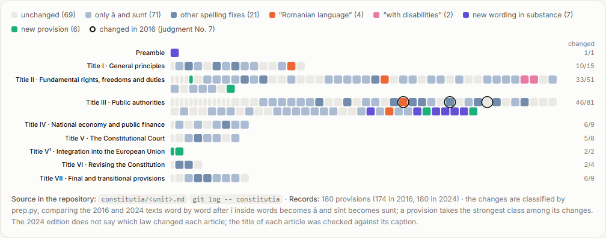

#### 2. Who elects the President

Articles 78 and 89 word by word, before and after Constitutional Court judgment No. 7 of 4 March 2016: Parliament, by three fifths of the deputies, then the citizens, by universal vote.

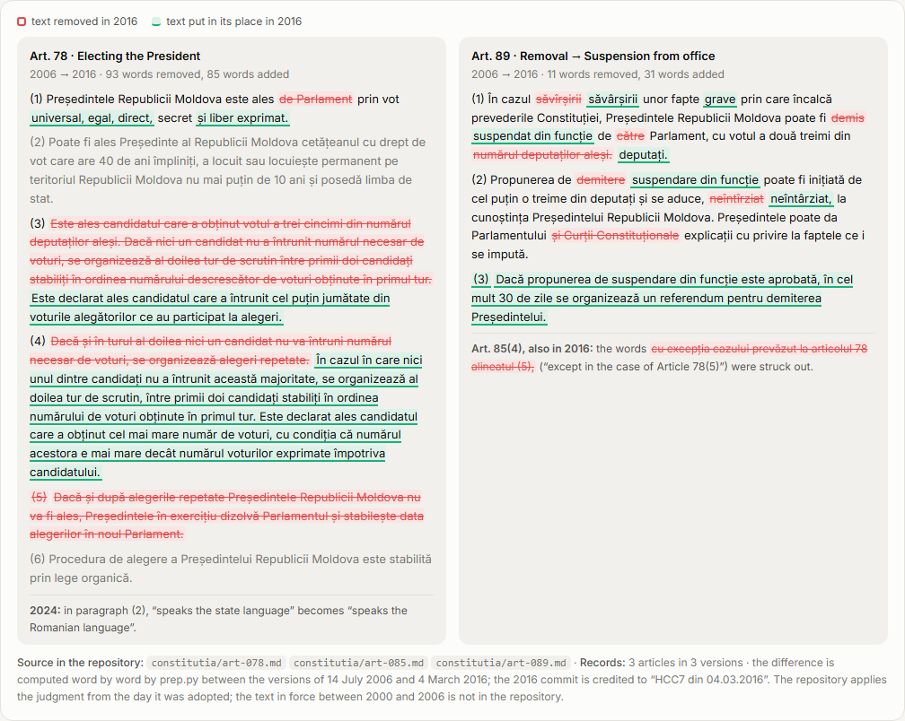

#### 3. Words in and out

How often each phrase occurs in the three versions: “Moldovan language” 3 times, then never; “European Union” 7 times in 2024.

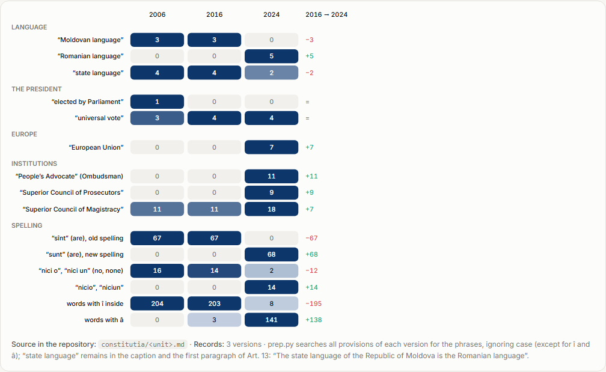

#### 4. Where the Constitution was rewritten in 2024

Words removed and added by title, leaving out spelling changes: Title III, with 514 words added and 223 removed.

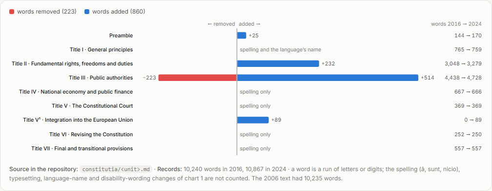

#### 5. From adoption to the Monitorul Oficial

The days between the adoption and the publication of the 16 acts amending the Constitution: a median of 18.5 days.

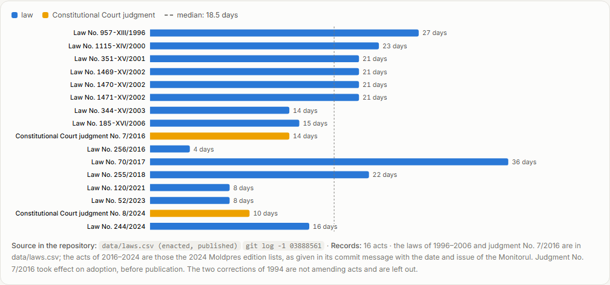

### II. The Supreme Court of Justice

#### 6. The Supreme Court decisions in the repository

6,329 decisions by database and year: 69% from the civil college.

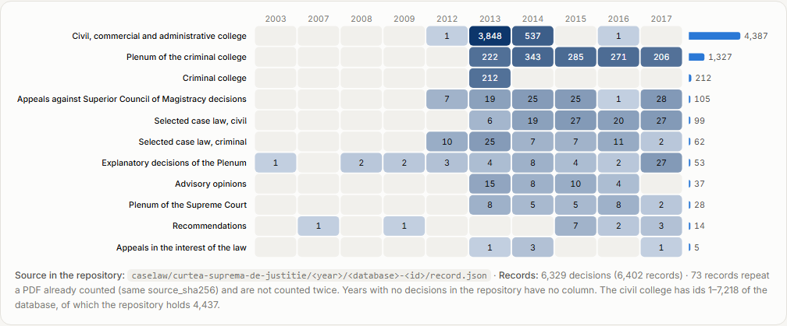

#### 7. Each bench has its day

The weekday of the decisions' dates: 91% of the civil college's decisions are dated Wednesday, 92% of the criminal plenum's Thursday.

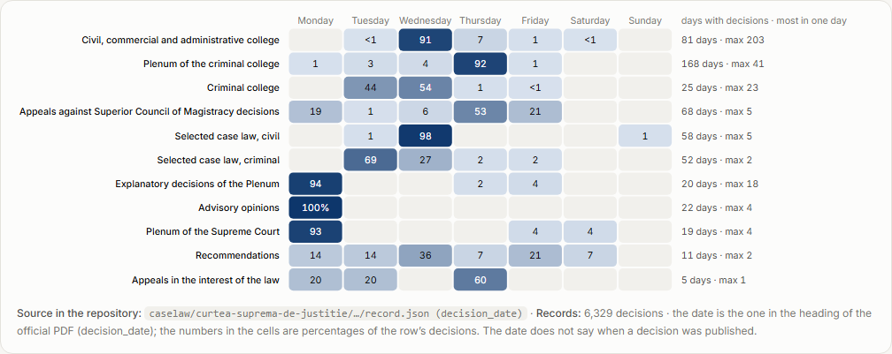

#### 8. The civil college day by day

The calendar of its decisions from April 2013 to February 2014, with up to 203 decisions in a day and the gap in the repository.

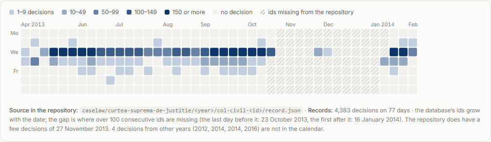

#### 9. What the civil college hears

The procedures, read from the case numbers: 69% are appeals against judgments and decisions.

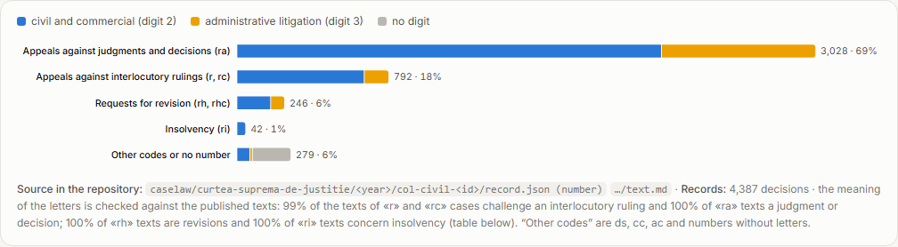

#### 10. How long a Supreme Court decision is

The pages of each decision, by database: a median of 5 pages.

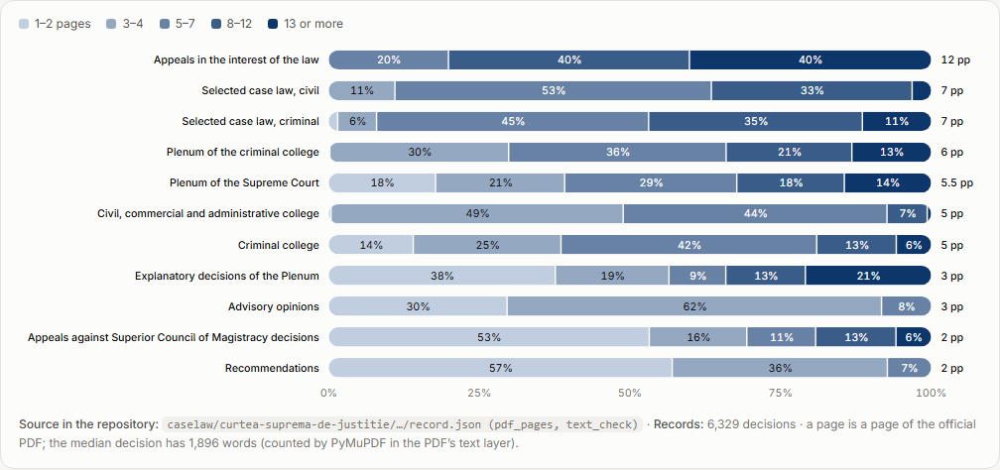

#### 11. The civil college's decisions with text

The operative part of the 397 decisions with text: 29% allow the appeal, 50% dismiss it, 17% declare it inadmissible.

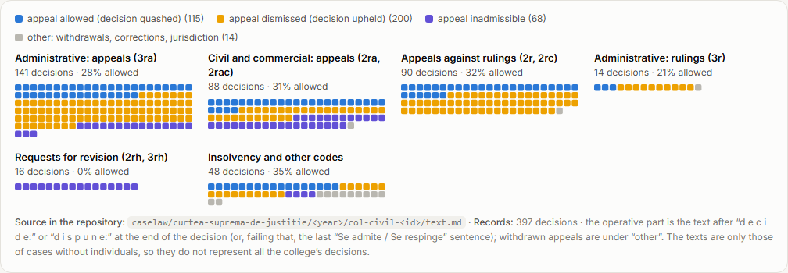

#### 12. What the civil college cites

The laws the decisions name: the Code of Civil Procedure in 95% of them, the European Convention on Human Rights in 20%.

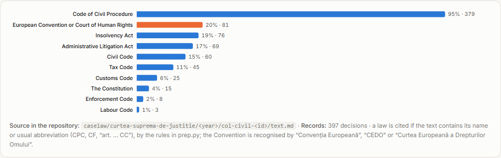

#### 13. The Plenum updates its explanatory decisions

Each amended explanatory decision, with its date and the date of the amendment: 25 amended in October and December 2017.

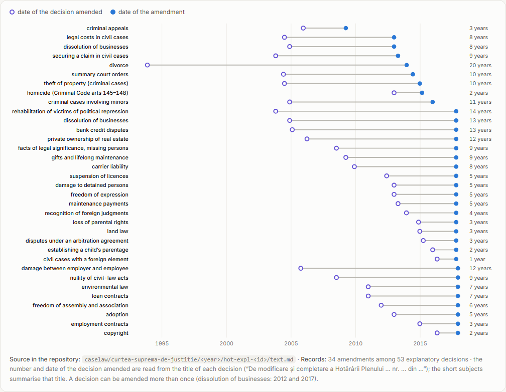

### III. The courts, 12–13 November 2026

#### 14. Two days of judgments, by court

455 judgments on a map and in a list: 146 from the Chișinău District Court.

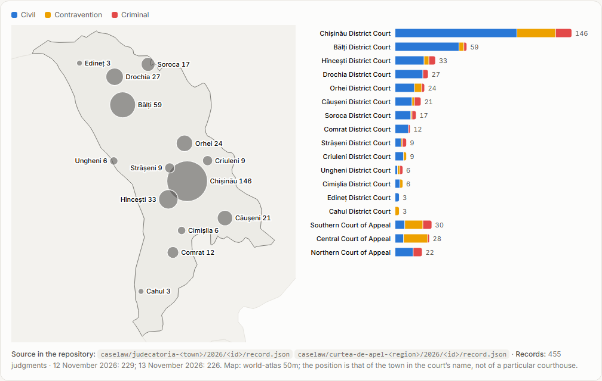

#### 15. From filing to judgment

The days from a case's filing to the judgment: at the district courts, a median of 115 days in civil cases and 168 in criminal cases.

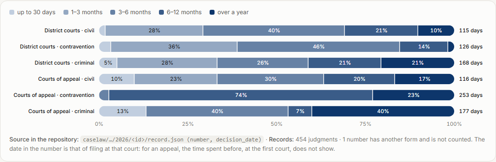

#### 16. What was decided

The subject of the cases, from the judgments' titles: debt recovery in 44% of civil cases, electoral corruption in 16 of 94 contravention cases.

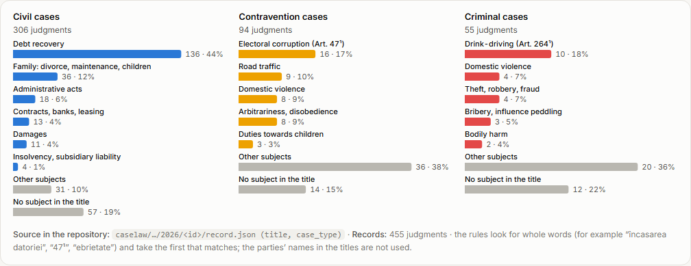

### IV. The Competition Council

#### 17. The Competition Council's decisions

Decisions by year and field: state aid 34%, mergers 18%.

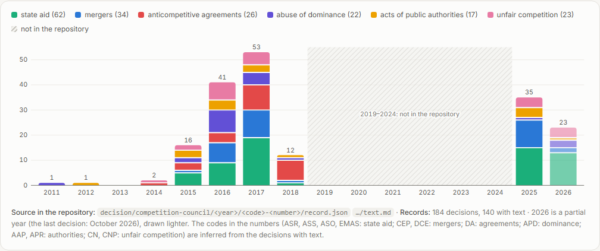

#### 18. The Council's investigations

The operative part of the decisions by field: a breach found in 26 of 67 decisions with text, the investigation closed in 17.

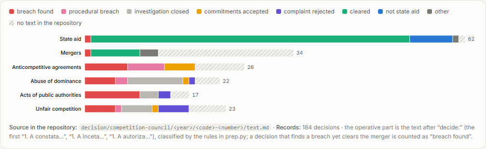

#### 19. State aid

Who notified the measure and in what form: in 2015–2018, 19 of 33 decisions concerned property handed by town halls to local water and sewerage companies.

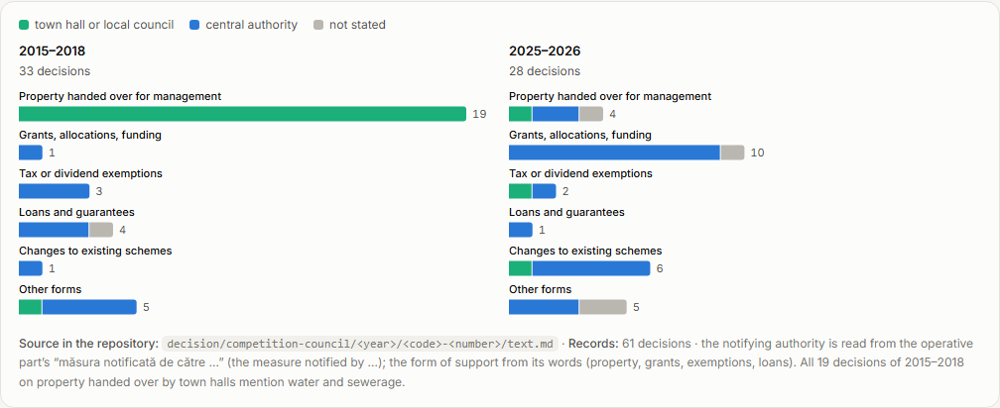

### V. The repository

#### 20. What the repository covers over time

Every source by year: 91% of the records are Supreme Court decisions of 2003–2017.

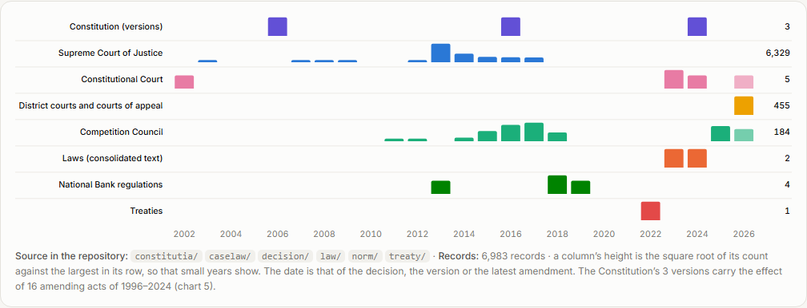

## Data

As of commit `8235d4bec9` (16 November 2026).

| Dataset | Where in the repository | Records | Coverage |
| --- | --- | ---: | --- |
| Git history | branch `main` | 7,097 commits | each commit is dated on the day of the decision, the version or the entry into force (`In-force:`) |
| The Constitution | `constitutia/` | 180 provisions, 3 versions | 14 July 2006, 4 March 2016 and 20 October 2024 |
| Supreme Court of Justice | `caselaw/curtea-suprema-de-justitie/` | 6,329 decisions (6,402 records), 540 with text | 2003–2017; the civil college only from April 2013 to February 2014 |
| The courts | `caselaw/judecatoria-*/`, `caselaw/curtea-de-apel-*/` | 455 judgments | 12 and 13 November 2026; metadata only |
| Competition Council | `decision/competition-council/` | 184 decisions, 140 with text | 2011–2018 and 2025–2026 |
| Constitutional Court | `caselaw/curtea-constitutionala/` | 4 opinions and a judgment | 2002, 2023, 2024 and 2026 |
| Laws, National Bank regulations, treaties | `law/`, `norm/bnm/`, `treaty/` | 2 laws, 4 regulations, a treaty | the published consolidated text |

## Limits

- **The repository holds only part of Moldovan law.** Laws and codes (apart from two laws on the People's Advocate), Government decisions, local acts and bills are not here, so the charts say nothing about them.
- **The Constitution has three versions, not every amendment on its own day.** The 2024 edition does not say which law changed each article (charts 1, 3 and 4); the amending acts of chart 5 are those the repository's sources name.
- **Supreme Court of Justice: part of the database.** The civil college appears only from April 2013 to February 2014, with a gap from late October 2013 to mid-January 2014 (chart 8); texts exist only for cases without individuals (charts 11 and 12). The 73 records that repeat a PDF are not counted twice.
- **The courts: two days.** Charts 14–16 describe the judgments of 12 and 13 November 2026, not a whole year.
- **Categories are read from words.** The procedure (chart 9), the outcome (11 and 18), the laws cited (12), the subject of cases (16), and the field and form of state aid (17 and 19) come from the words of the texts, by the rules in `src/prep.py`; whatever no rule recognises is shown as "other".
- **Competition Council: 2019–2024 are missing**, and 44 decisions have metadata only.

## Rebuilding

```sh
python visualisations/src/make.py            # git -> src/.build/ -> dreptul-republicii-moldova-in-20-de-grafice.html
node visualisations/src/stills.cjs           # images for these READMEs (needs Playwright; PLAYWRIGHT=<path> if not global)
```

`make.py` reads everything from git objects, so it also works in a blobless or `--no-checkout` clone; missing blobs are fetched in one request. It reads `origin/main` (or `HEAD`) by default; `--ref` picks another branch or commit. It writes nothing into the repository except the page and the `src/.build/` folder, which git ignores.

| File | What it does |
| --- | --- |
| `src/make.py` | extracts the history, the record.json and text.md files and the versions of the Constitution into `src/.build/`, then runs `prep.py` and `build.py` |
| `src/prep.py` | computes every number for the 20 charts and the data profile into `src/.build/data.json` |
| `src/page.tpl.html` | the page: text in both languages, the charts (d3), the tables |
| `src/build.py` | puts `data.json` into the template and writes the page |
| `src/stills.cjs` | draws each chart as a PNG into `stills/ro/` and `stills/en/` |
