# Dreptul Republicii Moldova în 20 de grafice

[English](README.en.md)

Grafice despre dreptul tuturor țărilor, din întregul global-law: [global-law visualisations/](https://github.com/lexifina/global-law/tree/main/visualisations). Aici sunt doar graficele despre Republica Moldova.

Douăzeci de grafice despre dreptul Republicii Moldova, desenate numai din datele acestui depozit: Constituția din 29 iulie 1994 în cele trei versiuni pe care le are, deciziile Curții Supreme de Justiție din baza de date jurisprudenta.csj.md, hotărârile pronunțate de instanțe pe 12 și 13 noiembrie 2026 și deciziile Consiliului Concurenței.

Deschideți [`dreptul-republicii-moldova-in-20-de-grafice.html`](dreptul-republicii-moldova-in-20-de-grafice.html) într-un browser. Pagina este un singur fișier, cu toate datele în el; din internet încarcă doar bibliotecile d3 și topojson, harta din graficul 14 și fonturile. Butoanele din dreapta sus schimbă limba (română sau engleză) și tema (luminoasă sau întunecată). Fiecare grafic numește calea datelor în depozit, numărul de înregistrări și limitele lor și are dedesubt un tabel cu toate cifrele. Treceți cu mouse-ul peste un element ca să vedeți valorile exacte.

Graficele sunt descriptive: arată ce înregistrează sursele, nu de ce.

## Graficele

### I. Constituția

#### 1. Ediția din 2024 a Constituției

Fiecare dispoziție, colorată după ce s-a schimbat între 2016 și 2024: din 111 dispoziții schimbate, 92 diferă doar prin scriere (â, sunt, nicio).

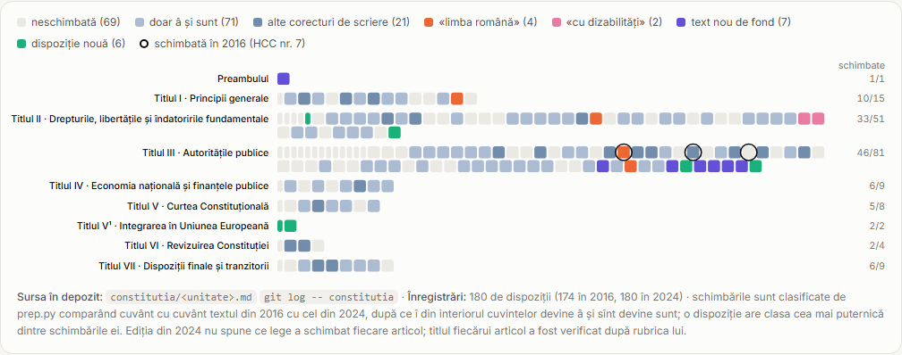

#### 2. Cine alege Președintele

Articolele 78 și 89 cuvânt cu cuvânt, înainte și după Hotărârea Curții Constituționale nr. 7 din 4 martie 2016: Parlamentul, cu trei cincimi din deputați, apoi cetățenii, prin vot universal.

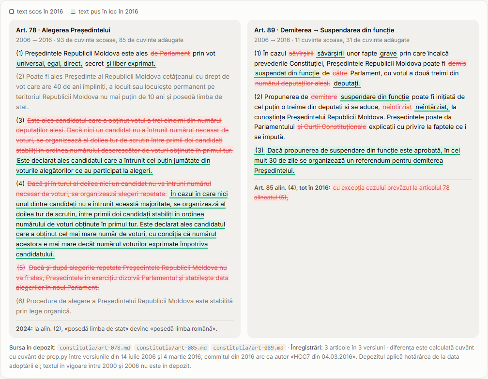

#### 3. Cuvinte care au intrat și au ieșit

De câte ori apare fiecare expresie în cele trei versiuni: «limba moldovenească» de 3 ori, apoi niciodată; «Uniunea Europeană» de 7 ori în 2024.

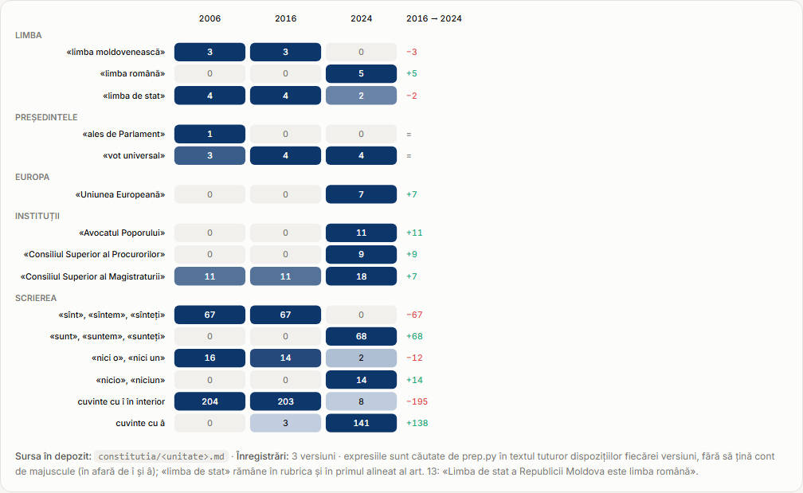

#### 4. Unde a fost rescrisă Constituția în 2024

Cuvintele scoase și adăugate pe titluri, fără schimbările de scriere: titlul III, cu 514 cuvinte noi și 223 de cuvinte scoase.

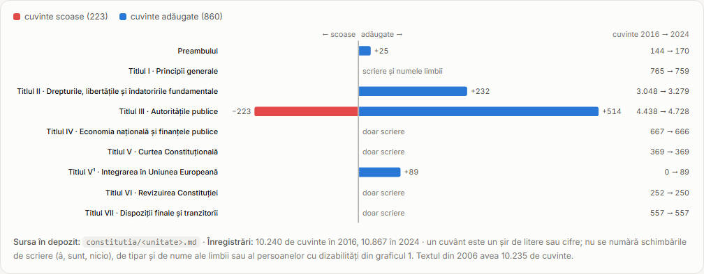

#### 5. De la adoptare la Monitorul Oficial

Zilele dintre adoptarea și publicarea celor 16 acte de modificare a Constituției: mediana de 18,5 zile.

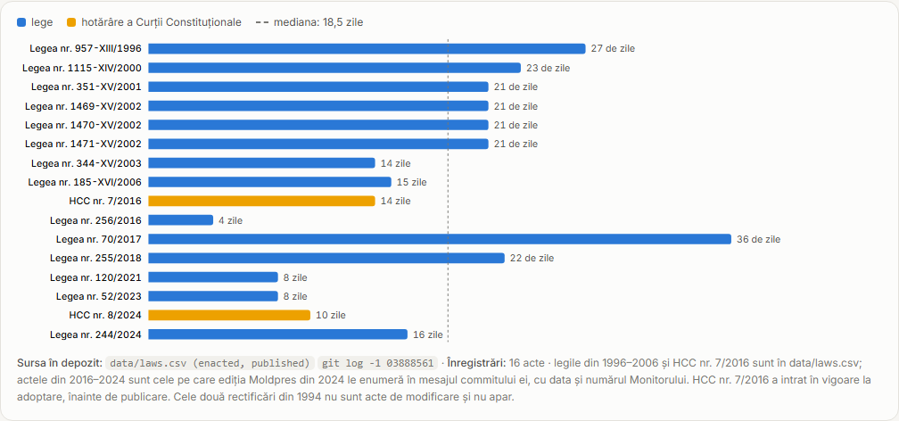

### II. Curtea Supremă de Justiție

#### 6. Deciziile Curții Supreme de Justiție din depozit

6.329 de decizii pe baze de date și ani: 69 % sunt ale Colegiului civil.

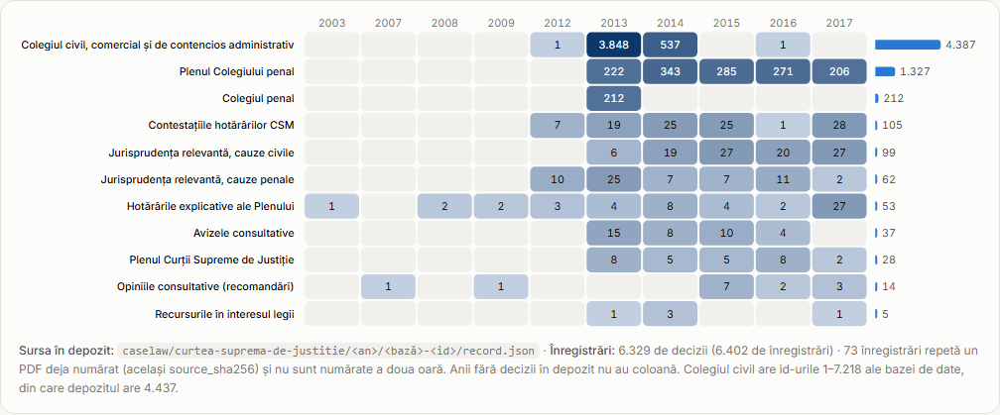

#### 7. Fiecare complet are ziua lui

Ziua săptămânii din data deciziilor: 91 % din deciziile Colegiului civil poartă data de miercuri, 92 % din ale Plenului penal, de joi.

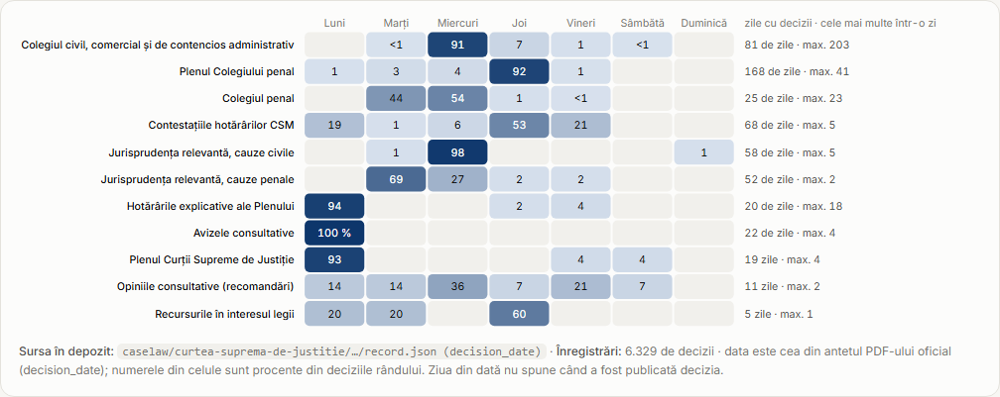

#### 8. Colegiul civil zi de zi

Calendarul deciziilor din aprilie 2013 – februarie 2014, cu până la 203 decizii într-o zi și golul din depozit.

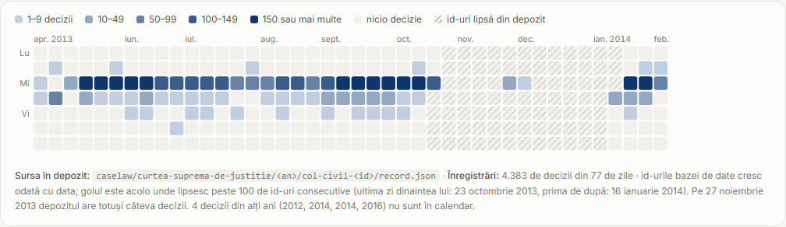

#### 9. Ce judecă Colegiul civil

Procedurile, citite din numerele dosarelor: 69 % sunt recursuri împotriva hotărârilor și deciziilor.

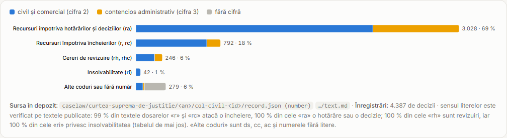

#### 10. Cât de lungă este o decizie a CSJ

Paginile fiecărei decizii, pe baze de date: 5 pagini în mediană.

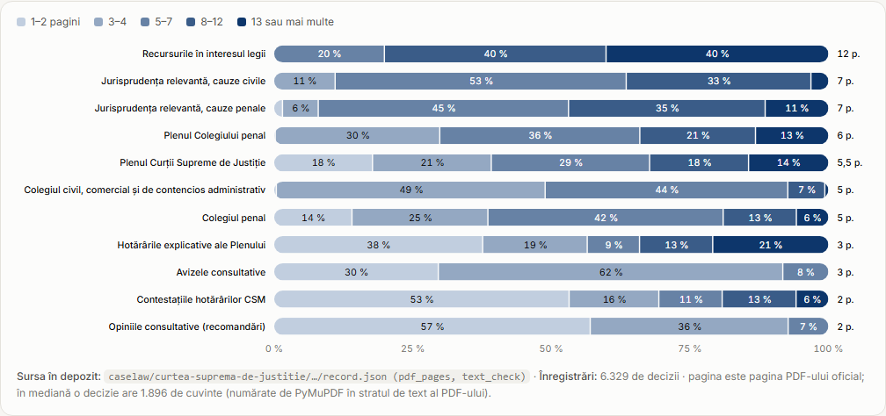

#### 11. Deciziile cu text ale Colegiului civil

Dispozitivul celor 397 de decizii cu text: 29 % admit recursul, 50 % îl resping, 17 % îl declară inadmisibil.

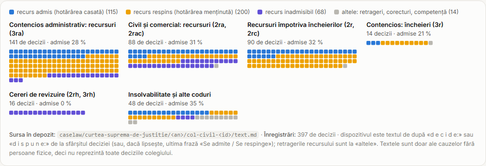

#### 12. Ce citează Colegiul civil

Legile numite în decizii: Codul de procedură civilă în 95 % dintre ele, Convenția Europeană a Drepturilor Omului în 20 %.

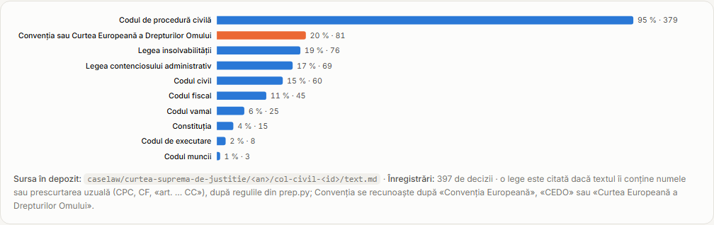

#### 13. Plenul CSJ își actualizează hotărârile explicative

Fiecare hotărâre explicativă modificată, cu data ei și a modificării: 25 de hotărâri modificate în octombrie și decembrie 2017.

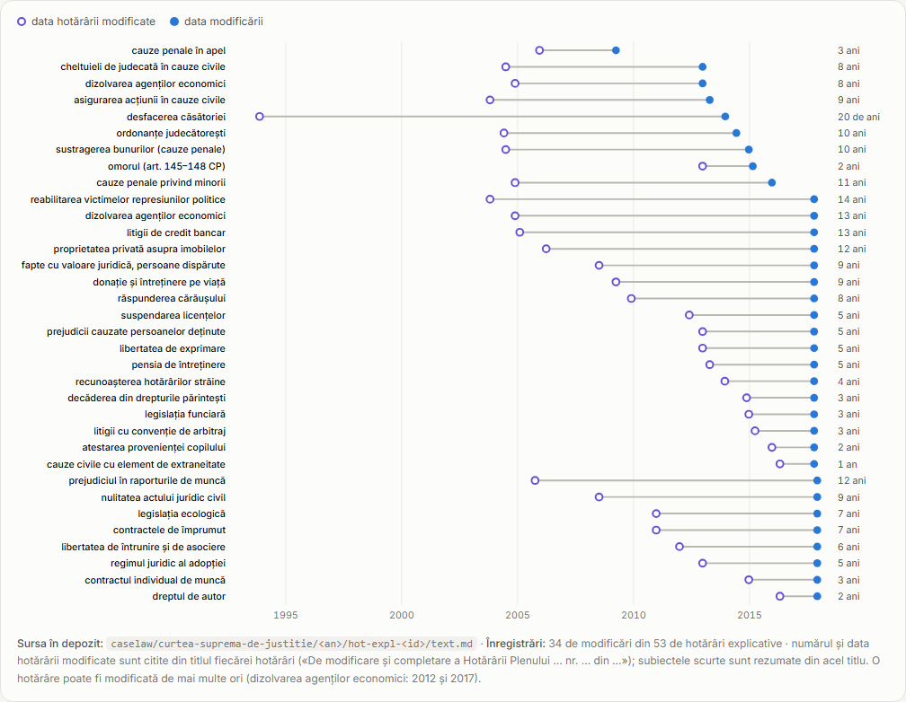

### III. Instanțele de judecată, 12–13 noiembrie 2026

#### 14. Hotărârile a două zile, pe instanțe

455 de hotărâri pe hartă și în listă: 146 de la Judecătoria Chișinău.

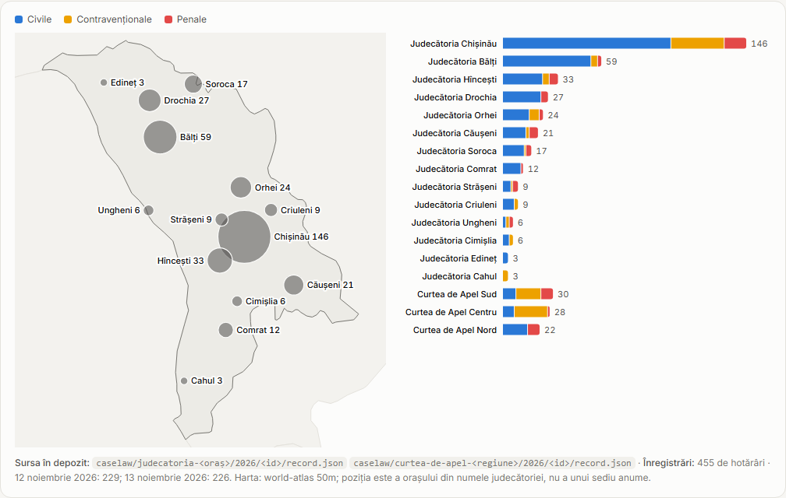

#### 15. De la înregistrare la hotărâre

Zilele de la înregistrarea dosarului până la pronunțare: la judecătorii, mediana de 115 zile în cauzele civile și 168 în cele penale.

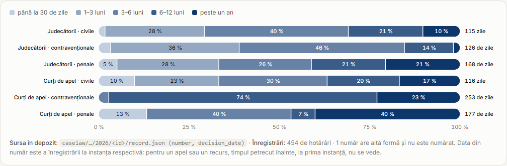

#### 16. Ce s-a judecat

Obiectul cauzelor, din titlurile hotărârilor: încasarea unei datorii în 44 % din cauzele civile, coruperea electorală în 16 din 94 de cauze contravenționale.

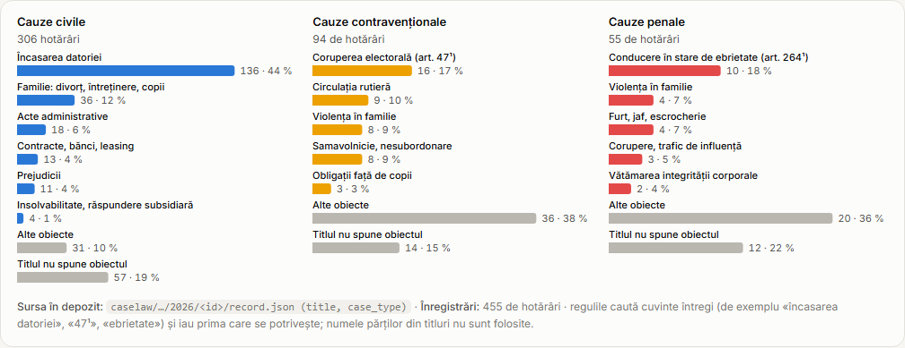

### IV. Consiliul Concurenței

#### 17. Deciziile Consiliului Concurenței

Deciziile pe ani și domenii: ajutorul de stat, 34 %; concentrările economice, 18 %.

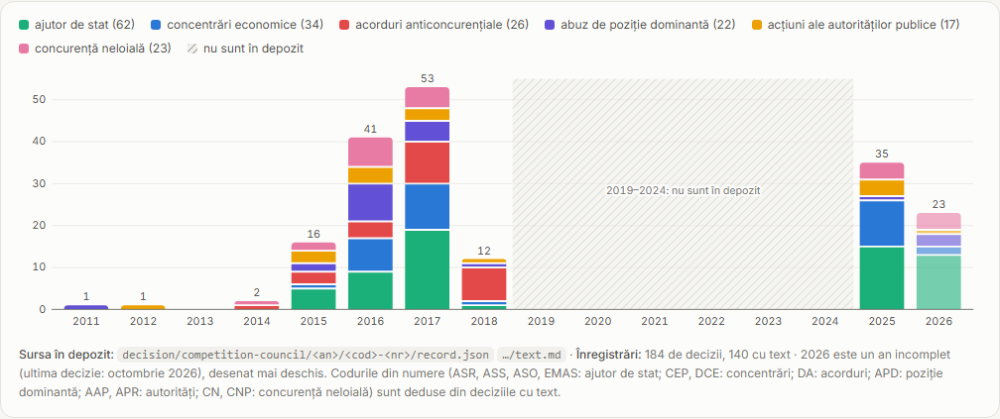

#### 18. Investigațiile Consiliului

Dispozitivul deciziilor pe domenii: încălcare constatată în 26 din 67 de decizii cu text, investigație încetată în 17.

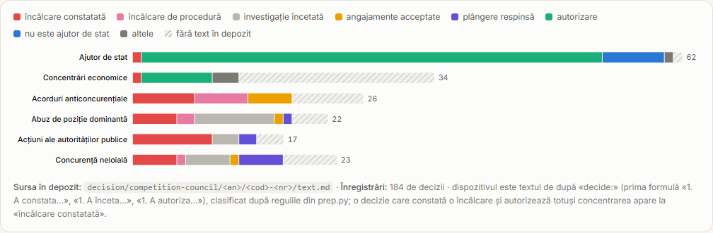

#### 19. Ajutorul de stat

Cine a notificat măsura și ce formă a avut: în 2015–2018, 19 din 33 de decizii priveau bunuri date de primării întreprinderilor locale de apă și canalizare.

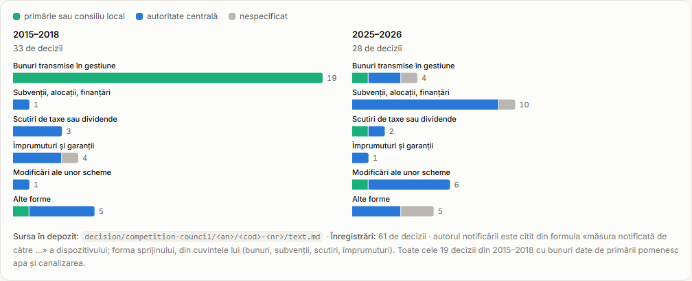

### V. Depozitul

#### 20. Ce acoperă depozitul în timp

Toate sursele, pe ani: 91 % din înregistrări sunt decizii ale CSJ din 2003–2017.

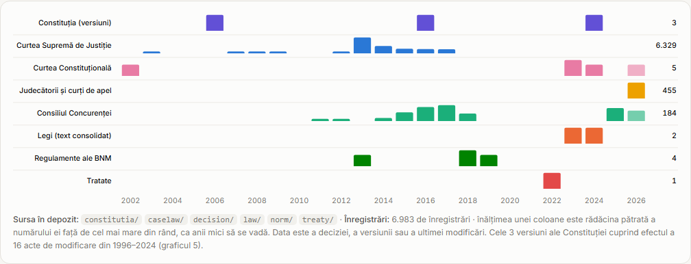

## Date

În starea commitului `8235d4bec9` (16 noiembrie 2026).

| Set de date | Unde în depozit | Înregistrări | Acoperire |
| --- | --- | ---: | --- |
| Istoria git | ramura `main` | 7.097 de commituri | fiecare commit este datat în ziua deciziei, a versiunii sau a intrării în vigoare (`In-force:`) |
| Constituția | `constitutia/` | 180 de dispoziții, 3 versiuni | 14 iulie 2006, 4 martie 2016 și 20 octombrie 2024 |
| Curtea Supremă de Justiție | `caselaw/curtea-suprema-de-justitie/` | 6.329 de decizii (6.402 înregistrări), 540 cu text | 2003–2017; Colegiul civil doar din aprilie 2013 până în februarie 2014 |
| Instanțele de judecată | `caselaw/judecatoria-*/`, `caselaw/curtea-de-apel-*/` | 455 de hotărâri | 12 și 13 noiembrie 2026; doar metadate |
| Consiliul Concurenței | `decision/competition-council/` | 184 de decizii, 140 cu text | 2011–2018 și 2025–2026 |
| Curtea Constituțională | `caselaw/curtea-constitutionala/` | 4 avize și o hotărâre | 2002, 2023, 2024 și 2026 |
| Legi, regulamente BNM, tratate | `law/`, `norm/bnm/`, `treaty/` | 2 legi, 4 regulamente, un tratat | textul consolidat publicat |

## Limite

- **Depozitul cuprinde doar o parte din dreptul Republicii Moldova.** Legile și codurile (în afară de două legi despre Avocatul Poporului), hotărârile Guvernului, actele locale și proiectele de lege nu sunt aici, așa că graficele nu spun nimic despre ele.
- **Constituția are trei versiuni, nu fiecare modificare la data ei.** Ediția din 2024 nu spune ce lege a schimbat fiecare articol (graficele 1, 3 și 4); actele de modificare din graficul 5 sunt cele pe care le numesc sursele depozitului.
- **Curtea Supremă de Justiție: o parte a bazei de date.** Colegiul civil apare doar din aprilie 2013 până în februarie 2014, cu un gol între sfârșitul lui octombrie 2013 și mijlocul lui ianuarie 2014 (graficul 8); textele există doar pentru cauzele fără persoane fizice (graficele 11 și 12). Cele 73 de înregistrări care repetă un PDF nu sunt numărate de două ori.
- **Instanțele: două zile.** Graficele 14–16 descriu hotărârile din 12 și 13 noiembrie 2026, nu un an întreg.
- **Categoriile sunt citite din cuvinte.** Procedura (graficul 9), dispozitivul (11 și 18), legile citate (12), obiectul cauzelor (16), domeniul și forma ajutorului de stat (17 și 19) vin din cuvintele textelor, după regulile din `src/prep.py`; ce nu recunoaște nicio regulă apare ca «altele».
- **Consiliul Concurenței: lipsesc anii 2019–2024**, iar 44 de decizii au doar metadate.

## Reconstruire

```sh
python visualisations/src/make.py            # git -> src/.build/ -> dreptul-republicii-moldova-in-20-de-grafice.html
node visualisations/src/stills.cjs           # imaginile din aceste README (cu Playwright; PLAYWRIGHT=<cale> dacă nu este global)
```

`make.py` citește totul din obiectele git, deci funcționează și într-o clonă blobless sau `--no-checkout`; blobii care lipsesc sunt aduși într-o singură cerere. Implicit citește `origin/main` (sau `HEAD`); `--ref` alege altă ramură sau alt commit. Nu scrie nimic în depozit în afară de pagină și de dosarul `src/.build/`, pe care git îl ignoră.

| Fișier | Ce face |
| --- | --- |
| `src/make.py` | extrage istoria, fișierele record.json și text.md și versiunile Constituției în `src/.build/`, apoi rulează `prep.py` și `build.py` |
| `src/prep.py` | calculează toate cifrele celor 20 de grafice și profilul datelor în `src/.build/data.json` |
| `src/page.tpl.html` | pagina: textele în ambele limbi, graficele (d3), tabelele |
| `src/build.py` | pune `data.json` în șablon și scrie pagina |
| `src/stills.cjs` | desenează fiecare grafic ca PNG în `stills/ro/` și `stills/en/` |
