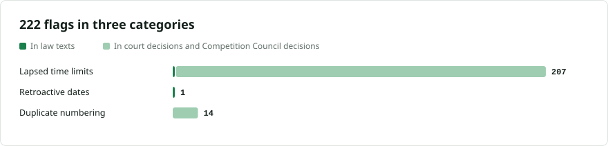

# Vulnerabilities in Moldovan law

[Română](README.md) · **English**

<picture>
<source media="(prefers-color-scheme: dark)" srcset="img/flags-by-category-dark.svg">

</picture>

The vulnerability detectors from [lexifina/global-law](https://github.com/lexifina/global-law/tree/main/vulnerabilities) look for mechanical mistakes in legislation: a rule applying "until" a date that has passed, a time limit extended only after it had run out, two amendments to the same provision on the same day, a rule in force before it was published. global-law's published list (9 November 2026) did not include Moldova, so this is a run over this repository only, as it stood at commit [`b962276`](https://github.com/lexifina/moldova-law/commit/b9622766cdf1fa1863595ba9ccb48b928c59e9e3) on 15 November 2026, with the National Bank's regulations, the Competition Council's decisions and the case law it now holds besides the Constitution.

**In short:** the detectors raised 222 flags, only two of them in law texts. A language model reviewed 42 of the strongest, arguing each one for and against; none survived. Checked by hand in this repository, the two in law texts are a spent transitional rule of the Constitution (Article IV, which exempted persons who had committed serious offences from Article 25(4), on the length of arrest, only until 1 January 1995) and the date of Constitutional Court judgment HCC7/2016, which took effect on the day it was adopted, two weeks before it was published, as Article 140 of the Constitution provides. The other 40 are in decisions of the Competition Council, where the dates are facts of the case. No drafting mistake in Moldovan law was found: the law this repository holds is the Constitution in three versions and four regulations of the National Bank, which leaves the detectors little to compare. Later, this will be formalised in Lean, similar to our work on [the US tax code](https://lexifina.com/blog/formalizing-the-us-tax-code) and [US case law](https://lexifina.com/blog/formalizing-all-us-case-law-in-lean).

A flag is a prompt to look, not legal advice, and nothing here has been tested in court.

## Flags by category

| Category | What it looks for | Flags | In law texts | Reviewed | Survived review |
| --- | --- | ---: | ---: | ---: | ---: |
| Lapsed time limits | Text still applying a rule "until" a date that has passed | 207 | 1 | 41 | 0 |
| Retroactive or pre-publication dates | A rule in force before it was made or published | 1 | 1 | 1 | 0 |
| Duplicate numbering | Two units with the same number in one act | 14 | 0 | 0 | 0 |

"In law texts" counts the Constitution and the regulations of the National Bank of Moldova. The other flags are in decisions of the Competition Council and of the Supreme Court of Justice, which this repository also holds and which count here as not law: a Competition Council decision settles one case. The search for repeal gaps, same-day conflicts, empty periods, stale amounts, references to deleted provisions, dead fines and publisher notes found nothing: the Constitution has three versions here and each regulation one, so there are few changes to compare and no deleted provision to cite. Nor did the search for dead currencies, now that it takes "inti" only as a whole word and no longer finds it inside "intimatul". The search for lapsed time limits reads "până la" or "până pe", also in the older spelling "pînă" and with "data de" between, followed by a date, and "până la sfârșitul anului" followed by a year; it still misses 23 phrases with a past date in this repository: 13 "până în anul" with a year, 4 "până la finele anului", 3 "până la data" without "de" and 3 "până în" or "până în data de" before a date, 22 in Competition Council decisions and one in an opinion of the Constitutional Court, none in the law texts.

*Edge cases: the 42 reviewed flags, each checked by hand and grouped by what it turned out to be, and what the other flags are, in [EDGE-CASES.en.md](EDGE-CASES.en.md).*

## Problems found in this repository

- **The README, REPRODUCE.md and LICENSE describe only the Constitution.** At this commit the README says that no other act is here yet, court decisions included, and REPRODUCE.md and LICENSE name only the Constitution and HCC7/2016, but the repository holds four regulations of the National Bank (`norm/bnm/`), 184 decisions of the Competition Council (`decision/`, 140 of them with their text), 1,028 decisions of the Supreme Court of Justice (95 with their text) and four texts of the Constitutional Court, three opinions and one judgment (`caselaw/`). The README and REPRODUCE.md also say that no commit date goes backwards, but the 1,238 commits added after the last README update are dated from 29 May 2003 to 5 November 2026, so the dates go backwards seven times along the history; the commit read here is dated 30 May 2013.
- **The 2024 version of the Constitution is dated the day of the referendum, 20 October 2024,** and carries seven acts at once ([the version](https://github.com/lexifina/moldova-law/commit/03888561d5e28fbed36026bd939fd056e082d3bf)): five laws published between 29 November 2016 and 24 March 2023, Constitutional Court judgment HCC8 of 11 March 2024, and Law No. 244 of 20 October 2024, published in the Monitorul Oficial on 5 November 2024 (No. 457-458, art. 633). The first six appear here up to almost eight years after they were published. Law No. 244 appears 16 days before it was published, although under Article 76 of the Constitution a law takes effect on publication or on a day its text sets, and nothing in the repository gives an earlier day. The README says that the amendments of 2016 to 2024 are not on their own days; it does not say that the 2024 date comes before publication.
- **Two Competition Council titles carry wrong dates:** EMAS-24 "din 27.07.2025" and EMAS-25 "din 28.07.2028", in the commit subject and `record.json`. The decisions' own headings say 22 July 2025 and 28 July 2025, and their `In-force` dates follow the headings.

## Files

| File | What it holds |
| --- | --- |
| [data/flags.csv](data/flags.csv) | Every flag, one row per text and issue |
| [data/reviewed.csv](data/reviewed.csv) | The 42 flags the model reviewed, with its verdict and reason |
| [data/by_category.csv](data/by_category.csv) | The counts in the table above |
| [tools/](tools/) | The scripts that made this run |

Columns: `category` and `category_ro` (the category in English and Romanian), `detector`, `kind` (`law` or `other`), `path` (the file in this repository), `date` (the date the flag turns on), `reference` (the act or line involved), `summary`, `score` (the detector's ranking, 0 to 1), `review` (`artefact`, `lawful` or `candidate_defect`), `survives_rebuttal`, `review_note` (the model's reason, in English), `url` (the text at the commit that was read, or, for a retroactive date, the commit of the act).

## How it was made

- **Detectors:** global-law's [vulnerabilities/scripts](https://github.com/lexifina/global-law/tree/main/vulnerabilities/scripts), run on this repository at commit `b962276`. The history table the detectors read was built from this repository's own commits (the author, the act that made each change, and the `In-force` and `Kind` trailers). An act's first text (`as-enacted`, `regulation`), the Constitutional Court's change to the Constitution (`court`) and the publisher's versions of the Constitution (`publisher`) count as changes to read; records without text (`metadata`) and case law (`case-law`) do not. The detectors were then run again with fixes that read "pînă" and "până la data de" before a date and that take a currency name such as "inti" only as a whole word.
- **Model review:** gpt-5.4-mini, the 40 strongest flags per category, and for lapsed time limits also the strongest in law texts (there was one); one pass says whether a flag is real, a second argues that it is not. There were no empty periods to review. Where a flag was reviewed twice, the later review is kept. global-law's own list used a different model.
- **Hand check:** the flags in law texts were read in this repository's history and texts, and Articles 78 and 85 also in the Moldpres edition of 2024; the reviewed flags in decisions were read in their decisions. The dates of the Constitution's versions, the four regulations and the Competition Council's decisions were compared with their own entry-into-force clauses: three regulations take the day their decision sets, the fourth (282/2018), which sets none, the day the National Bank's page gives, and every decision with text the day it was adopted, as its last point provides; for the Constitution, see above.

To report a correction, open an issue with the provision and an official source.

## Licence

The lists and notes are Lexifina's, dedicated to the public domain under CC0 1.0, like the rest of this repository's own contributions. Quoted texts are as the official sources publish them; laws and court decisions are not objects of copyright in Moldova (Law No. 139/2010 on copyright and related rights). See [LICENSE](../LICENSE).
