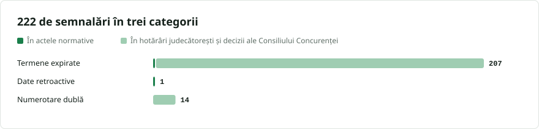

# Vulnerabilități în dreptul Republicii Moldova

**Română** · [English](README.en.md)

<picture>
<source media="(prefers-color-scheme: dark)" srcset="img/flags-by-category-dark.ro.svg">

</picture>

Detectoarele de vulnerabilități din [lexifina/global-law](https://github.com/lexifina/global-law/tree/main/vulnerabilities) caută greșeli mecanice în legislație: o normă care se aplică în continuare „până la” o dată care a trecut, un termen prelungit abia după ce expirase, două modificări ale aceleiași dispoziții în aceeași zi, o normă în vigoare înainte de a fi publicată. Lista publicată de global-law la 9 noiembrie 2026 nu cuprindea Republica Moldova. Aceasta este, așadar, o verificare doar a acestui depozit, așa cum se prezenta la 15 noiembrie 2026, la commitul [`b962276`](https://github.com/lexifina/moldova-law/commit/b9622766cdf1fa1863595ba9ccb48b928c59e9e3), cu regulamentele Băncii Naționale, deciziile Consiliului Concurenței și jurisprudența pe care le conține acum pe lângă Constituție.

**Pe scurt:** detectoarele au produs 222 de semnalări, dintre care doar două în acte normative. Un model lingvistic a examinat 42 dintre cele mai puternice, cântărind pentru fiecare argumentele pro și contra; niciuna nu a rezistat. La verificarea manuală în acest depozit, cele două din actele normative s-au dovedit a fi o normă tranzitorie a Constituției cu efect epuizat (articolul IV, care excepta de la articolul 25 alineatul (4), privind durata arestării, persoanele care au comis infracțiuni grave doar până la 1 ianuarie 1995) și data Hotărârii Curții Constituționale HCC7/2016, care a intrat în vigoare la data adoptării, cu două săptămâni înainte de publicare, așa cum prevede articolul 140 din Constituție. Celelalte 40 se află în decizii ale Consiliului Concurenței, unde datele sunt fapte ale cauzei. Nu a fost găsită nicio greșeală de redactare în dreptul Republicii Moldova: legislația din acest depozit înseamnă Constituția, în trei versiuni, și patru regulamente ale Băncii Naționale, astfel că detectoarele au puțin de comparat. Ulterior, aceasta va fi formalizată în Lean, asemenea lucrărilor noastre privind [codul fiscal al SUA](https://lexifina.com/blog/formalizing-the-us-tax-code) și [jurisprudența SUA](https://lexifina.com/blog/formalizing-all-us-case-law-in-lean).

O semnalare este un îndemn la o examinare mai atentă, nu o consultație juridică, și nimic din cele de aici nu a fost verificat în instanță.

## Semnalări pe categorii

| Categorie | Ce caută | Semnalări | În acte normative | Examinate | Au rezistat |
| --- | --- | ---: | ---: | ---: | ---: |
| Termene expirate | Text care aplică în continuare o normă „până la” o dată care a trecut | 207 | 1 | 41 | 0 |
| Intrare în vigoare înainte de publicare | O normă în vigoare înainte de a fi adoptată sau publicată | 1 | 1 | 1 | 0 |
| Numerotare dublă | Două unități cu același număr în același act | 14 | 0 | 0 | 0 |

„În acte normative” cuprinde Constituția și regulamentele Băncii Naționale a Moldovei. Celelalte semnalări se află în decizii ale Consiliului Concurenței și ale Curții Supreme de Justiție, pe care acest depozit le conține de asemenea și care aici nu sunt socotite acte normative: o decizie a Consiliului Concurenței soluționează o singură cauză. Căutarea lacunelor după abrogare, a modificărilor în aceeași zi, a perioadelor descoperite, a sumelor neactualizate, a trimiterilor la prevederi abrogate, a amenzilor fără faptă și a notelor editorului nu a găsit nimic: Constituția are aici trei versiuni, iar fiecare regulament una singură, astfel că sunt puține modificări de comparat și nicio dispoziție eliminată la care să se poată trimite. Nici căutarea monedelor ieșite din uz nu a mai găsit nimic, de când recunoaște „inti” doar ca termen de sine stătător și nu îl mai găsește în interiorul cuvântului „intimatul”. Căutarea termenelor expirate citește „până la” sau „până pe”, inclusiv în vechea grafie „pînă” și în formula „până la data de”, urmate de o dată, precum și „până la sfârșitul anului” urmat de un an; îi scapă încă 23 de sintagme cu o dată trecută din acest depozit: 13 „până în anul” urmat de un an, 4 „până la finele anului”, 3 „până la data” fără „de” și 3 „până în” sau „până în data de” înaintea unei date, dintre care 22 în decizii ale Consiliului Concurenței și una într-un aviz al Curții Constituționale, niciuna în actele normative.

*Cazuri-limită: cele 42 de semnalări examinate, fiecare verificată manual și grupată după ceea ce s-a dovedit a fi, precum și ce sunt celelalte semnalări, în [EDGE-CASES.md](EDGE-CASES.md).*

## Probleme găsite în acest depozit

- **README-ul, REPRODUCE.md și LICENSE descriu doar Constituția.** La acest commit, README-ul afirmă că niciun alt act nu se află încă aici, nici hotărâri judecătorești, iar REPRODUCE.md și LICENSE numesc doar Constituția și HCC7/2016, însă depozitul conține patru regulamente ale Băncii Naționale (`norm/bnm/`), 184 de decizii ale Consiliului Concurenței (`decision/`, 140 dintre ele cu textul lor), 1.028 de decizii ale Curții Supreme de Justiție (95 cu textul lor) și patru texte ale Curții Constituționale, trei avize și o hotărâre (`caselaw/`). README-ul și REPRODUCE.md mai afirmă că datele commiturilor nu merg niciodată înapoi, dar cele 1.238 de commituri adăugate după ultima actualizare a README-ului sunt datate între 29 mai 2003 și 5 noiembrie 2026, astfel că datele merg înapoi de șapte ori de-a lungul istoriei; commitul citit aici este datat 30 mai 2013.
- **Versiunea din 2024 a Constituției este datată în ziua referendumului, 20 octombrie 2024,** și cuprinde deodată șapte acte ([versiunea](https://github.com/lexifina/moldova-law/commit/03888561d5e28fbed36026bd939fd056e082d3bf)): cinci legi publicate între 29 noiembrie 2016 și 24 martie 2023, Hotărârea Curții Constituționale HCC8 din 11 martie 2024 și Legea nr. 244 din 20 octombrie 2024, publicată în Monitorul Oficial la 5 noiembrie 2024 (nr. 457-458, art. 633). Primele șase apar aici cu o întârziere de până la aproape opt ani de la publicare. Legea nr. 244 apare cu 16 zile înainte de a fi fost publicată, deși, potrivit articolului 76 din Constituție, legea intră în vigoare la data publicării sau la data prevăzută în textul ei, iar nimic din depozit nu indică o dată anterioară. README-ul spune că modificările din anii 2016-2024 nu sunt datate fiecare la ziua ei; nu spune că data din 2024 precede publicarea.
- **Două titluri de decizii ale Consiliului Concurenței poartă date greșite:** EMAS-24 „din 27.07.2025” și EMAS-25 „din 28.07.2028”, în subiectul commitului și în `record.json`. Antetele deciziilor indică 22 iulie 2025 și 28 iulie 2025, iar datele `In-force` urmează antetele.

## Fișiere

| Fișier | Ce conține |
| --- | --- |
| [data/flags.csv](data/flags.csv) | Fiecare semnalare, câte un rând pentru fiecare text și problemă |
| [data/reviewed.csv](data/reviewed.csv) | Cele 42 de semnalări examinate de model, cu verdictul și motivarea sa |
| [data/by_category.csv](data/by_category.csv) | Cifrele din tabelul de mai sus |
| [tools/](tools/) | Scripturile care au efectuat această verificare |

Coloane: `category` și `category_ro` (categoria în engleză și în română), `detector`, `kind` (`law` sau `other`), `path` (fișierul din acest depozit), `date` (data la care se raportează semnalarea), `reference` (actul sau rândul în cauză), `summary`, `score` (ordinea stabilită de detector, de la 0 la 1), `review` (`artefact`, `lawful` sau `candidate_defect`), `survives_rebuttal`, `review_note` (motivarea modelului, în engleză), `url` (textul la commitul verificat sau, pentru o dată retroactivă, commitul actului).

## Cum a fost realizată

- **Detectoare:** [vulnerabilities/scripts](https://github.com/lexifina/global-law/tree/main/vulnerabilities/scripts) din global-law, rulate pe acest depozit la commitul `b962276`. Tabelul istoriei pe care îl citesc detectoarele a fost construit din commiturile proprii ale acestui depozit (autorul, adică actul care a făcut modificarea, și trailerele `In-force` și `Kind`). Textul inițial al unui act (`as-enacted`, `regulation`), modificarea adusă Constituției de Curtea Constituțională (`court`) și versiunile Constituției atribuite editorului (`publisher`) sunt citite ca modificări; evidențele fără text (`metadata`) și jurisprudența (`case-law`) nu. Detectoarele au fost apoi rulate din nou, cu corecturi care citesc „pînă” și „până la data de” înaintea unei date și care recunosc denumirea unei monede, precum „inti”, doar ca termen de sine stătător.
- **Examinarea de către model:** gpt-5.4-mini, cele mai puternice 40 de semnalări din fiecare categorie, iar pentru termenele expirate și cele mai puternice din actele normative (a existat una); o primă trecere spune dacă semnalarea este reală, a doua argumentează că nu este. Nu au existat perioade descoperite de examinat. Unde o semnalare a fost examinată de două ori, se păstrează examinarea ulterioară. Lista proprie a global-law a folosit un alt model.
- **Verificare manuală:** semnalările din actele normative au fost citite în istoria și în textele acestui depozit, iar articolele 78 și 85 și în ediția Moldpres din 2024; semnalările examinate din decizii au fost citite în deciziile respective. Datele versiunilor Constituției, ale celor patru regulamente și ale deciziilor Consiliului Concurenței au fost comparate cu propriile clauze de intrare în vigoare: trei regulamente poartă ziua stabilită de hotărârea de aprobare, al patrulea (282/2018), care nu stabilește niciuna, ziua indicată pe pagina Băncii Naționale, iar fiecare decizie cu text, ziua adoptării, așa cum prevede ultimul ei punct; pentru Constituție, vezi mai sus.

Pentru a semnala o corectură, deschideți un issue cu dispoziția și o sursă oficială.

## Licență

Listele și notele aparțin Lexifina și sunt dedicate domeniului public sub CC0 1.0, la fel ca celelalte contribuții proprii ale acestui depozit. Textele citate sunt redate așa cum le publică sursele oficiale; legile și hotărârile judecătorești nu sunt obiecte ale dreptului de autor în Republica Moldova (Legea nr. 139/2010 privind dreptul de autor și drepturile conexe). Vezi [LICENSE](../LICENSE).
